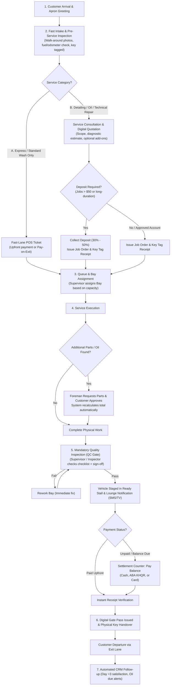
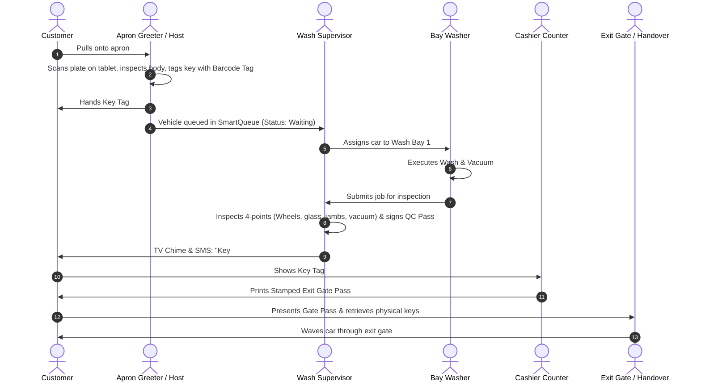
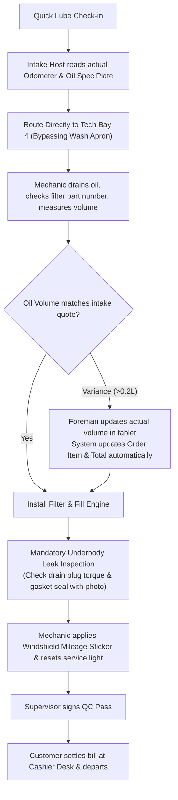
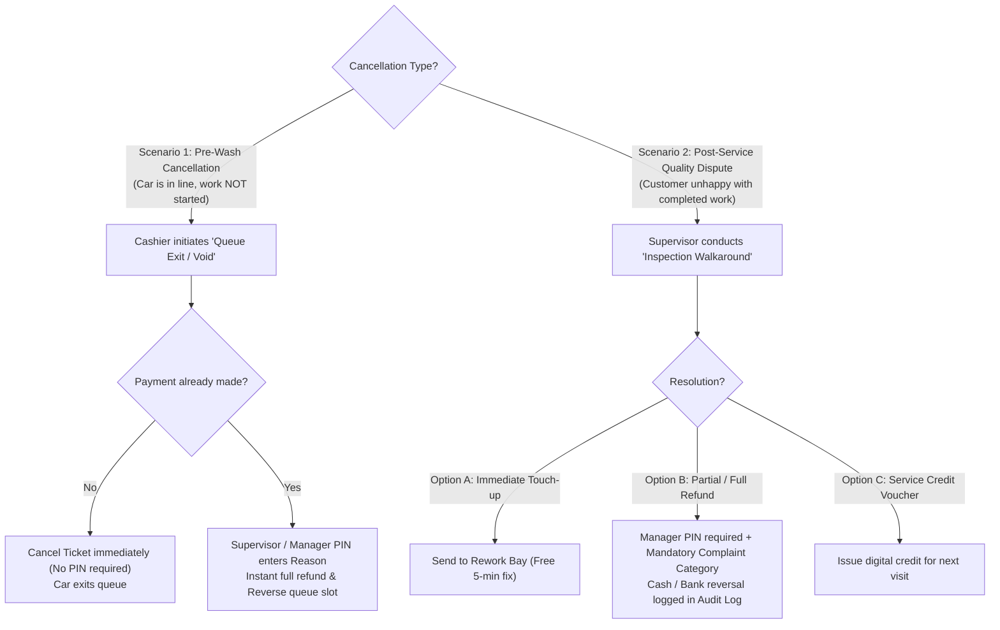

# Current vs. Recommended Operational Workflows

**Document ID:** WRK-FLOW-2026-002  
**Project:** Car-WashService  
**Scope:** Complete Operational Redesign & Process Engineering  
**Date:** November 2026  
**Status:** Complete – Awaiting Boss / Management Approval  

---

## 1. Master Operational Workflow Architecture

The primary weakness of the current system is treating a quick 10-minute motorcycle wash, a 3-hour multi-stage paint correction, and a complex technical engine repair with the exact same rigid linear sequence: `Enter POS -> Pay 100% Upfront -> Wash -> Finish`.

In a professional automotive care center, **the operational sequence must dynamically branch based on the service tier, diagnostic requirements, and payment risk.**

### Recommended Master Lifecycle Flowchart

---

## 2. Comprehensive Service-Specific Workflows

---

### Track 1: Wash Only (Express & Premium Wash)

#### A. Current Process
1. Driver pulls up to window.
2. Cashier enters plate, vehicle type, and basic wash into POS.
3. Customer must pay immediately in full (Cash, or scan KHQR and wait for cashier to snap photo of phone screen).
4. Paper thermal receipt prints. Cashier tells driver: "Put this on your dash."
5. Washer sees car, drives or directs car into Bay 1, washes, dries.
6. Washer taps "Finish Car" on their personal tablet. Order goes to `finished`.
7. Customer gets in car and drives away.

#### B. Identified Problem
- **Apron Congestion:** Forcing every car to stop at the cashier counter and complete banking verification before entering the apron blocks the street entrance.
- **Rushed Quality:** Washers mark their own work finished with zero quality oversight. If wheels or door frames are dirty, the customer discovers it at home.
- **Lost Upsells:** Washers cannot suggest a quick spray wax or windshield water-repellent because the ticket is already locked and paid.

#### C. Recommended Process

* **Business Benefit:** Eliminates intake bottleneck; moves vehicle directly into washing while payment happens flexibly while customer waits in air-conditioned lounge.
* **Complexity:** Medium (requires key tag tokens and mobile greeter tablet).
* **Required Roles:** Apron Greeter, Wash Supervisor, Washer, Cashier, Exit Handover.
* **Dependencies & Risks:** Requires clear physical stalls (`A1`, `A2`, `A3`) to avoid parking mix-ups.

---

### Track 2: Wash & Detailing (Polishing, Interior Deep Clean, Ceramic)

#### A. Current Process
- Handled identically to a regular wash.
- Single order created, washer screen shows "Detailing".
- Bay is blocked for 3 hours while SmartQueue assumes standard 25-minute cycle time, throwing queue estimation completely out of sync.

#### B. Identified Problem
- Detailing requires specialized staging (decontamination wash -> drying -> clay bar -> machine polish -> curing).
- SmartQueue calculates queue wait for standard cars based on bay counts, causing customers waiting for basic washes to see false 3-hour wait times.
- No milestone tracking for customers.

#### C. Recommended Process
1. **Intake & Paint Assessment:** Supervisor and customer walk around car with a digital paint inspection tablet:
   - Mark pre-existing swirl marks, deep scratches, rock chips, and hail dents.
   - Customer signs digital waiver acknowledging existing paint defects.
2. **Deposit & Schedule:** 50% deposit taken at POS. Order placed in dedicated Detailing Bay (not in general wash bays).
3. **Execution Milestones:** Detailing team checks off 3 distinct stages:
   - *Stage 1:* Chemical decontamination & foam pre-wash.
   - *Stage 2:* Paint correction & interior steam sanitization.
   - *Stage 3:* Sealant / Ceramic coating application & curing.
4. **Final Presentation:** Supervisor inspects under inspection spotlights, sprays customer scent preference, and tags vehicle "Ready for Presentation."
5. **Customer Handover:** Customer inspects vehicle with Supervisor, settles remaining 50% balance at POS, and receives warranty/maintenance card.

* **Business Benefit:** Protects shop against $500+ paint defect claims; generates high-ticket detailing trust; prevents detailing jobs from clogging express wash bays.
* **Complexity:** Medium.
* **Required Roles:** General Manager / Detailing Lead, Cashier, Detailer.
* **Dependencies & Risks:** Dedicated detailing bay must have adequate LED lighting.

---

### Track 3: Oil Change Only (Quick Lube Service)

#### A. Current Process
- Cashier enters vehicle type, selects oil package and filter.
- Order is sent to Mechanic screen.
- Mechanic performs oil change, types odometer mileage, marks complete.

#### B. Identified Problem
- If the vehicle's engine requires 4.5 liters of oil, but cashier pre-billed a 4.0-liter jug, the mechanic either pours the extra 0.5L unbilled (shrinkage) or leaves the engine under-filled (mechanical damage risk).
- No underbody leak verification procedure recorded.

#### C. Recommended Process

* **Business Benefit:** Zero unbilled oil leakage; 100% engine protection against loose drain plugs and leaks; automated mileage reminders driven by true cluster mileage.
* **Complexity:** Low.
* **Required Roles:** Mechanic, Stock Controller, Cashier, Supervisor.
* **Dependencies & Risks:** Workshop must have digital torque wrench / torque verification protocol.

---

### Track 4: Mixed Order (Wash Plus Oil Change)

#### A. Current Process
- System flags `orders.is_mixed = 1` and creates two `order_tasks`: Task 1 (Wash) and Task 2 (Oil Change).
- Washer finishes wash; system sets task status to `ready_for_tech`.
- Mechanic receives alert on tablet, takes car into Tech Bay, completes oil change.

#### B. Identified Problem
- **Sequencing Rigidity:** System strictly forces Wash first, then Tech. In hot, rainy weather, if Tech Bay 4 is completely empty while Wash Bays 1–3 have a 45-minute queue, the car sits idling in the wash line, wasting valuable tech bay capacity.
- **Yard Shuffling Hazard:** Moving wet, soapy cars from a wet bay into an automotive lift bay with oily floor tiles causes slip hazards and interior moisture issues.

#### C. Recommended Process
- **Dynamic Routing Decision Engine:**
  - If Wash Bay is open: Route to Wash Bay first (Standard Flow).
  - If Wash Bay has > 2 cars waiting AND Tech Bay is idle: **Route to Tech Bay FIRST.** Perform oil drain, filter replacement, and underbody checks on the dry car; then drive vehicle directly into Wash Bay for final cleaning, engine bay rinse, and interior vacuum.
- **Formal Inter-Bay Handover:**
  - Washer/Mechanic taps "Transfer Vehicle" with target bay stall.
  - Receiving technician verifies receipt of physical keys and signs off.
- **Unified Billing Recalculation:** Wash services and workshop parts/labor roll up dynamically into a single master checkout ticket.

* **Business Benefit:** Increases bay throughput by 30% during peak hours by eliminating idle lift time.
* **Complexity:** High (requires multi-task sequence flexibility in `BayManager.php`).
* **Required Roles:** Wash Supervisor, Lead Mechanic, Washers, Cashier.
* **Dependencies & Risks:** Requires mechanics to protect steering wheel and floor with disposable covers if servicing before wash.

---

### Track 5: Technical Repair & Diagnostics

#### A. Current Process
- Handled through same generic order form.
- Parts requests created in `core/TechnicalManager.php`, but approval is buried in Owner screen and does not recalculate order total.

#### B. Identified Problem
- High-ticket mechanical repairs (brake replacement, suspension bushings, AC servicing) require formal written quotes, customer authorization, parts procurement, and post-repair road testing.
- Customers dispute labor rates if not authorized upfront.

#### C. Recommended Process
1. **Diagnostic Work Order:** Vehicle checked in under "Diagnostic / Inspection". Intake fee fixed (e.g. $10, refundable if repair approved).
2. **Digital Inspection & Parts Estimate:**
   - Technician fills out digital checklist with photos/videos of defective components (e.g., worn brake pads at 1.5mm, leaking shock absorber).
   - Stock Controller adds required part numbers and labor hours.
   - System calculates estimated total.
3. **Customer Approval Gate:**
   - Cashier or CRM Coordinator reviews estimate with customer in lounge (or sends digital authorization link via Telegram).
   - Customer clicks "Approve Repair" or signs tablet.
4. **Fulfillment & Repair:**
   - Stock Controller approves and issues parts to mechanic.
   - Parts cost and labor automatically update the order total in real time.
5. **Quality & Road Test Sign-off:** Lead Technician conducts verification road test and signs off safety checklist.
6. **Final Settlement & Warranty Handover:** Customer receives itemized invoice showing old parts replaced, manufacturer warranty, and next checkup date.

* **Business Benefit:** Eliminates customer bill disputes; guarantees all parts issued are billed; creates high-margin repair revenue.
* **Complexity:** High.
* **Required Roles:** Lead Mechanic, Stock Controller, General Manager, Cashier.
* **Dependencies & Risks:** Workshop must retain replaced parts for customer inspection if requested.

---

### Track 6: Product / Retail Counter Sales (Walk-In Customer)

#### A. Current Process
- Handled through POS screen. Cashier must enter a license plate number even if a pedestrian walks in just to buy a cold beverage, microfiber towel, or bottle of windshield washer fluid.

#### B. Identified Problem
- Cashiers are forced to type fake plate numbers (e.g., `NONE`, `GUEST`, `0000`) just to sell a $1.00 bottle of water.
- Clutters vehicle database and skews average wash ticket metrics.

#### C. Recommended Process
- **Dedicated POS "Counter Sale" Mode:**
  - Selecting "Retail Sale / Walk-in" disables vehicle plate, type, and bay assignment requirements.
  - Cashier scans barcode or taps product icon.
  - Instant Cash / KHQR payment.
  - Receipt prints instantly without queue number or dashboard tag.
  - Stock decrements immediately from retail shelf inventory.

* **Business Benefit:** Blazing-fast counter transactions (< 5 seconds); clean vehicle analytics; accurate merchandise inventory.
* **Complexity:** Low.
* **Required Roles:** Cashier.
* **Dependencies & Risks:** Must maintain distinct retail inventory shelf separate from workshop spare parts.

---

### Track 7: Scheduled Appointments vs. Walk-In Customers

#### A. Current Process
- Appointments created in `/appointments`.
- If customer arrives within +/- 10 mins: Priority `P0` (VIP).
- If customer arrives > 10 mins late: Demoted to `P3` (Walk-in).

#### B. Identified Problem
- Traffic jams cause customers to arrive 12–15 minutes late. Dropping them behind 5 walk-in cars causes immediate anger and brand damage.
- Walk-in customers waiting on the apron feel resentful when an appointment car cuts directly ahead of them without explanation.

#### C. Recommended Process
- **Grace Period & Intelligent Re-Slotting:**
  - **Grace Period Extension:** 20-minute arrival window before priority demotion.
  - **Automated SMS Arrival Prompt:** At T-30 minutes, system sends automated message: *"Please confirm you are on your way for your 2:00 PM appointment at CarWash Pro."*
  - **Late Arrival Soft-Slotting:** If arriving between 20–40 minutes late, customer is assigned `P1 (Next Available Bay)` rather than lowest walk-in tier (`P3`). They do not bump an active wash, but take priority over unassigned walk-ins.
- **Physical Priority Lane:** Apron has a designated "Appointment / VIP Lane" so appointment vehicles do not get trapped in single-file walk-in queues.

* **Business Benefit:** Protects VIP relationships while maintaining orderly queue discipline.
* **Complexity:** Medium.
* **Required Roles:** CRM Coordinator, Apron Greeter, Wash Supervisor.
* **Dependencies & Risks:** Physical apron geometry must accommodate at least two incoming lanes.

---

### Track 8: Refunds & Order Cancellations

#### A. Current Process
- Strict Manager PIN required.
- Offline refunds completely blocked.
- Cancellation reverses commissions and loyalty points.

#### B. Identified Problem
- If the wait time unexpectedly surges to 60 minutes and a prepaid customer cannot wait, blocking offline refunds during network hiccups forces angry confrontation.
- No distinction between a pre-service cancellation (work hasn't started) and a post-service complaint (poor wash quality).

#### C. Recommended Process
- **Two Distinct Scenarios:**

- **Offline Refund Fallback Protocol:**
  - If offline, system permits Manager PIN override using a pre-printed, serial-numbered physical "Emergency Refund Slip."
  - Outgoing cash is disbursed from emergency float; cashier logs slip number.
  - When connection is restored, system prompts for slip reconciliation.

* **Business Benefit:** Protects customer goodwill; provides clear operational protocol for line dropouts; stops fraud with physical serial-controlled slips during outages.
* **Complexity:** Medium.
* **Required Roles:** Cashier, Wash Supervisor, General Manager.
* **Dependencies & Risks:** Cash drawer float must have sufficient physical currency for refunds.

---

### Track 9: Stock Shortages & Material Replenishment

#### A. Current Process
- Zero-stock blocks POS sale unless Manager PIN is keyed in.
- Mechanic can request parts from workshop view.

#### B. Identified Problem
- Cashiers repeatedly call managers to type PINs for everyday products (air fresheners, microfibers) whose physical stock was received in the morning but not yet keyed into the inventory system.
- Shuts down retail upselling.

#### C. Recommended Process
- **Buffer Stock & Warning Thresholds:**
  - Instead of a hard sales block at stock = 0, system implements:
    - *Warning State (Stock <= Min Threshold):* Alert cashier on screen: `"Low Stock (3 remaining). Please verify shelf."` Sale proceeds without PIN.
    - *Zero-Stock Sale:* Cashier can mark as `"Urgent Stock Sale (Pending Physical Verification)"`. System allows sale, flags item for warehouse audit, and alerts Stock Controller to update invoice receipt within 2 hours.
- **Auto-Replenishment Triggers:** When bulk shampoo or engine oil barrels hit 20% capacity, system automatically generates a purchase requisition for the General Manager.

* **Business Benefit:** Eliminates checkout slowdowns; keeps sales moving while maintaining inventory integrity.
* **Complexity:** Low to Medium.
* **Required Roles:** Cashier, Stock Controller, General Manager.
* **Dependencies & Risks:** Daily evening cycle counts must be enforced to resolve pending stock flags.

---

### Track 10: Offline / Blackout Operations (Disaster Recovery)

#### A. Current Process
- Local SQLite/MariaDB allows offline order entry.
- Paper recovery forms can be entered via `bulk_entry.php` upon restoration.
- Offline refunds strictly blocked.

#### B. Identified Problem
- When internet drops, cashiers do not know whether credit cards or KHQR scans went through.
- When power completely cuts out (generator startup gap), manual paper tickets are written haphazardly without queue numbers, leading to bay arguments.

#### C. Recommended Process
1. **Pre-Printed Triplicate Job Ticket Books:**
   - Every workstation has sequentially numbered paper ticket pads (`BOOK-A-0001` to `BOOK-A-1000`).
   - Copy 1: Dashboard / Bay Ticket (Handed to washer).
   - Copy 2: Customer Key Claim Receipt (Handed to customer).
   - Copy 3: Cashier Audit Stub (Stays in register drawer with cash).
2. **Static Standby KHQR Display:**
   - Counter features a laminated, static merchant Bakong KHQR code linked to shop bank account.
   - Customer scans static QR and types amount. Cashier checks bank SMS/push notification on dedicated shop mobile phone.
3. **Reconciliation Batch Upload:**
   - Once power/network returns, Cashier opens `views/recovery/bulk_entry.php`.
   - Types slip number, plate, service, and amount.
   - System validates that paper slip serial numbers match the physical book issued to that shift.

* **Business Benefit:** Shop continues washing cars and collecting revenue even during catastrophic fiber cuts or blackouts with zero data loss.
* **Complexity:** Low.
* **Required Roles:** Cashier, Shift Supervisor, General Manager.
* **Dependencies & Risks:** Physical triplicate books must be audited daily by management.

---

## 3. Workflow Comparison Summary

| Workflow Step | Current System Process | Recommended Operational Process | Business Impact |
| :--- | :--- | :--- | :--- |
| **Intake Greeting** | Customer walks to cashier desk. Vehicle idles unattended. | Apron Host greets driver at window, performs 30-second walkaround inspection, attaches Key Tag Barcode. | Professional customer reception; prevents damage liability. |
| **Service Selection** | Cashier types plate, selects items on POS. | Fast-Lane for wash; Digital Quotation & Customer Sign-off for detailing/mechanic. | Higher ticket size; eliminates customer repair disputes. |
| **Payment Timing** | 100% upfront payment before car enters bay. | **Hybrid:** Express wash = Pay upfront or exit; Detailing/Repair = Deposit upfront, settle balance at exit. | Unblocks service flow; accommodates additional parts/oil. |
| **Bay Assignment** | Washer or Cashier clicks buttons manually. Washers cherry-pick cars. | Wash Supervisor assigns bay based on real-time bay readiness and crew balancing. | Eliminates worker cherry-picking; maximizes bay utilization. |
| **Parts Approval** | Owner approves in back-office. Total bill never updates ($0 leak). | Stock Controller approves on workshop tablet; Order total updates in real time. | **Plugs massive financial inventory leak.** |
| **Quality Control** | Washer clicks "Finish" with zero inspection. | Dedicated Supervisor 4-point physical QC inspection before TV/SMS notification. | Eliminates re-wash complaints and dirty customer pickups. |
| **Vehicle Handover** | Keys left in car or open counter. Informal exit. | Key retrieved via Key Tag Token at cashier; Gate Pass verified at exit gate. | Prevents vehicle theft, unpaid drive-offs, and damage disputes. |
