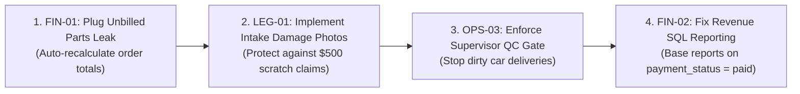

# Operational Risk Register & Risk Mitigation Matrix

**Document ID:** RSK-REG-2026-004  
**Project:** Car-WashService  
**Scope:** Comprehensive Threat Modeling, Fraud Prevention, Financial Vulnerabilities, and Operational Controls  
**Date:** November 2026  
**Status:** Complete – Awaiting Boss / Management Review  

---

## 1. Risk Scoring Methodology

All risks are evaluated using standard enterprise risk scoring:
* **Likelihood Score (L):** 1 (Low / Rare), 2 (Medium / Occasional), 3 (High / Frequent)
* **Impact Score (I):** 1 (Minor / Inconvenience), 2 (Moderate / Financial Loss), 3 (Severe / Critical Business Threat)
* **Risk Score:** **L × I** (1–2 = Low Risk [Green], 3–4 = Medium Risk [Yellow], 6–9 = High / Critical Risk [Red])

```
                     IMPACT (Severity)
                1 (Minor)  2 (Moderate)  3 (Severe)
LIKELIHOOD  3 (High)      3 [Med]    6 [High]      9 [Critical]
            2 (Medium)    2 [Low]    4 [Med]       6 [High]
            1 (Low)       1 [Low]    2 [Low]       3 [Med]
```

---

## 2. Comprehensive Operational Risk Register

| Risk ID | Risk Category | Risk Description | Root Cause in Current Code / Process | L | I | Score | Mitigation Strategy & Preventive Action | Monitoring Control & Audit Mechanism | Risk Owner |
| :---: | :--- | :--- | :--- | :---: | :---: | :---: | :--- | :--- | :--- |
| **FIN-01** | **Financial** | **Unbilled Parts & Oil Leakage** | `core/TechnicalManager.php` lines 587–591: Parts approved are added to `order_items` and deducted from inventory, but `orders.total_usd` is never updated. | 3 | 3 | **9 [Crit]** | **Immediate Code Fix:** Auto-recalculate `subtotal_usd`, `total_usd`, and `total_khr` whenever a parts request is approved. Enforce order recalculation before checkout. | Daily discrepancy report comparing total approved parts value against total parts revenue billed. | General Manager & Stock Controller |
| **FIN-02** | **Financial** | **Reporting Omission of Paid Finished Orders** | `views/owner/reports.php` line 75: Gross sales query strictly filters `WHERE o.status = 'paid'`, omitting orders with `status = 'finished'` and `payment_status = 'paid'`. | 3 | 3 | **9 [Crit]** | **Code Fix:** Update all revenue reporting queries to filter by financial status (`WHERE o.payment_status = 'paid'`) rather than operational bay status (`status`). | Daily reconciliation between POS register drawer cash counts and dashboard gross revenue reports. | Business Owner |
| **FIN-03** | **Financial** | **Cash Drawer Float Theft / Pilferage** | Cashiers can perform `open_drawer_no_sale` or collect cash without printing immediate receipts. | 2 | 3 | **6 [High]** | Enforce "No Receipt, No Wash" rule with customer display; enforce unannounced mid-shift drawer spot audits via `CashierControl::conductSpotAudit()`. | Spot audit variance log in `audit_logs`; video camera directed at cash drawer register. | General Manager |
| **FIN-04** | **Financial** | **Manager PIN Abuse for Unauthorized Discounts** | Cashiers memorize or borrow Manager PIN to apply discounts for friends or pocket cash difference. | 2 | 2 | **4 [Med]** | Implement temporary rolling PINs, NFC manager swipe cards, or biometric/fingerprint auth for discounts > $3. Log manager ID and cashier ID in every discount audit entry. | Weekly report of discounts granted by cashier ID; alert on cashiers with > 5% discount frequency. | General Manager |
| **FIN-05** | **Financial** | **Forged or Reused Bank Transfer Slips** | Cashiers accept forged ABA mobile confirmation screenshots without checking merchant soundbox or bank API. | 2 | 2 | **4 [Med]** | Mandate ABA Merchant Soundbox audio confirmation or dynamic Bakong KHQR webhook integration; replace camera photo upload with automatic transaction hash match. | Daily cross-reference of bank statement credit entries against total recorded ABA/KHQR POS orders. | Cashier & Owner |
| **LEG-01** | **Legal / Liability** | **False Customer Damage Claims (Scratches/Dents)** | No pre-service intake condition inspection in code or physical procedure. | 3 | 3 | **9 [Crit]** | **Mandatory Intake Triage:** Host captures 4 quick photos (front, rear, left, right) on tablet upon vehicle arrival; customer signs digital intake waiver acknowledging preexisting flaws. | Intake photo gallery attached to order record; must be completed before bay assignment is unlocked. | CRM Host & Wash Supervisor |
| **LEG-02** | **Legal / Liability** | **Missing Customer Property / Valuables in Vehicle** | Customer leaves sunglasses, cash, or electronics in vehicle; accuses wash crew of theft. | 2 | 3 | **6 [High]** | Intake Host verbally reminds customer: *"Please remove all cash and valuables."* Prominent signage on apron; dashboard placard placed inside: *"Valuables Checked by Owner."* | Valuables disclaimer printed on customer key tag claim stub; random worker bag checks at shift close. | General Manager |
| **LEG-03** | **Legal / Liability** | **Yard Accidents & Customer Vehicle Collisions** | Untrained wash staff driving high-horsepower or manual transmission customer vehicles around crowded yard. | 2 | 3 | **6 [High]** | Only certified "Yard Drivers" (Supervisors and Mechanics) with valid commercial driver licenses are permitted to start and move customer vehicles. Washers strictly prohibited from driving. | Driver authorization badge check; 5 km/h yard speed limit; mirrors and lane markings installed. | Wash Supervisor |
| **OPS-01** | **Operational** | **Apron Gridlock Due to Mandatory Bank Slip Photos** | `api/pos/index.php` lines 2028–2058 forces webcam photo upload for every ABA/KHQR payment at the front gate. | 3 | 2 | **6 [High]** | Move payment settlement from front apron to air-conditioned waiting lounge counter; allow customer to pay while car is already being washed. | Average intake duration KPI (target: < 45 seconds per vehicle). | Wash Supervisor & Cashier |
| **OPS-02** | **Operational** | **Washer Cherry-Picking & Unfair Commission Disputes** | Washers self-assign easy cars from `views/washer/jobs.php`, avoiding heavily soiled trucks. | 3 | 2 | **6 [High]** | Strip washer self-assignment permissions (`bays.assign`); bay allocation strictly controlled by Wash Supervisor or automated round-robin engine. | Daily commission distribution audit across all washer IDs; alert on > 20% variance between washers. | Wash Supervisor |
| **OPS-03** | **Operational** | **Quality Failure & Rework Customer Backlash** | Washers mark cars finished directly with zero independent inspection (`views/washer/jobs.php` line 69). | 3 | 2 | **6 [High]** | **Independent QC Gate:** Only Wash Supervisor can mark order `finished` after physically validating the 4-Point Checklist on tablet. | Monthly rework rate metric (% of vehicles returned for secondary cleaning). | Wash Supervisor |
| **OPS-04** | **Operational** | **Vehicle Release Without Payment or Gate Pass** | No vehicle key tracking or gate pass exit verification in code. | 2 | 3 | **6 [High]** | Secure Key Box behind counter; keys only released upon scanning paid Gate Pass; physical barrier arm at driveway exit manned by guard. | Daily audit of exit passes collected by guard vs paid orders in POS. | Cashier & Exit Guard |
| **INV-01** | **Inventory** | **Bulk Chemical & Shampoo Pilferage / Dilution** | Car wash chemicals (foaming soap, wheel acid, tire shine) are not metered or tracked per wash. | 3 | 2 | **6 [High]** | Implement chemical dilution dispensing stations (locked metering pumps); track chemical spend per vehicle ($/vehicle target: $0.35–$0.50). | Weekly physical measurement of chemical drum levels compared against total vehicle count washed. | Stock Controller |
| **INV-02** | **Inventory** | **Engine Oil Drum Volume Variance** | Bulk engine oil dispensed from 200L drums without calibrated digital oil meters. | 2 | 2 | **4 [Med]** | Mandate digital preset metering nozzles on oil dispensing reels; mechanic records exact dispensed volume (e.g. 4.3L) into tablet. | Monthly drum dipstick measurement reconciled against sum of all `oil_change_logs.actual_oil_used`. | Lead Mechanic & Stock Controller |
| **INV-03** | **Inventory** | **Zero-Stock Sales Freezing the POS Counter** | Hard sales block when stock = 0 forces cashiers to hunt for managers during busy rushes. | 3 | 1 | **3 [Med]** | Replace hard block with "Urgent Stock Warning"; allow sale to proceed and flag item for reconciliation within 2 hours. | Number of zero-stock overrides flagged daily; evening warehouse reconciliation. | Cashier & Stock Controller |
| **IT-01** | **IT / Connectivity** | **Internet Fiber Outage Halting POS Operations** | Cloud sync and KHQR dynamic generation fail when internet drops. | 2 | 2 | **4 [Med]** | Deploy Local Mini PC Server (XAMPP / MariaDB LAN architecture) so POS runs 100% offline; deploy Static Laminated KHQR at counter for payments. | Daily CloudSync health ping; automated local database backup every 6 hours to USB drive. | General Manager |
| **IT-02** | **IT / Connectivity** | **Offline Refund Deadlock During Customer Disputes** | `core/CashierControl.php` line 673 hard-blocks refunds when offline, provoking customer confrontations. | 2 | 2 | **4 [Med]** | Create pre-printed, serial-numbered physical "Emergency Refund Voucher" books; Manager PIN allows physical payout with reconciliation upon re-connection. | Physical emergency voucher count matched against `audit_logs` upon internet restoration. | General Manager |

---

## 3. High-Priority Action Plan for Management

The top four critical risks requiring immediate operational and policy intervention are:



1. **Immediate Code Remediation (FIN-01 & FIN-02):** Fix parts billing recalculation and correct SQL revenue queries to use `o.payment_status = 'paid'`.
2. **Physical Asset Deployment (LEG-01 & OPS-04):** Deploy 2 rugged tablets for Apron Intake photos and install a Secure Key Safe Box behind the cashier desk.
3. **Operational Protocol Enforcement (OPS-02 & OPS-03):** Remove washer self-assignment permissions and make Supervisor QC sign-off mandatory before customer notification.
