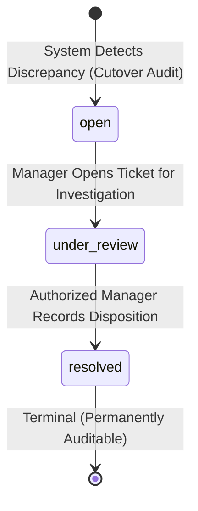
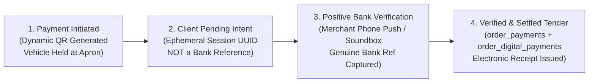

# POS Business Rules – Executive Decisions & Technical Design Registry

**Document ID:** POS-OQ-2026-FINAL
**Project:** Car-WashService
**Scope:** Confirmed Executive Decisions, Source Harmonization, Phase 1 Technical Design Specifications, Unresolved Dependencies
**Date:** November 8, 2026 (Updated - Round 15 Final Closure)
**Status:** Executive Decisions Confirmed by Business Owner – Technical Design & Dependencies Documented for Engineering Planning (Awaiting Separate Executive Authorization)

---

## Executive Confirmation Summary (November 8, 2026)

On November 8, 2026, the business owner formally reviewed and confirmed all six core operational business decisions required to finalize the Car-WashService Point-of-Sale (POS) counter workflow.

All six business policy questions are now **CLOSED** as executive policy. These confirmed decisions are distinct from subsequent technical implementation proposals and unresolved technical dependencies, which remain subject to separate executive authorization prior to implementation.

| # | Operational Domain | Confirmed Executive Decision (November 8, 2026) | Operational & Technical Impact | Policy vs. Technical Status |
| :-: | :--- | :--- | :--- | :--- |
| **1** | **Mixed Services Sequencing** | **Lift First $\rightarrow$ Wash Second** | Vehicles requiring both mechanical lube work and car wash undergo Bay 4 lift work first, followed by wash/dry, ensuring a clean vehicle at customer handover. | **Approved Executive Policy** |
| **2** | **Receipt Printing Gate** | **Advisory Printing (Electronic Gate)** | Electronic receipt issuance (`receipt_issued_at`) and confirmed payment (`payment_status = 'paid'`) are the sole service gate pass. Thermal printer paper jams never block service. | **Approved Executive Policy** (Any physical-printing gate is an unapproved proposal) |
| **3** | **Walk-In Identity & Schema** | **Default to `'Walk-in Guest'`** | Retains existing `customer_name VARCHAR(100) NOT NULL` in MariaDB schema without high-risk `ALTER TABLE`. Plate and vehicle category captured via existing cashier flow. | **Approved Executive Policy** |
| **4** | **Historical Orders Reconciliation** | **Preserve Intact + Exceptions Tab** | Original records are preserved untouched (no blanket overwrites). A dedicated **"Historical Unreconciled Exceptions"** tab is added to owner reports for manual review. | **Approved Executive Policy** (Accounting limits documented in UTD-1) |
| **5** | **KHQR Verification Channel** | **Store Counter Phone + Soundbox** | POS counter operates 100% on local LAN using store counter phone notifications and soundbox. No public static IP or bank webhook onboarding in initial scope. | **Approved Executive Policy** (Two-table schema & provisional format in UTD-4) |
| **6** | **Financial Reporting Separation** | **Net Settled Revenue $\ne$ Net Operating Profit** | Reports strictly distinguish **Net Settled Revenue** (Cash tender inflow minus settled refunds) from **Net Operating Profit**. Missing COGS flagged, never assumed $0.00. | **Approved Executive Policy** (Timestamps & fallbacks documented in UTD-2 & UTD-1) |

---

## Detailed Confirmed Decisions & Harmonization

### Decision 1: Mixed Services Sequencing (Option Lettering Clarification)

#### Clarification of Option Lettering:
In earlier audit drafts, a lettering ambiguity arose where Option A was described in one document as the existing PHP code behavior (*Wash First $\rightarrow$ Lube Second*) and in another draft as the newly recommended design (*Lift First $\rightarrow$ Wash Second*).

**The owner's decision is definitive and absolute regardless of historical letter labeling:**
* **Confirmed Standard:** **Lift First $\rightarrow$ Wash Second (Bay 4 Mechanical Lift First $\rightarrow$ Bay 1/2 Wash & Dry Second)**.

#### Technical Harmonization:
* **Current PHP Source (`core/BayManager.php:503-509`, line 917):**
  Currently hardcodes:
  ```php
  // Task 1: Wash (Step 1)
  $insTask->execute([$orderId, 'wash', 'Exterior & Interior Wash (Step 1)', 1, 'waiting']);
  // Task 2: Oil Change (Step 2)
  $insTask->execute([$orderId, 'oil_change', 'Engine Oil Change & Inspection (Step 2)', 2, 'pending_prereq']);
  ```
  And line 917 asserts: `"Sequence Rule: Step 1 (Car Wash) must be finished before Step 2 (Oil Change) can begin."`
* **Implementation Requirement (Work Package WP-2):**
  Refactor `ensureOrderTasks()` and `assignCarToBay()` in [BayManager.php](core/BayManager.php) so that when an order contains both mechanical items (`item_type = 'service'` / mechanical) and wash packages (`item_type = 'package'` / wash):
  - Task 1 (Step 1): Mechanical Lift Service (Bay 4) $\rightarrow$ Initial state: `'waiting'` / active.
  - Task 2 (Step 2): Exterior Wash & Detailing (Bay 1 or 2) $\rightarrow$ Initial state: `'pending_prereq'`.
  - Wash bay reservation for Step 2 is deferred until Step 1 reaches `'completed'`, preventing empty wash bays from sitting idle during long mechanical inspections.

---

### Decision 2: Receipt Printing Service Gate Policy

#### The Decision:
* **Physical thermal paper printing is advisory.**
* The mandatory service admission gate ([OrderGate.php](core/OrderGate.php)) requires confirmed payment (`payment_status = 'paid'`) and electronic receipt issuance (`receipt_issued_at IS NOT NULL`).
* Physical thermal printer failures (paper out, head open, cutter jam, USB disconnect) display an advisory toast on the cashier UI and log an event, but **must never block vehicle admission into the wash apron**.
* **Strict Policy Boundary:** An optional `require_receipt_before_wash` setting is **not an approved policy**. Any physical printing blockade is an **unapproved proposal requiring a separate owner decision**. The confirmed operational policy is that electronic receipt issuance alone gates service.

#### Technical Harmonization:
* Refactor [OrderGate.php](core/OrderGate.php):
  ```php
  public static function assertServiceAdmissionAllowed(int $orderId): bool {
      // 1. Payment must be confirmed (payment_status = 'paid')
      // 2. Electronic receipt must be issued (receipt_issued_at IS NOT NULL)
      // 3. Physical paper printing is advisory and NOT required for service admission
  }
  ```
* Physical receipt reprint remains completely read-only (`GET /api/pos/index.php?action=print_receipt`), performs zero database writes, and marks the slip with `*** DUPLICATE RECEIPT ***`.

---

### Decision 3: Walk-In Customer Identity & Schema Integrity

#### The Decision:
* Preserve database schema integrity without modifying table structures:
  `orders.customer_name VARCHAR(100) NOT NULL` (as defined in [init.php](database/init.php#L251)).
* When a customer declines to register or provide personal information, the cashier enters only the license plate and vehicle type; the application automatically records `'Walk-in Guest'` as `customer_name`.
* No mandatory customer phone, vehicle VIN, or unapproved database-level constraints are added. Vehicle category selection (`small_car`, `suv_pickup`, `van_truck`, `motorbike`) is captured per existing cashier flow to calculate correct package pricing.

---

### Decision 4: Historical Unreconciled Orders Migration Policy

#### The Decision:
* Original historical records must be preserved intact. No automated script may bulk-overwrite ambiguous records (e.g., historical orders with `status = 'paid'` but `cancelled_at IS NOT NULL`, or orders with `status = 'finished'` and `payment_status = 'unpaid'`).
* Financial reports in [reports.php](views/owner/reports.php) will incorporate a dedicated **"Historical Unreconciled Exceptions"** review tab.
* This tab isolates pre-cutover tickets that have conflicting operational and financial timestamps for owner inspection and manual write-off authorization, preventing historical test data from distorting active ledger reporting.

---

### Decision 5: KHQR Verification Channel & Local LAN Self-Sufficiency

#### The Decision:
* KHQR payment verification relies on the store's counter merchant devices:
  1. The business's official merchant smartphone bank push notification / SMS alert.
  2. The counter IoT soundbox audible chime (*"Received $XX.XX via KHQR"*).
* No commercial bank webhook onboarding, public static IP, external SSL domain, or cloud callback relays are required in the initial release scope.
* The local POS terminal maintains 100% LAN self-sufficiency.

---

### Decision 6: Financial Reporting Terminology & Cost Transparency

#### The Decision:
* Explicitly separate cash flow metrics from true business profitability:
  1. **Net Settled Revenue:** Gross Confirmed Payments minus Settled Refunds (`disbursed_at` or `settled_at`). Represents actual tender collected and retained in the drawer and merchant bank account.
  2. **Net Operating Profit:** Net Settled Revenue minus (Recorded COGS + Washer Commissions + Mechanic Commissions + Facility Expenses).
* **Missing Cost Rule:** If services or parts lack cost tracking in the legacy database, Net Operating Profit **must not assume $0.00 COGS**. Instead, the report must display an **"Untracked Cost Alert"** indicating the count and volume of items with unrecorded COGS.

---

## Phase 1 Technical Design & Unresolved Technical Dependencies

While executive business decisions are confirmed, several technical design areas cannot be finalized from the existing source schema alone and are registered as **Unresolved Technical Dependencies (UTD)**.

```
+-------------------------------------------------------------------------------+
|                      EXECUTIVE BUSINESS POLICIES (CLOSED)                     |
|  - Mixed Sequencing: Lift First -> Wash Second                                |
|  - Receipt Gate: Electronic issuance only (paper advisory)                    |
|  - Walk-In Identity: Default 'Walk-in Guest', preserve schema                 |
|  - Historical Data: Preserve intact + Exceptions Tab                          |
|  - KHQR Channel: Merchant counter phone + soundbox on local LAN               |
|  - Financial Separation: Net Settled Revenue != Net Operating Profit          |
+-------------------------------------------------------------------------------+
                                      |
                                      v
+-------------------------------------------------------------------------------+
|                 UNRESOLVED TECHNICAL DESIGN DEPENDENCIES (OPEN)               |
|  - UTD-1: Historical split-payment accounting, pseudocode & exception lifecycle|
|  - UTD-2: Reporting timestamp definitions & schema availability               |
|  - UTD-3: Bank reversal state machine, timeout safety & unapproved waits      |
|  - UTD-4: Two-table digital schema, restrictive deletion & pending KHQR lifecycle |
+-------------------------------------------------------------------------------+
```

---

### UTD-1: Historical Split-Payment Accounting, Pseudocode & Exception Lifecycle

#### Accounting Concepts & Distinctions:
To avoid conflating distinct accounting concepts, financial specifications must strictly differentiate:
1. **Cash Received:** Physical banknotes collected at the till or digital transfers confirmed on merchant bank devices.
2. **Revenue Earned:** Value recognized when vehicle washing or mechanical service is completed.
3. **Accounting-Period Recognition:** Recognition of confirmed monetary inflow and outflow strictly within a bounded reporting window `[:start_timestamp, :end_timestamp)`.
4. **Historical Order Total (`orders.total_usd`):** The static order price stored in the legacy table ([init.php](database/init.php#L260)).
5. **Amount Historically Recognized as Paid:** Verified only for unconflicted pre-cutover orders where `payment_status = 'paid'`, `cancelled_at IS NULL`, and zero subsequent ledger rows exist.
6. **Subsequent Ledger Payments (`order_payments.amount_usd`):** Discrete payments recorded after cutover.
7. **Remaining Unreconciled Amount:** Ambiguous balances that cannot be verified from source fields without manual audit.

#### Elimination of Contradictory Logic:
Earlier pseudocode drafts contained a contradictory `AND NOT EXISTS (SELECT 1 FROM order_payments op WHERE op.order_id = o.id)` clause that silently excluded an entire historical order from pre-cutover reports whenever any subsequent ledger payment existed. **This contradictory clause has been completely removed.** No order is ever silently omitted from financial visibility because a subsequent payment or refund occurred.

#### Binding Accounting Rules for Historical Orders:
1. **Strict Accounting Distinctions:**
   - **Historical Order Total (`orders.total_usd`):** The static order price stored in the legacy table ([init.php](database/init.php#L260)).
   - **Historically Verified Payment Amount:** Verifiable only for unconflicted pre-cutover orders where `payment_status = 'paid'`, `cancelled_at IS NULL`, and zero subsequent ledger rows exist.
   - **Post-Cutover Ledger Payments (`order_payments.amount_usd`):** Discrete, immutable payments recorded in the new transaction ledger with known event timestamps.
   - **Refunds & Disbursement Periods (`order_refunds.disbursed_at` / `settled_at`):** Outflows recognized strictly in the period when currency physically departed or bank settlement cleared.
   - **Unreconciled Historical Amount:** Ambiguous historical balances that cannot be verified from legacy fields without manual audit.
2. **Never Automatically Add:** A subsequent ledger payment must **never** be automatically added to the full historical order total. If an order had `total_usd = $50.00` and receives a post-cutover payment of `$20.00`, adding them to report `$70.00` would double-count revenue if the `$20.00` was merely the customer paying off a remaining balance.
3. **Never Silently Exclude:** A historical order must **never** be silently excluded from reporting or exception logs simply because a subsequent ledger payment exists.
4. **Never Assume Total Equals Cash Paid:** In the legacy schema, `orders.total_usd` represents the order price, not an immutable ledger of cash collected. When subsequent payments occur, `orders.total_usd` cannot be assumed to equal the amount actually received historically.
5. **No Invented Allocation Formulas:** The system must not guess whether subsequent payments are installments, add-ons, or overpayments. Fabricating an allocation formula is strictly prohibited.
6. **Classification as Reconciliation Exception:** If the available schema cannot mathematically calculate a confirmed historical payment amount, the affected order is classified as a **Historical Reconciliation Exception** under audit rather than fabricating a financial result.
7. **Separation of Confirmed Totals from Unreconciled Exceptions:**
   - In period financial reports, only **confirmed** amounts are added to Net Settled Revenue.
   - Historical orders with indeterminate allocation are visibly displayed in the report's **Period Historical Reconciliation Exceptions** section with their historical order total reported under audit.
   - They are **never silently included in confirmed historical revenue** (preventing double-counting) and **never treated as zero** (preventing omission).

#### Realistic Historical Scenarios:

##### Example 1: Historical Order with No Later Payment (Unconflicted)
* **Preconditions:** Order #101 created `2026-10-15 10:00:00`, `paid_at = '2026-10-15 10:02:00'`, `total_usd = 25.00`, `payment_status = 'paid'`, `cancelled_at IS NULL`. Zero rows in `order_payments` or `order_refunds`.
* **October 2026 Period Report:** Evaluated as unconflicted. Confirmed Historical Payment = +$25.00. Settled Refunds = $0.00. Net Settled Revenue = +$25.00. Zero exceptions.
* **November 2026 Period Report:** Excluded by period boundary ($0.00).
* **Audit Result:** 100% confirmed; zero exceptions.

##### Example 2: Historical Order with One Later Partial Payment (Split Payment)
* **Preconditions:** Order #102 created `2026-10-20 14:00:00`, `paid_at = '2026-10-20 14:05:00'`, `total_usd = 50.00`, `payment_status = 'paid'`, `cancelled_at IS NULL`. Cutover occurs on November 1. On November 10, an additional payment of $20.00 is recorded in `order_payments` (`recorded_at = '2026-11-10 09:00:00'`).
* **Source Limitation Analysis:** The legacy database lacks a transaction ledger. The source data **cannot establish whether the $20.00 is part of the $50.00 (balance payment) or additional to it (upsell/add-on)**.
* **November 2026 Period Report:** Confirmed Ledger Payment = +$20.00 (from `order_payments`).
* **October 2026 Period Report:**
  - Order #102 is **NOT** omitted from the report.
  - The historical $50.00 is **not** added to October Confirmed Revenue (prevents potential $20 double-counting).
  - The historical $50.00 is **not** treated as $0.00 (prevents silent loss of historical visibility).
  - Order #102 is displayed in the October report under **Period Historical Reconciliation Exceptions**:
    * Order ID / Number: #102 (`ORD-20261020-0045`)
    * Historical Order Total: $50.00
    * Post-Cutover Ledger Payments: $20.00
    * Exception Type: `Historical Split Payment (Allocation Indeterminate)`
    * Unreconciled Historical Amount: $50.00 (Under Audit)

##### Example 3: Historical Order with Multiple Later Payments
* **Preconditions:** Order #105 created `2026-10-10 09:00:00`, `paid_at = '2026-10-10 09:05:00'`, `total_usd = 100.00`, `payment_status = 'paid'`, `cancelled_at IS NULL`. Cutover occurs on November 1. On November 5, payment of $30.00 is recorded in `order_payments`; on November 12, a second payment of $40.00 is recorded in `order_payments`.
* **Source Limitation Analysis:** Total subsequent payments equal $70.00 across 2 transactions. Whether the customer originally paid $30 historically and $70 later, or whether the subsequent payments were additional work orders cannot be proven by legacy data.
* **November 2026 Period Report:** Confirmed Ledger Payments = +$70.00 ($30.00 + $40.00 from `order_payments`).
* **October 2026 Period Report:**
  - Order #105 is displayed under **Period Historical Reconciliation Exceptions**:
    * Order ID / Number: #105 (`ORD-20261010-0018`)
    * Historical Order Total: $100.00
    * Post-Cutover Ledger Payments: $70.00 (2 transactions)
    * Exception Type: `Historical Split Payment (Allocation Indeterminate)`
    * Unreconciled Historical Amount: $100.00 (Under Audit)
  - Not double-counted into October Confirmed Revenue; not dropped from view.

##### Example 4: Historical Order with Multiple Post-Cutover Partial Refunds
* **Preconditions:** Order #103 created `2026-10-05 08:00:00`, `paid_at = '2026-10-05 08:05:00'`, `total_usd = 60.00`, `payment_status = 'paid'`. Zero rows in `order_payments`. After cutover, two partial refunds are issued: Refund A for $10.00 on November 12 (`disbursed_at = '2026-11-12'`), and Refund B for $15.00 on November 15 (`disbursed_at = '2026-11-15'`).
* **October 2026 Period Report:** Confirmed Historical Payment = +$60.00. Settled Refunds = $0.00. Net Settled Revenue = +$60.00. (Subsequent refunds do NOT cause historical payments to disappear).
* **November 2026 Period Report:** Historical Payments = $0.00. Settled Refunds = +$25.00 ($10 + $15 from `order_refunds`). Net Settled Revenue = -$25.00.
* **Audit Result:** Payments and refunds are recognized independently in their respective event periods. Zero omission, zero double-counting.

##### Example 5: Historical Order with a Cancellation or Unverified Refund
* **Preconditions:** Order #104 created `2026-10-18 11:00:00`, `paid_at = '2026-10-18 11:02:00'`, `total_usd = 40.00`, `payment_status = 'paid'`, `cancelled_at = '2026-10-18 11:30:00'`.
* **Source Limitation Analysis:** `orders.refunded_amount` does not exist in the legacy schema ([init.php](database/init.php)). The system cannot verify whether the customer received $40 cash back, $20 partial refund, or zero.
* **Accounting Treatment:** The system does not invent a formula. It does not assume $40 was retained and does not assume $40 was refunded.
* **October 2026 Period Report:** Order #104 is displayed under **Period Historical Reconciliation Exceptions**:
  * Order ID / Number: #104 (`ORD-20261018-0031`)
  * Historical Order Total: $40.00
  * Post-Cutover Ledger Payments: $0.00
  * Exception Type: `Historical Cancellation (Refund Amount Indeterminate)`
  * Unreconciled Historical Amount: $40.00 (Under Audit)
* **Audit Result:** Excluded from Confirmed Revenue to prevent artificial inflation; preserved visibly on the report for owner manual audit.

##### Example 6: Historical Finished but Unpaid Order (Uncollected / Unverified Tender)
* **Preconditions:** Order #106 created `2026-10-25 15:00:00`, `status = 'finished'`, `payment_status = 'unpaid'`, `total_usd = 35.00`, `cancelled_at IS NULL`. Zero rows in `order_payments` or `order_refunds`.
* **Source Limitation Analysis:** The vehicle service was completed, but no payment was marked in the database. The system cannot assume $35 cash was collected off-ledger (fabrication of revenue), and cannot assume the customer was never charged.
* **Accounting Treatment:** The order is **never silently excluded** from reports. Exception discovery is **not restricted to `payment_status = 'paid'`**.
* **October 2026 Period Report:** Order #106 is displayed under **Period Historical Reconciliation Exceptions**:
  * Order ID / Number: #106 (`ORD-20261025-0052`)
  * Historical Order Total: $35.00
  * Post-Cutover Ledger Payments: $0.00
  * Exception Type: `Historical Finished but Unpaid (Uncollected / Unverified Tender)`
  * Unreconciled Historical Amount: $35.00 (Under Audit)
* **Audit Result:** Excluded from Confirmed Revenue to avoid booking fictitious income; visibly surfaced for manager collection, cash reconciliation, or CPA write-off authorization.

#### Revised Pseudocode: Period Financial Query & Exception Partitioning
```
FUNCTION GeneratePeriodReport(start_timestamp, end_timestamp, cutover_timestamp):
    // =============================================================
    // 1. CONFIRMED LEDGER PAYMENTS (Collected in Period)
    // Strictly bounded by [start_timestamp, end_timestamp)
    // =============================================================
    confirmed_ledger_payments = SELECT COALESCE(SUM(amount_usd), 0.00)
                                FROM order_payments
                                WHERE recorded_at >= start_timestamp
                                  AND recorded_at < end_timestamp;

    // =============================================================
    // 2. HISTORICAL ORDERS IN REPORTING WINDOW (Pre-Cutover)
    // Evaluated only if the reporting window covers pre-cutover dates.
    // ZERO NOT EXISTS EXCLUSION: Every historical order is accounted for.
    // NOT RESTRICTED TO payment_status = 'paid': Unpaid, split,
    // cancelled, and ambiguous orders are all discovered and partitioned.
    // =============================================================
    confirmed_historical_payments = 0.00;
    period_unreconciled_orders = [];
    period_unreconciled_historical_total = 0.00;

    IF start_timestamp < cutover_timestamp THEN
        historical_effective_end = MIN(end_timestamp, cutover_timestamp);

        // Fetch all historical orders falling within this reporting window regardless of payment status
        historical_orders = SELECT o.id, o.order_number, o.total_usd, o.status AS operational_status,
                                   o.payment_status, o.cancelled_at,
                                   COALESCE(o.paid_at, o.created_at) AS effective_event_date,
                                   COALESCE((SELECT SUM(op.amount_usd) FROM order_payments op WHERE op.order_id = o.id), 0.00) AS post_cutover_ledger_total,
                                   (SELECT COUNT(*) FROM order_payments op WHERE op.order_id = o.id) AS post_cutover_payment_count
                            FROM orders o
                            WHERE o.created_at < cutover_timestamp
                              AND COALESCE(o.paid_at, o.created_at) >= start_timestamp
                              AND COALESCE(o.paid_at, o.created_at) < historical_effective_end;

        FOR order IN historical_orders:
            IF order.cancelled_at IS NOT NULL THEN
                // CASE A: Historical cancellation with indeterminate refund amount
                period_unreconciled_orders.APPEND({
                    order_id: order.id,
                    order_number: order.order_number,
                    historical_order_total: order.total_usd,
                    post_cutover_ledger_paid: order.post_cutover_ledger_total,
                    exception_type: 'Historical Cancellation (Refund Amount Indeterminate)'
                });
                period_unreconciled_historical_total += order.total_usd;

            ELSE IF order.operational_status = 'finished' AND (order.payment_status != 'paid' OR order.payment_status IS NULL) THEN
                // CASE B: Finished but unpaid historical order (uncollected / unverified tender)
                period_unreconciled_orders.APPEND({
                    order_id: order.id,
                    order_number: order.order_number,
                    historical_order_total: order.total_usd,
                    post_cutover_ledger_paid: order.post_cutover_ledger_total,
                    exception_type: 'Historical Finished but Unpaid (Uncollected / Unverified Tender)'
                });
                period_unreconciled_historical_total += order.total_usd;

            ELSE IF order.payment_status IS NULL OR (order.operational_status != 'finished' AND order.payment_status != 'paid') THEN
                // CASE C: Incomplete or ambiguous historical ticket
                period_unreconciled_orders.APPEND({
                    order_id: order.id,
                    order_number: order.order_number,
                    historical_order_total: order.total_usd,
                    post_cutover_ledger_paid: order.post_cutover_ledger_total,
                    exception_type: 'Historical Incomplete / Ambiguous Ticket'
                });
                period_unreconciled_historical_total += order.total_usd;

            ELSE IF order.post_cutover_payment_count > 0 THEN
                // CASE D: Historical order with subsequent post-cutover ledger payments (split payment)
                // Do NOT add full total_usd to post-cutover payments (prevents double-counting)
                // Do NOT silently drop via NOT EXISTS (prevents silent loss)
                // Do NOT invent an arbitrary allocation formula
                period_unreconciled_orders.APPEND({
                    order_id: order.id,
                    order_number: order.order_number,
                    historical_order_total: order.total_usd,
                    post_cutover_ledger_paid: order.post_cutover_ledger_total,
                    exception_type: 'Historical Split Payment (Allocation Indeterminate)'
                });
                period_unreconciled_historical_total += order.total_usd;

            ELSE IF order.payment_status = 'paid' AND order.cancelled_at IS NULL THEN
                // CASE E: Unconflicted historical paid order (verified payment)
                confirmed_historical_payments += order.total_usd;
            END IF;
        END FOR;
    END IF;

    // =============================================================
    // 3. CONFIRMED SETTLED REFUNDS (Disbursed/Settled in Period)
    // Strictly bounded by [start_timestamp, end_timestamp)
    // =============================================================
    confirmed_settled_refunds = SELECT COALESCE(SUM(amount_usd), 0.00)
                                FROM order_refunds
                                WHERE ((settlement_status = 'cash_disbursed' AND disbursed_at >= start_timestamp AND disbursed_at < end_timestamp)
                                    OR (settlement_status = 'settled' AND settled_at >= start_timestamp AND settled_at < end_timestamp));

    // =============================================================
    // 4. CONFIRMED NET SETTLED REVENUE FOR PERIOD
    // =============================================================
    gross_confirmed_revenue = confirmed_ledger_payments + confirmed_historical_payments;
    net_settled_revenue = gross_confirmed_revenue - confirmed_settled_refunds;

    // =============================================================
    // 5. LIFETIME RECONCILIATION EXCEPTIONS REGISTRY (Open Backlog)
    // Independent from period metrics; displayed on Exceptions Tab
    // =============================================================
    lifetime_open_exceptions = SELECT her.id AS exception_id, her.order_id, o.order_number,
                                      her.exception_type, her.historical_order_total,
                                      her.subsequent_ledger_payments, her.resolution_status
                               FROM historical_exception_registry her
                               JOIN orders o ON o.id = her.order_id
                               WHERE her.resolution_status IN ('open', 'under_review');

    RETURN {
        confirmed_period_metrics: {
            gross_confirmed_payments: gross_confirmed_revenue,
            confirmed_settled_refunds: confirmed_settled_refunds,
            net_settled_revenue: net_settled_revenue
        },
        period_historical_exceptions: {
            orders: period_unreconciled_orders,
            unreconciled_total_under_audit: period_unreconciled_historical_total
        },
        lifetime_exceptions_backlog: lifetime_open_exceptions
    };
```

---

#### Historical Exception Resolution Lifecycle & Audit Governance

To ensure unreconciled historical discrepancies are systematically audited and resolved without destroying evidence or falsifying accounting statements, historical exceptions follow an immutable three-state lifecycle:



##### 1. Status Model Definitions:
- **`open`:** Exception automatically detected by pre-cutover audit queries (split payments, unverified cancellations, finished unpaid tickets). Stored in the exception registry and presented in the manager's active open backlog.
- **`under_review`:** An authorized manager has opened the ticket, initiated review of physical receipt books, shift logs, or bank records, and marked the ticket as actively investigated.
- **`resolved`:** An authorized manager has made an explicit administrative disposition, selected a resolution category, supplied mandatory explanation notes, linked supporting reference documents, and committed the resolution with timestamp and manager ID.

##### 2. Mandatory Audit Information per Exception:
Every record in `historical_exception_registry` captures the following immutable audit attributes:

| Field Name | Type | Description |
| :--- | :--- | :--- |
| `exception_id` | `INT AUTO_INCREMENT` | Unique identifier (e.g., `HEX-1001`). |
| `order_id` | `INT NOT NULL` | Foreign key referencing historical `orders(id)`. |
| `order_number` | `VARCHAR(50) NOT NULL` | Human-readable legacy order code (e.g. `ORD-20261020-0045`). |
| `exception_type` | `VARCHAR(50) NOT NULL` | Standardized category: `historical_split_payment`, `historical_cancellation_unverified`, `historical_unpaid_finished`, `timestamp_conflict`. |
| `historical_order_total` | `DECIMAL(10,2) NOT NULL` | Original static `orders.total_usd` under review. |
| `subsequent_ledger_payments` | `DECIMAL(10,2) NOT NULL` | Sum of post-cutover ledger payments from `order_payments` (`amount_usd`). |
| `subsequent_refunds` | `DECIMAL(10,2) NOT NULL` | Sum of post-cutover refunds from `order_refunds` (`amount_usd`). |
| `resolution_status` | `ENUM('open','under_review','resolved')` | Current lifecycle state. |
| `resolution_decision` | `VARCHAR(100) NULL` | Administrative category: `confirmed_historical_cash`, `installment_settled_post_cutover`, `administrative_write_off`, `duplicate_entry_cleared`. |
| `resolution_explanation` | `TEXT NULL` | Mandatory detailed explanation text entered by the manager. |
| `authorized_manager_id` | `INT NULL` | User ID of the authorized manager resolving the ticket. |
| `resolved_at` | `DATETIME NULL` | Exact timestamp when status was updated to `resolved`. |
| `supporting_evidence_ref` | `VARCHAR(255) NULL` | Reference to paper day-book page, bank statement date, or signed owner memo. |
| `lock_version` | `INT NOT NULL DEFAULT 1` | Optimistic concurrency control counter to prevent stale resolution overwrites. |
| `created_at` | `DATETIME NOT NULL` | Timestamp when exception was detected and logged. |

##### 3. Append-Only Event Trail (`historical_exception_events`):
Status transitions and ledger discovery events are recorded in an append-only audit table:
```sql
CREATE TABLE IF NOT EXISTS historical_exception_events (
    id INT AUTO_INCREMENT PRIMARY KEY,
    exception_id INT NOT NULL,
    from_status VARCHAR(50) NOT NULL,
    to_status VARCHAR(50) NOT NULL,
    actor_id INT NOT NULL,
    notes TEXT NULL,
    created_at DATETIME NOT NULL,
    CONSTRAINT fk_hex_events_exception FOREIGN KEY (exception_id)
        REFERENCES historical_exception_registry(id) ON DELETE RESTRICT
) ENGINE=InnoDB;
```

##### 4. Idempotent Ingestion, Evidence Updates & Reopening Governance:
1. **Idempotent Ingestion Rule:**
   - `historical_exception_registry` enforces `CONSTRAINT uq_hex_order_type UNIQUE (order_id, exception_type)`.
   - Report generation and background audit sweeps execute idempotent upserts:
     ```sql
     INSERT INTO historical_exception_registry (
         order_id, order_number, exception_type, historical_order_total,
         subsequent_ledger_payments, subsequent_refunds, resolution_status, lock_version, created_at
     ) VALUES (
         :order_id, :order_number, :exception_type, :historical_order_total,
         :subsequent_ledger_payments, :subsequent_refunds, 'open', 1, NOW()
     )
     ON DUPLICATE KEY UPDATE
         -- Automatically synchronize subsequent ledger payments and refunds without overwriting manager status
         subsequent_ledger_payments = VALUES(subsequent_ledger_payments),
         subsequent_refunds = VALUES(subsequent_refunds);
     ```
   - Running reports repeatedly **never** creates duplicate exception records.
2. **Updating Existing Exceptions with New Evidence:**
   - If a post-cutover payment or refund is posted for an order that already has an exception, the calculated fields (`subsequent_ledger_payments`, `subsequent_refunds`) update idempotently.
   - An audit event is logged in `historical_exception_events` with `event_type = 'ledger_activity_detected'`, capturing the transaction ID, amount, and timestamp.
   - Historical static fields (`order_id`, `order_number`, `historical_order_total`) remain strictly immutable.
3. **Reopening Resolved Exceptions:**
   - An exception may transition from `resolved` back to `under_review` ONLY under two strict conditions:
     * *Trigger A (New Ledger Activity):* A new conflicting post-cutover transaction (such as a chargeback, an unlinked refund, or a newly recorded installment) is posted to the order.
     * *Trigger B (Manager Discovery):* An authorized manager discovers physical daybook discrepancies, paper receipt stubs, or banking statement errors.
   - *Reopening Procedure:*
     * Gated by Manager PIN (`actor_id`).
     * State transition: `resolved` $\longrightarrow$ `under_review`.
     * Mandatory audit log: Inserts a row in `historical_exception_events` recording `from_status = 'resolved'`, `to_status = 'under_review'`, `actor_id`, and a mandatory justification note.
     * The exception immediately returns to the active open backlog (`WHERE resolution_status IN ('open', 'under_review')`).
4. **Optimistic Concurrency Protection for Exception Resolution:**
   - To eliminate race conditions where a manager resolves an exception based on stale figures while background sync or another user updates the record:
     * When the manager loads an exception ticket in the review interface, the client retrieves the current `lock_version`.
     * When the manager submits resolution, the backend executes an atomic conditional update:
       ```sql
       UPDATE historical_exception_registry
       SET resolution_status = :new_status,
           resolution_decision = :decision,
           resolution_explanation = :explanation,
           authorized_manager_id = :manager_id,
           resolved_at = NOW(),
           supporting_evidence_ref = :evidence_ref,
           lock_version = lock_version + 1
       WHERE id = :exception_id AND lock_version = :expected_lock_version;
       ```
     * If `rowCount === 0`, the transaction is rolled back and rejected with HTTP 409 Conflict (`EXCEPTION_STALE_RECORD`).
     * The manager is required to reload the latest record figures, inspect newly posted ledger events or evidence changes, and re-confirm the resolution decision.
     * All prior audit events are preserved; newer ledger tallies and evidence are never silently overwritten.
5. **Preservation of Audit Evidence & Prohibition of Automatic Write-offs:**
   - Resolving or reopening an exception must **never** delete the exception, historical order, or payment records (`ON DELETE RESTRICT` enforced).
   - Resolved exceptions remain permanently stored and queryable via audit log view (`view_historical_exception_audit`).
   - The active counter/manager backlog displays `WHERE resolution_status IN ('open', 'under_review')`, ensuring resolved cases leave the pending queue while remaining accessible in audit tabs.
   - The lifetime exception registry aggregates all unclosed discrepancies across history; its totals are **never** injected into periodic revenue totals.
   - The system **never automatically writes off an outstanding balance** or mutates historical financial records.
   - All accounting adjustments, bad debt write-offs, or revenue recognitions strictly require explicit CPA or owner authorization and are booked as current-period general ledger adjustments, never by mutating historical tables.
   - **Administrative Resolution $\ne$ Revenue Recognition:** Administrative resolution documents operational disposition. It does **not** retroactively rewrite closed historical revenue reports. Any formal revenue recognition or accounting write-off adjustments must be booked as separate general ledger adjustments in the current accounting period with CPA sign-off.

> [!WARNING]
> **Status of UTD-1:**
> The reporting algorithm is **not complete** until demonstrated against actual production data and realistic multi-currency test examples during Phase 2. Legacy pre-cutover cancellations and split payments cannot be reconstructed from the schema without explicit executive write-off or manual reconciliation.

---

### UTD-2: Reporting Timestamp Definitions & Schema Availability

#### Required Timestamp Distinctions:
Financial reporting must distinguish three discrete event timestamps:
1. `provider_event_at`: The timestamp reported by the external payment provider / bank indicating when funds moved.
2. `recorded_at`: The timestamp when the local counter POS system recorded the transaction in its local ledger.
3. `disbursed_at` / `settled_at`: The timestamp when currency physically left the drawer (`disbursed_at` for cash refunds) or when a digital refund settled on the bank account (`settled_at`).

#### Recognition Matrix by Tender & Event Type:

| Tender / Event Type | Reporting Recognition Timestamp | Justification |
| :--- | :--- | :--- |
| **Cash Payment** | `recorded_at` | The physical cash entered the till and was recorded in the active shift drawer at this moment. |
| **Manually Verified KHQR** | `recorded_at` | Verified at the counter terminal by the cashier. `provider_event_at` is preserved for audit if available, but `recorded_at` prevents delayed entry from altering closed shifts. |
| **Cash Refund** | `disbursed_at` | Cash physically departed the drawer till. |
| **Settled Digital Refund** | `settled_at` | Digital credit confirmed settled by bank statement / notification. |
| **Authorized Pending Refund** | None (Informational only) | Does NOT affect revenue. Displayed as a pending liability card. |

#### Period Boundaries & Delayed Notification Handling:
- **Strict Half-Open Interval:** All reporting queries must bound **both** start and end:
  `event_timestamp >= :start_timestamp AND event_timestamp < :end_timestamp`
- **Delayed Notifications:** If a payment occurred at 23:55 on October 31 (`provider_event_at`) but was recorded by the counter cashier at 00:05 on November 1 (`recorded_at`), recognizing on `recorded_at` ensures the closed October report is not silently rewritten. The transaction appears in November's receipts.

> [!NOTE]
> **Design Dependency Notice (UTD-2):**
> `provider_event_at`, `recorded_at`, `disbursed_at`, and `settled_at` do not exist in the current `orders` schema ([init.php](database/init.php)). They are planned columns for the future `order_payments` and `order_refunds` tables. Their introduction depends on the Phase 2 schema design.

---

### UTD-3: Bank Reversal State Machine, Timeout Safety & Unapproved Waiting Periods

#### Three Distinct Reversal Outcomes:
In digital payment processing, reversal requests result in one of three distinct states:
1. **Definitive Bank Rejection:** The bank clearinghouse explicitly rejects the reversal request (e.g. invalid transaction ID, account closed, or original transaction already reversed). Requires verifiable external evidence (such as an official bank portal rejection confirmation).
2. **Request Timeout with Unknown Bank Outcome:** A network disconnection, HTTP 504 gateway timeout, or bank app pending status occurs where it is **unknown whether the bank processed or will process the reversal**.
3. **Confirmed Bank Settlement:** The reversal is definitively confirmed as settled and credited to the customer's account.

#### Binding Reversal Safety Rules:
- **Timeouts Are Never Rejections:** A request timeout or lack of immediate confirmation must **never** be treated as a definitive bank rejection.
- **No Automatic Retry on Timeout:** An uncertain reversal request must **never be automatically retried**. Retrying an in-flight timeout risks dispatching duplicate debit requests to the banking network, creating double-deductions.
- **Replacement Cash Strictly Blocked:** If the bank outcome is uncertain, **replacement cash payout is strictly BLOCKED**.
- **Retry Preconditions:** A retry is permitted ONLY when reliable evidence establishes that the original request was completely dropped and cannot settle, and an approved operational retry procedure exists.
- **Unapproved 72-Hour Example Clarification:** Any mention of a "72-hour waiting period" is strictly an **unapproved operational example requiring bank and owner validation**. A 72-hour delay does NOT prove bank finality and does NOT permit automatic cash payouts. Whenever the bank outcome is uncertain, the cash payout blockade remains in effect.
- **Archival Controls:** If an operational procedure is formally approved in the future, it must enforce Manager PIN entry, an atomic conditional lock, append-only event logging (`order_refund_events`), and foreign key linking via `replaced_refund_id`. Never delete or overwrite the original reversal attempt.

---

### UTD-4: Two-Table Digital Architecture & KHQR Pending Reference Lifecycle

#### The MariaDB Nullable Column Vulnerability:
Under ANSI SQL and MySQL/MariaDB InnoDB rules:
- **`NULL != NULL` in UNIQUE constraints.**
- If any column in a composite unique index is `NULL`, MySQL allows multiple identical rows containing `NULL` without triggering a duplicate error.
- If cash payments share a single table and use `NULL` for digital references, any digital transaction with missing attributes also bypasses uniqueness.

#### Two-Table Normalized Schema Solution with Restrictive Deletion:
To enforce 100% database-level integrity, digital payments are decoupled from general tender records across two normalized tables with explicit foreign keys. Financial ledgers are append-only; **`ON DELETE CASCADE` is strictly prohibited on financial records and audit logs**:

```sql
-- 1. General Tender Ledger (Cash & Digital Payments)
CREATE TABLE IF NOT EXISTS order_payments (
    id INT AUTO_INCREMENT,
    order_id INT NOT NULL,
    payment_method ENUM('cash','khqr') NOT NULL,
    amount_usd DECIMAL(10,2) NOT NULL,
    amount_khr INT NOT NULL,
    exchange_rate INT NOT NULL,
    cashier_id INT NOT NULL,
    recorded_at DATETIME NOT NULL,
    PRIMARY KEY (id, order_id), -- Composite primary key enforces order_id alignment
    CONSTRAINT fk_order_payments_order FOREIGN KEY (order_id) REFERENCES orders(id) ON DELETE RESTRICT,
    INDEX idx_order_payments_order (order_id),
    INDEX idx_order_payments_recorded (recorded_at)
) ENGINE=InnoDB;

-- 2. Dedicated Digital Transaction Ledger (Strictly Non-Null Attributes)
CREATE TABLE IF NOT EXISTS order_digital_payments (
    payment_id INT NOT NULL,
    order_id INT NOT NULL,
    provider VARCHAR(50) NOT NULL,            -- e.g. 'khqr_bakong', 'khqr_aba'
    merchant_account_id VARCHAR(50) NOT NULL, -- e.g. 'store_counter_01'
    payment_ref VARCHAR(100) NOT NULL,        -- Genuine bank transaction reference
    provider_event_at DATETIME NULL,
    created_at DATETIME NOT NULL,
    PRIMARY KEY (payment_id),                 -- Exactly 1 digital record per payment_id
    -- Composite foreign key guarantees digital order_id CANNOT disagree with parent tender order_id
    CONSTRAINT fk_digital_tender FOREIGN KEY (payment_id, order_id)
        REFERENCES order_payments(id, order_id) ON DELETE RESTRICT,
    CONSTRAINT uq_digital_bank_ref UNIQUE (provider, merchant_account_id, payment_ref),
    INDEX idx_digital_order (order_id)
) ENGINE=InnoDB;
```

#### Transaction-Level Validation & Rollback Contract:
Database foreign keys guarantee that digital details reference existing tenders and prevent `order_id` disagreements. However, enforcing that each `khqr` tender has exactly one detail row, and that cash tenders have zero detail rows, requires **backend application transaction logic**:

```php
$pdo->beginTransaction();
try {
    // 1. Insert into general tender ledger
    $insPayment->execute([$orderId, $paymentMethod, $amountUsd, $amountKhr, $rate, $cashierId, $now]);
    $paymentId = (int)$pdo->lastInsertId();

    if ($paymentMethod === 'khqr') {
        // 2a. Digital Tender: Validate non-empty attributes
        if (empty($provider) || empty($merchantAccountId) || empty($paymentRef)) {
            throw new InvalidArgumentException("Missing mandatory digital reference attributes.");
        }
        // Insert digital detail record (enforces uq_digital_bank_ref)
        $insDigital->execute([$paymentId, $orderId, $provider, $merchantAccountId, $paymentRef, $providerEventAt, $now]);
    } elseif ($paymentMethod === 'cash') {
        // 2b. Cash Tender: Must NEVER create a row in order_digital_payments
    }

    $pdo->commit();
} catch (Throwable $e) {
    $pdo->rollBack(); // Atomic rollback on duplicate bank ref, null ref, or insertion failure
    throw $e;
}
```

---

#### KHQR Pending Reference Lifecycle & Architecture Boundary

To prevent premature revenue recognition, fraudulent claims, and database ledger corruption, the system strictly separates in-flight payment intent from confirmed settlement:



##### 1. Four Discrete States & Distinctions:
1. **Payment Initiated (Unverified / Staged):**
   - The cashier taps "KHQR", and the counter screen displays an EMVCo dynamic QR code.
   - *Status:* **Unverified.** Zero money has moved into the merchant account.
   - *Gate:* The car is held at the counter apron. Service bay admission is strictly blocked.
   - *Customer Screenshot Rejection:* A customer presenting a phone screen showing "transfer completed" is **strictly rejected as proof of payment**. Screenshots can be doctored, expired, or cancelled prior to clearing.
   - *QR Generation Independence:* Generating a QR code is merely an invitation to pay, **never proof of settlement**.
2. **Temporary Local Pending Identifier (`client_pending_intent_id`):**
   - An ephemeral, client-generated session identifier (e.g., UUID v4) held in browser memory or IndexedDB (`PosStorage`) to track the active checkout session.
   - *Non-Bank Reference:* A temporary local identifier is **NOT a bank transaction reference**.
   - *Prohibition:* A temporary identifier must **never be treated as proof of payment**, must **never satisfy verified digital payment requirements**, and must **never be inserted into `order_digital_payments.payment_ref`**.
   - *Storage:* Kept purely in client staging state. It does not exist in financial ledger tables.
3. **Genuine Merchant Bank Transaction Reference (`payment_ref`):**
   - The authentic transaction code generated by the merchant's financial institution (NBC Bakong or ABA PayWay) when funds clear.
   - *Approved Capture Channel:* Read directly by the cashier from the merchant counter smartphone bank app push notification / SMS or soundbox chime matching the phone alert.
   - *Soundbox Safeguard:* Soundbox chime alerts the cashier, but if multiple customers pay simultaneously, the soundbox chime alone is insufficient; the cashier **must match the customer and amount on the merchant phone app**.
   - *No Synthetic TRX:* The backend must never fabricate reference strings (e.g. `TRX-` via `uniqid()`) or provisional tokens (`PROV-...`) in lieu of an authentic bank reference.
4. **Verified and Settled Digital Payment:**
   - Cashier enters the authentic bank reference into the POS counter screen and clicks "Confirm Payment".
   - Backend inserts into `order_payments` and `order_digital_payments` within an atomic transaction.
   - *Gate Pass:* Database triggers generate electronic receipt (`orders.receipt_number`, `receipt_issued_at = NOW()`), order status updates to `payment_status = 'paid'`, and vehicle is dispatched to the service apron.

##### 2. Two-Table Schema Limitation Analysis:
* **Structural Constraint:** In the approved Two-Table schema:
  - `order_payments` is an append-only ledger recording confirmed monetary inflow (`amount_usd`, `amount_khr`).
  - `order_digital_payments.payment_ref` is `VARCHAR(100) NOT NULL` constrained by `CONSTRAINT uq_digital_bank_ref UNIQUE (provider, merchant_account_id, payment_ref)`.
* **Risk of Storing Pending Payments in Digital Ledger:**
  - Inserting an unconfirmed payment into `order_digital_payments` with a temporary token (e.g. `PROV-...`) would prematurely record unverified money into `order_payments`, inflating reported revenue.
  - Furthermore, replacing `payment_ref` in place later would overwrite original transaction evidence, violating audit immutability.
* **Formally Proposed Technical Decisions (For Later Approval):**
  - **Decision 1 (Approved Counter Workflow Baseline):** In-flight pending KHQR payments are staged in client-side memory / IndexedDB (`PosStorage`). No records are written to `order_payments` or `order_digital_payments` until the cashier positively verifies the transaction on the merchant phone and inputs the authentic `payment_ref`.
  - **Decision 2 (Optional Server-Side Pending Staging - Pending Owner Approval):** If server-side persistence of pending payment intents is ever required prior to cashier verification, it requires either:
    1. Adding `settlement_status ENUM('pending','settled','failed')` to `order_digital_payments` with nullable `payment_ref` (allowing null until settlement), OR
    2. Introducing an explicit non-financial staging table `pos_payment_intents` that stores local intent tokens without touching the append-only `order_payments` ledger.
  - *Governance:* Modifying schema files or introducing a third table is prohibited during documentation review. This limitation is formally logged as **Unresolved Technical Dependency (UTD-4 Addendum)** awaiting owner and CPA decision before Phase 2.

##### 3. Scoped Uniqueness & Provisional Format Notice:
- References are **not globally unique**; uniqueness is scoped strictly to `(provider, merchant_account_id, payment_ref)`.
- The description of bank references as "4 to 8 digits" is **provisional** based on common counter observation and is **NOT a confirmed universal bank standard**.
- Official ABA PayWay and NBC Bakong technical documentation must be reviewed before finalizing format rules, character sets, length bounds, or rollover cycles. No bank specifications may be invented.

##### 4. Proposed KHQR Intent Expiry, "Investigate First" Workflow & Duplicate Prevention:
1. **Configurable Intent Expiration (Proposed Operational Default: 300 Seconds):**
   - The 300-second (5-minute) timeout is a **proposed local POS operational default setting** (`khqr_intent_expiry_seconds`, default 300s), subject to business owner confirmation and actual acquiring provider requirements.
   - **No Mandated Standard:** Official NBC Bakong KHQR and EMVCo Merchant-Presented Mode specifications **do not mandate a universal 300-second hard limit**. Expiry durations vary by acquirer policy and merchant configuration.
   - **Presentation Timeout vs. Bank Status:** Local intent expiration represents strictly the counter terminal's UI presentation timeout, **NOT an external bank transaction failure**. Intent expiration does **not** mean the customer's transfer failed at the bank.
   - A live countdown timer is displayed on the cashier screen. At $t > \text{configured TTL}$, the intent transitions locally to `expired`, disabling the standard "Confirm Payment" button.
2. **Late KHQR Transfer Investigation ("Investigate First" Workflow):**
   When a customer claims to have completed a transfer after the local QR intent expired:
   - *Rule 1 (Never Collect Second Payment Automatically):* The cashier must **never** immediately generate a fresh QR or prompt the customer to transfer again simply because the local timer expired.
   - *Rule 2 (Investigate First on Merchant Devices):* The cashier immediately inspects the merchant counter smartphone's notification drawer and official mobile banking application statement history.
   - *Rule 3 (Verification Attributes):* The cashier verifies the incoming transfer amount, currency (USD/KHR), merchant destination account, transfer status ('Success' / 'Completed'), customer sender name, and authentic bank transaction reference code.
   - *Rule 4 (Controlled Reconciliation & Matching):* If authentic funds are confirmed on the merchant phone, the cashier enters the genuine bank reference (`payment_ref`) into a controlled "Match Late Transfer" reconciliation form. The backend commits an atomic database transaction inserting into `order_payments` and `order_digital_payments`, marks `payment_status = 'paid'`, issues the electronic receipt (`receipt_issued_at = NOW()`), and dispatches the vehicle to the service bay.
   - *Rule 5 (Preserve Original Expired Intent):* The original expired intent record, its creation timestamp, and reconciliation audit notes are preserved in `PosStorage` and system logs.
   - *Rule 6 (Manager Escalation Before Re-Generating QR):* If no matching credit appears on the merchant device after checking statement history, the cashier requests manager review. Only after manager confirmation that funds were genuinely not received may a fresh QR be generated.
   - *Rule 7 (Proof of Payment Rules Enforced):* Customer phone screenshots, dynamic QR generation, soundbox announcements alone, and local temporary intent IDs are strictly rejected as proof of settlement.
   - *Rule 8 (Duplicate Defense & Collision Rejection):* Composite unique constraint `CONSTRAINT uq_digital_bank_ref UNIQUE (provider, merchant_account_id, payment_ref)` strictly prevents recording identical bank references twice and rejects payments already matched to another order.
   - *Rule 9 (Zero Invented Bank APIs):* The counter workflow operates strictly via physical merchant counter phone notifications and soundbox announcements. No direct bank gateway webhooks, polling APIs, or automated server-to-server push APIs are assumed.
3. **Recovery After Browser Refresh or Terminal Reboot:**
   - Active in-flight intents are persisted in client IndexedDB (`PosStorage`) with creation timestamp, license plate, cart items, and `client_pending_intent_id`.
   - If the browser crashes, reloads, or the cashier tablet reboots:
     * On startup, `PosStorage` evaluates whether the stored intent is within the valid TTL window ($t < \text{created_at} + \text{TTL}$).
     * If valid, the UI restores the in-flight intent, showing the remaining countdown timer, order details, and QR display.
     * If expired ($t \ge \text{created_at} + \text{TTL}$), the intent is restored in `expired` state, and the cart is returned to editable draft mode.
   - **Crucial Rule:** Recovery does **NOT** constitute proof of payment. A recovered intent remains **strictly unverified**. The cashier MUST verify authentic push/SMS evidence on the merchant counter phone and input the authentic bank reference (`payment_ref`).
4. **Local Intent Cleanup Sweep:**
   - Expired intents older than 15 minutes that were never completed or paid are purged from `PosStorage` by a periodic client cleanup sweep, releasing local browser storage and cart locks.
5. **Duplicate Payment Prevention:**
   - Each intent carries an immutable `idempotency_key`.
   - If a cashier attempts rapid double-submission or tries to confirm an already processed order:
     * *Order Level:* Backend verifies `orders.payment_status`. If already `'paid'`, submission is rejected with HTTP 409 Conflict (`ORDER_ALREADY_PAID`).
     * *Digital Detail Level:* `CONSTRAINT uq_digital_bank_ref UNIQUE (provider, merchant_account_id, payment_ref)` strictly prevents the same bank reference from being recorded twice.

---

## Sign-Off & Governance Status

* **Executive Business Decisions:** Confirmed by Business Owner (November 8, 2026)
* **Technical Implementation Plan:** Subject to Separate Executive Authorization
* **58 Test Matrix Specifications:** **Planned specifications only**; remain unexecuted until authorized testing phase.
* **Current Phase Status:** Phase 0 (Read-Only Source, Runtime & Configuration Inspection)
