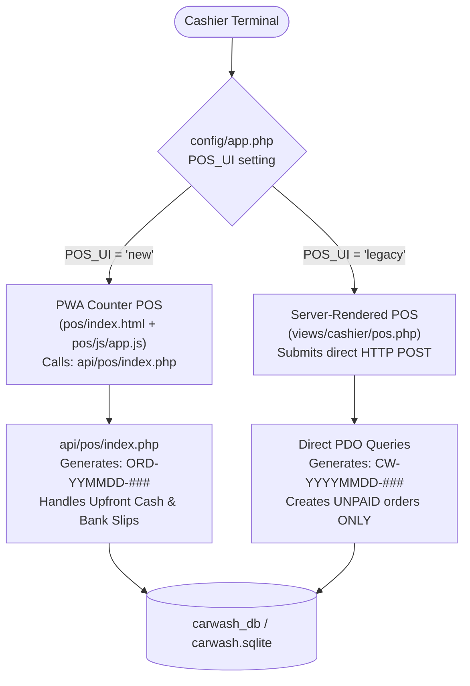
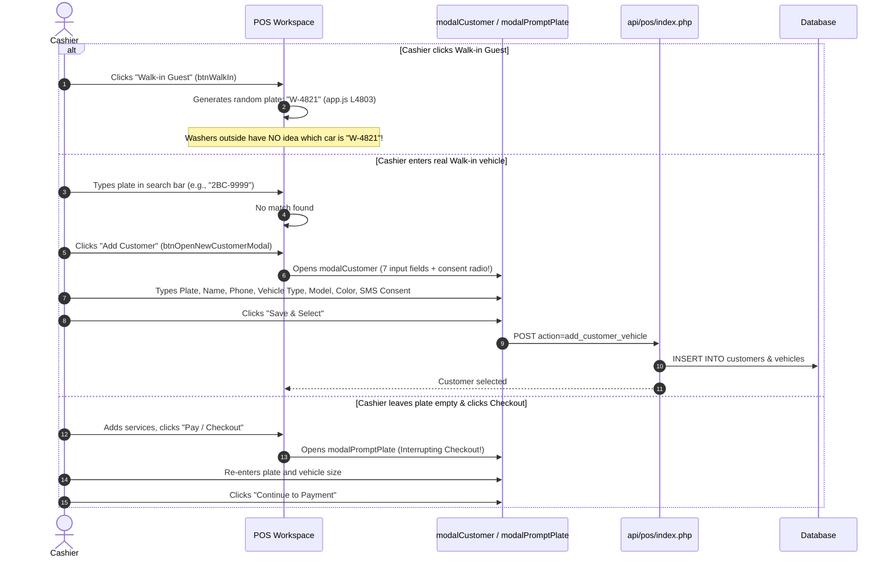
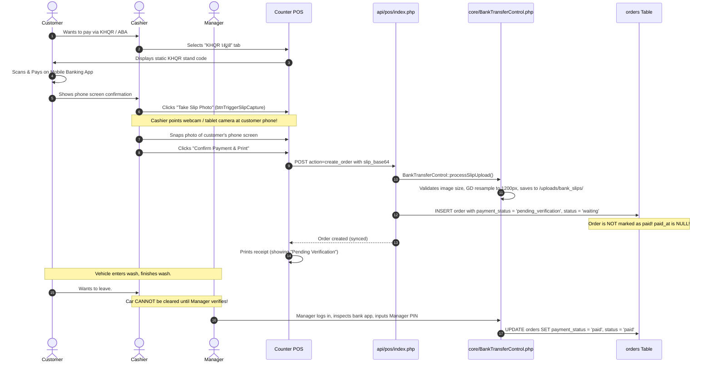

# POS Cashier Workflow Audit – Car-WashService

**Document ID:** POS-AUD-2026-001  
**Project:** Car-WashService  
**Scope:** Counter POS Terminal, Cashier Workflow, Payment Processing, Bay Dispatch  
**Audit Type:** Read-Only Technical & Operational Code Audit  
**Date:** November 2026 (Revised with Management Decisions)  
**Status:** Complete – Awaiting Management Approval  

---

## Management Revision Summary

Following management review of the initial cashier audit, key operational directives were confirmed:
1. **Customer Registration is strictly OPTIONAL:** Plate-first entry; no forced customer forms for standard counter transactions.
2. **Payment Timing is strictly BEFORE service:** "No Payment, No Service" and "No Receipt, No Wash". Unpaid queue entry, "Pay Later", and "Pay at Exit" are **removed** from the standard cashier counter workflow.
3. **Checkout Layout is SINGLE PAGE:** No modal popups, no separate checkout windows, no switching tabs between checkout and queue dispatch.
4. **Reliable KHQR Verification Required:** Static QR stands, unverified cashier button clicks, or inspecting customer phone screenshots are **not accepted** as proof of payment. Verification must rely on merchant-side push/SMS notifications, IoT merchant soundboxes, or official bank payment gateway callbacks.
5. **Permission Integrity:** No new unauthorized discount limits or role tiers shall be created; existing database permission codes (`pos.discount`, `CashierControl::verifyManagerPin()`) govern all price adjustments.
6. **Safe Historical Migration:** Legacy orders with `status = 'paid'` must **never** be blindly converted to operational `status = 'finished'`; actual timestamps (`started_at`, `finished_at`, `cancelled_at`) and queue logs must determine real operational state.
7. **Safe Multi-Stage Bay Routing:** Safe handling of multi-stage jobs (e.g. Oil Change in Bay 4 followed by Wash in Bay 1) with atomic database concurrency locks to prevent double-booking.
8. **System Boundary Maintained:** `Car-WashService` (local station) and `Car-WashCloud` remain strictly decoupled.

---

## 1. Architectural Overview & The Split System Problem

The audit revealed that the codebase maintains two parallel POS implementations with divergent logic, numbering schemes, and payment mechanisms:



### Critical Split Discrepancies:
1. **Order Numbering Divergence:**
   - Web POS (`views/cashier/pos.php` L226–233): Generates prefix `CW-YYYYMMDD-###`.
   - PWA POS (`api/pos/index.php` L2015–2019): Generates prefix `ORD-YYMMDD-###`.
2. **Payment Capability Gap & Upfront Enforcement Failure:**
   - Web POS cannot collect payment at intake; it unconditionally creates orders with `payment_status = 'unpaid'` and redirects to `views/orders/index.php`, violating the core business rule of upfront payment.
   - PWA POS supports upfront payment via Cash or Bank Transfer, but introduces severe modal friction and includes an unmonitored "Pay Later" button (`#btnPayLater`, L5765–5850) that dispatches unpaid cars to the apron.

---

## 2. In-Depth Step-by-Step Codebase Audit

### 2.1 POS Dashboard & Screen Initialization

#### Actual Code Path:
- **File:** `pos/index.html` (Lines 24–105, 355–375), `pos/js/app.js` (Lines 2980–3026, 3063–3110)
- **API Endpoint:** `GET api/pos/index.php?action=get_bays_and_queue`

#### Findings:
1. **Shift Gate Interruption:** If a cashier logs in without an open shift, `app.js` (L5551–5557) blocks checkout and triggers `modalStartShift` (HTML L2915–2956). Opening float requires counted USD and KHR cash entries before any sale can be made.
2. **Hidden Screen Switching:** The dashboard relies on a 5-tab top navigation (`បញ្ជរ`, `ជួរការងារ`, `ការណាត់ជួប`, `វិក្កយបត្រ`, `ប្តូរប្រេង`, `បិទបញ្ជី`). Once an order is created, the cashier must leave the POS view and navigate to `viewQueue` (`#queue`) to assign the vehicle to a bay or monitor progress.
3. **Overlapping Status Strips:** The live bay strip (`pos-bay-status-strip`, HTML L363–372) displays active bay counts, but clicking a bay chip does not allow direct car assignment from the checkout screen.

---

### 2.2 Customer Search & Registration (Optionality Gap)

#### Actual Code Path:
- **File:** `pos/index.html` (Lines 380–448, 1412–1484), `pos/js/app.js` (Lines 4756–4820, 5290–5340)
- **API Endpoints:**
  - Search: `GET api/pos/index.php?action=sync_customers`
  - Register: `POST api/pos/index.php?action=add_customer_vehicle`

#### Detailed Breakdown of Identified Friction:


#### Identified Deficiencies:
- **The "Dummy Plate" Fallacy:** `PosApp.setCustomerToWalkIn()` (`app.js` L4802–4805) assigns `W-` plus 4 random digits (e.g. `W-7392`). In a physical car wash, bay workers rely on the actual vehicle plate to identify the vehicle. Printing `W-7392` on the job ticket causes workers to wander the apron asking who owns the ticket.
- **Forced Heavy Registration:** Clicking "Add Customer" triggers `modalCustomer` (`pos/index.html` L1412–1484), requiring 8 fields: Plate, Name, Phone, Vehicle Type, Model, Color, and SMS Marketing Permission Radio. This violates management's decision that customer registration must be **strictly optional**.
- **Interruption at Checkout:** If the cashier skips customer selection and clicks checkout, `app.js` (L5578–5598) pauses checkout and launches `modalPromptPlate` (`pos/index.html` L2833–2885), forcing an extra popup step before payment.

---

### 2.3 Vehicle Selection & Price Matrix

#### Actual Code Path:
- **File:** `pos/index.html` (Lines 451–472), `pos/js/app.js` (Lines 1325–1339, 3900–3940)
- **Data Source:** `pricing_matrix` returned by `GET api/pos/index.php?action=sync_catalog`

#### Findings:
1. Four fixed vehicle buttons: `motorbike`, `small_car`, `suv_pickup`, `van_truck`.
2. Changing the vehicle type triggers `this.updateVehiclePricesInCart(true)` (`app.js` L1336), dynamically recalculating the unit price of all services currently in the cart.
3. **Problem:** If a cashier forgets to switch from the default `small_car` to `suv_pickup` before selecting services, prices may be undercharged unless caught before payment. Returning plates should auto-populate the vehicle category from vehicle history.

---

### 2.4 Service Selection & Catalog Navigation

#### Actual Code Path:
- **File:** `pos/index.html` (Lines 475–507), `pos/js/app.js` (Lines 3100–3280, 3895–3982)

#### Findings:
1. **Awkward Layout Hierarchy:**
   - Products and Services share a single grid (`catalogGrid`, HTML L495).
   - Category buttons (`categoryListWrap`, HTML L503) are crammed into a narrow vertical column on the **right** side of the grid, immediately adjacent to the cart.
2. **Accidental Image Lightbox Interruption:**
   - Item cards feature a magnifier button (`btn-card-magnifier`, `app.js` L3187).
   - Inadvertently tapping the image opens `modalProductImagePreview` (HTML L2673–2742), requiring dismissal before continuing.
3. **Aggressive Upsell Interruption:**
   - When an item is added, `app.js` (L11330–11365) queries matching upsell rules (`api/pos/index.php?action=get_matching_upsells`) and triggers `modalUpsellPrompt` (HTML L3289–3315), disrupting rapid counter checkout.

---

### 2.5 Cart & Order Summary

#### Actual Code Path:
- **File:** `pos/index.html` (Lines 519–725), `pos/js/app.js` (Lines 4246–4360, 4420–4580)

#### Findings:
1. **Collapsible Details Hide Essential Data:** Crew assignment (washer & mechanic) and vehicle mileage are hidden inside a collapsed `<details class="cart-details-accordion">` (HTML L602–660).
2. **Duplicated Inputs in Payment Modal:** Washer and mechanic selection dropdowns are repeated **again** inside `modalPayment` (`selectDutyWasher`, `selectDutyMechanic`, HTML L1626–1649), creating confusion over which takes precedence.
3. **The "Pay Later" Flaw:** The cart footer includes `btnPayLater` (HTML L703), which bypasses upfront payment and inserts unpaid jobs into the wash queue (`status = 'waiting'`, `payment_status = 'unpaid'`). Management decision requires **complete removal** of this button from the cashier workflow.

---

### 2.6 Discounts & Role-Based Permissions

#### Actual Code Path:
- **File:** `pos/index.html` (Lines 2743–2832), `pos/js/app.js` (Lines 4040–4244), `api/pos/index.php` (Lines 1438–1448, 1534–1555)

#### Findings:
1. **Friction & Crash at Submission:** Cashier clicks the `Discount` pill button in the cart footer, opening `modalDiscount` (HTML L2743). The modal lets any user input any discount up to 100%.
2. **Missing Inline Authentication:**
   - When submitted, `api/pos/index.php` (L1534–1542) checks `Auth::userHasPermission($staffUserId, 'pos.discount')`.
   - If the logged-in cashier lacks the permission, the backend throws a raw 403 error (`DISCOUNT_PERMISSION_DENIED`).
   - The cashier is not prompted for a manager override PIN at the point of discount entry. The entire checkout crashes at the final step.
3. **Governance Compliance:** Existing system permissions (`pos.discount`, `roles`, `role_permissions`) must be strictly respected without inventing unapproved discount percentage tiers or altering manager roles.

---

### 2.7 Payment Methods & Cash Tender Calculation

#### Actual Code Path:
- **File:** `pos/index.html` (Lines 1489–1660), `pos/js/app.js` (Lines 5537–5630, 5604–5625)

#### Findings:
1. **Cash Method:**
   - Contains tender input (`#cashTenderInput`) and quick buttons: Exact, $5, $10, $20, $50, $100, 20,000៛, 50,000៛.
   - Calculates change in both USD and KHR using the system exchange rate (`get_exchange_rate()`).
   - Blocks submission if cash entered is less than total (`app.js` L5617–5623).
2. **Payment Modal Redundancy:** All cash handling is sequestered inside `modalPayment`, adding unnecessary clicks instead of being integrated directly on the checkout screen.

---

### 2.8 KHQR Payment Verification Audit

#### Actual Code Path:
- **File:** `pos/index.html` (Lines 1583–1624), `pos/js/app.js` (Lines 5559–5566), `api/pos/index.php` (Lines 2026–2058), `core/BankTransferControl.php` (Lines 14–110, 238–315)

#### Detailed Existing Flow:


#### Code-Level Deficiencies & Security Vulnerabilities:
1. **The Physical Webcam Photo Chokepoint:** Forcing the cashier to aim a webcam at the customer's phone screen creates severe apron gridlock.
2. **The "Manager Approval" Bottleneck:** In `api/pos/index.php` (L2055–2058), orders paid via ABA/KHQR are explicitly marked as `payment_status = 'pending_verification'` and require `BankTransferControl::approveTransfer()` by a manager. If the manager is away, the customer is stuck or the car is released unpaid.
3. **The Fraud Risk of Unverified Over-simplification:** Management strictly warned: **Do not treat QR generation, customer screenshots, or an unverified cashier button click as proof of payment.** Customers can easily present fake or recycled payment confirmation screenshots.
4. **Verification Ground Truth:** Positive verification must be confirmed via the merchant's own bank reception devices (soundbox / Telegram notification bot / merchant bank app push notification on store device) or through verified bank API webhooks (subject to merchant onboarding with ABA PayWay / Bakong).

---

### 2.9 Order Creation & Idempotency Vulnerability

#### Actual Code Path:
- **File:** `pos/js/app.js` (Lines 42–51, 5634–5637, 5826–5830), `api/pos/index.php` (Lines 1289–1305, 2060–2095)

#### Findings:
1. `api/pos/index.php` (L1291–1305) correctly checks whether `idempotency_key` already exists in `orders`.
2. **However, `pos/js/app.js` defeats this protection:**
   - Every execution of `handleConfirmPayment()` generates a brand-new UUID:
     ```javascript
     const idempotencyKey = this.generateIdempotencyKey(); // app.js L5634
     ```
   - If a cashier double-clicks or retries during a 2-second Wi-Fi stutter, a new key is sent, creating **two identical orders in the database and charging the customer twice**.
   - The idempotency key must be bound to the **cart lifecycle**, not generated inside the button click handler.

---

### 2.10 Receipt Printing & The "OrderGate" Hard Gate

#### Actual Code Path:
- **File:** `pos/js/app.js` (Lines 5747–5757, 9657–9795), `core/OrderGate.php` (Lines 17–120), `api/pos/index.php` (Lines 2338–2377)

#### Findings:
1. **Decoupled Print Action:** Receipt printing executes via `PosThermalPrinter.printReceipt()` and updates the order record via `action=mark_receipt_printed`.
2. **The "OrderGate" Blockade:**
   - In `core/OrderGate.php` (L64–120), `assertReceiptPrinted()` blocks a vehicle from entering any wash bay until `orders.receipt_printed_at` is populated.
   - If the printer runs out of paper or jams, the wash line halts unless a manager inputs an override PIN. Printing must be independent and advisory; printer jams must not prevent confirmed paid orders from appearing on washer display screens.

---

### 2.11 Multi-Stage Bay Routing & Bay Assignment Concurrency

#### Actual Code Path:
- **File:** `pos/index.html` (Lines 738–795, 2615–2672), `pos/js/app.js` (Lines 7011–7056), `core/BayManager.php` (Lines 500–560)

#### Critical Gaps Identified:
1. **Queue Disconnection:** Order creation does not assign bays; cashiers must switch to the `ជួរការងារ` (Queue) tab, locate the car, and open `modalChooseBay`.
2. **Race Conditions (Concurrency):** Current bay assignment performs a non-atomic `SELECT` followed by `UPDATE`:
   ```sql
   -- Current BayManager assignment pattern:
   SELECT status FROM bays WHERE id = ?;
   -- Vulnerable window: another cashier claims the bay
   UPDATE bays SET status = 'busy', current_order_id = ? WHERE id = ?;
   ```
   If two cashiers assign vehicles simultaneously, both cars are sent to the same bay.
3. **Zero Multi-Stage Support:** For orders combining Oil Change + Wash (Scenario 5), the system has no concept of staged progression:
   - Stage 1: Bay 4 (Technical/Lift) for oil drain, filter, and lube.
   - Stage 2: Bay 1 or 2 (Wash/Dry) for exterior wash.
   Current software forces staff to manually delete or drag cars across screens, losing worker commission tracking.

---

### 2.12 Order Cancellation & Historical Data Integrity

#### Actual Code Path:
- **File:** `api/pos/index.php` (Lines 3143–3350), `core/CashierControl.php`

#### Findings:
1. **Cancellation Security:** Requires `staff_id`, minimum 5-character reason, and Manager/Owner PIN. Forbids self-approval (`SELF_APPROVAL_NOT_ALLOWED`).
2. **Historical Data Status Ambiguity:** Legacy database contains orders with `status = 'paid'`, `status = 'waiting'`, `status = 'washing'`, `status = 'finished'`.
   - **Crucial Warning:** Converting every record where `status = 'paid'` to `status = 'finished'` would corrupt historical reporting! An upfront paid order that was cancelled or currently in progress must be differentiated by checking `finished_at`, `started_at`, and `cancelled_at`.

---

## 3. Summary of Deficiencies & Management Corrections

| Workflow Step | Current Code Implementation | Identified Deficiency | Required Management Correction |
| :--- | :--- | :--- | :--- |
| **1. Customer Intake** | Forces `modalCustomer` (8 fields) or generates dummy `W-XXXX` plate | Apron gridlock; washers cannot match car | **Plate-first intake; customer registration strictly OPTIONAL.** |
| **2. Payment Timing** | Has `btnPayLater` creating unpaid queue entries | Unpaid drive-offs; unbilled services | **Payment BEFORE service strictly enforced. Remove Pay Later entirely.** |
| **3. Checkout Screen** | Multi-step modal navigation across 3 views | 15–20 clicks; cashier cognitive overload | **Single-Page Checkout. Zero popups.** |
| **4. KHQR Verification** | Mandatory webcam slip photo; Manager PIN required | Cashier paralyzed; manager bottleneck | **Merchant bank notification / soundbox / API verification. No webcam photos.** |
| **5. Discounts** | Modal allows 100%; backend crashes with 403 | Transaction failure at final step | **Inline Manager PIN; respect existing `pos.discount` role permissions.** |
| **6. Idempotency** | Fresh UUID generated on button click | Duplicate orders on network lag | **Cart-lifecycle token binding; safe backend replay.** |
| **7. Multi-Stage Bays** | Single bay only; non-atomic check | Bay collision; no Wash+Oil routing | **Atomic bay lock; Stage 1 (Lube) $\rightarrow$ Stage 2 (Wash) sequencing.** |
| **8. Historical Migration** | `status` overloads operational and payment states | Reports filter `status='paid'`, losing finished jobs | **Inspect actual timestamps (`finished_at`, `started_at`); never bulk-convert.** |
| **9. Project Scope** | Coupled sync references | Risk of merging station and cloud code | **Keep `Car-WashService` and `Car-WashCloud` strictly separate.** |
