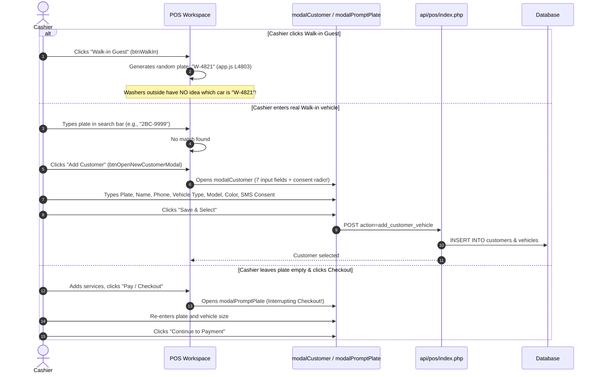

# POS Cashier Workflow Audit – Car-WashService

**Document ID:** POS-AUD-2026-001  
**Project:** Car-WashService  
**Scope:** Counter POS Terminal, Cashier Workflow, Payment Processing, Bay Dispatch  
**Audit Type:** Read-Only Technical & Operational Code Audit  
**Date:** November 2026  
**Status:** Complete – Awaiting Management Approval  

---

## Executive Summary

Management initiated this audit following cashier feedback and operational bottlenecks at the checkout counter:
1. **The cashier's workflow is unnecessarily complicated**, forcing staff through multiple disconnected screens, popups, and repetitive confirmations.
2. **The POS order creation and payment process is confusing**, mixing operational job states with payment statuses, requiring manual manager interventions for routine digital payments, and creating risks of duplicate orders and unbilled services.

This document presents an exhaustive code-level audit of the existing implementation across both the PWA Counter POS (`pos/index.html`, `pos/js/app.js`, `api/pos/index.php`) and the legacy Web POS (`views/cashier/pos.php`). Every step of the cashier journey is traced directly to source code lines, database queries, and UI interactions.

---

## 1. Architectural Overview & The Split System Problem

The audit revealed an immediate fundamental issue: **the application maintains two parallel, competing POS implementations** with divergent logic, numbering schemes, and payment mechanisms:


### Critical Split Discrepancies:
1. **Order Numbering Divergence:**
   - Web POS (`views/cashier/pos.php` L226–233): Generates prefix `CW-YYYYMMDD-###`.
   - PWA POS (`api/pos/index.php` L2015–2019): Generates prefix `ORD-YYMMDD-###`.
2. **Payment Capability Gap:**
   - Web POS cannot collect payment at intake; it unconditionally creates orders with `payment_status = 'unpaid'` and redirects to `views/orders/index.php`.
   - PWA POS supports upfront payment via Cash or Bank Transfer, but introduces severe modal friction.

---

## 2. In-Depth Step-by-Step Codebase Audit

### 2.1 POS Dashboard & Screen Initialization

#### Actual Code Path:
- **File:** `pos/index.html` (Lines 24–105, 355–375), `pos/js/app.js` (Lines 2980–3026, 3063–3110)
- **API Endpoint:** `GET api/pos/index.php?action=get_bays_and_queue`

#### Findings:
1. **Shift Gate Interruption:** If a cashier logs in without an open shift, `app.js` (L5551–5557) blocks checkout and triggers `modalStartShift` (HTML L2915–2956). Opening float requires counted USD and KHR cash entries before any sale can be made.
2. **Hidden Screen Switching:** The dashboard relies on a 5-tab top navigation (`បញ្ជរ`, `ជួរការងារ`, `ការណាត់ជួប`, `វិក្កយបត្រ`, `ប្តូរប្រេង`, `បិទបញ្ជី`). Once an order is created, the cashier must leave the POS view and navigate to `viewQueue` (`#queue`) to assign the vehicle to a bay or monitor progress.
3. **Overlapping Status Strips:** The live bay strip (`pos-bay-status-strip`, HTML L363–372) displays active bay counts, but clicking a bay chip does not allow direct car assignment from the checkout screen.

---

### 2.2 Customer Search & Registration

#### Actual Code Path:
- **File:** `pos/index.html` (Lines 380–448, 1412–1484), `pos/js/app.js` (Lines 4756–4820, 5290–5340)
- **API Endpoints:**
  - Search: `GET api/pos/index.php?action=sync_customers`
  - Register: `POST api/pos/index.php?action=add_customer_vehicle`

#### Detailed Breakdown of Identified Friction:


#### Identified Deficiencies:
- **The "Dummy Plate" Fallacy:** `PosApp.setCustomerToWalkIn()` (`app.js` L4802–4805) assigns `W-` plus 4 random digits (e.g. `W-7392`). In a physical car wash, bay workers rely on the actual vehicle plate to identify the vehicle. Printing `W-7392` on the job ticket causes workers to wander the apron asking who owns the ticket.
- **Forced Heavy Registration:** Clicking "Add Customer" triggers `modalCustomer` (`pos/index.html` L1412–1484), requiring 8 fields:
  1. Plate Number (`newCustPlate`)
  2. Customer Name (`newCustName`)
  3. Phone Number (`newCustPhone`)
  4. Vehicle Type dropdown (`newCustVehicleType`)
  5. Vehicle Model (`newCustModel`)
  6. Vehicle Color (`newCustColor`)
  7. SMS Marketing Permission Radio (`newCustMsgPermission` – Yes/No)
- **Interruption at Checkout:** If the cashier skips customer selection and clicks checkout, `app.js` (L5578–5598) pauses checkout and launches `modalPromptPlate` (`pos/index.html` L2833–2885), forcing an extra popup step before payment.

---

### 2.3 Vehicle Selection & Price Matrix

#### Actual Code Path:
- **File:** `pos/index.html` (Lines 451–472), `pos/js/app.js` (Lines 1325–1339, 3900–3940)
- **Data Source:** `pricing_matrix` returned by `GET api/pos/index.php?action=sync_catalog`

#### Findings:
1. Four fixed vehicle buttons: `motorbike`, `small_car`, `suv_pickup`, `van_truck`.
2. Changing the vehicle type triggers `this.updateVehiclePricesInCart(true)` (`app.js` L1336), dynamically recalculating the unit price of all services currently in the cart.
3. **Problem:** If a customer has a commercial truck or non-standard vehicle, the cashier is forced to pigeonhole the vehicle into one of four rigid sizes. If the cashier forgets to switch from the default `small_car` to `suv_pickup` before selecting services, prices may be undercharged unless the cashier catches it before payment.

---

### 2.4 Service Selection & Catalog Navigation

#### Actual Code Path:
- **File:** `pos/index.html` (Lines 475–507), `pos/js/app.js` (Lines 3100–3280, 3895–3982)

#### Findings:
1. **Awkward Layout Hierarchy:**
   - Products and Services share a single grid (`catalogGrid`, HTML L495).
   - Category buttons (`categoryListWrap`, HTML L503) are crammed into a narrow vertical column on the **right** side of the grid, immediately adjacent to the cart. This forces cashier eye movement to jump from left (search) to middle (products) to right (categories) back to middle (click item) and right again (cart).
2. **Accidental Image Lightbox Interruption:**
   - Item cards feature a magnifier button (`btn-card-magnifier`, `app.js` L3187).
   - Inadvertently tapping the image opens `modalProductImagePreview` (HTML L2673–2742), requiring the cashier to close the modal before continuing.
3. **Aggressive Upsell Interruption:**
   - When an item is added, `app.js` (L11330–11365) queries matching upsell rules (`api/pos/index.php?action=get_matching_upsells`).
   - If an upsell rule matches, it pops up `modalUpsellPrompt` (HTML L3289–3315). During peak rush hours, this modal interrupts fast counter flow.

---

### 2.5 Cart & Order Summary

#### Actual Code Path:
- **File:** `pos/index.html` (Lines 519–725), `pos/js/app.js` (Lines 4246–4360, 4420–4580)

#### Findings:
1. **Collapsible Details Hide Essential Data:** Crew assignment (washer & mechanic) and vehicle mileage are hidden inside a collapsed `<details class="cart-details-accordion">` (HTML L602–660). Cashiers frequently forget to assign workers because the inputs are folded shut.
2. **Duplicated Inputs in Payment Modal:** Surprisingly, washer and mechanic selection dropdowns are repeated **again** inside `modalPayment` (`selectDutyWasher`, `selectDutyMechanic`, HTML L1626–1649). This creates confusion over which dropdown takes precedence.
3. **Dual Currency Calculation:** Correctly calculates USD and KHR using the system exchange rate (`get_exchange_rate()`, default 4,100 KHR/USD). Subtotal and Grand Total display both values.

---

### 2.6 Discounts

#### Actual Code Path:
- **File:** `pos/index.html` (Lines 2743–2832), `pos/js/app.js` (Lines 4040–4244), `api/pos/index.php` (Lines 1438–1448, 1534–1555, 1923–1935)

#### Findings:
1. **Friction in Applying Discounts:** Cashier must click the `Discount` pill button in the cart footer, which opens `modalDiscount` (HTML L2743). The modal offers quick percentages (5%, 10%, 15%, 20%) or custom dollar/percent inputs.
2. **Frontend-Backend Permission Disconnect:**
   - The frontend POS modal lets any cashier select or type any discount up to 100%.
   - When the cashier submits the order, `api/pos/index.php` (L1534–1542) checks `Auth::userHasPermission($staffUserId, 'pos.discount')`.
   - If the logged-in cashier lacks the permission, the backend throws a raw 403 error (`DISCOUNT_PERMISSION_DENIED`).
   - The cashier is not prompted for a manager override PIN at the point of discount entry. The entire checkout crashes at the final step, leaving the cashier bewildered.

---

### 2.7 Payment Methods & Cash Tender Calculation

#### Actual Code Path:
- **File:** `pos/index.html` (Lines 1489–1660), `pos/js/app.js` (Lines 5537–5630, 5604–5625)

#### Findings:
1. **Cash Method:**
   - Contains tender input (`#cashTenderInput`) and quick buttons: Exact, $5, $10, $20, $50, $100, 20,000៛, 50,000៛.
   - Calculates change in both USD and KHR.
   - Blocks submission if cash entered is less than total (`app.js` L5617–5623).
2. **ABA Pay Method:**
   - Displays merchant account number and account name.
   - Requires manual entry of transaction reference (`#abaRefInput`).
   - **Enforces mandatory bank slip camera capture** (see Section 2.8).

---

### 2.8 KHQR Payment Verification & The Bank Slip Chokepoint

#### Actual Code Path:
- **File:** `pos/index.html` (Lines 1583–1624), `pos/js/app.js` (Lines 5559–5566), `api/pos/index.php` (Lines 2026–2058), `core/BankTransferControl.php` (Lines 14–110, 238–315)

#### Detailed Verification Flow:


#### Major Operational Failures:
1. **The Physical Webcam Photo Requirement:** In `pos/js/app.js` (L5560–5566):
   ```javascript
   if ((this.paymentMethod === 'aba' || this.paymentMethod === 'khqr') && !this.currentBankSlipBase64) {
       alert('A photo of the bank transfer slip is required for ABA and KHQR payments.');
       return;
   }
   ```
   Forcing the cashier to physically aim a webcam or tablet at the customer's mobile screen to snap a photo creates extreme apron friction, delays, and poor customer experience.
2. **The "Manager Approval" Chokepoint:**
   - In `api/pos/index.php` (L2055–2058), orders paid via ABA/KHQR are explicitly marked as `payment_status = 'pending_verification'`.
   - The cashier cannot finalize the sale. The order requires a user with role `manager` or `owner` to enter their username and PIN via `BankTransferControl::approveTransfer()` (`core/BankTransferControl.php` L240–285).
   - If the manager is busy in the wash bay or offsite, the order sits indefinitely as unverified, skewing shift closing and daily cash register balances.

---

### 2.9 Order Creation & Idempotency Failure

#### Actual Code Path:
- **File:** `pos/js/app.js` (Lines 42–51, 5634–5637, 5826–5830), `api/pos/index.php` (Lines 1289–1305, 2060–2095)

#### The Duplicate Order Vulnerability:
1. `api/pos/index.php` (L1291–1305) correctly implements idempotency detection:
   ```php
   $existingOrder = $pdo->prepare("SELECT id, order_number ... WHERE idempotency_key = ?");
   $existingOrder->execute([$idempotencyKey]);
   if ($dup) { return ['success' => true, 'is_duplicate' => true, 'order' => $dup]; }
   ```
2. **However, `pos/js/app.js` defeats this protection!**
   - Every time `handleConfirmPayment()` or `handlePayLaterOrder()` is invoked, it executes:
     ```javascript
     const idempotencyKey = this.generateIdempotencyKey(); // app.js L5634 & L5826
     ```
   - If a cashier clicks "Pay", experiences a 3-second network lag or packet drop, and clicks the button a second time, **a brand-new UUID is generated**.
   - The backend treats this second click as an entirely new order, resulting in **two identical orders created in the database and charged to the customer**.

---

### 2.10 Receipt Printing & The "OrderGate" Blockade

#### Actual Code Path:
- **File:** `pos/js/app.js` (Lines 5747–5757, 9657–9795), `core/OrderGate.php` (Lines 17–120), `api/pos/index.php` (Lines 2338–2377)

#### Findings:
1. **Decoupled Print Action:** The receipt print is decoupled from order creation; it executes via `PosThermalPrinter.printReceipt()` and updates the order record via `action=mark_receipt_printed`.
2. **The "OrderGate" Hard Blockade:**
   - In `core/OrderGate.php` (L64–120), `assertReceiptPrinted()` checks whether `orders.receipt_printed_at` is populated.
   - If `get_setting('receipt_required')` is enabled, **a car is physically blocked from entering any wash or technical bay** until a receipt is printed.
   - If the thermal printer jams, runs out of paper, or the cashier skips printing to save paper, the system refuses to let the vehicle enter a bay unless a manager physically types their credentials (`OrderGate::verifyOverrideManager()`).

---

### 2.11 Queue & Bay Assignment

#### Actual Code Path:
- **File:** `pos/index.html` (Lines 738–795, 2615–2672), `pos/js/app.js` (Lines 7011–7056), `api/pos/index.php` (Lines 2952–3010), `core/BayManager.php` (Lines 500–560)

#### Findings:
1. **Completely Disconnected from Checkout:** When an order is completed at checkout, the vehicle is simply placed into `orders` with `status = 'waiting'`.
2. **Required Navigational Steps:**
   - Cashier must click the `ជួរការងារ` (Queue) tab in the main navigation.
   - Cashier scans the queue list for the vehicle plate.
   - Cashier clicks "Assign Bay" button on the queue card.
   - `modalChooseBay` (HTML L2615–2672) opens, listing available wash bays.
   - Cashier clicks a bay, sending `action=assign_bay`.
3. **Operational Result:** 4 additional screen interactions and an extra modal simply to direct a car into an empty wash bay after paying.

---

### 2.12 Order Cancellation & Refunds

#### Actual Code Path:
- **File:** `pos/index.html` (Lines 2225–2265), `pos/js/app.js` (Lines 7640–7710), `api/pos/index.php` (Lines 3143–3350)

#### Findings:
1. **Cancellation Security:** Requires `staff_id`, a mandatory cancellation reason (minimum 5 characters), and a Manager/Owner PIN verification.
2. **Self-Approval Protection:** Explicitly prevents a manager from approving their own cancellation (`api/pos/index.php` L3233–3241: `SELF_APPROVAL_NOT_ALLOWED`).
3. **Stock & Ledger Reversal:** Correctly increments stock quantities for returned products (`L3299–3302`), zeroes out worker commissions (`L3305–3306`), and reverses loyalty points (`L3330–3334`).
4. **Deficiency:** Cancellation lacks an explicit refund receipt printout for the customer or an explicit cash drawer return event logged in `cashier_shift_events`.

---

## 3. Summary of Workflow Deficiencies & Metrics

| Workflow Step | Current Number of Clicks / Screens | Identified Flaw / Chokepoint | Impact on Business |
| :--- | :--- | :--- | :--- |
| **1. Walk-in Customer** | 3 clicks + 1 modal | Generates dummy `W-XXXX` plate; or forces 8-field registration modal | Washers cannot identify car; counter gridlock |
| **2. Vehicle Size Selection** | 1 click | Rigid 4 buttons; easily forgotten | Incorrect pricing; cashier undercharges |
| **3. Service Selection** | 2–4 clicks + potential modals | Categories on far right; accidental image preview modal; upsell modal interruption | High cashier cognitive load; accidental modal opens |
| **4. Discount Application** | 3 clicks + 1 modal | Modal allows any cashier discount; backend crashes with 403 if unauthorized | Transaction fails at final step; customer wait |
| **5. Cash Payment** | 3 clicks | Cash tender entered in modal; washer/mechanic dropdowns duplicated | Redundant inputs; modal clutter |
| **6. KHQR / ABA Payment** | 5 clicks + camera action | Cashier must aim camera at customer phone screen; status marked "pending verification"; requires Manager PIN | Severe checkout bottleneck; cashier unable to finalize sale |
| **7. Order Submission** | 1 click (with retry risk) | Fresh idempotency key generated on each click; double-click creates duplicate orders | Financial discrepancy; double charges |
| **8. Bay Assignment** | 4 clicks + tab switch + modal | Cashier must leave POS, go to Queue tab, find car, open bay modal, select bay | Delay in getting car onto wash apron |
| **Total Typical Journey** | **15–20 clicks, 3–4 modals, 2 page views** | Disjointed multi-step modal maze | **Counter apron gridlock during peak hours** |

---

## 4. Next Steps
The complete redesign of this cashier workflow is detailed in:
- `POS-CURRENT-VS-NEW-WORKFLOW.md` (Side-by-side behavioral comparison)
- `POS-NEW-CHECKOUT-DESIGN.md` (Single-page counter interface proposal)
- `POS-PAYMENT-BUSINESS-RULES.md` (10 core business & payment rules)
- `POS-IMPLEMENTATION-PLAN.md` (Technical implementation roadmap)
