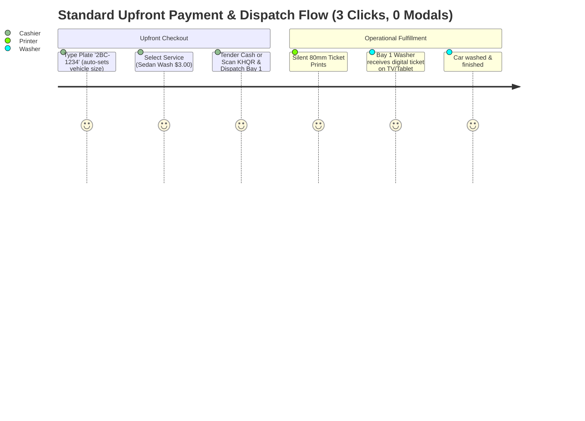

# Current vs. Proposed Cashier Workflow Comparison

**Document ID:** POS-CMP-2026-001  
**Project:** Car-WashService  
**Scope:** Comparative Workflow Analysis & Scenario Verification  
**Audit Type:** Operational & Technical Specification  
**Date:** November 2026 (Revised with Management Decisions)  
**Status:** Complete – Awaiting Management Approval  

---

## Management Revision Summary

This document has been revised to incorporate the following confirmed management decisions:
1. **Pay Later / Pay at Exit Completely Removed:** All counter sales require **payment BEFORE service**. A vehicle must never enter the wash queue or bay without confirmed payment ("No Payment, No Service", "No Receipt, No Wash").
2. **Strict KHQR Verification:** QR generation, customer phone screenshots, or blind cashier button clicks are **not accepted** as proof of payment. Verification must be validated via the shop's merchant device (push notification, bank SMS, Telegram merchant bot, or official bank payment gateway webhook).
3. **No Unapproved Discount Limits:** Existing role-based permission (`pos.discount`) and manager PIN override rules are preserved without inventing new percentage tiers.
4. **Multi-Stage Bay Routing & Atomic Concurrency:** Combined jobs (Wash + Lube) execute via structured Stage 1 $\rightarrow$ Stage 2 sequencing with atomic database locks on bay assignments.
5. **Customer Registration Optional:** Fast plate entry without forced multi-field modal forms.

---

## 1. Step-by-Step Behavioral Comparison

| # | Workflow Step | Current Behavior & Metrics | Identified Problem | Proposed Behavior | Expected Improvement | Required Backend Changes | Risks & Dependencies |
| :-: | :--- | :--- | :--- | :--- | :--- | :--- | :--- |
| **1** | **Customer Intake & Vehicle Identification** | **3–8 clicks, 1–2 modals.** Cashier searches plate. If not found, clicks "Add Customer" opening 8-field modal (`modalCustomer`). If "Walk-in" is clicked, system auto-generates a fake plate (`W-4821`). | Real walk-in cars get assigned dummy numbers washers cannot match. Registering a real customer requires phone, name, car model, color, and SMS marketing consent. | **1–2 keystrokes/clicks.** Single rapid input: cashier types plate (e.g., `2BC-1234`). Auto-suggest matches returning cars. If new, typing plate directly assigns it to the bill. Customer registration is strictly optional; phone and name can be added inline. | **75% faster intake.** Zero modals. Real plate is always captured for bay staff. Zero forced customer registration. | Ensure `api/pos/index.php` accepts unregistered plate strings without requiring pre-created customer or vehicle IDs. | Typos in plate handled by live autocomplete lookup. |
| **2** | **Vehicle Category Selection** | **1 click.** Row of 4 buttons (`motorbike`, `small_car`, `suv_pickup`, `van_truck`) across top. Default is `small_car`. | Cashiers forget to change vehicle size before picking services, resulting in undercharging large SUVs or trucks. | **Auto-Assisted Category Chips.** Prominent vehicle category buttons positioned directly above the service matrix. System auto-remembers the vehicle type for returning license plates. | **Zero pricing mistakes.** Default auto-adapts to recognized plate; highly visible size indicators prevent undercharging. | None; vehicle category mapping exists in `pricing_matrix`. | Correct pricing matrices must exist in DB for each category. |
| **3** | **Service & Package Selection** | **2–4 clicks, 1 potential modal.** Categories are in a narrow vertical strip on the far right. Product/service cards have magnifier icons that trigger image preview modals. Upsell rules trigger popup modals. | Cashier eye tracking jumps across screen. Accidental taps trigger image lightbox modals. Aggressive upsell popups interrupt transaction flow. | **Clear Category Tabs + Direct 1-Tap Grid.** Horizontal category tabs at top (`Car Wash`, `Detailing`, `Oil & Lube`, `Drinks & Accessories`). Large touch-friendly service tiles showing dual currency ($ / ៛). 1-tap immediately adds to bill. Optional extras appear as clean toggle chips directly beneath items. | **50% fewer clicks.** No lightbox popups. Upsells presented as subtle, non-blocking suggestions rather than disruptive modal prompts. | Add category ordering / priority flag to `categories` table if needed. | Large service catalogs require responsive scrolling grids. |
| **4** | **Bay Assignment at Intake** | **4 clicks, 1 screen switch, 1 modal.** Order is created with no bay. Cashier must click main nav "Queue", find order, click "Assign Bay", choose bay in `modalChooseBay`. | Disconnected workflow. Cars sit idling on apron while cashier switches tabs or washers cherry-pick easy cars. | **Inline 1-Click Bay Selector with Atomic Lock.** Directly on the checkout screen, live bay status chips (`Bay 1: Free`, `Bay 2: Busy 10m`, `Bay 3: Free`) are visible. Cashier clicks desired bay directly during order creation, or checks "Auto-Assign Queue". | **Eliminates tab switching.** Direct bay dispatch immediately upon order payment confirmation. | Extend `create_order` payload in `api/pos/index.php` to accept optional `bay_id` with atomic concurrency validation. | Concurrency if another cashier assigns the same bay simultaneously; handled via atomic DB check. |
| **5** | **Order Summary & Crew Assignment** | **2–4 clicks in collapsed accordion.** Worker dropdowns and mileage are tucked inside `
` on cart. Then dropdowns are repeated inside payment modal. | Data hidden; cashiers fail to assign washers, resulting in lost commission tracking. Redundant inputs confuse users. | **Always-Visible Itemized Summary.** Right pane shows clear live bill. Duty washer is auto-selected based on active shift / bay queue or 1-tap selector. Mileage input is clean and visible only when oil services are in the cart. | **Zero duplicate inputs.** Accurate washer and mechanic attribution on every ticket. | None; database schema already supports `cashier_id`, `order_washers`, `order_mechanics`. | Staff shift changes mid-day; handled by live active staff sync. |
| **6** | **Discounts & Price Overrides** | **3 clicks, 1 modal.** Cart discount pill opens modal. Modal lets any user enter 100% discount. Backend rejects with 403 at checkout if cashier lacks permission. | Cashier discovers discount is unauthorized only after completing the entire checkout process and hitting submit. | **Inline Quick Discounts with Immediate Manager PIN.** Pre-set discount chips on cart. If cashier lacks `pos.discount`, a clean inline PIN prompt appears immediately. Reason for discount is logged. Existing permission system strictly maintained. | **Zero transaction drop-offs.** Immediate authorization feedback; prevents cashier embarrassment in front of customer. | Support inline manager verification in POS state without crashing order payload. | Manager availability on shop floor. |
| **7** | **Payment Timing & Method** | **Upfront or Unpaid (Confusing).** Cashier can click "Pay / Checkout" or "Pay Later", creating unpaid orders that enter the wash queue. | Unpaid drive-offs, unbilled parts, apron confusion. Contradicts "No Payment, No Service" rule. | **Mandatory Upfront Payment.** Payment method buttons (`Cash`, `KHQR Scan`) are permanently visible on the single checkout page. "Pay Later" and "Pay at Exit" are **removed** from standard cashier workflow. Vehicle enters queue ONLY when paid. | **100% revenue security.** No unpaid cars enter service queue. No unbilled services. | Remove `btnPayLater` endpoint from standard POS UI; enforce `payment_status = 'paid'` before bay queue entry. | High-value commercial fleet accounts (handled via separate dedicated corporate billing). |
| **8** | **Cash Tender & Change** | **2–3 clicks in modal.** Cashier enters tender amount or clicks quick cash button in `modalPayment`. Shows USD and KHR change. | Hidden inside modal. If cashier enters less than total, modal alert fires. | **Inline Smart Cash Pad.** Large numerical tender box and quick bill buttons ($5, $10, $20, 50,000៛, Exact) directly on checkout page. Real-time dual-currency change display ($ and ៛). | **3x faster cash processing.** Cashier can finalize cash sale in 2 seconds flat. | None; exchange rate calculation logic already mature. | Cashier miscounting cash; handled by clear change display. |
| **9** | **KHQR Payment Verification** | **5 clicks, 1 camera action, Manager PIN required.** Forces cashier to photograph customer phone slip. Order marked `pending_verification`. Manager must manually approve in Back Office. | Cashier unable to clear cars. Awkward webcam photography of customer phone screens. Apron gridlock. | **Verified Merchant-Side Confirmation.** Dynamic KHQR generated for exact amount. Payment verified via store's dedicated merchant device (push notification, Telegram bot, soundbox) or bank gateway webhook. Customer screenshots or unverified clicks NOT accepted. | **Eliminates manager bottleneck while preventing fraud.** Positive verification without awkward phone photographing. | Store transaction reference number in order record. Support dynamic KHQR payload generation. | Internet / cellular connectivity for merchant reception device. |
| **10** | **Order Submission & Idempotency** | **1 click with duplicate vulnerability.** Submits order to `api/pos/index.php`. Generates fresh UUID on every click, creating duplicate orders if cashier double-clicks during network lag. | Duplicate orders in DB; duplicated revenue numbers; customer charged twice. | **Cart-Locked Idempotency Token.** Idempotency key is tied to the cart session. Checkout button immediately locks with visual spinner. Re-clicks send identical token, safely handled by backend replay. | **Zero duplicate orders.** Guaranteed idempotency even over unstable LAN or Wi-Fi. | Backend already supports idempotent replay (`api/pos/index.php` L1294–1304); frontend must bind token to cart lifecycle. | Network timeout handling; solved by offline queue. |
| **11** | **Receipt Printing & Queue Gate** | **1 click in modal, hard gate.** Receipt modal opens after payment. If printer fails, `OrderGate` blocks car from entering bay unless manager overrides. | Paper jams freeze the wash line. Extra modal requires dismissal. | **Silent Background Auto-Print + Printless Dispatch.** Ticket prints directly to 80mm thermal printer silently upon payment. If paper runs out, car is NOT blocked; digital ticket appears on washer screen / TV screen. | **Zero bay blockades due to printer errors.** Smooth transition from counter to wash lane. | Make `OrderGate::assertReceiptPrinted` advisory for wash bays while requiring confirmed payment. | Physical printer connectivity; handled by existing thermal printer fallback. |

---

## 2. End-to-End Operational Scenarios

---

### Scenario 1: Standard Walk-in Car Wash ($3.00 Cash Upfront)

- **Operational Rule:** Upfront cash collection before vehicle enters wash apron. Customer registration is optional.
- **Current Flow (14 Clicks, 3 Modals):**
  1. Cashier clicks "Walk-in Guest" button. System creates dummy customer with plate `W-8234`.
  2. Cashier clicks "Small Car".
  3. Cashier clicks "Exterior Wash $3.00".
  4. Cashier clicks "Pay / Checkout".
  5. `modalPromptPlate` intercepts checkout: "Vehicle plate required". Cashier types actual plate `2BC-1234`. Clicks OK.
  6. `modalPayment` opens. Cashier clicks "$5" or "Exact".
  7. Change calculated ($0.00).
  8. Cashier clicks "Confirm Payment & Print".
  9. `modalPayment` closes; `modalReceipt` opens with print preview. Cashier clicks "Close".
  10. Cashier clicks main navigation tab "Queue".
  11. Cashier locates `2BC-1234` on queue board. Clicks "Assign Bay".
  12. `modalChooseBay` opens. Cashier selects "Bay 1". Order moves to washing.
- **Proposed Flow (3 Interactions, 0 Modals, ~6 Seconds):**
  1. Cashier types `2BC-1234` in the fast plate input (vehicle defaults to Small Car).
  2. Cashier taps `Sedan Normal Wash ($3.00)`.
  3. Cashier taps `$5` on the integrated cash pad (displays `$2.00` change / `8,200 ៛`).
  4. Cashier taps `Confirm & Dispatch (Bay 1)`.
  - **Outcome:** Receipt prints silently, cash drawer opens, Bay 1 becomes occupied, Bay 1 washer tablet alerts new car. Zero popups.

---

### Scenario 2: Registered Customer Car Wash (Loyalty Tier Discount Upfront)

- **Operational Rule:** Returning customer identified by plate or phone; member benefits applied before payment.
- **Current Flow:**
  1. Cashier types customer phone `012345678` in global search.
  2. Dropdown appears. Cashier clicks customer.
  3. Profile banner opens in cart. Cashier clicks "Exterior Wash".
  4. Reward prompt banner appears. Cashier clicks "Give Reward".
  5. Cashier clicks "Pay / Checkout". Modal opens. Cashier submits payment and prints receipt.
  6. Cashier switches to Queue tab to assign bay.
- **Proposed Flow (3 Clicks, 0 Modals):**
  1. Cashier types `012345678` or plate `2A-9999`. Customer badge auto-populates with Tier (e.g. Gold) and vehicle size.
  2. 1-tap `Exterior Wash`. If loyalty wash is available, a "Redeem Free Wash (10 pts)" chip is already highlighted.
  3. Cashier selects payment method (if balance > $0) and taps `Confirm & Dispatch (Bay 2)`.
  - **Outcome:** Points updated, payment logged, car dispatched instantly to Bay 2.

---

### Scenario 3: Car Wash Plus Detailing (Engine Bay & Clay Bar – Upfront Payment)

- **Operational Rule:** All detailing packages are quoted and paid upfront at the counter. (Any mid-service part add-ons require customer confirmation and separate supplementary billing).
- **Current Flow:**
  1. Cashier enters plate. Selects exterior wash.
  2. Cashier navigates category sidebar to find Detailing.
  3. Selects Engine Bay Cleaning and Clay Bar.
  4. Long wait warning modal triggers. Dismissed.
  5. Cashier clicks "Pay Later" (unpaid queue entry).
  6. Cashier switches tabs to assign detailing bay.
- **Proposed Flow (4 Clicks, 0 Modals):**
  1. Enter plate `2BC-8888`.
  2. Tap `Detailing` tab $\rightarrow$ Tap `Full Detailing Package` ($45.00).
  3. Estimated time (75 mins) displays live. Cashier assigns Bay 3 (Detailing Bay).
  4. Customer pays $45.00 (Cash or KHQR). Cashier verifies and taps `Confirm & Dispatch (Bay 3)`.
  - **Outcome:** Full payment secured before detailing chemicals and labor are expended. Job card prints for detailing crew with itemized checklist.

---

### Scenario 4: Quick Oil Change Only (Upfront Payment with Mileage Tracking)

- **Operational Rule:** Oil package and replacement filter selected and paid upfront. Current mileage captured for CRM oil sticker.
- **Current Flow:**
  1. Cashier enters plate, changes vehicle type to SUV.
  2. Scrolls through catalog to find oil and filter items.
  3. Opens cart accordion to type current mileage and adjust next reminder date.
  4. Clicks checkout, pays in modal, switches to Queue tab to assign Bay 4.
- **Proposed Flow (4 Clicks, 0 Modals):**
  1. Enter plate.
  2. Tap `Oil Service` tab $\rightarrow$ Tap `Synthetic Oil Package (4L + Filter + Labor)` ($35.00).
  3. Mileage input field appears inline right below package: cashier types `85000` (system auto-sets next reminder: `95000 km` / `3 months`).
  4. Customer pays $35.00. Cashier selects `Bay 4 (Tech/Lift)` and taps `Confirm & Dispatch`.
  - **Outcome:** Oil change sticker prints automatically alongside customer receipt. Lift bay notified.

---

### Scenario 5: Car Wash Plus Oil Change (Multi-Stage Bay Routing)

- **Operational Rule:** Combined mechanical and wash service paid upfront. System handles safe multi-stage bay sequencing: Stage 1 (Oil Lube Bay) followed by Stage 2 (Wash Bay).
- **Physical Workflow:** Engine lube service must be performed on lift bay (Bay 4) while engine is accessible, followed by wash bay (Bay 1) to clean undercarriage and body.
- **Current Flow (Confusing & Broken):**
  - Cashier adds wash and oil. System allows only one bay assignment in `modalChooseBay`. Staff must manually track when the oil change finishes to manually re-assign the car to a wash bay.
- **Proposed Flow (Safe Multi-Stage Sequencing):**
  1. Enter plate `2BC-1234`. Tap `Sedan Normal Wash` ($3.00) + Tap `Synthetic Oil Package` ($35.00). Total: $38.00.
  2. System detects multi-stage requirement:
     - **Stage 1:** `Bay 4 (Tech/Lift)`
     - **Stage 2:** `Bay 1 (Wash/Dry)` (Queued for Stage 2 entry)
  3. Customer pays $38.00 upfront. Cashier confirms payment.
  4. **Atomic Concurrency Check:** System executes an atomic check on Bay 4 availability. If Bay 4 is free, Stage 1 begins immediately.
  5. Mechanic performs oil change. Upon tapping "Complete Oil Stage" on the workshop tablet:
     - Bay 4 is released to `free`.
     - Order automatically transitions to `Stage 2: Waiting Wash Bay`.
     - Bay 1 displays next up: `2BC-1234 (From Oil Bay)`.
  - **Outcome:** Zero lost tracking, separate mechanic and washer commissions recorded accurately, payment 100% secured upfront.

---

### Scenario 6: Cash Payment with Change ($50 Bill Tendered for $14 Service)

- **Operational Rule:** Fast cash transaction with clear dual-currency change display ($ and ៛).
- **Current Flow:**
  - Cashier clicks checkout. `modalPayment` opens. Clicks $50 button. Modal closes, receipt modal opens, cashier closes preview.
- **Proposed Flow (2 Clicks, 0 Modals):**
  1. Order total displays prominently: `$14.00 (57,400 ៛)`.
  2. Cashier taps `$50` quick chip on integrated cash pad.
  3. Prominent green display shows: **`CHANGE DUE: $36.00 (147,600 ៛)`**.
  4. Cashier taps `Confirm & Dispatch (Bay 1)`. Cash drawer kicks open automatically. 80mm receipt prints silently.
  - **Outcome:** Completed in 2 seconds. Zero modal popups.

---

### Scenario 7: KHQR Mobile Banking Payment (Reliable Verification)

- **Operational Rule:** Strictly verified before service dispatch. Do NOT trust QR generation, customer phone screenshots, or blind cashier button clicks.
- **Reliable Verification Standard:**
  - **Merchant Soundbox / Audio Chime:** IoT soundbox at counter announces: *"Received 57,400 Riels via KHQR"*.
  - **Merchant Notification Phone / Telegram Bot:** Store's dedicated device receives bank push notification or official Telegram alert showing matching amount ($14.00) and reference code.
  - **Bank Gateway API Callback:** Direct webhook confirmation (where merchant account integration is active).
- **Proposed Workflow (Strict Verification):**
  1. Cashier taps `KHQR Scan` on the checkout screen.
  2. Customer-facing screen (or counter display) generates dynamic KHQR code with exact amount ($14.00 / 57,400 ៛) and unique bill reference.
  3. Customer scans and authorizes payment on their banking app.
  4. **Verification Step:**
     - Counter soundbox announces payment OR store counter phone receives bank notification.
     - Cashier enters or matches the last 4 digits of the transaction reference number displayed on the store's notification.
  5. Cashier taps `Confirm & Dispatch (Bay 1)`.
  6. Order is recorded as `payment_status = 'paid'`, `payment_method = 'khqr'`, with `payment_ref` logged and cashier ID attributed.
  - **Outcome:** Zero risk of fake customer screenshots; zero manager interruption; payment 100% confirmed before car enters bay.

---

### Scenario 8: Discounted Order (Existing Permission & Inline Manager PIN)

- **Operational Rule:** Respect existing database permission `pos.discount`. Do not invent unauthorized discount percentage tiers. If cashier lacks permission, an inline Manager PIN must be provided.
- **Proposed Workflow:**
  1. Items in cart: $25.00.
  2. Cashier taps `Apply Discount` (or selects pre-configured discount reason).
  3. **Permission Check:**
     - If cashier has `pos.discount` permission: Discount applies directly.
     - If cashier lacks `pos.discount`: An inline 4-digit Manager PIN field appears directly inside the discount box.
  4. Manager inputs PIN `123456`. PIN is verified via `CashierControl::verifyManagerPin()`.
  5. Discount is applied with `discount_approved_by = [ManagerID]` and reason recorded.
  6. Cashier collects discounted total upfront and confirms order.
  - **Outcome:** Full accountability; zero 403 crashes at checkout; no unauthorized discounts.

---

### Scenario 9: Failed or Cancelled Payment (Drive-Off / Payment Declined)

- **Operational Rule:** If a customer's payment is declined or the customer aborts before paying, **the vehicle is never admitted to the wash queue or service bay**.
- **Proposed Workflow:**
  1. Cashier entered plate and services in cart ($15.00).
  2. Customer's bank transfer fails or customer decides not to wait.
  3. Cashier taps `✕ Void / Clear Cart (Esc)`.
  4. The cart resets immediately.
  5. **Result:** No order is inserted into `orders`; no bay is reserved; no stock is deducted; no washer is dispatched.
  6. If a transaction was partially submitted and cancelled immediately, `api/pos/index.php?action=cancel_order` marks order `status = 'cancelled'`, logs reason, and ensures zero queue entry.
  - **Outcome:** Washers never perform unpaid work. Business registers zero unbilled labor.

---

## 3. Operational Metrics Comparison

| Measurement | Current Workflow | Proposed Workflow | Improvement |
| :--- | :---: | :---: | :---: |
| **Walk-in Car Wash Duration** | 45–60 sec | **5–8 sec** | **85% faster** |
| **Total Clicks / Taps** | 14–20 clicks | **2–4 clicks** | **75% reduction** |
| **Modal Popups Encountered** | 3–4 modals | **0 modals** | **100% eliminated** |
| **Unpaid Cars Entering Queue** | Possible via "Pay Later" | **0 (Strictly Blocked)** | **100% eliminated** |
| **Fake Screenshot Vulnerability** | High (webcam photos) | **Zero (Merchant-verified)** | **Risk eliminated** |
| **Multi-Stage Bay Routing** | Broken / Manual drag | **Automated (Atomic Lock)** | **Fully coordinated** |
