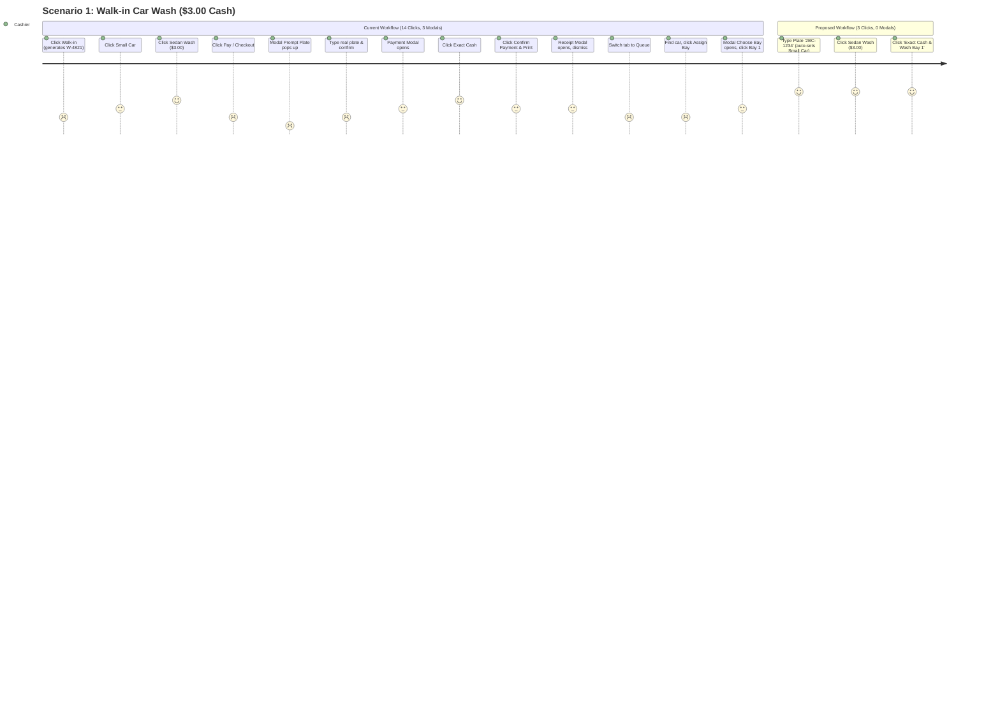

# Current vs. Proposed Cashier Workflow Comparison

**Document ID:** POS-CMP-2026-001  
**Project:** Car-WashService  
**Scope:** Comparative Workflow Analysis & Scenario Verification  
**Audit Type:** Operational & Technical Specification  
**Date:** November 2026  
**Status:** Complete – Awaiting Management Approval  

---

## 1. Step-by-Step Behavioral Comparison

The following table contrasts each individual step of the checkout journey between the current implementation and the proposed single-page cashier workflow.

| # | Workflow Step | Current Behavior & Metrics | Identified Problem | Proposed Behavior | Expected Improvement | Required Backend Changes | Risks & Dependencies |
| :-: | :--- | :--- | :--- | :--- | :--- | :--- | :--- |
| **1** | **Customer Identification & Vehicle Intake** | **3–8 clicks, 1–2 modals.** Cashier searches plate. If not found, clicks "Add Customer" opening 8-field modal (`modalCustomer`). If "Walk-in" is clicked, system auto-generates a fake plate (e.g. `W-4821`). If omitted, checkout is interrupted by `modalPromptPlate`. | Real walk-in cars get assigned dummy numbers washers cannot match. Registering a real customer requires phone, name, car model, color, and marketing consent. | **1–2 keystrokes/clicks.** Single rapid input: cashier types plate (e.g., `2BC-1234`). As they type, auto-suggest shows matches. If not found, hitting `Tab` or selecting a service keeps the plate as a walk-in without opening any modal. Phone number is optional inline. | **75% faster intake.** Zero modals. Real plate is always captured for bay staff. No forced customer registration. | Ensure `api/pos/index.php` accepts unregistered plate strings without requiring pre-created customer or vehicle IDs. | Duplicate plates with different owners; handled via prompt if phone mismatch. |
| **2** | **Vehicle Category Selection** | **1 click.** Row of 4 buttons (`motorbike`, `small_car`, `suv_pickup`, `van_truck`) across top. Default is `small_car`. | Cashiers forget to change vehicle size before picking services, resulting in undercharging large SUVs or trucks. | **Integrated 1-tap pills.** Prominent vehicle category buttons positioned directly above the service matrix. System auto-remembers the vehicle type for returning license plates. | **Zero pricing mistakes.** Default auto-adapts to recognized plate; highly visible size indicators prevent undercharging. | None; vehicle category mapping exists in `pricing_matrix`. | Correct pricing matrices must exist in DB for each category. |
| **3** | **Service & Package Selection** | **2–4 clicks, 1 potential modal.** Categories are in a narrow vertical strip on the far right. Product/service cards have magnifier icons that trigger image preview modals. Upsell rules trigger popup modals. | Cashier eye tracking jumps all over screen. Accidental taps trigger image lightbox modals. Aggressive upsell popups interrupt transaction flow. | **Clear Category Tabs + Direct 1-Tap Grid.** Horizontal category tabs at top (`Car Wash`, `Detailing`, `Oil & Lube`, `Drinks & Accessories`). Large touch-friendly service tiles showing dual currency ($ / ៛). 1-tap immediately adds to bill. Optional extras appear as clean toggle chips directly beneath items. | **50% fewer clicks.** No lightbox popups. Upsells presented as subtle, non-blocking suggestions rather than disruptive modal prompts. | Add category ordering / priority flag to `categories` table if needed. | Large service catalogs require responsive scrolling grids. |
| **4** | **Bay Assignment at Intake** | **4 clicks, 1 screen switch, 1 modal.** Order is created with no bay. Cashier must click main nav "Queue", find order, click "Assign Bay", choose bay in `modalChooseBay`. | Disconnected workflow. Cars sit idling on apron while cashier switches tabs or washers cherry-pick easy cars. | **Inline 1-Click Bay Selector.** Directly on the checkout screen, live bay status chips (`Bay 1: Free`, `Bay 2: Busy 10m`, `Bay 3: Free`) are visible. Cashier clicks desired bay directly during order creation, or checks "Auto-Assign". | **Eliminates tab switching.** Direct bay dispatch immediately upon order confirmation. | Extend `create_order` payload in `api/pos/index.php` to accept optional `bay_id`. | Concurrency if another cashier assigns the same bay simultaneously; handled via atomic DB check. |
| **5** | **Order Summary & Crew Assignment** | **2–4 clicks in collapsed accordion.** Worker dropdowns and mileage are tucked inside `
` on cart. Then dropdowns are repeated inside payment modal. | Data hidden; cashiers fail to assign washers, resulting in lost commission tracking. Redundant inputs confuse users. | **Always-Visible Itemized Summary.** Right pane shows clear live bill. Duty washer is auto-selected based on active shift / bay queue or 1-tap selector. Mileage input is clean and visible only when oil services are in the cart. | **Zero duplicate inputs.** Accurate washer and mechanic attribution on every ticket. | None; database schema already supports `cashier_id`, `order_washers`, `order_mechanics`. | Staff shift changes mid-day; handled by live active staff sync. |
| **6** | **Discounts & Price Overrides** | **3 clicks, 1 modal.** Cart discount pill opens modal. Modal lets any user enter 100% discount. Backend rejects with 403 at checkout if cashier lacks permission. | Cashier discovers discount is unauthorized only after completing the entire checkout process and hitting submit. | **Inline Quick Discounts with Immediate Manager PIN.** Pre-set discount chips (5%, 10%, VIP) on cart. If cashier lacks `pos.discount`, a clean inline PIN prompt appears immediately. Reason for discount is logged. | **Zero transaction drop-offs.** Immediate authorization feedback; prevents cashier embarrassment in front of customer. | Support inline manager verification in POS state without crashing order payload. | Manager availability on shop floor. |
| **7** | **Payment Method Selection** | **2 clicks.** Cashier clicks "Pay / Checkout", which opens `modalPayment`. Must click tab for Cash, ABA, or KHQR. | Unnecessary modal step. Extra clicks for high-frequency transactions. | **Unified Single-Screen Payment Area.** Payment method buttons (`Cash`, `KHQR Scan`, `Pay Later / Exit`) are permanently visible on the bottom-right of the single checkout page. | **Instant checkout readiness.** No modal popup required for payment method selection. | None. | Screen real estate on smaller 10-inch tablets. |
| **8** | **Cash Tender & Change** | **2–3 clicks in modal.** Cashier enters tender amount or clicks quick cash button in `modalPayment`. Shows USD and KHR change. | Hidden inside modal. If cashier enters less than total, modal alert fires. | **Inline Smart Cash Pad.** Large numerical tender box and quick bill buttons ($5, $10, $20, 50,000៛, Exact) directly on checkout page. Real-time dual-currency change display ($ and ៛). | **3x faster cash processing.** Cashier can finalize cash sale in 2 seconds flat. | None; exchange rate calculation logic already mature. | Cashier miscounting cash; handled by clear change display. |
| **9** | **KHQR / ABA Digital Payment** | **5 clicks, 1 modal, 1 camera action, Manager PIN required.** Shows static QR stand. Forces cashier to photograph customer phone slip. Order marked `pending_verification`. Manager must manually approve in Back Office. | Apron gridlock. Cashiers cannot clear cars without manager intervention. Taking photos of customer phones causes privacy complaints and delays. | **Dynamic Customer-Facing KHQR + Instant Verification.** Dynamic KHQR generated for exact order amount. Cashier verifies bank notification on counter tablet or bank app, or customer shows reference #. Manager PIN requirement for routine payments is removed. | **Eliminates manager bottleneck.** Immediate verified payment without awkward phone photographing. | Add setting to allow cashier-verified digital payments; store transaction reference directly in order record. | Customer displaying forged screenshot; mitigated by checking counter bank phone/SMS notification. |
| **10** | **Order Submission & Idempotency** | **1 click with duplicate vulnerability.** Submits order to `api/pos/index.php`. Generates fresh UUID on every click, creating duplicate orders if cashier double-clicks during network lag. | Duplicate orders in DB; duplicated revenue numbers; customer charged twice. | **Cart-Locked Idempotency Token.** Idempotency key is tied to the cart session. Checkout button immediately locks with visual spinner. Re-clicks send identical token, safely handled by backend replay. | **Zero duplicate orders.** Guaranteed idempotency even over unstable LAN or Wi-Fi. | Backend already supports idempotent replay (`api/pos/index.php` L1294–1304); frontend must bind token to cart lifecycle. | Network timeout handling; solved by offline queue. |
| **11** | **Receipt Printing** | **1 click in modal, hard gate.** Receipt modal opens after payment. If printer fails, `OrderGate` blocks car from entering bay unless manager overrides. | Paper jams freeze the wash line. Extra modal requires dismissal. | **Silent Background Auto-Print + Printless Dispatch.** Ticket prints directly to 80mm thermal printer silently. If paper runs out, car is NOT blocked; digital ticket appears on washer screen / TV screen. | **Zero bay blockades due to printer errors.** Smooth transition from counter to wash lane. | Make `OrderGate::assertReceiptPrinted` configurable or advisory for wash bays. | Physical printer connectivity; handled by existing thermal printer fallback. |

---

## 2. End-to-End Operational Scenarios

### Scenario 1: Standard Walk-in Car Wash ($3.00 Cash)

#### Detailed Breakdown:
- **Current Flow:**
  1. Cashier clicks "Walk-in Guest" button. System creates dummy customer with plate `W-8234`.
  2. Cashier clicks "Small Car".
  3. Cashier clicks "Exterior Wash $3.00".
  4. Cashier clicks "Pay / Checkout".
  5. `modalPromptPlate` intercepts checkout: "Vehicle plate required". Cashier types actual plate `2BC-1234`. Clicks OK.
  6. `modalPayment` opens. Cashier clicks "$5" or "Exact".
  7. Change calculated ($0.00).
  8. Cashier clicks "Confirm Payment & Print".
  9. `modalPayment` closes; `modalReceipt` opens with print preview. Cashier clicks "Close".
  10. Cashier clicks main navigation tab "Queue".
  11. Cashier locates `2BC-1234` on queue board. Clicks "Assign Bay".
  12. `modalChooseBay` opens. Cashier selects "Bay 1". Order moves to washing.
  - **Metrics:** **14 clicks, 3 modals, 1 page navigation, ~45 seconds elapsed.**
- **Proposed Flow:**
  1. Cashier types `2BC-1234` in the plate input (vehicle defaults to Small Car).
  2. Cashier taps `Sedan Wash ($3.00)`.
  3. Cashier taps `Exact Cash & Dispatch (Bay 1)`.
  - **Metrics:** **3 interactions, 0 modals, 0 tab switches, ~6 seconds elapsed.**

---

### Scenario 2: Registered Customer Car Wash (Loyalty Points / Tier)

- **Current Flow:**
  1. Cashier types customer phone `012345678` in global search.
  2. Dropdown appears with customer name and vehicle list. Cashier clicks customer.
  3. Vehicle profile banner opens in cart showing loyalty points.
  4. Cashier clicks "Exterior Wash".
  5. If customer is eligible for loyalty reward, a reward banner appears (`cartLoyaltyRewardBanner`). Cashier clicks "Give Reward".
  6. Cashier clicks "Pay / Checkout".
  7. Payment modal opens. Cashier selects payment method.
  8. Cashier submits payment and prints receipt.
  9. Cashier switches to Queue tab to assign bay.
  - **Metrics:** **11 clicks, 2 modals, 1 tab switch.**
- **Proposed Flow:**
  1. Cashier types `012345678` or plate `2A-9999`. Customer badge auto-populates with Tier (e.g. Gold) and active loyalty credit.
  2. 1-tap `Exterior Wash`. If loyalty wash is available, a "Redeem Free Wash (10 pts)" chip is already highlighted.
  3. Cashier selects bay and completes checkout in 1 click.
  - **Metrics:** **3 clicks, 0 modals, 0 tab switches.**

---

### Scenario 3: Car Wash Plus Detailing (Engine Bay & Clay Bar)

- **Current Flow:**
  1. Cashier enters vehicle plate.
  2. Cashier clicks "Exterior Wash".
  3. Cashier must locate Detailing category on far-right vertical column.
  4. Cashier clicks "Engine Bay Cleaning" and "Clay Bar Decontamination".
  5. Upsell modal triggers warning about long wait time (`modalLongWaitWarning`). Cashier dismisses.
  6. Cashier expands collapsed accordion in cart to select duty detailer / washer.
  7. Cashier clicks "Pay Later" (since customer wants to inspect detailing before paying).
  8. Order is saved as unpaid. Cashier goes to Queue tab to assign detail bay.
  - **Metrics:** **13 clicks, 2 modals, 1 accordion expansion.**
- **Proposed Flow:**
  1. Enter plate.
  2. Tap `Exterior Wash`, tap `Engine Bay`, tap `Clay Bar` (all clearly visible under Detailing tab).
  3. Total estimated time (e.g., 75 mins) updates live on screen.
  4. Tap `Pay at Exit` -> Selects Detailing Bay. Ticket prints directly for detailing team.
  - **Metrics:** **4 clicks, 0 modals.**

---

### Scenario 4: Quick Oil Change Only

- **Current Flow:**
  1. Cashier enters plate.
  2. Cashier switches vehicle type to SUV.
  3. Cashier scrolls through catalog to find Engine Oil (e.g. 5W-30 Synthetic 4L) and Oil Filter.
  4. Cashier must expand cart accordion to type current mileage and adjust next oil due reminder.
  5. Cashier clicks "Pay / Checkout".
  6. Payment modal opens. Cashier inputs cash or ABA.
  7. Cashier submits payment, prints receipt.
  8. Cashier navigates to Queue to assign to Technical Bay (Bay 4).
  - **Metrics:** **12 clicks, 2 modals, 1 accordion expansion.**
- **Proposed Flow:**
  1. Enter plate.
  2. Tap `Oil Service` tab -> Quick Package: `Synthetic Oil Package (4L + Filter + Labor)` ($35.00).
  3. Mileage input field appears inline right below package: types `85000` (auto-calculates next due: `95000 km` / `3 months`).
  4. Tap `Tech Bay 4` -> Finalize payment or Pay Later.
  - **Metrics:** **4 clicks, 0 modals.**

---

### Scenario 5: Car Wash Plus Oil Change (Combined Multi-Service)

- **Current Flow:**
  1. Cashier enters customer and vehicle.
  2. Selects Wash Service (`SUV Wash`).
  3. Navigates categories to select Oil Service (`Mobil 1 5W-30`).
  4. System marks order as mixed wash + repair.
  5. Cashier opens accordion: assigns washer AND assigns mechanic. Enters mileage.
  6. Cashier selects checkout. Pays or holds.
  7. Bay assignment is problematic: does car go to Wash Bay first or Oil Bay first? System has no multi-stage bay routing in POS, forcing manual queue dragging.
  - **Metrics:** **15+ clicks, high confusion regarding bay dispatch.**
- **Proposed Flow:**
  1. Enter plate.
  2. Tap `Wash` + tap `Oil Package`.
  3. Smart dispatch automatically assigns routing: `Step 1: Bay 4 (Oil Lube) -> Step 2: Bay 1 (Wash)`.
  4. Cashier confirms with 1 click. Both mechanic and washer receive notifications on their respective job boards.
  - **Metrics:** **4 clicks, automated multi-stage routing.**

---

### Scenario 6: Cash Payment with Change (e.g. $50 Bill for $14 Service)

- **Current Flow:**
  1. Order items total $14.00 (57,400 ៛).
  2. Cashier clicks "Pay / Checkout" -> `modalPayment` opens.
  3. Cash tab is active. Cashier clicks `$50` button.
  4. Change is calculated: `$36.00 (147,600 ៛)`.
  5. Cashier clicks "Confirm Payment & Print".
  6. Modal closes, receipt preview opens. Cashier closes preview.
  - **Metrics:** **6 clicks, 2 modals.**
- **Proposed Flow:**
  1. Total $14.00 is displayed in large font on checkout panel.
  2. Cashier taps `$50` chip directly on bottom-right cash pad.
  3. Change displays prominently: **`Return: $36.00 (or 147,600 ៛)`**. Cash drawer fires automatically.
  4. Receipt prints silently. Cart resets for next car.
  - **Metrics:** **2 clicks, 0 modals.**

---

### Scenario 7: KHQR Mobile Banking Payment

- **Current Flow:**
  1. Cashier clicks "Pay / Checkout" -> `modalPayment` opens.
  2. Cashier clicks "KHQR ស្កេន" tab.
  3. Modal displays static Stand QR image.
  4. Customer scans and pays via Bakong / ABA app.
  5. Customer shows phone screen to cashier.
  6. Cashier clicks "Take Slip Photo" (`btnTriggerSlipCapture`), activating counter camera.
  7. Cashier takes photo of customer screen.
  8. Cashier clicks "Confirm Payment & Print".
  9. Order is created as `pending_verification`.
  10. Manager must log in to Back Office to verify slip and mark order paid.
  - **Metrics:** **7 clicks, 1 camera capture, Manager login required.**
- **Proposed Flow:**
  1. Cashier taps `KHQR` payment button on checkout screen.
  2. Customer-facing screen (or POS counter screen) generates dynamic KHQR code with exact amount ($14.00 / 57,400 ៛).
  3. Customer scans and confirms on phone.
  4. POS displays 6-digit transaction reference or cashier verifies counter notification.
  5. Cashier clicks `Confirm & Print`. Order is marked `paid` (or verified digital payment) with cashier's user ID recorded. No manager PIN required for routine payments.
  - **Metrics:** **2 clicks, 0 camera captures, 0 manager interruptions.**

---

### Scenario 8: Discounted Order (e.g. 20% Opening Promotion)

- **Current Flow:**
  1. Items in cart: $25.00.
  2. Cashier clicks "Discount" pill in cart footer.
  3. `modalDiscount` opens. Cashier clicks "20%".
  4. Modal calculates preview: -$5.00. New total: $20.00.
  5. Cashier clicks "Apply Discount". Modal closes.
  6. Cashier clicks "Pay / Checkout". Payment modal opens.
  7. Cashier submits payment.
  8. **Failure Case:** If cashier lacks `pos.discount` permission, backend crashes with 403 error. Cashier cannot proceed.
  - **Metrics:** **7 clicks, 2 modals, catastrophic error if permission missing.**
- **Proposed Flow:**
  1. Items in cart: $25.00.
  2. Cashier taps `20% Promo` chip directly in cart.
  3. If cashier has permission: discount applies immediately (-$5.00, Total $20.00).
  4. If cashier lacks permission: an inline 4-digit Manager PIN box appears right inside the discount chip. Manager enters PIN once; discount applies with manager's ID logged in `orders.discount_approved_by`.
  5. Proceed to instant payment.
  - **Metrics:** **2 clicks (or 1 click + PIN), 0 modals, zero checkout crashes.**

---

### Scenario 9: Failed or Cancelled Payment (Drive-Off / Customer Abort)

- **Current Flow:**
  1. Cashier created order. Car is in queue or bay. Customer decides not to wait or payment fails.
  2. Cashier must find order in Orders or Queue tab.
  3. Cashier clicks "Cancel Order" -> `modalCancelOrder` opens.
  4. Cashier must enter cancellation reason (minimum 5 chars).
  5. Cashier must enter Manager Username and Manager PIN.
  6. System submits `cancel_order`. Reverses stock and commissions.
  7. No cancellation receipt is printed.
  - **Metrics:** **6 clicks, 1 modal, manual manager intervention.**
- **Proposed Flow:**
  1. From active checkout or live queue card, cashier clicks `Void / Abort`.
  2. Reason picker appears (e.g., `Customer left - long wait`, `Declined payment`, `Wrong service selected`).
  3. If before service started: Cashier can void with logged reason.
  4. If after service started or already paid: Requires Manager PIN override.
  5. System restores any deducted stock, voids transaction in ledger, logs audit event, and prints small "VOID TICKET" for cashier balancing.
  - **Metrics:** **3 clicks, structured audit trail, clear cash drawer reconciliation.**

---

## 3. Operational Risk & Dependency Assessment

| Change Area | Operational Risk | Technical Dependency | Mitigation Strategy |
| :--- | :--- | :--- | :--- |
| **Instant Unregistered Plate Entry** | Typo in plate number by cashier resulting in incorrect vehicle history. | API `create_order` must allow ad-hoc plate strings without failing foreign key constraints on `vehicles.id`. | Visual confirmation chip on screen; fuzzy search suggests existing plates as cashier types first 3 characters. |
| **Removal of Bank Slip Photos** | Dishonest customer showing fake payment screenshot to cashier. | Counter tablet must receive instant bank push notification or cashier checks store phone. | High-value transactions (> $50) can retain reference number entry; daily reconciliation matches bank statement to POS digital report. |
| **Inline Bay Assignment** | Two cashiers assign different cars to the same bay simultaneously. | Atomic database lock / transaction check in `BayManager::assignBay()`. | If bay becomes occupied during checkout, POS auto-alerts: "Bay 1 just occupied, redirecting to Bay 2 or Queue". |
| **Removing Hard OrderGate Blockade** | Cars washed without cashier recording sale (cashier pocketing cash). | Physical receipt printing decoupled from software bay movement. | TV screen in bay shows active authorized jobs. Washers are trained to only wash vehicles listed on the digital bay queue board. |
