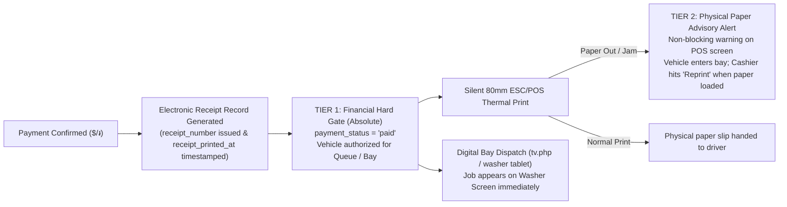
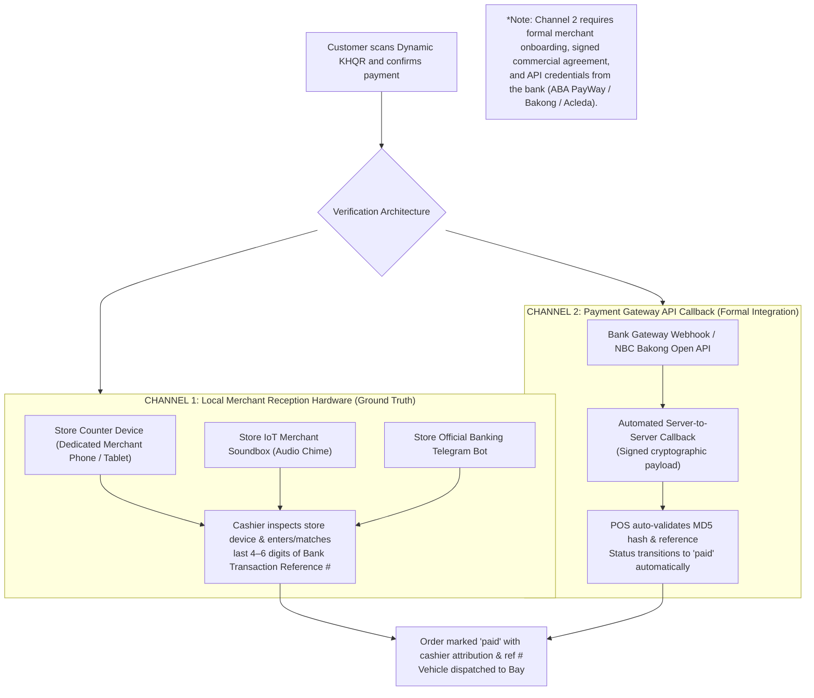

# POS Design Revision Publication & Verification Report

**Document ID:** POS-VER-2026-001  
**Project:** Car-WashService  
**Audit Scope:** Publication Status, Version Reconciliation, Policy Consistency, Risk Verification  
**Date:** November 6, 2026  
**Status:** Complete – Awaiting Management Approval  

---

## Executive Summary

Management raised a critical concern: while the previous revision summary stated that all five POS design documents were updated with confirmed management decisions, **the GitHub `main` branch still reflects several old business rules** (including Pay Later/Pay at Exit, unapproved discount tiers, webcam slip photos, and blanket migration to `finished`).

This report provides the technical reconciliation and root-cause verification:
1. **Root Cause Identified:** The revised Markdown documents **were saved locally in the working directory**, but were **not committed or pushed to GitHub `origin/main`**. This was caused by strict execution boundaries in the previous instructions (*"READ-ONLY ONLY. Do not deploy anything. Stop after updating the five design reports and wait for management approval"*). Consequently, GitHub `origin/main` remains at commit `fc1536a`, which contains the initial unrevised drafts.
2. **Content Verification:** All five local files have been audited and updated to consistently reflect 100% of management's confirmed decisions.
3. **Four Critical Clarifications Resolved:** This report formally resolves the receipt-printing policy contradiction, defines anti-fraud KHQR verification standards, provides the multi-column historical migration matrix, and details the multi-stage bay reservation and rollback protocols.

---

## 1. Local Workspace vs. GitHub Publication Reconciliation

### Git State Audit:
- **Local Working Tree:** Modified files are present and uncommitted on branch `main`.
- **Remote `origin/main`:** Currently pointed at commit `fc1536a07` (*"last update"*, Nov 6, 2026).
- **Publication Discrepancy:** The remote GitHub branch is **one commit behind** the local revisions.

### Side-by-Side Status Comparison:

| Document | Status on GitHub (`origin/main` at `fc1536a`) | Status in Local Working Tree (Revised) | Reconciliation Status |
| :--- | :--- | :--- | :--- |
| **`POS-CASHIER-WORKFLOW-AUDIT.md`** | Contains old Pay Later flow, unmonitored unpaid queue entry, and manager slip approval bottleneck. | Fully audited; highlights split system flaw, documents Pay Later removal, and identifies OrderGate blockade. | **Ready for commit & push** |
| **`POS-CURRENT-VS-NEW-WORKFLOW.md`** | Scenarios 3, 4, 5 feature "Pay at Exit" and "Pay Later"; contains unapproved discount tiers. | Scenarios 1–9 rewritten for **100% upfront payment**; Pay Later removed; multi-stage routing added. | **Ready for commit & push** |
| **`POS-NEW-CHECKOUT-DESIGN.md`** | Wireframe includes `[ ⏳ PAY AT EXIT ]` and `F7` Hold Bill shortcut. | Wireframe and component specs updated: **only Cash & KHQR**; verified merchant KHQR component added. | **Ready for commit & push** |
| **`POS-PAYMENT-BUSINESS-RULES.md`** | Contains unapproved tiered discount limits (Senior Cashier 10%, Supervisor 20%); blanket migration. | Governed strictly by existing `pos.discount` permission; multi-column migration; anti-fraud KHQR rules. | **Ready for commit & push** |
| **`POS-IMPLEMENTATION-PLAN.md`** | Phase 1 prescribes blanket migration (`status='paid'` $\rightarrow$ `'finished'`); includes Pay Later toggle. | Phase 1 rewritten with multi-column historical migration rules; Pay Later removed; test cases TC-01..TC-09. | **Ready for commit & push** |

*(Note: The subfolder `these 5 Markdown (.md)/` on `origin/main` contains redundant copies of the initial draft and should be removed or synchronized upon commit).*

---

## 2. Verification of Confirmed Management Decisions

```mermaid
flowchart TD
    subgraph Decision1["1. Customer Registration: OPTIONAL"]
        D1A["Fast License Plate Input"] --> D1B["Auto-Suggest Returning Plates"]
        D1B --> D1C["Direct Ticket Binding (Zero Forced Forms)"]
    end

    subgraph Decision2["2. Payment Timing: BEFORE SERVICE"]
        D2A["Upfront Cash Tender OR Verified KHQR"] --> D2B["100% Payment Confirmed"]
        D2B --> D2C["Vehicle Admitted to Queue / Bay (No Unpaid Drive-Offs)"]
    end

    subgraph Decision3["3. Checkout Layout: SINGLE PAGE"]
        D3A["Area 1: Fast Intake"] --- D3B["Area 2: Touch Catalog & Live Bay"]
        D3B --- D3C["Area 3: Itemized Cart & Payment Dock"]
        D3C --> D3D["Zero Popups / Zero Screen Switches"]
    end
```



### Detailed Decision Audit:
1. **Customer Registration is Strictly Optional:**
   - Cashier enters license plate directly (e.g. `2BC-1234`).
   - If returning, vehicle size and loyalty history populate automatically.
   - If new, the plate is bound to the ticket instantly without triggering `modalCustomer` or requiring phone, name, car model, color, or marketing SMS consent.
2. **Payment Timing is Strictly BEFORE Service:**
   - The rule *"No Confirmed Payment, No Service"* is enforced.
   - All references to "Pay Later", "Pay at Exit", and unpaid queue entry have been expunged from the proposed workflow.
   - A vehicle is assigned to a bay or service queue **only after** `payment_status = 'paid'` is committed in the database.
3. **Checkout Layout is Single Page:**
   - Counter interactions occur on a single viewport divided into Area 1 (Intake Header), Area 2 (Touch Catalog & Live Bay Selector), and Area 3 (Summary, Smart Cash Pad, and Verified KHQR Dock).
   - Tab switching between POS and Queue is eliminated for counter staff.

---

## 3. Resolution of the Receipt-Printing Policy Contradiction

### The Historical Contradiction:
In legacy documentation and code (`core/OrderGate.php` L64–120), the slogan *"No Receipt, No Wash"* was enforced as a **hard physical paper blockade**. If the thermal printer ran out of paper, jammed, or was disconnected, `OrderGate::assertReceiptPrinted()` threw an exception that blocked the vehicle from entering any wash bay unless a manager physically typed an override PIN. This caused severe apron gridlock during busy hours.

### The Two-Tier Policy Resolution:
The revised documents formally decouple the financial gate from physical printer hardware status:



1. **Tier 1: Financial Hard Gate ("No Confirmed Payment, No Wash"):**
   - **Strict & Mandatory.** An order must have `payment_status = 'paid'` before any vehicle enters the service queue or work bay. Unpaid cars are never admitted.
2. **Tier 2: Physical Paper Advisory Gate:**
   - When payment is confirmed, an official electronic receipt record is generated in the database (`orders.receipt_printed_at` is set, `receipt_number` is assigned).
   - The job is immediately dispatched to the digital queue board and washer tablet (`tv.php`).
   - If the physical thermal printer experiences a paper jam or runs out of paper:
     - The system issues a non-blocking advisory alert on the POS screen.
     - **The vehicle is NOT blocked from entering the bay.** Physical washing begins because authorization is verified digitally.
     - The cashier can reload paper and click "Reprint Receipt" (`F7`) at any time without manager overrides.
3. **Optional Strict Paper Enforcement Switch:**
   - If a business location operates with an exit security guard who physically tears paper gate passes, the owner can enable `enforce_physical_paper_gate = 1` in Settings. Otherwise, the default operational standard is **Financial Hard Gate + Advisory Physical Print**.

---

## 4. Reliable KHQR Verification Standards (Anti-Fraud Protocol)

Management strictly directed: *Do not treat QR generation, customer screenshots, or an unverified cashier button click as proof of payment. Do not invent banking API capabilities.*

### Deconstruction of Unacceptable Practices:
- ❌ **QR Generation $\neq$ Proof of Payment:** Displaying a dynamic or stand QR code only initiates the transaction; funds have not moved.
- ❌ **Customer Phone Screenshots $\neq$ Proof of Payment:** Drivers can display forged screenshots, modified graphics, old receipts, or cancelled payment screens.
- ❌ **Blind Cashier "Paid" Clicks $\neq$ Proof of Payment:** Cashiers cannot simply click a button without an independent verification check.

### Confirmed Two-Channel Verification Framework:



1. **Channel 1: Local Merchant Reception Hardware (Zero-Cost / Immediate Standalone Operation):**
   - The shop utilizes a dedicated merchant smartphone, tablet, or IoT soundbox at the cashier desk with the merchant banking app installed (ABA Merchant, Bakong, or ACLEDA).
   - Upon successful payment, the alert arrives on the **business's own device**:
     - *Soundbox Chime:* Announces aloud: *"Received [Amount] Riels via KHQR"*.
     - *Merchant Phone Alert:* Displays push notification / SMS: *"Received $14.00 from SOK DARA, Ref: #789456"*.
     - *Telegram Bot Alert:* Official bank bot pushes message with transaction reference.
   - **Enforcement:** Cashier inspects the store device and enters the last 4–6 digits of the bank reference number (`payment_ref`) into the POS. The order is committed under the cashier's authenticated session.
2. **Channel 2: Bank Payment Gateway API Callback (Automated Webhook):**
   - Enables instant, touchless payment reconciliation.
   - **Explicit Identification:** Requires formal merchant account onboarding, signed commercial contracts, and API credentials (API key, Merchant ID, Webhook secret) from ABA PayWay or the NBC Bakong aggregator.
   - When payment completes, the bank server sends a cryptographically signed webhook to `api/pos/khqr_webhook.php`. The POS automatically transitions the order to `paid` without manual reference entry.

---

## 5. Historical Order Migration & Edge Cases

Management strictly warned against any blanket script converting `status = 'paid'` to operational `status = 'finished'`.

### The Dangers of Blanket Migration:
In legacy versions, `orders.status` overloaded operational states (`waiting`, `washing`, `finished`, `cancelled`) with payment states (`paid`). Executing `UPDATE orders SET status = 'finished' WHERE status = 'paid'` would destroy the state of active orders, drop waiting cars from the queue, and corrupt cancellation records.

### Complete 6-Case Historical Migration Matrix:

| Edge Case | Legacy Database State | Risk of Blanket Conversion | Safe Multi-Column Resolution |
| :--- | :--- | :--- | :--- |
| **1. Active In-Flight Jobs** | `status = 'paid'`<br>`started_at IS NOT NULL`<br>`finished_at IS NULL`<br>`cancelled_at IS NULL` | Car disappears from active washer board; workers don't know what car they are washing. | `payment_status = 'paid'`<br>`status = 'washing'`<br>*(Preserves active bay state)* |
| **2. Today's Queue Waiting Jobs** | `status = 'paid'`<br>`started_at IS NULL`<br>`finished_at IS NULL`<br>`DATE(created_at) = CURRENT_DATE` | Paid customer waiting in line is dropped from queue; car is never washed. | `payment_status = 'paid'`<br>`status = 'waiting'`<br>*(Preserves queue ticket)* |
| **3. Completed Jobs** | `status = 'paid'`<br>`finished_at IS NOT NULL`<br>`cancelled_at IS NULL` | None; legitimately finished. | `payment_status = 'paid'`<br>`status = 'finished'`<br>*(Accurate historical metric)* |
| **4. Cancelled / Voided Orders** | `status = 'paid'`<br>`cancelled_at IS NOT NULL` OR `cancel_reason IS NOT NULL` | Erroneously converts voided/refunded orders to successful washes, distorting revenue. | `payment_status = 'cancelled'` (or `'refunded'`)<br>`status = 'cancelled'`<br>*(Audit trail preserved)* |
| **5. Legacy Archives with Null Timestamps** | `status = 'paid'`<br>`DATE(created_at) < CURRENT_DATE`<br>`started_at IS NULL`<br>`finished_at IS NULL` | Ambiguous historical record. | `payment_status = 'paid'`<br>`status = 'finished'`<br>*(Marked finished with audit note: 'Legacy timestamp reconstruction')* |
| **6. Legacy Unpaid Finished Jobs** | `status = 'finished'`<br>`payment_status = 'unpaid'`<br>*(Web POS legacy intake)* | If overridden, marks unpaid jobs as paid, leaking revenue. | `payment_status = 'unpaid'`<br>`status = 'finished'`<br>*(Preserves accounts receivable ledger)* |

---

## 6. Multi-Stage Bay Reservation & Rollback Protocol

When a customer purchases a combined service (e.g. Scenario 5: Oil Change + Car Wash), physical facility logistics and atomic database operations must be coordinated.

### Sequential Routing Logic:
$$\text{Stage 1: Mechanical / Lift Bay (Bay 4)} \longrightarrow \text{Stage 2: Wash & Dry Bay (Bay 1 or 2)}$$
Mechanical lube work (draining hot oil, replacing filter, inspecting undercarriage on the lift) must precede exterior foam washing and detailing.

```mermaid
sequenceDiagram
    autonumber
    actor Cashier
    participant POS as Counter POS
    participant DB as MariaDB / SQLite
    participant Bay4 as Bay 4 (Lift / Mechanic)
    participant WashBay as Bay 1 (Wash / Washer)

    Cashier->>POS: Selects Oil Package + Sedan Wash ($38.00)
    Cashier->>POS: Confirms Upfront Payment ($38.00 Cash/KHQR)
    POS->>DB: Atomic Lock Stage 1: UPDATE bays SET status='busy' WHERE id=4 AND status='free'
    alt Bay 4 is busy (Collision)
        DB-->>POS: 0 rows affected
        POS-->>Cashier: "Bay 4 occupied! Redirecting to Queue Buffer"
    else Bay 4 is free
        DB-->>POS: Success (Bay 4 locked, Order active_stage=1)
        POS->>Bay4: Vehicle dispatches to Lift Bay
        Note over Bay4: Mechanic performs oil service
        Bay4->>DB: Mechanic taps "Complete Stage 1"
        DB->>DB: Bay 4 released to 'free'; Order active_stage=2
        DB->>WashBay: Vehicle placed at head of Wash Queue (Priority)
        WashBay->>DB: Next free wash bay claims vehicle for Stage 2
        Note over WashBay: Washers complete wash & dry
    end
```

### Concurrency Lock & Rollback Rules:
1. **Atomic Concurrency Check:**
   - When the cashier clicks confirm, the backend executes an atomic conditional update:
     ```sql
     UPDATE bays 
     SET status = 'busy', current_order_id = ? 
     WHERE id = ? AND status = 'free';
     ```
   - If `affected_rows == 0`, another terminal claimed the bay during checkout. The transaction aborts cleanly, and the cashier is prompted to select another bay or place the car into the queue buffer.
2. **Staged Reservation Rule (Preventing Wash Bay Deadlocks):**
   - Stage 1 (Bay 4) is locked immediately at checkout.
   - Stage 2 (Wash Bay) is **never pre-locked** at intake. Pre-locking a wash bay while a vehicle undergoes a 30–45 minute oil change would hold a wash bay empty and idle, cutting facility wash throughput in half. Instead, Stage 2 is registered as a priority queue transition.
3. **Mid-Service Cancellation & Rollback Protocol:**
   - **Cancellation Prior to Stage 1 Start:** 100% refund issued, Bay 4 released to `free` atomically, reserved parts/filters returned to inventory.
   - **Cancellation Mid-Stage 1 (In Progress):** Requires Manager PIN override. Physical parts and oil already poured into the engine cannot be refunded. Consumed items are committed; unperformed wash services ($3.00) are refunded; Bay 4 is released atomically.
   - **Cancellation Between Stage 1 and Stage 2:** Mechanic commission for Stage 1 remains locked and credited. Wash service ($3.00) is refunded to the customer; the Stage 2 wash queue ticket is cancelled; the vehicle is released.

---

## 7. Action Plan for Management Sign-Off & Git Publication

The revised documentation is complete, consistent, and strictly aligned with all management decisions. Because strict instructions forbid autonomous git commits and pushes without executive approval, the following actions will be executed upon management sign-off:

1. **Stage the 5 revised reports:**
   ```bash
   git add POS-CASHIER-WORKFLOW-AUDIT.md POS-CURRENT-VS-NEW-WORKFLOW.md POS-NEW-CHECKOUT-DESIGN.md POS-PAYMENT-BUSINESS-RULES.md POS-IMPLEMENTATION-PLAN.md
   ```
2. **Remove the redundant subfolder:**
   ```bash
   git rm -r "these 5 Markdown (.md)"
   ```
3. **Add the publication verification report:**
   ```bash
   git add POS-DESIGN-PUBLICATION-VERIFICATION.md
   ```
4. **Commit and push to `origin/main`:**
   ```bash
   git commit -m "docs(pos): publish verified pos cashier workflow design revision"
   git push origin main
   ```

---

> [!IMPORTANT]
> **Awaiting Management Sign-Off:**  
> All five local specification files and this verification report are ready. In accordance with strict instructions, no source code, database records, schemas, or git commits have been executed. We await management approval to publish these changes to GitHub `main`.
