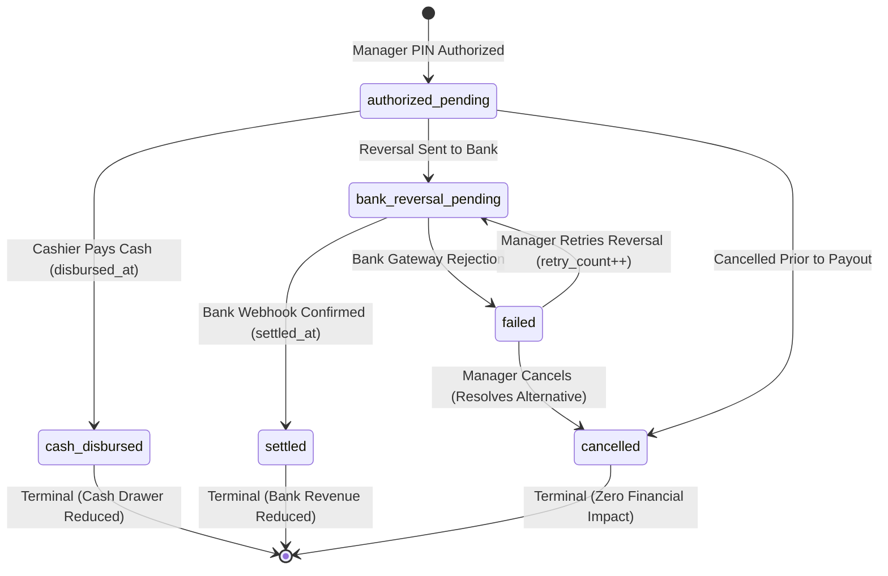

# Car Wash POS Final Business Rules & Operational Specifications

**Document ID:** POS-BR-2026-FINAL  
**Project:** Car-WashService  
**Scope:** Counter Cashier Workflow, Payment Governance, Refund State Machine, Accounting & Reporting Standards, Queue & Bay Management  
**Date:** November 7, 2026  
**Status:** Complete Specifications – Ready for Executive Approval & Implementation Planning  

---

## Executive Summary

This document defines the final, authoritative business rules for the Car-WashService Point-of-Sale (POS) counter system. It synthesizes confirmed management decisions with technical feasibility and accounting integrity.

The operational objective is to provide a **fast, frictionless single-page cashier checkout (< 15 seconds per vehicle)**, **positive payment confirmation prior to service entry ("No Payment, No Service")**, **100% offline local area network (LAN) self-sufficiency**, and **mathematically watertight financial reporting** that bridges legacy historical records with discrete transaction ledgers without omission or double-counting.

---

## 1. Core Architectural Standards & Workflows

### 1.1 Local Area Network (LAN) Self-Sufficiency Standard
1. **Zero External Cloud Dependencies for Counter Intake:**
   - Counter checkout, pricing calculation, cash tendering, cash drawer kick pulses, and 80mm ESC/POS thermal printing must operate completely autonomously within the shop's local Wi-Fi / Ethernet LAN.
   - All fonts (`Kantumruy Pro`, `Inter`), icons (`FontAwesome`), CSS stylesheets, and JavaScript libraries must be hosted locally (`/pos/webfonts/`, `/pos/css/`, `/pos/js/`). External CDNs are strictly prohibited.
2. **Offline Data Storage & Sync:**
   - In the event of LAN router disruption or counter client disconnect, checkout requests are queued in browser IndexedDB (`PosStorage`).
   - Upon reconnection, transactions are replayed sequentially using their original client-generated `idempotency_key`.

### 1.2 Single-Page Checkout Interface Layout
The cashier interface operates on a unified single-page layout divided into three distinct operational zones:
- **Zone 1 (Intake & Customer/Vehicle):** Quick search by license plate or phone; optional walk-in guest handling; vehicle category selection.
- **Zone 2 (Catalog & Selection):** Touch-friendly service packages, mechanical repair tasks, and retail car care products organized in clean category tabs.
- **Zone 3 (Cart Summary, Tender & Dispatch):** Live line-item review, automated dual-currency totals ($ USD and ៛ KHR), manager discount authorization gate, tender selection (Cash vs. KHQR), change calculation, and bay assignment.

---

## 2. Cashier Workflow Rules

### Rule 2.1: Optional Customer Registration (Walk-In Plate-First Intake)
1. **Customer Registration is Strictly Optional:**
   - Cashiers must **never** be forced to open a modal or require customer name/phone number before starting an order.
   - Walk-in customers who do not wish to provide personal information are registered simply by entering their vehicle license plate number.
2. **Mandatory Vehicle Capture:**
   - A valid license plate number (`plate_number`) is mandatory for all orders.
   - A vehicle category (`vehicle_type`) must be selected (`small_car`, `suv_pickup`, `van_truck`, `motorbike`) to establish accurate service pricing.
3. **Database Fallback Designation:**
   - If customer name is omitted by the cashier, the backend automatically records `customer_name = 'Walk-in Guest'` to satisfy database integrity while keeping customer registration optional.
   - If an existing vehicle plate is found in the database, the customer profile is linked automatically without requiring manual re-entry.

### Rule 2.2: Mandatory Upfront Payment ("Payment Before Service")
1. **Strict Upfront Payment Policy:**
   - Every vehicle must be fully paid and confirmed at the counter before being admitted into the service queue or work bay.
   - "Pay Later", "Pay at Exit", and unpaid post-service dispatch are **permanently removed** from the standard cashier workflow.
2. **Service Admission Gate (`core/OrderGate`):**
   - The system strictly enforces `orders.payment_status = 'paid'` as an immutable prerequisite before a vehicle appears on washer/mechanic job boards or can be assigned to a bay.
   - Unpaid orders are blocked with HTTP 422 (`PAYMENT_REQUIRED`).

### Rule 2.3: Idempotency & Duplicate Order Prevention
1. **Cart Idempotency Key:**
   - A unique UUID v4 `idempotency_key` is established when the cart session begins.
   - Rapid double-clicking, browser refreshes, or network retry attempts transmit the identical token.
2. **Backend Duplicate Handling:**
   - If an incoming `idempotency_key` matches an existing order, the backend does **not** insert a second row; it returns the existing order payload with HTTP 200 and `'is_duplicate' => true`.
3. **Button Debounce:**
   - The checkout button immediately disables and displays a spinner upon the first click, preventing accidental duplicate tender submissions.

### Rule 2.4: Printing Independence & Presentation Decoupling
1. **Physical Printing Decoupled from Financial & Service Progression:**
   - Printing a physical paper receipt is an asynchronous presentation action.
   - If the counter thermal printer runs out of paper, jams, or is powered off, the order is **not rolled back**, payment is **not duplicated**, and the car is **not blocked** from entering the service apron.
2. **Electronic Receipt Contract:**
   - Confirmed payment immediately generates an official electronic receipt number (`orders.receipt_number`) and timestamps electronic issuance (`orders.receipt_issued_at = NOW()`).
   - The job ticket is transmitted digitally to the apron queue display (`tv.php`) and worker tablets.
3. **Reprint Safety:**
   - Clicking "Reprint Receipt" is strictly read-only. It executes zero database mutations and prints with a clear `*** DUPLICATE RECEIPT ***` header watermark.

---

## 3. Payment Governance & Verification Standards

### Rule 3.1: Cash Tender & Dual-Currency Change Calculation
1. **Sufficient Cash Tender Requirement:**
   - Cash payment is confirmed only after the cashier counts and enters physical currency equal to or greater than the order total.
   - The POS interface provides "Exact Cash" and Quick-Tender denominations ($5, $10, $20, $50, $100 and equivalent KHR).
2. **Accurate Dual-Currency Change Display:**
   - The system automatically calculates change due in both currencies:
     $$\text{Change USD} = \text{Tendered USD} - \text{Total USD}$$
     $$\text{Change KHR} = \text{Change USD} \times \text{Exchange Rate}$$
   - Change is displayed in high-contrast, large-font typography (minimum 24pt bold green) to eliminate cashier calculation errors.
3. **Cash Drawer Pulse:**
   - Upon cash confirmation, an ESC/POS hardware kick pulse (`ESC p 0 25 250`) is dispatched to open the counter cash drawer.

### Rule 3.2: Anti-Fraud KHQR & Digital Bank Verification
1. **Positive Verification Requirement:**
   - A customer's smartphone screen showing a "successful transfer" screenshot is **strictly rejected as proof of payment**. Screenshots can be doctored, from previous visits, or cancelled.
   - Dynamic QR generation is **not proof of payment**; it is merely an invitation to pay.
   - Blind cashier button clicks without positive evidence are strictly prohibited.
2. **Approved Verification Channels:**
   Payment is confirmed ONLY when authentic evidence arrives on the business's own systems:
   - **Channel A (Store Counter Phone):** Official bank mobile push notification or SMS alert displaying matching amount, currency, and customer name.
   - **Channel B (IoT Merchant Soundbox):** Counter soundbox chimes audible confirmation: *"Received [Amount] via KHQR"*.
   - **Channel C (Merchant Telegram Bot):** Official bank merchant bot announces verified incoming payment with reference code.
   - **Channel D (Automated Bank Gateway Webhook):** Direct server-to-server callback verified cryptographically (HMAC-SHA512 / RSA-SHA256). *(Note: Requires formal commercial merchant onboarding).*
3. **Eradication of Synthetic Bank References:**
   - The backend must **never** generate fake reference strings (e.g., `TRX-` via `uniqid()`) to represent bank transactions.
   - The cashier must capture the genuine 4-to-8 digit bank transaction reference code (`payment_ref`) from the merchant alert.
4. **Unconfirmed Transfers Hold Protocol:**
   - If a customer claims payment was sent but no merchant alert arrives within 60 seconds (interbank latency), the vehicle is **held at the counter apron**. The car is never dispatched to a wash bay until funds are confirmed.

### Rule 3.3: Dual-Currency Accounting & Frozen Exchange Rates
1. **Discrete Currency Staging:**
   - All transactions store both `amount_usd` and `amount_khr`.
   - The exchange rate active at the exact moment of checkout is permanently frozen in the transaction row (`order_payments.exchange_rate`).
2. **Immunity to Rate Drift:**
   - Financial reports never recalculate historical transactions using live exchange rates. Historical revenue remains fixed and auditable.

### Rule 3.4: Discount & Price Override Governance
1. **Existing Permission Enforcement:**
   - Discounts directly reduce revenue and must strictly adhere to the existing permission `pos.discount`.
   - Cashiers lacking `pos.discount` must prompt for an authorized Manager PIN inline.
2. **Anti-Self-Approval:**
   - A manager acting as the counter cashier cannot enter their own PIN to approve discounts on their own checkout (`manager_user_id != cashier_id`).
3. **Attribution & Audit Logging:**
   - Every discount records `discount_usd`, `discount_approved_by`, and a mandatory reason (`Promotion`, `Loyalty Reward`, `Service Recovery`).

---

## 4. Refund Lifecycle & Concurrency Integrity

### Rule 4.1: Discrete Refund State Machine
Refunds are governed by a finite state machine ensuring separation between administrative approval, physical currency disbursement, and bank reconciliation:



### Rule 4.2: Permitted & Terminal Transitions
1. **Permitted Status Transitions:**
   - `authorized_pending` $\rightarrow$ `cash_disbursed`: Cashier hands cash from till to customer.
   - `authorized_pending` $\rightarrow$ `bank_reversal_pending`: POS dispatches digital reversal request.
   - `authorized_pending` $\rightarrow$ `cancelled`: Void aborted before currency leaves the till.
   - `bank_reversal_pending` $\rightarrow$ `settled`: Confirmed credit reversal from bank webhook/statement.
   - `bank_reversal_pending` $\rightarrow$ `failed`: Bank gateway rejects reversal (account closed, card expired).
   - `failed` $\rightarrow$ `bank_reversal_pending`: Manager retries with incremented `retry_count`.
   - `failed` $\rightarrow$ `cancelled`: Manager abandons digital reversal and resolves via cash or denies claim.
2. **Terminal States (Strictly Irreversible):**
   - `cash_disbursed`: Terminal. Banknotes handed to customer cannot be digitally retracted.
   - `settled`: Terminal. Bank credit cannot be reversed inside the POS.
   - `cancelled`: Terminal. Once voided, a refund cannot be revived; a new refund must be created.
   - Skipping intermediate verification (`authorized_pending` $\rightarrow$ `settled`) is strictly forbidden.

### Rule 4.3: Concurrency Protection Against Duplicate Disbursements
1. **Atomic Conditional Lock for Cash Disbursement:**
   ```sql
   UPDATE order_refunds 
   SET settlement_status = 'cash_disbursed', disbursed_at = NOW() 
   WHERE id = :refund_id AND settlement_status = 'authorized_pending';
   ```
   - If `rowCount === 0`, execution is aborted with HTTP 409 Conflict (`REFUND_ALREADY_DISBURSED_OR_CANCELLED`).
   - The hardware drawer kick pulse fires **only** if `rowCount === 1`. Rapid double-tapping cannot dispense money twice.
2. **Duplicate Bank Reversal Prevention:**
   - Inbound reversal webhooks check `webhook_events(provider, event_id)` for replay defense.
   - `order_refunds` enforces `UNIQUE INDEX uq_refund_bank_ref (payment_id, bank_reversal_ref)`. Duplicate callbacks return HTTP 200 `{ status: 'already_processed' }` with zero duplicate deductions.

### Rule 4.4: Cumulative Refund Ceiling
1. **Payment Balance Ceiling:**
   - The sum of all non-cancelled refunds on an order must never exceed the total confirmed payments collected on that order:
     $$\sum \text{Refunds}_{\text{non-cancelled}} + \text{New Refund} \le \text{Total Payments Collected}$$
   - Any attempt to disburse more than the original payment balance is rejected with HTTP 422 (`REFUND_EXCEEDS_PAYMENT_BALANCE`).
2. **Multiple Partial Refunds:**
   - An order supports multiple partial refunds (e.g., cancelling an unused detailing upgrade while retaining basic wash), each maintaining its own discrete ledger record and sequence number (`refund_seq = 1, 2, ...`).

---

## 5. Revenue, Reporting & Accounting Definitions

### Rule 5.1: Strict Financial Terminology Standards
To prevent executive misinterpretation, financial reports must strictly differentiate cash flow metrics from accounting profitability:
1. **Gross Confirmed Payments:** Total monetary inflow collected across all confirmed tenders ($ USD equivalent) during the reporting window.
2. **Settled Refunds:** Total money physically returned to customers (cash disbursed from drawer or cleared bank debit credits). **Only settled refunds reduce gross confirmed payments.**
3. **Pending Refund Liabilities:** Administratively authorized refunds awaiting physical cash disbursement or bank gateway clearing. **Reported as an informational liability; never subtracted from settled revenue.**
4. **Net Settled Payments:** Gross Confirmed Payments minus Settled Refunds. Represents authentic net cash/bank inflow retained in the business.
5. **Net Settled Payments $\ne$ Profit:**
   - Net Settled Payments represents **Net Cash Collections**, NOT business profit.
   - **True Accounting Net Profit** requires deducting Cost of Goods Sold (chemical/stock COGS), washer labor commissions, mechanic labor commissions, and facility operating overhead (rent, utilities, water, electricity).
   - POS reports must label cash flow summaries as **Net Settled Revenue** or **Net Retained Tender**, never as "Net Profit".

### Rule 5.2: Accounting Treatment Table
| Refund Lifecycle State | Gross Payments Collected | Settled Refunds | Counter Cash Drawer Till | Net Settled Revenue | Pending Liabilities | Net Realizable Revenue |
| :--- | :---: | :---: | :---: | :---: | :---: | :---: |
| `authorized_pending` | Unchanged | **$0.00** | **Unchanged** | **Unchanged** | **+$Amount** | **-$Amount** |
| `cash_disbursed` | Unchanged | **+$Amount** | **-$Amount** | **-$Amount** | $0.00 | **-$Amount** |
| `bank_reversal_pending` | Unchanged | **$0.00** | **Unchanged** | **Unchanged** | **+$Amount** | **-$Amount** |
| `settled` | Unchanged | **+$Amount** | **Unchanged** | **-$Amount** | $0.00 | **-$Amount** |
| `failed` | Unchanged | **$0.00** | **Unchanged** | **Unchanged** | **$0.00** (Alert) | Unchanged |
| `cancelled` | Unchanged | **$0.00** | **Unchanged** | **Unchanged** | **$0.00** | Unchanged |

### Rule 5.3: Decoupled Two-Tier Reporting & Future Event Isolation
1. **Decoupled Fallback Formulation:**
   - Historical orders created prior to cutover (`created_at < :cutover_ts`) must decouple payment fallback from refund fallback.
   - The presence of a post-cutover refund in `order_refunds` must **never** cause Tier 2 to omit the original historical payment.
2. **Future Event Isolation (Zero Retroactive Subtraction):**
   - Subqueries offsetting historical sums must restrict ledger lookups to `recorded_at <= :end_date`.
   - Transactions occurring in subsequent months (e.g. November/December) must **never** be subtracted from past reporting periods (e.g. October).

---

## 6. Service Admission & OrderGate Policy

### Rule 6.1: Service Gate Resolution
1. **Financial Hard Gate ("No Payment, No Wash"):**
   - Service admission is strictly gated on confirmed payment (`payment_status = 'paid'`) and electronic receipt issuance (`receipt_issued_at IS NOT NULL`).
2. **Physical Printing Advisory Standard (Default):**
   - Physical paper deposition is decoupled. Hardware printer failure displays an advisory warning on the POS counter screen but **does not block** apron technicians from starting work.
3. **Optional Hard Paper Gate Setting:**
   - For facilities employing dedicated gate security personnel who physically inspect paper slips, an explicit configuration toggle `require_receipt_before_wash` is maintained in `settings`.
   - If enabled by management, physical paper printing remains a mandatory hard block (with manager PIN override). If disabled (recommended default), the electronic receipt acts as the definitive admission ticket.

---

## 7. Bay Assignment & Queue Management

### Rule 7.1: Atomic Bay Reservation & State Checking
1. **No Presumption of Availability:**
   - A bay is never assumed to be free based on cached client state.
   - Assignment executes an atomic conditional lock:
     ```sql
     UPDATE bays 
     SET status = 'busy', current_order_id = ?, occupied_at = NOW() 
     WHERE id = ? AND status = 'free' AND is_active = 1;
     ```
   - If `rowCount === 0`, the vehicle is redirected to the Priority Queue buffer without data corruption.
2. **Intake Hold TTL & Occupied Bay Safety:**
   - Cashier intake holds on bays expire strictly at 180 seconds (3 minutes).
   - The expiry cleanup sweep verifies `physical_occupancy = 'vacant'` and `current_order_id IS NULL`. A bay actively occupied by a vehicle is **never auto-released by a timer**.

### Rule 7.2: Multi-Stage Bay Dispatch Sequence
1. **Mixed Service Order Sequencing:**
   - For orders containing both mechanical lube work and exterior washing, the physical routing sequence must be explicitly configured by shop management.
   - *Recommended Engineering Standard:* Lift / Undercarriage Mechanical Work (Bay 4, Stage 1) $\rightarrow$ Wash & Dry (Bay 1 or 2, Stage 2). Hot fluids and dirty filters are serviced first; the car is cleaned and dried immediately prior to customer handover.
2. **Staged Reservation Rule:**
   - Stage 1 is claimed at checkout. Stage 2 is **never pre-locked** at checkout, preventing empty wash bays from sitting idle while cars undergo 45-minute mechanical services. Stage 2 is automatically queued at the head of the wash queue upon Stage 1 completion.
