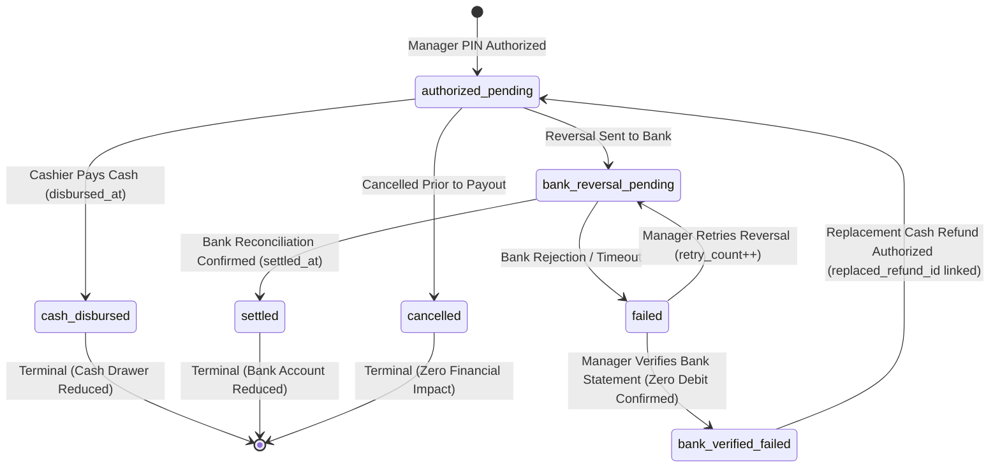

# Car Wash POS Final Business Rules & Operational Specifications

**Document ID:** POS-BR-2026-FINAL
**Project:** Car-WashService
**Scope:** Counter Cashier Workflow, Payment Governance, Refund State Machine, Accounting & Reporting Standards, Queue & Bay Management
**Date:** November 8, 2026 (Updated - Round 8)
**Status:** Authoritative Business Rules & Technical Design Specifications – Subject to Separate Executive Authorization (NOT Production-Ready Until Released)

---

## Executive Summary

This document defines the authoritative business rules for the Car-WashService Point-of-Sale (POS) counter system. It integrates the **six business decisions confirmed by the business owner on November 8, 2026**, establishing a simple, high-speed cashier workflow, positive payment verification before service admission ("Payment Before Service"), 100% local area network (LAN) self-sufficiency, and mathematically certified accounting separation between cash revenue and operating profit.

All business policies approved by the owner are clearly separated from technical design proposals and unresolved technical dependencies.

---

## 1. Core Architectural Standards & Workflows

### 1.1 Local Area Network (LAN) Self-Sufficiency Standard
1. **Zero External Cloud Dependencies for Counter Intake:**
   - Counter checkout, catalog pricing, cash tendering, cash drawer kick pulses, ESC/POS 80mm thermal printing, and bay dispatching must operate completely autonomously within the shop's local Wi-Fi / Ethernet LAN.
   - All fonts (`Kantumruy Pro`, `Inter`), typography assets, icon sets (`FontAwesome`), CSS stylesheets, and JavaScript files must be hosted locally on the counter server (`pos/webfonts/`, `pos/css/`, `pos/js/`). External CDNs and cloud endpoints are strictly prohibited during normal intake operations.
2. **Offline Data Storage & Sync:**
   - In the event of LAN router disruption or counter client disconnect, checkout requests are safely staged in browser IndexedDB (`PosStorage`).
   - Upon reconnection, transactions are replayed sequentially using their original client-generated `idempotency_key`.

### 1.2 Single-Page Checkout Interface Layout
The cashier interface operates on a unified single-page layout divided into three distinct operational zones:
- **Zone 1 (Intake & Customer/Vehicle):** Quick search by license plate or phone; walk-in guest intake; vehicle category selection.
- **Zone 2 (Catalog & Selection):** Touch-friendly service packages, mechanical repair tasks, and retail car care products organized in clean category tabs.
- **Zone 3 (Cart Summary, Tender & Dispatch):** Live line-item review, automated dual-currency totals ($ USD and ៛ KHR), manager discount authorization gate, tender selection (Cash vs. KHQR), change calculation, and bay assignment.

---

## 2. Cashier Workflow Rules

### Rule 2.1: Optional Customer Registration & Walk-In Intake (Owner Decision 3)
1. **Customer Registration is Strictly Optional:**
   - Cashiers must **never** be forced to open a customer registration modal or require customer name/phone number before starting an order.
   - Walk-in customers who do not wish to provide personal details are processed simply by entering their vehicle license plate number.
2. **Mandatory License Plate Capture:**
   - A valid license plate string (`plate_number`) is mandatory for all vehicle service orders to identify the car on the apron and digital job boards.
   - A vehicle category (`vehicle_type`) must be selected (`small_car`, `suv_pickup`, `van_truck`, `motorbike`) to establish accurate service pricing per vehicle dimensions.
   - No unapproved mandatory fields (such as VIN or customer phone number) may be introduced.
3. **Database Schema Preservation:**
   - The database schema `customer_name VARCHAR(100) NOT NULL` (in [init.php](database/init.php#L251)) is preserved without high-risk `ALTER TABLE` schema modifications.
   - If customer name is omitted by the cashier, the backend automatically records `customer_name = 'Walk-in Guest'`, satisfying schema constraints while honoring optional registration.
   - If an existing vehicle plate is found in the database, the customer profile is linked automatically without requiring manual re-entry.

### Rule 2.2: Mandatory Upfront Payment ("Payment Before Service")
1. **Strict Upfront Payment Policy:**
   - Every vehicle must have confirmed payment at the counter before being admitted into the service queue or work bay.
   - "Pay Later", "Pay at Exit", and unpaid post-service dispatch are **permanently removed** from the standard cashier workflow.
2. **Service Admission Gate ([OrderGate.php](core/OrderGate.php)):**
   - The system strictly enforces `orders.payment_status = 'paid'` as an immutable prerequisite before a vehicle appears on washer/mechanic job boards or can be assigned to a bay.
   - Unpaid orders are blocked with HTTP 422 (`PAYMENT_REQUIRED`).

### Rule 2.3: Idempotency & Duplicate Order Prevention
1. **Cart Idempotency Key:**
   - A unique UUID v4 `idempotency_key` is established when the cart session begins.
   - Rapid double-clicking, browser refreshes, or network retry attempts transmit the identical token.
2. **Backend Duplicate Handling:**
   - If an incoming `idempotency_key` matches an existing order, the backend does **not** insert a second row; it returns the existing order payload with HTTP 200 and `'is_duplicate' => true`.
3. **Button Debounce:**
   - The checkout button immediately disables and displays a spinner upon the first click, preventing accidental duplicate tender submissions.

### Rule 2.4: Printing Independence & Presentation Decoupling (Owner Decision 2)
1. **Physical Printing is Strictly Advisory:**
   - Printing a physical paper receipt is an asynchronous presentation action.
   - If the counter thermal printer runs out of paper, jams, has its print head open, or is powered off, the order is **not rolled back**, payment is **not duplicated**, and the car is **not blocked** from entering the service apron.
2. **Electronic Receipt Service Gate:**
   - Confirmed payment immediately generates an official electronic receipt number (`orders.receipt_number`) and timestamps electronic issuance (`orders.receipt_issued_at = NOW()`).
   - The electronic receipt issuance and confirmed payment constitute the complete service admission pass.
   - The job ticket is transmitted digitally to the apron queue display (`tv.php`) and worker tablets.
3. **Unapproved Policy Clarification:**
   - Any proposal to introduce an optional `require_receipt_before_wash` setting is an **unapproved proposal requiring a separate owner decision**. The approved corporate policy is that electronic receipt issuance alone gates service admission.
4. **Read-Only Reprint Safety:**
   - Clicking "Reprint Receipt" is strictly read-only (`GET /api/pos/index.php?action=print_receipt`). It executes zero database mutations and prints with a clear `*** DUPLICATE RECEIPT ***` header watermark.

---

## 3. Payment Governance & Verification Standards

### Rule 3.1: Cash Tender & Dual-Currency Change Calculation
1. **Sufficient Cash Tender Requirement:**
   - Cash payment is confirmed only after the cashier counts and enters physical currency equal to or greater than the order total.
   - The POS interface provides "Exact Cash" and Quick-Tender denominations ($5, $10, $20, $50, $100 and equivalent KHR).
2. **Accurate Dual-Currency Change Display:**
   - The system automatically calculates change due in both currencies:
     $$\text{Change USD} = \text{Tendered USD} - \text{Total USD}$$
     $$\text{Change KHR} = \text{Change USD} \times \text{Exchange Rate}$$
   - Change is displayed in high-contrast, large-font typography (minimum 24pt bold green) to eliminate cashier calculation errors.
3. **Cash Drawer Pulse:**
   - Upon cash confirmation, an ESC/POS hardware kick pulse (`ESC p 0 25 250`) is dispatched to open the counter cash drawer.

### Rule 3.2: Anti-Fraud KHQR & Digital Bank Verification (Owner Decision 5)
1. **Positive Verification Requirement:**
   - A customer's smartphone screen showing a "successful transfer" screenshot is **strictly rejected as proof of payment**. Screenshots can be doctored, reused from previous visits, or cancelled before broadcast.
   - Dynamic QR generation is **not proof of payment**; it is merely an invitation to pay.
   - Blind cashier button clicks without positive evidence are strictly prohibited.
2. **Approved Verification Channels (Local LAN Scope):**
   Payment is confirmed ONLY when authentic evidence arrives on the business's own merchant devices:
   - **Channel A (Store Counter Phone App / Push):** Official bank mobile push notification or SMS alert displaying matching amount, currency, and customer name.
   - **Channel B (IoT Merchant Soundbox):** Counter soundbox chimes audible confirmation: *"Received [Amount] via KHQR"*.
   - *Soundbox Ambiguity Safeguard:* An audible chime alone alerts the cashier, but if multiple customers are paying simultaneously or amounts are identical, the soundbox chime alone is insufficient; the cashier **must match the transaction on the counter merchant phone**.
3. **Genuine Bank Transaction References (No Synthetic TRX):**
   - The backend must **never** generate fake reference strings (e.g., `TRX-` via `uniqid()`) to represent bank transactions.
   - The cashier captures the genuine 4-to-8 digit bank transaction reference code (`payment_ref`) from the merchant bank notification.
4. **Scoped Uniqueness & Unresolved Dependencies:**
   - Digital transaction uniqueness must be scoped to provider and merchant account:
     `UNIQUE (provider, merchant_account_id, payment_ref)`
   - Cash payments do **not** require a digital reference and must not be constrained by bank uniqueness indexes.
   - *Unresolved Technical Dependency:* The exact reference format, character set, length, and uniqueness guarantees from ABA Bank and NBC Bakong must be confirmed with official bank documentation or verified merchant procedures before locking database constraints.
5. **Unconfirmed Transfers Hold Protocol:**
   - If a customer claims payment was sent but no merchant alert arrives within 60 seconds (interbank latency), the vehicle is **held at the counter apron**. The car is never dispatched to a wash bay until funds are confirmed.

### Rule 3.3: Dual-Currency Accounting & Frozen Exchange Rates
1. **Discrete Currency Staging:**
   - All transactions store both `amount_usd` and `amount_khr`.
   - The exchange rate active at the exact moment of checkout is permanently frozen in the transaction row (`order_payments.exchange_rate`).
2. **Immunity to Rate Drift:**
   - Financial reports never recalculate historical transactions using live exchange rates. Historical revenue remains fixed and auditable.

### Rule 3.4: Discount & Price Override Governance
1. **Existing Permission Enforcement:**
   - Discounts directly reduce revenue and must strictly adhere to the existing permission `pos.discount`.
   - Cashiers lacking `pos.discount` must prompt for an authorized Manager PIN inline.
2. **Anti-Self-Approval:**
   - A manager acting as the counter cashier cannot enter their own PIN to approve discounts on their own checkout (`manager_user_id != cashier_id`).
3. **Attribution & Audit Logging:**
   - Every discount records `discount_usd`, `discount_approved_by`, and a mandatory reason (`Promotion`, `Loyalty Reward`, `Service Recovery`).

---

## 4. Refund Lifecycle & Concurrency Integrity

### Rule 4.1: Discrete Refund State Machine
Refunds are governed by a finite state machine ensuring strict separation between administrative approval, physical currency disbursement, external bank reconciliation, and cash replacement safety:



### Rule 4.2: Permitted & Terminal Transitions
1. **Permitted Status Transitions:**
   - `authorized_pending` $\rightarrow$ `cash_disbursed`: Cashier hands cash from till to customer.
   - `authorized_pending` $\rightarrow$ `bank_reversal_pending`: POS registers digital reversal request.
   - `authorized_pending` $\rightarrow$ `cancelled`: Void aborted before currency leaves the till.
   - `bank_reversal_pending` $\rightarrow$ `settled`: Confirmed credit reversal from bank statement/reconciliation.
   - `bank_reversal_pending` $\rightarrow$ `failed`: Bank rejects reversal (account closed, invalid card, timeout).
   - `failed` $\rightarrow$ `bank_reversal_pending`: Manager retries with incremented `retry_count`.
   - `failed` $\rightarrow$ `bank_verified_failed`: Manager verifies via merchant bank portal that no debit occurred.
   - `bank_verified_failed` $\rightarrow$ `authorized_pending`: Replacement cash refund row generated with explicit link to failed reversal.
2. **Terminal States (Strictly Irreversible):**
   - `cash_disbursed`: Terminal. Banknotes handed to customer cannot be digitally retracted.
   - `settled`: Terminal. Bank credit cannot be reversed inside the POS.
   - `cancelled`: Terminal. Once voided, a refund cannot be revived; a new refund must be created.
   - Skipping intermediate verification (`authorized_pending` $\rightarrow$ `settled`) is strictly forbidden.

### Rule 4.3: Concurrency Protection & Bank Reversal Safety
1. **Atomic Conditional Lock for Cash Disbursement:**
   ```sql
   UPDATE order_refunds
   SET settlement_status = 'cash_disbursed', disbursed_at = NOW()
   WHERE id = :refund_id AND settlement_status = 'authorized_pending';
   ```
   - If `rowCount === 0`, execution is aborted with HTTP 409 Conflict (`REFUND_ALREADY_DISBURSED_OR_CANCELLED`).
   - The hardware drawer kick pulse fires **only** if `rowCount === 1`. Rapid double-tapping cannot dispense money twice.
2. **Failed Bank Reversal Safety (Dual-Payout Prevention Standard):**
   - **No Automated Assumption:** A local database status update alone must **never** be treated as proof that the bank cannot later settle a reversal. Changing a failed reversal row to `'cancelled'` does not stop bank clearinghouse processing.
   - **Verification Gate:** Before any replacement cash payout can be authorized, the cashier/manager **must verify the final bank outcome** (e.g. by checking the merchant bank account statement to confirm no funds were deducted).
   - **Mandatory Blockade if Ambiguous:** If the bank's final outcome cannot be verified or remains pending, the replacement cash payout **must remain blocked pending reconciliation**.
   - **Append-Only History & Replacement Link:** Once verified as permanently failed, a manager enters a PIN to generate a replacement cash refund. The original failed attempt is preserved in an append-only audit trail, and the new refund row records `replaced_refund_id = [failed_refund_id]`.

### Rule 4.4: Cumulative Refund Ceiling & Multi-Refunds
1. **Payment Balance Ceiling:**
   - The sum of all non-cancelled refunds on an order must never exceed the total confirmed payments collected on that order:
     $$\sum \text{Refunds}_{\text{non-cancelled}} + \text{New Refund} \le \text{Total Payments Collected}$$
   - Any attempt to disburse more than the original payment balance is rejected with HTTP 422 (`REFUND_EXCEEDS_PAYMENT_BALANCE`).
2. **Multiple Partial Refunds:**
   - An order supports multiple partial refunds (e.g., cancelling an unused detailing upgrade while retaining basic wash), each maintaining its own discrete ledger record and sequence number (`refund_seq = 1, 2, ...`).

---

## 5. Revenue, Reporting & Accounting Definitions

### Rule 5.1: Strict Financial Terminology Standards (Owner Decision 6)
To prevent executive misinterpretation, financial reports must strictly differentiate cash flow metrics from accounting profitability:
1. **Gross Confirmed Payments:** Total monetary inflow collected across all confirmed tenders ($ USD equivalent) during the reporting window.
2. **Settled Refunds:** Total money physically returned to customers (cash disbursed from drawer or cleared bank debit credits). **Only settled refunds reduce gross confirmed payments.**
3. **Pending Refund Liabilities:** Administratively authorized refunds awaiting physical cash disbursement or bank clearing. **Reported as an informational liability; never subtracted from settled revenue.**
4. **Net Settled Revenue:** Gross Confirmed Payments minus Settled Refunds. Represents authentic net cash/bank inflow retained in the business.
5. **Net Operating Profit:**
   $$\text{Net Operating Profit} = \text{Net Settled Revenue} - (\text{COGS} + \text{Washer Commissions} + \text{Mechanic Commissions} + \text{Logged Expenses})$$
6. **Untracked Cost Safeguard (Missing COGS Rule):**
   - If services or parts lack cost records in the database, Net Operating Profit **must not assume $0.00 COGS**.
   - The report must flag an **"Untracked Cost Alert"** indicating the number of line items (`untracked_cost_count`) and volume of sales lacking COGS data.

### Rule 5.2: Reporting Timestamps & Recognition Matrix
Financial reporting distinguishes three distinct event timestamps:
- `provider_event_at`: External provider/bank timestamp.
- `recorded_at`: Local counter POS ledger recording timestamp.
- `disbursed_at` / `settled_at`: Physical currency departure (`disbursed_at`) or bank settlement clearing (`settled_at`).

| Tender / Event Type | Reporting Recognition Timestamp | Accounting Treatment |
| :--- | :--- | :--- |
| **Cash Payment** | `recorded_at` | Added to Gross Payments for the shift/period. |
| **Manually Verified KHQR** | `recorded_at` | Added to Gross Payments based on counter confirmation time. (`provider_event_at` retained for audit). |
| **Cash Refund** | `disbursed_at` | Subtracted from Gross Payments to arrive at Net Settled Revenue. |
| **Settled Digital Refund** | `settled_at` | Subtracted from Gross Payments to arrive at Net Settled Revenue. |
| **Authorized Pending Refund** | None (Informational) | Displayed as Pending Liability; zero impact on Net Settled Revenue. |
| **Failed Reversal** | None (Informational) | Displayed as Operational Alert; zero financial impact. |
| **Cancelled Refund** | None (Informational) | Terminal; zero financial impact. |

> [!NOTE]
> **Schema Design Dependency:**
> In the existing MariaDB schema ([init.php](database/init.php)), `orders` possesses only `paid_at`, `created_at`, and `cancelled_at`. Discrete columns `provider_event_at`, `recorded_at`, `disbursed_at`, and `settled_at` belong to the proposed `order_payments` and `order_refunds` schema and require implementation during Phase 2.

### Rule 5.3: Decoupled Period-Aware Reporting & Historical Fallback Architecture
1. **Strict Period Boundaries:**
   - All reporting queries must bound **both** start and end using a half-open interval:
     `event_timestamp >= :start_timestamp AND event_timestamp < :end_timestamp`
2. **Handling Delayed Notifications:**
   - Transactions recorded or settled after a period boundary belong to the subsequent reporting period based on their effective recognition timestamp, ensuring closed historical periods remain immutable.
3. **Decoupled, Period-Aware Historical Fallback (Removal of All-or-Nothing Logic):**
   - Payment fallback and refund fallback are evaluated independently and per reporting period.
   - A pre-cutover order with an original payment recorded on `orders` and a post-cutover partial refund recorded in `order_refunds` must include the payment in the pre-cutover period and the refund in the post-cutover period. Neither transaction may be omitted or double-counted.
   - Multiple partial refunds on pre-cutover orders are each recognized at their respective settlement timestamps.
4. **Historical Unreconciled Exceptions Tab (Owner Decision 4):**
   - Historical records with contradictory timestamps are preserved untouched.
   - An informational **"Historical Unreconciled Exceptions"** tab in [reports.php](views/owner/reports.php) provides visibility into test and pre-cutover anomalies without distorting active financial ledgers.

---

## 6. Service Admission & OrderGate Policy

### Rule 6.1: Service Gate Resolution (Owner Decision 2)
1. **Financial Hard Gate ("Payment Before Service"):**
   - Service admission is strictly gated on confirmed payment (`payment_status = 'paid'`) and electronic receipt issuance (`receipt_issued_at IS NOT NULL`).
2. **Physical Printing Advisory Standard (Default):**
   - Physical paper deposition is decoupled. Hardware printer failure displays an advisory warning on the POS counter screen but **does not block** apron technicians from starting work.
3. **Unapproved Policy Clarification:**
   - Any physical-printing gate is an **unapproved proposal requiring a separate owner decision**. The approved corporate policy is that electronic receipt issuance alone gates service admission.

---

## 7. Bay Assignment & Queue Management

### Rule 7.1: Atomic Bay Reservation & State Checking
1. **No Presumption of Availability:**
   - A bay is never assumed to be free based on cached client state.
   - Assignment executes an atomic conditional lock:
     ```sql
     UPDATE bays
     SET status = 'busy', current_order_id = ?, occupied_at = NOW()
     WHERE id = ? AND status = 'free' AND is_active = 1;
     ```
   - If `rowCount === 0`, the vehicle is redirected to the Priority Queue buffer without data corruption.
2. **Intake Hold TTL & Occupied Bay Safety:**
   - Cashier intake holds on bays expire strictly at 180 seconds (3 minutes).
   - The expiry cleanup sweep verifies `physical_occupancy = 'vacant'` and `current_order_id IS NULL`. A bay actively occupied by a vehicle is **never auto-released by a timer**.

### Rule 7.2: Multi-Stage Bay Dispatch Sequence (Owner Decision 1)
1. **Mixed Service Order Sequencing (Lift First $\rightarrow$ Wash Second):**
   - For orders containing both mechanical lube work and exterior washing, the physical routing sequence is standardized:
     **Step 1: Mechanical Lift (Bay 4) $\rightarrow$ Step 2: Wash & Dry (Bay 1 or 2)**.
   - Hot fluid drainage, oil filter changes, and dirty undercarriage repairs finish first. The car receives a complete exterior wash, hand wipe-down, and tire shine as the final step before customer handover.
2. **Staged Reservation Rule:**
   - Stage 1 (Mechanical Lift) is claimed at checkout.
   - Stage 2 (Wash Bay) is **never pre-locked** at checkout, preventing empty wash bays from sitting idle while cars undergo 45-minute mechanical services. Stage 2 is automatically queued at the head of the wash queue upon Stage 1 completion.

---

## Governance & Release Status

* **Status:** Specifications Complete – Subject to Separate Executive Authorization
* **Verification Matrix:** The 58 test cases in [POS-IMPLEMENTATION-TEST-MATRIX.md](POS-IMPLEMENTATION-TEST-MATRIX.md) represent **planned test specifications**; they remain unexecuted until authorized testing begins.
* **Production Readiness:** The system is **NOT production-ready** until implementation work packages and verification acceptance tests are executed and formally signed off by executive management.
