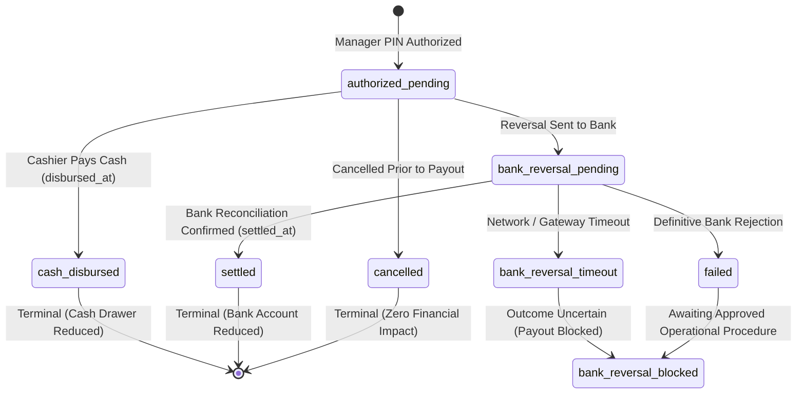

# Car Wash POS Final Business Rules & Operational Specifications

**Document ID:** POS-BR-2026-FINAL
**Project:** Car-WashService
**Scope:** Counter Cashier Workflow, Payment Governance, Refund State Machine, Accounting & Reporting Standards, Queue & Bay Management
**Date:** November 8, 2026 (Updated - Round 12 Closure)
**Status:** Authoritative Business Rules & Technical Design Specifications – Subject to Separate Executive Authorization (NOT Production-Ready Until Released)

---

## Executive Summary

This document defines the authoritative business rules for the Car-WashService Point-of-Sale (POS) counter system. It integrates the **six business decisions confirmed by the business owner on November 8, 2026**, establishing a simple, high-speed cashier workflow, positive payment verification before service admission ("Payment Before Service"), 100% local area network (LAN) self-sufficiency, and mathematically certified accounting separation between cash revenue and operating profit.

All business policies approved by the owner are clearly separated from technical design proposals and unresolved technical dependencies.

---

## 1. Core Architectural Standards & Workflows

### 1.1 Local Area Network (LAN) Self-Sufficiency Standard
1. **Zero External Cloud Dependencies for Counter Intake:**
   - Counter checkout, catalog pricing, cash tendering, cash drawer kick pulses, ESC/POS 80mm thermal printing, and bay dispatching must operate completely autonomously within the shop's local Wi-Fi / Ethernet LAN.
   - All fonts (`Kantumruy Pro`, `Inter`), typography assets, icon sets (`FontAwesome`), CSS stylesheets, and JavaScript files must be hosted locally on the counter server (`pos/webfonts/`, `pos/css/`, `pos/js/`). External CDNs and cloud endpoints are strictly prohibited during normal intake operations.
2. **Offline Data Storage & Sync:**
   - In the event of LAN router disruption or counter client disconnect, checkout requests are safely staged in browser IndexedDB (`PosStorage`).
   - Upon reconnection, transactions are replayed sequentially using their original client-generated `idempotency_key`.

### 1.2 Single-Page Checkout Interface Layout
The cashier interface operates on a unified single-page layout divided into three distinct operational zones:
- **Zone 1 (Intake & Customer/Vehicle):** Quick search by license plate or phone; walk-in guest intake; vehicle category selection.
- **Zone 2 (Catalog & Selection):** Touch-friendly service packages, mechanical repair tasks, and retail car care products organized in clean category tabs.
- **Zone 3 (Cart Summary, Tender & Dispatch):** Live line-item review, automated dual-currency totals ($ USD and ៛ KHR), manager discount authorization gate, tender selection (Cash vs. KHQR), change calculation, and bay assignment.

---

## 2. Cashier Workflow Rules

### Rule 2.1: Optional Customer Registration & Walk-In Intake (Owner Decision 3)
1. **Customer Registration is Strictly Optional:**
   - Cashiers must **never** be forced to open a customer registration modal or require customer name/phone number before starting an order.
   - Walk-in customers who do not wish to provide personal details are processed simply by entering their vehicle license plate number.
2. **Mandatory License Plate Capture:**
   - A valid license plate string (`plate_number`) is mandatory for all vehicle service orders to identify the car on the apron and digital job boards.
   - A vehicle category (`vehicle_type`) must be selected (`small_car`, `suv_pickup`, `van_truck`, `motorbike`) to establish accurate service pricing per vehicle dimensions.
   - No unapproved mandatory fields (such as VIN or customer phone number) may be introduced.
3. **Database Schema Preservation:**
   - The database schema `customer_name VARCHAR(100) NOT NULL` (in [init.php](database/init.php#L251)) is preserved without high-risk `ALTER TABLE` schema modifications.
   - If customer name is omitted by the cashier, the backend automatically records `customer_name = 'Walk-in Guest'`, satisfying schema constraints while honoring optional registration.
   - If an existing vehicle plate is found in the database, the customer profile is linked automatically without requiring manual re-entry.

### Rule 2.2: Mandatory Upfront Payment ("Payment Before Service")
1. **Strict Upfront Payment Policy:**
   - Every vehicle must have confirmed payment at the counter before being admitted into the service queue or work bay.
   - "Pay Later", "Pay at Exit", and unpaid post-service dispatch are **permanently removed** from the standard cashier workflow.
2. **Service Admission Gate ([OrderGate.php](core/OrderGate.php)):**
   - The system strictly enforces `orders.payment_status = 'paid'` as an immutable prerequisite before a vehicle appears on washer/mechanic job boards or can be assigned to a bay.
   - Unpaid orders are blocked with HTTP 422 (`PAYMENT_REQUIRED`).

### Rule 2.3: Idempotency & Duplicate Order Prevention
1. **Cart Idempotency Key:**
   - A unique UUID v4 `idempotency_key` is established when the cart session begins.
   - Rapid double-clicking, browser refreshes, or network retry attempts transmit the identical token.
2. **Backend Duplicate Handling:**
   - If an incoming `idempotency_key` matches an existing order, the backend does **not** insert a second row; it returns the existing order payload with HTTP 200 and `'is_duplicate' => true`.
3. **Button Debounce:**
   - The checkout button immediately disables and displays a spinner upon the first click, preventing accidental duplicate tender submissions.

### Rule 2.4: Printing Independence & Presentation Decoupling (Owner Decision 2)
1. **Physical Printing is Strictly Advisory:**
   - Printing a physical paper receipt is an asynchronous presentation action.
   - If the counter thermal printer runs out of paper, jams, has its print head open, or is powered off, the order is **not rolled back**, payment is **not duplicated**, and the car is **not blocked** from entering the service apron.
2. **Electronic Receipt Service Gate:**
   - Confirmed payment immediately generates an official electronic receipt number (`orders.receipt_number`) and timestamps electronic issuance (`orders.receipt_issued_at = NOW()`).
   - The electronic receipt issuance and confirmed payment constitute the complete service admission pass.
   - The job ticket is transmitted digitally to the apron queue display (`tv.php`) and worker tablets.
3. **Unapproved Policy Clarification:**
   - Any proposal to introduce an optional `require_receipt_before_wash` setting is an **unapproved proposal requiring a separate owner decision**. The approved corporate policy is that electronic receipt issuance alone gates service admission.
4. **Read-Only Reprint Safety:**
   - Clicking "Reprint Receipt" is strictly read-only (`GET /api/pos/index.php?action=print_receipt`). It executes zero database mutations and prints with a clear `*** DUPLICATE RECEIPT ***` header watermark.

---

## 3. Payment Governance & Verification Standards

### Rule 3.1: Cash Tender & Dual-Currency Change Calculation
1. **Sufficient Cash Tender Requirement:**
   - Cash payment is confirmed only after the cashier counts and enters physical currency equal to or greater than the order total.
   - The POS interface provides "Exact Cash" and Quick-Tender denominations ($5, $10, $20, $50, $100 and equivalent KHR).
2. **Accurate Dual-Currency Change Display:**
   - The system automatically calculates change due in both currencies:
     $$\text{Change USD} = \text{Tendered USD} - \text{Total USD}$$
     $$\text{Change KHR} = \text{Change USD} \times \text{Exchange Rate}$$
   - Change is displayed in high-contrast, large-font typography (minimum 24pt bold green) to eliminate cashier calculation errors.
3. **Cash Drawer Pulse:**
   - Upon cash confirmation, an ESC/POS hardware kick pulse (`ESC p 0 25 250`) is dispatched to open the counter cash drawer.

### Rule 3.2: Anti-Fraud KHQR, Pending Reference Lifecycle & Two-Table Digital Architecture (UTD-4)
1. **Four-Stage Digital Payment Lifecycle:**
   - **Stage 1 (Payment Initiated / Staged):** The cashier selects "KHQR", displaying an EMVCo dynamic QR code. *Status:* Unverified. No money has moved. Dynamic QR generation is merely an invitation to pay, **never proof of settlement**.
   - **Stage 2 (Temporary Local Pending Intent):** An ephemeral client session identifier (e.g. UUID v4 `client_pending_intent_id`) tracks the in-flight checkout intent in browser memory / IndexedDB (`PosStorage`). A temporary local identifier is **NOT a bank transaction reference**, must **never be treated as proof of payment**, must **never satisfy verified digital payment requirements**, and must **never be inserted into `order_digital_payments.payment_ref`**.
   - **Stage 3 (Genuine Bank Reference Capture):** Captured directly from the merchant counter smartphone bank push notification or SMS alert. The backend must **never** generate synthetic reference strings (`TRX-` via `uniqid()`) or provisional tokens (`PROV-...`). Describing bank references as "4 to 8 digits" is provisional and not an assumed universal format.
   - **Stage 4 (Verified & Settled Tender):** Cashier matches customer and amount on the merchant phone, inputs genuine `payment_ref`, and submits tender. Backend commits within an atomic transaction inserting into `order_payments` and `order_digital_payments`. Electronic receipt is issued, and vehicle is admitted to service apron.
2. **Positive Verification Requirement & Screen Rejection:**
   - A customer's smartphone screen showing a "successful transfer" screenshot is **strictly rejected as proof of payment**. Screenshots can be doctored, reused from previous visits, or cancelled before broadcast.
   - Blind cashier button clicks without positive evidence on merchant devices are strictly prohibited.
3. **Approved Verification Channels (Local LAN Scope):**
   Payment is confirmed ONLY when authentic evidence arrives on the business's own merchant devices:
   - **Channel A (Store Counter Phone App / Push):** Official bank mobile push notification or SMS alert displaying matching amount, currency, and customer name.
   - **Channel B (IoT Merchant Soundbox):** Counter soundbox chimes audible confirmation: *"Received [Amount] via KHQR"*.
   - *Soundbox Ambiguity Safeguard:* An audible chime alone alerts the cashier, but if multiple customers are paying simultaneously or amounts are identical, the soundbox chime alone is insufficient; the cashier **must match the transaction on the counter merchant phone**.
4. **Two-Table Schema & Relational Integrity:**
   - To eliminate nullable unique constraint loopholes in MariaDB (`NULL != NULL`), digital transactions are normalized across two tables:
     1. `order_payments` (Tender Ledger): Records financial amounts for all tenders; cash payments carry zero digital reference requirements. Primary key `(id, order_id)`.
     2. `order_digital_payments` (Digital Detail Ledger): Dedicated strictly to verified digital payments with non-null `provider`, `merchant_account_id`, and `payment_ref`.
   - **Order Alignment & Restrictive Deletion:**
     * Composite foreign key `FOREIGN KEY (payment_id, order_id) REFERENCES order_payments(id, order_id) ON DELETE RESTRICT` guarantees that digital details **can never disagree with parent tender order assignments**.
     * Cascading deletion (`ON DELETE CASCADE`) is strictly prohibited on financial records.
   - **Application Transaction Contract:**
     * Each digital payment must have exactly one detail row in `order_digital_payments`.
     * Cash tenders must **never** have a row in `order_digital_payments`.
     * If digital insertion fails (duplicate reference or missing field), the entire database transaction is rolled back atomically.
5. **Two-Table Schema Limitation on Pending Records:**
   - In the approved Two-Table schema, `order_payments` records confirmed collected tenders, and `order_digital_payments.payment_ref` is strictly `NOT NULL` with unique constraint `(provider, merchant_account_id, payment_ref)`.
   - Storing unverified pending payments in `order_digital_payments` with provisional fake references would corrupt the tender ledger with uncollected money and violate unique constraints.
   - *Operational Baseline:* Pending digital checkouts remain staged purely in client-side memory / IndexedDB (`PosStorage`). Zero rows are written to `order_payments` or `order_digital_payments` until positive merchant confirmation is obtained.
   - *Future Server-Side Staging (Pending Approval):* If server-side persistence of unverified payment intents is required, it requires either adding a nullable `payment_ref` with `settlement_status` to `order_digital_payments` or creating a separate `pos_payment_intents` staging table. This limitation is classified as an **Unresolved Technical Dependency (UTD-4 Addendum)**.
6. **Scoped Uniqueness & Format Governance:**
   - References are **not globally unique**; uniqueness is scoped strictly to `(provider, merchant_account_id, payment_ref)`.
   - Exact formats, length constraints, character sets, and rollover cycles remain an **Unresolved Technical Dependency** pending official merchant bank documentation.
7. **Unconfirmed Transfers Hold Protocol:**
   - If a customer claims payment was sent but no merchant alert arrives within 60 seconds (interbank latency), the vehicle is **held at the counter apron**. The car is never dispatched to a wash bay until funds are confirmed.

### Rule 3.3: Dual-Currency Accounting & Frozen Exchange Rates
1. **Discrete Currency Staging:**
   - All transactions store both `amount_usd` and `amount_khr`.
   - The exchange rate active at the exact moment of checkout is permanently frozen in the transaction row (`order_payments.exchange_rate`).
2. **Immunity to Rate Drift:**
   - Financial reports never recalculate historical transactions using live exchange rates. Historical revenue remains fixed and auditable.

### Rule 3.4: Discount & Price Override Governance
1. **Existing Permission Enforcement:**
   - Discounts directly reduce revenue and must strictly adhere to the existing permission `pos.discount`.
   - Cashiers lacking `pos.discount` must prompt for an authorized Manager PIN inline.
2. **Anti-Self-Approval:**
   - A manager acting as the counter cashier cannot enter their own PIN to approve discounts on their own checkout (`manager_user_id != cashier_id`).
3. **Attribution & Audit Logging:**
   - Every discount records `discount_usd`, `discount_approved_by`, and a mandatory reason (`Promotion`, `Loyalty Reward`, `Service Recovery`).

---

## 4. Refund Lifecycle & Concurrency Integrity

### Rule 4.1: Discrete Refund State Machine
Refunds are governed by a finite state machine ensuring strict separation between administrative approval, physical currency disbursement, external bank reconciliation, and cash replacement safety:



### Rule 4.2: Permitted & Terminal Transitions
1. **Permitted Status Transitions:**
   - `authorized_pending` $\rightarrow$ `cash_disbursed`: Cashier hands cash from till to customer.
   - `authorized_pending` $\rightarrow$ `bank_reversal_pending`: POS registers digital reversal request.
   - `authorized_pending` $\rightarrow$ `cancelled`: Void aborted before currency leaves the till.
   - `bank_reversal_pending` $\rightarrow$ `settled`: Confirmed credit reversal from bank reconciliation.
   - `bank_reversal_pending` $\rightarrow$ `bank_reversal_timeout`: Gateway timeout; outcome uncertain.
   - `bank_reversal_pending` $\rightarrow$ `failed`: Definitive external rejection confirmed by bank.
   - `bank_reversal_timeout` $\rightarrow$ `bank_reversal_blocked`: Payout remains blocked while bank outcome is uncertain.
2. **Terminal States (Strictly Irreversible):**
   - `cash_disbursed`: Terminal. Banknotes handed to customer cannot be digitally retracted.
   - `settled`: Terminal. Bank credit cannot be reversed inside the POS.
   - `cancelled`: Terminal. Once voided, a refund cannot be revived; a new refund must be created.
   - Skipping intermediate verification (`authorized_pending` $\rightarrow$ `settled`) is strictly forbidden.

### Rule 4.3: Concurrency Protection & Bank Reversal Timeout Safety (UTD-3)
1. **Atomic Conditional Lock for Cash Disbursement:**
   ```sql
   UPDATE order_refunds
   SET settlement_status = 'cash_disbursed', disbursed_at = NOW()
   WHERE id = :refund_id AND settlement_status = 'authorized_pending';
   ```
   - If `rowCount === 0`, execution is aborted with HTTP 409 Conflict (`REFUND_ALREADY_DISBURSED_OR_CANCELLED`).
   - The hardware drawer kick pulse fires **only** if `rowCount === 1`. Rapid double-tapping cannot dispense money twice.
2. **Three Distinct Reversal Outcomes & Timeout Safety:**
   - *Definitive Bank Rejection:* Bank clearinghouse explicitly rejects the request. Requires verifiable external bank confirmation.
   - *Request Timeout with Unknown Bank Outcome:* Network disconnect or gateway timeout occurs. **A timeout must NEVER be treated as a definitive rejection.**
   - *Confirmed Bank Settlement:* Reversal cleared and settled.
3. **No Automatic Retry on Timeout:**
   - An uncertain reversal must **never be automatically retried**, as retrying in-flight requests risks duplicate debits on the banking network.
4. **Replacement Cash Payout Strictly Blocked:**
   - When the bank outcome is uncertain or timed out, **replacement cash payout is strictly BLOCKED**.
   - A local status update to `'cancelled'` does NOT stop external bank clearing.
   - A bank statement snapshot is NOT proof that a delayed transaction cannot settle later.
   - Any mention of a "72-hour waiting period" is strictly an **unapproved operational example requiring bank and owner validation**; 72 hours does not prove bank finality and does not permit automatic cash payouts.
5. **Archival Controls:**
   - Never delete or overwrite original reversal attempts.
   - If an operational procedure is formally approved in the future, it must enforce Manager PIN entry, an atomic conditional lock, append-only event logging (`order_refund_events`), and foreign key linking via `replaced_refund_id`.

### Rule 4.4: Cumulative Refund Ceiling & Multi-Refunds
1. **Payment Balance Ceiling:**
   - The sum of all non-cancelled refunds on an order must never exceed the total confirmed payments collected on that order:
     $$\sum \text{Refunds}_{\text{non-cancelled}} + \text{New Refund} \le \text{Total Payments Collected}$$
   - Any attempt to disburse more than the original payment balance is rejected with HTTP 422 (`REFUND_EXCEEDS_PAYMENT_BALANCE`).
2. **Multiple Partial Refunds:**
   - An order supports multiple partial refunds (e.g., cancelling an unused detailing upgrade while retaining basic wash), each maintaining its own discrete ledger record and sequence number (`refund_seq = 1, 2, ...`).

---

## 5. Revenue, Reporting & Accounting Definitions

### Rule 5.1: Strict Financial Terminology Standards (Owner Decision 6)
To prevent executive misinterpretation, financial reports must strictly differentiate cash flow metrics from accounting profitability:
1. **Gross Confirmed Payments:** Total monetary inflow collected across all confirmed tenders ($ USD equivalent) during the reporting window.
2. **Settled Refunds:** Total money physically returned to customers (cash disbursed from drawer or cleared bank debit credits). **Only settled refunds reduce gross confirmed payments.**
3. **Pending Refund Liabilities:** Administratively authorized refunds awaiting physical cash disbursement or bank clearing. **Reported as an informational liability; never subtracted from settled revenue.**
4. **Net Settled Revenue:** Gross Confirmed Payments minus Settled Refunds. Represents authentic net cash/bank inflow retained in the business.
5. **Net Operating Profit:**
   $$\text{Net Operating Profit} = \text{Net Settled Revenue} - (\text{COGS} + \text{Washer Commissions} + \text{Mechanic Commissions} + \text{Logged Expenses})$$
6. **Untracked Cost Safeguard (Missing COGS Rule):**
   - If services or parts lack cost records in the database, Net Operating Profit **must not assume $0.00 COGS**.
   - The report must flag an **"Untracked Cost Alert"** indicating the number of line items (`untracked_cost_count`) and volume of sales lacking COGS data.

### Rule 5.2: Reporting Timestamps & Recognition Matrix (UTD-2)
Financial reporting distinguishes three distinct event timestamps:
- `provider_event_at`: External provider/bank timestamp.
- `recorded_at`: Local counter POS ledger recording timestamp.
- `disbursed_at` / `settled_at`: Physical currency departure (`disbursed_at`) or bank settlement clearing (`settled_at`).

| Tender / Event Type | Reporting Recognition Timestamp | Accounting Treatment |
| :--- | :--- | :--- |
| **Cash Payment** | `recorded_at` | Added to Gross Payments for the shift/period. |
| **Manually Verified KHQR** | `recorded_at` | Added to Gross Payments based on counter confirmation time. (`provider_event_at` retained for audit). |
| **Cash Refund** | `disbursed_at` | Subtracted from Gross Payments to arrive at Net Settled Revenue. |
| **Settled Digital Refund** | `settled_at` | Subtracted from Gross Payments to arrive at Net Settled Revenue. |
| **Authorized Pending Refund** | None (Informational) | Displayed as Pending Liability; zero impact on Net Settled Revenue. |
| **Failed / Blocked Reversal** | None (Informational) | Displayed as Operational Alert; zero financial impact. |
| **Cancelled Refund** | None (Informational) | Terminal; zero financial impact. |

> [!NOTE]
> **Schema Design Dependency:**
> In the existing MariaDB schema ([init.php](database/init.php)), `orders` possesses only `paid_at`, `created_at`, and `cancelled_at`. Discrete columns `provider_event_at`, `recorded_at`, `disbursed_at`, and `settled_at` belong to the proposed `order_payments` and `order_refunds` schema and require implementation during Phase 2.

### Rule 5.3: Decoupled Period-Aware Reporting & Historical Split Accounting (UTD-1)
1. **Strict Period Boundaries:**
   - All reporting queries must bound **both** start and end using a half-open interval:
     `event_timestamp >= :start_timestamp AND event_timestamp < :end_timestamp`
2. **Handling Delayed Notifications:**
   - Transactions recorded or settled after a period boundary belong to the subsequent reporting period based on their effective recognition timestamp, ensuring closed historical periods remain immutable.
3. **Elimination of Contradictory `NOT EXISTS` Logic:**
   - The contradictory `NOT EXISTS` clause that silently excluded historical orders whenever any subsequent ledger payment existed has been **completely eliminated**.
   - A historical order is **never silently excluded** from reports because a subsequent payment or refund occurred.
4. **Strict Accounting Distinctions:**
   - **Historical Order Total (`orders.total_usd`):** Static order price stored in the legacy table.
   - **Historically Verified Payment Amount:** Verifiable only for unconflicted pre-cutover orders where `payment_status = 'paid'`, `cancelled_at IS NULL`, and zero subsequent ledger rows exist.
   - **Post-Cutover Ledger Payments (`order_payments.amount_usd`):** Discrete, immutable payments recorded in the new transaction ledger with known event timestamps.
   - **Refunds & Disbursement Periods:** Outflows recognized strictly in the period when currency physically departed or bank settlement cleared.
   - **Unreconciled Historical Amount:** Ambiguous historical balances requiring manual audit.
5. **Decoupled Evaluation & Anti-Double-Counting Rules:**
   - A subsequent ledger payment must **never** be automatically added to the full historical order total (prevents double-counting).
   - In period financial reports, historical orders falling within the reporting window are partitioned into:
     * **Confirmed Historical Payments:** Unconflicted orders where full payment is verified.
     * **Period Historical Reconciliation Exceptions:** Orders with subsequent ledger payments or unverified cancellations. These orders and their historical totals are visibly displayed under audit on the report rather than fabricating an arbitrary allocation formula.
   - Post-cutover ledger payments are recognized in their respective post-cutover periods under Confirmed Ledger Payments. Neither transaction is omitted and neither is double-counted.

### Rule 5.4: Historical Exception Resolution Lifecycle & Governance (UTD-1)
1. **Three-State Resolution Lifecycle:**
   - Discrepancies and unverified historical orders follow an immutable audit lifecycle:
     $$\text{Open} \longrightarrow \text{Under Review} \longrightarrow \text{Resolved}$$
   - **`open`:** Exception detected automatically by historical data queries; presented in active open backlog.
   - **`under_review`:** Authorized manager has opened the investigation, reviewing physical receipts, cash sheets, or bank statements.
   - **`resolved`:** Authorized manager has recorded an administrative disposition, explanation, and supporting evidence references.
2. **Mandatory Audit Information per Exception:**
   Every exception record captures:
   - Unique exception ID (`exception_id`).
   - Related order ID and order number (`order_id`, `order_number`).
   - Exception type (`historical_split_payment`, `historical_cancellation_unverified`, `historical_unpaid_finished`, `timestamp_conflict`).
   - Original historical order total under review (`historical_order_total`).
   - Related subsequent ledger payments and refunds (`subsequent_ledger_payments`, `subsequent_refunds`).
   - Current resolution status (`resolution_status`).
   - Resolution decision category (`resolution_decision`) and mandatory explanation (`resolution_explanation`).
   - Authorized manager ID (`authorized_manager_id`) and resolution timestamp (`resolved_at`).
   - Supporting evidence reference (`supporting_evidence_ref`).
   - Append-only event history in `historical_exception_events`.
3. **Strict Governance & Accounting Protection Rules:**
   - **No Record Deletion:** Resolving an exception must **never** delete the original exception, historical order, or payment records (`ON DELETE RESTRICT` enforced).
   - **Permanent Audit Trail:** Resolved exceptions remain permanently stored and queryable for internal and external auditors.
   - **Backlog Filtering:** The active operational backlog excludes resolved exceptions (`WHERE resolution_status IN ('open', 'under_review')`).
   - **Separation of Lifetime Registry from Period Revenue:** Lifetime exception balances are **never** injected into periodic net revenue totals.
   - **Manager Authority Gate:** Status changes require an authorized Manager PIN; cashiers cannot resolve exceptions.
   - **No Autonomous Write-Offs:** Write-off determinations, bad-debt classifications, and tax adjustments **require explicit CPA or owner approval**.
   - **Administrative Resolution $\ne$ Revenue Recognition:** Administrative resolution documents operational disposition. It does **not** retroactively rewrite closed historical revenue reports. Any formal revenue recognition or accounting write-off adjustments must be booked as separate general ledger adjustments in the current accounting period with CPA sign-off.

---

## 6. Service Admission & OrderGate Policy

### Rule 6.1: Service Gate Resolution (Owner Decision 2)
1. **Financial Hard Gate ("Payment Before Service"):**
   - Service admission is strictly gated on confirmed payment (`payment_status = 'paid'`) and electronic receipt issuance (`receipt_issued_at IS NOT NULL`).
2. **Physical Printing Advisory Standard (Default):**
   - Physical paper deposition is decoupled. Hardware printer failure displays an advisory warning on the POS counter screen but **does not block** apron technicians from starting work.
3. **Unapproved Policy Clarification:**
   - Any physical-printing gate is an **unapproved proposal requiring a separate owner decision**. The approved corporate policy is that electronic receipt issuance alone gates service admission.

---

## 7. Bay Assignment & Queue Management

### Rule 7.1: Atomic Bay Reservation & State Checking
1. **No Presumption of Availability:**
   - A bay is never assumed to be free based on cached client state.
   - Assignment executes an atomic conditional lock:
     ```sql
     UPDATE bays
     SET status = 'busy', current_order_id = ?, occupied_at = NOW()
     WHERE id = ? AND status = 'free' AND is_active = 1;
     ```
   - If `rowCount === 0`, the vehicle is redirected to the Priority Queue buffer without data corruption.
2. **Intake Hold TTL & Occupied Bay Safety:**
   - Cashier intake holds on bays expire strictly at 180 seconds (3 minutes).
   - The expiry cleanup sweep verifies `physical_occupancy = 'vacant'` and `current_order_id IS NULL`. A bay actively occupied by a vehicle is **never auto-released by a timer**.

### Rule 7.2: Multi-Stage Bay Dispatch Sequence (Owner Decision 1)
1. **Mixed Service Order Sequencing (Lift First $\rightarrow$ Wash Second):**
   - For orders containing both mechanical lube work and exterior washing, the physical routing sequence is standardized:
     **Step 1: Mechanical Lift (Bay 4) $\rightarrow$ Step 2: Wash & Dry (Bay 1 or 2)**.
   - Hot fluid drainage, oil filter changes, and dirty undercarriage repairs finish first. The car receives a complete exterior wash, hand wipe-down, and tire shine as the final step before customer handover.
2. **Staged Reservation Rule:**
   - Stage 1 (Mechanical Lift) is claimed at checkout.
   - Stage 2 (Wash Bay) is **never pre-locked** at checkout, preventing empty wash bays from sitting idle while cars undergo 45-minute mechanical services. Stage 2 is automatically queued at the head of the wash queue upon Stage 1 completion.

---

## Governance & Release Status

* **Status:** Specifications Complete – Subject to Separate Executive Authorization
* **Verification Matrix:** The 58 test cases in [POS-IMPLEMENTATION-TEST-MATRIX.md](POS-IMPLEMENTATION-TEST-MATRIX.md) represent **planned test specifications**; they remain unexecuted until authorized testing begins.
* **Production Readiness:** The system is **NOT production-ready** until implementation work packages and verification acceptance tests are executed and formally signed off by executive management.
