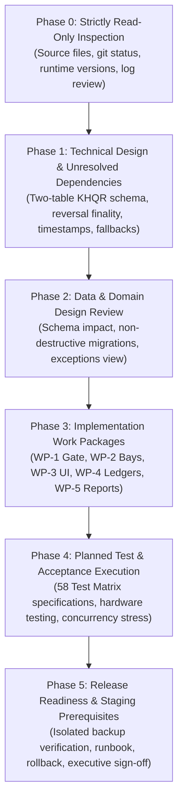

# Car-WashService POS Final Implementation Plan

**Document ID:** POS-PLN-2026-FINAL
**Project:** Car-WashService (Local Counter Terminal)
**Scope:** Phased Engineering Roadmap, Technical Migration, Verification Plan, Release Governance
**Date:** November 8, 2026 (Updated - Round 16 Final Closure)
**Status:** Engineering Proposal – Awaiting Separate Executive Authorization (NOT Production-Ready Until Released)

---

## Executive Overview & Architectural Baseline

This implementation plan provides the technical execution blueprint for the Car-WashService Point-of-Sale (POS) counter system. It operationalizes the **six business decisions confirmed by the business owner on November 8, 2026**, defines technical design specifications, documents unresolved technical dependencies, and establishes a strict, non-destructive migration roadmap.

### Core Architectural Guardrails:
1. **100% Local LAN Self-Sufficiency:** The counter terminal functions with zero dependencies on external cloud APIs, public domains, or reverse tunnels. All fonts, styles, scripts, and runtime dependencies reside on the local counter server.
2. **Upfront Payment Service Gate:** Confirmed payment (`payment_status = 'paid'`) and electronic receipt issuance (`receipt_issued_at IS NOT NULL`) are the sole mandatory gate pass before vehicle admission to wash apron or mechanical bays.
3. **Lift First $\rightarrow$ Wash Second Sequencing:** Mixed-service orders complete Bay 4 mechanical lift work prior to entering wash bays, ensuring spotless presentation at customer handover.
4. **Decoupled Financial & Presentation Layers:** Physical printer failure displays an advisory alert but never blocks wash apron operations. Any physical-printing gate (`require_receipt_before_wash`) is an **unapproved proposal requiring a separate owner decision**.
5. **Discrete Double-Entry Financial Ledgers:** Strict separation between **Net Settled Revenue** and **Net Operating Profit**, with unrecorded COGS flagged rather than assumed $0.00.
6. **Planned Test Status:** The 58 verification test specifications from [POS-IMPLEMENTATION-TEST-MATRIX.md](POS-IMPLEMENTATION-TEST-MATRIX.md) are **planned test specifications**; they have not been executed and do not represent passed tests.
7. **Executive Authorization Requirement:** This document is an engineering implementation proposal. The system remains strictly non-production-ready until all phases pass acceptance testing under separately authorized conditions and receive formal management release sign-off.

---

## Implementation Roadmap Overview

The implementation roadmap is organized into six sequential phases (Phases 0 through 5):



---

## Phase 0: Strictly Read-Only Source, Runtime & Configuration Inspection

### 0.1 Objective
Establish an uncompromised, verified baseline of the local execution environment using strictly read-only inspection methods. Phase 0 contains **inspection only**.

### 0.2 Explicit Prohibitions & Safety Boundaries
Phase 0 strictly prohibits and does not require:
- **Never start a stopped database service** (`net start`, `service start`).
- **Never repair or modify an unstable database** (`REPAIR TABLE`, `mysqlcheck`).
- **Never create databases, dumps, or restores** (`CREATE DATABASE`, `mysqldump`, `mysql < dump.sql`).
- **Never clean, reset, stash, or overwrite existing user changes** in the Git working tree.
- **Inspect and report existing service status only.** If the MariaDB service is stopped, offline, or inaccessible, Phase 0 inspects the service status, configuration files (`my.ini`), and system event logs, reporting the status in the inspection log without attempting to start, recover, or repair the database.
- **Phase 0 must remain strictly read-only and separately authorized.**

### 0.3 Inspection Activities & Validation Checklist

| Inspection Domain | Inspection Target | Read-Only Method | Success Criteria |
| :--- | :--- | :--- | :--- |
| **Source Integrity** | Working tree & branch state | `git status` (without resets/stashes) | Inspect clean working tree on `main` or active changes; zero unapproved file modifications. |
| **PHP Runtime** | CLI & Web PHP modules | `php -v` & `php -m` (non-intrusive) | PHP 8.2+ verified; PDO_MySQL, OpenSSL, mbstring, and GD loaded. |
| **Database Server** | MariaDB version & status | Non-mutating status / service check | MariaDB 10.4+ / MySQL 8.0+ version inspected; service status reported as-is. |
| **Web Server** | Apache port binding | `netstat -ano \| findstr :80` | Port 80 bound locally; virtual host routes to local project root. |
| **Configuration Files** | Database credentials & paths | File inspection without credential exposure | Connection parameters verified against local instance; no secrets logged. |
| **System Logs** | Apache & PHP error logs | Log file inspection (`tail` / view) | Zero critical startup errors, segmentation faults, or permission blocks. |
| **Backup Documentation** | Disaster recovery documentation | Review existing operational runbooks | Existing backup SOP reviewed; risk items identified for Phase 5 staging. |

---

## Phase 1: Technical Design Specifications & Unresolved Dependencies

### 1.1 TD-1: Scoped KHQR Reference Uniqueness, Pending Lifecycle & Two-Table Schema (UTD-4)
* **Four-Stage Digital Payment Lifecycle:**
  1. **Stage 1 (Payment Initiated / Staged):** Cashier selects "KHQR"; counter displays dynamic EMVCo QR code. Vehicle is held at counter apron; wash bay entry is blocked. Dynamic QR generation is merely an invitation to pay, **never proof of payment**.
  2. **Stage 2 (Temporary Local Pending Intent):** An ephemeral client session identifier (UUID v4 `client_pending_intent_id`) tracks the active checkout intent in browser memory / IndexedDB (`PosStorage`). A temporary local identifier is **NOT a bank transaction reference**, must **never be treated as proof of payment**, must **never satisfy verified digital payment requirements**, and must **never be inserted into `order_digital_payments.payment_ref`**.
  3. **Stage 3 (Authentic Bank Reference Capture):** Cashier reads the genuine bank transaction reference code (`payment_ref`) directly from the merchant smartphone notification or SMS alert. Screens presented by customers are strictly rejected. Generation of synthetic reference strings (`TRX-` via `uniqid()`) or provisional tokens (`PROV-...`) is prohibited.
  4. **Stage 4 (Verified & Settled Tender):** Cashier enters genuine `payment_ref`; backend executes atomic insert into `order_payments` and `order_digital_payments`. Electronic receipt is issued (`receipt_issued_at = NOW()`), and vehicle is dispatched to apron.
* **The MariaDB Nullable Column Vulnerability & Two-Table Solution:**
  - Under SQL standards, `NULL != NULL` in unique indexes. If composite columns (`provider`, `merchant_account_id`, `payment_ref`) allow `NULL`, multiple identical rows with `NULL` bypass duplicate protection.
  - To enforce 100% database-level integrity, digital payments are separated from cash across two tables with restrictive deletion (`ON DELETE RESTRICT`):
    1. General Tender Ledger (`order_payments`): Primary key `(id, order_id)`. Records financial amounts for all tenders; cash payments carry zero digital reference requirements.
    2. Dedicated Digital Ledger (`order_digital_payments`): Primary key `(payment_id)`. Composite foreign key `FOREIGN KEY (payment_id, order_id) REFERENCES order_payments(id, order_id) ON DELETE RESTRICT` guarantees that digital details **can never disagree with parent tender order assignments**. Mandatory `NOT NULL` for `provider`, `merchant_account_id`, and `payment_ref`, enforced by `CONSTRAINT uq_digital_bank_ref UNIQUE (provider, merchant_account_id, payment_ref)`.
* **Two-Table Schema Limitation on Pending Records:**
  - In the approved Two-Table schema, `order_payments` is an append-only ledger of confirmed collected tenders, and `order_digital_payments.payment_ref` is `NOT NULL` with a unique constraint.
  - Inserting an unconfirmed payment into `order_digital_payments` with a provisional fake reference (like `PROV-...`) would corrupt the ledger with uncollected revenue and violate unique constraints.
  - *Standard Local Counter Policy (Approved Scope):* In-flight pending KHQR payments remain staged in browser memory / IndexedDB (`PosStorage`). Zero rows are written to `order_payments` or `order_digital_payments` until positive merchant confirmation is obtained and the genuine `payment_ref` is entered.
  - *Future Server-Side Staging (Pending Approval):* If server-side persistence of unverified payment intents is required, it requires either adding a nullable `payment_ref` with `settlement_status` to `order_digital_payments` or creating a dedicated non-financial staging table `pos_payment_intents`. This limitation is logged as **Unresolved Technical Dependency (UTD-4 Addendum)**.
* **Proposed KHQR Intent Expiry, Settlement Evidence Hierarchy & "Investigate First" Workflow:**
  - **KHQR Settlement Evidence Hierarchy & Mandatory Verification:**
    * **Primary Authoritative Evidence:** The official merchant mobile banking application's settled transaction statement history is the **PRIMARY and sole authoritative proof of settlement**.
    * **Secondary / Investigative Assists Only:** Counter smartphone push notifications, SMS alerts, and counter soundbox voice announcements serve strictly as **assistive investigation tools** to alert the cashier that funds may have arrived. They **CANNOT independently establish settlement**, as notifications and SMS alerts can be delayed, truncated, spoofed, cleared, or silenced.
    * **Mandatory 5-Point Statement Verification:** Before confirming payment or entering references into the POS, the cashier must verify all five attributes directly in the merchant banking app transaction statement:
      1. *Merchant Account:* Funds are credited to the verified, authorized merchant counter destination account.
      2. *Amount:* Transfer amount matches the exact order total.
      3. *Currency:* Currency matches exactly (USD vs. KHR; e.g., $10.00 is never satisfied by 10,000 KHR).
      4. *Transaction Status:* Explicitly marked as `SUCCESS` or `COMPLETED` (not pending, held, or reversed).
      5. *Genuine Bank Reference:* Authentic bank transaction reference code (`payment_ref`) issued by the clearing bank.
  - *Proposed Configurable Local Expiry (Default 300s):* Neither NBC Bakong specifications nor EMVCo QR standards mandate a universal 300-second hard cutoff for dynamic QR validity. 300 seconds is defined strictly as a **proposed local POS operational default setting** (`khqr_intent_expiry_seconds`, default: 300s), configurable pending business owner approval and acquiring bank specifications.
  - *Local Intent Expiration vs. Bank Transaction Status:* A local dynamic QR intent expiration is purely a local client-side presentation timeout designed to prevent stale counter cart sessions. **Expiration of a local intent does NOT mean payment failed at the bank**, nor does it indicate that funds were returned.
  - *Mandatory "Investigate First" Workflow for Late Transfers:*
    When a customer claims to have completed a bank transfer after the local QR intent has expired or while in `expired` state, cashiers and managers must follow a strict **Investigate First** protocol:
    1. **Do NOT Immediately Generate Another QR:** Cashiers are strictly forbidden from immediately generating a fresh dynamic QR code or requesting another payment, as doing so risks double-charging the customer. Never generate a replacement QR or request another payment before thoroughly investigating whether the original transfer arrived.
    2. **Cashier Checks Primary Merchant Bank Statement:** The cashier immediately inspects the official mobile banking application statement history on the physical merchant counter smartphone (using push notifications and SMS strictly as discovery clues).
    3. **Mandatory 5-Point Statement Verification:** Cashier verifies: (a) merchant receiver account, (b) exact transfer amount, (c) correct currency (USD vs. KHR), (d) transaction status = `SUCCESS`/`COMPLETED`, and (e) customer sender name.
    4. **Locate Genuine Bank Reference:** Cashier extracts the authentic bank transaction reference (`payment_ref`) from the verified merchant notification or app statement.
    5. **Reconcile Without Collecting Second Payment:** Using a controlled late-transfer reconciliation interface, the cashier inputs the genuine `payment_ref` to confirm settlement and issue the electronic receipt for the existing order, without collecting a second payment.
    6. **Preserve Expired Intent:** The expired client intent metadata and timestamp are retained in local audit logs for transaction reconciliation.
    7. **Escalate to Manager if No Funds Appear:** If no incoming credit appears on the merchant counter mobile banking app after statement inspection, the cashier must escalate to the manager to verify merchant bank statements. Only after manager confirmation that zero funds arrived may a fresh QR be generated or an alternate tender requested.
    8. **Strict Rejection of Non-Bank Proof:** Customer smartphone screens, customer-shown receipts, dynamic QR generation alone, soundbox announcements without statement verification, and temporary local UUIDs are strictly rejected as settlement proof.
    9. **Database Protection Against Duplicate References:** Composite uniqueness `CONSTRAINT uq_digital_bank_ref UNIQUE (provider, merchant_account_id, payment_ref)` rejects duplicate bank references and prevents a payment already matched to another order from being accepted.
    10. **Zero Invented Bank APIs:** LAN operations rely strictly on physical merchant counter device statement inspection and soundbox announcements; no direct bank webhooks, automated polling APIs, or simulated push protocols are assumed.
  - *Refresh & Restart Recovery:* Active in-flight intents are persisted in client IndexedDB (`PosStorage`) with creation timestamp, plate, cart items, and `client_pending_intent_id`. If the browser reloads or the counter tablet reboots:
    * If $t < \text{created_at} + \text{expiry_seconds}$, the intent is restored with the remaining countdown timer and QR display.
    * If $t \ge \text{created_at} + \text{expiry_seconds}$, the intent is restored in `expired` state, cart is returned to editable draft mode, and any claimed transfer requires the mandatory Investigate First workflow.
    * *Crucial Rule:* Recovery does **NOT** constitute proof of payment. Recovered intents remain strictly unverified until genuine bank confirmation is obtained directly from the merchant mobile banking app statement.
  - *Local Cleanup Sweep:* Expired intents older than 15 minutes are purged from `PosStorage` by a periodic client cleanup sweep, releasing local browser storage.
  - *Duplicate Payment Prevention:* Each intent carries an immutable `idempotency_key`. The backend rejects payment submissions for already-paid orders with HTTP 409 Conflict (`ORDER_ALREADY_PAID`). Composite uniqueness `CONSTRAINT uq_digital_bank_ref UNIQUE (provider, merchant_account_id, payment_ref)` strictly prevents the same bank reference from being recorded twice.
* **Provisional Reference Format Notice:**
  - Describing references as "4 to 8 digits" is **provisional** based on counter observation and is not an assumed universal format.
  - References are **not globally unique**; uniqueness is scoped strictly to `(provider, merchant_account_id, payment_ref)`.
  - Official ABA PayWay and NBC Bakong documentation must be reviewed before finalizing format rules.

### 1.2 TD-2: Bank Reversal Outcomes, Timeout Safety & Unapproved Waiting Periods (UTD-3)
* **Three Distinct Reversal Outcomes:**
  1. *Definitive Bank Rejection:* Bank clearinghouse explicitly rejects the reversal request. Requires verifiable external bank confirmation.
  2. *Request Timeout with Unknown Bank Outcome:* Network disconnect or gateway timeout occurs. **A timeout must NEVER be treated as a definitive rejection.**
  3. *Confirmed Bank Settlement:* Reversal cleared and credited to the customer.
* **Safety Reality on Offline LAN Counter:**
  - On an offline local LAN counter operating without direct bank gateway API integrations, **no automated mechanism exists to guarantee bank reversal finality**.
  - **No Automatic Retry on Timeout:** An uncertain reversal request must **never be automatically retried**, as retrying in-flight requests risks duplicate debits on the banking network.
  - **Replacement Cash Payout is Strictly BLOCKED:** The POS cashier interface **must not provide an active replacement-cash payout button or automated workflow** while the bank outcome remains uncertain.
  - **Unapproved 72-Hour Example Clarification:** Any mention of a "72-hour waiting period" is strictly an **unapproved operational example requiring bank and owner validation**. A 72-hour delay does NOT prove bank finality and does NOT permit automatic cash payouts.
  - **Process Remains Unresolved:** The replacement cash refund workflow is classified as an **Unresolved Technical Dependency**, requiring an owner-approved operational procedure before any technical implementation can be designed.

### 1.3 TD-3: Reporting Timestamps & Period Bounding (UTD-2)
* **Timestamp Distinctions:**
  - `provider_event_at`: External provider/bank timestamp.
  - `recorded_at`: Local POS ledger recording timestamp.
  - `disbursed_at` / `settled_at`: Currency departure (`disbursed_at`) or bank settlement confirmation (`settled_at`).
* **Reporting Period Recognition:**
  - Cash Payments & Manually Verified KHQR: Recognized on `recorded_at`.
  - Cash Refunds: Recognized on `disbursed_at`.
  - Settled Digital Refunds: Recognized on `settled_at`.
* **Period Boundary Formulation:**
  - Strict half-open interval: `event_timestamp >= :start_timestamp AND event_timestamp < :end_timestamp`. Both start and end are strictly bounded.
  - Delayed provider notifications recorded after a period cut point fall into the subsequent period, ensuring closed historical reports remain immutable.
* **Schema Design Dependency (UTD-2):**
  - These discrete timestamp columns do not exist in the current `orders` table ([init.php](database/init.php)) and require creation during Phase 2.

### 1.4 TD-4: Decoupled Period-Aware Historical Fallback Architecture (UTD-1)
* **Elimination of Unsupported Assumptions & Contradictory Logic:**
  - Removed undefined flags (`is_initial_migration`) and non-existent fields (`orders.refunded_amount` does not exist in [init.php](database/init.php)).
  - **Eliminated the contradictory `NOT EXISTS` query clause** that previously excluded an entire historical order from historical reports whenever any subsequent ledger payment existed.
* **Period-Aware Fallback Principles:**
  - Differentiates cash received, revenue earned, and accounting-period recognition.
  - Payment recognition and refund recognition are evaluated independently within `[start_date, end_date)`.
  - Historical revenue is **never silently omitted** when an order has both historical payment information and subsequent ledger payments.
  - A subsequent ledger payment must **never be automatically added** to the full historical order total (prevents double-counting).
  - The existence of a subsequent ledger payment must not automatically exclude the historical order amount.
  - In period financial reports, historical orders falling within the reporting window are partitioned into:
    * **Confirmed Historical Payments:** Unconflicted pre-cutover orders where payment is fully verified (`payment_status = 'paid'`, `cancelled_at IS NULL`, zero post-cutover payments).
    * **Period Historical Reconciliation Exceptions:** Orders with subsequent ledger payments (split payments), finished but unpaid orders, cancellations, or incomplete tickets. Exception discovery is **not restricted to `payment_status = 'paid'`**; all discrepancy types are visibly displayed under audit rather than guessing an allocation formula or inventing revenue.
  - Post-cutover ledger payments are confirmed in their respective post-cutover periods under Confirmed Ledger Payments. Neither transaction is omitted and neither is double-counted.

#### Realistic Historical Scenarios:
1. **Historical Order with No Later Payment (Unconflicted):** Order #101 created pre-cutover, `paid_at = '2026-10-15'`, `total_usd = 25.00`, `payment_status = 'paid'`. Zero rows in `order_payments` or `order_refunds`. Recognized in Oct 2026 as Confirmed Historical Payment = +$25.00. 100% confirmed; zero exceptions.
2. **Historical Order with One Later Partial Payment (Split Payment):** Order #102 created pre-cutover, `total_usd = 50.00`, `payment_status = 'paid'`, `cancelled_at IS NULL`. After cutover, a partial payment of $20.00 is recorded in `order_payments` (`recorded_at = '2026-11-10'`). Confirmed Ledger in Nov = +$20.00. The historical database cannot prove whether the $20.00 is part of the $50.00 or additional to it; the historical order is displayed in October under **Period Historical Reconciliation Exceptions** ($50.00 under audit) rather than fabricating an allocation formula.
3. **Historical Order with Multiple Later Payments:** Order #105 created pre-cutover, `total_usd = 100.00`, `payment_status = 'paid'`, `cancelled_at IS NULL`. After cutover, two payments occur: $30.00 on Nov 5 and $40.00 on Nov 12 in `order_payments`. Confirmed Ledger in Nov = +$70.00 ($30 + $40). In October, Order #105 is displayed under **Period Historical Reconciliation Exceptions** ($100.00 under audit). Zero omission, zero double-counting.
4. **Historical Order with Multiple Post-Cutover Partial Refunds:** Order #103 created pre-cutover, `total_usd = 60.00`, `payment_status = 'paid'`. Two partial refunds occur post-cutover: Refund A for $10 on Nov 12, Refund B for $15 on Nov 15. In Oct 2026, Confirmed Payment = +$60.00. In Nov 2026, Settled Refunds = +$25.00 ($10 + $15). Payments and refunds recognized independently in respective periods without disappearing.
5. **Historical Cancellation with No Reconstructable Refund Amount:** Order #104 created pre-cutover, `total_usd = 40.00`, `payment_status = 'paid'`, `cancelled_at = '2026-10-18'`. `orders.refunded_amount` does not exist in schema. Excluded from Confirmed Revenue and classified as a **Historical Unreconciled Cancellation Exception** ($40.00 under audit) for owner manual review.
6. **Historical Finished but Unpaid Order (Uncollected / Unverified Tender):** Order #106 created pre-cutover, `status = 'finished'`, `payment_status = 'unpaid'`, `total_usd = 35.00`. Schema cannot prove whether money was collected off-ledger. Classified as **Historical Finished but Unpaid Exception** ($35.00 under audit). Excluded from Confirmed Revenue; surfaced on Exceptions tab.

* **Status:** The reporting algorithm is **not complete** until demonstrated against actual source fields and realistic examples during Phase 2.

### 1.5 TD-5: Unrecorded COGS Handling in Operating Profit
* Net Operating Profit = Net Settled Revenue - (Tracked COGS + Washer Commissions + Mechanic Commissions + Logged Expenses).
* If any sold line items lack cost data (`cogs_amount IS NULL`), Net Operating Profit **must not assume $0.00 COGS**. The report flags an **"Untracked Cost Alert"** indicating the count of untracked items (`untracked_cost_count`).

### 1.6 TD-6: Receipt Cutover Timestamp Configuration
* Cutover is governed by setting `receipt_v2_cutover_timestamp` in `settings`.
* **Fail-Closed Rule:** If the setting is missing or unparseable, the system fails closed (enforces electronic receipt requirement for all orders without exception).

### 1.7 TD-7: Historical Exception Resolution Lifecycle & Governance (UTD-1)
* **Three-State Resolution Lifecycle:**
  $$\text{Open} \longrightarrow \text{Under Review} \longrightarrow \text{Resolved}$$
* **Mandatory Audit Attributes:**
  Every record captures `exception_id`, `order_id`, `order_number`, `exception_type`, `historical_order_total`, `subsequent_ledger_payments`, `subsequent_refunds`, `resolution_status`, `resolution_decision`, `resolution_explanation`, `authorized_manager_id`, `resolved_at`, and `supporting_evidence_ref`.
* **Append-Only History:**
  Recorded in `historical_exception_events` (`id`, `exception_id`, `from_status`, `to_status`, `actor_id`, `notes`, `created_at`).
* **Idempotent Ingestion Rule:**
  Enforces `CONSTRAINT uq_hex_order_type UNIQUE (order_id, exception_type)`. Repeated execution of reports or background sync sweeps executes `INSERT ... ON DUPLICATE KEY UPDATE`, updating subsequent payment/refund amounts and incrementing `lock_version` (`lock_version = CASE WHEN subsequent_ledger_payments != VALUES(subsequent_ledger_payments) OR subsequent_refunds != VALUES(subsequent_refunds) THEN lock_version + 1 ELSE lock_version END`) without duplicating rows or resetting manager status.
* **Updating Existing Exceptions with New Ledger Evidence:**
  When a post-cutover payment or refund is posted for an order with an active exception, `subsequent_ledger_payments` and `subsequent_refunds` update idempotently, `lock_version` increments, and an audit event is logged in `historical_exception_events` (`event_type = 'ledger_activity_detected'`). Static historical fields remain immutable. The registry update and audit event insert must execute atomically within a single database transaction.
* **Reopening Governance for Resolved Exceptions:**
  An exception may transition from `resolved` back to `under_review` ONLY upon:
  - *Trigger A:* New conflicting post-cutover transaction (chargeback, refund, installment) posted.
  - *Trigger B:* Manager discovery of physical paper daybook evidence or bank errors.
  *Procedure:* Requires Manager PIN, executes conditional update (`WHERE id = :id AND lock_version = :expected_lock_version`) incrementing `lock_version = lock_version + 1`, logs transition in `historical_exception_events` with mandatory justification notes, and immediately returns the exception to the active open backlog (`WHERE resolution_status IN ('open', 'under_review')`). The update and audit insert must be atomic within a single database transaction.
* **Comprehensive Optimistic Concurrency Protection for Exception Registry & Lifecycle Transitions:**
  - **Universal Rule:** Every operation changing exception status, reconciliation figures, or audit evidence MUST increment `lock_version`:
    1. *Background Reconciliation Updates:* When periodic report sync sweeps detect and update `subsequent_ledger_payments` or `subsequent_refunds`, `lock_version` increments (`lock_version = lock_version + 1`), instantly invalidating any stale review screen.
    2. *Exception Reopening:* Reopening from `resolved` to `under_review` requires expected `lock_version` and increments `lock_version = lock_version + 1`.
    3. *Manager Resolution:* Moving from `open`/`under_review` to `resolved` requires expected `lock_version` and increments `lock_version = lock_version + 1`.
    4. *Evidence or Status Modification:* Attaching supporting evidence or modifying administrative notes requires expected `lock_version` and increments `lock_version = lock_version + 1`.
  - **Atomic Single-Transaction Requirement:** The update to `historical_exception_registry` and the insertion of the transition or discovery record in `historical_exception_events` MUST be executed atomically within a single database transaction (`BEGIN ... COMMIT`). If either operation fails or if conditional update affects 0 rows, the entire transaction is rolled back.
  - **Conditional Update Specification:**
    ```sql
    UPDATE historical_exception_registry
    SET resolution_status = :to_status,
        resolution_decision = :resolution_decision,
        resolution_explanation = :resolution_explanation,
        authorized_manager_id = :authorized_manager_id,
        resolved_at = NOW(),
        supporting_evidence_ref = :supporting_evidence_ref,
        lock_version = lock_version + 1
    WHERE id = :id AND lock_version = :expected_lock_version;
    ```
  - **Stale Collision Handling:** In any conditional update, if `rowCount === 0` (indicating concurrent collision or background figure update), the transaction rolls back, and the API returns `HTTP 409 Conflict` (`EXCEPTION_STALE_RECORD`). The client interface requires reloading current evidence and figures before another decision can be submitted.
  - All prior audit events are preserved; newer ledger tallies and evidence are never silently overwritten.
* **Governance Rules:**
  1. Resolving an exception must **never** delete the original exception, historical order, or payment records (`ON DELETE RESTRICT`).
  2. Resolved exceptions remain permanently stored and queryable in `view_historical_exception_audit`.
  3. The active open backlog filters `WHERE resolution_status IN ('open', 'under_review')`.
  4. Lifetime exception totals are **never** injected into periodic revenue totals.
  5. Manager PIN required for status transitions.
  6. Financial write-off decisions **require explicit CPA or owner approval**; the POS cannot autonomously decide write-off policies.
  7. Administrative resolution documents operational disposition; it does **not** retroactively rewrite closed historical revenue reports. Any formal revenue recognition or accounting write-off adjustments must be booked as separate general ledger adjustments in the current accounting period with CPA sign-off.

---

## Phase 2: Data and Domain Design Review

### 2.1 Table Impact Matrix

| Table Name | Operation | Proposed Columns / Modifications | Purpose |
| :--- | :--- | :--- | :--- |
| `orders` | Read / Update | `receipt_issued_at DATETIME NULL`<br/>`receipt_number VARCHAR(50) NULL`<br/>`discount_approved_by INT NULL` | Decouple electronic receipt from physical print; track manager discount authorization. |
| `order_payments` | Create (New Table) | `id INT AUTO_INCREMENT`<br/>`order_id INT NOT NULL`<br/>`payment_method ENUM('cash','khqr') NOT NULL`<br/>`amount_usd DECIMAL(10,2) NOT NULL`<br/>`amount_khr INT NOT NULL`<br/>`exchange_rate INT NOT NULL`<br/>`cashier_id INT NOT NULL`<br/>`recorded_at DATETIME NOT NULL`<br/>`PRIMARY KEY (id, order_id)`<br/>`CONSTRAINT fk_order_payments_order FOREIGN KEY (order_id) REFERENCES orders(id) ON DELETE RESTRICT`<br/>`INDEX idx_order_payments_order (order_id)`<br/>`INDEX idx_order_payments_recorded (recorded_at)` | General tender ledger for cash & digital payments; composite primary key enforces order alignment; restrictive deletion protects audit history. |
| `order_digital_payments` | Create (New Table) | `payment_id INT NOT NULL PRIMARY KEY`<br/>`order_id INT NOT NULL`<br/>`provider VARCHAR(50) NOT NULL`<br/>`merchant_account_id VARCHAR(50) NOT NULL`<br/>`payment_ref VARCHAR(100) NOT NULL`<br/>`provider_event_at DATETIME NULL`<br/>`created_at DATETIME NOT NULL`<br/>`CONSTRAINT fk_digital_tender FOREIGN KEY (payment_id, order_id) REFERENCES order_payments(id, order_id) ON DELETE RESTRICT`<br/>`CONSTRAINT uq_digital_bank_ref UNIQUE (provider, merchant_account_id, payment_ref)`<br/>`INDEX idx_digital_order (order_id)` | Dedicated digital transaction ledger; composite foreign key prevents order disagreement; mandatory non-null attributes enforce 100% duplicate protection without nullable loopholes. |
| `order_refunds` | Create (New Table) | `id INT AUTO_INCREMENT PRIMARY KEY`<br/>`order_id INT NOT NULL`<br/>`payment_id INT NULL`<br/>`refund_seq INT NOT NULL`<br/>`amount_usd DECIMAL(10,2) NOT NULL`<br/>`amount_khr INT NOT NULL`<br/>`settlement_status ENUM('authorized_pending','cash_disbursed','bank_reversal_pending','settled','failed','bank_reversal_timeout','bank_reversal_blocked','cancelled')`<br/>`authorized_by INT NOT NULL`<br/>`disbursed_at DATETIME NULL`<br/>`settled_at DATETIME NULL`<br/>`bank_reversal_ref VARCHAR(100) NULL`<br/>`replaced_refund_id INT NULL`<br/>`CONSTRAINT fk_order_refunds_order FOREIGN KEY (order_id) REFERENCES orders(id) ON DELETE RESTRICT` | Finite state machine ledger for customer refunds and reversals; restrictive deletion. |
| `order_refund_events` | Create (New Table) | `id INT AUTO_INCREMENT PRIMARY KEY`<br/>`refund_id INT NOT NULL`<br/>`event_type VARCHAR(50) NOT NULL`<br/>`from_status VARCHAR(50) NOT NULL`<br/>`to_status VARCHAR(50) NOT NULL`<br/>`actor_id INT NOT NULL`<br/>`notes TEXT NULL`<br/>`created_at DATETIME NOT NULL`<br/>`CONSTRAINT fk_order_refund_events_refund FOREIGN KEY (refund_id) REFERENCES order_refunds(id) ON DELETE RESTRICT` | Append-only audit history for refund state transitions; restrictive deletion. |
| `historical_exception_registry` | Create (New Table) | `id INT AUTO_INCREMENT PRIMARY KEY`<br/>`order_id INT NOT NULL`<br/>`order_number VARCHAR(50) NOT NULL`<br/>`exception_type VARCHAR(50) NOT NULL`<br/>`historical_order_total DECIMAL(10,2) NOT NULL`<br/>`subsequent_ledger_payments DECIMAL(10,2) NOT NULL DEFAULT 0.00`<br/>`subsequent_refunds DECIMAL(10,2) NOT NULL DEFAULT 0.00`<br/>`resolution_status ENUM('open','under_review','resolved') NOT NULL DEFAULT 'open'`<br/>`resolution_decision VARCHAR(100) NULL`<br/>`resolution_explanation TEXT NULL`<br/>`authorized_manager_id INT NULL`<br/>`resolved_at DATETIME NULL`<br/>`supporting_evidence_ref VARCHAR(255) NULL`<br/>`lock_version INT NOT NULL DEFAULT 1`<br/>`created_at DATETIME NOT NULL`<br/>`CONSTRAINT fk_hex_order FOREIGN KEY (order_id) REFERENCES orders(id) ON DELETE RESTRICT`<br/>`CONSTRAINT uq_hex_order_type UNIQUE (order_id, exception_type)` | Lifecycle tracking registry for historical accounting exceptions; idempotent ingestion; optimistic concurrency protection (`lock_version`); restrictive deletion; immutable audit log. |
| `historical_exception_events` | Create (New Table) | `id INT AUTO_INCREMENT PRIMARY KEY`<br/>`exception_id INT NOT NULL`<br/>`from_status VARCHAR(50) NOT NULL`<br/>`to_status VARCHAR(50) NOT NULL`<br/>`actor_id INT NOT NULL`<br/>`notes TEXT NULL`<br/>`created_at DATETIME NOT NULL`<br/>`CONSTRAINT fk_hex_events_exception FOREIGN KEY (exception_id) REFERENCES historical_exception_registry(id) ON DELETE RESTRICT` | Append-only audit history for exception lifecycle transitions; restrictive deletion. |
| `bays` | Update | Index on `(status, is_active)` | Atomic conditional reservation locks. |
| `bay_tasks` | Update | `task_sequence INT NOT NULL DEFAULT 1`<br/>`status ENUM('waiting','in_progress','completed','pending_prereq')` | Enforce Lift First $\rightarrow$ Wash Second staging. |
| `settings` | Read / Insert | `receipt_v2_cutover_timestamp DATETIME` | Authorized cutover date. |

### 2.2 Non-Destructive Migration Script (`database/migrate_pos_workflow_v3.php`)
* **Execution Rules:**
  1. The script uses idempotent DDL (`CREATE TABLE IF NOT EXISTS`) and inspects `information_schema.columns` before attempting column additions.
  2. Zero existing data rows in `orders` or `order_items` are altered, deleted, or converted.
  3. Pre-cutover ambiguous tickets are left untouched for owner review.

### 2.3 Historical Exception Registry & Views

#### 1. Registry & Audit Tables:
```sql
CREATE TABLE IF NOT EXISTS historical_exception_registry (
    id INT AUTO_INCREMENT PRIMARY KEY,
    order_id INT NOT NULL,
    order_number VARCHAR(50) NOT NULL,
    exception_type VARCHAR(50) NOT NULL,
    historical_order_total DECIMAL(10,2) NOT NULL,
    subsequent_ledger_payments DECIMAL(10,2) NOT NULL DEFAULT 0.00,
    subsequent_refunds DECIMAL(10,2) NOT NULL DEFAULT 0.00,
    resolution_status ENUM('open','under_review','resolved') NOT NULL DEFAULT 'open',
    resolution_decision VARCHAR(100) NULL,
    resolution_explanation TEXT NULL,
    authorized_manager_id INT NULL,
    resolved_at DATETIME NULL,
    supporting_evidence_ref VARCHAR(255) NULL,
    lock_version INT NOT NULL DEFAULT 1,
    created_at DATETIME NOT NULL,
    CONSTRAINT fk_hex_order FOREIGN KEY (order_id) REFERENCES orders(id) ON DELETE RESTRICT,
    CONSTRAINT uq_hex_order_type UNIQUE (order_id, exception_type),
    INDEX idx_hex_status (resolution_status),
    INDEX idx_hex_order (order_id)
) ENGINE=InnoDB;

CREATE TABLE IF NOT EXISTS historical_exception_events (
    id INT AUTO_INCREMENT PRIMARY KEY,
    exception_id INT NOT NULL,
    from_status VARCHAR(50) NOT NULL,
    to_status VARCHAR(50) NOT NULL,
    actor_id INT NOT NULL,
    notes TEXT NULL,
    created_at DATETIME NOT NULL,
    CONSTRAINT fk_hex_events_exception FOREIGN KEY (exception_id)
        REFERENCES historical_exception_registry(id) ON DELETE RESTRICT
) ENGINE=InnoDB;
```

#### 2. Open Backlog View (Excludes Resolved Exceptions):
```sql
CREATE OR REPLACE VIEW view_historical_unreconciled_exceptions AS
SELECT
    her.id AS exception_id,
    her.order_id,
    her.order_number,
    o.customer_name,
    o.plate_number,
    her.historical_order_total,
    her.subsequent_ledger_payments,
    her.subsequent_refunds,
    her.exception_type,
    her.resolution_status,
    o.status AS operational_status,
    o.payment_status,
    o.created_at AS order_created_at,
    her.created_at AS exception_created_at
FROM historical_exception_registry her
JOIN orders o ON o.id = her.order_id
WHERE her.resolution_status IN ('open', 'under_review');
```

#### 3. Permanent Audit View (Includes Complete Resolution Trail):
```sql
CREATE OR REPLACE VIEW view_historical_exception_audit AS
SELECT
    her.id AS exception_id,
    her.order_id,
    her.order_number,
    her.exception_type,
    her.historical_order_total,
    her.subsequent_ledger_payments,
    her.subsequent_refunds,
    her.resolution_status,
    her.resolution_decision,
    her.resolution_explanation,
    her.authorized_manager_id,
    her.resolved_at,
    her.supporting_evidence_ref,
    her.created_at
FROM historical_exception_registry her;
```

---

## Phase 3: Implementation Work Packages

### WP-1: Core Gate & Receipt Decoupling
* **Files:** [OrderGate.php](core/OrderGate.php), [index.php](api/pos/index.php).
* **Specifications:**
  1. Introduce `orders.receipt_issued_at` and `orders.receipt_number`.
  2. Service admission requires `payment_status = 'paid'` AND `receipt_issued_at IS NOT NULL`.
  3. Physical paper printing failure displays an advisory alert on POS client but does not block apron entry.
  4. Any proposal for an optional physical-printing hard gate (`require_receipt_before_wash`) is classified as an unapproved proposal requiring a separate owner decision.
  5. Receipt reprinting is strictly read-only (`GET /api/pos/index.php?action=print_receipt`) and emits a `*** DUPLICATE RECEIPT ***` watermark.

### WP-2: Bay Manager & Lift-First Sequencing
* **Files:** [BayManager.php](core/BayManager.php).
* **Specifications:**
  1. Mixed wash + mechanical orders configure:
     - Task 1: Mechanical Lift Service (Bay 4, sequence = 1, status = `'waiting'`).
     - Task 2: Exterior Wash & Detailing (Bay 1 or 2, sequence = 2, status = `'pending_prereq'`).
  2. Checkout claims Bay 4 only; Bay 1 or 2 is deferred until Task 1 reaches `'completed'`, keeping wash bays available.
  3. Update task sequence validator (line 917) to enforce: Step 1 (Mechanical Lift) must be marked `'completed'` before Step 2 (Wash) can begin.

### WP-3: POS Client Single-Page Checkout UI
* **Files:** `pos/index.html`, `pos/js/app.js`, `pos/css/app.css`.
* **Specifications:**
  1. Unified single-page counter interface with three active zones:
     - Zone 1: License plate intake defaulting blank customer names to `'Walk-in Guest'`; vehicle category selector.
     - Zone 2: Category touch tabs for Wash Packages, Mechanical Tasks, and Car Care Products.
     - Zone 3: Cart summary, dual-currency live totals ($ USD / ៛ KHR), Quick Cash pads, KHQR bank reference input, change display.
  2. Idempotency token per cart session with immediate checkout button debouncing.
  3. Advisory toast system for printer status (advisory only; no workflow blockage).

### WP-4: Discrete Payment & Refund Ledgers
* **Files:** [index.php](api/pos/index.php), [CashierControl.php](core/CashierControl.php).
* **Specifications:**
  1. Record incoming tenders across `order_payments` (financial amounts) and `order_digital_payments` (mandatory non-null provider/ref) with `ON DELETE RESTRICT`.
  2. Implement refund finite state machine in `order_refunds`:
     - Manager PIN required for `authorized_pending`.
     - Atomic conditional disbursement lock (`rowCount === 1` opens cash drawer).
     - Bank reversal timeout and uncertain outcomes block replacement cash payouts pending an approved operational procedure.
     - Append-only event history in `order_refund_events`.
     - Enforce cumulative refund ceiling ($\sum \text{Refunds} \le \text{Total Payments}$).
  3. KHQR Pending Reference Lifecycle: Pending digital intents are staged in client memory / IndexedDB (`PosStorage`) with ephemeral session UUID; zero rows are inserted into `order_payments` or `order_digital_payments` until positive merchant confirmation arrives. Merchant mobile banking application transaction statement is the PRIMARY settlement evidence; counter phone notifications, SMS, and soundbox announcements are assistive investigative aids only and cannot independently establish settlement. Verification requires: merchant receiver account, exact amount, currency (USD/KHR), `SUCCESS`/`COMPLETED` status, and authentic `payment_ref`. Dynamic QR validity TTL is a proposed configurable local POS operational default (`khqr_intent_expiry_seconds`, default 300s), not an EMVCo/Bakong mandate. In-flight intent expiration is a client timeout, not bank failure. Late customer transfers strictly require the "Investigate First" workflow: cashiers must inspect the merchant banking app statement and locate the authentic `payment_ref` to reconcile the order without collecting a second payment; generating a replacement QR immediately is strictly prohibited. Genuine bank transaction reference (`payment_ref`) is mandatory; synthetic reference strings (`TRX-` or `PROV-...`), customer smartphone screens, dynamic QR generation alone, soundbox announcements without statement verification, and temporary local UUIDs are strictly rejected as settlement proof.

### WP-5: Reporting Engine & Two-Tier Separation
* **Files:** [reports.php](views/owner/reports.php).
* **Specifications:**
  1. Two-Tier period-aware reporting queries bounded by `[:start_timestamp, :end_timestamp)`.
  2. Confirmed metrics separated from Unreconciled Historical Exceptions (split payments and pre-cutover cancellations reported under audit on separate tab).
  3. Separate dashboard metrics:
     - **Net Settled Revenue:** Gross Confirmed Payments minus Settled Refunds.
     - **Net Operating Profit:** Net Settled Revenue minus (COGS + Commissions + Expenses).
  4. Untracked Cost Alert displayed when line items lack COGS data.
  5. Historical Exception Resolution Workflow: Implement manager resolution workflow (`Open -> Under Review -> Resolved`) in `reports.php` tabs; record transition events in `historical_exception_events`; update `resolution_status` without deleting evidence; enforce universal optimistic concurrency: every operation changing status or reconciliation figures (sync sweeps, reopening, resolution, evidence attachment) increments `lock_version` (`lock_version = lock_version + 1`); require registry update and append-only event insertion (`historical_exception_events`) to be executed atomically within a single database transaction; stale requests abort with HTTP 409 Conflict (`EXCEPTION_STALE_RECORD`), requiring managers to reload current figures and evidence before submitting a decision; exclude resolved cases from active open backlog while retaining them in permanent audit views. Administrative resolution documents operational disposition and does not retroactively rewrite closed historical revenue reports.

---

## Phase 4: Planned Test and Acceptance Execution

### 4.1 Test Matrix Integration (58 Planned Test Specifications)
The 58 test specifications defined in [POS-IMPLEMENTATION-TEST-MATRIX.md](POS-IMPLEMENTATION-TEST-MATRIX.md) represent **planned test specifications**; they remain unexecuted and await separately authorized testing conditions:

| Test Group | ID Range | Core Focus | Planned Status |
| :--- | :--- | :--- | :--- |
| **Payment Before Service Gate** | TC-01 to TC-08 | Verify unpaid orders cannot enter bays; electronic receipt issuance gates apron. | Planned (Unexecuted) |
| **Receipt Decoupling & Printing** | TC-09 to TC-14 | Verify printer paper-out does not block service; verify reprint read-only safety. | Planned (Unexecuted) |
| **KHQR Scoped Matching** | TC-15 to TC-22 | Verify phone/soundbox matching; reject customer screenshots; test two-table constraint. | Planned (Unexecuted) |
| **Refund Safety & Finality** | TC-23 to TC-32 | Verify atomic disbursement lock; verify replacement payout blocked on uncertain reversal. | Planned (Unexecuted) |
| **Period-Aware Financial Reporting** | TC-33 to TC-42 | Verify decoupled fallbacks; multi-refund orders; reporting period boundary isolation. | Planned (Unexecuted) |
| **Multi-Stage Lift-First Dispatch** | TC-43 to TC-50 | Verify Bay 4 lift executes before wash; verify deferred wash bay reservation. | Planned (Unexecuted) |
| **Walk-in Guest & Concurrency** | TC-51 to TC-58 | Verify blank customer name defaults to `'Walk-in Guest'`; verify idempotency under double-clicks. | Planned (Unexecuted) |

### 4.2 Hardware & Counter Testing Plan
1. **ESC/POS Thermal Printer (80mm):**
   - Test printing under normal paper load.
   - Simulate paper-out condition: verify advisory toast appears on screen and vehicle moves to wash queue unimpeded.
2. **Cash Drawer Kick Pulse:**
   - Verify drawer opens upon cash confirmation.
   - Verify drawer does NOT open upon KHQR confirmation.
   - Verify drawer opens upon atomic cash refund disbursement.
3. **Soundbox & Merchant Phone Match:**
   - Simulate simultaneous $5.00 transfers: verify cashier matches bank reference on merchant phone app.

### 4.3 Concurrency & Stress Testing Plan
- Automated load test simulating 20 rapid checkout submissions with identical `idempotency_key`: verify exactly 1 database order created.
- Concurrent bay reservation attempts: verify atomic lock prevents double-booking of Bay 4 or Bay 1/2.
- Concurrent refund disbursement calls: verify atomic lock allows cash drawer pulse to fire exactly once.

---

## Phase 5: Controlled Release Readiness, Recovery & Rollback Safety

### 5.1 Recovery and Rollback Safety Principles
Recovery must strictly separate Application Code Rollback from Database Disaster Recovery:

1. **Separation of Concerns:**
   - **Application Code Rollback:** Reverting modified PHP, JavaScript, CSS, or HTML files to the pre-deployment Git release tag. This is a non-destructive application action that does not alter database state.
   - **Database Recovery:** A catastrophic, high-risk operational recovery action that requires separate, explicit executive authorization.

2. **Database Recovery Risks & Data Loss Assessment:**
   - Restoring a cold backup **destroys all transactional data created after the backup timestamp** (e.g. newly admitted vehicles, completed wash jobs, and cash drawer balances).
   - Recovery requires explicit, separate executive authorization.
   - The recovery point objective (RPO) and potential transaction loss must be formally assessed before executing any restore.
   - The backup integrity must be verified prior to recovery.
   - Restore validation must use an isolated test environment (`carwash_restore_test`).
   - **Never restore over the original production database without separate explicit authorization.**
   - Do not promise an unverified "five-minute recovery or rollback time"; actual recovery duration depends on dump size and must be demonstrated through approved staging tests.

### 5.2 Pre-Deployment Operational Runbook
1. **Pre-Cutover Checklist:**
   - [ ] Staging backup/restore verification completed successfully in isolated test database.
   - [ ] Counter hardware (printer, drawer, soundbox, LAN router) online and tested.
   - [ ] `receipt_v2_cutover_timestamp` set in `settings` to scheduled go-live hour.
   - [ ] Cashier floats verified and logged in [CashierControl.php](core/CashierControl.php).
2. **Deployment Sequence:**
   - Step 1: Deploy non-destructive schema migration `database/migrate_pos_workflow_v3.php`.
   - Step 2: Deploy updated PHP backend modules (`OrderGate.php`, `BayManager.php`, `api/pos/index.php`).
   - Step 3: Deploy single-page frontend (`pos/index.html`, `pos/js/app.js`, `pos/css/app.css`).
   - Step 4: Execute smoke verification tests.
   - Step 5: Transition counter cashiers to new interface.

### 5.3 Staff & Cashier Training Plan
- **Cashier Fast-Intake Training (< 15 seconds):**
  - Enter plate number $\rightarrow$ Select vehicle category $\rightarrow$ Tap service package $\rightarrow$ Collect cash/KHQR $\rightarrow$ Complete checkout.
  - Explain that customer name is optional (system automatically applies `'Walk-in Guest'`).
- **KHQR Anti-Fraud Training:**
  - Never look at customer phone screens.
  - Listen for soundbox chime; check merchant smartphone app for bank reference code; enter code into POS.
- **Service Flow Training:**
  - Inform technicians that mixed lube + wash cars proceed to Bay 4 Lift first, then wash bays second.

### 5.4 Executive Authorization Gate
> [!IMPORTANT]
> **Executive Sign-Off Requirement:**
> This implementation plan, its associated work packages, and the proposed deployment timeline are **subject to separate executive authorization by the business owner**. Under strict project governance rules, the software must NOT be described as "production-ready" until Phase 4 acceptance testing is completed on the staging counter and formal deployment sign-off is granted.

---

## Document Control & Verification

* **Lead Systems Architect:** Prepared for Engineering Review (November 8, 2026)
* **Operational Status:** Implementation Roadmap Complete – Ready for Phase 0 Read-Only Inspection upon Management Instruction
