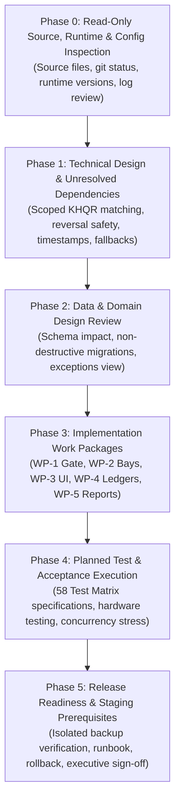

# Car-WashService POS Final Implementation Plan

**Document ID:** POS-PLN-2026-FINAL
**Project:** Car-WashService (Local Counter Terminal)
**Scope:** Phased Engineering Roadmap, Technical Migration, Verification Plan, Release Governance
**Date:** November 8, 2026 (Updated - Round 8)
**Status:** Engineering Proposal – Awaiting Separate Executive Authorization (NOT Production-Ready Until Released)

---

## Executive Overview & Architectural Baseline

This implementation plan provides the technical execution blueprint for the Car-WashService Point-of-Sale (POS) counter system. It operationalizes the **six business decisions confirmed by the business owner on November 8, 2026**, defines technical design specifications, documents unresolved technical dependencies, and establishes a strict, non-destructive migration roadmap.

### Core Architectural Guardrails:
1. **100% Local LAN Self-Sufficiency:** The counter terminal functions with zero dependencies on external cloud APIs, public domains, or reverse tunnels. All fonts, styles, scripts, and runtime dependencies reside on the local counter server.
2. **Upfront Payment Service Gate:** Confirmed payment (`payment_status = 'paid'`) and electronic receipt issuance (`receipt_issued_at IS NOT NULL`) are the sole mandatory gate pass before vehicle admission to wash apron or mechanical bays.
3. **Lift First $\rightarrow$ Wash Second Sequencing:** Mixed-service orders complete Bay 4 mechanical lift work prior to entering wash bays, ensuring spotless presentation at customer handover.
4. **Decoupled Financial & Presentation Layers:** Physical printer failure displays an advisory alert but never blocks wash apron operations. Any physical-printing gate (`require_receipt_before_wash`) is an **unapproved proposal requiring a separate owner decision**.
5. **Discrete Double-Entry Financial Ledgers:** Strict separation between **Net Settled Revenue** and **Net Operating Profit**, with unrecorded COGS flagged rather than assumed $0.00.
6. **Planned Test Status:** The 58 verification test specifications from [POS-IMPLEMENTATION-TEST-MATRIX.md](POS-IMPLEMENTATION-TEST-MATRIX.md) are **planned test specifications**; they have not been executed and do not represent passed tests.
7. **Executive Authorization Requirement:** This document is an engineering implementation proposal. The system remains strictly non-production-ready until all phases pass acceptance testing under separately authorized conditions and receive formal management release sign-off.

---

## Implementation Roadmap Overview

The implementation roadmap is organized into six sequential phases (Phases 0 through 5):



---

## Phase 0: Read-Only Source, Runtime & Configuration Inspection

### 0.1 Objective
Establish an uncompromised, verified baseline of the local execution environment using strictly read-only inspection methods. Phase 0 contains **inspection only**. Under no circumstances are database dumps, database creation, database restoration, directory copying, migrations, or other write operations performed during this phase.

### 0.2 Inspection Activities & Validation Checklist

| Inspection Domain | Inspection Target | Read-Only Method | Success Criteria |
| :--- | :--- | :--- | :--- |
| **Source Integrity** | Working tree & branch state | `git status` | Clean working tree on `main`; zero untracked code files; zero uncommitted diffs. |
| **PHP Runtime** | CLI & Web PHP modules | `php -v` & `php -m` (non-intrusive) | PHP 8.2+ verified; PDO_MySQL, OpenSSL, mbstring, and GD loaded. |
| **Database Server** | MariaDB version & status | Service inspection / version check without data alteration | MariaDB 10.4+ / MySQL 8.0+ running; InnoDB storage engine verified. |
| **Web Server** | Apache port binding | `netstat -ano \| findstr :80` | Port 80 bound locally; virtual host routes to local project root. |
| **Configuration Files** | Database credentials & paths | File inspection without credential exposure | Connection parameters verified against local instance; no secrets logged. |
| **System Logs** | Apache & PHP error logs | Log file inspection (`tail` / view) | Zero critical startup errors, segmentation faults, or permission blocks. |
| **Backup Documentation** | Disaster recovery documentation | Review existing operational runbooks | Existing backup SOP reviewed; risk items identified for Phase 5 staging. |

### 0.3 Future Backup/Restore Validation Prerequisite
Validation of database backup and restoration procedures is explicitly deferred to **Phase 5 (Release Readiness & Staging Prerequisites)**. When authorized, backup/restore validation must:
1. Be executed as a separately authorized task.
2. Utilize an isolated test copy of the database (`carwash_restore_test`).
3. Make **zero changes** to the original MariaDB production data directory.
4. Include a fully documented recovery and rollback plan.

---

## Phase 1: Technical Design Specifications & Unresolved Dependencies

### 1.1 TD-1: Scoped KHQR Reference Uniqueness & Anti-Fraud Protocol
* **Operational Flow:** The counter terminal utilizes an IoT soundbox and merchant smartphone bank app.
  1. **Primary Alert:** Soundbox chime alerts cashier to incoming funds.
  2. **Phone App Match:** If multiple customers are checking out simultaneously or amounts are identical, the soundbox chime alone is insufficient; the cashier **must match the transaction on the counter merchant phone**.
  3. **Authentic Reference Capture:** Cashier reads the genuine 4-to-8 digit bank transaction reference code (`payment_ref`) from the bank notification and enters it into the POS interface.
  4. **Customer Screen Rejection:** Smartphone screens presented by customers are strictly rejected as proof of payment.
  5. **No Synthetic TRX:** Backend generation of synthetic reference strings (`TRX-` via `uniqid()`) is prohibited.
* **Uniqueness Scoping:**
  - Remove global `UNIQUE (payment_method, payment_ref)`. Uniqueness is scoped to provider and merchant account:
    `UNIQUE (provider, merchant_account_id, payment_ref)` for digital transactions.
  - Cash transactions do not carry a digital bank reference and are excluded from digital uniqueness constraints.
* **Unresolved Technical Dependency (UTD-4):**
  - Official reference formats, lengths, character sets, and uniqueness scopes from ABA PayWay and NBC Bakong must be confirmed with merchant bank technical documentation prior to finalizing database constraints.

### 1.2 TD-2: Verification-Gated Bank Reversal Resolution Protocol (Dual-Payout Prevention)
* **Problem Resolved:** A local status update to `'cancelled'` does **not** stop external bank clearinghouse processing. If a bank reversal request was transmitted, the bank may asynchronously settle the debit later.
* **Resolution Workflow:**
  ```mermaid
  sequenceDiagram
      autonumber
      actor Cashier
      actor Manager
      participant POS as POS Client
      participant Bank as Merchant Bank App / Statement
      participant DB as MariaDB Ledger
      Cashier->>Manager: Report Digital Reversal Failed / Timed Out
      Manager->>Bank: Inspect Merchant Bank Statement & Portal
      alt Bank Outcome Ambiguous or Debit Pending
          Manager-->>Cashier: STOP. Payout Blocked Pending Bank Reconciliation
      else Bank Outcome Verified: Zero Debit / Definitive Rejection
          Manager->>POS: Authorize Replacement Cash Refund + Enter Manager PIN
          POS->>DB: Atomic Update on Failed Attempt
          Note over DB: Record failure verified in append-only audit log;<br/>Preserve failed reversal row
          POS->>DB: Insert New Cash Refund Row (authorized_pending, replaced_refund_id = [failed_id])
          Cashier->>POS: Execute Cash Payout
          POS->>DB: UPDATE order_refunds SET settlement_status = 'cash_disbursed', disbursed_at = NOW()<br/>WHERE id = [new_id] AND settlement_status = 'authorized_pending'
          DB-->>POS: rowCount === 1
          POS-->>Cashier: Hardware Kick Pulse (Cash Drawer Opens)
      end
  ```
* **Mandatory Safeguards:**
  1. Cash replacement is strictly **blocked** if the bank outcome cannot be verified.
  2. Original reversal attempts are preserved in an append-only audit trail (`order_refund_events`).
  3. Replacement cash refunds maintain an explicit foreign key link `replaced_refund_id`.
  4. Dual-payout is prevented by requiring verified bank non-execution before cash is authorized.

### 1.3 TD-3: Reporting Timestamps & Period Bounding
* **Timestamp Distinctions:**
  - `provider_event_at`: External provider/bank timestamp.
  - `recorded_at`: Local POS ledger recording timestamp.
  - `disbursed_at` / `settled_at`: Currency departure (`disbursed_at`) or bank settlement confirmation (`settled_at`).
* **Reporting Period Recognition:**
  - Cash Payments & Manually Verified KHQR: Recognized on `recorded_at`.
  - Cash Refunds: Recognized on `disbursed_at`.
  - Settled Digital Refunds: Recognized on `settled_at`.
* **Period Boundary Formulation:**
  - Strict half-open interval: `event_timestamp >= :start_timestamp AND event_timestamp < :end_timestamp`. Both start and end are strictly bounded.
  - Delayed provider notifications recorded after a period cut point fall into the subsequent period, ensuring closed historical reports remain immutable.
* **Schema Design Dependency (UTD-2):**
  - These discrete timestamp columns do not exist in the current `orders` table ([init.php](database/init.php)) and require creation during Phase 2.

### 1.4 TD-4: Decoupled Period-Aware Historical Fallback Architecture
* **Problem Resolved:** Removal of all-or-nothing fallback logic. Payment recognition and refund recognition are evaluated independently within `[start_date, end_date)`.
* **Period-Aware Rules:**
  - Pre-cutover orders created before cutover with an original payment recorded on `orders` and a post-cutover refund recorded in `order_refunds` recognize the payment in the pre-cutover period and the refund in the post-cutover period.
  - Post-cutover split payments recorded on pre-cutover orders recognize each tranche at its own `recorded_at` timestamp.
  - Multiple partial refunds each appear in their respective disbursement/settlement periods.
  - Events outside the selected reporting window are strictly excluded.
* **Unresolved Technical Design Item (UTD-1):**
  - In the current schema, `orders` has `total_usd`, `paid_at`, `payment_status`, and `cancelled_at`, but **lacks a `refunded_amount` column** and lacks a pre-cutover payment ledger. The exact mathematical reconciliation for pre-cutover split payments and legacy cancellations requires finalization during Phase 2 schema design.

### 1.5 TD-5: Unrecorded COGS Handling in Operating Profit
* Net Operating Profit = Net Settled Revenue - (Tracked COGS + Washer Commissions + Mechanic Commissions + Logged Expenses).
* If any sold line items lack cost data (`cogs_amount IS NULL`), Net Operating Profit **must not assume $0.00 COGS**. The report flags an **"Untracked Cost Alert"** indicating the count of untracked items (`untracked_cost_count`).

### 1.6 TD-6: Receipt Cutover Timestamp Configuration
* Cutover is governed by setting `receipt_v2_cutover_timestamp` in `settings`.
* **Fail-Closed Rule:** If the setting is missing or unparseable, the system fails closed (enforces electronic receipt requirement for all orders without exception).

---

## Phase 2: Data and Domain Design Review

### 2.1 Table Impact Matrix

| Table Name | Operation | Proposed Columns / Modifications | Purpose |
| :--- | :--- | :--- | :--- |
| `orders` | Read / Update | `receipt_issued_at DATETIME NULL`<br/>`receipt_number VARCHAR(50) NULL`<br/>`discount_approved_by INT NULL` | Decouple electronic receipt from physical print; track manager discount authorization. |
| `order_payments` | Create (New Table) | `id INT AUTO_INCREMENT PRIMARY KEY`<br/>`order_id INT NOT NULL`<br/>`provider VARCHAR(50) DEFAULT 'cash'`<br/>`merchant_account_id VARCHAR(50) NULL`<br/>`payment_method ENUM('cash','khqr') NOT NULL`<br/>`amount_usd DECIMAL(10,2) NOT NULL`<br/>`amount_khr INT NOT NULL`<br/>`exchange_rate INT NOT NULL`<br/>`payment_ref VARCHAR(100) NULL`<br/>`cashier_id INT NOT NULL`<br/>`provider_event_at DATETIME NULL`<br/>`recorded_at DATETIME NOT NULL`<br/>`UNIQUE KEY uq_digital_payment_ref (provider, merchant_account_id, payment_ref)` | Discrete transaction ledger for incoming tenders; scoped digital uniqueness; frozen exchange rates. |
| `order_refunds` | Create (New Table) | `id INT AUTO_INCREMENT PRIMARY KEY`<br/>`order_id INT NOT NULL`<br/>`payment_id INT NULL`<br/>`refund_seq INT NOT NULL`<br/>`amount_usd DECIMAL(10,2) NOT NULL`<br/>`amount_khr INT NOT NULL`<br/>`settlement_status ENUM('authorized_pending','cash_disbursed','bank_reversal_pending','settled','failed','bank_verified_failed','cancelled')`<br/>`authorized_by INT NOT NULL`<br/>`disbursed_at DATETIME NULL`<br/>`settled_at DATETIME NULL`<br/>`bank_reversal_ref VARCHAR(100) NULL`<br/>`replaced_refund_id INT NULL` | Finite state machine ledger for customer refunds and reversals. |
| `order_refund_events` | Create (New Table) | `id INT AUTO_INCREMENT PRIMARY KEY`<br/>`refund_id INT NOT NULL`<br/>`event_type VARCHAR(50) NOT NULL`<br/>`from_status VARCHAR(50) NOT NULL`<br/>`to_status VARCHAR(50) NOT NULL`<br/>`actor_id INT NOT NULL`<br/>`notes TEXT NULL`<br/>`created_at DATETIME NOT NULL` | Append-only audit history for refund state transitions. |
| `bays` | Update | Index on `(status, is_active)` | Atomic conditional reservation locks. |
| `bay_tasks` | Update | `task_sequence INT NOT NULL DEFAULT 1`<br/>`status ENUM('waiting','in_progress','completed','pending_prereq')` | Enforce Lift First $\rightarrow$ Wash Second staging. |
| `settings` | Read / Insert | `receipt_v2_cutover_timestamp DATETIME` | Authorized cutover date. |

### 2.2 Non-Destructive Migration Script (`database/migrate_pos_workflow_v3.php`)
* **Execution Rules:**
  1. The script uses idempotent DDL (`CREATE TABLE IF NOT EXISTS`) and inspects `information_schema.columns` before attempting column additions.
  2. Zero existing data rows in `orders` or `order_items` are altered, deleted, or converted.
  3. Pre-cutover ambiguous tickets are left untouched for owner review.

### 2.3 Historical Unreconciled Exceptions View
Create an informational SQL view for the owner reporting dashboard:
```sql
CREATE OR REPLACE VIEW view_historical_unreconciled_exceptions AS
SELECT
    o.id AS order_id,
    o.order_number,
    o.customer_name,
    o.plate_number,
    o.total_usd,
    o.status AS operational_status,
    o.payment_status,
    o.created_at,
    o.started_at,
    o.finished_at,
    o.cancelled_at,
    CASE
        WHEN o.status = 'finished' AND o.payment_status = 'unpaid' THEN 'Finished but Unpaid'
        WHEN o.status = 'paid' AND o.cancelled_at IS NOT NULL THEN 'Paid but Cancelled'
        WHEN o.status = 'paid' AND o.finished_at IS NULL AND o.cancelled_at IS NULL THEN 'Paid but Uncompleted'
        ELSE 'Timestamp Conflict'
    END AS exception_reason
FROM orders o
WHERE o.created_at < (SELECT setting_value FROM settings WHERE setting_key = 'receipt_v2_cutover_timestamp')
  AND (
      (o.status = 'finished' AND o.payment_status = 'unpaid') OR
      (o.status = 'paid' AND o.cancelled_at IS NOT NULL) OR
      (o.payment_status IS NULL)
  );
```

---

## Phase 3: Implementation Work Packages

### WP-1: Core Gate & Receipt Decoupling
* **Files:** [OrderGate.php](core/OrderGate.php), [index.php](api/pos/index.php).
* **Specifications:**
  1. Introduce `orders.receipt_issued_at` and `orders.receipt_number`.
  2. Service admission requires `payment_status = 'paid'` AND `receipt_issued_at IS NOT NULL`.
  3. Physical paper printing failure displays an advisory alert on POS client but does not block apron entry.
  4. Any proposal for an optional physical-printing hard gate (`require_receipt_before_wash`) is classified as an unapproved proposal requiring a separate owner decision.
  5. Receipt reprinting is strictly read-only (`GET /api/pos/index.php?action=print_receipt`) and emits a `*** DUPLICATE RECEIPT ***` watermark.

### WP-2: Bay Manager & Lift-First Sequencing
* **Files:** [BayManager.php](core/BayManager.php).
* **Specifications:**
  1. Mixed wash + mechanical orders configure:
     - Task 1: Mechanical Lift Service (Bay 4, sequence = 1, status = `'waiting'`).
     - Task 2: Exterior Wash & Detailing (Bay 1 or 2, sequence = 2, status = `'pending_prereq'`).
  2. Checkout claims Bay 4 only; Bay 1 or 2 is deferred until Task 1 reaches `'completed'`, keeping wash bays available.
  3. Update task sequence validator (line 917) to enforce: Step 1 (Mechanical Lift) must be marked `'completed'` before Step 2 (Wash) can begin.

### WP-3: POS Client Single-Page Checkout UI
* **Files:** `pos/index.html`, `pos/js/app.js`, `pos/css/app.css`.
* **Specifications:**
  1. Unified single-page counter interface with three active zones:
     - Zone 1: License plate intake defaulting blank customer names to `'Walk-in Guest'`; vehicle category selector.
     - Zone 2: Category touch tabs for Wash Packages, Mechanical Tasks, and Car Care Products.
     - Zone 3: Cart summary, dual-currency live totals ($ USD / ៛ KHR), Quick Cash pads, KHQR bank reference input, change display.
  2. Idempotency token per cart session with immediate checkout button debouncing.
  3. Advisory toast system for printer status (advisory only; no workflow blockage).

### WP-4: Discrete Payment & Refund Ledgers
* **Files:** [index.php](api/pos/index.php), [CashierControl.php](core/CashierControl.php).
* **Specifications:**
  1. Record incoming tenders in `order_payments` with frozen exchange rate, cashier ID, and scoped bank reference (for KHQR).
  2. Implement refund finite state machine in `order_refunds`:
     - Manager PIN required for `authorized_pending`.
     - Atomic conditional disbursement lock (`rowCount === 1` opens cash drawer).
     - Failed bank reversal resolution requires verified bank outcome before cash replacement authorization; links via `replaced_refund_id`.
     - Append-only event history in `order_refund_events`.
     - Enforce cumulative refund ceiling ($\sum \text{Refunds} \le \text{Total Payments}$).

### WP-5: Reporting Engine & Two-Tier Separation
* **Files:** [reports.php](views/owner/reports.php).
* **Specifications:**
  1. Two-Tier period-aware reporting queries bounded by `[:start_timestamp, :end_timestamp)`.
  2. Payment and refund fallback calculations evaluated independently per period without all-or-nothing omission.
  3. Separate dashboard metrics:
     - **Net Settled Revenue:** Gross Confirmed Payments minus Settled Refunds.
     - **Net Operating Profit:** Net Settled Revenue minus (COGS + Commissions + Expenses).
  4. Untracked Cost Alert displayed when line items lack COGS data.
  5. Dedicated **Historical Unreconciled Exceptions** review tab.

---

## Phase 4: Planned Test and Acceptance Execution

### 4.1 Test Matrix Integration (58 Planned Test Specifications)
The 58 test specifications defined in [POS-IMPLEMENTATION-TEST-MATRIX.md](POS-IMPLEMENTATION-TEST-MATRIX.md) represent **planned test specifications**; they remain unexecuted and await separately authorized testing conditions:

| Test Group | ID Range | Core Focus | Planned Status |
| :--- | :--- | :--- | :--- |
| **Payment Before Service Gate** | TC-01 to TC-08 | Verify unpaid orders cannot enter bays; electronic receipt issuance gates apron. | Planned (Unexecuted) |
| **Receipt Decoupling & Printing** | TC-09 to TC-14 | Verify printer paper-out does not block service; verify reprint read-only safety. | Planned (Unexecuted) |
| **KHQR Scoped Matching** | TC-15 to TC-22 | Verify phone/soundbox matching; reject customer screenshots; test scoped ref uniqueness. | Planned (Unexecuted) |
| **Refund Safety & Dual Payout** | TC-23 to TC-32 | Verify atomic disbursement lock; test bank outcome verification before cash replacement. | Planned (Unexecuted) |
| **Period-Aware Financial Reporting** | TC-33 to TC-42 | Verify decoupled fallbacks; multi-refund orders; reporting period boundary isolation. | Planned (Unexecuted) |
| **Multi-Stage Lift-First Dispatch** | TC-43 to TC-50 | Verify Bay 4 lift executes before wash; verify deferred wash bay reservation. | Planned (Unexecuted) |
| **Walk-in Guest & Concurrency** | TC-51 to TC-58 | Verify blank customer name defaults to `'Walk-in Guest'`; verify idempotency under double-clicks. | Planned (Unexecuted) |

### 4.2 Hardware & Counter Testing Plan
1. **ESC/POS Thermal Printer (80mm):**
   - Test printing under normal paper load.
   - Simulate paper-out condition: verify advisory toast appears on screen and vehicle moves to wash queue unimpeded.
2. **Cash Drawer Kick Pulse:**
   - Verify drawer opens upon cash confirmation.
   - Verify drawer does NOT open upon KHQR confirmation.
   - Verify drawer opens upon atomic cash refund disbursement.
3. **Soundbox & Merchant Phone Match:**
   - Simulate simultaneous $5.00 transfers: verify cashier matches bank reference on merchant phone app.

### 4.3 Concurrency & Stress Testing Plan
- Automated load test simulating 20 rapid checkout submissions with identical `idempotency_key`: verify exactly 1 database order created.
- Concurrent bay reservation attempts: verify atomic lock prevents double-booking of Bay 4 or Bay 1/2.
- Concurrent refund disbursement calls: verify atomic lock allows cash drawer pulse to fire exactly once.

---

## Phase 5: Controlled Release Readiness & Staging Prerequisites

### 5.1 Isolated Backup & Restore Validation (Staging Prerequisite)
Prior to production deployment, backup and restore validation must be executed under separately authorized testing conditions:
1. Generate logical database dump to an isolated staging directory.
2. Restore the dump into a separate temporary database (`carwash_restore_test`).
3. Verify 100% record parity, table schemas, and auto-increment sequences.
4. Verify that **zero modifications** were made to the original MariaDB data files.

### 5.2 Pre-Deployment Operational Runbook
1. **Pre-Cutover Checklist:**
   - [ ] Staging backup/restore verification completed successfully.
   - [ ] Counter hardware (printer, drawer, soundbox, LAN router) online and tested.
   - [ ] `receipt_v2_cutover_timestamp` set in `settings` to scheduled go-live hour.
   - [ ] Cashier floats verified and logged in [CashierControl.php](core/CashierControl.php).
2. **Deployment Sequence:**
   - Step 1: Deploy non-destructive schema migration `database/migrate_pos_workflow_v3.php`.
   - Step 2: Deploy updated PHP backend modules (`OrderGate.php`, `BayManager.php`, `api/pos/index.php`).
   - Step 3: Deploy single-page frontend (`pos/index.html`, `pos/js/app.js`, `pos/css/app.css`).
   - Step 4: Execute smoke verification tests.
   - Step 5: Transition counter cashiers to new interface.

### 5.3 Staff & Cashier Training Plan
- **Cashier Fast-Intake Training (< 15 seconds):**
  - Enter plate number $\rightarrow$ Select vehicle category $\rightarrow$ Tap service package $\rightarrow$ Collect cash/KHQR $\rightarrow$ Complete checkout.
  - Explain that customer name is optional (system automatically applies `'Walk-in Guest'`).
- **KHQR Anti-Fraud Training:**
  - Never look at customer phone screens.
  - Listen for soundbox chime; check merchant smartphone app for bank reference code; enter code into POS.
- **Service Flow Training:**
  - Inform technicians that mixed lube + wash cars proceed to Bay 4 Lift first, then wash bays second.

### 5.4 Rapid Rollback Plan
If an unresolvable defect arises during go-live:
1. **Rollback Trigger Conditions:**
   - Inability to checkout vehicles during rush hour.
   - Cash drawer fails to respond to confirmed cash transactions.
   - Database deadlocks on bay assignments.
2. **Rollback Steps (< 5 Minutes):**
   - Revert PHP and JS files to pre-cutover Git commit / snapshot.
   - Restore database from cold dump if schema alterations caused instability.
   - Verify counter terminal operational on legacy workflow.

### 5.5 Executive Authorization Gate
> [!IMPORTANT]
> **Executive Sign-Off Requirement:**
> This implementation plan, its associated work packages, and the proposed deployment timeline are **subject to separate executive authorization by the business owner**. Under strict project governance rules, the software must NOT be described as "production-ready" until Phase 4 acceptance testing is completed on the staging counter and formal deployment sign-off is granted.

---

## Document Control & Verification

* **Lead Systems Architect:** Prepared for Engineering Review (November 8, 2026)
* **Operational Status:** Implementation Roadmap Complete – Ready for Phase 0 Read-Only Inspection upon Management Instruction
