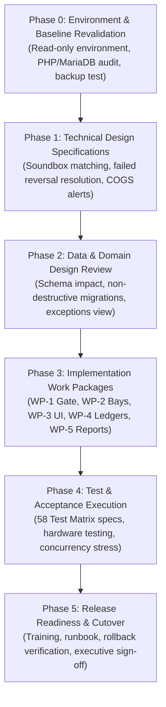

# Car-WashService POS Final Implementation Plan

**Document ID:** POS-PLN-2026-FINAL  
**Project:** Car-WashService (Local Counter Terminal)  
**Scope:** Phased Engineering Roadmap, Technical Migration, Verification Plan, Release Governance  
**Date:** November 8, 2026  
**Status:** Engineering Proposal – Awaiting Executive Authorization (NOT Production-Ready Until Released)  

---

## Executive Overview & Architectural Baseline

This implementation plan provides the end-to-end technical execution blueprint for the Car-WashService Point-of-Sale (POS) counter system. It operationalizes the **six business decisions confirmed by the business owner on November 8, 2026**, addresses all technical design edge cases, and establishes a strict, non-destructive migration roadmap.

### Core Architectural Guardrails:
1. **100% Local LAN Self-Sufficiency:** The counter terminal functions with zero dependencies on external cloud APIs, public domains, or reverse tunnels. All fonts, styles, scripts, and runtime dependencies reside on the local counter server.
2. **Upfront Payment Service Gate:** Confirmed payment (`payment_status = 'paid'`) and electronic receipt issuance (`receipt_issued_at IS NOT NULL`) are the mandatory gate pass before vehicle admission to wash apron or mechanical bays.
3. **Lift First $\rightarrow$ Wash Second Sequencing:** Mixed-service orders complete Bay 4 mechanical lift work prior to entering wash bays, ensuring spotless presentation at customer handover.
4. **Decoupled Financial & Presentation Layers:** Physical printer failure displays an advisory alert but never blocks wash apron operations.
5. **Discrete Double-Entry Financial Ledgers:** Strict separation between **Net Settled Revenue** and **Net Operating Profit**, with unrecorded COGS flagged rather than assumed $0.00.
6. **Executive Authorization Requirement:** This document is an implementation roadmap. The system remains strictly non-production-ready until all phases pass acceptance testing and receive formal management release sign-off.

---

## Implementation Roadmap Overview

The implementation roadmap is organized into six sequential phases (Phases 0 through 5):



---

## Phase 0: Read-Only Source & Environment Revalidation

### 0.1 Objective
Establish an uncompromised, verified baseline of the local execution environment, verifying PHP runtime, MariaDB storage, Apache web server, and cold backup restoration procedures before introducing code changes.

### 0.2 Action Items & Validation Criteria

| Component | Target Specification | Validation Method | Acceptance Criteria |
| :--- | :--- | :--- | :--- |
| **PHP Runtime** | PHP 8.2+ (XAMPP for Windows) | `php -v` & `php -m` | PDO_MySQL, cURL, OpenSSL, mbstring, and GD active; short tags allowed. |
| **Database Engine** | MariaDB 10.4+ / MySQL 8.0+ | `mysql -V` | InnoDB default engine; `STRICT_TRANS_TABLES` active; `utf8mb4` charset. |
| **Web Server** | Apache 2.4+ (Port 80 / localhost) | `httpd -v` & `netstat -ano \| findstr :80` | Port 80 bound locally; virtual host pointing to `C:\xampp\htdocs\Car-WashService`. |
| **Repository State** | Git `main` branch | `git status` | Clean working tree; zero untracked code files; zero uncommitted diffs. |
| **Cold Backup Test** | Full data directory snapshot | Simulated restore into `carwash_test_db` | Cold dump of database and codebase completes and restores with 100% record parity. |

### 0.3 Cold Backup & Restore Protocol
1. **Cold Dump Execution:**
   - Execute physical and logical database dumps before any schema migration scripts are introduced:
     ```cmd
     mysqldump -u root -p carwash_pos > "C:\xampp\backup\carwash_pos_pre_migration_%date%.sql"
     ```
2. **Restoration Verification Test:**
   - Import the dump file into an isolated temporary database (`carwash_restore_test`):
     ```cmd
     mysql -u root -e "CREATE DATABASE carwash_restore_test;"
     mysql -u root carwash_restore_test < "C:\xampp\backup\carwash_pos_pre_migration_%date%.sql"
     ```
   - Verify table count, row count, and primary key auto-increment values against production.
3. **Artifact Snapshot:**
   - Copy the entire working directory to a timestamped cold archive on external media.

---

## Phase 1: Close Remaining Technical Design Specifications

### 1.1 TD-1: Soundbox Positive Matching & Anti-Fraud Protocol
* **Background:** The counter operates an IoT soundbox and a merchant smartphone bank app. During rush hours, a soundbox chime (*"Received $5.00 via KHQR"*) does not state vehicle license plate or customer identity.
* **Positive Matching Specification:**
  1. **Primary Alert:** Soundbox chime alerts cashier that incoming funds hit the bank account.
  2. **Mandatory Match Requirement:** If more than one customer is checking out, or if the tender amount is a common value ($3.00, $5.00), cashier **must look at the counter merchant smartphone app**.
  3. **Genuine Bank Reference Capture:** Cashier reads the authentic 4-to-8 digit bank transaction reference (`payment_ref`) from the bank notification and enters it into the POS field.
  4. **Database Constraint:** The database strictly prevents reference reuse:
     ```sql
     UNIQUE INDEX uq_payment_bank_ref (payment_method, payment_ref)
     ```
  5. **No Synthetic TRX:** Backend code generation of synthetic strings (`TRX-` via `uniqid()`) is prohibited.
  6. **Customer Screenshot Rejection:** Customer smartphone screens are strictly rejected as proof of payment.

### 1.2 TD-2: Failed Bank Reversal Resolution Protocol (Dual-Payout Prevention)
* **Background:** When an electronic reversal fails (bank account closed, timeout, network error), the cashier must not issue cash while a bank reversal could still settle, risking duplicate payout.
* **Resolution Workflow:**
  ```mermaid
  sequenceDiagram
      autonumber
      actor Cashier
      actor Manager
      participant POS as POS Client
      participant DB as MariaDB Ledger
      Cashier->>Manager: Report Bank Reversal Failed
      Manager->>POS: Review Failed Reversal #REF-101
      Manager->>POS: Execute "Cancel Reversal & Switch to Cash" + Enter PIN
      POS->>DB: Atomic Lock & Status Update
      Note over DB: UPDATE order_refunds SET settlement_status = 'cancelled',<br/>cancelled_reason = 'Reversal failed; manual cash replacement authorized'<br/>WHERE id = 101 AND settlement_status = 'failed'
      DB-->>POS: rowCount === 1 (Reversal Voided)
      POS->>DB: Insert New Cash Refund Row (authorized_pending, replaced_refund_id = 101)
      Cashier->>POS: Execute Cash Payout
      POS->>DB: UPDATE order_refunds SET settlement_status = 'cash_disbursed', disbursed_at = NOW()
      POS-->>Cashier: Hardware Kick Pulse (Cash Drawer Opens)
  ```
* **Safety Rule:** Dual disbursement is physically impossible because the digital reversal record is irrevocably marked `'cancelled'` before the replacement cash refund is generated.

### 1.3 TD-3: Unrecorded COGS Handling in Operating Profit
* **Background:** In legacy orders or untracked services, Cost of Goods Sold (`cogs_amount`) may be missing (`NULL`). Treating missing COGS as $0.00 falsely inflates business profit.
* **Specification:**
  1. The reporting query computes:
     $$\text{Tracked COGS} = \sum (\text{item\_quantity} \times \text{unit\_cost})$$
     $$\text{Untracked Item Count} = \sum (\text{CASE WHEN unit\_cost IS NULL THEN 1 ELSE 0 END})$$
  2. If `Untracked Item Count > 0`, the Net Operating Profit card displays a prominent warning badge:
     `"⚠️ Operating profit reflects partial costs. [N] line items have untracked COGS."`
  3. Net Settled Revenue remains unaffected, as revenue measures tender inflow regardless of costs.

### 1.4 TD-4: Receipt Cutover Timestamp Configuration
* **Specification:**
  1. System cutover is governed by setting `receipt_v2_cutover_timestamp` in `settings`.
  2. **Fail-Closed Rule:** If `receipt_v2_cutover_timestamp` is missing or invalid, the system fails closed (enforces electronic receipt requirement for all orders without exception).
  3. Pre-cutover orders are identified by `created_at < :cutover_timestamp`.

---

## Phase 2: Data and Domain Design Review

### 2.1 Table Impact Matrix

| Table Name | Operations | New Columns / Modifications | Purpose |
| :--- | :--- | :--- | :--- |
| `orders` | Read / Update | `receipt_issued_at DATETIME NULL`<br/>`receipt_number VARCHAR(50) NULL`<br/>`discount_approved_by INT NULL` | Decouple electronic receipt from physical print; track manager PIN attribution. |
| `order_payments` | Create (New Table) | `id INT AUTO_INCREMENT PRIMARY KEY`<br/>`order_id INT NOT NULL`<br/>`payment_method ENUM('cash','khqr') NOT NULL`<br/>`amount_usd DECIMAL(10,2) NOT NULL`<br/>`amount_khr INT NOT NULL`<br/>`exchange_rate INT NOT NULL`<br/>`payment_ref VARCHAR(100) NULL`<br/>`cashier_id INT NOT NULL`<br/>`recorded_at DATETIME NOT NULL`<br/>`UNIQUE KEY uq_payment_bank_ref (payment_method, payment_ref)` | Discrete transaction ledger for incoming tenders; frozen exchange rates. |
| `order_refunds` | Create (New Table) | `id INT AUTO_INCREMENT PRIMARY KEY`<br/>`order_id INT NOT NULL`<br/>`payment_id INT NULL`<br/>`refund_seq INT NOT NULL`<br/>`amount_usd DECIMAL(10,2) NOT NULL`<br/>`amount_khr INT NOT NULL`<br/>`settlement_status ENUM('authorized_pending','cash_disbursed','bank_reversal_pending','settled','failed','cancelled')`<br/>`authorized_by INT NOT NULL`<br/>`disbursed_at DATETIME NULL`<br/>`settled_at DATETIME NULL`<br/>`bank_reversal_ref VARCHAR(100) NULL`<br/>`replaced_refund_id INT NULL` | Finite state machine ledger for customer refunds and reversals. |
| `bays` | Update | Index on `(status, is_active)` | Atomic conditional reservation locks. |
| `bay_tasks` | Update | `task_sequence INT NOT NULL DEFAULT 1`<br/>`status ENUM('waiting','in_progress','completed','pending_prereq')` | Enforce Lift First $\rightarrow$ Wash Second staging. |
| `settings` | Read / Insert | `receipt_v2_cutover_timestamp DATETIME`<br/>`require_receipt_before_wash TINYINT DEFAULT 0` | Authorized cutover date; optional paper gate toggle. |

### 2.2 Non-Destructive Migration Script (`database/migrate_pos_workflow_v3.php`)
* **Safety Rules:**
  1. The script uses idempotent DDL: `CREATE TABLE IF NOT EXISTS`, and checks `information_schema.columns` before `ALTER TABLE`.
  2. Zero data rows in `orders` or `order_items` are altered, deleted, or converted.
  3. Pre-cutover ambiguous tickets are left untouched for owner review.

### 2.3 Historical Unreconciled Exceptions View
Create an informational SQL view for the owner reporting dashboard:
```sql
CREATE OR REPLACE VIEW view_historical_unreconciled_exceptions AS
SELECT 
    o.id AS order_id,
    o.invoice_number,
    o.customer_name,
    o.plate_number,
    o.total_price,
    o.status AS operational_status,
    o.payment_status,
    o.created_at,
    o.started_at,
    o.finished_at,
    o.cancelled_at,
    CASE 
        WHEN o.status = 'finished' AND o.payment_status = 'unpaid' THEN 'Finished but Unpaid'
        WHEN o.status = 'paid' AND o.cancelled_at IS NOT NULL AND (o.refunded_amount IS NULL OR o.refunded_amount = 0) THEN 'Paid but Cancelled without Refund'
        WHEN o.status = 'paid' AND o.finished_at IS NULL AND o.cancelled_at IS NULL THEN 'Paid but Uncompleted'
        ELSE 'Timestamp Conflict'
    END AS exception_reason
FROM orders o
WHERE o.created_at < (SELECT setting_value FROM settings WHERE setting_key = 'receipt_v2_cutover_timestamp')
  AND (
      (o.status = 'finished' AND o.payment_status = 'unpaid') OR
      (o.status = 'paid' AND o.cancelled_at IS NOT NULL AND (o.refunded_amount IS NULL OR o.refunded_amount = 0)) OR
      (o.payment_status IS NULL)
  );
```

---

## Phase 3: Future Implementation Work Packages

### WP-1: Core Gate & Receipt Decoupling
* **Files Modified:** `core/OrderGate.php`, `api/pos/index.php`.
* **Changes:**
  1. Introduce `orders.receipt_issued_at` timestamp and `orders.receipt_number` string.
  2. Refactor `OrderGate::assertServiceAdmissionAllowed()`:
     - Gated strictly on `payment_status = 'paid'` AND `receipt_issued_at IS NOT NULL`.
     - Physical paper printing check is removed from the service gate pass unless `require_receipt_before_wash = 1` is explicitly enabled in `settings`.
  3. Receipt reprinting is read-only (`GET /api/pos/index.php?action=print_receipt`) and emits a `*** DUPLICATE RECEIPT ***` watermark.

### WP-2: Bay Manager & Lift-First Sequencing
* **Files Modified:** `core/BayManager.php`.
* **Changes:**
  1. Update `ensureOrderTasks()`:
     - When an order contains both mechanical lube services and wash packages, inject:
       - Step 1: Mechanical Lift (Bay 4, sequence = 1, status = `'waiting'`).
       - Step 2: Wash & Dry (Bay 1 or 2, sequence = 2, status = `'pending_prereq'`).
  2. Implement staged bay locking:
     - Checkout claims Bay 4 only.
     - Bay 1 or 2 is NOT claimed at checkout; it is queued upon Step 1 completion, keeping wash aprons fluid.
  3. Update sequence validator (line 917) to enforce: Step 1 (Mechanical Lift) must be marked `'completed'` before Step 2 (Wash) can begin.

### WP-3: POS Client Single-Page Checkout UI
* **Files Modified:** `pos/index.html`, `pos/js/app.js`, `pos/css/app.css`.
* **Changes:**
  1. Consolidate counter checkout into a single viewport with three active zones:
     - Zone 1: License plate intake with `'Walk-in Guest'` automatic defaulting; vehicle category selector (`small_car`, `suv_pickup`, `van_truck`, `motorbike`).
     - Zone 2: Category touch tabs for Wash Packages, Mechanical Tasks, and Car Care Products.
     - Zone 3: Cart summary, dual-currency live totals, Quick Cash pads, KHQR view with genuine bank reference input field, change calculation display ($ USD / ៛ KHR).
  2. Idempotency token generation per cart session with immediate button debouncing on click.
  3. Advisory toast system for printer status (notifies cashier if printer is offline without halting workflow).

### WP-4: Discrete Payment & Refund Ledgers
* **Files Modified:** `api/pos/index.php`, `core/CashierControl.php`.
* **Changes:**
  1. On confirmed checkout, insert discrete row into `order_payments` with frozen exchange rate, cashier ID, and validated bank reference (for KHQR).
  2. Implement refund state machine in `order_refunds`:
     - Manager PIN required for `authorized_pending`.
     - Atomic disbursement update for `cash_disbursed` (`rowCount === 1` unlocks cash drawer).
     - Cancellation protocol for failed reversals to enable cash resolution without dual payout.
     - Enforce cumulative refund ceiling ($\sum \text{Refunds} \le \text{Total Payments}$).

### WP-5: Reporting Engine & Two-Tier Separation
* **Files Modified:** `views/owner/reports.php`.
* **Changes:**
  1. Implement Two-Tier Decoupled query:
     - Gross Payments = Tier 1 (Post-cutover `order_payments`) + Tier 2 (Pre-cutover `orders.total_price` fallback).
     - Settled Refunds = Tier 1 (Post-cutover settled `order_refunds`) + Tier 2 (Pre-cutover `orders.refunded_amount` fallback).
  2. Bound all subqueries with `recorded_at <= :end_date` (and `disbursed_at / settled_at <= :end_date`) to prevent future event leakage.
  3. Clearly separate dashboard cards:
     - Card 1: **Net Settled Revenue** (`Gross Payments - Settled Refunds`).
     - Card 2: **Net Operating Profit** (`Net Settled Revenue - (COGS + Commissions + Expenses)`).
  4. Display **Untracked Cost Alert** if any sold items lack COGS data.
  5. Add **"Historical Unreconciled Exceptions"** review tab.

---

## Phase 4: Test and Acceptance Execution

### 4.1 Test Matrix Integration (58 Planned Test Specifications)
Execution of all 58 test specifications defined in [POS-IMPLEMENTATION-TEST-MATRIX.md](file:///C:/xampp/htdocs/Car-WashService/POS-IMPLEMENTATION-TEST-MATRIX.md), including:

| Test Group | ID Range | Core Focus |
| :--- | :--- | :--- |
| **Payment Before Service Gate** | TC-01 to TC-08 | Verify unpaid orders cannot enter bays; electronic receipt issuance gates apron. |
| **Receipt Decoupling & Printing** | TC-09 to TC-14 | Verify printer paper-out does not block service; verify reprint read-only safety. |
| **KHQR Positive Matching** | TC-15 to TC-22 | Verify phone/soundbox matching; reject customer screenshots; enforce unique bank ref. |
| **Refund State Machine & Dual Payout** | TC-23 to TC-32 | Verify atomic disbursement lock; test failed reversal cancellation and cash replacement. |
| **Two-Tier Financial Reporting** | TC-33 to TC-42 | Verify decoupled fallbacks; multi-refund orders; reporting period boundary isolation. |
| **Multi-Stage Lift-First Dispatch** | TC-43 to TC-50 | Verify Bay 4 lift executes before wash; verify deferred wash bay reservation. |
| **Walk-in Guest & Concurrency** | TC-51 to TC-58 | Verify blank customer name defaults to `'Walk-in Guest'`; verify idempotency under double-clicks. |

### 4.2 Hardware & Physical Counter Testing
1. **ESC/POS Thermal Printer (80mm):**
   - Test printing under normal paper load.
   - Simulate paper-out condition: verify alert appears on screen and vehicle moves to wash queue unimpeded.
2. **Cash Drawer Kick Pulse:**
   - Verify drawer opens upon cash confirmation.
   - Verify drawer DOES NOT open upon KHQR confirmation.
   - Verify drawer opens upon atomic cash refund disbursement.
3. **Soundbox & Merchant Phone Match:**
   - Simulate simultaneous $5.00 transfers: verify cashier is prompted to match bank reference on phone app.

### 4.3 Concurrency & Stress Testing
- Execute automated load script simulating 20 rapid checkout submissions with identical `idempotency_key`: verify exactly 1 database order created.
- Simulate concurrent bay reservation attempts: verify no double-booking of Bay 4 or Bay 1/2.
- Simulate concurrent refund disbursement calls: verify cash drawer pulse fires exactly once.

---

## Phase 5: Controlled Release Readiness & Cutover Governance

### 5.1 Pre-Deployment Operational Runbook
1. **Pre-Cutover Checklist:**
   - [ ] Full cold backup of MariaDB and codebase completed and verified.
   - [ ] Counter terminal hardware (printer, drawer, soundbox, LAN router) online and tested.
   - [ ] `receipt_v2_cutover_timestamp` set in `settings` to scheduled go-live hour.
   - [ ] Cashier floats verified and logged in `core/CashierControl.php`.
2. **Go-Live Sequence:**
   - Step 1: Deploy non-destructive schema migration `database/migrate_pos_workflow_v3.php`.
   - Step 2: Deploy updated PHP backend modules (`OrderGate.php`, `BayManager.php`, `api/pos/index.php`).
   - Step 3: Deploy single-page frontend (`pos/index.html`, `pos/js/app.js`, `pos/css/app.css`).
   - Step 4: Execute end-to-end smoke test (TC-01, TC-15, TC-43).
   - Step 5: Transition counter cashiers to new interface.

### 5.2 Staff & Cashier Training Plan
- **Cashier Fast-Intake Training (< 15 seconds):**
  - Enter plate number $\rightarrow$ Select vehicle category $\rightarrow$ Tap service package $\rightarrow$ Collect cash/KHQR $\rightarrow$ Done.
  - Explain that customer name is optional (system automatically applies `'Walk-in Guest'`).
- **KHQR Anti-Fraud Training:**
  - Never look at customer phone screens.
  - Listen for soundbox chime; check merchant smartphone app for bank reference code; enter code into POS.
- **Service Flow Training:**
  - Inform technicians that mixed lube + wash cars proceed to Bay 4 Lift first, then wash bays second.

### 5.3 Rapid Rollback Plan
If an unresolvable defect arises during go-live:
1. **Rollback Trigger Conditions:**
   - Inability to checkout vehicles during rush hour.
   - Cash drawer fails to respond to confirmed cash transactions.
   - Database deadlocks on bay assignments.
2. **Rollback Steps (< 5 Minutes):**
   - Revert PHP and JS files to pre-cutover Git commit / snapshot.
   - Restore database from cold dump if schema alterations caused instability.
   - Verify counter terminal operational on legacy workflow.

### 5.4 Executive Authorization Gate
> [!IMPORTANT]
> **Executive Sign-Off Requirement:**  
> This implementation plan, its associated work packages, and the proposed deployment timeline are **subject to separate executive authorization by the business owner**. Under strict project governance rules, the software must NOT be described as "production-ready" until Phase 4 acceptance testing is completed on the staging counter and formal deployment sign-off is granted.

---

## Document Control & Verification

* **Lead Systems Architect:** Prepared for Engineering Review (November 8, 2026)  
* **Operational Status:** Implementation Roadmap Complete – Ready for Phase 0 Execution upon Management Instruction
