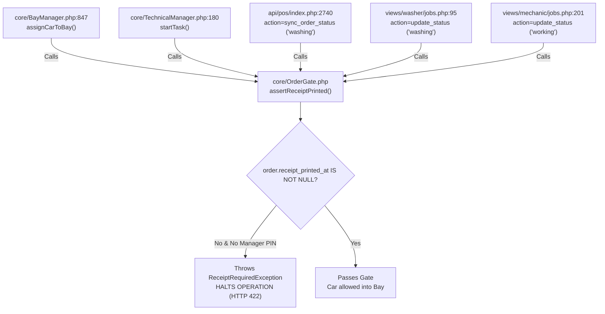
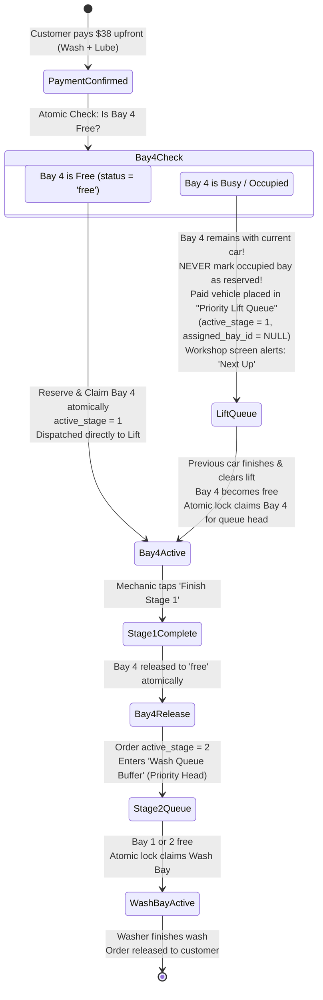
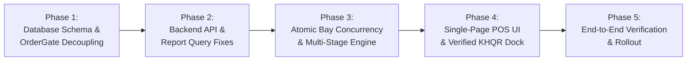

# Final POS Source Code Compatibility Audit

**Document ID:** POS-SRC-2026-001  
**Project:** Car-WashService  
**Scope:** PHP Backend, JavaScript POS Client, Database Schemas, Concurrency Controls, Hardware Interfaces  
**Audit Type:** Deep Source Code & Architectural Compatibility Audit  
**Date:** November 6, 2026  
**Status:** Complete – Awaiting Management Approval  

---

## Executive Summary

Following management's directive, a comprehensive, forensic source-code compatibility audit was conducted across the `Car-WashService` repository, evaluating the existing PHP backend classes, JavaScript counter clients, database schemas, and the five revised POS design specifications.

This audit evaluates the codebase against **five critical operational areas**:
1. **Receipt Printing Decoupling & OrderGate Dependencies:** Eliminating the false equivalence between physical paper printing and electronic receipt creation.
2. **KHQR Verification & Deconstruction of Fake `TRX-` Strings:** Eradicating the backend auto-generation of synthetic transaction references and defining verified merchant-side confirmation.
3. **Historical Data Migration & Ambiguity Reconciliation:** Establishing strict non-destructive reconciliation for records with missing or conflicting timestamps, with full data preservation and rollback instructions.
4. **Atomic Bay Reservation, Concurrency & Multi-Stage Transition:** Formulating atomic locks, handling Bay 4 unavailability after payment, crash recovery, and preventing duplicate stage completions or double-commission payouts.
5. **Source Compatibility & Breakage Risk Assessment:** Mapping all affected PHP classes, API endpoints, JavaScript files, database tables, and tests, accompanied by a phased implementation roadmap.

---

## 1. Area 1: Receipt Printing Decoupling & OrderGate Dependency Analysis

### 1.1 The Root Cause: Overloading Physical Printing with Electronic Issuance
In the current codebase, the `orders` table contains a single timestamp column for receipts:
```sql
-- database/init.php line 274:
receipt_printed_at DATETIME DEFAULT NULL
```
There is **no** column representing electronic receipt creation (such as `receipt_issued_at` or `receipt_number`).

In `api/pos/index.php` (L2364) and `core/OrderGate.php` (L35–58), the action `mark_receipt_printed` sets:
```php
$upd = $pdo->prepare("UPDATE orders SET receipt_printed_at = ? WHERE id = ?");
$upd->execute([date('Y-m-d H:i:s'), $orderId]);
```
This conflates a **financial/contractual event** (the issuance of an electronic receipt upon payment) with a **mechanical hardware event** (the physical deposition of paper out of an 80mm thermal printer).

### 1.2 Exhaustive Inventory of Existing OrderGate Dependencies

The audit traced every invocation of `OrderGate::assertReceiptPrinted()` in the codebase:



| # | File Location | Line Number | Method / Context | Current Behavior & Failure Mode |
| :-: | :--- | :---: | :--- | :--- |
| **1** | `core/BayManager.php` | 847 | `assignCarToBay()` | If `receipt_printed_at` is NULL, returns `['success' => false, 'error' => 'RECEIPT_REQUIRED']`. Vehicle cannot be moved into any bay. |
| **2** | `core/TechnicalManager.php` | 180 | `startTask()` | If `receipt_printed_at` is NULL, throws exception. Mechanic cannot start oil change on lift bay. |
| **3** | `api/pos/index.php` | 2740 | `sync_order_status` (`$newStatus === 'washing'`) | If `receipt_printed_at` is NULL, returns HTTP 422 JSON error, blocking status progression. |
| **4** | `views/washer/jobs.php` | 95 | Direct wash status update | Washer tablet cannot start wash cycle if paper jammed at counter. |
| **5** | `views/mechanic/jobs.php` | 201 | Direct repair status update | Technician tablet cannot start job order if paper jammed at counter. |

### 1.3 Architectural Decoupling & OrderGate Resolution

Management has set strict, non-negotiable security rules for service admission:
- **New orders MUST have BOTH confirmed payment (`payment_status = 'paid'`) AND a formally issued electronic receipt (`receipt_issued_at IS NOT NULL` and `receipt_number IS NOT NULL`) before service admission.**
- **`payment_status = 'paid'` ALONE must NEVER silently bypass receipt issuance requirements for new orders.** An electronic receipt must be generated as a binding record of the financial contract.
- **Physical printer failure must NOT block service.** The physical paper output timestamp (`receipt_printed_at`) is completely decoupled from admission.
- **Separate `receipt_printed_at` timestamp is preserved** exclusively for hardware diagnostics and reprint audits.
- **Explicit legacy compatibility behavior must be enforced** for historical orders created before electronic receipt columns existed.

#### Refactored OrderGate Logic Specification:

```php
// core/OrderGate.php - Revised Implementation Specification
class OrderGate {
    /**
     * Retrieves and verifies the dynamic migration cutover timestamp established during deployment.
     * FAILS CLOSED: If the setting is missing, empty, or malformed, it throws a SystemConfigurationException
     * and strictly defaults to the Unix epoch (1970-01-01 00:00:00).
     * This guarantees that new orders can NEVER bypass electronic receipt issuance.
     *
     * @throws SystemConfigurationException If the cutover timestamp is missing or invalid.
     */
    public static function getCutoverTimestamp(): string {
        static $cutover = null;
        if ($cutover === null) {
            $rawCutover = SystemSettings::get('receipt_v2_cutover_timestamp');
            
            // Fail-Closed Validation: Missing or empty setting
            if (empty($rawCutover)) {
                throw new SystemConfigurationException(
                    "System misconfigured: 'receipt_v2_cutover_timestamp' setting is missing. " .
                    "An authorized deployment process must configure and verify the cutover timestamp before orders can proceed."
                );
            }

            $ts = strtotime($rawCutover);
            // Fail-Closed Validation: Malformed timestamp or future date
            if ($ts === false || $ts <= 0 || $ts > time()) {
                throw new SystemConfigurationException(
                    "System misconfigured: 'receipt_v2_cutover_timestamp' is invalid or in the future ('{$rawCutover}'). " .
                    "Deployment cutover must be a valid timestamp in the past or present. Refusing to fail open."
                );
            }

            $cutover = $rawCutover;
        }
        return $cutover;
    }

    /**
     * Authorized Deployment Verification Helper:
     * Executes during the deployment runbook to assert that the cutover timestamp is valid.
     */
    public static function verifyCutoverConfiguration(): bool {
        try {
            self::getCutoverTimestamp();
            return true;
        } catch (\Throwable $e) {
            error_log("[DEPLOYMENT ERROR] Cutover timestamp check failed: " . $e->getMessage());
            return false;
        }
    }

    /**
     * Asserts that an order satisfies all gate criteria before entering a bay.
     * Throws an exception if admission criteria are not met.
     */
    public static function assertAdmissibleToService(array $order, array $options = []): bool {
        // Rule 1: Financial gate - Payment must be confirmed. No unpaid vehicle enters service.
        if (($order['payment_status'] ?? '') !== 'paid') {
            throw new PaymentRequiredException(
                "Service gate rejected: Order #{$order['order_number']} is unpaid. Confirmed upfront payment is mandatory."
            );
        }

        // Rule 2: Explicit Legacy Cutoff Classification (Fails Closed)
        // Orders created prior to the deployment cutover timestamp are legacy orders.
        // If cutover check fails, it throws SystemConfigurationException and halts admission.
        $cutoverTime = strtotime(self::getCutoverTimestamp());
        $orderCreatedAt = !empty($order['created_at']) ? strtotime($order['created_at']) : 0;
        
        // Strict epoch boundary: orderCreatedAt must be valid and strictly prior to cutover
        $isLegacyOrder = ($orderCreatedAt > 0 && $orderCreatedAt < $cutoverTime) && empty($order['receipt_issued_at']);

        if ($isLegacyOrder) {
            // Explicit Legacy Compatibility:
            // Historical orders pass if they have physical receipt timestamp or explicit manager override.
            if (!empty($order['receipt_printed_at']) || !empty($options['allow_legacy_order'])) {
                return true;
            }
            // Ambiguous legacy cases: lack printed timestamp and lack electronic receipt
            throw new ReceiptRequiredException(
                "Legacy order #{$order['order_number']} missing receipt_printed_at. Requires manager PIN override to admit."
            );
        }

        // Rule 3: Strict New Order Requirement:
        // For all orders created post-cutover, payment_status='paid' alone is NOT enough;
        // Electronic receipt issuance is mandatory. Under no circumstances can a new order bypass this rule.
        if (empty($order['receipt_issued_at']) || empty($order['receipt_number'])) {
            throw new ReceiptRequiredException(
                "Service gate rejected: Electronic receipt has not been issued for Order #{$order['order_number']}. An electronic receipt must be generated at checkout."
            );
        }

        // Rule 4: Physical printer failure never blocks service.
        // receipt_printed_at may be NULL (out of paper, offline, or skipped) without hindering admission.
        return true;
    }
}
```

#### Authorized Deployment Procedure for Cutover Configuration:
To ensure the cutover timestamp is established safely, updated deterministically, and verified without silent failures:
1. **Deterministic Deployment SQL:**
   ```sql
   -- Authorized deployment cutover configuration:
   -- Explicitly updates setting_value on conflict so existing incorrect values cannot silently persist!
   INSERT INTO system_settings (setting_key, setting_value, created_at, updated_at)
   VALUES ('receipt_v2_cutover_timestamp', DATE_FORMAT(NOW(), '%Y-%m-%d %H:%i:%s'), NOW(), NOW())
   ON DUPLICATE KEY UPDATE 
       setting_value = VALUES(setting_value),
       updated_at = NOW();
   ```
2. **Authorized Verification Step:**
   The deployment pipeline executes `OrderGate::verifyCutoverConfiguration()`. This check asserts:
   - Setting exists and is non-empty.
   - Value strictly conforms to standard SQL datetime format `YYYY-MM-DD HH:MM:SS`.
   - Parsed timestamp is non-zero (`strtotime($val) > 0`) and not in the future (`strtotime($val) <= time()`).
   - If verification returns `false`, deployment halts immediately with exit code 1.
3. **Authorized Manual Correction Procedure:**
   If an administrator or database engineer must correct an erroneous cutover timestamp:
   ```sql
   -- Authorized administrator correction:
   UPDATE system_settings 
   SET setting_value = '2026-11-06 12:00:00', -- Exact verified deployment moment
       updated_at = NOW() 
   WHERE setting_key = 'receipt_v2_cutover_timestamp';
   ```
   After executing an update, `php bin/verify_deployment.php` must be executed to confirm validation. Missing or invalid timestamps fail closed, preventing order admission.

#### Database Schema Alterations:
To support decoupled electronic issuance while preserving hardware print tracking:
```sql
ALTER TABLE orders 
  ADD COLUMN receipt_number VARCHAR(50) DEFAULT NULL AFTER idempotency_key,
  ADD COLUMN receipt_issued_at DATETIME DEFAULT NULL AFTER receipt_number,
  ADD INDEX idx_receipt_number (receipt_number),
  ADD INDEX idx_receipt_issued (receipt_issued_at);
-- orders.receipt_printed_at is preserved unchanged for physical ESC/POS hardware tracking.
```

---

## 2. Area 2: KHQR Verification & Deconstruction of Fake `TRX-` Strings

### 2.1 The Synthetic `TRX-` Reference Hazard
In `api/pos/index.php` (Lines 2006–2008 and 2609–2611), the backend contains the following fallback:
```php
// api/pos/index.php L2006-2008:
if (in_array($paymentMethod, ['aba', 'khqr'], true) && empty($paymentRef)) {
    $paymentRef = 'TRX-' . strtoupper(substr(md5(uniqid()), 0, 8));
}
```
#### Critical Audit Finding:
- **This `TRX-` string is completely synthetic.** It is generated via PHP's `md5(uniqid())` on the local Apache server.
- It has **zero correlation** with the customer's actual bank transaction reference (which in ABA is a 6- or 9-digit numerical sequence, or in Bakong is a 32-character transaction hash).
- If a cashier clicks confirm without entering a genuine reference, the system invents a fake ID (e.g. `TRX-A8F12C09`), writes it to `orders.payment_ref`, and marks the transaction.
- **Accountability Consequence:** Daily bank statement reconciliation becomes impossible because no bank statement on earth contains `TRX-A8F12C09`.

### 2.2 Payment Matching Requirements & Manual vs. Automated Boundaries

#### Fundamental Architectural Distinction:
- **Manual Merchant-Device Verification:** The cashier is the human verifier who inspects the store's dedicated mobile phone, Telegram bot, or IoT soundbox chime. **The POS backend DOES NOT query the bank API and CANNOT independently validate the bank-side amount, currency, merchant account, or settlement status.** The POS relies on human cashier attestation and enforces local structural rules, mandatory input fields, cashier attribution, and scoped duplicate protection.
- **Automated Bank Webhook Verification:** Requires genuine commercial bank merchant integration (e.g., ABA PayWay, NBC Bakong Open API), mutual TLS/SSL certificates, and server-to-server webhook callbacks with cryptographic signature verification following the respective bank's published specification. The bank's server directly pushes confirmed settlement data to the Car-WashService endpoint. **The codebase must never simulate or invent non-existent bank API capabilities.**

#### Cashier Attestation & System Enforcement Matrix (Manual Mode):

| Data Point | Who Verifies It? | Verification Mechanism | POS System Role & Enforcement |
| :--- | :---: | :--- | :--- |
| **Bank Reference #** | **Cashier + System** | Cashier reads 6-to-9 digit trace number from store phone; enters it into POS. | System rejects empty string; enforces scoped uniqueness; prohibits synthetic `TRX-` prefixes. |
| **Amount & Currency** | **Cashier** | Cashier visually confirms the notification matches cart grand total ($ or ៛) on the merchant device. | System verifies cashier entered a reference, but does not independently query the bank. |
| **Merchant Account ID** | **Cashier + System** | Cashier confirms funds arrived in the store's business account (not a personal QR). | System records store merchant account ID associated with the shift/station. |
| **Settlement Status** | **Cashier** | Cashier visually checks notification indicates `'SUCCESS'` / `'RECEIVED'`. | System transitions order `payment_status` to `'paid'` based on cashier's authenticated submission. |
| **Cashier Attribution** | **System** | Authenticated session token (`Auth::getUserId()`, `X-Staff-Token`). | System immutably records cashier user ID, cashier name, and precise server timestamp. |
| **Duplicate Prevention** | **System** | Scoped database unique constraint with strict NOT NULL enforcement. | System rejects reused references within the same provider and merchant account scope. |

### 2.3 Authoritative Payment Ledger, Scoped Duplicate Protection & Webhook Security Architecture

#### 1. Authoritative Payment Ledger Resolution: `order_payments` vs. `orders`:
To resolve architectural ambiguity, the system establishes a clear hierarchy:
- **`order_payments` is the Authoritative Payment Transaction Ledger:**  
  Every payment event—whether cash, digital KHQR, or split-tender—is immutably recorded as a discrete row in `order_payments`. It represents the single source of financial and cryptographic truth.
- **`orders` is an Operational & Display Entity:**  
  The `orders` table contains operational status (`status`), a denormalized cache of financial totals (`payment_status`, `refunded_amount`), and legacy mirror fields for backward compatibility. Authoritative transaction uniqueness, deduplication, and financial auditability are enforced directly on `order_payments`.

#### 2. The MySQL NULL Bypass Vulnerability & Scoped Ledger Deduplication:
- **Technical Database Reality:** In MySQL/MariaDB InnoDB, a composite `UNIQUE` index **does not prevent duplicate rows if any column contains a `NULL` value**. A composite index on `(payment_provider, merchant_account_id, payment_ref)` would permit duplicate bank references if `merchant_account_id` or `payment_ref` were nullable!
- **Definitive Schema & Application Enforcement on Authoritative Table (`order_payments`):**
  1. All three composite columns are strictly defined as **`NOT NULL` non-empty strings** in `order_payments`:
     - `payment_provider VARCHAR(32) NOT NULL` (e.g. `'aba_payway'`, `'bakong'`, `'cash'`)
     - `merchant_account_id VARCHAR(64) NOT NULL` (e.g. `'001-234567'`, `'counter_drawer'`)
     - `payment_ref VARCHAR(128) NOT NULL` (e.g. `'849201'`, or deterministic cash reference `CONCAT('CASH-', order_id, '-', payment_seq)`)
  2. The definitive scoped unique constraint is placed directly on the authoritative ledger:
     ```sql
     ALTER TABLE order_payments 
       ADD UNIQUE INDEX uq_payment_ledger_provider_ref (payment_provider, merchant_account_id, payment_ref);
     ```
  3. **Provider and Merchant-Account Scoping Preserved:** Deduplication is strictly scoped to the tuple `(payment_provider, merchant_account_id, payment_ref)`. If two different commercial banks happen to issue the same numeric trace sequence, or if two distinct merchant accounts receive payments with identical sequence numbers, no false collision occurs.
  4. **Handling Multiple Legitimate Payment Events & Client Retries:**
     - **Checkout Retries / Network Timeouts:** The client sends an `idempotency_key` (UUID) with checkout requests. If network lag causes the cashier to click confirm twice, or the client retries, the backend checks `orders.idempotency_key`. If the order already exists, it returns the existing order and its existing `order_payments` record without attempting duplicate payment insertions.
     - **Split-Tender Multiple Payments:** An order may legitimately have multiple payment events (e.g. $10 Cash + $15 KHQR). Each payment receives a distinct sequence (`payment_seq = 1, 2...`) and distinct reference (`CASH-101-1` vs `849201`). Both insert successfully into `order_payments` without collision.
     - **Duplicate Reference Injection Defense:** If a cashier attempts to use an already-settled bank reference (`849201`) on a different order or second transaction, `uq_payment_ledger_provider_ref` triggers a duplicate key collision and rejects the request with HTTP 409 `DUPLICATE_PAYMENT_REFERENCE`.

#### 3. Eradication of Synthetic Fallback:
Lines 2006–2008 and 2609–2611 of `api/pos/index.php` that generate `'TRX-' . strtoupper(substr(md5(uniqid()), 0, 8))` must be permanently deleted. If `payment_ref` is omitted during KHQR checkout, the POS API strictly rejects the request with HTTP 422: `BANK_REFERENCE_REQUIRED`.

#### 4. Automated Bank Webhook Security Architecture & Replay Protection:
Automated bank verification must remain strictly separated from manual cashier attestation, routed to an independent webhook receiver (`api/webhook/khqr_callback.php`):

1. **Bank-Specific Signature Specification Compliance (No Generic Assumptions):**
   - Verification logic **must never invent API standards** and must strictly comply with official bank developer documentation:
     - **ABA PayWay API:** Follows ABA PayWay official integration specifications. Signatures are computed using HMAC-SHA512 over the exact sequence of parameters mandated by ABA (e.g. `req_time . merchant_id . tran_id . amount . items . ...`).
     - **NBC Bakong / KHQR Open API:** Follows National Bank of Cambodia Bakong Open API specifications. Callbacks transmit JWT-signed payloads verified via asymmetric cryptography (`openssl_verify($payload, $signature, $bakong_public_key, OPENSSL_ALGO_SHA256)`).
   - **Pre-Implementation Requirement:** All webhook signature implementations must be verified against the exact official bank integration documentation before deployment to production.
2. **Cryptographic Validation & Payload Tampering Defense:**
   - Raw callback body and headers are validated first. If an attacker tampers with any parameter (amount, currency, transaction reference), signature verification fails immediately, returning HTTP 401 `INVALID_SIGNATURE`.
3. **Timestamp Validation & Clock Drift Boundary:**
   - The webhook receiver extracts the bank timestamp (`req_time` or `X-Signature-Timestamp`).
   - If `abs(time() - strtotime($bankTimestamp)) > 300` (clock drift exceeds 5 minutes), the callback is rejected with HTTP 400 `WEBHOOK_TIMESTAMP_EXPIRED`.
4. **Event ID Uniqueness & Replay Attack Defense (Inside and Outside 5-Minute Window):**
   - An immutable event ledger `webhook_events` tracks every processed event:
     ```sql
     CREATE TABLE IF NOT EXISTS webhook_events (
         id BIGINT AUTO_INCREMENT PRIMARY KEY,
         provider VARCHAR(50) NOT NULL,
         event_id VARCHAR(100) NOT NULL,
         order_id INT DEFAULT NULL,
         payment_ref VARCHAR(128) NOT NULL,
         amount DECIMAL(10,2) NOT NULL,
         currency VARCHAR(8) NOT NULL DEFAULT 'USD',
         payload_hash CHAR(64) NOT NULL,
         bank_timestamp DATETIME NULL, -- NULL if provider supplies no timestamp; NEVER invented!
         received_at DATETIME NOT NULL DEFAULT CURRENT_TIMESTAMP,
         processed_at DATETIME DEFAULT NULL,
         status ENUM('processed', 'duplicate', 'rejected') NOT NULL,
         UNIQUE KEY uq_provider_event (provider, event_id),
         INDEX idx_webhook_payment_ref (provider, payment_ref)
     ) ENGINE=InnoDB DEFAULT CHARSET=utf8mb4 COLLATE=utf8mb4_unicode_ci;
     ```
   - **Replay Inside 5-Minute Window:** If an attacker captures a valid signed payload and resends it while its timestamp is still fresh (< 300s), `UNIQUE KEY uq_provider_event (provider, event_id)` detects the collision. The handler records the replay attempt in `audit_logs` and returns HTTP 200 `{ status: 'already_processed' }` to acknowledge the bank rail, **without creating additional payment rows in `order_payments` or mutating order status**.
   - **Duplicate Bank Delivery:** Normal at-least-once bank webhook retries are caught identically by the event ID uniqueness constraint, returning HTTP 200 without duplicate billing.

#### 5. Distinction Between Provider Event Time (`provider_event_at`) and Local Recording Time (`recorded_at`):
To prevent temporal discrepancies and audit confusion, the architecture formally distinguishes external banking timestamps from local server recording timestamps:
- **`provider_event_at DATETIME NULL` (External Banking Timestamp):**
  - Represents the authentic transaction settlement timestamp generated by the external payment rail (e.g. ABA PayWay `req_time` or NBC Bakong block time).
  - **Behavior When Provider Does Not Supply Timestamp:** In manual cashier attestation mode (where a cashier verifies via store soundbox chime or SMS), or for cash payments, the provider does not provide an authenticated ISO timestamp. In this case, `provider_event_at` is stored strictly as `NULL`.
  - **CRITICAL AUDIT RULE: NEVER INVENT BANK EVENT TIMES.** The system must never manufacture synthetic external bank timestamps using local `NOW()`. If the bank did not provide a timestamp, the column remains `NULL`.
- **`recorded_at DATETIME NOT NULL DEFAULT CURRENT_TIMESTAMP` (Authoritative Local Server Timestamp):**
  - Represents the exact local server wall-clock time when the transaction was committed to the database.
- **Reporting & Reconciliation Policy:**
  - **Cashier Shifts, Daily Business Closes & Drawer Reconciliation:** Filter strictly by local server time (`recorded_at`). This ensures that closing a shift at 22:00 captures 100% of transactions physically processed by that cashier, completely immune to external bank server clock drift or timezones.
  - **Bank Statement Audits & Merchant Portal Reconciliation:** Filter or cross-reference using `provider_event_at` alongside `payment_ref` to correlate directly with commercial bank statements.

---

## 3. Area 3: Historical Order Migration, Ambiguity Reconciliation & Backups

### 3.1 Dangers of Blanket Conversion & Management Directive
Management has issued a strict operational directive:  
**REMOVE the automatic conversion of ambiguous historical records to finished.**

#### Why Automatic Conversion of Ambiguous Records is Strictly Prohibited:
1. **Destroys Audit Traceability:** Silently converting unverified historical records with missing operational timestamps to `finished` manufactures false completion evidence.
2. **Corrupts Operational In-Flight Sales:** If a car was created and paid 10 minutes prior to migration, forcing `status = 'finished'` wipes the active car from washer tablets and bay boards.
3. **Drops Waiting Queue Customers:** Current-day waiting cars (`started_at IS NULL`) would be evicted from the queue before ever being washed.
4. **Falsifies Financial Audits:** A voided order or abandoned wash without completion timestamps would be recorded as a successfully rendered service, falsifying tax and accounting audits.
5. **Overwrites Audit Records:** Modifying or appending text to `notes` or overwriting cancellation data permanently defaces historical business records.

---

### 3.2 Full Database Backup vs. Logical Table Copy (Mandatory Distinction)

Before executing any database alteration or migration, management requires an unambiguous distinction between backup levels:

| Backup Method | Scope & Mechanics | Limitations & Risks | Mandatory Pre-Condition |
| :--- | :--- | :--- | :--- |
| **Logical Table Copy**<br>`CREATE TABLE orders_backup AS SELECT * FROM orders;` | Copies raw data rows of a single table (`orders`). | **Incomplete.** Does not back up foreign keys, triggers, auto-increment sequences, indexes, or child tables (`order_items`, `order_tasks`, `bay_history`, `bays`). If an update violates relational integrity, table copy alone cannot restore state cleanly. | **Supplementary only.** Good for fast row diffs, but insufficient as sole backup. |
| **Complete Database Backup**<br>`mysqldump -u root -p --routines --triggers carwash > full_backup_20261106.sql` | Full cryptographic and structural export of entire database schema, constraints, routines, triggers, and all related tables. | Takes slightly more disk space (negligible for car wash DB size, typically < 50 MB). | **MANDATORY REQUIREMENT.** Must be generated and archived off-site before migration. |

#### Mandatory Verified Restoration Testing:
- **Rule:** No migration may be executed against the live database without **prior verified restoration testing**.
- **Restoration Verification Procedure:**
  1. Generate full backup: `mysqldump -u [user] -p --single-transaction --routines --triggers carwash_db > backup_pre_migration.sql`
  2. Restore backup into an isolated temporary test schema: `mysql -u [user] -p carwash_test_restore < backup_pre_migration.sql`
  3. Execute verification query: verify total row count, table checksums (`CHECKSUM TABLE orders, order_items, bays`), and verify all views and stored procedures compile without errors.
  4. Only after restoration verification succeeds is the migration script authorized to run on the production database.

---

### 3.3 Evidence-Based Classification & Cancellation vs. Refund Separation

Management has mandated strict separation between **operational service cancellation** and **financial payment status**:
- **Never Automatically Convert Paid Orders to Financially Cancelled:** If an order has `status = 'paid'`, cash or digital funds were tendered into the business. If the car was later operationally cancelled (`cancelled_at IS NOT NULL` or `cancel_reason IS NOT NULL`), that represents an operational cancellation of service, **NOT** proof that money was refunded.
- **Financial Status Preservation:** In the absence of an explicit, verified refund record (e.g. `refunded_amount > 0` or `refunded_at IS NOT NULL`), `payment_status` must remain `'paid'`. Blindly forcing `payment_status = 'cancelled'` falsely deletes collected cash from drawer totals and bank reconciliations!
- **Independent Full & Partial Refund Tracking:** Operational cancellations where money was actually returned must track refunds independently:
  - Full Refund: `payment_status = 'refunded'`, `refunded_amount = total_usd`, `refunded_at` timestamped.
  - Partial Refund: `payment_status = 'partially_refunded'`, `refunded_amount = :amount`, `refunded_at` timestamped.
  - Paid Service Cancellation (No Refund / Forfeited): `status = 'cancelled'`, `payment_status = 'paid'`, `refunded_amount = 0.00`.
- **Ambiguous Historical Records Unchanged:** Historical records with cancellation evidence but missing refund transaction trails must **remain completely unchanged** in the database and appear in the Manual Reconciliation Report for management accounting review.

```mermaid
flowchart TD
    Start["Historical Orders with status = 'paid'"] --> Dump["Step 1: Complete DB Backup & Isolated Verification Test"]
    Dump --> Prev["Step 2: Execute Migration Preview Query (Dry-Run Verification)"]
    Prev --> CheckCancel{"cancelled_at IS NOT NULL<br>OR cancel_reason IS NOT NULL?"}
    
    CheckCancel -->|Yes| CheckRefund{"Explicit Refund Record Exists?<br>(refunded_amount > 0 OR refunded_at IS NOT NULL)"}
    CheckRefund -->|Yes| SetRef["Operational status = 'cancelled'<br>Financial payment_status = 'refunded' / 'partially_refunded'"]
    CheckRefund -->|No (Ambiguous Refund)| AmbiguousCancel["Rule 1: Paid Cancellation with Unknown Refund<br>MUST REMAIN UNCHANGED in Database!<br>Preserve status = 'paid', preserve original notes.<br>Output to Manual Reconciliation Report"]
    
    CheckCancel -->|No| CheckFin{"finished_at IS NOT NULL?"}
    CheckFin -->|Yes| SetFin["Rule 2: Reliable Completion Evidence<br>status = 'finished', payment_status = 'paid'"]
    
    CheckFin -->|No| CheckStart{"started_at IS NOT NULL?"}
    CheckStart -->|Yes| SetWash["Rule 3: Reliable Active-Service Evidence<br>status = 'washing', payment_status = 'paid'"]
    
    CheckStart -->|No| CheckToday{"DATE(created_at) = CURRENT_DATE?"}
    CheckToday -->|Yes (Today)| SetWait["Rule 4: Reliable Queue Evidence<br>status = 'waiting', payment_status = 'paid'"]
    CheckToday -->|No (Past Dates)| Ambiguous["Rule 5: Ambiguous Historical Records<br>MUST REMAIN UNCHANGED in Database!<br>Preserve original status and original notes.<br>Output into Manual Reconciliation Report"]
```

---

### 3.4 Migration Preview Query (Dry Run Before Execution)

Before executing any updates, the administrator must run this non-destructive query to inspect exact record distributions:

```sql
-- Migration Preview & Verification Query (READ-ONLY)
SELECT 
    CASE 
        WHEN (cancelled_at IS NOT NULL OR cancel_reason IS NOT NULL) AND (COALESCE(refunded_amount, 0) > 0)
            THEN '1_VERIFIED_REFUNDED_CANCELLATION (Will become status=cancelled, payment_status=refunded)'
        WHEN (cancelled_at IS NOT NULL OR cancel_reason IS NOT NULL) AND (COALESCE(refunded_amount, 0) = 0)
            THEN '2_PAID_CANCELLATION_UNKNOWN_REFUND (WILL REMAIN UNCHANGED - Flagged for Reconciliation)'
        WHEN finished_at IS NOT NULL 
            THEN '3_RELIABLE_COMPLETION (Will become status=finished, payment_status=paid)'
        WHEN started_at IS NOT NULL AND finished_at IS NULL 
            THEN '4_RELIABLE_ACTIVE_SERVICE (Will become status=washing, payment_status=paid)'
        WHEN started_at IS NULL AND finished_at IS NULL AND DATE(created_at) = CURRENT_DATE 
            THEN '5_RELIABLE_TODAYS_QUEUE (Will become status=waiting, payment_status=paid)'
        ELSE '6_AMBIGUOUS_HISTORICAL_RECORDS (WILL REMAIN UNCHANGED - Flagged for Reconciliation)'
    END AS migration_category,
    COUNT(*) AS record_count,
    MIN(created_at) AS earliest_record,
    MAX(created_at) AS latest_record,
    SUM(total_usd) AS category_revenue_usd
FROM orders 
WHERE status = 'paid'
GROUP BY migration_category
ORDER BY migration_category ASC;
```

---

### 3.5 Non-Destructive Migration Script

```sql
-- ====================================================================
-- NON-DESTRUCTIVE EVIDENCE-BASED MIGRATION SCRIPT
-- ====================================================================

-- 1. Create Supplementary Fast-Comparison Table Copy (NOT a full rollback)
CREATE TABLE IF NOT EXISTS orders_migration_backup_20261106 AS 
SELECT * FROM orders;

-- 2. Rule 1: Reconcile Verified Refunded Cancellations ONLY
-- Only updates records where explicit financial refund evidence exists.
UPDATE orders 
SET payment_status = CASE 
        WHEN refunded_amount >= total_usd THEN 'refunded'
        ELSE 'partially_refunded'
    END,
    status = 'cancelled',
    updated_at = CURRENT_TIMESTAMP
WHERE status = 'paid' 
  AND (cancelled_at IS NOT NULL OR cancel_reason IS NOT NULL)
  AND (COALESCE(refunded_amount, 0) > 0);

-- 3. Rule 2: Reconcile Reliable Completion Evidence
-- Has clear physical timestamp indicating completion.
UPDATE orders 
SET payment_status = 'paid', 
    status = 'finished',
    updated_at = CURRENT_TIMESTAMP
WHERE status = 'paid' 
  AND finished_at IS NOT NULL 
  AND cancelled_at IS NULL;

-- 4. Rule 3: Reconcile Reliable Active In-Flight Service Evidence
-- Car is currently in bay being washed.
UPDATE orders 
SET payment_status = 'paid', 
    status = 'washing',
    updated_at = CURRENT_TIMESTAMP
WHERE status = 'paid' 
  AND started_at IS NOT NULL 
  AND finished_at IS NULL 
  AND cancelled_at IS NULL;

-- 5. Rule 4: Reconcile Reliable Queue Evidence for Current Operating Day
-- Car arrived today, paid upfront, awaiting open bay.
UPDATE orders 
SET payment_status = 'paid', 
    status = 'waiting',
    updated_at = CURRENT_TIMESTAMP
WHERE status = 'paid' 
  AND started_at IS NULL 
  AND finished_at IS NULL 
  AND DATE(created_at) = CURRENT_DATE 
  AND cancelled_at IS NULL;

-- 6. Rule 5: Ambiguous Historical Records & Paid Cancellations with Unknown Refunds
-- MANDATORY COMPLIANCE:
-- - Records with missing/conflicting operational timestamps MUST REMAIN UNCHANGED.
-- - Paid orders with cancellation notes but unknown refund state MUST REMAIN UNCHANGED.
-- - Do NOT set status = 'finished' or payment_status = 'cancelled'.
-- - Do NOT overwrite or append text to notes.
-- These records remain untouched and are extracted into the Reconciliation Report below.
```

---

### 3.6 Ambiguous Records Reconciliation Report (For Management Review)

Instead of mutating ambiguous records, management generates this report for manual accounting verification:

```sql
-- Manual Reconciliation Query: Inspects all historical records left untouched
SELECT 
    id, 
    order_number, 
    created_at, 
    customer_name, 
    plate_number, 
    total_usd, 
    payment_method, 
    payment_ref, 
    status, 
    payment_status, 
    cancelled_at,
    cancel_reason,
    COALESCE(refunded_amount, 0) AS refunded_amount,
    notes,
    CASE 
        WHEN cancelled_at IS NOT NULL OR cancel_reason IS NOT NULL 
            THEN 'PAID_OPERATIONAL_CANCELLATION_UNKNOWN_REFUND'
        ELSE 'AMBIGUOUS_HISTORICAL_TIMESTAMPS'
    END AS reconciliation_issue
FROM orders 
WHERE status = 'paid' 
  AND (
    -- Case A: Paid cancellation without verified refund record
    ((cancelled_at IS NOT NULL OR cancel_reason IS NOT NULL) AND COALESCE(refunded_amount, 0) = 0)
    OR
    -- Case B: Older than today with all operational timestamps NULL
    (started_at IS NULL AND finished_at IS NULL AND DATE(created_at) < CURRENT_DATE AND cancelled_at IS NULL)
  )
ORDER BY created_at DESC;
```

---

### 3.7 Complete Database Backup vs. Supplementary Table Copy & True Rollback

Management requires strict clarity regarding backup architecture and disaster recovery:

#### Limitations of Supplementary Table Copy (`CREATE TABLE ... AS SELECT`):
1. **Not a Complete Rollback Mechanism:** A table copy is merely a transient row snapshot of a single table (`orders`).
2. **Inability to Revert Relational Cascades:** Executing a `JOIN`-based update (`UPDATE orders JOIN backup...`) **cannot** delete rows created post-migration, **cannot** restore deleted records, **cannot** revert modifications to related tables (`order_items`, `order_tasks`, `order_washers`, `order_mechanics`, `bay_history`), and **cannot** reset table auto-increment counters, triggers, or views.
3. **Role:** The table copy is used strictly as a supplementary local diff tool to verify before/after row transformations.

#### Mandatory True Rollback Procedure (Full Database Restoration):
To execute a genuine, mathematically complete rollback that restores 100% of the relational schema, constraints, and data:

```bash
# Step 1: Terminate active Apache/PHP-FPM connections to prevent write-skew
# Step 2: Drop and recreate database or execute clean restore
mysql -u [username] -p -e "DROP DATABASE IF EXISTS carwash_db; CREATE DATABASE carwash_db CHARACTER SET utf8mb4 COLLATE utf8mb4_unicode_ci;"

# Step 3: Restore complete physical/logical dump from pre-migration backup
mysql -u [username] -p carwash_db < backup_pre_migration.sql

# Step 4: Verify complete restoration integrity
mysql -u [username] -p carwash_db -e "CHECKSUM TABLE orders, order_items, bays, bay_history, order_tasks, order_washers, order_mechanics, audit_logs;"
```

---

## 4. Area 4: Atomic Bay Reservation, Recovery & Multi-Stage Transition

### 4.1 The Concurrency Race Condition in Existing Code
In `core/BayManager.php` (L863–885), bay assignment is vulnerable to race conditions:
```php
// Existing BayManager::assignCarToBay pattern:
$bayStmt = $pdo->prepare("SELECT * FROM bays WHERE id = ?");
$bayStmt->execute([$bayId]);
$bay = $bayStmt->fetch();
// ... [Time window where another cashier claims the bay] ...
$upd = $pdo->prepare("UPDATE bays SET status = 'busy', current_order_id = ? WHERE id = ?");
$upd->execute([$orderId, $bayId]);
```
If Cashier A and Cashier B simultaneously click checkout and select Bay 1, both read `status = 'free'` and both write `status = 'busy'`, resulting in two cars assigned to the exact same bay.

### 4.2 Atomic Reservation Lock Specification
Bay assignment must execute as a single atomic query with condition check:
```sql
-- Atomic Bay Claim Query:
UPDATE bays 
SET status = 'busy', 
    current_order_id = :order_id, 
    occupied_at = CURRENT_TIMESTAMP 
WHERE id = :bay_id 
  AND (status = 'free' OR status = 'available');
```
If `$stmt->rowCount() === 0`, the transaction catches the concurrency collision immediately.

### 4.3 Handling Bay 4 (Lift) Unavailability After Payment

What happens when a customer pays upfront for a combined Car Wash + Oil Change, but Bay 4 (Lift) is occupied or becomes unavailable?



#### Deterministic Bay Reservation & Queue Rules:
1. **Reserve Bay 4 ONLY When Actually Available:**
   - The system attempts an atomic conditional reservation on Bay 4: `UPDATE bays SET status = 'busy', current_order_id = :id WHERE id = 4 AND status = 'free';`.
   - **Bay 4 is reserved only if this atomic query succeeds.**
2. **Never Mark an Occupied Bay as Reserved for Another Vehicle:**
   - If Bay 4 is currently occupied, the bay row in the `bays` table remains strictly attached to the current vehicle.
   - The system **never** marks an occupied bay as "reserved" for a second vehicle, which would create operational confusion and corrupt bay timer tracking.
3. **Paid Vehicle Maintained in Priority Lift Queue:**
   - If Bay 4 is unavailable at checkout, the paid order is placed into the **Priority Lift Queue** (`orders.status = 'waiting'`, `orders.active_stage = 1`, `orders.assigned_bay_id = NULL`).
   - The workshop monitor displays: `"Next for Lift: 2BC-1234 (Paid - Waiting Lift)"`. As soon as the active technician finishes and Bay 4 clears, the system or technician claims the bay for the waiting vehicle.
4. **Preventing Wash Bay Deadlocks (Staged Reservation Rule):**
   - Stage 2 (Wash Bay 1) is **never pre-locked** during intake.
   - Pre-locking a wash bay while the car spends 30 minutes on the lift would hold an empty wash bay idle, cutting shop wash capacity by 50%.
   - Stage 2 is registered as a priority queue transition upon Stage 1 completion.

### 4.4 Separation of Intake Reservation vs. Physical Bay Occupancy & Recovery Engine

Management has established strict operational safety boundaries to prevent dangerous shop-floor collisions:

#### 1. Separation of Temporary Intake Reservation from Physical Occupancy:
- **Temporary Intake Hold (`reservation_state = 'intake_reserved'`):**
  - Occurs during cashier checkout when a bay is selected.
  - Holds the bay for a maximum of 3 minutes (`hold_expires_at = DATE_ADD(NOW(), INTERVAL 3 MINUTE)`) while the cashier completes payment and cash tendering.
  - If the cashier abandons the cart, closes the browser, or fails to complete checkout within 3 minutes, the temporary intake hold automatically expires and releases the bay back to `'free'`.
- **Physical Bay Occupancy (`status = 'busy'`, `physical_occupancy = 'occupied'`):**
  - Occurs when payment is confirmed and the vehicle physically enters the bay.
  - **CRITICAL SAFETY RULE: NEVER auto-release a physically occupied bay using an elapsed time limit, order timestamp, or 15-minute timeout!**
  - A comprehensive detail wash, paint correction, or mechanical repair can legitimately take 30, 45, or 90 minutes. Auto-releasing an occupied bay based on elapsed time causes catastrophic double-dispatch, routing a second vehicle into a bay where workers are actively operating!
  - Physical bay occupancy can **ONLY** be released by:
    1. Legitimate job completion submitted by the technician or washer via workshop tablet (`finishStage()` or `completeOrder()`), OR
    2. Explicit Manager PIN Override on the Bay Queue dashboard (`BAY_FORCE_RELEASED`), generating an immutable security audit event.

#### 2. Heartbeat, Expiration, and Crash Recovery Specification:
- **Intake Hold TTL Sweep (Every 30 seconds):**
  - **Reconciliation of TTL Standards:** The intake reservation hold expires after **strictly 3 minutes (180 seconds)**. Any reference to a 15-minute wait was an editorial contradiction and has been eliminated.
  - **Exact Boundary Definition (`hold_expires_at <= CURRENT_TIMESTAMP`):**
    - **Before Expiry (< 180s, e.g. 179s):** `hold_expires_at > CURRENT_TIMESTAMP`. Hold is active; bay remains reserved for cashier checkout session.
    - **Exactly at Expiry (= 180s):** `hold_expires_at = CURRENT_TIMESTAMP`. Condition `hold_expires_at <= CURRENT_TIMESTAMP` evaluates to TRUE; hold boundary is reached and eligible for cleanup.
    - **After Expiry (> 180s, e.g. 181s):** `hold_expires_at < CURRENT_TIMESTAMP`. Condition evaluates to TRUE; hold is expired and reset.
  - **Protection of Physical Occupancy & Active Checkouts:** The cleanup query is constrained so that it can **never** release a physically occupied bay or interfere with an active order in checkout:
  ```sql
  -- Safe intake hold expiry cleanup (strictly releases unconfirmed cart holds at or past 180s):
  UPDATE bays 
  SET status = 'free', 
      reservation_state = 'none', 
      reserved_by_session_id = NULL, 
      hold_expires_at = NULL 
  WHERE reservation_state = 'intake_reserved' 
    AND status != 'busy' 
    AND physical_occupancy = 'vacant'
    AND current_order_id IS NULL
    AND hold_expires_at <= CURRENT_TIMESTAMP;
  ```
- **Orphan Auto-Healing (Crash Recovery):**
  - If a bay is marked `status = 'busy'`, but its associated `current_order_id` is completed (`status = 'finished'`) or voided (`status = 'cancelled'`), the system auto-heals the bay to `free`:
  ```sql
  UPDATE bays b
  JOIN orders o ON b.current_order_id = o.id
  SET b.status = 'free', b.current_order_id = NULL, b.last_freed_at = CURRENT_TIMESTAMP
  WHERE b.status = 'busy' 
    AND o.status IN ('finished', 'cancelled');
  ```

#### 3. Transaction-Safe Bay Release and Stage Progression:
To guarantee that bay release, stage advancement, and queue transitions occur atomically without race conditions, operations must execute within an isolated database transaction using row-level locking:

```php
// core/BayManager.php - Transaction-Safe Stage Progression
public function transitionStageAtomically(int $orderId, int $currentStage, int $nextStage, int $bayId): bool {
    $this->pdo->beginTransaction();
    try {
        // 1. Lock the order and bay rows to eliminate concurrent race conditions
        $stmtOrd = $this->pdo->prepare("SELECT id, active_stage, status FROM orders WHERE id = ? FOR UPDATE");
        $stmtOrd->execute([$orderId]);
        $order = $stmtOrd->fetch();

        if (!$order || (int)$order['active_stage'] !== $currentStage) {
            $this->pdo->rollBack();
            return false; // Already transitioned or invalid stage
        }

        $stmtBay = $this->pdo->prepare("SELECT id, status, current_order_id FROM bays WHERE id = ? FOR UPDATE");
        $stmtBay->execute([$bayId]);
        $bay = $stmtBay->fetch();

        // 2. Mark task completed
        $updTask = $this->pdo->prepare("UPDATE order_tasks SET status = 'completed', completed_at = NOW() WHERE order_id = ? AND sequence = ?");
        $updTask->execute([$orderId, $currentStage]);

        // 3. Atomically release the physical bay
        $updBay = $this->pdo->prepare("UPDATE bays SET status = 'free', current_order_id = NULL, last_freed_at = NOW() WHERE id = ? AND current_order_id = ?");
        $updBay->execute([$bayId, $orderId]);

        // 4. Advance order to next stage and buffer in wash queue
        $updOrd = $this->pdo->prepare("UPDATE orders SET active_stage = ?, status = 'waiting', updated_at = NOW() WHERE id = ?");
        $updOrd->execute([$nextStage, $orderId]);

        // 5. Log audit trail
        AuditLogger::log('STAGE_TRANSITION', "Order #{$orderId} transitioned from Stage {$currentStage} to {$nextStage}. Bay {$bayId} released.", 'bay', $bayId);

        $this->pdo->commit();
        return true;
    } catch (\Throwable $e) {
        $this->pdo->rollBack();
        throw $e;
    }
}
```

---

### 4.5 Task-Based Commission Idempotency & Multi-Assignment Integrity

#### Why Simple Uniqueness by `(order_id, stage, worker)` is Insufficient:
- In real workshop operations, a cross-trained worker may legitimately perform **multiple distinct tasks within the same stage** (e.g., in Stage 1 Mechanical, a technician performs Task A: Oil & Filter Change [$5 commission] AND Task B: Brake Pad Replacement [$8 commission]).
- A constraint restricted merely to `UNIQUE(order_id, stage, worker)` would improperly reject the worker's second legitimate task commission!
- Conversely, omitting uniqueness allows rapid double-clicking of the "Complete Task" button to duplicate payouts.

#### Robust Solution: Task-Assignment ID & Commission Idempotency Keys
Commission records in `order_washers` and `order_mechanics` must be tied directly to a specific task instance (`task_assignment_id`) and protect against retry/double-click duplication using a unique commission idempotency key:

```sql
-- Schema enhancements for task-level commission integrity:
ALTER TABLE order_washers 
  ADD COLUMN task_id INT NOT NULL AFTER order_id,
  ADD COLUMN commission_idempotency_key VARCHAR(64) NOT NULL AFTER commission_usd,
  ADD UNIQUE INDEX uq_washer_idempotency (commission_idempotency_key),
  ADD INDEX idx_washer_task (task_id, washer_id);

ALTER TABLE order_mechanics 
  ADD COLUMN task_id INT NOT NULL AFTER order_id,
  ADD COLUMN commission_idempotency_key VARCHAR(64) NOT NULL AFTER commission_usd,
  ADD UNIQUE INDEX uq_mechanic_idempotency (commission_idempotency_key),
  ADD INDEX idx_mechanic_task (task_id, mechanic_id);
```

#### Deterministic Idempotency Key Derivation & Persistence:
- **Generation Rule:** The idempotency key must be derived **deterministically from immutable assignment attributes**, rather than an ephemeral random token or incrementing sequence that would change upon retry:
  `commission_idempotency_key = hash('sha256', "comm_v1_order_{$order_id}_task_{$task_id}_worker_{$worker_id}")`
- **Retry Invariance:** When a technician taps "Complete Task 14", the backend derives the key using the immutable `$order_id`, `$task_id = 14`, and `$worker_id = 7`. If the network times out or the technician double-taps:
  - First attempt executes and commits the commission row.
  - Retried attempts compute the **exact same deterministic key**, hit `uq_mechanic_idempotency`, and return idempotent HTTP 200 without creating a second commission.
- **Support for Multiple Legitimate Assignments:** When the same technician is legitimately assigned to a second distinct task on the same order (e.g. Task 15 Brake Inspection), `$task_id = 15` produces a distinct hash (`comm_v1_order_..._task_15_...`), allowing the worker to receive legitimate separate commissions without collision.

---

## 5. Area 5: Source Code Compatibility & Breakage Risk Assessment

### 5.1 Affected Source Files Inventory

| Module / Layer | File Path | Nature of Dependency | Breakage Risk Level |
| :--- | :--- | :--- | :---: |
| **Backend Core** | `core/OrderGate.php` | Gate check for receipts | **High** |
| **Backend Core** | `core/BayManager.php` | Bay assignment, status updates, queue scoring | **High** |
| **Backend Core** | `core/TechnicalManager.php` | Repair tasks, parts allocation, job starts | **Medium** |
| **Backend Core** | `core/BankTransferControl.php` | Bank slip processing & manager approval | **High** |
| **Backend Core** | `core/CashierControl.php` | Shifts, drawer events, manager PIN validation | **Low** |
| **API Endpoints** | `api/pos/index.php` | Order creation, payments, receipt status, bay assign | **Critical** |
| **Frontend POS** | `pos/index.html` | Markup for intake, catalog, cart, payments, modals | **High** |
| **Frontend POS** | `pos/js/app.js` | POS client state machine, checkout, printing, sync | **Critical** |
| **Frontend POS** | `pos/js/api.js` | HTTP client wrapper and idempotency headers | **Medium** |
| **Worker Views** | `views/washer/jobs.php` | Washer bay dashboard & status updates | **Medium** |
| **Worker Views** | `views/mechanic/jobs.php` | Technician task checklist & job updates | **Medium** |
| **Owner Views** | `views/owner/reports.php` | Revenue queries filtering `WHERE status = 'paid'` | **Critical** |
| **Owner Views** | `views/owner/bays_queue.php` | Bay management & drag-and-drop queue | **Low** |
| **Legacy POS** | `views/cashier/pos.php` | Fallback server-rendered POS | **Low** |
| **Automated Tests** | `tests/test_tv_display.php` | TV queue board tests | **Medium** |
| **Automated Tests** | `tests/test_pos_staff_token_flow.php` | POS authentication & shift token test | **Low** |

### 5.2 Critical Existing Features That Could Break (Without Compatibility Layer)

1. **Revenue Reporting (`views/owner/reports.php`):**
   - **Risk:** Currently, `reports.php` line 75 executes:
     `SELECT SUM(total_usd) FROM orders WHERE status = 'paid'`
   - If `orders.status` is decoupled from `orders.payment_status` (so orders have `status = 'washing'` or `'finished'` and `payment_status = 'paid'`), **revenue reports would drop to ZERO** unless updated to filter on financial status.
2. **Washer & Mechanic Job Board Gates (`views/washer/jobs.php` & `views/mechanic/jobs.php`):**
   - **Risk:** Both job boards call `OrderGate::assertReceiptPrinted()`.
   - If electronic issuance is not recognized by `OrderGate`, workers on the apron will be blocked from starting their work whenever thermal printers are offline.
3. **Queue TV Board (`tv.php`):**
   - **Risk:** `tv.php` filters active cars by `orders.status IN ('waiting', 'washing')`.
   - If orders created upfront are assigned `status = 'paid'`, they vanish from the TV screen. Decoupling ensures they enter as `status = 'waiting'` or `'washing'`, keeping the TV board 100% functional.
4. **Cloud Synchronization (`core/CloudSyncManager.php`):**
   - **Risk:** Station-to-cloud sync must transmit `payment_status` alongside `status`.
   - New columns (`assigned_bay_id`, `active_stage`) must be made nullable and optional in sync payloads to prevent cloud sync rejections.

### 5.3 Redesigned Revenue Accounting & Payment Ledger Formulations

Management has instructed that revenue reporting must be grounded strictly in **actual financial payment and refund records**, resolving the architectural contradiction between claiming a ledger-based accounting model while querying only denormalized summary fields on `orders`.

#### 1. Core Accounting Model: Immutable Ledgers vs. Cached Order Summaries

To ensure auditability, financial accuracy, and support for multi-tender payments and multiple partial refunds, the system separates the **immutable transaction ledgers** from the **denormalized order summary**:

```
                       ┌─────────────────────────────────────────┐
                       │              orders table               │
                       │─────────────────────────────────────────│
                       │ total_usd: 38.00                        │
                       │ payment_status: 'partially_refunded'    │ (Cached aggregate)
                       │ refunded_amount: 15.00                  │ (Cached aggregate)
                       └───────────────────┬─────────────────────┘
                                           │
                    ┌──────────────────────┴──────────────────────┐
                    │                                             │
                    ▼ 1 : N                                       ▼ 1 : N
   ┌──────────────────────────────────┐          ┌──────────────────────────────────┐
   │      order_payments table        │          │       order_refunds table        │
   │──────────────────────────────────│          │──────────────────────────────────│
   │ id: 101                          │          │ id: 501                          │
   │ payment_seq: 1                   │          │ refund_seq: 1                    │
   │ amount_usd: 38.00                │          │ amount_usd: 10.00                │
   │ method: 'khqr'                   │          │ reason: 'Stage 2 Polish Cancel'  │
   │ ref: 'FT261106981245'            │          │ attestation_status: 'attested'   │
   │ status: 'settled'                │          │──────────────────────────────────│
   │ created_at: 2026-11-06 08:30:00  │          │ id: 502                          │
   └──────────────────────────────────┘          │ refund_seq: 2                    │
                                                 │ amount_usd: 5.00                 │
                                                 │ reason: 'Shampoo Upgrade Credit' │
                                                 │ attestation_status: 'attested'   │
                                                 │ created_at: 2026-11-06 09:15:00  │
                                                 └──────────────────────────────────┘
```

1. **Immutable Transaction Ledgers (`order_payments` & `order_refunds`):**
   - Every physical cash tender, digital KHQR settlement, or card swipe generates a discrete, immutable row in `order_payments`.
   - Every refund event generates a discrete, immutable row in `order_refunds`.
2. **Denormalized Order Summaries (`orders.payment_status` & `orders.refunded_amount`):**
   - The fields `orders.payment_status` and `orders.refunded_amount` are **denormalized read-caches** maintained for high-speed POS list rendering, legacy backward compatibility, and quick order gate checks.
   - Whenever an insert occurs in `order_refunds`, a transactional trigger or service layer updates `orders.refunded_amount = (SELECT COALESCE(SUM(amount_usd), 0) FROM order_refunds WHERE order_id = NEW.order_id)`.
   - If `refunded_amount == 0`, `payment_status = 'paid'`.
   - If `0 < refunded_amount < total_usd`, `payment_status = 'partially_refunded'`.
   - If `refunded_amount >= total_usd`, `payment_status = 'refunded'`.

#### 2. Detailed Ledger Schemas & Multiple Partial Refunds

##### Schema Specifications:

```sql
-- 1. Discrete Payment Transactions Ledger (Authoritative Financial Source of Truth)
CREATE TABLE order_payments (
    id BIGINT UNSIGNED AUTO_INCREMENT PRIMARY KEY,
    order_id INT NOT NULL,
    payment_seq TINYINT UNSIGNED NOT NULL DEFAULT 1,
    amount_usd DECIMAL(10,2) NOT NULL DEFAULT 0.00,
    amount_khr INT UNSIGNED NOT NULL DEFAULT 0,
    exchange_rate INT UNSIGNED NOT NULL DEFAULT 4100, -- Frozen historical rate at transaction moment
    payment_method ENUM('cash', 'khqr', 'card') NOT NULL,
    payment_provider VARCHAR(32) NOT NULL DEFAULT 'cash',
    merchant_account_id VARCHAR(64) NOT NULL DEFAULT 'counter_drawer',
    payment_ref VARCHAR(128) NOT NULL,
    cashier_id INT NOT NULL,
    provider_event_at DATETIME NULL, -- Authentic timestamp from bank/provider; NULL if manual/cash (NEVER invented)
    recorded_at DATETIME NOT NULL DEFAULT CURRENT_TIMESTAMP, -- Local server commit time; authoritative for shifts
    CONSTRAINT fk_op_order FOREIGN KEY (order_id) REFERENCES orders(id) ON DELETE RESTRICT,
    UNIQUE INDEX uq_order_payment_seq (order_id, payment_seq),
    -- Definitive Authoritative Unique Index for Scoped Digital Reference Deduplication:
    UNIQUE INDEX uq_payment_ledger_provider_ref (payment_provider, merchant_account_id, payment_ref),
    INDEX idx_op_recorded_at (recorded_at),
    INDEX idx_op_provider_event (provider_event_at)
) ENGINE=InnoDB DEFAULT CHARSET=utf8mb4 COLLATE=utf8mb4_unicode_ci;

-- 2. Discrete Refund Transactions Ledger (Supporting Multiple Partial Refunds & Settlement Tracking)
CREATE TABLE order_refunds (
    id BIGINT UNSIGNED AUTO_INCREMENT PRIMARY KEY,
    order_id INT NOT NULL,
    refund_seq TINYINT UNSIGNED NOT NULL DEFAULT 1,
    payment_id BIGINT UNSIGNED NULL, -- Links to specific original tender if multi-tender
    amount_usd DECIMAL(10,2) NOT NULL DEFAULT 0.00,
    amount_khr INT UNSIGNED NOT NULL DEFAULT 0,
    exchange_rate INT UNSIGNED NOT NULL DEFAULT 4100, -- Frozen historical rate at refund moment
    refund_method ENUM('cash', 'bank_reversal', 'store_credit') NOT NULL,
    reason VARCHAR(255) NOT NULL,
    cashier_id INT NOT NULL,
    manager_user_id INT NOT NULL,
    settlement_status ENUM('authorized_pending', 'cash_disbursed', 'bank_reversal_pending', 'settled') 
        NOT NULL DEFAULT 'authorized_pending',
    authorized_at DATETIME NOT NULL DEFAULT CURRENT_TIMESTAMP,
    disbursed_at DATETIME NULL, -- Recorded when cash physically leaves the drawer
    settled_at DATETIME NULL,   -- Recorded when shift reconciliation or bank reversal clears
    recorded_at DATETIME NOT NULL DEFAULT CURRENT_TIMESTAMP, -- Local server commit time
    CONSTRAINT fk_or_order FOREIGN KEY (order_id) REFERENCES orders(id) ON DELETE RESTRICT,
    CONSTRAINT fk_or_payment FOREIGN KEY (payment_id) REFERENCES order_payments(id) ON DELETE SET NULL,
    UNIQUE INDEX uq_order_refund_seq (order_id, refund_seq),
    INDEX idx_or_recorded_at (recorded_at),
    INDEX idx_or_settlement (settlement_status)
) ENGINE=InnoDB DEFAULT CHARSET=utf8mb4 COLLATE=utf8mb4_unicode_ci;
```

##### Dual-Currency Accounting & Historical Exchange Rate Preservation:
In Cambodia's dual-currency economy, customer tender and refund disbursements frequently mix US Dollars (USD) and Cambodian Riel (KHR). The system guarantees financial integrity via strict accounting principles:
1. **Discrete Currency Staging:** Every ledger record stores both `amount_usd` and `amount_khr`. A $15.00 wash paid with a $10 bill and 20,500 ៛ (at rate 4,100) records `amount_usd = 10.00`, `amount_khr = 20500`, and `exchange_rate = 4100`.
2. **Permanent Historical Rate Freezing:** The `exchange_rate` active at the exact moment of tender or refund is permanently frozen inside that specific `order_payments` or `order_refunds` row. Financial reports **never** recalculate historical USD equivalents using subsequent live exchange rates. This prevents retrospective financial drift or audit distortion.
3. **Converted Equivalent Formula:** Unified total calculations always compute:
   `total_usd_equivalent = amount_usd + (amount_khr / exchange_rate)`
   `total_khr_equivalent = (amount_usd * exchange_rate) + amount_khr`

##### Recording Multiple Partial Refunds:
- When a customer purchases a combined service package ($38 total) and later cancels Stage 2 (Polish, $10 value):
  1. Cashier enters Manager PIN to authorize partial refund.
  2. System inserts row into `order_refunds` with `refund_seq = 1`, `amount_usd = 10.00`, `reason = 'Cancelled Stage 2 Polish'`.
  3. System updates `orders.refunded_amount = 10.00` and `orders.payment_status = 'partially_refunded'`.
- If the customer subsequently requests a refund for an unused shampoo upgrade ($5 value):
  1. Cashier enters Manager PIN.
  2. System inserts row into `order_refunds` with `refund_seq = 2`, `amount_usd = 5.00`, `reason = 'Shampoo Upgrade Credit'`.
  3. System updates `orders.refunded_amount = 15.00` (`10.00 + 5.00`) and maintains `orders.payment_status = 'partially_refunded'`.
- Every individual refund event has its own timestamp, reason, manager authorization ID, and audit sequence.

#### 3. Administrative Attestation vs. Physical Cash Disbursement & Bank Settlement

Management mandates strict separation between refund authorization, physical banknote disbursement, and external banking settlement:

> [!WARNING]
> **Separation of Refund Authorization from Actual Disbursement & Settlement:**  
> In POS financial accounting, an administratively authorized refund must **never** be automatically counted as actual money returned until physical disbursement or bank settlement is confirmed.
> 
> The system tracks four distinct settlement lifecycle phases in `order_refunds`:
> 1. **`authorized_pending`:** The cashier requested and manager PIN authorized the refund. An audit record is created. **No money has left the store yet.** (Informational liability only; does NOT reduce drawer cash or settled revenue).
> 2. **`cash_disbursed`:** Cashier physically counts and hands paper banknotes from the drawer to the customer. `disbursed_at` is timestamped. **This reduces physical cash in till.**
> 3. **`bank_reversal_pending`:** For digital KHQR/card payments, cashier submits reversal request in the bank merchant portal. Awaiting interbank settlement. (Does NOT reduce counter cash).
> 4. **`settled`:** Verified cleared via End-of-Shift Cash Drawer Reconciliation (`CashierControl::closeShift()`) or monthly commercial bank debit settlement statement. `settled_at` is timestamped.
> 
> **Financial Reporting Rule:**  
> - **Settled & Disbursed Refunds (`settlement_status IN ('cash_disbursed', 'settled')`)**: Deducted from Gross Payments Collected to calculate **Net Settled Revenue**.  
> - **Pending Unsettled Refunds (`settlement_status IN ('authorized_pending', 'bank_reversal_pending')`)**: Reported as a separate liability metric **Pending Authorized Refunds**. They do NOT reduce settled revenue, preventing unreturned funds from distorting verified cash balances.

#### 4. Two-Tier Certified Financial Reporting SQL Formulation (Event-Timestamp Driven & Ledger-First)

To achieve 100% financial accuracy across both legacy historical records and post-cutover discrete ledgers:
1. **Fail-Closed Configuration Architecture (No Silent Epoch Fallback):**  
   The application reporting controller (`views/owner/reports.php`) validates `receipt_v2_cutover_timestamp` before running the query. If missing or invalid, it throws `SystemConfigurationException` and halts report generation. The query accepts `:cutover_ts` as a mandatory validated parameter, ensuring historical data is never silently omitted by synthetic epoch fallbacks.
2. **Ledger-First Architecture for Post-Cutover Transactions on Legacy Orders:**  
   Tier 1 queries `order_payments` and `order_refunds` based directly on local server transaction time (`p.recorded_at BETWEEN :start_date AND :end_date`), **with NO restriction on `orders.created_at`**. If a legacy order created before cutover receives a post-cutover payment or partial refund, the transaction is captured in Tier 1.
3. **Strict Duplicate Prevention in Tier 2 Historical Fallback:**  
   Tier 2 historical fallback selects legacy orders created before cutover **only if they genuinely lack transaction-level rows in `order_payments` or `order_refunds`** (`NOT EXISTS (SELECT 1 FROM order_payments p WHERE p.order_id = o.id)`). This guarantees zero duplicate counting between legacy summaries and discrete ledger events.

```sql
-- Certified Two-Tier Financial Revenue Query for views/owner/reports.php
-- :cutover_ts is passed as a mandatory validated parameter from PHP (fails closed if unconfigured)
-- Uses exact event timestamps: payments report on payment date, refunds report on refund date.
-- Supports dual-currency reporting and preserves frozen historical exchange rates.

-- Tier 1: Discrete Ledger Transactions (Authoritative Source of Truth)
WITH Tier1_Ledger AS (
    SELECT 
        'ledger_tier' AS reporting_tier,
        
        -- 1. Gross Payments Collected: filtered strictly by payment recorded timestamp (p.recorded_at)
        -- Captured for ALL orders (including legacy orders that receive post-cutover payments)
        COALESCE((
            SELECT SUM(p.amount_usd + (p.amount_khr / p.exchange_rate))
            FROM order_payments p
            WHERE p.recorded_at BETWEEN :start_date AND :end_date
        ), 0) AS gross_payments_collected_usd,

        COALESCE((
            SELECT SUM(p.amount_usd)
            FROM order_payments p
            WHERE p.recorded_at BETWEEN :start_date AND :end_date
        ), 0) AS gross_payments_usd_native,

        COALESCE((
            SELECT SUM(p.amount_khr)
            FROM order_payments p
            WHERE p.recorded_at BETWEEN :start_date AND :end_date
        ), 0) AS gross_payments_khr_native,

        -- 2. Settled & Disbursed Refunds: Cash physically handed out or bank reversal cleared
        -- Only settled/disbursed refunds deduct from Gross Payments!
        COALESCE((
            SELECT SUM(r.amount_usd + (r.amount_khr / r.exchange_rate))
            FROM order_refunds r
            WHERE r.settlement_status IN ('cash_disbursed', 'settled')
              AND r.recorded_at BETWEEN :start_date AND :end_date
        ), 0) AS settled_refunds_usd,

        COALESCE((
            SELECT SUM(r.amount_usd)
            FROM order_refunds r
            WHERE r.settlement_status IN ('cash_disbursed', 'settled')
              AND r.recorded_at BETWEEN :start_date AND :end_date
        ), 0) AS settled_refunds_usd_native,

        COALESCE((
            SELECT SUM(r.amount_khr)
            FROM order_refunds r
            WHERE r.settlement_status IN ('cash_disbursed', 'settled')
              AND r.recorded_at BETWEEN :start_date AND :end_date
        ), 0) AS settled_refunds_khr_native,

        -- 3. Pending Authorized Refunds: Manager approved, awaiting cash disbursement or bank clearing
        -- Reported as informational liability; DOES NOT deduct from settled revenue
        COALESCE((
            SELECT SUM(r.amount_usd + (r.amount_khr / r.exchange_rate))
            FROM order_refunds r
            WHERE r.settlement_status IN ('authorized_pending', 'bank_reversal_pending')
              AND r.recorded_at BETWEEN :start_date AND :end_date
        ), 0) AS pending_refunds_usd,

        -- 4. Unpaid Voids from Orders table
        COALESCE((
            SELECT SUM(o.total_usd) 
            FROM orders o
            WHERE o.created_at >= :cutover_ts
              AND o.created_at BETWEEN :start_date AND :end_date
              AND o.status = 'cancelled' 
              AND o.payment_status = 'unpaid'
        ), 0) AS unpaid_voids_usd
),

-- Tier 2: Pre-Cutover Historical Fallback (Aggregated from Orders Cache for legacy dates)
-- STRICT DEDUPLICATION: Excludes any historical order that has rows in order_payments or order_refunds!
Tier2_PreCutover AS (
    SELECT 
        'pre_cutover_fallback' AS reporting_tier,
        -- Gross Payments: legacy orders marked paid/partially_refunded/refunded with NO ledger entries
        COALESCE(SUM(CASE 
            WHEN o.payment_status IN ('paid', 'partially_refunded', 'refunded') 
                 AND NOT EXISTS (SELECT 1 FROM order_payments p WHERE p.order_id = o.id)
            THEN o.total_usd ELSE 0 END), 0) AS gross_payments_collected_usd,

        -- Settled Refunds: full + partial legacy refunds with NO refund ledger entries
        COALESCE(SUM(CASE 
            WHEN o.payment_status = 'refunded' 
                 AND NOT EXISTS (SELECT 1 FROM order_refunds r WHERE r.order_id = o.id)
            THEN COALESCE(o.refunded_amount, o.total_usd)
            WHEN o.payment_status = 'partially_refunded' 
                 AND NOT EXISTS (SELECT 1 FROM order_refunds r WHERE r.order_id = o.id)
            THEN COALESCE(o.refunded_amount, 0)
            ELSE 0 END), 0) AS settled_refunds_usd,

        -- Pending Refunds in legacy: 0 (legacy orders lacked pending state)
        0.00 AS pending_refunds_usd,

        -- Unpaid Voids
        COALESCE(SUM(CASE 
            WHEN o.status = 'cancelled' AND (o.payment_status = 'unpaid' OR o.payment_status IS NULL)
            THEN o.total_usd ELSE 0 END), 0) AS unpaid_voids_usd
    FROM orders o
    WHERE o.created_at < :cutover_ts
      AND o.created_at BETWEEN :start_date AND :end_date
)

-- Unified Executive Financial Statement
SELECT 
    (t1.gross_payments_collected_usd + t2.gross_payments_collected_usd) AS gross_payments_collected_usd,
    t1.gross_payments_usd_native AS gross_payments_usd_native,
    t1.gross_payments_khr_native AS gross_payments_khr_native,
    (t1.settled_refunds_usd + t2.settled_refunds_usd) AS total_settled_refunds_usd,
    t1.settled_refunds_usd_native AS settled_refunds_usd_native,
    t1.settled_refunds_khr_native AS settled_refunds_khr_native,
    t1.pending_refunds_usd AS pending_unsettled_refunds_usd,
    -- Net Settled Revenue: Actual money retained in drawer/bank
    ((t1.gross_payments_collected_usd + t2.gross_payments_collected_usd) - 
     (t1.settled_refunds_usd + t2.settled_refunds_usd)) AS net_settled_revenue_usd,
    -- Net Realizable Revenue: Projected net if all pending authorized refunds disburse
    ((t1.gross_payments_collected_usd + t2.gross_payments_collected_usd) - 
     (t1.settled_refunds_usd + t2.settled_refunds_usd) - t1.pending_refunds_usd) AS net_realizable_revenue_usd,
    (t1.unpaid_voids_usd + t2.unpaid_voids_usd) AS unpaid_voids_usd
FROM Tier1_Ledger t1
CROSS JOIN Tier2_PreCutover t2;
```

#### 5. Legacy Records Reconciliation Strategy:
- **Historical Orders (`created_at < cutover_ts`):**
  - Historical orders where `orders.status = 'paid'` and `cancelled_at IS NULL` are recognized as `payment_status = 'paid'` (Gross & Net).
  - Historical orders where `orders.status = 'paid'` but `cancelled_at IS NOT NULL` without refund amounts are flagged in the Manual Reconciliation Report as `PAID_OPERATIONAL_CANCELLATION_UNKNOWN_REFUND`. Management reviews bank and drawer history to classify whether funds were refunded or retained before finalizing historical statements.
  - Historical orders where `orders.status = 'cancelled'` and `payment_status` is NULL/unpaid are treated as Unpaid Cancellations ($0 financial impact).
  - The migration script does **not** attempt to synthetically manufacture historical `order_payments` or `order_refunds` rows out of thin air, preserving strict forensic separation between authentic ledger records and estimated historical aggregates.

---

## 6. Phased Implementation Roadmap

To ensure zero downtime and safe rollback at every juncture, implementation must proceed in five strict sequential phases:



### Phase 1: Database Schema Expansion & OrderGate Decoupling
- Execute non-destructive schema additions (`receipt_issued_at`, `receipt_number`, `active_stage`, `stage_routing`).
- Refactor `core/OrderGate.php` to accept electronic receipt issuance and paid payment status.
- Execute multi-column historical order reconciliation with pre-migration backup table.

### Phase 2: Backend API & Revenue Reporting Harmonization
- Update `views/owner/reports.php` to filter by `payment_status = 'paid'`.
- Remove synthetic `TRX-` generation from `api/pos/index.php`.
- Enforce mandatory upfront payment in `api/pos/index.php?action=create_order`.

### Phase 3: Atomic Bay Concurrency & Multi-Stage Staged Engine
- Update `core/BayManager.php` with atomic conditional claim queries.
- Implement staged reservation protocol (Stage 1 Lift locked; Stage 2 Wash Bay buffered).
- Add unique constraints to `order_washers` and `order_mechanics` to prevent double-commission payouts.

### Phase 4: Single-Page POS Client Refactoring
- Refactor `pos/index.html` and `pos/js/app.js` into the zero-modal single-page checkout interface.
- Implement plate-first intake, touch catalog tabs, and live bay status chips.
- Embed the Smart Cash Pad and Verified KHQR component (requiring real bank reference entry).
- Remove "Pay Later", "Pay at Exit", and unpaid dispatch from the client.

### Phase 5: Verification & Controlled Pilot Deployment
- Execute all test suites in `POS-IMPLEMENTATION-TEST-MATRIX.md`.
- Conduct shadow counter testing alongside active cashiers.
- Retain `config/app.php` fallback toggle `define('POS_UI', 'legacy');` for emergency fallback.

---

> [!IMPORTANT]
> **Audit Conclusion & Strict Restrictions Notice:**  
> This source compatibility audit confirms that the revised POS design is fully realizable without breaking existing features, provided the phased implementation order and architectural decoupling rules are followed. In accordance with instructions, **no source code, database records, schemas, or configurations have been modified**. All changes await executive review and approval.
