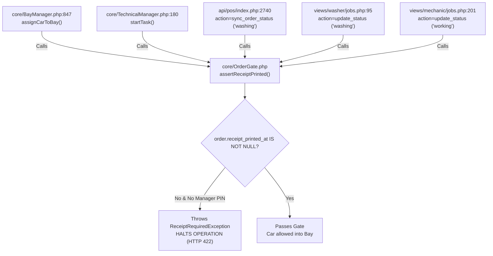
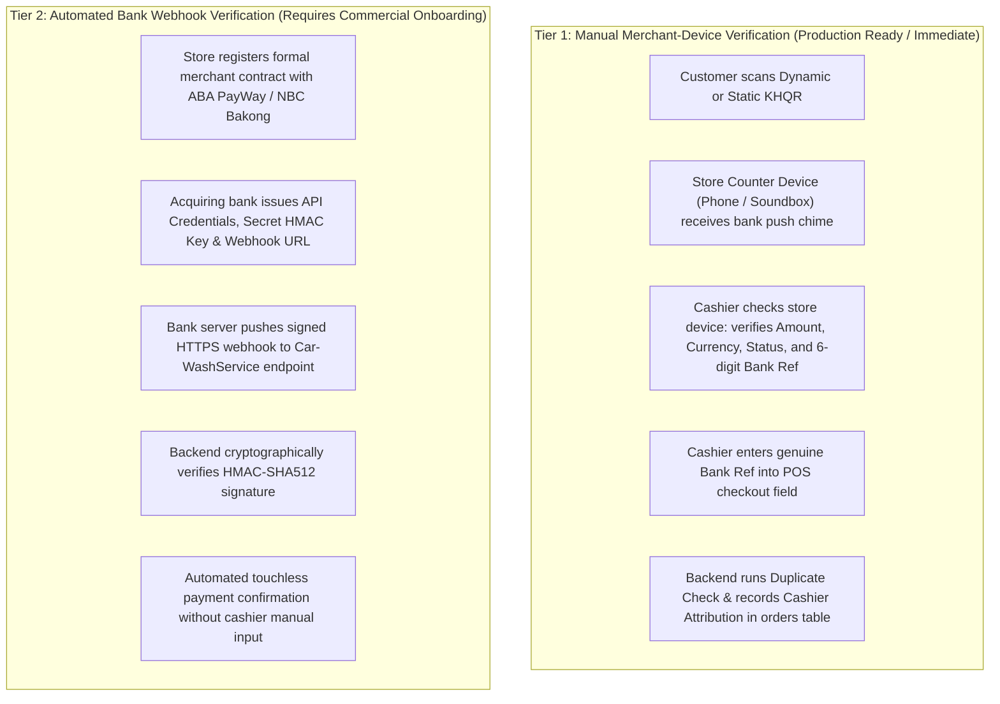
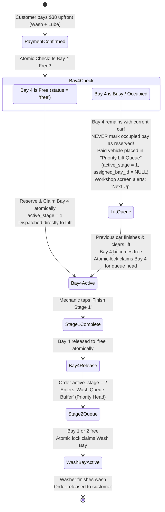
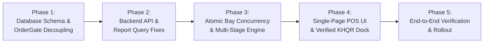

# Final POS Source Code Compatibility Audit

**Document ID:** POS-SRC-2026-001  
**Project:** Car-WashService  
**Scope:** PHP Backend, JavaScript POS Client, Database Schemas, Concurrency Controls, Hardware Interfaces  
**Audit Type:** Deep Source Code & Architectural Compatibility Audit  
**Date:** November 6, 2026  
**Status:** Complete – Awaiting Management Approval  

---

## Executive Summary

Following management's directive, a comprehensive, forensic source-code compatibility audit was conducted across the `Car-WashService` repository, evaluating the existing PHP backend classes, JavaScript counter clients, database schemas, and the five revised POS design specifications.

This audit evaluates the codebase against **five critical operational areas**:
1. **Receipt Printing Decoupling & OrderGate Dependencies:** Eliminating the false equivalence between physical paper printing and electronic receipt creation.
2. **KHQR Verification & Deconstruction of Fake `TRX-` Strings:** Eradicating the backend auto-generation of synthetic transaction references and defining verified merchant-side confirmation.
3. **Historical Data Migration & Ambiguity Reconciliation:** Establishing strict non-destructive reconciliation for records with missing or conflicting timestamps, with full data preservation and rollback instructions.
4. **Atomic Bay Reservation, Concurrency & Multi-Stage Transition:** Formulating atomic locks, handling Bay 4 unavailability after payment, crash recovery, and preventing duplicate stage completions or double-commission payouts.
5. **Source Compatibility & Breakage Risk Assessment:** Mapping all affected PHP classes, API endpoints, JavaScript files, database tables, and tests, accompanied by a phased implementation roadmap.

---

## 1. Area 1: Receipt Printing Decoupling & OrderGate Dependency Analysis

### 1.1 The Root Cause: Overloading Physical Printing with Electronic Issuance
In the current codebase, the `orders` table contains a single timestamp column for receipts:
```sql
-- database/init.php line 274:
receipt_printed_at DATETIME DEFAULT NULL
```
There is **no** column representing electronic receipt creation (such as `receipt_issued_at` or `receipt_number`).

In `api/pos/index.php` (L2364) and `core/OrderGate.php` (L35–58), the action `mark_receipt_printed` sets:
```php
$upd = $pdo->prepare("UPDATE orders SET receipt_printed_at = ? WHERE id = ?");
$upd->execute([date('Y-m-d H:i:s'), $orderId]);
```
This conflates a **financial/contractual event** (the issuance of an electronic receipt upon payment) with a **mechanical hardware event** (the physical deposition of paper out of an 80mm thermal printer).

### 1.2 Exhaustive Inventory of Existing OrderGate Dependencies

The audit traced every invocation of `OrderGate::assertReceiptPrinted()` in the codebase:



| # | File Location | Line Number | Method / Context | Current Behavior & Failure Mode |
| :-: | :--- | :---: | :--- | :--- |
| **1** | `core/BayManager.php` | 847 | `assignCarToBay()` | If `receipt_printed_at` is NULL, returns `['success' => false, 'error' => 'RECEIPT_REQUIRED']`. Vehicle cannot be moved into any bay. |
| **2** | `core/TechnicalManager.php` | 180 | `startTask()` | If `receipt_printed_at` is NULL, throws exception. Mechanic cannot start oil change on lift bay. |
| **3** | `api/pos/index.php` | 2740 | `sync_order_status` (`$newStatus === 'washing'`) | If `receipt_printed_at` is NULL, returns HTTP 422 JSON error, blocking status progression. |
| **4** | `views/washer/jobs.php` | 95 | Direct wash status update | Washer tablet cannot start wash cycle if paper jammed at counter. |
| **5** | `views/mechanic/jobs.php` | 201 | Direct repair status update | Technician tablet cannot start job order if paper jammed at counter. |

### 1.3 Architectural Decoupling & OrderGate Resolution

Management has set strict, non-negotiable security rules for service admission:
- **New orders MUST have BOTH confirmed payment (`payment_status = 'paid'`) AND a formally issued electronic receipt (`receipt_issued_at IS NOT NULL` and `receipt_number IS NOT NULL`) before service admission.**
- **`payment_status = 'paid'` ALONE must NEVER silently bypass receipt issuance requirements for new orders.** An electronic receipt must be generated as a binding record of the financial contract.
- **Physical printer failure must NOT block service.** The physical paper output timestamp (`receipt_printed_at`) is completely decoupled from admission.
- **Separate `receipt_printed_at` timestamp is preserved** exclusively for hardware diagnostics and reprint audits.
- **Explicit legacy compatibility behavior must be enforced** for historical orders created before electronic receipt columns existed.

#### Refactored OrderGate Logic Specification:

```php
// core/OrderGate.php - Revised Implementation Specification
class OrderGate {
    const MIGRATION_CUTOFF = '2026-11-06 00:00:00';

    /**
     * Asserts that an order satisfies all gate criteria before entering a bay.
     * Throws an exception if admission criteria are not met.
     */
    public static function assertAdmissibleToService(array $order, array $options = []): bool {
        // Rule 1: Financial gate - Payment must be confirmed. No unpaid vehicle enters service.
        if (($order['payment_status'] ?? '') !== 'paid') {
            throw new PaymentRequiredException(
                "Service gate rejected: Order #{$order['order_number']} is unpaid. Confirmed upfront payment is mandatory."
            );
        }

        // Rule 2: Electronic Receipt Gate for New Orders
        $isLegacyOrder = empty($order['receipt_issued_at']) 
            && !empty($order['created_at']) 
            && (strtotime($order['created_at']) < strtotime(self::MIGRATION_CUTOFF));

        if ($isLegacyOrder) {
            // Explicit Legacy Compatibility:
            // Historical orders without electronic receipt columns pass if they have physical receipt timestamp
            // OR if explicitly passed via migration/legacy flag or manager PIN override.
            if (!empty($order['receipt_printed_at']) || !empty($options['allow_legacy_order'])) {
                return true;
            }
            throw new ReceiptRequiredException(
                "Legacy order #{$order['order_number']} missing receipt_printed_at. Requires manager override."
            );
        }

        // Rule 3: Strict New Order Requirement:
        // payment_status='paid' alone is NOT enough; electronic receipt issuance is mandatory.
        if (empty($order['receipt_issued_at']) || empty($order['receipt_number'])) {
            throw new ReceiptRequiredException(
                "Service gate rejected: Electronic receipt has not been issued for Order #{$order['order_number']}. An electronic receipt must be generated at checkout."
            );
        }

        // Rule 4: Physical printer failure never blocks service.
        // receipt_printed_at may be NULL (out of paper, offline, or skipped) without hindering admission.
        return true;
    }
}
```

#### Database Schema Alterations:
To support decoupled electronic issuance while preserving hardware print tracking:
```sql
ALTER TABLE orders 
  ADD COLUMN receipt_number VARCHAR(50) DEFAULT NULL AFTER idempotency_key,
  ADD COLUMN receipt_issued_at DATETIME DEFAULT NULL AFTER receipt_number,
  ADD INDEX idx_receipt_number (receipt_number),
  ADD INDEX idx_receipt_issued (receipt_issued_at);
-- orders.receipt_printed_at is preserved unchanged for physical ESC/POS hardware tracking.
```

---

## 2. Area 2: KHQR Verification & Deconstruction of Fake `TRX-` Strings

### 2.1 The Synthetic `TRX-` Reference Hazard
In `api/pos/index.php` (Lines 2006–2008 and 2609–2611), the backend contains the following fallback:
```php
// api/pos/index.php L2006-2008:
if (in_array($paymentMethod, ['aba', 'khqr'], true) && empty($paymentRef)) {
    $paymentRef = 'TRX-' . strtoupper(substr(md5(uniqid()), 0, 8));
}
```
#### Critical Audit Finding:
- **This `TRX-` string is completely synthetic.** It is generated via PHP's `md5(uniqid())` on the local Apache server.
- It has **zero correlation** with the customer's actual bank transaction reference (which in ABA is a 6- or 9-digit numerical sequence, or in Bakong is a 32-character transaction hash).
- If a cashier clicks confirm without entering a genuine reference, the system invents a fake ID (e.g. `TRX-A8F12C09`), writes it to `orders.payment_ref`, and marks the transaction.
- **Accountability Consequence:** Daily bank statement reconciliation becomes impossible because no bank statement on earth contains `TRX-A8F12C09`.

### 2.2 Exact Payment Matching Requirements (6-Point Verification Protocol)

To eliminate fraud, customer screenshot spoofing, and synthetic references, every KHQR transaction must satisfy a rigorous 6-point verification protocol before payment status can become `'paid'`:

| # | Verification Criterion | Matching Rule & Enforcement | Failure Action |
| :-: | :--- | :--- | :--- |
| **1** | **Genuine Bank Transaction Reference** | Must be the actual reference issued by the bank/Bakong network (e.g. ABA 6-to-9 digit trace number or Bakong hash), extracted from merchant notification. Synthetic `TRX-` strings are forbidden. | Rejection (HTTP 422: `BANK_REFERENCE_REQUIRED`) |
| **2** | **Exact Amount and Currency Match** | The received amount and currency must match the cart grand total exactly. If cart is `$5.00 USD`, a payment of `$4.50 USD` or `20,000 KHR` with wrong exchange rate must NOT be confirmed as paid. | Rejection (HTTP 422: `PAYMENT_AMOUNT_MISMATCH`) |
| **3** | **Correct Merchant Receiving Account** | Must verify the funds entered the store's designated merchant account ID (e.g. store ABA PayWay merchant ID or Bakong account), not a personal account or unrelated QR. | Rejection / Alert |
| **4** | **Successful Transaction Status** | Must confirm the transaction is in `'SUCCESS'` / `'SETTLED'` state on the banking network, not `'PENDING'`, `'ON HOLD'`, or `'FAILED'`. | Rejection |
| **5** | **Duplicate Transaction Detection** | Backend enforces uniqueness: `SELECT id FROM orders WHERE payment_ref = :ref AND id != :current_order_id`. The exact same bank reference can NEVER be reused across multiple orders or retried carts. | Rejection (HTTP 409: `DUPLICATE_PAYMENT_REFERENCE`) |
| **6** | **Cashier Attribution & Immutable Audit History** | Every manually verified transaction must capture `payment_verified_by_id`, `payment_verified_by_name`, `payment_verified_at`, and client IP in an immutable audit ledger. | Unattributed verification blocked |

### 2.3 Verification Methods: Manual Merchant Device vs. Automated Bank Webhook

To ensure complete architectural clarity without inventing non-existent bank API capabilities:



| Verification Method | Architectural Nature | Implementation Status in Car-WashService | Hardware / Network Prerequisites | Operational Boundary |
| :--- | :--- | :---: | :--- | :--- |
| **Manual Merchant-Device Verification** | Cashier matches notification on store-owned hardware (IoT soundbox, dedicated counter phone, or Telegram merchant bot) and inputs genuine bank reference. | **Fully Supported & Recommended for Immediate Deployment.** Requires zero bank API contracts. | Dedicated store mobile device or soundbox with active cellular/Wi-Fi connection. | Cashier is legally and operationally accountable for matching the 6-point criteria before clicking confirm. |
| **Automated Bank Webhook Verification** | Commercial payment gateway (e.g. ABA PayWay API, Bakong Open API) delivers direct server-to-server webhook callback. | **Requires External Commercial Bank Onboarding.** Not currently activated. | Live public domain/IP, valid SSL certificate, formal merchant acquiring agreement, bank-issued API keys and webhook secrets. | Touchless automation; cannot be deployed until commercial banking contracts and onboarding are formally completed. **Do not simulate or invent fictitious bank endpoints.** |

### 2.4 Removal of Auto-Generated Fallback & Cashier Attribution Schema
1. **Eradication of Synthetic Fallback:**  
   Lines 2006–2008 and 2609–2611 of `api/pos/index.php` that generate `'TRX-' . strtoupper(substr(md5(uniqid()), 0, 8))` must be permanently deleted.
2. **Database Schema Enhancements for Attribution & Deduplication:**
```sql
ALTER TABLE orders 
  ADD COLUMN payment_verified_by_id INT DEFAULT NULL AFTER payment_ref,
  ADD COLUMN payment_verified_by_name VARCHAR(100) DEFAULT NULL AFTER payment_verified_by_id,
  ADD COLUMN payment_verified_at DATETIME DEFAULT NULL AFTER payment_verified_by_name,
  ADD UNIQUE INDEX uq_payment_ref (payment_ref); -- Prevents duplicate bank reference reuse across orders
```
3. **Audit Log Recording:**
   When cashier verifies payment:
   `AuditLogger::log('KHQR_VERIFIED', "Cashier {$cashierName} (ID: {$cashierId}) verified KHQR Bank Ref #{$bankRef} for \${$amountUsd}", 'order', $orderId, ['bank_ref' => $bankRef, 'method' => 'manual_merchant_device']);`

---

## 3. Area 3: Historical Order Migration, Ambiguity Reconciliation & Backups

### 3.1 Dangers of Blanket Conversion & Management Directive
Management has issued a strict operational directive:  
**REMOVE the automatic conversion of ambiguous historical records to finished.**

#### Why Automatic Conversion of Ambiguous Records is Strictly Prohibited:
1. **Destroys Audit Traceability:** Silently converting unverified historical records with missing operational timestamps to `finished` manufactures false completion evidence.
2. **Corrupts Operational In-Flight Sales:** If a car was created and paid 10 minutes prior to migration, forcing `status = 'finished'` wipes the active car from washer tablets and bay boards.
3. **Drops Waiting Queue Customers:** Current-day waiting cars (`started_at IS NULL`) would be evicted from the queue before ever being washed.
4. **Falsifies Financial Audits:** A voided order or abandoned wash without completion timestamps would be recorded as a successfully rendered service, falsifying tax and accounting audits.
5. **Overwrites Audit Records:** Modifying or appending text to `notes` or overwriting cancellation data permanently defaces historical business records.

---

### 3.2 Full Database Backup vs. Logical Table Copy (Mandatory Distinction)

Before executing any database alteration or migration, management requires an unambiguous distinction between backup levels:

| Backup Method | Scope & Mechanics | Limitations & Risks | Mandatory Pre-Condition |
| :--- | :--- | :--- | :--- |
| **Logical Table Copy**<br>`CREATE TABLE orders_backup AS SELECT * FROM orders;` | Copies raw data rows of a single table (`orders`). | **Incomplete.** Does not back up foreign keys, triggers, auto-increment sequences, indexes, or child tables (`order_items`, `order_tasks`, `bay_history`, `bays`). If an update violates relational integrity, table copy alone cannot restore state cleanly. | **Supplementary only.** Good for fast row diffs, but insufficient as sole backup. |
| **Complete Database Backup**<br>`mysqldump -u root -p --routines --triggers carwash > full_backup_20261106.sql` | Full cryptographic and structural export of entire database schema, constraints, routines, triggers, and all related tables. | Takes slightly more disk space (negligible for car wash DB size, typically < 50 MB). | **MANDATORY REQUIREMENT.** Must be generated and archived off-site before migration. |

#### Mandatory Verified Restoration Testing:
- **Rule:** No migration may be executed against the live database without **prior verified restoration testing**.
- **Restoration Verification Procedure:**
  1. Generate full backup: `mysqldump -u [user] -p --single-transaction --routines --triggers carwash_db > backup_pre_migration.sql`
  2. Restore backup into an isolated temporary test schema: `mysql -u [user] -p carwash_test_restore < backup_pre_migration.sql`
  3. Execute verification query: verify total row count, table checksums (`CHECKSUM TABLE orders, order_items, bays`), and verify all views and stored procedures compile without errors.
  4. Only after restoration verification succeeds is the migration script authorized to run on the production database.

---

### 3.3 Evidence-Based Classification Rules

Every historical record with `status = 'paid'` must be classified strictly based on immutable physical evidence:

```mermaid
flowchart TD
    Start["Historical Orders with status = 'paid'"] --> Dump["Step 1: Complete DB Backup & Verified Restoration Test"]
    Dump --> Prev["Step 2: Execute Migration Preview Query (Dry-Run Verification)"]
    Prev --> CheckCancel{"cancelled_at IS NOT NULL<br>OR cancel_reason IS NOT NULL?"}
    
    CheckCancel -->|Yes| SetCancel["Rule 1: Reliable Cancellation Evidence<br>status = 'cancelled'<br>payment_status = 'cancelled' or 'refunded'<br>Notes: PRESERVED UNCHANGED"]
    CheckCancel -->|No| CheckFin{"finished_at IS NOT NULL?"}
    
    CheckFin -->|Yes| SetFin["Rule 2: Reliable Completion Evidence<br>status = 'finished'<br>payment_status = 'paid'"]
    CheckFin -->|No| CheckStart{"started_at IS NOT NULL?"}
    
    CheckStart -->|Yes| SetWash["Rule 3: Reliable Active-Service Evidence<br>status = 'washing'<br>payment_status = 'paid'"]
    CheckStart -->|No| CheckToday{"DATE(created_at) = CURRENT_DATE?"}
    
    CheckToday -->|Yes (Today)| SetWait["Rule 4: Reliable Queue Evidence<br>status = 'waiting'<br>payment_status = 'paid'"]
    CheckToday -->|No (Past Dates)| Ambiguous["Rule 5: Ambiguous / Conflicting Records<br>MUST REMAIN UNCHANGED in Database!<br>Preserve original status and original notes.<br>Output into Manual Reconciliation Report"]
```

---

### 3.4 Migration Preview Query (Dry Run Before Execution)

Before executing any updates, the administrator must run this non-destructive query to inspect exact record distributions:

```sql
-- Migration Preview & Verification Query (READ-ONLY)
SELECT 
    CASE 
        WHEN cancelled_at IS NOT NULL OR cancel_reason IS NOT NULL 
            THEN '1_RELIABLE_CANCELLATION (Will become status=cancelled)'
        WHEN finished_at IS NOT NULL 
            THEN '2_RELIABLE_COMPLETION (Will become status=finished)'
        WHEN started_at IS NOT NULL AND finished_at IS NULL 
            THEN '3_RELIABLE_ACTIVE_SERVICE (Will become status=washing)'
        WHEN started_at IS NULL AND finished_at IS NULL AND DATE(created_at) = CURRENT_DATE 
            THEN '4_RELIABLE_TODAYS_QUEUE (Will become status=waiting)'
        ELSE '5_AMBIGUOUS_RECORDS (WILL REMAIN UNCHANGED - Flagged for Reconciliation)'
    END AS migration_category,
    COUNT(*) AS record_count,
    MIN(created_at) AS earliest_record,
    MAX(created_at) AS latest_record,
    SUM(total_usd) AS category_revenue_usd
FROM orders 
WHERE status = 'paid'
GROUP BY migration_category
ORDER BY migration_category ASC;
```

---

### 3.5 Non-Destructive Migration Script

```sql
-- ====================================================================
-- NON-DESTRUCTIVE EVIDENCE-BASED MIGRATION SCRIPT
-- ====================================================================

-- 1. Create Supplementary Fast-Rollback Table Copy
CREATE TABLE IF NOT EXISTS orders_migration_backup_20261106 AS 
SELECT * FROM orders;

-- 2. Rule 1: Reconcile Reliable Cancellation Evidence
-- Preserves original cancellation notes and timestamps exactly as-is.
UPDATE orders 
SET payment_status = 'cancelled', 
    status = 'cancelled',
    updated_at = CURRENT_TIMESTAMP
WHERE status = 'paid' 
  AND (cancelled_at IS NOT NULL OR cancel_reason IS NOT NULL);

-- 3. Rule 2: Reconcile Reliable Completion Evidence
-- Has clear physical timestamp indicating completion.
UPDATE orders 
SET payment_status = 'paid', 
    status = 'finished',
    updated_at = CURRENT_TIMESTAMP
WHERE status = 'paid' 
  AND finished_at IS NOT NULL 
  AND cancelled_at IS NULL;

-- 4. Rule 3: Reconcile Reliable Active In-Flight Service Evidence
-- Car is currently in bay being washed.
UPDATE orders 
SET payment_status = 'paid', 
    status = 'washing',
    updated_at = CURRENT_TIMESTAMP
WHERE status = 'paid' 
  AND started_at IS NOT NULL 
  AND finished_at IS NULL 
  AND cancelled_at IS NULL;

-- 5. Rule 4: Reconcile Reliable Queue Evidence for Current Operating Day
-- Car arrived today, paid upfront, awaiting open bay.
UPDATE orders 
SET payment_status = 'paid', 
    status = 'waiting',
    updated_at = CURRENT_TIMESTAMP
WHERE status = 'paid' 
  AND started_at IS NULL 
  AND finished_at IS NULL 
  AND DATE(created_at) = CURRENT_DATE 
  AND cancelled_at IS NULL;

-- 6. Rule 5: Ambiguous Historical Records
-- MANDATORY COMPLIANCE: Records with missing/conflicting operational timestamps
-- MUST REMAIN UNCHANGED in the database.
-- Do NOT set status = 'finished'.
-- Do NOT overwrite or append text to notes.
-- These records remain untouched and are extracted into the Reconciliation Report below.
```

---

### 3.6 Ambiguous Records Reconciliation Report (For Management Review)

Instead of mutating ambiguous records, management generates this report for manual accounting verification:

```sql
-- Manual Reconciliation Query: Inspects all historical records left untouched
SELECT 
    id, 
    order_number, 
    created_at, 
    customer_name, 
    plate_number, 
    total_usd, 
    payment_method, 
    payment_ref, 
    status, 
    payment_status, 
    notes
FROM orders 
WHERE status = 'paid' 
  AND started_at IS NULL 
  AND finished_at IS NULL 
  AND DATE(created_at) < CURRENT_DATE 
  AND cancelled_at IS NULL
ORDER BY created_at DESC;
```

---

### 3.7 Comprehensive Rollback Strategy

In the event of any discrepancy post-migration, two levels of rollback are provided:

#### Level 1: Immediate Fast Table-Level Reversion
```sql
-- Fast 1-Step Reversion from supplementary backup table:
UPDATE orders o
JOIN orders_migration_backup_20261106 b ON o.id = b.id
SET o.status = b.status,
    o.payment_status = b.payment_status,
    o.receipt_issued_at = b.receipt_issued_at,
    o.receipt_number = b.receipt_number,
    o.notes = b.notes,
    o.updated_at = b.updated_at;
```

#### Level 2: Full Database Disaster Recovery Restore
```bash
# Complete DB restore from verified full backup:
mysql -u [username] -p carwash_db < backup_pre_migration.sql
```

---

## 4. Area 4: Atomic Bay Reservation, Recovery & Multi-Stage Transition

### 4.1 The Concurrency Race Condition in Existing Code
In `core/BayManager.php` (L863–885), bay assignment is vulnerable to race conditions:
```php
// Existing BayManager::assignCarToBay pattern:
$bayStmt = $pdo->prepare("SELECT * FROM bays WHERE id = ?");
$bayStmt->execute([$bayId]);
$bay = $bayStmt->fetch();
// ... [Time window where another cashier claims the bay] ...
$upd = $pdo->prepare("UPDATE bays SET status = 'busy', current_order_id = ? WHERE id = ?");
$upd->execute([$orderId, $bayId]);
```
If Cashier A and Cashier B simultaneously click checkout and select Bay 1, both read `status = 'free'` and both write `status = 'busy'`, resulting in two cars assigned to the exact same bay.

### 4.2 Atomic Reservation Lock Specification
Bay assignment must execute as a single atomic query with condition check:
```sql
-- Atomic Bay Claim Query:
UPDATE bays 
SET status = 'busy', 
    current_order_id = :order_id, 
    occupied_at = CURRENT_TIMESTAMP 
WHERE id = :bay_id 
  AND (status = 'free' OR status = 'available');
```
If `$stmt->rowCount() === 0`, the transaction catches the concurrency collision immediately.

### 4.3 Handling Bay 4 (Lift) Unavailability After Payment

What happens when a customer pays upfront for a combined Car Wash + Oil Change, but Bay 4 (Lift) is occupied or becomes unavailable?



#### Deterministic Bay Reservation & Queue Rules:
1. **Reserve Bay 4 ONLY When Actually Available:**
   - The system attempts an atomic conditional reservation on Bay 4: `UPDATE bays SET status = 'busy', current_order_id = :id WHERE id = 4 AND status = 'free';`.
   - **Bay 4 is reserved only if this atomic query succeeds.**
2. **Never Mark an Occupied Bay as Reserved for Another Vehicle:**
   - If Bay 4 is currently occupied, the bay row in the `bays` table remains strictly attached to the current vehicle.
   - The system **never** marks an occupied bay as "reserved" for a second vehicle, which would create operational confusion and corrupt bay timer tracking.
3. **Paid Vehicle Maintained in Priority Lift Queue:**
   - If Bay 4 is unavailable at checkout, the paid order is placed into the **Priority Lift Queue** (`orders.status = 'waiting'`, `orders.active_stage = 1`, `orders.assigned_bay_id = NULL`).
   - The workshop monitor displays: `"Next for Lift: 2BC-1234 (Paid - Waiting Lift)"`. As soon as the active technician finishes and Bay 4 clears, the system or technician claims the bay for the waiting vehicle.
4. **Preventing Wash Bay Deadlocks (Staged Reservation Rule):**
   - Stage 2 (Wash Bay 1) is **never pre-locked** during intake.
   - Pre-locking a wash bay while the car spends 30 minutes on the lift would hold an empty wash bay idle, cutting shop wash capacity by 50%.
   - Stage 2 is registered as a priority queue transition upon Stage 1 completion.

### 4.4 Reservation Expiry & Crash Recovery (Auto-Healing Engine)

To prevent orphaned or dead-locked bays caused by browser crashes, terminal power loss, or abandoned intake sessions:

1. **Intake Reservation Expiry Timeout (15-Minute TTL):**
   - If a bay is locked by a cashier intake session but no active physical check-in or progress occurs on the shop floor within 15 minutes, the reservation expires.
   - A background heartbeat checks:
     ```sql
     UPDATE bays 
     SET status = 'free', current_order_id = NULL, last_freed_at = CURRENT_TIMESTAMP 
     WHERE status = 'busy' 
       AND occupied_at < DATE_SUB(CURRENT_TIMESTAMP, INTERVAL 15 MINUTE)
       AND current_order_id IN (SELECT id FROM orders WHERE status = 'waiting' AND started_at IS NULL);
     ```
2. **Crash Recovery & Orphan Auto-Healing:**
   - If a bay is marked `status = 'busy'`, but its associated `current_order_id` has completed (`status = 'finished'`) or been voided (`status = 'cancelled'`), the engine auto-heals the bay status to `free`.
3. **Manual Manager Override:**
   - The Bay Queue dashboard (`views/owner/bays_queue.php`) provides an emergency "Force Release Bay" action protected by Manager PIN, logging an audit trail (`BAY_FORCE_RELEASED`).

### 4.5 Prevention of Duplicate Stage Completion & Multi-Stage Commission Integrity

In `core/BayManager.php` and `views/mechanic/jobs.php`, rapid double-clicking of stage completion must be handled idempotently without corrupting commissions:

1. **Idempotent Stage Transition:**
   - When completing Stage 1:
     ```sql
     UPDATE orders 
     SET active_stage = 2, 
         repair_status = 'finished',
         updated_at = CURRENT_TIMESTAMP 
     WHERE id = :order_id 
       AND active_stage = 1; -- Enforces single execution!
     ```
   - If `rowCount() === 0`, Stage 1 was already completed; duplicate requests are safely ignored.
2. **Worker Commission Uniqueness Per Legitimate Stage Assignment:**
   - **Critical Problem with Simple `UNIQUE(order_id, staff_id)`:** In a combined service (Oil Change + Detail Wash), a cross-trained staff member might legitimately perform Stage 1 (Oil service) and later perform Stage 2 (Wash/Wax). A simple `UNIQUE(order_id, staff_id)` would improperly reject the legitimate second commission!
   - **Correct Solution:** Commission uniqueness must be enforced **per legitimate assignment or service stage**, not merely per worker and order:
     ```sql
     -- Schema constraint enforcing uniqueness per stage sequence:
     ALTER TABLE order_washers 
       ADD COLUMN stage_sequence TINYINT NOT NULL DEFAULT 1 AFTER order_id,
       ADD UNIQUE INDEX uq_order_stage_washer (order_id, stage_sequence, washer_id);

     ALTER TABLE order_mechanics 
       ADD COLUMN stage_sequence TINYINT NOT NULL DEFAULT 1 AFTER order_id,
       ADD UNIQUE INDEX uq_order_stage_mechanic (order_id, stage_sequence, mechanic_id);
     ```
   - This prevents duplicate commission payouts if a cashier or technician taps "Submit" twice on the same stage, while cleanly allowing distinct legitimate commissions across separate stages.

---

## 5. Area 5: Source Code Compatibility & Breakage Risk Assessment

### 5.1 Affected Source Files Inventory

| Module / Layer | File Path | Nature of Dependency | Breakage Risk Level |
| :--- | :--- | :--- | :---: |
| **Backend Core** | `core/OrderGate.php` | Gate check for receipts | **High** |
| **Backend Core** | `core/BayManager.php` | Bay assignment, status updates, queue scoring | **High** |
| **Backend Core** | `core/TechnicalManager.php` | Repair tasks, parts allocation, job starts | **Medium** |
| **Backend Core** | `core/BankTransferControl.php` | Bank slip processing & manager approval | **High** |
| **Backend Core** | `core/CashierControl.php` | Shifts, drawer events, manager PIN validation | **Low** |
| **API Endpoints** | `api/pos/index.php` | Order creation, payments, receipt status, bay assign | **Critical** |
| **Frontend POS** | `pos/index.html` | Markup for intake, catalog, cart, payments, modals | **High** |
| **Frontend POS** | `pos/js/app.js` | POS client state machine, checkout, printing, sync | **Critical** |
| **Frontend POS** | `pos/js/api.js` | HTTP client wrapper and idempotency headers | **Medium** |
| **Worker Views** | `views/washer/jobs.php` | Washer bay dashboard & status updates | **Medium** |
| **Worker Views** | `views/mechanic/jobs.php` | Technician task checklist & job updates | **Medium** |
| **Owner Views** | `views/owner/reports.php` | Revenue queries filtering `WHERE status = 'paid'` | **Critical** |
| **Owner Views** | `views/owner/bays_queue.php` | Bay management & drag-and-drop queue | **Low** |
| **Legacy POS** | `views/cashier/pos.php` | Fallback server-rendered POS | **Low** |
| **Automated Tests** | `tests/test_tv_display.php` | TV queue board tests | **Medium** |
| **Automated Tests** | `tests/test_pos_staff_token_flow.php` | POS authentication & shift token test | **Low** |

### 5.2 Critical Existing Features That Could Break (Without Compatibility Layer)

1. **Revenue Reporting (`views/owner/reports.php`):**
   - **Risk:** Currently, `reports.php` line 75 executes:
     `SELECT SUM(total_usd) FROM orders WHERE status = 'paid'`
   - If `orders.status` is decoupled from `orders.payment_status` (so orders have `status = 'washing'` or `'finished'` and `payment_status = 'paid'`), **revenue reports would drop to ZERO** unless updated to filter on financial status.
2. **Washer & Mechanic Job Board Gates (`views/washer/jobs.php` & `views/mechanic/jobs.php`):**
   - **Risk:** Both job boards call `OrderGate::assertReceiptPrinted()`.
   - If electronic issuance is not recognized by `OrderGate`, workers on the apron will be blocked from starting their work whenever thermal printers are offline.
3. **Queue TV Board (`tv.php`):**
   - **Risk:** `tv.php` filters active cars by `orders.status IN ('waiting', 'washing')`.
   - If orders created upfront are assigned `status = 'paid'`, they vanish from the TV screen. Decoupling ensures they enter as `status = 'waiting'` or `'washing'`, keeping the TV board 100% functional.
4. **Cloud Synchronization (`core/CloudSyncManager.php`):**
   - **Risk:** Station-to-cloud sync must transmit `payment_status` alongside `status`.
   - New columns (`assigned_bay_id`, `active_stage`) must be made nullable and optional in sync payloads to prevent cloud sync rejections.

### 5.3 Strict Accounting & Revenue Calculation Formulas

To ensure zero accounting ambiguity across financial reports, the revenue aggregation logic in `views/owner/reports.php` and `api/reports/` must implement standard accounting formulas across all transaction states:

| Order Transaction State | Database Status Mapping | Revenue Ledger Treatment | Accounting Impact |
| :--- | :--- | :--- | :--- |
| **Fully Paid Order** | `payment_status = 'paid'` AND `status != 'cancelled'` | Included in Gross and Net Sales (+100% `total_usd`) | Positive recognized revenue |
| **Fully Refunded Order** | `payment_status = 'refunded'` | Fully deducted from Gross Sales (-100% `total_usd` or `refunded_amount`) | Net Revenue impact = $0.00; Refund loss tracked |
| **Partially Refunded Order** | `payment_status = 'partially_refunded'` OR `(payment_status = 'paid' AND refunded_amount > 0)` | Net recognized amount = `(total_usd - refunded_amount)` | Only unrefunded portion counted in Net Sales |
| **Cancelled / Voided Order** | `status = 'cancelled'` OR `payment_status = 'cancelled'` | **100% EXCLUDED** from both Gross and Net Sales | Never counts toward sales; reported in Void / Loss log |

#### Standard Revenue SQL Formulation:
```sql
-- Certified Revenue Formula for Financial Reports:
SELECT 
    -- 1. Gross Revenue (Total cash & KHQR received before refunds)
    COALESCE(SUM(CASE 
        WHEN payment_status IN ('paid', 'partially_refunded') AND status != 'cancelled' 
        THEN total_usd ELSE 0 END), 0) AS gross_sales_usd,

    -- 2. Total Refunds Issued
    COALESCE(SUM(CASE 
        WHEN payment_status = 'refunded' THEN total_usd 
        WHEN payment_status = 'partially_refunded' THEN refunded_amount 
        ELSE 0 END), 0) AS total_refunds_usd,

    -- 3. Net Revenue (Actual retained cash flow)
    COALESCE(SUM(CASE 
        WHEN payment_status = 'paid' AND status != 'cancelled' THEN (total_usd - COALESCE(refunded_amount, 0))
        WHEN payment_status = 'partially_refunded' AND status != 'cancelled' THEN (total_usd - refunded_amount)
        ELSE 0 END), 0) AS net_revenue_usd,

    -- 4. Voided Sales Volume (Audit traceability)
    COALESCE(SUM(CASE 
        WHEN status = 'cancelled' OR payment_status = 'cancelled' THEN total_usd 
        ELSE 0 END), 0) AS voided_sales_usd
FROM orders
WHERE created_at BETWEEN :start_date AND :end_date;
```

---

## 6. Phased Implementation Roadmap

To ensure zero downtime and safe rollback at every juncture, implementation must proceed in five strict sequential phases:



### Phase 1: Database Schema Expansion & OrderGate Decoupling
- Execute non-destructive schema additions (`receipt_issued_at`, `receipt_number`, `active_stage`, `stage_routing`).
- Refactor `core/OrderGate.php` to accept electronic receipt issuance and paid payment status.
- Execute multi-column historical order reconciliation with pre-migration backup table.

### Phase 2: Backend API & Revenue Reporting Harmonization
- Update `views/owner/reports.php` to filter by `payment_status = 'paid'`.
- Remove synthetic `TRX-` generation from `api/pos/index.php`.
- Enforce mandatory upfront payment in `api/pos/index.php?action=create_order`.

### Phase 3: Atomic Bay Concurrency & Multi-Stage Staged Engine
- Update `core/BayManager.php` with atomic conditional claim queries.
- Implement staged reservation protocol (Stage 1 Lift locked; Stage 2 Wash Bay buffered).
- Add unique constraints to `order_washers` and `order_mechanics` to prevent double-commission payouts.

### Phase 4: Single-Page POS Client Refactoring
- Refactor `pos/index.html` and `pos/js/app.js` into the zero-modal single-page checkout interface.
- Implement plate-first intake, touch catalog tabs, and live bay status chips.
- Embed the Smart Cash Pad and Verified KHQR component (requiring real bank reference entry).
- Remove "Pay Later", "Pay at Exit", and unpaid dispatch from the client.

### Phase 5: Verification & Controlled Pilot Deployment
- Execute all test suites in `POS-IMPLEMENTATION-TEST-MATRIX.md`.
- Conduct shadow counter testing alongside active cashiers.
- Retain `config/app.php` fallback toggle `define('POS_UI', 'legacy');` for emergency fallback.

---

> [!IMPORTANT]
> **Audit Conclusion & Strict Restrictions Notice:**  
> This source compatibility audit confirms that the revised POS design is fully realizable without breaking existing features, provided the phased implementation order and architectural decoupling rules are followed. In accordance with instructions, **no source code, database records, schemas, or configurations have been modified**. All changes await executive review and approval.
