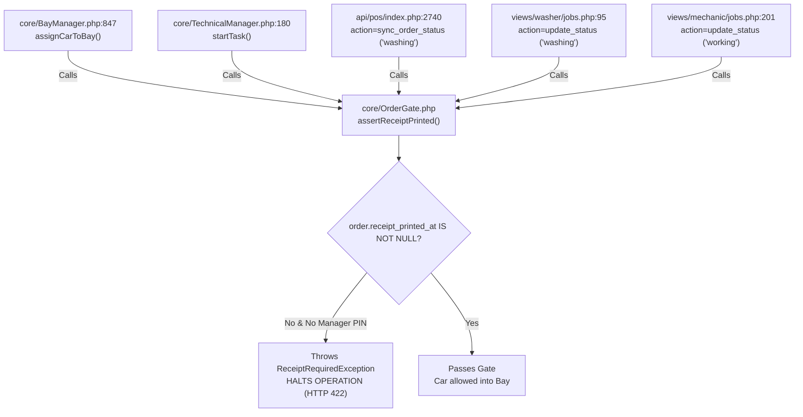
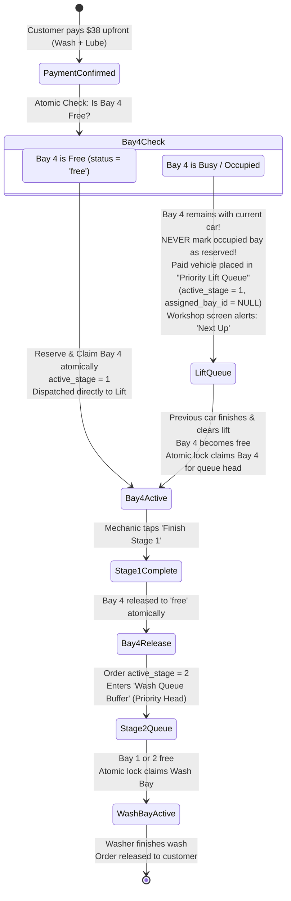
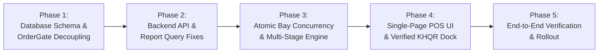

# Final POS Source Code Compatibility Audit

**Document ID:** POS-SRC-2026-001  
**Project:** Car-WashService  
**Scope:** PHP Backend, JavaScript POS Client, Database Schemas, Concurrency Controls, Hardware Interfaces  
**Audit Type:** Deep Source Code & Architectural Compatibility Audit  
**Date:** November 6, 2026  
**Status:** Complete – Awaiting Management Approval  

---

## Executive Summary

Following management's directive, a comprehensive, forensic source-code compatibility audit was conducted across the `Car-WashService` repository, evaluating the existing PHP backend classes, JavaScript counter clients, database schemas, and the five revised POS design specifications.

This audit evaluates the codebase against **five critical operational areas**:
1. **Receipt Printing Decoupling & OrderGate Dependencies:** Eliminating the false equivalence between physical paper printing and electronic receipt creation.
2. **KHQR Verification & Deconstruction of Fake `TRX-` Strings:** Eradicating the backend auto-generation of synthetic transaction references and defining verified merchant-side confirmation.
3. **Historical Data Migration & Ambiguity Reconciliation:** Establishing strict non-destructive reconciliation for records with missing or conflicting timestamps, with full data preservation and rollback instructions.
4. **Atomic Bay Reservation, Concurrency & Multi-Stage Transition:** Formulating atomic locks, handling Bay 4 unavailability after payment, crash recovery, and preventing duplicate stage completions or double-commission payouts.
5. **Source Compatibility & Breakage Risk Assessment:** Mapping all affected PHP classes, API endpoints, JavaScript files, database tables, and tests, accompanied by a phased implementation roadmap.

---

## 1. Area 1: Receipt Printing Decoupling & OrderGate Dependency Analysis

### 1.1 The Root Cause: Overloading Physical Printing with Electronic Issuance
In the current codebase, the `orders` table contains a single timestamp column for receipts:
```sql
-- database/init.php line 274:
receipt_printed_at DATETIME DEFAULT NULL
```
There is **no** column representing electronic receipt creation (such as `receipt_issued_at` or `receipt_number`).

In `api/pos/index.php` (L2364) and `core/OrderGate.php` (L35–58), the action `mark_receipt_printed` sets:
```php
$upd = $pdo->prepare("UPDATE orders SET receipt_printed_at = ? WHERE id = ?");
$upd->execute([date('Y-m-d H:i:s'), $orderId]);
```
This conflates a **financial/contractual event** (the issuance of an electronic receipt upon payment) with a **mechanical hardware event** (the physical deposition of paper out of an 80mm thermal printer).

### 1.2 Exhaustive Inventory of Existing OrderGate Dependencies

The audit traced every invocation of `OrderGate::assertReceiptPrinted()` in the codebase:



| # | File Location | Line Number | Method / Context | Current Behavior & Failure Mode |
| :-: | :--- | :---: | :--- | :--- |
| **1** | `core/BayManager.php` | 847 | `assignCarToBay()` | If `receipt_printed_at` is NULL, returns `['success' => false, 'error' => 'RECEIPT_REQUIRED']`. Vehicle cannot be moved into any bay. |
| **2** | `core/TechnicalManager.php` | 180 | `startTask()` | If `receipt_printed_at` is NULL, throws exception. Mechanic cannot start oil change on lift bay. |
| **3** | `api/pos/index.php` | 2740 | `sync_order_status` (`$newStatus === 'washing'`) | If `receipt_printed_at` is NULL, returns HTTP 422 JSON error, blocking status progression. |
| **4** | `views/washer/jobs.php` | 95 | Direct wash status update | Washer tablet cannot start wash cycle if paper jammed at counter. |
| **5** | `views/mechanic/jobs.php` | 201 | Direct repair status update | Technician tablet cannot start job order if paper jammed at counter. |

### 1.3 Architectural Decoupling & OrderGate Resolution

Management has set strict, non-negotiable security rules for service admission:
- **New orders MUST have BOTH confirmed payment (`payment_status = 'paid'`) AND a formally issued electronic receipt (`receipt_issued_at IS NOT NULL` and `receipt_number IS NOT NULL`) before service admission.**
- **`payment_status = 'paid'` ALONE must NEVER silently bypass receipt issuance requirements for new orders.** An electronic receipt must be generated as a binding record of the financial contract.
- **Physical printer failure must NOT block service.** The physical paper output timestamp (`receipt_printed_at`) is completely decoupled from admission.
- **Separate `receipt_printed_at` timestamp is preserved** exclusively for hardware diagnostics and reprint audits.
- **Explicit legacy compatibility behavior must be enforced** for historical orders created before electronic receipt columns existed.

#### Refactored OrderGate Logic Specification:

```php
// core/OrderGate.php - Revised Implementation Specification
class OrderGate {
    const MIGRATION_CUTOFF = '2026-11-06 00:00:00';

    /**
     * Asserts that an order satisfies all gate criteria before entering a bay.
     * Throws an exception if admission criteria are not met.
     */
    public static function assertAdmissibleToService(array $order, array $options = []): bool {
        // Rule 1: Financial gate - Payment must be confirmed. No unpaid vehicle enters service.
        if (($order['payment_status'] ?? '') !== 'paid') {
            throw new PaymentRequiredException(
                "Service gate rejected: Order #{$order['order_number']} is unpaid. Confirmed upfront payment is mandatory."
            );
        }

        // Rule 2: Electronic Receipt Gate for New Orders
        $isLegacyOrder = empty($order['receipt_issued_at']) 
            && !empty($order['created_at']) 
            && (strtotime($order['created_at']) < strtotime(self::MIGRATION_CUTOFF));

        if ($isLegacyOrder) {
            // Explicit Legacy Compatibility:
            // Historical orders without electronic receipt columns pass if they have physical receipt timestamp
            // OR if explicitly passed via migration/legacy flag or manager PIN override.
            if (!empty($order['receipt_printed_at']) || !empty($options['allow_legacy_order'])) {
                return true;
            }
            throw new ReceiptRequiredException(
                "Legacy order #{$order['order_number']} missing receipt_printed_at. Requires manager override."
            );
        }

        // Rule 3: Strict New Order Requirement:
        // payment_status='paid' alone is NOT enough; electronic receipt issuance is mandatory.
        if (empty($order['receipt_issued_at']) || empty($order['receipt_number'])) {
            throw new ReceiptRequiredException(
                "Service gate rejected: Electronic receipt has not been issued for Order #{$order['order_number']}. An electronic receipt must be generated at checkout."
            );
        }

        // Rule 4: Physical printer failure never blocks service.
        // receipt_printed_at may be NULL (out of paper, offline, or skipped) without hindering admission.
        return true;
    }
}
```

#### Database Schema Alterations:
To support decoupled electronic issuance while preserving hardware print tracking:
```sql
ALTER TABLE orders 
  ADD COLUMN receipt_number VARCHAR(50) DEFAULT NULL AFTER idempotency_key,
  ADD COLUMN receipt_issued_at DATETIME DEFAULT NULL AFTER receipt_number,
  ADD INDEX idx_receipt_number (receipt_number),
  ADD INDEX idx_receipt_issued (receipt_issued_at);
-- orders.receipt_printed_at is preserved unchanged for physical ESC/POS hardware tracking.
```

---

## 2. Area 2: KHQR Verification & Deconstruction of Fake `TRX-` Strings

### 2.1 The Synthetic `TRX-` Reference Hazard
In `api/pos/index.php` (Lines 2006–2008 and 2609–2611), the backend contains the following fallback:
```php
// api/pos/index.php L2006-2008:
if (in_array($paymentMethod, ['aba', 'khqr'], true) && empty($paymentRef)) {
    $paymentRef = 'TRX-' . strtoupper(substr(md5(uniqid()), 0, 8));
}
```
#### Critical Audit Finding:
- **This `TRX-` string is completely synthetic.** It is generated via PHP's `md5(uniqid())` on the local Apache server.
- It has **zero correlation** with the customer's actual bank transaction reference (which in ABA is a 6- or 9-digit numerical sequence, or in Bakong is a 32-character transaction hash).
- If a cashier clicks confirm without entering a genuine reference, the system invents a fake ID (e.g. `TRX-A8F12C09`), writes it to `orders.payment_ref`, and marks the transaction.
- **Accountability Consequence:** Daily bank statement reconciliation becomes impossible because no bank statement on earth contains `TRX-A8F12C09`.

### 2.2 Payment Matching Requirements & Manual vs. Automated Boundaries

#### Fundamental Architectural Distinction:
- **Manual Merchant-Device Verification:** The cashier is the human verifier who inspects the store's dedicated mobile phone, Telegram bot, or IoT soundbox chime. **The POS backend DOES NOT query the bank API and CANNOT independently validate the bank-side amount, currency, merchant account, or settlement status.** The POS relies on human cashier attestation and enforces local structural rules, mandatory input fields, cashier attribution, and scoped duplicate protection.
- **Automated Bank Webhook Verification:** Requires genuine commercial bank merchant integration (e.g., ABA PayWay, NBC Bakong Open API), mutual TLS/SSL certificates, and server-to-server webhook callbacks with cryptographic signature verification (HMAC-SHA512). The bank's server directly pushes confirmed settlement data to the Car-WashService endpoint. **The codebase must never simulate or invent non-existent bank API capabilities.**

#### Cashier Attestation & System Enforcement Matrix (Manual Mode):

| Data Point | Who Verifies It? | Verification Mechanism | POS System Role & Enforcement |
| :--- | :---: | :--- | :--- |
| **Bank Reference #** | **Cashier + System** | Cashier reads 6-to-9 digit trace number from store phone; enters it into POS. | System rejects empty string; enforces scoped uniqueness; prohibits synthetic `TRX-` prefixes. |
| **Amount & Currency** | **Cashier** | Cashier visually confirms the notification matches cart grand total ($ or ៛) on the merchant device. | System verifies cashier entered a reference, but does not independently query the bank. |
| **Merchant Account ID** | **Cashier + System** | Cashier confirms funds arrived in the store's business account (not a personal QR). | System records store merchant account ID associated with the shift/station. |
| **Settlement Status** | **Cashier** | Cashier visually checks notification indicates `'SUCCESS'` / `'RECEIVED'`. | System transitions order `payment_status` to `'paid'` based on cashier's authenticated submission. |
| **Cashier Attribution** | **System** | Authenticated session token (`Auth::getUserId()`, `X-Staff-Token`). | System immutably records cashier user ID, cashier name, and precise server timestamp. |
| **Duplicate Prevention** | **System** | Scoped database unique constraint. | System rejects reused references within the same provider and merchant account scope. |

### 2.3 Scoped Duplicate-Reference Protection & Schema Architecture

To prevent accidental double-submits or fraudulent re-use of bank references across different carts while allowing legitimate multi-account business operations:

1. **Scoped Uniqueness Standard:**  
   A reference is unique within a specific payment provider and store merchant account:
   ```sql
   ALTER TABLE orders 
     ADD COLUMN payment_provider VARCHAR(50) DEFAULT 'cash' AFTER payment_method,
     ADD COLUMN merchant_account_id VARCHAR(100) DEFAULT NULL AFTER payment_provider,
     ADD COLUMN payment_verified_by_id INT DEFAULT NULL AFTER payment_ref,
     ADD COLUMN payment_verified_by_name VARCHAR(100) DEFAULT NULL AFTER payment_verified_by_id,
     ADD COLUMN payment_verified_at DATETIME DEFAULT NULL AFTER payment_verified_by_name,
     ADD COLUMN verification_method ENUM('manual_merchant_device', 'automated_webhook', 'cash_drawer') DEFAULT 'cash_drawer' AFTER payment_verified_at,
     ADD UNIQUE INDEX uq_provider_account_ref (payment_provider, merchant_account_id, payment_ref);
   ```
2. **Backend Duplicate Check Query:**
   ```sql
   -- Validates that this bank reference has never been used for this merchant account
   SELECT id, order_number, created_at, payment_verified_by_name 
   FROM orders 
   WHERE payment_provider = :provider 
     AND merchant_account_id = :account_id 
     AND payment_ref = :ref 
     AND id != :current_order_id;
   ```
   If a matching row is returned, the checkout is rejected with HTTP 409: `DUPLICATE_PAYMENT_REFERENCE`.

3. **Eradication of Synthetic Fallback:**  
   Lines 2006–2008 and 2609–2611 of `api/pos/index.php` that generate `'TRX-' . strtoupper(substr(md5(uniqid()), 0, 8))` must be permanently deleted. If `payment_ref` is omitted during KHQR checkout, the POS API strictly rejects the request with HTTP 422: `BANK_REFERENCE_REQUIRED`.

4. **Automated Webhook Security Boundary:**  
   When commercial bank integration is completed in future phases, the webhook endpoint (`api/pos/khqr_webhook.php`) must:
   - Enforce IP allowlisting against bank server subnets.
   - Cryptographically verify the HMAC-SHA512 payload signature using the bank-issued secret key.
   - Reject unsigned, expired, or non-matching merchant account payloads.
   - Record `verification_method = 'automated_webhook'`.

---

## 3. Area 3: Historical Order Migration, Ambiguity Reconciliation & Backups

### 3.1 Dangers of Blanket Conversion & Management Directive
Management has issued a strict operational directive:  
**REMOVE the automatic conversion of ambiguous historical records to finished.**

#### Why Automatic Conversion of Ambiguous Records is Strictly Prohibited:
1. **Destroys Audit Traceability:** Silently converting unverified historical records with missing operational timestamps to `finished` manufactures false completion evidence.
2. **Corrupts Operational In-Flight Sales:** If a car was created and paid 10 minutes prior to migration, forcing `status = 'finished'` wipes the active car from washer tablets and bay boards.
3. **Drops Waiting Queue Customers:** Current-day waiting cars (`started_at IS NULL`) would be evicted from the queue before ever being washed.
4. **Falsifies Financial Audits:** A voided order or abandoned wash without completion timestamps would be recorded as a successfully rendered service, falsifying tax and accounting audits.
5. **Overwrites Audit Records:** Modifying or appending text to `notes` or overwriting cancellation data permanently defaces historical business records.

---

### 3.2 Full Database Backup vs. Logical Table Copy (Mandatory Distinction)

Before executing any database alteration or migration, management requires an unambiguous distinction between backup levels:

| Backup Method | Scope & Mechanics | Limitations & Risks | Mandatory Pre-Condition |
| :--- | :--- | :--- | :--- |
| **Logical Table Copy**<br>`CREATE TABLE orders_backup AS SELECT * FROM orders;` | Copies raw data rows of a single table (`orders`). | **Incomplete.** Does not back up foreign keys, triggers, auto-increment sequences, indexes, or child tables (`order_items`, `order_tasks`, `bay_history`, `bays`). If an update violates relational integrity, table copy alone cannot restore state cleanly. | **Supplementary only.** Good for fast row diffs, but insufficient as sole backup. |
| **Complete Database Backup**<br>`mysqldump -u root -p --routines --triggers carwash > full_backup_20261106.sql` | Full cryptographic and structural export of entire database schema, constraints, routines, triggers, and all related tables. | Takes slightly more disk space (negligible for car wash DB size, typically < 50 MB). | **MANDATORY REQUIREMENT.** Must be generated and archived off-site before migration. |

#### Mandatory Verified Restoration Testing:
- **Rule:** No migration may be executed against the live database without **prior verified restoration testing**.
- **Restoration Verification Procedure:**
  1. Generate full backup: `mysqldump -u [user] -p --single-transaction --routines --triggers carwash_db > backup_pre_migration.sql`
  2. Restore backup into an isolated temporary test schema: `mysql -u [user] -p carwash_test_restore < backup_pre_migration.sql`
  3. Execute verification query: verify total row count, table checksums (`CHECKSUM TABLE orders, order_items, bays`), and verify all views and stored procedures compile without errors.
  4. Only after restoration verification succeeds is the migration script authorized to run on the production database.

---

### 3.3 Evidence-Based Classification & Cancellation vs. Refund Separation

Management has mandated strict separation between **operational service cancellation** and **financial payment status**:
- **Never Automatically Convert Paid Orders to Financially Cancelled:** If an order has `status = 'paid'`, cash or digital funds were tendered into the business. If the car was later operationally cancelled (`cancelled_at IS NOT NULL` or `cancel_reason IS NOT NULL`), that represents an operational cancellation of service, **NOT** proof that money was refunded.
- **Financial Status Preservation:** In the absence of an explicit, verified refund record (e.g. `refunded_amount > 0` or `refunded_at IS NOT NULL`), `payment_status` must remain `'paid'`. Blindly forcing `payment_status = 'cancelled'` falsely deletes collected cash from drawer totals and bank reconciliations!
- **Independent Full & Partial Refund Tracking:** Operational cancellations where money was actually returned must track refunds independently:
  - Full Refund: `payment_status = 'refunded'`, `refunded_amount = total_usd`, `refunded_at` timestamped.
  - Partial Refund: `payment_status = 'partially_refunded'`, `refunded_amount = :amount`, `refunded_at` timestamped.
  - Paid Service Cancellation (No Refund / Forfeited): `status = 'cancelled'`, `payment_status = 'paid'`, `refunded_amount = 0.00`.
- **Ambiguous Historical Records Unchanged:** Historical records with cancellation evidence but missing refund transaction trails must **remain completely unchanged** in the database and appear in the Manual Reconciliation Report for management accounting review.

```mermaid
flowchart TD
    Start["Historical Orders with status = 'paid'"] --> Dump["Step 1: Complete DB Backup & Isolated Verification Test"]
    Dump --> Prev["Step 2: Execute Migration Preview Query (Dry-Run Verification)"]
    Prev --> CheckCancel{"cancelled_at IS NOT NULL<br>OR cancel_reason IS NOT NULL?"}
    
    CheckCancel -->|Yes| CheckRefund{"Explicit Refund Record Exists?<br>(refunded_amount > 0 OR refunded_at IS NOT NULL)"}
    CheckRefund -->|Yes| SetRef["Operational status = 'cancelled'<br>Financial payment_status = 'refunded' / 'partially_refunded'"]
    CheckRefund -->|No (Ambiguous Refund)| AmbiguousCancel["Rule 1: Paid Cancellation with Unknown Refund<br>MUST REMAIN UNCHANGED in Database!<br>Preserve status = 'paid', preserve original notes.<br>Output to Manual Reconciliation Report"]
    
    CheckCancel -->|No| CheckFin{"finished_at IS NOT NULL?"}
    CheckFin -->|Yes| SetFin["Rule 2: Reliable Completion Evidence<br>status = 'finished', payment_status = 'paid'"]
    
    CheckFin -->|No| CheckStart{"started_at IS NOT NULL?"}
    CheckStart -->|Yes| SetWash["Rule 3: Reliable Active-Service Evidence<br>status = 'washing', payment_status = 'paid'"]
    
    CheckStart -->|No| CheckToday{"DATE(created_at) = CURRENT_DATE?"}
    CheckToday -->|Yes (Today)| SetWait["Rule 4: Reliable Queue Evidence<br>status = 'waiting', payment_status = 'paid'"]
    CheckToday -->|No (Past Dates)| Ambiguous["Rule 5: Ambiguous Historical Records<br>MUST REMAIN UNCHANGED in Database!<br>Preserve original status and original notes.<br>Output into Manual Reconciliation Report"]
```

---

### 3.4 Migration Preview Query (Dry Run Before Execution)

Before executing any updates, the administrator must run this non-destructive query to inspect exact record distributions:

```sql
-- Migration Preview & Verification Query (READ-ONLY)
SELECT 
    CASE 
        WHEN (cancelled_at IS NOT NULL OR cancel_reason IS NOT NULL) AND (COALESCE(refunded_amount, 0) > 0)
            THEN '1_VERIFIED_REFUNDED_CANCELLATION (Will become status=cancelled, payment_status=refunded)'
        WHEN (cancelled_at IS NOT NULL OR cancel_reason IS NOT NULL) AND (COALESCE(refunded_amount, 0) = 0)
            THEN '2_PAID_CANCELLATION_UNKNOWN_REFUND (WILL REMAIN UNCHANGED - Flagged for Reconciliation)'
        WHEN finished_at IS NOT NULL 
            THEN '3_RELIABLE_COMPLETION (Will become status=finished, payment_status=paid)'
        WHEN started_at IS NOT NULL AND finished_at IS NULL 
            THEN '4_RELIABLE_ACTIVE_SERVICE (Will become status=washing, payment_status=paid)'
        WHEN started_at IS NULL AND finished_at IS NULL AND DATE(created_at) = CURRENT_DATE 
            THEN '5_RELIABLE_TODAYS_QUEUE (Will become status=waiting, payment_status=paid)'
        ELSE '6_AMBIGUOUS_HISTORICAL_RECORDS (WILL REMAIN UNCHANGED - Flagged for Reconciliation)'
    END AS migration_category,
    COUNT(*) AS record_count,
    MIN(created_at) AS earliest_record,
    MAX(created_at) AS latest_record,
    SUM(total_usd) AS category_revenue_usd
FROM orders 
WHERE status = 'paid'
GROUP BY migration_category
ORDER BY migration_category ASC;
```

---

### 3.5 Non-Destructive Migration Script

```sql
-- ====================================================================
-- NON-DESTRUCTIVE EVIDENCE-BASED MIGRATION SCRIPT
-- ====================================================================

-- 1. Create Supplementary Fast-Comparison Table Copy (NOT a full rollback)
CREATE TABLE IF NOT EXISTS orders_migration_backup_20261106 AS 
SELECT * FROM orders;

-- 2. Rule 1: Reconcile Verified Refunded Cancellations ONLY
-- Only updates records where explicit financial refund evidence exists.
UPDATE orders 
SET payment_status = CASE 
        WHEN refunded_amount >= total_usd THEN 'refunded'
        ELSE 'partially_refunded'
    END,
    status = 'cancelled',
    updated_at = CURRENT_TIMESTAMP
WHERE status = 'paid' 
  AND (cancelled_at IS NOT NULL OR cancel_reason IS NOT NULL)
  AND (COALESCE(refunded_amount, 0) > 0);

-- 3. Rule 2: Reconcile Reliable Completion Evidence
-- Has clear physical timestamp indicating completion.
UPDATE orders 
SET payment_status = 'paid', 
    status = 'finished',
    updated_at = CURRENT_TIMESTAMP
WHERE status = 'paid' 
  AND finished_at IS NOT NULL 
  AND cancelled_at IS NULL;

-- 4. Rule 3: Reconcile Reliable Active In-Flight Service Evidence
-- Car is currently in bay being washed.
UPDATE orders 
SET payment_status = 'paid', 
    status = 'washing',
    updated_at = CURRENT_TIMESTAMP
WHERE status = 'paid' 
  AND started_at IS NOT NULL 
  AND finished_at IS NULL 
  AND cancelled_at IS NULL;

-- 5. Rule 4: Reconcile Reliable Queue Evidence for Current Operating Day
-- Car arrived today, paid upfront, awaiting open bay.
UPDATE orders 
SET payment_status = 'paid', 
    status = 'waiting',
    updated_at = CURRENT_TIMESTAMP
WHERE status = 'paid' 
  AND started_at IS NULL 
  AND finished_at IS NULL 
  AND DATE(created_at) = CURRENT_DATE 
  AND cancelled_at IS NULL;

-- 6. Rule 5: Ambiguous Historical Records & Paid Cancellations with Unknown Refunds
-- MANDATORY COMPLIANCE:
-- - Records with missing/conflicting operational timestamps MUST REMAIN UNCHANGED.
-- - Paid orders with cancellation notes but unknown refund state MUST REMAIN UNCHANGED.
-- - Do NOT set status = 'finished' or payment_status = 'cancelled'.
-- - Do NOT overwrite or append text to notes.
-- These records remain untouched and are extracted into the Reconciliation Report below.
```

---

### 3.6 Ambiguous Records Reconciliation Report (For Management Review)

Instead of mutating ambiguous records, management generates this report for manual accounting verification:

```sql
-- Manual Reconciliation Query: Inspects all historical records left untouched
SELECT 
    id, 
    order_number, 
    created_at, 
    customer_name, 
    plate_number, 
    total_usd, 
    payment_method, 
    payment_ref, 
    status, 
    payment_status, 
    cancelled_at,
    cancel_reason,
    COALESCE(refunded_amount, 0) AS refunded_amount,
    notes,
    CASE 
        WHEN cancelled_at IS NOT NULL OR cancel_reason IS NOT NULL 
            THEN 'PAID_OPERATIONAL_CANCELLATION_UNKNOWN_REFUND'
        ELSE 'AMBIGUOUS_HISTORICAL_TIMESTAMPS'
    END AS reconciliation_issue
FROM orders 
WHERE status = 'paid' 
  AND (
    -- Case A: Paid cancellation without verified refund record
    ((cancelled_at IS NOT NULL OR cancel_reason IS NOT NULL) AND COALESCE(refunded_amount, 0) = 0)
    OR
    -- Case B: Older than today with all operational timestamps NULL
    (started_at IS NULL AND finished_at IS NULL AND DATE(created_at) < CURRENT_DATE AND cancelled_at IS NULL)
  )
ORDER BY created_at DESC;
```

---

### 3.7 Complete Database Backup vs. Supplementary Table Copy & True Rollback

Management requires strict clarity regarding backup architecture and disaster recovery:

#### Limitations of Supplementary Table Copy (`CREATE TABLE ... AS SELECT`):
1. **Not a Complete Rollback Mechanism:** A table copy is merely a transient row snapshot of a single table (`orders`).
2. **Inability to Revert Relational Cascades:** Executing a `JOIN`-based update (`UPDATE orders JOIN backup...`) **cannot** delete rows created post-migration, **cannot** restore deleted records, **cannot** revert modifications to related tables (`order_items`, `order_tasks`, `order_washers`, `order_mechanics`, `bay_history`), and **cannot** reset table auto-increment counters, triggers, or views.
3. **Role:** The table copy is used strictly as a supplementary local diff tool to verify before/after row transformations.

#### Mandatory True Rollback Procedure (Full Database Restoration):
To execute a genuine, mathematically complete rollback that restores 100% of the relational schema, constraints, and data:

```bash
# Step 1: Terminate active Apache/PHP-FPM connections to prevent write-skew
# Step 2: Drop and recreate database or execute clean restore
mysql -u [username] -p -e "DROP DATABASE IF EXISTS carwash_db; CREATE DATABASE carwash_db CHARACTER SET utf8mb4 COLLATE utf8mb4_unicode_ci;"

# Step 3: Restore complete physical/logical dump from pre-migration backup
mysql -u [username] -p carwash_db < backup_pre_migration.sql

# Step 4: Verify complete restoration integrity
mysql -u [username] -p carwash_db -e "CHECKSUM TABLE orders, order_items, bays, bay_history, order_tasks, order_washers, order_mechanics, audit_logs;"
```

---

## 4. Area 4: Atomic Bay Reservation, Recovery & Multi-Stage Transition

### 4.1 The Concurrency Race Condition in Existing Code
In `core/BayManager.php` (L863–885), bay assignment is vulnerable to race conditions:
```php
// Existing BayManager::assignCarToBay pattern:
$bayStmt = $pdo->prepare("SELECT * FROM bays WHERE id = ?");
$bayStmt->execute([$bayId]);
$bay = $bayStmt->fetch();
// ... [Time window where another cashier claims the bay] ...
$upd = $pdo->prepare("UPDATE bays SET status = 'busy', current_order_id = ? WHERE id = ?");
$upd->execute([$orderId, $bayId]);
```
If Cashier A and Cashier B simultaneously click checkout and select Bay 1, both read `status = 'free'` and both write `status = 'busy'`, resulting in two cars assigned to the exact same bay.

### 4.2 Atomic Reservation Lock Specification
Bay assignment must execute as a single atomic query with condition check:
```sql
-- Atomic Bay Claim Query:
UPDATE bays 
SET status = 'busy', 
    current_order_id = :order_id, 
    occupied_at = CURRENT_TIMESTAMP 
WHERE id = :bay_id 
  AND (status = 'free' OR status = 'available');
```
If `$stmt->rowCount() === 0`, the transaction catches the concurrency collision immediately.

### 4.3 Handling Bay 4 (Lift) Unavailability After Payment

What happens when a customer pays upfront for a combined Car Wash + Oil Change, but Bay 4 (Lift) is occupied or becomes unavailable?



#### Deterministic Bay Reservation & Queue Rules:
1. **Reserve Bay 4 ONLY When Actually Available:**
   - The system attempts an atomic conditional reservation on Bay 4: `UPDATE bays SET status = 'busy', current_order_id = :id WHERE id = 4 AND status = 'free';`.
   - **Bay 4 is reserved only if this atomic query succeeds.**
2. **Never Mark an Occupied Bay as Reserved for Another Vehicle:**
   - If Bay 4 is currently occupied, the bay row in the `bays` table remains strictly attached to the current vehicle.
   - The system **never** marks an occupied bay as "reserved" for a second vehicle, which would create operational confusion and corrupt bay timer tracking.
3. **Paid Vehicle Maintained in Priority Lift Queue:**
   - If Bay 4 is unavailable at checkout, the paid order is placed into the **Priority Lift Queue** (`orders.status = 'waiting'`, `orders.active_stage = 1`, `orders.assigned_bay_id = NULL`).
   - The workshop monitor displays: `"Next for Lift: 2BC-1234 (Paid - Waiting Lift)"`. As soon as the active technician finishes and Bay 4 clears, the system or technician claims the bay for the waiting vehicle.
4. **Preventing Wash Bay Deadlocks (Staged Reservation Rule):**
   - Stage 2 (Wash Bay 1) is **never pre-locked** during intake.
   - Pre-locking a wash bay while the car spends 30 minutes on the lift would hold an empty wash bay idle, cutting shop wash capacity by 50%.
   - Stage 2 is registered as a priority queue transition upon Stage 1 completion.

### 4.4 Separation of Intake Reservation vs. Physical Bay Occupancy & Recovery Engine

Management has established strict operational safety boundaries to prevent dangerous shop-floor collisions:

#### 1. Separation of Temporary Intake Reservation from Physical Occupancy:
- **Temporary Intake Hold (`reservation_state = 'intake_reserved'`):**
  - Occurs during cashier checkout when a bay is selected.
  - Holds the bay for a maximum of 3 minutes (`hold_expires_at = DATE_ADD(NOW(), INTERVAL 3 MINUTE)`) while the cashier completes payment and cash tendering.
  - If the cashier abandons the cart, closes the browser, or fails to complete checkout within 3 minutes, the temporary intake hold automatically expires and releases the bay back to `'free'`.
- **Physical Bay Occupancy (`status = 'busy'`, `physical_occupancy = 'occupied'`):**
  - Occurs when payment is confirmed and the vehicle physically enters the bay.
  - **CRITICAL SAFETY RULE: NEVER auto-release a physically occupied bay using an elapsed time limit, order timestamp, or 15-minute timeout!**
  - A comprehensive detail wash, paint correction, or mechanical repair can legitimately take 30, 45, or 90 minutes. Auto-releasing an occupied bay based on elapsed time causes catastrophic double-dispatch, routing a second vehicle into a bay where workers are actively operating!
  - Physical bay occupancy can **ONLY** be released by:
    1. Legitimate job completion submitted by the technician or washer via workshop tablet (`finishStage()` or `completeOrder()`), OR
    2. Explicit Manager PIN Override on the Bay Queue dashboard (`BAY_FORCE_RELEASED`), generating an immutable security audit event.

#### 2. Heartbeat, Expiration, and Crash Recovery Specification:
- **Intake Hold TTL Sweep (Every 30 seconds):**
  ```sql
  -- Releases ONLY temporary intake holds that were never paid or confirmed:
  UPDATE bays 
  SET status = 'free', 
      reservation_state = 'none', 
      reserved_by_session_id = NULL,
      hold_expires_at = NULL 
  WHERE reservation_state = 'intake_reserved' 
    AND hold_expires_at < CURRENT_TIMESTAMP;
  ```
- **Orphan Auto-Healing (Crash Recovery):**
  - If a bay is marked `status = 'busy'`, but its associated `current_order_id` is completed (`status = 'finished'`) or voided (`status = 'cancelled'`), the system auto-heals the bay to `free`:
  ```sql
  UPDATE bays b
  JOIN orders o ON b.current_order_id = o.id
  SET b.status = 'free', b.current_order_id = NULL, b.last_freed_at = CURRENT_TIMESTAMP
  WHERE b.status = 'busy' 
    AND o.status IN ('finished', 'cancelled');
  ```

#### 3. Transaction-Safe Bay Release and Stage Progression:
To guarantee that bay release, stage advancement, and queue transitions occur atomically without race conditions, operations must execute within an isolated database transaction using row-level locking:

```php
// core/BayManager.php - Transaction-Safe Stage Progression
public function transitionStageAtomically(int $orderId, int $currentStage, int $nextStage, int $bayId): bool {
    $this->pdo->beginTransaction();
    try {
        // 1. Lock the order and bay rows to eliminate concurrent race conditions
        $stmtOrd = $this->pdo->prepare("SELECT id, active_stage, status FROM orders WHERE id = ? FOR UPDATE");
        $stmtOrd->execute([$orderId]);
        $order = $stmtOrd->fetch();

        if (!$order || (int)$order['active_stage'] !== $currentStage) {
            $this->pdo->rollBack();
            return false; // Already transitioned or invalid stage
        }

        $stmtBay = $this->pdo->prepare("SELECT id, status, current_order_id FROM bays WHERE id = ? FOR UPDATE");
        $stmtBay->execute([$bayId]);
        $bay = $stmtBay->fetch();

        // 2. Mark task completed
        $updTask = $this->pdo->prepare("UPDATE order_tasks SET status = 'completed', completed_at = NOW() WHERE order_id = ? AND sequence = ?");
        $updTask->execute([$orderId, $currentStage]);

        // 3. Atomically release the physical bay
        $updBay = $this->pdo->prepare("UPDATE bays SET status = 'free', current_order_id = NULL, last_freed_at = NOW() WHERE id = ? AND current_order_id = ?");
        $updBay->execute([$bayId, $orderId]);

        // 4. Advance order to next stage and buffer in wash queue
        $updOrd = $this->pdo->prepare("UPDATE orders SET active_stage = ?, status = 'waiting', updated_at = NOW() WHERE id = ?");
        $updOrd->execute([$nextStage, $orderId]);

        // 5. Log audit trail
        AuditLogger::log('STAGE_TRANSITION', "Order #{$orderId} transitioned from Stage {$currentStage} to {$nextStage}. Bay {$bayId} released.", 'bay', $bayId);

        $this->pdo->commit();
        return true;
    } catch (\Throwable $e) {
        $this->pdo->rollBack();
        throw $e;
    }
}
```

---

### 4.5 Task-Based Commission Idempotency & Multi-Assignment Integrity

#### Why Simple Uniqueness by `(order_id, stage, worker)` is Insufficient:
- In real workshop operations, a cross-trained worker may legitimately perform **multiple distinct tasks within the same stage** (e.g., in Stage 1 Mechanical, a technician performs Task A: Oil & Filter Change [$5 commission] AND Task B: Brake Pad Replacement [$8 commission]).
- A constraint restricted merely to `UNIQUE(order_id, stage, worker)` would improperly reject the worker's second legitimate task commission!
- Conversely, omitting uniqueness allows rapid double-clicking of the "Complete Task" button to duplicate payouts.

#### Robust Solution: Task-Assignment ID & Commission Idempotency Keys
Commission records in `order_washers` and `order_mechanics` must be tied directly to a specific task instance (`task_assignment_id`) and protect against retry/double-click duplication using a unique commission idempotency key:

```sql
-- Schema enhancements for task-level commission integrity:
ALTER TABLE order_washers 
  ADD COLUMN task_id INT NOT NULL AFTER order_id,
  ADD COLUMN commission_idempotency_key VARCHAR(64) NOT NULL AFTER commission_usd,
  ADD UNIQUE INDEX uq_washer_idempotency (commission_idempotency_key),
  ADD INDEX idx_washer_task (task_id, washer_id);

ALTER TABLE order_mechanics 
  ADD COLUMN task_id INT NOT NULL AFTER order_id,
  ADD COLUMN commission_idempotency_key VARCHAR(64) NOT NULL AFTER commission_usd,
  ADD UNIQUE INDEX uq_mechanic_idempotency (commission_idempotency_key),
  ADD INDEX idx_mechanic_task (task_id, mechanic_id);
```

#### Idempotency Key Derivation:
- Key format: `hash('sha256', "comm_{order_id}_{task_id}_{worker_id}_{action_sequence}")`
- When a technician completes Task 14, the frontend or controller sends the idempotency key.
- If the network lags and the technician taps "Complete" 3 times in 400ms:
  - First request commits the commission row.
  - Second and third requests hit `uq_mechanic_idempotency`, catch the unique violation gracefully, and return idempotent success without creating duplicate payouts.
- When the same technician is assigned to Task 15 (a different task on the same order and stage), the derived key includes `task_id = 15`, which succeeds without collision, completely preserving multi-task commission earnings.

---

## 5. Area 5: Source Code Compatibility & Breakage Risk Assessment

### 5.1 Affected Source Files Inventory

| Module / Layer | File Path | Nature of Dependency | Breakage Risk Level |
| :--- | :--- | :--- | :---: |
| **Backend Core** | `core/OrderGate.php` | Gate check for receipts | **High** |
| **Backend Core** | `core/BayManager.php` | Bay assignment, status updates, queue scoring | **High** |
| **Backend Core** | `core/TechnicalManager.php` | Repair tasks, parts allocation, job starts | **Medium** |
| **Backend Core** | `core/BankTransferControl.php` | Bank slip processing & manager approval | **High** |
| **Backend Core** | `core/CashierControl.php` | Shifts, drawer events, manager PIN validation | **Low** |
| **API Endpoints** | `api/pos/index.php` | Order creation, payments, receipt status, bay assign | **Critical** |
| **Frontend POS** | `pos/index.html` | Markup for intake, catalog, cart, payments, modals | **High** |
| **Frontend POS** | `pos/js/app.js` | POS client state machine, checkout, printing, sync | **Critical** |
| **Frontend POS** | `pos/js/api.js` | HTTP client wrapper and idempotency headers | **Medium** |
| **Worker Views** | `views/washer/jobs.php` | Washer bay dashboard & status updates | **Medium** |
| **Worker Views** | `views/mechanic/jobs.php` | Technician task checklist & job updates | **Medium** |
| **Owner Views** | `views/owner/reports.php` | Revenue queries filtering `WHERE status = 'paid'` | **Critical** |
| **Owner Views** | `views/owner/bays_queue.php` | Bay management & drag-and-drop queue | **Low** |
| **Legacy POS** | `views/cashier/pos.php` | Fallback server-rendered POS | **Low** |
| **Automated Tests** | `tests/test_tv_display.php` | TV queue board tests | **Medium** |
| **Automated Tests** | `tests/test_pos_staff_token_flow.php` | POS authentication & shift token test | **Low** |

### 5.2 Critical Existing Features That Could Break (Without Compatibility Layer)

1. **Revenue Reporting (`views/owner/reports.php`):**
   - **Risk:** Currently, `reports.php` line 75 executes:
     `SELECT SUM(total_usd) FROM orders WHERE status = 'paid'`
   - If `orders.status` is decoupled from `orders.payment_status` (so orders have `status = 'washing'` or `'finished'` and `payment_status = 'paid'`), **revenue reports would drop to ZERO** unless updated to filter on financial status.
2. **Washer & Mechanic Job Board Gates (`views/washer/jobs.php` & `views/mechanic/jobs.php`):**
   - **Risk:** Both job boards call `OrderGate::assertReceiptPrinted()`.
   - If electronic issuance is not recognized by `OrderGate`, workers on the apron will be blocked from starting their work whenever thermal printers are offline.
3. **Queue TV Board (`tv.php`):**
   - **Risk:** `tv.php` filters active cars by `orders.status IN ('waiting', 'washing')`.
   - If orders created upfront are assigned `status = 'paid'`, they vanish from the TV screen. Decoupling ensures they enter as `status = 'waiting'` or `'washing'`, keeping the TV board 100% functional.
4. **Cloud Synchronization (`core/CloudSyncManager.php`):**
   - **Risk:** Station-to-cloud sync must transmit `payment_status` alongside `status`.
   - New columns (`assigned_bay_id`, `active_stage`) must be made nullable and optional in sync payloads to prevent cloud sync rejections.

### 5.3 Redesigned Revenue Accounting & Payment Ledger Formulations

Management has instructed that revenue reporting must be grounded strictly in **actual financial payment and refund records**, rather than assuming operational `status = 'cancelled'` equates to zero payment:

#### 1. Core Accounting Distinctions:
- **Gross Payments Collected:** Total tender physically received into the cash drawer or verified via merchant KHQR, regardless of subsequent operational completion. If a customer paid $30 and the service was subsequently aborted without a refund, the $30 remains collected gross tender.
- **Full Refunds Returned:** Payments where 100% of the funds were returned to the customer (`payment_status = 'refunded'`).
- **Partial Refunds Returned:** Payments where a portion of the funds was refunded (e.g., $10 refunded from a $38 mixed package when Stage 2 was cancelled; `payment_status = 'partially_refunded'`).
- **Net Retained Payments:** The exact net cash/digital funds retained by the business: `Gross Payments - Full Refunds - Partial Refunds`.
- **Unpaid Cancellations:** Orders cancelled prior to payment receipt (`payment_status = 'unpaid' AND status = 'cancelled'`). Zero cash impact.
- **Paid Operational Cancellations:** Orders where payment was collected (`payment_status = 'paid'`), but service was aborted (`status = 'cancelled'`). If no refund was granted (e.g. materials poured or policy forfeiture), these funds remain retained in Net Payments. If refunded, they are accounted for under Full or Partial Refunds.

| Transaction Classification | Financial Payment Status | Operational Service Status | Gross Payments Impact | Refunds Impact | Net Retained Impact |
| :--- | :--- | :--- | :---: | :---: | :---: |
| **Standard Completed Order** | `payment_status = 'paid'` | `status = 'finished'` | `+total_usd` | $0.00 | `+total_usd` |
| **Active In-Flight Paid Order** | `payment_status = 'paid'` | `status IN ('waiting', 'washing')` | `+total_usd` | $0.00 | `+total_usd` |
| **Paid Cancellation (No Refund)** | `payment_status = 'paid'` | `status = 'cancelled'` | `+total_usd` | $0.00 | `+total_usd` *(Retained)* |
| **Full Refund Cancellation** | `payment_status = 'refunded'` | `status = 'cancelled'` | `+total_usd` | `+total_usd` | **$0.00** |
| **Partial Refund Cancellation** | `payment_status = 'partially_refunded'` | `status = 'cancelled'` | `+total_usd` | `+refunded_amount` | `+(total_usd - refunded_amount)` |
| **Unpaid Cancellation** | `payment_status = 'unpaid'` | `status = 'cancelled'` | **$0.00** | $0.00 | **$0.00** |

#### 2. Certified Financial SQL Formulation:
```sql
-- Certified Financial Revenue Query for views/owner/reports.php
SELECT 
    -- 1. Gross Payments Collected (All cash & digital funds received)
    COALESCE(SUM(CASE 
        WHEN payment_status IN ('paid', 'partially_refunded', 'refunded') 
        THEN total_usd ELSE 0 END), 0) AS gross_payments_collected_usd,

    -- 2. Full Refunds Issued (Money returned in full)
    COALESCE(SUM(CASE 
        WHEN payment_status = 'refunded' 
        THEN COALESCE(refunded_amount, total_usd) ELSE 0 END), 0) AS full_refunds_usd,

    -- 3. Partial Refunds Issued (Portion returned)
    COALESCE(SUM(CASE 
        WHEN payment_status = 'partially_refunded' 
        THEN refunded_amount ELSE 0 END), 0) AS partial_refunds_usd,

    -- 4. Total Refunds (Full + Partial)
    COALESCE(SUM(CASE 
        WHEN payment_status = 'refunded' THEN COALESCE(refunded_amount, total_usd)
        WHEN payment_status = 'partially_refunded' THEN refunded_amount 
        ELSE 0 END), 0) AS total_refunds_usd,

    -- 5. Net Retained Payments (Actual money kept by the business)
    COALESCE(SUM(CASE 
        WHEN payment_status = 'paid' THEN total_usd
        WHEN payment_status = 'partially_refunded' THEN (total_usd - refunded_amount)
        ELSE 0 END), 0) AS net_retained_payments_usd,

    -- 6. Unpaid Operational Cancellations (Never tendered)
    COALESCE(SUM(CASE 
        WHEN status = 'cancelled' AND payment_status = 'unpaid' 
        THEN total_usd ELSE 0 END), 0) AS unpaid_voids_usd
FROM orders
WHERE created_at BETWEEN :start_date AND :end_date;
```

#### 3. Legacy Records Reconciliation Strategy:
- **Historical Orders (`created_at < MIGRATION_DATE`):**
  - Historical orders where `orders.status = 'paid'` and `cancelled_at IS NULL` are recognized as `payment_status = 'paid'` (Gross & Net).
  - Historical orders where `orders.status = 'paid'` but `cancelled_at IS NOT NULL` without refund amounts are flagged in the Manual Reconciliation Report as `PAID_OPERATIONAL_CANCELLATION_UNKNOWN_REFUND`. Management reviews bank and drawer history to classify whether funds were refunded or retained before finalizing historical statements.
  - Historical orders where `orders.status = 'cancelled'` and `payment_status` is NULL/unpaid are treated as Unpaid Cancellations ($0 financial impact).

---

## 6. Phased Implementation Roadmap

To ensure zero downtime and safe rollback at every juncture, implementation must proceed in five strict sequential phases:



### Phase 1: Database Schema Expansion & OrderGate Decoupling
- Execute non-destructive schema additions (`receipt_issued_at`, `receipt_number`, `active_stage`, `stage_routing`).
- Refactor `core/OrderGate.php` to accept electronic receipt issuance and paid payment status.
- Execute multi-column historical order reconciliation with pre-migration backup table.

### Phase 2: Backend API & Revenue Reporting Harmonization
- Update `views/owner/reports.php` to filter by `payment_status = 'paid'`.
- Remove synthetic `TRX-` generation from `api/pos/index.php`.
- Enforce mandatory upfront payment in `api/pos/index.php?action=create_order`.

### Phase 3: Atomic Bay Concurrency & Multi-Stage Staged Engine
- Update `core/BayManager.php` with atomic conditional claim queries.
- Implement staged reservation protocol (Stage 1 Lift locked; Stage 2 Wash Bay buffered).
- Add unique constraints to `order_washers` and `order_mechanics` to prevent double-commission payouts.

### Phase 4: Single-Page POS Client Refactoring
- Refactor `pos/index.html` and `pos/js/app.js` into the zero-modal single-page checkout interface.
- Implement plate-first intake, touch catalog tabs, and live bay status chips.
- Embed the Smart Cash Pad and Verified KHQR component (requiring real bank reference entry).
- Remove "Pay Later", "Pay at Exit", and unpaid dispatch from the client.

### Phase 5: Verification & Controlled Pilot Deployment
- Execute all test suites in `POS-IMPLEMENTATION-TEST-MATRIX.md`.
- Conduct shadow counter testing alongside active cashiers.
- Retain `config/app.php` fallback toggle `define('POS_UI', 'legacy');` for emergency fallback.

---

> [!IMPORTANT]
> **Audit Conclusion & Strict Restrictions Notice:**  
> This source compatibility audit confirms that the revised POS design is fully realizable without breaking existing features, provided the phased implementation order and architectural decoupling rules are followed. In accordance with instructions, **no source code, database records, schemas, or configurations have been modified**. All changes await executive review and approval.
