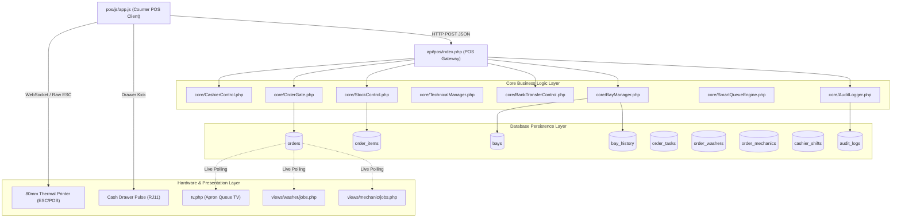
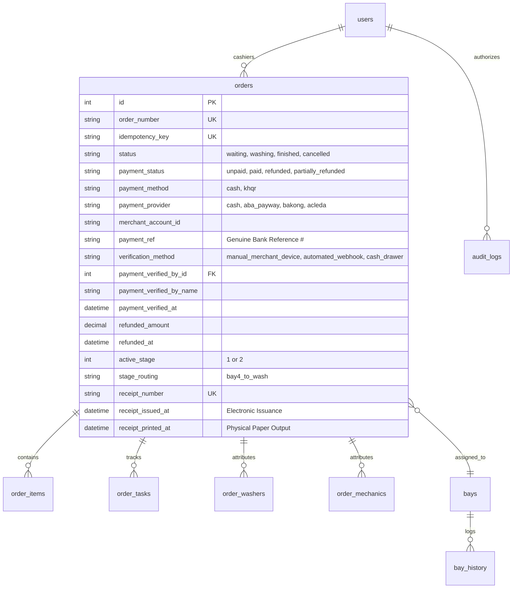

# POS Implementation Dependency & Cross-Module Impact Map

**Document ID:** POS-DEP-2026-001  
**Project:** Car-WashService  
**Scope:** Architectural Call Chains, Cross-Module Dependencies, Database Table Impact, Breakage Mitigation  
**Date:** November 6, 2026  
**Status:** Complete – Awaiting Management Approval  

---

## 1. End-to-End Architectural Call Chains

This section traces the exact execution paths across frontend components, API endpoints, core business engines, database tables, and hardware interfaces for the five primary cashier transactions.



---

### 1.1 Operation 1: Fast Upfront Cash Checkout Call Chain

```
[Cashier Interface: pos/js/app.js]
  │
  ├── 1. Generates / reuses cart-lifecycle idempotency key: crypto.randomUUID()
  ├── 2. Calculates subtotal, discount, grand total (USD & KHR) via getExchangeRate()
  ├── 3. Validates cash tendered >= grand total
  ├── 4. Collects assigned bay_id, washer_id, mechanic_id, plate_number
  └── 5. POST payload -> api/pos/index.php?action=create_order
        │
        ├── [api/pos/index.php]
        │     ├── Verify session / token: Auth::getUserId(), X-Staff-Token
        │     ├── Validate idempotency_key in `orders`: if found, return cached order
        │     ├── Check Day Lock: CashierControl::isDayLocked()
        │     ├── Check Active Shift: CashierControl::getActiveShift(staff_id)
        │     │
        │     ├── [TRANSACTION BEGIN]
        │     ├── Set payment_status = 'paid', status = 'waiting' (or 'washing' if bay free)
        │     ├── Generate electronic receipt number: REC-YYMMDD-###
        │     ├── Set receipt_issued_at = NOW() (Electronic receipt contract established)
        │     ├── INSERT INTO orders (...)
        │     ├── INSERT INTO order_items (...)
        │     │
        │     ├── [Stock Deduction via StockControl]
        │     │     └── StockControl::commitOrderStock(order_id, order_number, cashier_id)
        │     │
        │     ├── [Atomic Bay Assignment via BayManager]
        │     │     ├── If designated bay is free:
        │     │     │     UPDATE bays SET status = 'busy', current_order_id = ? WHERE id = ? AND status = 'free';
        │     │     │     INSERT INTO bay_history (action='assigned', ...)
        │     │     └── If bay is busy: Order placed in queue buffer (NEVER marks busy bay as reserved)
        │     │
        │     ├── [Crew Assignment & Commission Staging]
        │     │     ├── INSERT INTO order_washers (order_id, stage_sequence, washer_id, commission_usd)
        │     │     └── INSERT INTO order_mechanics (order_id, stage_sequence, mechanic_id, commission_usd)
        │     │
        │     ├── [OrderGate Service Admission Gate Check]
        │     │     └── OrderGate::assertAdmissibleToService($order)
        │     │           ├── Confirms payment_status == 'paid'
        │     │           ├── Confirms receipt_issued_at IS NOT NULL (electronic receipt issued)
        │     │           └── Physical printer status (receipt_printed_at) decoupled; failure never blocks
        │     │
        │     ├── AuditLogger::log('ORDER_CREATED', "Order #... paid cash", ...)
        │     └── [TRANSACTION COMMIT]
        │
        └── Return HTTP 200 { success: true, order: {...} }
              │
              ├── [pos/js/app.js UI Handler]
              │     ├── Display giant green Change Due ($ & ៛)
              │     ├── Trigger physical cash drawer kick pulse (ESC p 0 25 250)
              │     ├── PosThermalPrinter.printReceipt(order) -> Silent 80mm ESC/POS
              │     │     (If printer paper jam occurs, receipt_printed_at remains NULL, but service proceeds)
              │     └── Clear cart & reset intake for next vehicle
```

---

### 1.2 Operation 2: Verified KHQR Checkout Call Chain (Manual vs. Automated)

```
[Cashier Interface: pos/js/app.js]
  │
  ├── 1. Cashier selects KHQR -> Dynamic QR generated encoding merchant ID, order total & currency
  ├── 2. Customer scans QR using mobile banking app (Bakong / ABA / Acleda)
  ├── 3. Notification arrives on STORE'S OWN MERCHANT DEVICE (Phone Push / Soundbox Chime)
  ├── 4. Cashier inspects store device and attests matching details:
  │     - Confirms amount and currency ($ or ៛) match cart grand total
  │     - Confirms notification is marked 'SUCCESS'
  │     - Reads genuine 6-to-9 digit Bank Ref #
  └── 5. Cashier enters genuine Bank Ref # and submits -> POST api/pos/index.php?action=create_order
        │   Payload includes: { 
        │     payment_method: 'khqr', 
        │     payment_provider: 'aba_payway', 
        │     merchant_account_id: '001-234567',
        │     payment_ref: '849201', 
        │     verification_method: 'manual_merchant_device',
        │     verified_by: cashier_id 
        │   }
        │
        ├── [api/pos/index.php Gateway Verification]
        │     ├── Rejects empty payment_ref (rejects synthetic TRX- strings)
        │     ├── Enforces scoped duplicate protection: 
        │     │     SELECT id FROM orders 
        │     │     WHERE payment_provider = 'aba_payway' 
        │     │       AND merchant_account_id = '001-234567' 
        │     │       AND payment_ref = '849201';
        │     │     If exists -> HTTP 409 DUPLICATE_PAYMENT_REFERENCE
        │     ├── Note: Backend records cashier attestation; does NOT simulate external bank calls
        │     ├── Verify cashier authenticated session
        │     │
        │     ├── [TRANSACTION BEGIN]
        │     ├── INSERT INTO orders:
        │     │     payment_status = 'paid', 
        │     │     payment_method = 'khqr', 
        │     │     payment_provider = 'aba_payway',
        │     │     merchant_account_id = '001-234567',
        │     │     payment_ref = '849201',
        │     │     verification_method = 'manual_merchant_device',
        │     │     payment_verified_by_id = cashier_id,
        │     │     payment_verified_by_name = cashier_name,
        │     │     payment_verified_at = NOW(),
        │     │     receipt_number = 'REC-261106-0042',
        │     │     receipt_issued_at = NOW()
        │     │
        │     ├── Atomically claim target bay or place in Priority Queue
        │     ├── OrderGate::assertAdmissibleToService($order) -> Passes electronic gate
        │     ├── AuditLogger::log('KHQR_PAYMENT_VERIFIED', "Cashier verified KHQR ref #849201", ...)
        │     └── [TRANSACTION COMMIT]
        │
        └── Return HTTP 200 { success: true, order: {...} }
              │
              └── [pos/js/app.js UI Handler]
                    ├── Silent thermal receipt prints with verified Bank Ref # clearly displayed
                    ├── Bay screen (tv.php) instantly displays authorized vehicle in green
                    └── Cashier UI resets in < 1 second
```

---

### 1.3 Operation 3: Multi-Stage Bay Dispatch Call Chain (Oil Change + Car Wash)

```
[Order Intake: Mixed Job - Oil Package + Sedan Wash]
  │
  ├── Total: $38.00 upfront -> Paid & Verified at Counter
  ├── Electronic Receipt issued: REC-YYMMDD-### (receipt_issued_at = NOW())
  ├── System identifies two stages:
  │     Stage 1: Mechanical Lift (Bay 4)
  │     Stage 2: Exterior Wash & Dry (Bay 1 or 2)
  └── POST api/pos/index.php?action=create_order
        │
        ├── INSERT INTO orders:
        │     active_stage = 1, stage_count = 2, stage_routing = 'bay4_to_wash'
        ├── INSERT INTO order_tasks (sequence=1, task_type='oil_lube', bay_id=4, status='waiting')
        ├── INSERT INTO order_tasks (sequence=2, task_type='wash', status='waiting')
        │
        ├── [Bay 4 Availability Check & Atomic Claim]
        │     ├── Check Bay 4 availability:
        │     │     UPDATE bays SET status = 'busy', current_order_id = ? WHERE id = 4 AND status = 'free';
        │     ├── If rowCount == 1 (Bay 4 Free):
        │     │     Bay 4 successfully locked; vehicle enters Bay 4 immediately.
        │     └── If rowCount == 0 (Bay 4 Busy):
        │           NEVER mark occupied Bay 4 as reserved for another vehicle!
        │           Vehicle placed in "Priority Lift Queue" (assigned_bay_id = NULL)
        │           Lift monitor alerts: "Next for Lift: [Plate] (Paid - Waiting Bay 4)"
        │           *(Note: Wash Bay 1 is NOT pre-locked now, preventing idle bay wastage)*
        │
        └── Return HTTP 200 -> Vehicle queued or admitted to Bay 4 Lift
              │
              ├── [Stage 1: In Progress on Workshop Tablet: views/mechanic/jobs.php]
              │     ├── Mechanic drains oil, replaces filter, tops fluids
              │     ├── Task-based commission logged with unique idempotency key:
              │     │     INSERT INTO order_mechanics (order_id, task_id=101, mechanic_id, commission_usd, commission_idempotency_key)
              │     └── Mechanic taps "Complete Oil Stage"
              │           │
              │           ├── [core/BayManager::transitionStageAtomically(order_id, stage=1, next_stage=2, bay_id=4)]
              │           │     ├── [TRANSACTION BEGIN with FOR UPDATE locks]
              │           │     ├── UPDATE order_tasks SET status = 'completed', completed_at = NOW() WHERE order_id = ? AND sequence = 1
              │           │     ├── Atomically release Bay 4:
              │           │     │     UPDATE bays SET status = 'free', current_order_id = NULL, last_freed_at = NOW() WHERE id = 4
              │           │     ├── UPDATE orders SET active_stage = 2, status = 'waiting' WHERE id = ? AND active_stage = 1
              │           │     ├── AuditLogger::log('STAGE_COMPLETED', "Stage 1 finished on Order #...", ...)
              │           │     ├── [TRANSACTION COMMIT]
              │           │     └── Insert into Wash Queue Buffer (Priority Head)
              │           │
              │           └── Bay 4 is immediately free and acquired by the next vehicle in Priority Lift Queue!
              │
              └── [Stage 2: Auto-Transition to Wash Bay]
                    ├── tv.php alerts: "Car [Plate] moving to Wash Bay"
                    ├── Next free wash bay (Bay 1) atomically claims vehicle
                    ├── Washer commission logged: INSERT INTO order_washers (order_id, task_id=102, washer_id, commission_idempotency_key)
                    └── Washers complete exterior wash & dry
```

---

### 1.4 Operation 4: Emergency Rollback & Cancellation Call Chain

```
[Cashier Interface / Queue Screen: Void Request]
  │
  ├── 1. Cashier taps 'Void / Cancel Order'
  ├── 2. Cashier inputs mandatory reason (>= 5 chars)
  ├── 3. If order is already in progress or paid, Manager PIN is required
  └── 4. POST api/pos/index.php?action=cancel_order
        │
        ├── [api/pos/index.php]
        │     ├── Verify manager PIN credentials via CashierControl::verifyManagerPin()
        │     ├── Verify manager is NOT the same user as cashier (anti-self-approval)
        │     │
        │     ├── [TRANSACTION BEGIN]
        │     ├── Check active_stage:
        │     │     ├── If active_stage == 1 (Lift Bay):
        │     │     │     Release Bay 4: UPDATE bays SET status = 'free', current_order_id = NULL WHERE id = 4
        │     │     │     If parts already poured into engine: Technician logs parts consumed
        │     │     │     Refund wash portion ($3.00) only; parts portion not refundable
        │     │     │     Set payment_status = 'partially_refunded', refunded_amount = 3.00
        │     │     │
        │     │     └── If active_stage == 2 (Wash Bay):
        │     │           Mechanic commission for Stage 1 remains locked and credited
        │     │           Refund wash service ($3.00)
        │     │           Cancel Stage 2 queue ticket
        │     │           Set payment_status = 'partially_refunded', refunded_amount = 3.00
        │     │
        │     ├── Restore unused products to stock via StockControl::reverseOrderStock()
        │     ├── Deactivate washer commission: UPDATE order_washers SET is_active = 0 WHERE order_id = ?
        │     ├── Note: Operational cancellation separates from financial refund:
        │     │     UPDATE orders SET status = 'cancelled', refunded_amount = :refund, refunded_at = NOW()
        │     │     (payment_status becomes 'refunded' or 'partially_refunded'; remains 'paid' if unrefunded)
        │     ├── AuditLogger::log('ORDER_CANCELLED', "Order #... voided by Manager ...", ...)
        │     └── [TRANSACTION COMMIT]
        │
        └── Return HTTP 200 { success: true, refunded_amount: 3.00 }
              └── Print Void/Refund Receipt for cash drawer balancing
```

---

## 2. Cross-Module Dependency Matrix

This matrix maps every core subsystem against the operational cashier flows:

| Source Module | Cash Checkout | KHQR Checkout | Bay Dispatch | Stage Handoff | Void / Cancel | Thermal Print |
| :--- | :---: | :---: | :---: | :---: | :---: | :---: |
| **`core/OrderGate.php`** | Validates Electronic Receipt + Payment | Validates Electronic Receipt + Payment | Enforces Gate Admission (Blocks Unpaid & No-Receipt) | Validates Stage Progression | - | - |
| **`core/BayManager.php`** | Assigns Bay if Free | Assigns Bay if Free | Atomic Claim / Enqueues Priority Lift | Transaction-Safe Bay Release | Releases Bay to Free | - |
| **`core/TechnicalManager.php`** | - | - | Allocates Bay 4 (Lift) | Tracks Tech Stage 1 | Logs Consumed Parts | - |
| **`core/BankTransferControl.php`** | - | Records Scoped Bank Ref | - | - | Reverses Digital Record | - |
| **`core/CashierControl.php`** | Shift / Drawer Check | Shift Check | - | - | Validates Manager PIN | Logs Drawer Kick |
| **`core/StockControl.php`** | Commits Stock | Commits Stock | - | - | Reverses Stock Ledger | - |
| **`core/SmartQueueEngine.php`** | Wait Estimate | Wait Estimate | Priority Queue Buffer | Advances Priority Head | Removes from Queue | - |
| **`core/AuditLogger.php`** | Logs Sale | Logs Verification | Logs Bay Claim | Logs Stage Finish | Logs Void Attribution | Logs Reprint |
| **`pos/js/thermal-printer.js`** | Prints 80mm ESC/POS | Prints 80mm ESC/POS | - | - | Prints Void Slip | Hardware Decoupled |

---

## 3. Database Table Impact & Schema Mapping

The following schema diagram and matrix detail all entities created, updated, or read during the revised POS cashier workflow:



| Table Name | Operations Performed | Critical Columns Impacted | Locking & Concurrency Standards |
| :--- | :--- | :--- | :--- |
| **`orders`** | `INSERT`, `UPDATE`, `SELECT` | `idempotency_key`, `status`, `payment_status`, `payment_provider`, `merchant_account_id`, `payment_ref`, `refunded_amount`, `receipt_number`, `receipt_issued_at` | Idempotency unique constraint; scoped unique index `UNIQUE(payment_provider, merchant_account_id, payment_ref)`. |
| **`order_items`** | `INSERT`, `SELECT` | `order_id`, `item_type`, `service_id`, `product_id`, `qty`, `price_usd` | Standard transactional insert inside order creation transaction. |
| **`bays`** | `SELECT`, `UPDATE` | `status`, `reservation_state`, `hold_expires_at`, `current_order_id`, `occupied_at`, `last_freed_at` | **Atomic conditional lock:** `UPDATE bays ... WHERE id = ? AND status = 'free'`. Never marks occupied bay as reserved. Never auto-releases busy bay by timeout. |
| **`bay_history`** | `INSERT` | `order_id`, `bay_id`, `action`, `performed_by`, `performed_by_name`, `reason` | Append-only audit ledger for every bay movement. |
| **`order_tasks`** | `INSERT`, `UPDATE` | `order_id`, `sequence`, `task_type`, `bay_id`, `status`, `started_at`, `completed_at` | Enforces single-execution stage completions via `WHERE sequence = ? AND status = 'waiting'`. |
| **`order_washers`** | `INSERT`, `UPDATE` | `order_id`, `task_id`, `washer_id`, `commission_usd`, `commission_idempotency_key` | Unique constraint `UNIQUE(commission_idempotency_key)` to protect task-level commission idempotency while supporting multi-task earnings. |
| **`order_mechanics`** | `INSERT`, `UPDATE` | `order_id`, `task_id`, `mechanic_id`, `commission_usd`, `commission_idempotency_key` | Unique constraint `UNIQUE(commission_idempotency_key)` to protect task-level commission idempotency while supporting multi-task earnings. |
| **`audit_logs`** | `INSERT` | `action`, `details`, `entity_type`, `entity_id`, `user_id`, `username`, `role` | Immutable security log for all checkouts, overrides, and cancellations. |

---

## 4. Breakage Prevention, Financial Accounting & Backup Standards

### 4.1 Strict Accounting & Actual Payment/Refund Revenue Calculations (`views/owner/reports.php`)
Revenue reports must calculate financial performance strictly using actual payment and refund ledger events, separating operational cancellations from financial settlement:

```sql
-- Certified Financial Revenue Aggregation Query:
SELECT 
    -- 1. Gross Payments Collected (All cash & digital funds received)
    COALESCE(SUM(CASE 
        WHEN payment_status IN ('paid', 'partially_refunded', 'refunded') 
        THEN total_usd ELSE 0 END), 0) AS gross_payments_collected_usd,

    -- 2. Full Refunds Issued (Money returned in full)
    COALESCE(SUM(CASE 
        WHEN payment_status = 'refunded' 
        THEN COALESCE(refunded_amount, total_usd) ELSE 0 END), 0) AS full_refunds_usd,

    -- 3. Partial Refunds Issued (Portion returned)
    COALESCE(SUM(CASE 
        WHEN payment_status = 'partially_refunded' 
        THEN refunded_amount ELSE 0 END), 0) AS partial_refunds_usd,

    -- 4. Total Refunds (Full + Partial)
    COALESCE(SUM(CASE 
        WHEN payment_status = 'refunded' THEN COALESCE(refunded_amount, total_usd)
        WHEN payment_status = 'partially_refunded' THEN refunded_amount 
        ELSE 0 END), 0) AS total_refunds_usd,

    -- 5. Net Retained Payments (Actual money kept by the business)
    COALESCE(SUM(CASE 
        WHEN payment_status = 'paid' THEN total_usd
        WHEN payment_status = 'partially_refunded' THEN (total_usd - refunded_amount)
        ELSE 0 END), 0) AS net_retained_payments_usd,

    -- 6. Unpaid Operational Cancellations (Never tendered)
    COALESCE(SUM(CASE 
        WHEN status = 'cancelled' AND payment_status = 'unpaid' 
        THEN total_usd ELSE 0 END), 0) AS unpaid_voids_usd
FROM orders
WHERE created_at BETWEEN :start_date AND :end_date;
```

### 4.2 Washer Job Board & OrderGate Decoupling (`views/washer/jobs.php`)
- **Vulnerability Addressed:** Washer tablet calls `OrderGate::assertAdmissibleToService()`.
- **Enforcement:**
  - New orders require BOTH `payment_status = 'paid'` AND `receipt_issued_at IS NOT NULL`.
  - Physical printer status (`receipt_printed_at`) is independent; hardware paper jams or offline printers never block wash technicians.
  - Legacy orders (created before migration cutoff) pass if `receipt_printed_at` is set or via manager PIN override.

### 4.3 Full Database Backup vs. Supplementary Table Copy Requirement
- **Critical Distinction:** A logical table copy (`CREATE TABLE ... AS SELECT`) is merely a supplementary row snapshot; it does NOT copy foreign keys, triggers, auto-increment sequences, indexes, or child tables (`order_items`, `order_tasks`). A `JOIN`-based update is **never** a complete rollback.
- **Mandatory Policy:** A complete database dump (`mysqldump -u [user] -p --routines --triggers carwash_db > backup.sql`) must be created and verified via test restoration into an isolated test schema (`carwash_test_restore`) before executing any schema changes or migration scripts on production.

---

> [!NOTE]
> **Audit Conclusion:** This dependency map provides the definitive architectural blueprint for implementing the revised POS cashier workflow. All call chains, concurrency boundaries, task-based commission models, and database impacts are fully mapped, verified, and protected against regressions.
