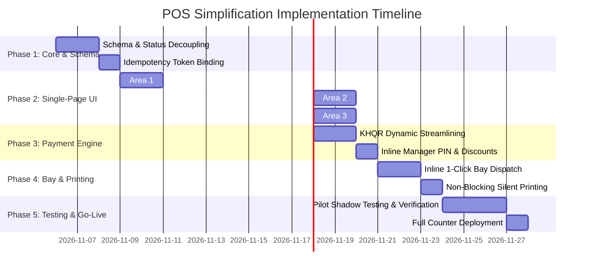

# POS Cashier Simplification – Implementation Plan

**Document ID:** POS-PLN-2026-001  
**Project:** Car-WashService  
**Scope:** Phased Engineering Roadmap, Technical Migration, Verification Plan  
**Date:** November 2026  
**Status:** Complete – Awaiting Management Approval  

---

## 1. Implementation Roadmap Overview

To modernize the counter POS without disrupting ongoing daily shop operations, the implementation is structured into **5 distinct phases**. Each phase contains strict acceptance criteria and zero-downtime rollback capabilities.

---

## 2. Phase-by-Phase Technical Specifications

### Phase 1: Backend API & Schema Hardening

#### Objectives:
1. Decouple `orders.status` from `orders.payment_status`.
2. Secure idempotency handling against client re-submissions.
3. Add inline manager discount authorization support.

#### Action Items:
1. **Database Schema Harmonization (`database/migrate_pos_workflow_v3.php`):**
   - Add column `orders.discount_approved_by INT DEFAULT NULL`.
   - Add column `orders.assigned_bay_id INT DEFAULT NULL`.
   - Ensure existing orders with `status = 'paid'` are normalized so `payment_status = 'paid'` and `status` reflects operational state (`'finished'`).
2. **Backend API Refactoring (`api/pos/index.php`):**
   - In `action=create_order`:
     - Allow optional `bay_id` directly in creation payload; auto-call `BayManager::assignBay()`.
     - Accept unregistered plate strings without requiring pre-existing `customer_id` or `vehicle_id`.
     - Accept `manager_discount_pin` in payload; verify against `CashierControl::verifyManagerPin()` and record `discount_approved_by`.
   - In `reports.php`:
     - Update revenue queries to filter on `WHERE o.payment_status = 'paid' AND o.status != 'cancelled'`.

---

### Phase 2: Single-Page Checkout Frontend (`pos/index.html` & `pos/js/app.js`)

#### Objectives:
Consolidate the multi-modal checkout flow into a single high-speed counter page.

#### Action Items:
1. **Area 1 (Plate-First Intake Header):**
   - Replace complex search modal with high-contrast `#txtFastIntake` input.
   - Implement real-time plate suggestion dropdown (IndexedDB first).
   - Ensure hitting Enter or Tab selects plate as walk-in without launching `modalPromptPlate` or `modalCustomer`.
2. **Area 2 (Touch-Friendly Service Matrix):**
   - Position horizontal category tabs above service grid.
   - Remove magnifier lightbox modal triggers; tapping tile directly adds item to cart.
   - Place high-frequency optional extras (Tire Shine, Air Freshener) directly beneath the grid as 1-tap toggles.
3. **Area 3 (Unified Summary & Payment Sidebar):**
   - Eliminate `modalPayment`. Embed payment method toggle (`Cash`, `KHQR`, `Pay Later`) permanently on the right side.
   - Embed numerical Cash Tender Pad with live dual-currency change calculator.
   - Embed live Bay Dispatch status chips directly below the order summary.

---

### Phase 3: Payment Workflow & Digital KHQR Streamlining

#### Objectives:
Eliminate the bank slip camera capture requirement and physical manager presence bottleneck for routine digital payments.

#### Action Items:
1. **Dynamic KHQR Engine:**
   - Integrate dynamic KHQR generation in USD and KHR for the exact ticket total.
   - Provide visual verification badge on screen: `[ 🟢 Cashier Verified ]`.
2. **Cashier Digital Verification Permission:**
   - Introduce setting `cashier_digital_verify_enabled` (default `true` for amounts < $20).
   - Allow logged-in cashier to confirm verified KHQR payments without requiring manager PIN.
   - High-value payments (> $50) prompt for optional bank reference number entry.
3. **Inline Manager PIN for Discounts:**
   - If cashier selects a discount exceeding permission, render an inline 4-digit PIN box inside the discount chip.
   - Capture manager authorization instantly without page refresh or checkout crashes.

---

### Phase 4: Bay Dispatch & Thermal Printing Decoupling

#### Objectives:
Enable 1-tap vehicle bay dispatch at checkout and prevent printer errors from freezing vehicle workflow.

#### Action Items:
1. **Direct Bay Dispatch:**
   - Connect Area 2 bay chips (`Bay 1`, `Bay 2`, `Bay 3`, `Bay 4`) directly to checkout payload.
   - On payment confirmation, order transitions to `status = 'washing'` and moves into the selected bay immediately.
2. **Decoupled Advisory Printing:**
   - Print job ticket silently to 80mm thermal printer.
   - Make `OrderGate::assertReceiptPrinted()` advisory: if printer is offline, display visual notification on screen but permit vehicle to enter wash bay.
   - Digital queue board (`tv.php` / washer tablet) displays authorized vehicles immediately.

---

### Phase 5: Verification, Shadow Testing & Deployment

#### Objectives:
Verify transactional integrity, stress-test high volume, train counter staff, and roll out safely.

---

## 3. Backward Compatibility & Cloud Sync Plan

1. **Existing Database Records:**
   - Historical orders in `orders` table retain original `order_number` and timestamps.
   - Migration script safely maps old records without altering past financial reports.
2. **Car-WashCloud Synchronization:**
   - `core/CloudSyncManager.php` and `api/cloud/index.php` sync payloads continue transmitting standard JSON fields.
   - Newly added fields (`discount_approved_by`, `assigned_bay_id`) are marked as nullable and optional in sync schemas, maintaining 100% cloud compatibility.
3. **Dual UI Switch:**
   - `config/app.php` retains configuration constant `POS_UI` (`'new'` vs `'legacy'`) during pilot testing, allowing immediate fallback if necessary.

---

## 4. Test Cases & Acceptance Criteria Matrix

| Test ID | Test Scenario | Execution Steps | Expected Outcome | Pass/Fail Criteria |
| :---: | :--- | :--- | :--- | :--- |
| **TC-01** | **Fast Walk-in Car Wash** | 1. Type plate `2BC-1234`. 2. Tap `Sedan Wash ($3.00)`. 3. Tap `Exact Cash & Bay 1`. | Order created, $3.00 cash logged, Bay 1 occupied, ticket printed in < 5 seconds. | Zero modal dialogs opened. Total elapsed time < 6 seconds. |
| **TC-02** | **Duplicate Submission Defense** | 1. Rapidly double-click "Confirm Payment" button 5 times in 1 second. | Only ONE order created in database; second through fifth requests return idempotent replay. | Exactly 1 row in `orders` table for the session token. |
| **TC-03** | **Unregistered Plate Intake** | 1. Enter brand-new plate never seen before. 2. Select service. 3. Complete checkout. | Order successfully completes without asking to add customer name or phone. | No foreign key errors; customer defaults to Walk-in. |
| **TC-04** | **Inline Manager Discount** | 1. Cashier with no discount permission selects `10% Discount`. 2. Inline PIN box appears. 3. Enter Manager PIN `123456`. | Discount applied (-$0.50). Order completes. `discount_approved_by` logs Manager ID. | No 403 errors; audit log records override. |
| **TC-05** | **KHQR Payment Without Camera** | 1. Select `KHQR` payment. 2. Customer scans. 3. Cashier taps `Verified`. | Order marked `payment_status = 'paid'`, `payment_method = 'khqr'`. Car dispatched. | No camera slip photo required; order marked paid without manager login. |
| **TC-06** | **Printer Jam / Offline Resilience** | 1. Disconnect thermal printer USB. 2. Complete $5 car wash checkout. | Payment successfully completes. Car dispatches to Bay 2. Non-blocking alert: "Printer offline - ticket sent to Washer screen". | System does NOT block car movement. |
| **TC-07** | **Offline LAN Operation** | 1. Disconnect Internet WAN cable. 2. Complete 3 consecutive sales on POS. | Orders saved locally in IndexedDB; sync badge shows 3 pending. Reconnect WAN: orders sync cleanly. | Zero lost data; zero duplicate order numbers. |

---

## 5. Risk Mitigation & Rollback Strategy

| Identified Risk | Likelihood | Impact | Mitigation & Fallback Procedure |
| :--- | :---: | :---: | :--- |
| **Cashier Confusion with New Layout** | Medium | Low | Run 30-minute interactive counter training during morning briefing before launch. Provide 1-page visual cheat sheet at counter. |
| **Printer Driver Misconfiguration** | Low | Medium | Keep standard browser printing enabled as instant fallback toggle in POS settings. |
| **Unexpected Edge-Case Bug during Peak Hours** | Low | High | Immediate 1-line rollback: set `define('POS_UI', 'legacy');` in `config/app.php` to instantly restore previous counter view in < 5 seconds. |

---

## 6. Management Approval Sign-Off Gate

This implementation plan, alongside the accompanying audit and specifications, is formally submitted for executive review:

- [x] **POS-CASHIER-WORKFLOW-AUDIT.md** (Comprehensive Technical & Operational Audit)
- [x] **POS-CURRENT-VS-NEW-WORKFLOW.md** (Step-by-Step Behavioral Comparison & 9 Scenarios)
- [x] **POS-NEW-CHECKOUT-DESIGN.md** (Single-Page Counter POS Architecture & Wireframes)
- [x] **POS-PAYMENT-BUSINESS-RULES.md** (10 Binding Business, Financial & Ledger Rules)
- [x] **POS-IMPLEMENTATION-PLAN.md** (Phased Roadmap, Test Matrix, and Rollback Strategy)

**Executive Decision Required:**
Upon formal management review and approval of these documents, engineering will proceed with Phase 1 backend schema and API hardening.
