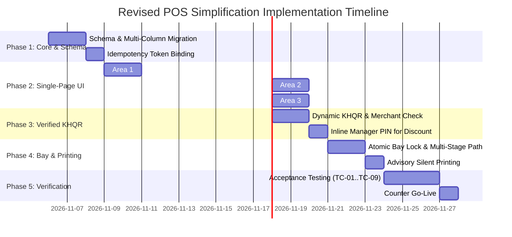

# POS Cashier Simplification – Implementation Plan

**Document ID:** POS-PLN-2026-001  
**Project:** Car-WashService  
**Scope:** Phased Engineering Roadmap, Technical Migration, Verification Plan  
**Date:** November 2026 (Revised with Management Decisions)  
**Status:** Complete – Awaiting Management Approval  

---

## Management Revision Summary

This implementation plan has been revised to enforce confirmed management decisions:
1. **Upfront Payment Timing:** Payment timing is strictly **BEFORE service**. "Pay Later", "Pay at Exit", and unpaid queue dispatch are **removed** from the engineering roadmap. A car does not enter the queue or bay without confirmed payment.
2. **Reliable KHQR Verification Standards:** QR generation, customer phone screenshots, or blind cashier button clicks are **not accepted** as proof of payment. Ground-truth verification utilizes merchant-side push/SMS alerts, IoT soundbox chimes, or official bank payment gateway webhooks (which require confirmation, merchant onboarding, and API credentials from the bank/NBC payment aggregator). No banking API capabilities are invented.
3. **Preservation of Existing Permissions:** No unauthorized discount percentage tiers or new manager limits are introduced. System strictly uses existing `pos.discount` role permissions and `CashierControl::verifyManagerPin()`.
4. **Careful Historical Data Migration:** Never automatically convert every order with `status='paid'` to operational `status='finished'`. Historical migration evaluates multi-column timestamps (`started_at`, `finished_at`, `cancelled_at`).
5. **Multi-Stage Bay Routing & Atomic Concurrency:** Safe sequential routing for combined services (Stage 1 Lube $\rightarrow$ Stage 2 Wash) with atomic database concurrency locks.
6. **Project Boundary Decoupling:** `Car-WashService` (local station) and `Car-WashCloud` remain strictly separate repositories.

---

## 1. Implementation Roadmap Overview

The implementation is structured into **5 distinct phases** designed for zero-downtime execution on the counter terminal.



---

## 2. Phase-by-Phase Technical Specifications

### Phase 1: Backend API & Schema Hardening

#### Objectives:
1. Decouple `orders.status` (operational) from `orders.payment_status` (financial).
2. Execute careful, non-destructive migration of historical records.
3. Secure idempotency handling against client re-submissions.
4. Add atomic bay lock support and multi-stage routing columns.

#### Action Items:
1. **Database Schema Harmonization (`database/migrate_pos_workflow_v3.php`):**
   - Add column `orders.discount_approved_by INT DEFAULT NULL`.
   - Add column `orders.assigned_bay_id INT DEFAULT NULL`.
   - Add columns for multi-stage tracking:
     `orders.active_stage INT DEFAULT 1`,
     `orders.stage_count INT DEFAULT 1`,
     `orders.stage_routing VARCHAR(100) DEFAULT NULL`.
2. **Careful Historical Order Migration Logic:**
   - Under no circumstances shall an automatic bulk update convert all `status = 'paid'` to `status = 'finished'`.
   - Migration script must evaluate each historical record individually:
     ```sql
     -- Example of careful multi-column normalization:
     UPDATE orders 
     SET payment_status = 'paid',
         status = CASE 
             WHEN cancelled_at IS NOT NULL THEN 'cancelled'
             WHEN finished_at IS NOT NULL THEN 'finished'
             WHEN started_at IS NOT NULL AND finished_at IS NULL THEN 'washing'
             ELSE 'waiting'
         END
     WHERE status = 'paid';
     ```
3. **Backend API Refactoring (`api/pos/index.php`):**
   - In `action=create_order`:
     - Enforce payment validation upfront: order must be paid before being placed into queue or bay.
     - Accept unregistered plate strings without requiring pre-existing `customer_id` or `vehicle_id`.
     - Accept `manager_discount_pin` in payload; verify against `CashierControl::verifyManagerPin()` and record `discount_approved_by`.
     - Remove `action=pay_later` from normal counter POS endpoints.
   - In `reports.php`:
     - Update revenue queries to filter on `WHERE o.payment_status = 'paid' AND o.status != 'cancelled'`.

---

### Phase 2: Single-Page Checkout Frontend (`pos/index.html` & `pos/js/app.js`)

#### Objectives:
Consolidate the multi-modal checkout flow into a single high-speed counter page with **strictly upfront payment**.

#### Action Items:
1. **Area 1 (Plate-First Fast Intake):**
   - Implement autofocused `#txtFastIntake` input.
   - Live plate autocomplete checks local IndexedDB first, then server.
   - Hitting Enter or Tab binds the typed plate directly to the bill without launching `modalPromptPlate` or `modalCustomer`. Customer registration is strictly optional.
2. **Area 2 (Touch-Friendly Service Matrix & Multi-Stage Path):**
   - Horizontal category tabs (`Wash`, `Detailing`, `Oil & Lube`, `Shop`) above service grid.
   - 1-tap item tiles; touching tile immediately adds item to cart.
   - If mixed services are selected (Oil Change + Car Wash), Area 2 displays the sequential path:
     `Stage 1: Bay 4 (Tech/Lift)` $\longrightarrow$ `Stage 2: Bay 1 (Wash/Dry)`
   - High-frequency add-ons (Tire Shine, Air Freshener) appear as 1-tap pills directly below the grid.
3. **Area 3 (Unified Summary & Upfront Payment Sidebar):**
   - Completely eliminate `modalPayment`.
   - Remove "Pay Later", "Pay at Exit", and "Hold Bill" buttons.
   - Toggle buttons strictly limited to `💵 CASH` and `📱 KHQR SCAN`.
   - Embed numerical Cash Tender Pad with live dual-currency change calculator ($ and ៛).
   - Single confirmation action: **`🖨️ CONFIRM PAYMENT & DISPATCH (Enter)`**.

---

### Phase 3: Payment Engine & Verified KHQR Process

#### Objectives:
Implement reliable KHQR verification without webcam screenshots, blind clicks, or physical manager bottlenecks.

#### Action Items:
1. **Dynamic KHQR Payload Generator:**
   - POS generates dynamic KHQR string and QR code containing exact bill amount in KHR / USD and unique bill reference.
2. **Merchant-Side Ground Truth Verification:**
   - Eliminate webcam slip capture (`btnTriggerSlipCapture`).
   - Payment verification is confirmed via the **store's own merchant reception device**:
     - *Local Merchant Reception:* Counter IoT soundbox voice chime, Telegram merchant notification bot, or store terminal push alert.
     - *Bank Payment Gateway Callback:* Direct webhook from bank/aggregator (e.g. ABA PayWay / Bakong MD5 verification).
       *(Note: Bank API integrations require formal commercial onboarding and API credentials from the bank or payment aggregator).*
   - Cashier enters or matches the last 4–6 digits of the bank reference number (`payment_ref`) before confirming.
   - Blind cashier clicks without reference match are blocked.
3. **Inline Manager PIN for Discounts:**
   - If cashier selects a discount and lacks `pos.discount` permission, render an inline 4-digit PIN box inside the discount chip.
   - Verify manager credentials instantly without crashing checkout.

---

### Phase 4: Atomic Bay Concurrency & Advisory Silent Printing

#### Objectives:
Prevent double-booking bays between terminals and prevent printer hardware issues from blocking vehicle workflow.

#### Action Items:
1. **Atomic Bay Concurrency Lock & Multi-Stage Staged Reservation:**
   - In `core/BayManager.php`, assign bay via atomic conditional update:
     ```sql
     UPDATE bays 
     SET status = 'busy', current_order_id = ? 
     WHERE id = ? AND status = 'free';
     ```
   - If rows affected is 0, alert cashier immediately: `"Bay [X] was just claimed by Terminal [Y]. Redirecting to Queue / Next Free Bay"`.
   - **Multi-Stage Staged Reservation:** Stage 1 (Bay 4 Lift) is locked at checkout. Stage 2 (Wash Bay) is registered in the priority queue buffer rather than pre-locked, preventing empty wash bays from sitting idle during 30-minute oil changes.
   - **Rollback Protocol:** If checkout collision occurs, transaction rolls back cleanly. If mid-service cancellation occurs: Stage 1 consumed parts are non-refundable, unperformed wash services ($3.00) are refunded, Bay 4 is released atomically, and Stage 2 queue ticket is voided.
2. **Two-Tier Receipt Printing Policy (Resolving Historical Contradiction):**
   - **Tier 1 (Financial Hard Gate):** Mandatory `payment_status = 'paid'` before any vehicle enters service queue or bay.
   - **Tier 2 (Physical Paper Advisory Gate):** Silent 80mm ESC/POS ticket prints immediately. If printer runs out of paper or jams, the vehicle is **not blocked** from entering the wash bay; the electronic receipt is recorded in the database, and the job appears digitally on the washer bay display/TV screen (`tv.php`). Cashier can reprint physical paper at any time (`F7` or Reprint button) once paper is loaded. Setting `enforce_physical_paper_gate = 1` remains available for shops requiring security guard paper slip checks.

---

### Phase 5: Verification, Shadow Testing & Deployment

#### Objectives:
Verify transactional integrity, stress-test high volume, train counter staff, and roll out safely.

---

## 3. Backward Compatibility & Cloud Sync Plan

1. **Existing Database Records:**
   - Historical orders retain original `order_number` and timestamps.
   - Migration script safely normalizes records using multi-column criteria without altering past financial reports.
2. **Car-WashCloud Decoupling:**
   - `Car-WashService` (local on-premise application) and `Car-WashCloud` remain strictly separate codebases.
   - Sync payloads between station and cloud transmit standard, documented JSON schemas without sharing local schema dependencies.
3. **Rollback Safety Switch:**
   - Configuration setting `define('POS_UI', 'new');` in `config/app.php` can be reverted to `'legacy'` in < 5 seconds if an unexpected edge case occurs during morning pilot testing.

---

## 4. Test Cases & Acceptance Criteria Matrix

| Test ID | Test Scenario | Execution Steps | Expected Outcome | Pass/Fail Criteria |
| :---: | :--- | :--- | :--- | :--- |
| **TC-01** | **Fast Walk-in Upfront Car Wash** | 1. Type plate `2BC-1234`.<br>2. Tap `Sedan Wash ($3.00)`.<br>3. Tap `$5 Cash`.<br>4. Tap `Confirm & Dispatch (Bay 1)`. | Order created, $3.00 cash logged, $2.00 change displayed, Bay 1 occupied, ticket printed in < 6 seconds. | Zero modal dialogs opened. Total elapsed time < 6 seconds. Payment marked `paid` before bay entry. |
| **TC-02** | **Duplicate Submission Defense** | 1. Rapidly double-click "Confirm Payment" button 5 times in 1 second. | Only ONE order created in database; second through fifth requests return idempotent replay. | Exactly 1 row in `orders` table for the session token. |
| **TC-03** | **Unregistered Plate Intake** | 1. Enter brand-new plate never seen before.<br>2. Select service.<br>3. Pay cash and complete checkout. | Order successfully completes without asking to register customer name, phone, or marketing consent. | No foreign key errors; customer defaults to Walk-in. |
| **TC-04** | **Inline Manager Discount** | 1. Cashier with no discount permission selects `Discount`.<br>2. Inline PIN box appears.<br>3. Enter Manager PIN `123456`. | Discount applied (-$0.50). Order completes. `discount_approved_by` logs Manager ID. | No 403 errors; audit log records override. |
| **TC-05** | **Reliable KHQR Verification** | 1. Select `KHQR`. Dynamic QR generated.<br>2. Customer scans.<br>3. Cashier verifies bank notification on store device and enters reference #.<br>4. Confirm payment. | Order marked `payment_status = 'paid'`, `payment_method = 'khqr'`. Car dispatched. | Customer screenshots rejected; unverified clicks blocked; verified reference logged. |
| **TC-06** | **Unpaid Queue Entry Blocked** | 1. Add services to cart.<br>2. Attempt to dispatch vehicle without cash tender or KHQR verification. | POS disables dispatch action; vehicle CANNOT enter queue or bay without payment. | "No Payment, No Service" strictly enforced. Zero unpaid entries. |
| **TC-07** | **Atomic Bay Concurrency Collision** | 1. Terminal A and Terminal B both attempt to assign Bay 1 at the exact same millisecond. | First terminal claims Bay 1; second terminal receives collision alert and routes car to Bay 2 or Queue. | Zero double-assigned bays. |
| **TC-08** | **Multi-Stage Bay Routing (Oil + Wash)** | 1. Select `Synthetic Oil Package` + `Exterior Wash`.<br>2. Confirm upfront payment. | Stage 1 assigned to Bay 4 (Tech/Lift). Upon Stage 1 completion, vehicle advances to Stage 2 (Bay 1 Wash). | Both stages tracked cleanly; separate mechanic and washer commissions recorded. |
| **TC-09** | **Historical Data Migration Safety** | 1. Run migration test on database copy with legacy orders where `status='paid'`. | Migration inspects `finished_at`, `started_at`, and `cancelled_at`; does NOT convert unfinished or cancelled jobs to `finished`. | Historical report revenue and job counts match pre-migration baseline 100%. |

---

## 5. Management Approval Sign-Off Gate

This implementation plan, alongside the revised audit and specifications, is formally submitted for executive review:

- [x] **POS-CASHIER-WORKFLOW-AUDIT.md** (Revised with Management Decisions)
- [x] **POS-CURRENT-VS-NEW-WORKFLOW.md** (Revised: Pay Later Removed, Upfront Payment, Scenarios 1–9)
- [x] **POS-NEW-CHECKOUT-DESIGN.md** (Revised: Single-Page Checkout, Verified KHQR, Multi-Stage Bay Path)
- [x] **POS-PAYMENT-BUSINESS-RULES.md** (Revised: 10 Core Rules, Anti-Fraud KHQR, Multi-Stage Concurrency)
- [x] **POS-IMPLEMENTATION-PLAN.md** (Revised: Phased Roadmap, Test Matrix TC-01..TC-09, Migration Safety)

**Executive Decision Required:**
Upon formal management review and approval of these revised design documents, engineering will proceed with Phase 1 backend schema and API hardening.
