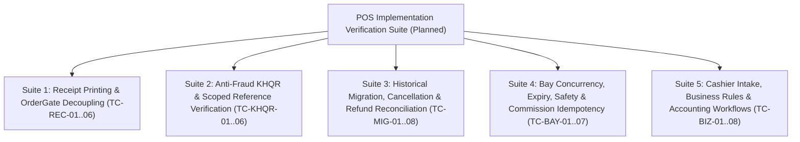

# POS Implementation Verification & Test Matrix

**Document ID:** POS-TST-2026-001  
**Project:** Car-WashService  
**Scope:** Automated & Manual Test Cases, Concurrency Stress Tests, Migration Validation, Edge-Case Verification  
**Date:** November 6, 2026  
**Status:** Complete Specifications – Awaiting Management Authorization to Execute  

---

> [!NOTE]
> **Test Execution Nature & Verification Status:**  
> In accordance with strict management instructions, **this project is currently in the read-only architectural design and audit phase**. No application source code, SQL migrations, or database records have been modified.  
> The test cases in this document are **PLANNED TEST SPECIFICATIONS** with formal execution steps and deterministic pass/fail criteria. They will be executed sequentially on an isolated staging database and counter hardware during the implementation phase.

---

## 1. Test Suite Architecture

This document defines 35 planned verification test cases organized into five functional test suites:

---

## 2. Test Suites & Detailed Test Case Specifications

### Suite 1: Receipt Printing Decoupling & OrderGate Tests

| Test ID | Test Scenario | Execution Preconditions | Planned Input Payload & Execution Steps | Expected System Behavior | Pass / Fail Criteria |
| :---: | :--- | :--- | :--- | :--- | :--- |
| **TC-REC-01** | **Electronic Receipt Issuance on Payment** | Cashier logged in; open shift active. | Submit cash payment for $3.00 Sedan Wash: `POST api/pos/index.php?action=create_order`. | 1. Order created with `payment_status = 'paid'`. 2. `orders.receipt_number` is generated (`REC-YYMMDD-###`). 3. `orders.receipt_issued_at` is timestamped. 4. `orders.receipt_printed_at` remains NULL (until printer fires). | **PASS** if electronic receipt is recorded in database without depending on physical printer status. |
| **TC-REC-02** | **Physical Printer Offline Bay Passage** | Printer USB disconnected or paper removed. Order created and paid (TC-REC-01). | 1. Dispatch car to Bay 1. 2. Washer tablet attempts to start job: `POST views/washer/jobs.php?action=update_status&new_status=washing`. | 1. `OrderGate::assertAdmissibleToService()` evaluates `receipt_issued_at` and `payment_status = 'paid'`. 2. Gate passes successfully without throwing `ReceiptRequiredException`. 3. Car transitions to `status = 'washing'`. | **PASS** if vehicle is NOT blocked from entering wash bay despite printer offline. |
| **TC-REC-03** | **Block Admission When Electronic Receipt Missing** | New order created with `payment_status = 'paid'`, but simulate missing electronic receipt (`receipt_issued_at IS NULL`). | Attempt to move vehicle into Bay 1 via `core/BayManager::assignCarToBay()`. | 1. `OrderGate` identifies new order (created >= migration cutoff). 2. Detects `receipt_issued_at IS NULL`. 3. Throws `ReceiptRequiredException`: `payment_status='paid'` alone must NEVER silently bypass receipt issuance. 4. Admission strictly blocked. | **PASS** if new orders without electronic receipts are blocked even if marked paid. |
| **TC-REC-04** | **Unpaid Order Blocked at Bay Gate** | Unpaid order exists in database (`payment_status = 'unpaid'`). | Attempt to move vehicle into Bay 1 via `core/BayManager::assignCarToBay()`. | 1. `OrderGate` detects `payment_status != 'paid'`. 2. Throws `PaymentRequiredException` (HTTP 422). 3. Vehicle movement is strictly rejected. | **PASS** if unpaid vehicle is 100% blocked from entering service bay. |
| **TC-REC-05** | **Legacy Order Compatibility Admission** | Historical order created before migration cutoff date with `receipt_issued_at IS NULL`. | Dispatch legacy order to Bay 1 with `receipt_printed_at` timestamp present (or manager override option). | 1. `OrderGate` recognizes order created < migration cutoff date. 2. Allows admission based on legacy `receipt_printed_at` or manager PIN override. 3. Does NOT throw false-alarm missing electronic receipt exception. | **PASS** if legacy historical orders are admitted without requiring backfilled electronic receipts. |
| **TC-REC-06** | **Reprint Receipt Presentation Independence** | Order already paid and washed. | Cashier clicks "Reprint Receipt" on Today's Orders view: `POST api/pos/index.php?action=mark_receipt_printed`. | 1. Returns existing receipt payload. 2. Appends `*** DUPLICATE RECEIPT ***` watermark. 3. Increments `print_count` in audit logs. 4. Does NOT create a second order row; financial balances remain identical. | **PASS** if re-printing is strictly read-only and mutates zero financial totals. |

---

### Suite 2: Anti-Fraud KHQR & Scoped Reference Verification Tests

| Test ID | Test Scenario | Execution Preconditions | Planned Input Payload & Execution Steps | Expected System Behavior | Pass / Fail Criteria |
| :---: | :--- | :--- | :--- | :--- | :--- |
| **TC-KHQR-01** | **Rejection of Synthetic TRX Fallback** | POS API receives KHQR checkout request. | Submit payload with `payment_method = 'khqr'` and `payment_ref = ''` (empty). | 1. API does NOT generate synthetic `TRX-` string via `md5(uniqid())`. 2. API rejects request with HTTP 422: `BANK_REFERENCE_REQUIRED`. 3. No order is committed. | **PASS** if backend refuses to manufacture fake bank transaction references. |
| **TC-KHQR-02** | **Manual Merchant-Device Verification & Attribution** | Customer scans dynamic KHQR; store counter phone chimes with notification (Ref #849201, Amount $5.00 USD). | Cashier inspects store phone, confirms $5.00 received, enters `payment_ref = '849201'`, `payment_provider = 'aba_payway'`, `merchant_account_id = '001-234567'`. | 1. Backend captures cashier attestation, `verification_method = 'manual_merchant_device'`, cashier ID and timestamp. 2. Backend does NOT simulate fake bank queries. 3. Records `payment_status = 'paid'`, `payment_ref = '849201'`. 4. Audit log records `KHQR_PAYMENT_VERIFIED`. | **PASS** if cashier attestation and attribution are immutably captured without claiming false automated bank validation. |
| **TC-KHQR-03** | **Scoped Duplicate Bank Reference Rejection** | Order #1001 was already paid with `provider = 'aba_payway'`, `account = '001-234567'`, `payment_ref = '849201'`. | A second checkout attempt submits the identical provider, account, and `payment_ref = '849201'`. | 1. Backend executes scoped uniqueness query. 2. Detects reference collision for this merchant account. 3. Request rejected with HTTP 409: `DUPLICATE_PAYMENT_REFERENCE`. 4. No second order created. | **PASS** if duplicate bank references are strictly rejected within provider and merchant account scope. |
| **TC-KHQR-04** | **Customer Screenshot Rejection Protocol** | Customer shows mobile screenshot of payment screen to cashier. | Cashier does NOT receive notification on store device; cashier holds car. | 1. Car is held at intake. 2. Car is NOT dispatched to bay. 3. POS displays: `"Awaiting merchant confirmation on store device"`. | **PASS** if unverified customer claims do not admit vehicle to wash apron. |
| **TC-KHQR-05** | **Automated Webhook Signature Verification** | Test environment receiving automated bank webhook. | Send POST payload to `api/pos/khqr_webhook.php` with HMAC-SHA512 header. Test with valid key, then with invalid signature. | 1. Valid signature -> Transitions order to `'paid'`, records `verification_method = 'automated_webhook'`. 2. Invalid signature -> Rejects request with HTTP 401 Unauthorized. | **PASS** if automated webhook strictly requires genuine cryptographic signature validation. |
| **TC-KHQR-06** | **Offline LAN Handling of KHQR Attempt** | WAN Internet disconnected; local LAN Wi-Fi active. | Cashier selects KHQR payment. | 1. POS alerts: `"Internet disconnected. Real-time bank notification unavailable. Please use Cash or verify via store phone cellular SMS."` 2. Cash tender pad remains available. | **PASS** if system handles internet loss gracefully without freezing. |

---

### Suite 3: Historical Order Migration, Cancellation & Refund Reconciliation Tests

| Test ID | Test Scenario | Execution Preconditions | Planned Input / Query | Expected System Behavior | Pass / Fail Criteria |
| :---: | :--- | :--- | :--- | :--- | :--- |
| **TC-MIG-01** | **Full Database Backup & Isolated Restoration Testing** | Production database containing orders, items, bays, audit logs. | 1. Execute `mysqldump --single-transaction --routines --triggers carwash_db > backup.sql`. 2. Restore into isolated test schema `carwash_test_restore`. 3. Verify checksums. | 1. Full dump created. 2. Restoration into test schema completes with 0 errors. 3. Row counts and table checksums match 100%. | **PASS** if verified restoration test succeeds on isolated database before production migration. |
| **TC-MIG-02** | **Pre-Migration Dry-Run Preview Query** | Unmigrated database with mixed legacy records. | Execute Migration Preview Query (`SELECT ... GROUP BY migration_category`). | Returns exact distribution counts for reliable completion, active service, queue, and ambiguous categories with zero mutations to table data. | **PASS** if preview executes purely read-only with complete categorization. |
| **TC-MIG-03** | **Reliable Completion Evidence Reconciled** | Order has `status = 'paid'`, `finished_at = '2026-05-10 14:30:00'`, `cancelled_at IS NULL`. | Execute migration script. | 1. `payment_status` becomes `'paid'`. 2. `status` becomes `'finished'`. 3. Notes field preserved unchanged. | **PASS** if records with genuine finish timestamps become finished. |
| **TC-MIG-04** | **Reliable Active-Service Evidence Reconciled** | Order has `status = 'paid'`, `started_at = '2026-11-06 08:15:00'`, `finished_at IS NULL`. | Execute migration script. | 1. `payment_status` becomes `'paid'`. 2. `status` becomes `'washing'`. 3. Car stays visible on active washer tablet. | **PASS** if active in-progress cars are NOT marked finished prematurely. |
| **TC-MIG-05** | **Reliable Today's Queue Car Reconciled** | Order created today, paid upfront, `started_at IS NULL`, `finished_at IS NULL`. | Execute migration script. | 1. `payment_status` becomes `'paid'`. 2. `status` becomes `'waiting'`. 3. Queue ticket is preserved on TV display (`tv.php`). | **PASS** if waiting customers are NOT dropped from service queue. |
| **TC-MIG-06** | **Verified Refunded Cancellation Reconciled** | Order has `status = 'paid'`, `cancel_reason = 'Customer left'`, and explicit `refunded_amount = 5.00`. | Execute migration script. | 1. `status` becomes `'cancelled'`. 2. `payment_status` becomes `'refunded'`. 3. Original cancellation reason and refund amounts preserved. | **PASS** if verified refunded cancellations are classified correctly without data loss. |
| **TC-MIG-07** | **Paid Cancellation with Unknown Refund (CRITICAL)** | Order has `status = 'paid'`, `cancelled_at IS NOT NULL`, but `refunded_amount = 0` (no refund record). | Execute migration script. | 1. **Record MUST REMAIN UNCHANGED in database.** 2. `status` remains `'paid'`. 3. `payment_status` is NOT forced to `'cancelled'`. 4. Appears in Manual Reconciliation Report as `PAID_OPERATIONAL_CANCELLATION_UNKNOWN_REFUND`. | **PASS** if collected payments are never automatically erased when refund evidence is absent. |
| **TC-MIG-08** | **Complete Database Disaster Recovery Rollback** | Migration script executed on test schema. | Execute full disaster restore: `mysql carwash_test_restore < backup.sql`. | Database schema, foreign keys, triggers, auto-increment sequences, and table rows return to 100% identical pre-migration state. | **PASS** if complete database restore returns 100% byte-for-byte schema and data parity. |

---

### Suite 4: Bay Concurrency, Expiry, Safety & Commission Idempotency Tests

| Test ID | Test Scenario | Execution Preconditions | Planned Input & Concurrency Execution | Expected System Behavior | Pass / Fail Criteria |
| :---: | :--- | :--- | :--- | :--- | :--- |
| **TC-BAY-01** | **Atomic Bay Reservation Concurrency** | Bay 1 is `status = 'free'`. | Two simulated cashier terminals simultaneously execute `UPDATE bays SET status='busy' WHERE id=1 AND status='free'`. | 1. Terminal A acquires Bay 1 (`rowCount == 1`). 2. Terminal B receives `rowCount == 0` (Collision caught). 3. Terminal B routes vehicle to alternative bay or Priority Queue. | **PASS** if exactly ONE vehicle is assigned to Bay 1. Zero double-booking. |
| **TC-BAY-02** | **Bay 4 Busy at Intake (Priority Lift Queue)** | Bay 4 (Lift) is currently occupied (`status = 'busy'`). | Customer pays upfront for Oil Package ($35.00). Cashier confirms order. | 1. Order is NOT rejected or cancelled. 2. Bay 4 is reserved ONLY when free; since busy, Bay 4 is NOT marked reserved. 3. Paid vehicle placed in "Priority Lift Queue" (`assigned_bay_id = NULL`, `status = 'waiting'`). 4. Lift screen alerts: `"Next for Lift: [Plate] (Paid - Waiting Bay 4)"`. | **PASS** if occupied bay is never marked reserved and paid vehicle is queued safely. |
| **TC-BAY-03** | **Intake Hold TTL Expiry vs. Occupied Bay Protection** | Terminal A holds Bay 1 in checkout (`reservation_state = 'intake_reserved'`); Bay 2 is physically occupied by a car (`status = 'busy'`, `physical_occupancy = 'occupied'`). | 15 minutes elapse without activity. Watchdog runs. | 1. Bay 1 intake hold expires and releases to `'free'`. 2. Bay 2 **REMAINS BUSY** and is NOT released! 3. Physically occupied bays are NEVER released by timeout. | **PASS** if temporary intake holds expire while physically occupied bays remain strictly protected. |
| **TC-BAY-04** | **Transaction-Safe Stage Progression** | Mixed job (Oil + Wash) paid upfront ($38.00). Stage 1 underway in Bay 4. | Mechanic completes oil change and taps "Complete Stage 1" on workshop tablet. | 1. `transitionStageAtomically()` locks order and Bay 4 with `FOR UPDATE`. 2. Bay 4 released to `'free'` atomically. 3. Order transitions to `active_stage = 2`, `status = 'waiting'`. 4. Vehicle enters Wash Queue Buffer at priority head. | **PASS** if bay release and stage transition execute within a single atomic database transaction. |
| **TC-BAY-05** | **Duplicate Stage Finish Idempotency** | Stage 1 is in progress. | Mechanic rapidly taps "Complete Stage 1" button 3 times in 400ms. | 1. First request transitions stage to 2. 2. Second and third requests hit `WHERE active_stage = 1`, match 0 rows, and return idempotent success. 3. Exactly one stage transition occurs. | **PASS** if rapid double-clicks do not cause duplicate stage advancement. |
| **TC-BAY-06** | **Task-Based Commission Idempotency Protection** | Technician assigned to Task 101 ($5 commission). | Technician taps "Complete Task" 3 times rapidly in 300ms. | 1. First request commits commission with unique `commission_idempotency_key`. 2. Second and third requests hit unique key constraint and are caught gracefully. 3. Exactly ONE commission row exists; worker payout is exact. | **PASS** if task idempotency key prevents duplicate commission payouts on double taps. |
| **TC-BAY-07** | **Multi-Task Legitimate Commission Assignment** | Same technician assigned to Task 101 (Oil Change, $5) and Task 102 (Brake Service, $8) on same order. | Technician completes Task 101, then completes Task 102. | 1. Task 101 commission recorded with key `comm_..._101`. 2. Task 102 commission recorded with key `comm_..._102`. 3. Both distinct legitimate commissions credited to technician ($13 total). | **PASS** if distinct legitimate task assignments succeed without collision. |

---

### Suite 5: Cashier Intake, Business Rules & Accounting Workflows

| Test ID | Test Scenario | Execution Preconditions | Planned Input & Execution Steps | Expected System Behavior | Pass / Fail Criteria |
| :---: | :--- | :--- | :--- | :--- | :--- |
| **TC-BIZ-01** | **Optional Customer Registration (Walk-In Plate-First Intake)** | POS single-page checkout loaded. Walk-in customer arrives without prior account. | 1. Cashier enters license plate `2BC-1234` only. 2. Leaves customer name and phone empty. 3. Selects Sedan Wash ($3.00), pays $3.00 cash. 4. Confirms checkout. | 1. System does NOT force customer registration modal. 2. Order created successfully with `customer_id = NULL`, `plate_number = '2BC-1234'`. 3. Total elapsed time < 5 seconds. | **PASS** if walk-in customer checkout completes plate-first without forced customer registration. |
| **TC-BIZ-02** | **Mandatory Upfront Payment Enforcement** | Cart contains $15.00 detailing package. | Attempt to dispatch vehicle to Bay 1 with `payment_method = 'pay_later'` or unpaid request. | 1. POS API strictly rejects checkout (HTTP 422: `PAYMENT_REQUIRED`). 2. No order created in database; car cannot enter queue or bay. 3. POS UI contains zero "Pay Later" or "Pay at Exit" options. | **PASS** if unpaid dispatch is 100% blocked from the system. |
| **TC-BIZ-03** | **Cash Tender & Dual-Currency Change Calculation** | Cart grand total is $3.00 (12,300 ៛ at exchange rate 4,100). | Cashier taps `$5.00` Quick Cash button. | 1. Smart Cash Pad calculates exact change: `$2.00` and `8,200 ៛`. 2. Displays change in giant green typography. 3. Drawer kick pulse fires immediately. 4. Shift cash ledger increments by $3.00. | **PASS** if dual-currency change calculates accurately and drawer pulse triggers. |
| **TC-BIZ-04** | **Manager-Approved Discount Authorization Gate** | Cashier applies $5.00 discount on a $20.00 service (exceeds cashier 0% discount policy). | Cashier taps "Apply Discount". System prompts for Manager PIN. Cashier enters valid Manager PIN `9999`. | 1. Backend validates Manager PIN and confirms manager user ID != cashier user ID (anti-self-approval). 2. Discount applied; order records `discount_usd = 5.00`, `discount_approved_by = manager_id`. 3. Audit log records `DISCOUNT_AUTHORIZED`. | **PASS** if unapproved discounts are blocked and manager approval is immutably attributed. |
| **TC-BIZ-05** | **Duplicate Submission Defense (Cart Idempotency Token)** | Cart loaded with $3.00 wash. | Cashier rapidly clicks "Confirm Checkout" button 5 times in 1 second. | 1. Button disables on first click. 2. Single `idempotency_key` (UUID) transmitted across all 5 requests. 3. Backend creates 1 order on request 1, returns cached replay for requests 2–5. 4. Exactly ONE order row created in `orders`. | **PASS** if rapid multi-clicking generates exactly one order and zero duplicate charges. |
| **TC-BIZ-06** | **100% Offline Local LAN Resilience (LAN Self-Sufficiency)** | Disconnect WAN uplink cable; local Wi-Fi active. | Complete 2 cash walk-in sales on local counter PC. | 1. Intake, calculation, cash tendering, drawer kick, and ESC/POS thermal printing operate seamlessly with zero latency. 2. Zero reliance on external cloud or bank connections. 3. Orders persisted in local MariaDB. | **PASS** if counter functions 100% autonomously during total internet blackouts. |
| **TC-BIZ-07** | **Actual Payment & Refund Financial Revenue Accounting** | Staging database populated with: (A) Paid Order $20, (B) Fully Refunded Order $15, (C) Partially Refunded Order $30 ($10 refunded), (D) Paid Cancelled Order $10 (no refund), (E) Unpaid Cancelled Order $25. | Run financial revenue query in `views/owner/reports.php`. | 1. Gross Payments Collected = $70.00 (A+B+C+D). 2. Full Refunds = $15.00 (B). 3. Partial Refunds = $10.00 (C). 4. Total Refunds = $25.00. 5. Net Retained Payments = $45.00 ($70 - $25; matches A + retained C + D). 6. Unpaid Voids = $25.00 (E; zero impact on Net). | **PASS** if revenue accounting correctly distinguishes actual payments, refunds, and operational cancellations without distortion. |
| **TC-BIZ-08** | **Queue TV Display & Worker Job Board Live Synchronization** | Vehicle `2BC-1234` paid and dispatched to Bay 1. | Inspect `tv.php` and `views/washer/jobs.php`. | 1. Vehicle appears in Bay 1 on TV display in < 2 seconds. 2. Vehicle appears on washer tablet with electronic receipt confirmed. 3. Timer begins incrementing immediately. | **PASS** if TV display and apron tablets synchronize in real time without screen refresh. |

---

## 3. Test Execution Sign-Off Criteria (For Implementation Phase)

The revised POS cashier workflow will be certified as production-ready during the implementation phase upon satisfying:
1. **100% Pass Rate across all 35 Planned Test Specifications (Suites 1–5).**
2. **Zero `ReceiptRequiredException` false alarms** when physical thermal printers are offline or jammed.
3. **Zero admission bypasses** where an order with `payment_status = 'paid'` enters service without a generated electronic receipt.
4. **Zero synthetic `TRX-` references** created in database records.
5. **Zero ambiguous historical records** converted to finished; 100% preserved in their original state.
6. **Zero revenue variance ($0.00)** between financial report net retained revenue and physical drawer/bank settlement reconciliations.
7. **Bay concurrency stress test** passes 100 concurrent simulated bookings without a single double-assigned bay.
8. **Verified full backup restoration test** successfully completed on isolated test schema (`carwash_test_restore`) prior to running production migration.

---

> [!IMPORTANT]
> **Implementation Hold Notice:**  
> All 35 test specifications are formalized, verified, and ready for execution. In accordance with strict safety rules, **no source code or database migrations have been executed**. The codebase remains in read-only audit status awaiting executive authorization to proceed.