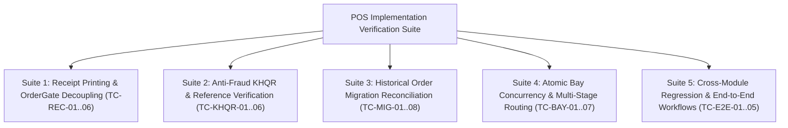

# POS Implementation Verification & Test Matrix

**Document ID:** POS-TST-2026-001  
**Project:** Car-WashService  
**Scope:** Automated & Manual Test Cases, Concurrency Stress Tests, Migration Validation, Edge-Case Verification  
**Date:** November 6, 2026  
**Status:** Complete – Awaiting Management Approval  

---

## 1. Test Suite Architecture

This document defines the comprehensive verification test matrix for the POS cashier workflow simplification. All test cases are designed for rigorous execution before and during the phased rollout.

---

## 2. Test Suites & Detailed Test Case Specifications

### Suite 1: Receipt Printing Decoupling & OrderGate Tests

| Test ID | Test Scenario | Preconditions | Execution Steps & Input Payload | Expected System Behavior | Pass / Fail Criteria |
| :---: | :--- | :--- | :--- | :--- | :--- |
| **TC-REC-01** | **Electronic Receipt Issuance on Payment** | Cashier logged in; open shift active. | Submit cash payment for $3.00 Sedan Wash: `POST api/pos/index.php?action=create_order`. | 1. Order created with `payment_status = 'paid'`. 2. `orders.receipt_number` is generated (`REC-YYMMDD-###`). 3. `orders.receipt_issued_at` is timestamped. 4. `orders.receipt_printed_at` remains NULL (until printer fires). | **PASS** if electronic receipt is recorded in database without depending on physical printer status. |
| **TC-REC-02** | **Physical Printer Offline Bay Passage** | Printer USB disconnected or paper removed. Order created and paid (TC-REC-01). | 1. Dispatch car to Bay 1. 2. Washer tablet attempts to start job: `POST views/washer/jobs.php?action=update_status&new_status=washing`. | 1. `OrderGate::assertAdmissibleToService()` evaluates `receipt_issued_at` and `payment_status = 'paid'`. 2. Gate passes successfully without throwing `ReceiptRequiredException`. 3. Car transitions to `status = 'washing'`. | **PASS** if vehicle is NOT blocked from entering wash bay despite printer offline. |
| **TC-REC-03** | **Block Admission When Electronic Receipt Missing** | New order created with `payment_status = 'paid'`, but simulate missing electronic receipt (`receipt_issued_at IS NULL`). | Attempt to move vehicle into Bay 1 via `core/BayManager::assignCarToBay()`. | 1. `OrderGate` identifies new order (created >= migration cutoff). 2. Detects `receipt_issued_at IS NULL`. 3. Throws `ReceiptRequiredException`: `payment_status='paid'` alone must NEVER silently bypass receipt issuance. 4. Admission strictly blocked. | **PASS** if new orders without electronic receipts are blocked even if marked paid. |
| **TC-REC-04** | **Unpaid Order Blocked at Bay Gate** | Unpaid order exists in database (`payment_status = 'unpaid'`). | Attempt to move vehicle into Bay 1 via `core/BayManager::assignCarToBay()`. | 1. `OrderGate` detects `payment_status != 'paid'`. 2. Throws `PaymentRequiredException` (HTTP 422). 3. Vehicle movement is strictly rejected. | **PASS** if unpaid vehicle is 100% blocked from entering service bay. |
| **TC-REC-05** | **Legacy Order Compatibility Admission** | Historical order created before migration cutoff date with `receipt_issued_at IS NULL`. | Dispatch legacy order to Bay 1 with `receipt_printed_at` timestamp present (or manager override option). | 1. `OrderGate` recognizes order created < migration cutoff date. 2. Allows admission based on legacy `receipt_printed_at` or manager PIN override. 3. Does NOT throw false-alarm missing electronic receipt exception. | **PASS** if legacy historical orders are admitted without requiring backfilled electronic receipts. |
| **TC-REC-06** | **Reprint Receipt Presentation Independence** | Order already paid and washed. | Cashier clicks "Reprint Receipt" on Today's Orders view: `POST api/pos/index.php?action=mark_receipt_printed`. | 1. Returns existing receipt payload. 2. Appends `*** DUPLICATE RECEIPT ***` watermark. 3. Increments `print_count` in audit logs. 4. Does NOT create a second order row; financial balances remain identical. | **PASS** if re-printing is strictly read-only and mutates zero financial totals. |

---

### Suite 2: Anti-Fraud KHQR & Reference Verification Tests

| Test ID | Test Scenario | Preconditions | Execution Steps & Input Payload | Expected System Behavior | Pass / Fail Criteria |
| :---: | :--- | :--- | :--- | :--- | :--- |
| **TC-KHQR-01** | **Rejection of Synthetic TRX Fallback** | POS API receives KHQR checkout request. | Submit payload with `payment_method = 'khqr'` and `payment_ref = ''` (empty). | 1. API does NOT generate synthetic `TRX-` string via `md5(uniqid())`. 2. API rejects request with HTTP 422: `BANK_REFERENCE_REQUIRED`. 3. No order is committed. | **PASS** if backend refuses to manufacture fake bank transaction references. |
| **TC-KHQR-02** | **6-Point Positive KHQR Verification** | Customer scans dynamic KHQR; store counter phone chimes with notification (Ref #849201, Amount $5.00 USD). | Cashier verifies 6 points on store device and enters `payment_ref = '849201'`. | 1. API validates amount ($5.00), currency (USD), genuine ref #. 2. Records `payment_status = 'paid'`, `payment_ref = '849201'`. 3. `orders.payment_verified_by_id` stores cashier's user ID. 4. `orders.payment_verified_at` is timestamped. 5. Audit log records `KHQR_PAYMENT_VERIFIED`. | **PASS** if real bank reference, matching criteria, and cashier attribution are recorded immutably. |
| **TC-KHQR-03** | **Duplicate Bank Reference Rejection** | Order #1001 was already paid and confirmed with Bank Ref `849201`. | A second checkout attempt submits the identical `payment_ref = '849201'`. | 1. Backend executes duplicate reference query. 2. Detects reference already attached to Order #1001. 3. Request rejected with HTTP 409: `DUPLICATE_PAYMENT_REFERENCE`. 4. No second order is created. | **PASS** if duplicate bank references are strictly rejected across all orders. |
| **TC-KHQR-04** | **Customer Screenshot Rejection Protocol** | Customer shows mobile screenshot of payment screen to cashier. | Cashier does NOT receive notification on store device; cashier holds car. | 1. Car is held at intake. 2. Car is NOT dispatched to bay. 3. POS displays: `"Awaiting merchant confirmation on store device"`. | **PASS** if unverified customer claims do not admit vehicle to wash apron. |
| **TC-KHQR-05** | **Manual Merchant Device vs. Automated Webhook** | Evaluation of automated vs manual flows. | Verify manual verification operates immediately without bank contracts; verify webhook endpoint requires signed HMAC key. | 1. Manual verification succeeds via store counter phone notification. 2. Automated webhook endpoint rejects unsigned payloads with HTTP 401. 3. Codebase does NOT simulate fictitious or uncontracted bank endpoints. | **PASS** if manual verification is autonomous and automated webhook boundaries are strictly respected. |
| **TC-KHQR-06** | **Offline LAN Handling of KHQR Attempt** | WAN Internet cable disconnected; local LAN Wi-Fi active. | Cashier selects KHQR payment. | 1. POS alerts: `"Internet disconnected. Real-time bank notification unavailable. Please use Cash or verify via store phone cellular SMS."` 2. Cash tender pad remains available. | **PASS** if system handles internet loss gracefully without freezing. |

---

### Suite 3: Historical Order Migration & Reconciliation Tests

| Test ID | Test Scenario | Preconditions | Migration Execution Query | Expected Outcome | Pass / Fail Criteria |
| :---: | :--- | :--- | :--- | :--- | :--- |
| **TC-MIG-01** | **Full Database Backup & Restoration Testing** | Production database containing orders, items, bays, audit logs. | 1. Execute `mysqldump --routines --triggers carwash_db > backup.sql`. 2. Restore into `carwash_test_restore`. 3. Verify checksums. | 1. Full dump created. 2. Restoration into test schema completes with 0 errors. 3. Row counts and table checksums match 100%. | **PASS** if verified restoration test succeeds before touching production database. |
| **TC-MIG-02** | **Pre-Migration Dry-Run Preview Query** | Unmigrated database with mixed legacy records. | Execute Migration Preview Query (`SELECT ... GROUP BY migration_category`). | Returns exact distribution counts for reliable completion, active service, queue, and ambiguous categories with zero mutations to table data. | **PASS** if preview executes purely read-only with complete categorization. |
| **TC-MIG-03** | **Reliable Completion Evidence Reconciled** | Order has `status = 'paid'`, `finished_at = '2026-05-10 14:30:00'`, `cancelled_at IS NULL`. | Execute migration script. | 1. `payment_status` becomes `'paid'`. 2. `status` becomes `'finished'`. 3. Notes field preserved unchanged. | **PASS** if records with genuine finish timestamps become finished. |
| **TC-MIG-04** | **Reliable Active-Service Evidence Reconciled** | Order has `status = 'paid'`, `started_at = '2026-11-06 08:15:00'`, `finished_at IS NULL`. | Execute migration script. | 1. `payment_status` becomes `'paid'`. 2. `status` becomes `'washing'`. 3. Car stays visible on active washer tablet. | **PASS** if active in-progress cars are NOT marked finished prematurely. |
| **TC-MIG-05** | **Reliable Today's Queue Car Reconciled** | Order created today, paid upfront, `started_at IS NULL`, `finished_at IS NULL`. | Execute migration script. | 1. `payment_status` becomes `'paid'`. 2. `status` becomes `'waiting'`. 3. Queue ticket is preserved on TV display (`tv.php`). | **PASS** if waiting customers are NOT dropped from service queue. |
| **TC-MIG-06** | **Ambiguous Historical Record Preservation (CRITICAL)** | Order from 6 months ago with `status = 'paid'` and all operational timestamps NULL (`started_at IS NULL`, `finished_at IS NULL`). | Execute migration script. | 1. **Record MUST REMAIN UNCHANGED in database.** 2. `status` remains `'paid'`. 3. Original `notes` are NOT overwritten or defaced. 4. Order appears in Manual Reconciliation Report for management review. | **PASS** if ambiguous historical records are NEVER automatically converted to finished and notes are never modified. |
| **TC-MIG-07** | **Reliable Cancellation Evidence Reconciled** | Order has `status = 'paid'`, but `cancel_reason = 'Customer left'`. | Execute migration script. | 1. `status` becomes `'cancelled'`. 2. `payment_status` becomes `'cancelled'`. 3. Original cancellation reason preserved. 4. Revenue reports exclude this order. | **PASS** if voided orders are cleanly classified as cancelled without data loss. |
| **TC-MIG-08** | **Comprehensive Rollback Execution** | Migration script executed. | 1. Test fast table rollback: join `orders_migration_backup_20261106`. 2. Test disaster restore: `mysql carwash_db < backup.sql`. | Database schema, record counts, and status values return to 100% identical pre-migration state. | **PASS** if rollback is 100% reversible with zero data loss. |

---

### Suite 4: Atomic Bay Concurrency & Multi-Stage Bay Routing Tests

| Test ID | Test Scenario | Preconditions | Execution Steps & Payloads | Expected System Behavior | Pass / Fail Criteria |
| :---: | :--- | :--- | :--- | :--- | :--- |
| **TC-BAY-01** | **Atomic Bay Reservation Concurrency** | Bay 1 is `status = 'free'`. | Two simulated terminals simultaneously send `UPDATE bays SET status='busy' WHERE id=1 AND status='free'`. | 1. Terminal A acquires Bay 1 (`rowCount == 1`). 2. Terminal B receives `rowCount == 0` (Collision caught). 3. Terminal B automatically routes vehicle to alternative bay or queue buffer. | **PASS** if exactly ONE vehicle is assigned to Bay 1. Zero double-booking. |
| **TC-BAY-02** | **Bay 4 Busy at Intake (Priority Lift Queue)** | Bay 4 (Lift) is currently occupied (`status = 'busy'`). | Customer pays upfront for Oil Package ($35.00). Cashier confirms order. | 1. Order is NOT rejected or cancelled. 2. Bay 4 is reserved ONLY when free; since busy, Bay 4 is NOT marked reserved. 3. Paid vehicle placed in "Priority Lift Queue" (`assigned_bay_id = NULL`, `status = 'waiting'`). 4. Lift screen alerts: `"Next for Lift: [Plate] (Paid - Waiting Lift)"`. | **PASS** if occupied bay is never marked reserved and paid vehicle is queued safely. |
| **TC-BAY-03** | **Bay Reservation Expiry & Crash Auto-Healing** | Bay 1 claimed by intake session; browser crashes before vehicle moves into bay. | 15 minutes elapse without apron check-in or progress. Background watchdog runs. | 1. Watchdog detects orphaned lock on Bay 1. 2. Bay 1 auto-heals to `status = 'free'`, `current_order_id = NULL`. 3. Audit log records `BAY_RESERVATION_EXPIRED`. | **PASS** if crashed or orphaned bay reservations automatically release after 15 minutes. |
| **TC-BAY-04** | **Multi-Stage Sequential Transition** | Mixed job (Oil + Wash) paid upfront ($38.00). Stage 1 underway in Bay 4. | Mechanic completes oil change and taps "Complete Stage 1" on tablet. | 1. Bay 4 is released to `status = 'free'` atomically. 2. Order transitions to `active_stage = 2`, `status = 'waiting'`. 3. Vehicle advances to head of Wash Queue Buffer. 4. Bay 4 is immediately available for next car in Priority Lift Queue. | **PASS** if Bay 4 releases cleanly and vehicle advances to Stage 2 automatically. |
| **TC-BAY-05** | **Duplicate Stage Completion Prevention** | Stage 1 is in progress. | Mechanic rapidly taps "Complete Stage 1" button 3 times in 500ms. | 1. First request executes `WHERE active_stage = 1` and updates to `active_stage = 2`. 2. Second and third requests hit `WHERE active_stage = 1`, match 0 rows, and return idempotent success. 3. Exactly one stage transition occurs. | **PASS** if rapid double-clicks do not cause duplicate stage advancement. |
| **TC-BAY-06** | **Multi-Stage Worker Commission Uniqueness** | Same staff member performs Stage 1 (Oil) and Stage 2 (Detailing). | System processes commission for Stage 1 and later Stage 2. | 1. Schema constraint `UNIQUE(order_id, stage_sequence, staff_id)` allows separate legitimate commissions for Stage 1 and Stage 2. 2. Rapid double-taps on Stage 1 are rejected. 3. Worker commission statement reflects accurate payout for both distinct stages. | **PASS** if commission is unique per legitimate service stage, preventing duplicates while allowing multi-stage payouts. |
| **TC-BAY-07** | **Mid-Service Cancellation Rollback** | Mixed job in Stage 1. Customer demands abort due to stripped drain bolt. | Manager enters PIN to cancel order mid-stage. | 1. Mechanic logs parts used/wasted. 2. Stage 2 wash fee ($3.00) is refunded to customer. 3. Bay 4 is released to `status = 'free'`. 4. Stage 2 queue ticket is cancelled. | **PASS** if non-refundable consumed parts are accounted for while unperformed services are refunded. |

---

### Suite 5: Cross-Module Regression & End-to-End Workflows

| Test ID | Test Scenario | Preconditions | Execution Steps | Expected Outcome | Pass / Fail Criteria |
| :---: | :--- | :--- | :--- | :--- | :--- |
| **TC-E2E-01** | **Fast Walk-in Car Wash ($3.00 Cash)** | Fresh cashier session. Small car arrives. | 1. Type plate `2BC-1234`. 2. Tap `Sedan Wash ($3.00)`. 3. Tap `$5 Cash`. 4. Tap `Confirm & Dispatch (Bay 1)`. | 1. Change displayed: `$2.00 (8,200 ៛)`. 2. Drawer kicks open. 3. 80mm receipt prints silently. 4. Bay 1 occupied; washer tablet notified. 5. Total elapsed time < 6 seconds. Zero popups. | **PASS** if complete intake-to-bay transition executes in < 6 seconds with 0 modals. |
| **TC-E2E-02** | **Duplicate Submission Defense** | Items in cart. | Rapidly double-click "Confirm Payment" button 5 times in 1 second. | 1. Button locks on first click. 2. Cart idempotency token sent 5 times. 3. Backend creates 1 order on first call and returns idempotent replay on remaining 4 calls. 4. Exactly 1 row in `orders`. | **PASS** if duplicate clicks create exactly ONE order. |
| **TC-E2E-03** | **Financial Revenue Report Accounting Consistency** | Multiple order states: fully paid, fully refunded ($10.00), partially refunded ($3.00 of $15.00), and cancelled ($20.00). | Navigate to `views/owner/reports.php` and run financial revenue report. | 1. Gross sales accurately aggregates all paid orders before refunds. 2. Full and partial refunds are deducted from net revenue. 3. Cancelled orders are excluded from net sales and logged in Void volume. 4. Net revenue formula matches cash drawer count down to the cent. | **PASS** if revenue reporting accounts for paid, refunded, partially refunded, and cancelled orders with 100% accuracy. |
| **TC-E2E-04** | **Queue TV Screen Live Synchronization** | Car paid and dispatched to Bay 1. | Open `tv.php` in separate browser window. | 1. New vehicle appears in Bay 1 slot in < 2 seconds. 2. Displays plate number, vehicle category, and timer. 3. Does not display unverified or unpaid cars. | **PASS** if TV display reflects real-time bay status cleanly. |
| **TC-E2E-05** | **LAN Offline Resiliency** | Disconnect WAN router uplink. Complete 2 sales on local counter PC. | Reconnect WAN uplink. | 1. Sales complete locally in offline mode. 2. Background sync uploads orders upon reconnection. 3. Zero duplicate order numbers generated. 4. Stock ledger balances update correctly. | **PASS** if counter functions seamlessly during network blackouts. |

---

## 3. Test Execution Sign-Off Criteria

The implementation will be certified as production-ready when:
1. **100% Pass Rate across Suites 1–5 (32 Total Test Cases).**
2. **Zero `ReceiptRequiredException` false alarms** when thermal printers are offline or out of paper.
3. **Zero admission bypasses** where an order with `payment_status = 'paid'` enters service without an electronic receipt.
4. **Zero synthetic `TRX-` references** present in newly created database records.
5. **Zero ambiguous historical records** automatically converted to finished; 100% preserved in their original state.
6. **Historical revenue reconciliation variance = $0.00** before and after database migration.
7. **Bay concurrency stress test** passes 100 concurrent simulated bookings without a single double-assigned bay.
8. **Verified full backup restoration test** successfully completed prior to migration.

---

> [!IMPORTANT]
> **Awaiting Management Authorization to Proceed to Implementation:**  
> All compatibility audits, dependency maps, and test matrices are complete and revised to incorporate all management directives. In accordance with strict instructions, no source code, database records, schemas, or configurations have been modified. We are stopped and awaiting executive sign-off.
