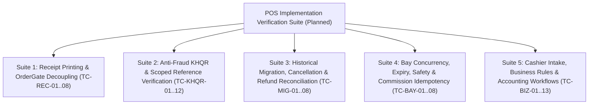

# POS Implementation Verification & Test Matrix

**Document ID:** POS-TST-2026-001  
**Project:** Car-WashService  
**Scope:** Automated & Manual Test Cases, Concurrency Stress Tests, Migration Validation, Edge-Case Verification  
**Date:** November 6, 2026  
**Status:** Complete Specifications – Awaiting Management Authorization to Execute  

---

> [!NOTE]
> **Test Execution Nature & Verification Status:**  
> In accordance with strict management instructions, **this project is currently in the read-only architectural design and audit phase**. No application source code, SQL migrations, or database records have been modified.  
> The test cases in this document are **PLANNED TEST SPECIFICATIONS** with formal execution steps and deterministic pass/fail criteria. They will be executed sequentially on an isolated staging database and counter hardware during the implementation phase.

---

## 1. Test Suite Architecture

This document defines 50 planned verification test cases organized into five functional test suites:

---

## 2. Test Suites & Detailed Test Case Specifications

### Suite 1: Receipt Printing Decoupling & OrderGate Tests

| Test ID | Test Scenario | Execution Preconditions | Planned Input Payload & Execution Steps | Expected System Behavior | Pass / Fail Criteria |
| :---: | :--- | :--- | :--- | :--- | :--- |
| **TC-REC-01** | **Electronic Receipt Issuance on Payment** | Cashier logged in; open shift active. | Submit cash payment for $3.00 Sedan Wash: `POST api/pos/index.php?action=create_order`. | 1. Order created with `payment_status = 'paid'`. 2. `orders.receipt_number` is generated (`REC-YYMMDD-###`). 3. `orders.receipt_issued_at` is timestamped. 4. `orders.receipt_printed_at` remains NULL (until printer fires). | **PASS** if electronic receipt is recorded in database without depending on physical printer status. |
| **TC-REC-02** | **Physical Printer Offline Bay Passage** | Printer USB disconnected or paper removed. Order created and paid (TC-REC-01). | 1. Dispatch car to Bay 1. 2. Washer tablet attempts to start job: `POST views/washer/jobs.php?action=update_status&new_status=washing`. | 1. `OrderGate::assertAdmissibleToService()` evaluates `receipt_issued_at` and `payment_status = 'paid'`. 2. Gate passes successfully without throwing `ReceiptRequiredException`. 3. Car transitions to `status = 'washing'`. | **PASS** if vehicle is NOT blocked from entering wash bay despite printer offline. |
| **TC-REC-03** | **Block Admission When Electronic Receipt Missing** | New order created with `payment_status = 'paid'`, but simulate missing electronic receipt (`receipt_issued_at IS NULL`). | Attempt to move vehicle into Bay 1 via `core/BayManager::assignCarToBay()`. | 1. `OrderGate` identifies new order (created >= migration cutoff). 2. Detects `receipt_issued_at IS NULL`. 3. Throws `ReceiptRequiredException`: `payment_status='paid'` alone must NEVER silently bypass receipt issuance. 4. Admission strictly blocked. | **PASS** if new orders without electronic receipts are blocked even if marked paid. |
| **TC-REC-04** | **Unpaid Order Blocked at Bay Gate** | Unpaid order exists in database (`payment_status = 'unpaid'`). | Attempt to move vehicle into Bay 1 via `core/BayManager::assignCarToBay()`. | 1. `OrderGate` detects `payment_status != 'paid'`. 2. Throws `PaymentRequiredException` (HTTP 422). 3. Vehicle movement is strictly rejected. | **PASS** if unpaid vehicle is 100% blocked from entering service bay. |
| **TC-REC-05** | **Legacy Order Compatibility Admission** | Historical order created before migration cutoff date (`receipt_v2_cutover_timestamp`) with `receipt_issued_at IS NULL`. | Dispatch legacy order to Bay 1 with `receipt_printed_at` timestamp present (or manager override option). | 1. `OrderGate` dynamically evaluates `receipt_v2_cutover_timestamp`. 2. Confirms `order.created_at < cutover_ts`. 3. Allows admission based on legacy `receipt_printed_at` or manager PIN override. 4. Does NOT throw false-alarm missing electronic receipt exception. | **PASS** if legacy historical orders are admitted without requiring backfilled electronic receipts. |
| **TC-REC-06** | **Reprint Receipt Presentation Independence** | Order already paid and washed. | Cashier clicks "Reprint Receipt" on Today's Orders view: `POST api/pos/index.php?action=mark_receipt_printed`. | 1. Returns existing receipt payload. 2. Appends `*** DUPLICATE RECEIPT ***` watermark. 3. Increments `print_count` in audit logs. 4. Does NOT create a second order row; financial balances remain identical. | **PASS** if re-printing is strictly read-only and mutates zero financial totals. |
| **TC-REC-07** | **Fail-Closed Gate on Missing Cutover Timestamp** | `system_settings.receipt_v2_cutover_timestamp` is completely absent or empty in database. | Attempt to admit any order via `OrderGate::assertAdmissibleToService()`. | 1. `OrderGate::getCutoverTimestamp()` detects missing setting. 2. Throws `SystemConfigurationException`: "System misconfigured: 'receipt_v2_cutover_timestamp' setting is missing." 3. Gate fails closed; order admission strictly halted. 4. Prevents unconfigured deployments from treating new orders as legacy. | **PASS** if missing cutover timestamp fails closed and prevents receipt bypass. |
| **TC-REC-08** | **Fail-Closed Gate on Malformed or Future Cutover Timestamp** | `receipt_v2_cutover_timestamp` set to malformed string (`'INVALID_DATE'`) or future date (`'2099-12-31'`). | Run deployment verification and attempt order admission. | 1. `OrderGate::verifyCutoverConfiguration()` returns `false` (halts deployment). 2. `OrderGate::assertAdmissibleToService()` throws `SystemConfigurationException`: "Invalid or future cutover timestamp." 3. Admission halted; refuses to fail open. | **PASS** if invalid or future cutover timestamps fail closed. |

---

### Suite 2: Anti-Fraud KHQR & Scoped Reference Verification Tests

| Test ID | Test Scenario | Execution Preconditions | Planned Input Payload & Execution Steps | Expected System Behavior | Pass / Fail Criteria |
| :---: | :--- | :--- | :--- | :--- | :--- |
| **TC-KHQR-01** | **Rejection of Synthetic TRX Fallback** | POS API receives KHQR checkout request. | Submit payload with `payment_method = 'khqr'` and `payment_ref = ''` (empty). | 1. API does NOT generate synthetic `TRX-` string via `md5(uniqid())`. 2. API rejects request with HTTP 422: `BANK_REFERENCE_REQUIRED`. 3. No order is committed. | **PASS** if backend refuses to manufacture fake bank transaction references. |
| **TC-KHQR-02** | **Manual Merchant-Device Verification & Attribution** | Customer scans dynamic KHQR; store counter phone chimes with notification (Ref #849201, Amount $5.00 USD). | Cashier inspects store phone, confirms $5.00 received, enters `payment_ref = '849201'`, `payment_provider = 'aba_payway'`, `merchant_account_id = '001-234567'`. | 1. Backend captures cashier attestation, `verification_method = 'manual_merchant_device'`, cashier ID and timestamp. 2. Backend does NOT simulate fake bank queries. 3. Records `payment_status = 'paid'`, `payment_ref = '849201'`. 4. Audit log records `KHQR_PAYMENT_VERIFIED`. | **PASS** if cashier attestation and attribution are immutably captured without claiming false automated bank validation. |
| **TC-KHQR-03** | **Authoritative Ledger Scoped Duplicate Bank Reference Rejection** | Order #1001 payment committed in `order_payments` with `provider = 'aba_payway'`, `account = '001-234567'`, `payment_ref = '849201'`. | A second checkout attempt submits the identical provider, account, and `payment_ref = '849201'`. | 1. Backend executes insert on authoritative ledger `order_payments`. 2. Constraint `uq_payment_ledger_provider_ref` triggers duplicate key collision. 3. Request rejected with HTTP 409: `DUPLICATE_PAYMENT_REFERENCE`. 4. No second payment committed in `order_payments`. | **PASS** if duplicate bank references are strictly rejected on authoritative ledger within provider and merchant account scope. |
| **TC-KHQR-04** | **Customer Screenshot Rejection Protocol** | Customer shows mobile screenshot of payment screen to cashier. | Cashier does NOT receive notification on store device; cashier holds car. | 1. Car is held at intake. 2. Car is NOT dispatched to bay. 3. POS displays: `"Awaiting merchant confirmation on store device"`. | **PASS** if unverified customer claims do not admit vehicle to wash apron. |
| **TC-KHQR-05A** | **ABA PayWay Webhook Parameter-Sequence HMAC-SHA512 Verification** | Test environment receiving automated ABA PayWay webhook callback. | Send POST payload to `api/webhook/khqr_callback.php` with ABA-mandated concatenated parameter string hash. Test with genuine merchant API key, then with tampered amount. | 1. Valid hash matches PayWay official spec -> Transitions order to `'paid'`, records `verification_method = 'automated_webhook'`. 2. Tampered parameter or invalid key -> Rejects request with HTTP 401 Unauthorized (`INVALID_SIGNATURE`). | **PASS** if ABA PayWay webhooks strictly validate against official published parameter sequence HMAC-SHA512. |
| **TC-KHQR-05B** | **NBC Bakong / KHQR Webhook Asymmetric RSA-SHA256 Verification** | Test environment receiving automated NBC Bakong Open API webhook callback. | Send POST payload with JWT signed using Bakong RSA private key. Test with genuine public key, then with forged certificate. | 1. Valid signature verified via `openssl_verify()` with Bakong public certificate -> Transitions order to `'paid'`. 2. Forged or unsigned payload -> Rejects request with HTTP 401 Unauthorized. | **PASS** if NBC Bakong webhooks strictly validate against official published RSA-SHA256 asymmetric certificate specifications. |
| **TC-KHQR-06** | **Offline LAN Handling of KHQR Attempt** | WAN Internet disconnected; local LAN Wi-Fi active. | Cashier selects KHQR payment. | 1. POS alerts: `"Internet disconnected. Real-time bank notification unavailable. Please use Cash or verify via store phone cellular SMS."` 2. Cash tender pad remains available. | **PASS** if system handles internet loss gracefully without freezing. |
| **TC-KHQR-07** | **Duplicate Webhook Delivery Idempotency** | Automated webhook endpoint operational. Valid signed webhook received and processed for bank event `EVT-998811`. | Bank gateway retries and delivers identical webhook payload for `EVT-998811` 15 seconds later. | 1. Endpoint queries `webhook_events` table for `(provider, event_id)`. 2. Detects existing event ID. 3. Returns HTTP 200 `{ status: 'duplicate_acknowledged' }` without creating a duplicate payment or mutating order balances. | **PASS** if bank webhook retries are handled idempotently with zero duplicate transactions. |
| **TC-KHQR-08** | **Webhook Replay Attack Outside Window (Timestamp Drift Rejection)** | Automated webhook endpoint operational. Valid bank signature generated for historical event. | Attacker intercepts webhook and re-sends payload with `bank_timestamp` 301 seconds in the past (`drift > 300s`). | 1. Endpoint calculates `abs(CURRENT_TIMESTAMP - bank_timestamp)`. 2. Detects drift of 301 seconds (> 300s window). 3. Rejects request with HTTP 400: `WEBHOOK_TIMESTAMP_EXPIRED`. 4. Replay event logged in `audit_logs` with attacker IP. | **PASS** if expired or replayed webhooks outside 300-second drift tolerance are rejected. |
| **TC-KHQR-09** | **NULL Merchant Account Duplicate Defense** | Digital payment processing gateway. | Attacker or buggy client submits payment with `payment_provider = 'aba_payway'`, `merchant_account_id = NULL`, and known duplicate `payment_ref`. | 1. Database column schema enforces `merchant_account_id VARCHAR(64) NOT NULL` on `order_payments`. 2. API validation enforces non-empty string. 3. Request rejected with HTTP 422: `INVALID_MERCHANT_ACCOUNT`. 4. Defends against MySQL composite UNIQUE index bypass where `NULL != NULL`. | **PASS** if NULL merchant account values are blocked, preserving composite unique protection. |
| **TC-KHQR-10** | **Webhook Replay Attack Inside 5-Minute Window** | Valid signed webhook processed successfully for `event_id = 'EVT-554433'` at `T_0`. | Attacker intercepts payload and re-sends identical valid payload at `T_0 + 60s` (timestamp is fresh within 300s). | 1. Endpoint checks `webhook_events` for `(provider, 'EVT-554433')`. 2. Uniqueness constraint `uq_provider_event` detects existing processed event. 3. Logs replay warning in `audit_logs`. 4. Returns HTTP 200 `{ status: 'already_processed' }` to silence bank rail. 5. Creates ZERO additional records in `order_payments` and leaves order balance intact. | **PASS** if replays inside the 5-minute window are caught by event ID uniqueness with zero duplicate payments. |
| **TC-KHQR-11** | **Altered Webhook Payload Tampering Defense** | Valid signed webhook payload captured. | Attacker alters `amount` from `$5.00` to `$50.00` while preserving original signature and timestamp. | 1. Webhook receiver executes cryptographic verification (HMAC or RSA) over raw payload. 2. Signature verification fails due to payload mismatch. 3. Request rejected immediately with HTTP 401: `INVALID_SIGNATURE`. 4. Zero records created in `webhook_events` or `order_payments`. | **PASS** if altered payloads fail cryptographic signature verification immediately. |
| **TC-KHQR-12** | **Provider Event Time vs. Local Recorded Time Audit Distinction** | POS integrated with webhook receiver and cash counter. | (A) Process genuine bank webhook where bank payload contains `bank_timestamp = '2026-11-06 14:02:10'`, received by local server at `2026-11-06 14:02:15`. (B) Process manual cash checkout at `2026-11-06 14:05:00`. | 1. Webhook record stores authentic bank timestamp in `provider_event_at = '2026-11-06 14:02:10'` and local ingestion time in `recorded_at = '2026-11-06 14:02:15'`. 2. Cashier shift/drawer balancing queries rely strictly on `recorded_at`. 3. Cash record stores `provider_event_at = NULL` and `recorded_at = '2026-11-06 14:05:00'`. 4. Backend NEVER invents a non-existent external bank event time. | **PASS** if authentic external bank timestamps are preserved without tampering, cashier shift/drawer balancing relies exclusively on local server `recorded_at`, and manual cash records store NULL for provider event time. |

---

### Suite 3: Historical Order Migration, Cancellation & Refund Reconciliation Tests

| Test ID | Test Scenario | Execution Preconditions | Planned Input / Query | Expected System Behavior | Pass / Fail Criteria |
| :---: | :--- | :--- | :--- | :--- | :--- |
| **TC-MIG-01** | **Full Database Backup & Isolated Restoration Testing** | Production database containing orders, items, bays, audit logs. | 1. Execute `mysqldump --single-transaction --routines --triggers carwash_db > backup.sql`. 2. Restore into isolated test schema `carwash_test_restore`. 3. Verify checksums. | 1. Full dump created. 2. Restoration into test schema completes with 0 errors. 3. Row counts and table checksums match 100%. | **PASS** if verified restoration test succeeds on isolated database before production migration. |
| **TC-MIG-02** | **Pre-Migration Dry-Run Preview Query** | Unmigrated database with mixed legacy records. | Execute Migration Preview Query (`SELECT ... GROUP BY migration_category`). | Returns exact distribution counts for reliable completion, active service, queue, and ambiguous categories with zero mutations to table data. | **PASS** if preview executes purely read-only with complete categorization. |
| **TC-MIG-03** | **Reliable Completion Evidence Reconciled** | Order has `status = 'paid'`, `finished_at = '2026-05-10 14:30:00'`, `cancelled_at IS NULL`. | Execute migration script. | 1. `payment_status` becomes `'paid'`. 2. `status` becomes `'finished'`. 3. Notes field preserved unchanged. | **PASS** if records with genuine finish timestamps become finished. |
| **TC-MIG-04** | **Reliable Active-Service Evidence Reconciled** | Order has `status = 'paid'`, `started_at = '2026-11-06 08:15:00'`, `finished_at IS NULL`. | Execute migration script. | 1. `payment_status` becomes `'paid'`. 2. `status` becomes `'washing'`. 3. Car stays visible on active washer tablet. | **PASS** if active in-progress cars are NOT marked finished prematurely. |
| **TC-MIG-05** | **Reliable Today's Queue Car Reconciled** | Order created today, paid upfront, `started_at IS NULL`, `finished_at IS NULL`. | Execute migration script. | 1. `payment_status` becomes `'paid'`. 2. `status` becomes `'waiting'`. 3. Queue ticket is preserved on TV display (`tv.php`). | **PASS** if waiting customers are NOT dropped from service queue. |
| **TC-MIG-06** | **Verified Refunded Cancellation Reconciled** | Order has `status = 'paid'`, `cancel_reason = 'Customer left'`, and explicit `refunded_amount = 5.00`. | Execute migration script. | 1. `status` becomes `'cancelled'`. 2. `payment_status` becomes `'refunded'`. 3. Original cancellation reason and refund amounts preserved. | **PASS** if verified refunded cancellations are classified correctly without data loss. |
| **TC-MIG-07** | **Paid Cancellation with Unknown Refund (CRITICAL)** | Order has `status = 'paid'`, `cancelled_at IS NOT NULL`, but `refunded_amount = 0` (no refund record). | Execute migration script. | 1. **Record MUST REMAIN UNCHANGED in database.** 2. `status` remains `'paid'`. 3. `payment_status` is NOT forced to `'cancelled'`. 4. Appears in Manual Reconciliation Report as `PAID_OPERATIONAL_CANCELLATION_UNKNOWN_REFUND`. | **PASS** if collected payments are never automatically erased when refund evidence is absent. |
| **TC-MIG-08** | **Complete Database Disaster Recovery Rollback** | Migration script executed on test schema. | Execute full disaster restore: `mysql carwash_test_restore < backup.sql`. | Database schema, foreign keys, triggers, auto-increment sequences, and table rows return to 100% identical pre-migration state. | **PASS** if complete database restore returns 100% byte-for-byte schema and data parity. |

---

### Suite 4: Bay Concurrency, Expiry, Safety & Commission Idempotency Tests

| Test ID | Test Scenario | Execution Preconditions | Planned Input & Concurrency Execution | Expected System Behavior | Pass / Fail Criteria |
| :---: | :--- | :--- | :--- | :--- | :--- |
| **TC-BAY-01** | **Atomic Bay Reservation Concurrency** | Bay 1 is `status = 'free'`. | Two simulated cashier terminals simultaneously execute `UPDATE bays SET status='busy' WHERE id=1 AND status='free'`. | 1. Terminal A acquires Bay 1 (`rowCount == 1`). 2. Terminal B receives `rowCount == 0` (Collision caught). 3. Terminal B routes vehicle to alternative bay or Priority Queue. | **PASS** if exactly ONE vehicle is assigned to Bay 1. Zero double-booking. |
| **TC-BAY-02** | **Bay 4 Busy at Intake (Priority Lift Queue)** | Bay 4 (Lift) is currently occupied (`status = 'busy'`). | Customer pays upfront for Oil Package ($35.00). Cashier confirms order. | 1. Order is NOT rejected or cancelled. 2. Bay 4 is reserved ONLY when free; since busy, Bay 4 is NOT marked reserved. 3. Paid vehicle placed in "Priority Lift Queue" (`assigned_bay_id = NULL`, `status = 'waiting'`). 4. Lift screen alerts: `"Next for Lift: [Plate] (Paid - Waiting Bay 4)"`. | **PASS** if occupied bay is never marked reserved and paid vehicle is queued safely. |
| **TC-BAY-03** | **Intake Hold TTL Expiry (Exact 3-Min Boundary Testing) vs. Occupied Bay Protection** | Terminal A holds Bay 1 in checkout (`reservation_state = 'intake_reserved'`, `hold_expires_at = T_0 + 180s`); Bay 2 is physically occupied (`status = 'busy'`, `physical_occupancy = 'occupied'`); Bay 3 has active order attached (`current_order_id = 99`). | Execute sweep query `UPDATE bays SET status='free'... WHERE reservation_state='intake_reserved' AND status!='busy' AND physical_occupancy='vacant' AND current_order_id IS NULL AND hold_expires_at <= CURRENT_TIMESTAMP` across 3 test intervals: 1. *Before expiry (T = 179s / < 180s)*. 2. *Exactly at expiry (T = 180s / = 180s)*. 3. *After expiry (T = 181s / > 180s)*. | 1. At 179s: `hold_expires_at > CURRENT_TIMESTAMP`; Bay 1 remains `'intake_reserved'`; cashier can finish checkout. 2. At 180s: `hold_expires_at <= CURRENT_TIMESTAMP` evaluates TRUE; Bay 1 intake hold expires and resets to `'free'`. 3. At 181s: Bay 1 reset confirmed. 4. Across all intervals: Bay 2 **STRICTLY REMAINS BUSY** and Bay 3 **STRICTLY REMAINS ATTACHED**! Zero false releases. | **PASS** if intake holds expire precisely at the 180-second boundary while physically occupied bays and active transactions remain 100% protected. |
| **TC-BAY-04** | **Transaction-Safe Stage Progression** | Mixed job (Oil + Wash) paid upfront ($38.00). Stage 1 underway in Bay 4. | Mechanic completes oil change and taps "Complete Stage 1" on workshop tablet. | 1. `transitionStageAtomically()` locks order and Bay 4 with `FOR UPDATE`. 2. Bay 4 released to `'free'` atomically. 3. Order transitions to `active_stage = 2`, `status = 'waiting'`. 4. Vehicle enters Wash Queue Buffer at priority head. | **PASS** if bay release and stage transition execute within a single atomic database transaction. |
| **TC-BAY-05** | **Duplicate Stage Finish Idempotency** | Stage 1 is in progress. | Mechanic rapidly taps "Complete Stage 1" button 3 times in 400ms. | 1. First request transitions stage to 2. 2. Second and third requests hit `WHERE active_stage = 1`, match 0 rows, and return idempotent success. 3. Exactly one stage transition occurs. | **PASS** if rapid double-clicks do not cause duplicate stage advancement. |
| **TC-BAY-06** | **Task-Based Commission Idempotency Protection** | Technician assigned to Task 101 ($5 commission). | Technician taps "Complete Task" 3 times rapidly in 300ms. | 1. First request commits commission with unique `commission_idempotency_key`. 2. Second and third requests hit unique key constraint and are caught gracefully. 3. Exactly ONE commission row exists; worker payout is exact. | **PASS** if task idempotency key prevents duplicate commission payouts on double taps. |
| **TC-BAY-07** | **Multi-Task Legitimate Commission Assignment** | Same technician assigned to Task 101 (Oil Change, $5) and Task 102 (Brake Service, $8) on same order. | Technician completes Task 101, then completes Task 102. | 1. Task 101 commission recorded with key `comm_..._101`. 2. Task 102 commission recorded with key `comm_..._102`. 3. Both distinct legitimate commissions credited to technician ($13 total). | **PASS** if distinct legitimate task assignments succeed without collision. |
| **TC-BAY-08** | **Deterministic Commission Idempotency Retry Test** | Worker assigned to Task 103 ($7 commission). | Network times out during task completion; client retries completion 3 times using formula `sha256("comm_v1_order_{$order_id}_task_{$task_id}_worker_{$worker_id}")`. | 1. All 3 retries compute the exact same deterministic hash key. 2. First insert commits successfully. 3. Subsequent 2 retries collide with `uq_mechanic_idempotency`, return HTTP 200 idempotent success without throwing an unhandled exception or creating a duplicate row. 4. Payout ledger remains exactly $7.00. | **PASS** if deterministic commission key derivation guarantees idempotency across retries. |

---

### Suite 5: Cashier Intake, Business Rules & Accounting Workflows

| Test ID | Test Scenario | Execution Preconditions | Planned Input & Execution Steps | Expected System Behavior | Pass / Fail Criteria |
| :---: | :--- | :--- | :--- | :--- | :--- |
| **TC-BIZ-01** | **Optional Customer Registration (Walk-In Plate-First Intake)** | POS single-page checkout loaded. Walk-in customer arrives without prior account. | 1. Cashier enters license plate `2BC-1234` only. 2. Leaves customer name and phone empty. 3. Selects Sedan Wash ($3.00), pays $3.00 cash. 4. Confirms checkout. | 1. System does NOT force customer registration modal. 2. Order created successfully with `customer_id = NULL`, `plate_number = '2BC-1234'`. 3. Total elapsed time < 5 seconds. | **PASS** if walk-in customer checkout completes plate-first without forced customer registration. |
| **TC-BIZ-02** | **Mandatory Upfront Payment Enforcement** | Cart contains $15.00 detailing package. | Attempt to dispatch vehicle to Bay 1 with `payment_method = 'pay_later'` or unpaid request. | 1. POS API strictly rejects checkout (HTTP 422: `PAYMENT_REQUIRED`). 2. No order created in database; car cannot enter queue or bay. 3. POS UI contains zero "Pay Later" or "Pay at Exit" options. | **PASS** if unpaid dispatch is 100% blocked from the system. |
| **TC-BIZ-03** | **Cash Tender & Dual-Currency Change Calculation** | Cart grand total is $3.00 (12,300 ៛ at exchange rate 4,100). | Cashier taps `$5.00` Quick Cash button. | 1. Smart Cash Pad calculates exact change: `$2.00` and `8,200 ៛`. 2. Displays change in giant green typography. 3. Drawer kick pulse fires immediately. 4. Shift cash ledger increments by $3.00. | **PASS** if dual-currency change calculates accurately and drawer pulse triggers. |
| **TC-BIZ-04** | **Manager-Approved Discount Authorization Gate** | Cashier applies $5.00 discount on a $20.00 service (exceeds cashier 0% discount policy). | Cashier taps "Apply Discount". System prompts for Manager PIN. Cashier enters valid fixture PIN `TEST_MANAGER_FIXTURE_PIN` (e.g. from test env config). | 1. Backend validates Manager PIN and confirms manager user ID != cashier user ID (anti-self-approval). 2. Discount applied; order records `discount_usd = 5.00`, `discount_approved_by = manager_id`. 3. Audit log records `DISCOUNT_AUTHORIZED`. | **PASS** if unapproved discounts are blocked and manager approval is immutably attributed via test fixture credentials. |
| **TC-BIZ-05** | **Duplicate Submission Defense (Cart Idempotency Token)** | Cart loaded with $3.00 wash. | Cashier rapidly clicks "Confirm Checkout" button 5 times in 1 second. | 1. Button disables on first click. 2. Single `idempotency_key` (UUID) transmitted across all 5 requests. 3. Backend creates 1 order on request 1, returns cached replay for requests 2–5. 4. Exactly ONE order row created in `orders`. | **PASS** if rapid multi-clicking generates exactly one order and zero duplicate charges. |
| **TC-BIZ-06** | **100% Offline Local LAN Resilience (LAN Self-Sufficiency)** | Disconnect WAN uplink cable; local Wi-Fi active. | Complete 2 cash walk-in sales on local counter PC. | 1. Intake, calculation, cash tendering, drawer kick, and ESC/POS thermal printing operate seamlessly with zero latency. 2. Zero reliance on external cloud or bank connections. 3. Orders persisted in local MariaDB. | **PASS** if counter functions 100% autonomously during total internet blackouts. |
| **TC-BIZ-07** | **Event-Timestamp Driven Financial Revenue Accounting (Cross-Date Payments & Refunds)** | Staging database populated with: (A) Order #101 created & paid Day 1 ($20 USD), (B) Order #102 created & paid Day 1 ($30 USD), (C) Order #102 cancelled Stage 2 on Day 2 with $10 partial refund disbursed on Day 2 (`settlement_status = 'cash_disbursed'`), (D) Order #103 created Day 2 and paid Day 2 ($15 USD). | Run financial revenue query for Day 1, Day 2, and combined date range. | 1. **Day 1 Query:** Gross Payments = $50.00 (A+B); Settled Refunds = $0.00; Net Settled = $50.00. 2. **Day 2 Query:** Gross Payments = $15.00 (D); Settled Refunds = $10.00 (C); Net Settled = $5.00. 3. **Combined Query:** Gross = $65.00; Settled Refunds = $10.00; Net Settled = $55.00. 4. Confirms payments report on `p.recorded_at` and refunds report on `r.recorded_at`, independent of `orders.created_at`. | **PASS** if cross-date payments and refunds report on their exact transaction event dates without distortion. |
| **TC-BIZ-08** | **Queue TV Display & Worker Job Board Live Synchronization** | Vehicle `2BC-1234` paid and dispatched to Bay 1. | Inspect `tv.php` and `views/washer/jobs.php`. | 1. Vehicle appears in Bay 1 on TV display in < 2 seconds. 2. Vehicle appears on washer tablet with electronic receipt confirmed. 3. Timer begins incrementing immediately. | **PASS** if TV display and apron tablets synchronize in real time without screen refresh. |
| **TC-BIZ-09** | **Repeated Partial Refunds Multi-Event Recording** | Order #2001 paid $38.00 upfront (Oil + Detailing). | 1. First event: Customer cancels Detailing ($10.00). Manager authorizes partial refund. 2. Second event: Customer requests refund for unused engine additive ($5.00). Manager authorizes second partial refund. | 1. Event 1: Inserts `order_refunds` row (`refund_seq = 1`, `amount_usd = 10.00`). Updates `orders.refunded_amount = 10.00`, `orders.payment_status = 'partially_refunded'`. 2. Event 2: Inserts `order_refunds` row (`refund_seq = 2`, `amount_usd = 5.00`). Updates `orders.refunded_amount = 15.00`, `orders.payment_status = 'partially_refunded'`. 3. Report calculates Net Settled = $23.00 ($38.00 - $15.00). 4. Attestation recorded: marking refund in POS records administrative authorization, requiring drawer balance confirmation. | **PASS** if multiple partial refund events append discrete ledger rows and accurately maintain cumulative aggregate totals. |
| **TC-BIZ-10** | **Dual-Currency Reporting & Historical Exchange Rate Preservation** | Customer pays for $10.00 Sedan Detail using 41,000 KHR when active exchange rate is 4,100. Stored in `order_payments` (`amount_usd = 0`, `amount_khr = 41000`, `exchange_rate = 4100`). | Next day, shop manager updates system exchange rate to 4,150. Run financial revenue report for previous day. | 1. Query uses frozen `p.exchange_rate = 4100` from the transaction row. 2. Evaluates `amount_khr / exchange_rate = 41000 / 4100 = $10.00`. 3. Does NOT re-evaluate using live rate 4,150 (which would falsely produce $9.88). 4. Native KHR column displays 41,000 ៛; USD converted column displays $10.00. | **PASS** if historical revenue is preserved permanently against live exchange rate drift. |
| **TC-BIZ-11** | **Refund Settlement Lifecycle Accounting (Authorization vs. Disbursement vs. Bank Settlement)** | Order #301 paid $25.00 cash upfront; Order #302 paid $50.00 KHQR upfront. Total gross revenue = $75.00. | 1. Manager authorizes full refund on Order #301 (`settlement_status = 'authorized_pending'`). Run report. 2. Cashier disburses $25.00 cash from drawer (`settlement_status = 'cash_disbursed'`, `disbursed_at = NOW()`). Run report. 3. Manager authorizes $20.00 bank reversal for Order #302 (`settlement_status = 'bank_reversal_pending'`). Run report. 4. Bank webhook confirms reversal settlement (`settlement_status = 'settled'`, `settled_at = NOW()`). Run report. | 1. Step 1: Gross = $75.00, Settled Refunds = $0.00, Net Settled = $75.00, Pending Liability = $25.00, Net Realizable = $50.00. Cash drawer balance unchanged. 2. Step 2: Settled Refunds = $25.00, Net Settled = $50.00, Pending Liability = $0.00, Net Realizable = $50.00. Cash drawer reduced by $25.00. 3. Step 3: Settled Refunds = $25.00, Net Settled = $50.00, Pending Liability = $20.00, Net Realizable = $30.00. 4. Step 4: Settled Refunds = $45.00, Net Settled = $30.00, Pending Liability = $0.00, Net Realizable = $30.00. | **PASS** if administrative authorization is never counted as money returned, drawer balancing matches physical disbursement, and pending liabilities are strictly segregated from net settled revenue. |
| **TC-BIZ-12** | **Cross-Cutover Transaction Accounting (Post-Cutover Ledger Event on Pre-Cutover Legacy Order)** | Historical Order #88 created prior to cutover date (`o.created_at < cutover_ts`, $40.00 USD), recorded in legacy format (`payment_status = 'paid'`, no rows in `order_payments`). | 1. On post-cutover date, customer returns with defective product. Manager authorizes and disburses $15.00 cash refund. POS inserts row into `order_refunds` (`order_id = 88, refund_seq = 1, amount_usd = 15.00, settlement_status = 'cash_disbursed', recorded_at = NOW()`). 2. Run Two-Tier Financial Query for post-cutover refund date and for historical creation date. | 1. Tier 1 captures $15.00 refund on its `recorded_at` date because it queries ledger transactions directly without restricting by `o.created_at`. 2. When querying historical date range, Tier 2 historical fallback evaluates Order #88. Because `EXISTS (SELECT 1 FROM order_refunds r WHERE r.order_id = o.id)` is TRUE, Tier 2 **strictly excludes** Order #88 from legacy cache fallback. 3. Zero duplicate counting and zero omission across reporting periods. | **PASS** if post-cutover refunds on legacy orders are fully captured in Tier 1 on their refund event date, while Tier 2 anti-double-counting guard prevents historical duplication. |
| **TC-BIZ-13** | **Fail-Closed Revenue Reporting on Missing Cutover Configuration** | `system_settings` table missing the key `receipt_v2_cutover_timestamp` (or set to NULL / invalid string). | Owner or cashier navigates to `views/owner/reports.php` or calls revenue reporting API. | 1. Backend reporting controller detects missing/invalid `receipt_v2_cutover_timestamp`. 2. System throws `SystemConfigurationException`: "System misconfigured: 'receipt_v2_cutover_timestamp' is missing or invalid. Revenue calculation aborted." 3. Backend halts execution with HTTP 500 / error message and refuses to run reporting queries. 4. System NEVER silently defaults to Unix epoch (`1970-01-01`), preventing silent wipeout of historical revenue. | **PASS** if missing or invalid cutover timestamp causes the revenue reporting controller to fail closed immediately without executing misleading or corrupted queries. |

---

## 3. Test Execution Sign-Off Criteria (For Implementation Phase)

The revised POS cashier workflow will be certified as production-ready during the implementation phase upon satisfying:
1. **100% Pass Rate across all 50 Planned Test Specifications (Suites 1–5).**
2. **Zero `ReceiptRequiredException` false alarms** when physical thermal printers are offline or jammed.
3. **Zero admission bypasses** where an order with `payment_status = 'paid'` enters service without a generated electronic receipt.
4. **Zero synthetic `TRX-` references** created in database records.
5. **Zero ambiguous historical records** converted to finished; 100% preserved in their original state.
6. **Zero revenue variance ($0.00)** between financial report net settled revenue and physical drawer/bank settlement reconciliations.
7. **Bay concurrency stress test** passes 100 concurrent simulated bookings without a single double-assigned bay.
8. **Verified full backup restoration test** successfully completed on isolated test schema (`carwash_test_restore`) prior to running production migration.

---

> [!IMPORTANT]
> **Implementation Hold Notice:**  
> All 50 test specifications are formalized, verified, and ready for execution. In accordance with strict safety rules, **no source code or database migrations have been executed**. The codebase remains in read-only audit status awaiting executive authorization to proceed.