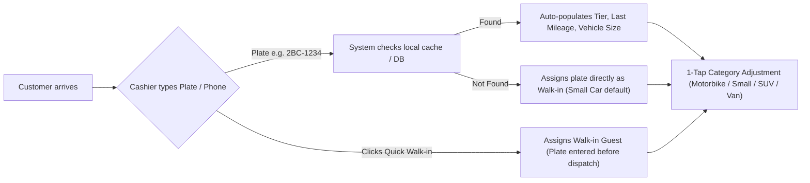
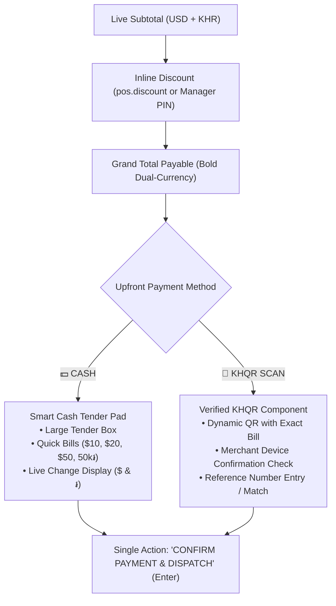

# POS Single-Page Checkout Interface Specification

**Document ID:** POS-DES-2026-001  
**Project:** Car-WashService  
**Scope:** Frontend Architecture, UI/UX Wireframes, Component Hierarchy, Interaction Design  
**Date:** November 2026 (Revised with Management Decisions)  
**Status:** Complete – Awaiting Management Approval  

---

## Management Revision Summary

This document has been revised in accordance with confirmed management decisions:
1. **Mandatory Upfront Payment Only:** "Pay Later", "Pay at Exit", and unpaid queue entry are **completely removed** from the checkout interface. The payment method options are strictly `CASH` and `KHQR SCAN`. A vehicle does not enter the queue or bay until payment is confirmed.
2. **Reliable KHQR Verification UI:** Replaced unverified button clicks and webcam screenshot capture with a dedicated merchant-side verification component (matching transaction reference against store notification device, Telegram bot, soundbox, or bank API webhook).
3. **Multi-Stage Bay Routing Interface:** Integrated multi-stage bay flow (e.g. Stage 1: Oil Lube Lift $\rightarrow$ Stage 2: Wash Bay) directly into the dispatch selector, backed by atomic concurrency locks.
4. **Customer Registration is Optional:** Plate-first entry with instant vehicle size selection. Zero forced multi-field forms.
5. **No Invented Discount Limits:** Permission checks adhere strictly to the existing `pos.discount` database permission. If unauthorized, an inline Manager PIN is prompted.

---

## 1. Design Philosophy: "Fast, Clear, Zero Friction"

The new POS interface consolidates all intake, service selection, bay dispatch, cash tendering, and payment confirmation into a **single, unified, high-speed counter checkout screen**.

### Core Usability Principles:
1. **Zero-Modal Architecture:** No popup dialogs interrupt the cashier. Every interaction happens inline on one viewport.
2. **Payment BEFORE Service:** Every order is paid and verified upfront. The vehicle is dispatched to the queue/bay only upon confirmed receipt.
3. **Plate-First Intake:** Real vehicle plate is captured in < 2 seconds. Customer registration is strictly optional.
4. **Dual-Currency Prominence:** Large, high-contrast display of USD ($) and Cambodian Riel (៛) across all pricing, totals, and change calculations.
5. **Atomic Bay Dispatch:** Prevents double-booking bays between multiple counter terminals.

---

## 2. Desktop & Tablet ASCII Wireframe

```
+---------------------------------------------------------------------------------------------------------------------------------------+
|  [LOGO] CAR WASH SERVICE PRO              (o) Online (LAN) | Rate: $1 = 4,100៛ | Shift #12 (Dara Sok)          [Sync: OK]  [⚙] [Logout] |
+---------------------------------------------------------------------------------------------------------------------------------------+
|                                  AREA 1: CUSTOMER & VEHICLE INTAKE (Fast Header Strip)                                               |
|  [ Plate Number / Phone: [ 2BC-1234                      ] [🔍 Search] ]   [ 🚶 Quick Walk-in ]                                        |
|  Vehicle Type:  ( ) Motorbike ($1.5)   (*) Small Car ($3)   ( ) SUV / Pickup ($4)   ( ) Van / Truck ($5)                              |
|  Customer: Sok Piseth (Optional) | Phone: 012 345 678 | Tier: [ ⭐ GOLD MEMBER ] | History: 14 Washes | Last Oil: 82,000km             |
+-----------------------------------------------------------------------------------+---------------------------------------------------+
|                     AREA 2: SERVICE & PACKAGE SELECTION                           |              AREA 3: ORDER SUMMARY & PAYMENT      |
+-----------------------------------------------------------------------------------+---------------------------------------------------+
|  [ 🚗 Wash Services ] [ ✨ Detailing ] [ 🛢️ Oil & Lube ] [ 🥤 Shop & Drinks ]      | Active Ticket: ORD-261106-042                     |
|-----------------------------------------------------------------------------------| Plate: 2BC-1234  (Small Car - Sedan)              |
|  +--------------------+ +--------------------+ +--------------------+             |---------------------------------------------------|
|  | Sedan Normal Wash  | | Wash + Hand Wax    | | Full Interior Sham |             | Items:                                            |
|  | $3.00   (12,300៛)  | | $7.00   (28,700៛)  | | $15.00  (61,500៛)  |             |  1. Sedan Normal Wash                     $3.00   |
|  | [15 mins]  [POPULAR]| | [30 mins]          | | [45 mins]          |             |     - Duty Washer: [ Sopheap V.  ▼ ]              |
|  +--------------------+ +--------------------+ +--------------------+             |  2. Synthetic 5W-30 Oil Package          $35.00   |
|  +--------------------+ +--------------------+ +--------------------+             |     - Mechanic: [ Vicheka (Mech) ▼ ]              |
|  | Underbody Wash     | | Engine Bay Clean   | | Headlight Restore  |             |     - Mileage: [ 85,000 ] km (Next: 95,000)       |
|  | $2.00    (8,200៛)  | | $5.00   (20,500៛)  | | $10.00  (41,000៛)  |             |---------------------------------------------------|
|  | [10 mins]          | | [20 mins]          | | [25 mins]          |             | Multi-Stage Routing:                              |
|  +--------------------+ +--------------------+ +--------------------+             |  [Stage 1: Bay 4 Lift] -> [Stage 2: Bay 1 Wash]   |
|                                                                                   |---------------------------------------------------|
|  OPTIONAL EXTRAS (1-Tap Add):                                                     | Subtotal:                         $38.00 (155,800៛)
|  [ + Tire Shine $1 ] [ + Air Freshener $1 ] [ + Rain Repellent $3 ]               | Discount: [ None ▼ ] [ Apply Discount ]           |
|-----------------------------------------------------------------------------------|---------------------------------------------------|
|  BAY DISPATCH (Live Availability):                                                | FINAL TOTAL PAYABLE:              $38.00          |
|  (*) Stage 1: Bay 4 (Tech Lift) [ FREE - Lock ]                                   |                                 (155,800 ៛)       |
|  ( ) Queue Stage 2: Bay 1 (Wash) [ FREE - Ready ]                                 |---------------------------------------------------|
|                                                                                   | UPFRONT PAYMENT METHOD:                           |
|                                                                                   |  [ 💵 CASH ]                    [ 📱 KHQR SCAN ]  |
|                                                                                   |---------------------------------------------------|
|                                                                                   | CASH TENDER PAD (If Cash):                        |
|                                                                                   |  Tendered: [ $ 40.00      ]   [ Exact ($38.00) ]  |
|                                                                                   |  Quick:    [ $40 ]  [ $50 ]  [ $100 ] [ 160,000៛ ]|
|                                                                                   |  CHANGE DUE:   $ 2.00   ( 8,200 ៛ )               |
|                                                                                   |---------------------------------------------------|
|                                                                                   | KHQR VERIFICATION (If KHQR):                      |
|                                                                                   |  Dynamic QR Generated: [$38.00 / 155,800៛]        |
|                                                                                   |  Status: [ 🟡 Waiting Merchant Confirmation... ]   |
|                                                                                   |  Ref #:  [ Bank Ref / Notification Check      ]  |
|                                                                                   |---------------------------------------------------|
|                                                                                   | [ 🖨️ CONFIRM PAYMENT & DISPATCH (Enter) ] [ ✕ Void] |
+-----------------------------------------------------------------------------------+---------------------------------------------------+
```

---

## 3. Detailed Component Architecture

### Area 1: Customer & Vehicle Intake (Top Strip)



#### Functional Requirements:
1. **Universal Fast Input (`#txtFastIntake`):**
   - High-contrast, autofocused text input.
   - Accepts license plates (e.g., `2BC-1234`, `Phnom Penh 2A-9999`) or phone numbers (`012...`).
   - Debounced search (150ms) checks local cache first, then server.
2. **Instant Recognition (Optional Registration):**
   - If recognized, displays customer name, phone, loyalty tier, and last recorded mileage.
   - Customer registration is strictly optional; new plates are assigned directly without popping up registration forms.
3. **Vehicle Category Chips:**
   - Positioned directly beside the plate input. Auto-selects from vehicle history or defaults to `Small Car`.
   - Single tap switches pricing matrix across all services instantly.

---

### Area 2: Service Selection & Catalog Matrix (Left / Center Pane)

#### 1. Horizontal Category Tabs:
- Located directly above the service grid:
  - **🚗 Wash & Dry:** Standard washing packages (Normal Wash, Wash + Wax, Undercarriage).
  - **✨ Detailing:** Machine polishing, interior shampoo, engine bay cleaning.
  - **🛢️ Oil & Lube:** Engine oil packages, oil filters, fluids, coolant.
  - **🥤 Shop & Drinks:** Beverages, air fresheners, accessories.

#### 2. Service Item Tiles:
- **Dimensions:** Minimum 120px height, optimized for touch fingers (target > 48px).
- **Content:** Title in Khmer and English, duration estimate, unit price in USD and KHR for the active vehicle category.
- **Interaction:**
  - **1-Tap Add:** Instantly adds item to cart. Subtle green badge increments quantity (`x1`, `x2`).
  - **High-Frequency Extras Strip:** Positioned cleanly below grid (`Tire Shine $1`, `Air Freshener $1`) as 1-tap add-on chips.

#### 3. Live Bay Dispatch Selector & Multi-Stage Path:
- Displays live status of all bays (`Bay 1 Wash`, `Bay 2 Wash`, `Bay 3 Detailing`, `Bay 4 Tech/Lift`).
- For single services: Cashier selects target bay with 1 tap (or auto-assigns next free bay).
- For multi-stage jobs (Wash + Lube): The interface automatically displays the two-stage path:
  `Stage 1: Bay 4 (Tech/Lift)` $\rightarrow$ `Stage 2: Bay 1 (Wash/Dry)`
- **Atomic Concurrency Protection:** When confirmed, an atomic database lock validates that the bay is still free before committing.

---

### Area 3: Order Summary & Upfront Payment (Right Pane)



#### Detailed Element Specifications:
1. **Itemized Cart Table:**
   - Displays Item Name, Quantity (+/- buttons), Unit Price, and Line Total.
   - For wash services: Duty washer dropdown pre-selects the active bay washer.
   - For oil services: Inline mileage box (`Current km`) auto-calculates `Next Due km`.
2. **Discounts (Strict Permission Control):**
   - Cashier selects discount reason.
   - If cashier role has `pos.discount`: Applies directly.
   - If cashier lacks permission: Inline 4-digit Manager PIN box appears inside the chip. Manager enters PIN once to authorize. No unapproved discount tiers.
3. **Smart Cash Tender Pad:**
   - Visible when `CASH` is active.
   - Numerical tender input + quick bill chips: `Exact`, `$10`, `$20`, `$50`, `50,000 ៛`.
   - Prominent **Change Due Box** in high-contrast green text:
     $$\text{Change USD} = \text{Tendered USD} - \text{Total USD}$$
     $$\text{Change KHR} = \text{Change USD} \times \text{Exchange Rate}$$
4. **Verified KHQR Component:**
   - Visible when `KHQR SCAN` is active.
   - Renders dynamic QR code containing the exact bill amount and unique transaction reference.
   - **Verification Requirement:**
     - Displays status: `🟡 Waiting for Merchant Confirmation`.
     - Cashier verifies receipt of push notification / Telegram bot alert / soundbox announcement on the store's dedicated device.
     - Cashier enters or confirms matching 4–6 digit transaction reference number.
     - Customer phone screenshots or unverified button clicks are strictly prohibited.
5. **Single Confirmation Action:**
   - Single prominent button: **`🖨️ CONFIRM PAYMENT & DISPATCH (Enter)`**.
   - Disabled until payment is fully tendered (Cash) or verified (KHQR).
   - Once tapped: locks with visual spinner, commits transaction via cart-lifecycle idempotency token, kicks open cash drawer (if cash), prints 80mm receipt silently, and moves vehicle into the service bay queue.

---

## 4. Hardware Integration & Peripherals

### Thermal Receipt Printer (80mm ESC/POS):
- Silent background print upon confirmed payment.
- If paper runs out or printer is offline, the transaction is **not blocked**; an advisory alert appears on screen and the job is transmitted digitally to the washer bay tablet / TV board.
- Physical cash drawer kick pulse sent automatically on confirmed cash payments.

### Keyboard Shortcuts (For Counter Speed):
| Key | Action |
| :--- | :--- |
| `F1` | Focus Plate Search Bar |
| `F2` | Set Vehicle Size: Small Car (Sedan) |
| `F3` | Set Vehicle Size: SUV / Pickup |
| `F4` | Set Vehicle Size: Van / Truck |
| `F5` | Select Cash Payment Method |
| `F6` | Select KHQR Payment Method |
| `F8` | Open Cash Drawer (No Sale - Manager PIN) |
| `Enter` | Confirm Payment & Dispatch to Bay |
| `Esc` | Clear Cart / Void Transaction |

---

## 5. Responsive Counter Adaptations
- **1080p Desktop Counter PC (1920x1080):** Full 3-column layout (Intake Header, 60% Catalog Grid, 40% Cart & Payment Sidebar).
- **10.1" Counter Touch Tablet (1280x800):** 2-column layout with fixed bottom payment dock.
- **Mobile Handheld (Service Advisor on Apron):** Single-column stacked mode for taking vehicle intake on the driveway.
