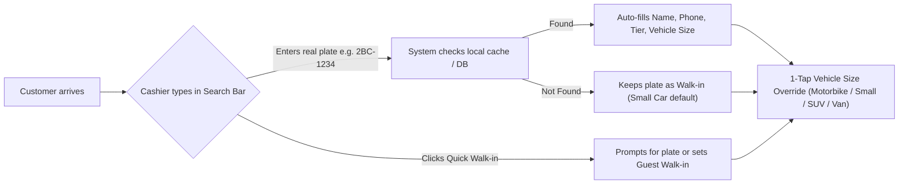
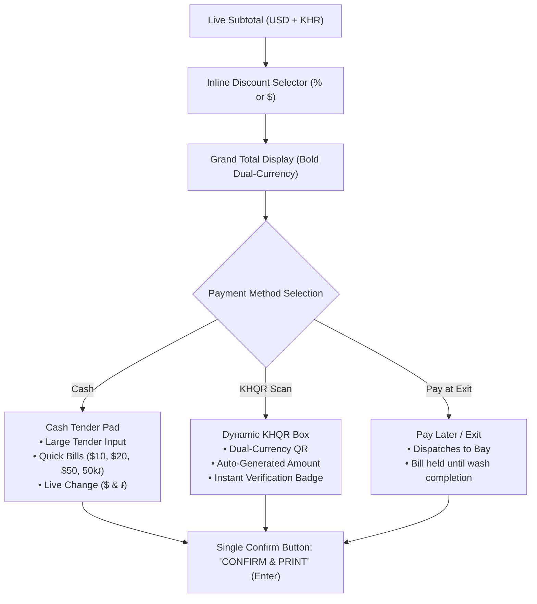

# POS Single-Page Checkout Interface Specification

**Document ID:** POS-DES-2026-001  
**Project:** Car-WashService  
**Scope:** Frontend Architecture, UI/UX Wireframes, Component Hierarchy, Interaction Design  
**Date:** November 2026  
**Status:** Complete – Awaiting Management Approval  

---

## 1. Design Philosophy: "Fast, Clear, Zero Friction"

To solve cashier confusion and counter bottlenecks, the new POS eliminates modal dialogs, tab switching, and redundant data entry. The counter experience is consolidated into a **single, unified, high-speed checkout screen**.

### Core Usability Principles:
1. **Zero-Modal Checkout:** Intake, service selection, bay dispatch, cash tendering, and payment confirmation occur entirely on **one screen** without popups interrupting the user.
2. **Plate-First Intake:** A real vehicle license plate is the primary identifier. No dummy random plates (`W-XXXX`) and no forced multi-field customer registration forms.
3. **Dual Currency Everywhere:** Large, clear display of both USD ($) and Cambodian Riel (៛) across all pricing, totals, and change calculations.
4. **Touch & Keyboard Optimized:** Designed for 10-to-15 inch counter touchscreens as well as rapid desktop keyboard entry (`F1`–`F12`, `Enter`, `Esc`).

---

## 2. Desktop & Tablet ASCII Wireframe

```
+---------------------------------------------------------------------------------------------------------------------------------------+
|  [LOGO] CAR WASH SERVICE PRO              (o) Online (LAN) | Rate: $1 = 4,100៛ | Shift #12 (Dara Sok)          [Sync: OK]  [⚙] [Logout] |
+---------------------------------------------------------------------------------------------------------------------------------------+
|                                  AREA 1: CUSTOMER & VEHICLE INTAKE (Fast Header Strip)                                               |
|  [ Plate Number / Phone / Name: [ 2BC-1234               ] [🔍 Search] ]   [ 🚶 Quick Walk-in ]                                        |
|  Vehicle Type:  ( ) Motorbike ($)   (*) Small Car ($3)   ( ) SUV / Pickup ($4)   ( ) Van / Truck ($5)                                 |
|  Customer: Sok Piseth | Phone: 012 345 678 | Tier: [ ⭐ GOLD MEMBER ] | History: 14 Washes | Last Oil: 12,400km (Due Soon)            |
+-----------------------------------------------------------------------------------+---------------------------------------------------+
|                     AREA 2: SERVICE & PACKAGE SELECTION                           |              AREA 3: ORDER SUMMARY & PAYMENT      |
+-----------------------------------------------------------------------------------+---------------------------------------------------+
|  [ 🚗 Wash Services ] [ ✨ Detailing ] [ 🛢️ Oil & Lube ] [ 🥤 Shop & Drinks ]      | Active Ticket: ORD-261105-042                     |
|-----------------------------------------------------------------------------------| Plate: 2BC-1234  (Small Car - Sedan)              |
|  +--------------------+ +--------------------+ +--------------------+             |---------------------------------------------------|
|  | Sedan Normal Wash  | | Wash + Hand Wax    | | Full Interior Sham |             | Items:                                            |
|  | $3.00   (12,300៛)  | | $7.00   (28,700៛)  | | $15.00  (61,500៛)  |             |  1. Sedan Normal Wash                     $3.00   |
|  | [15 mins]  [POPULAR]| | [30 mins]          | | [45 mins]          |             |     - Duty Washer: [ Sopheap V.  ▼ ]              |
|  +--------------------+ +--------------------+ +--------------------+             |  2. Engine Bay Degreasing                 $5.00   |
|  +--------------------+ +--------------------+ +--------------------+             |     - Optional Extra                                  |
|  | Underbody Wash     | | Engine Bay Clean   | | Headlight Restore  |             |  3. Synthetic 5W-30 Oil Pack             $35.00   |
|  | $2.00    (8,200៛)  | | $5.00   (20,500៛)  | | $10.00  (41,000៛)  |             |     - Tech: [ Vicheka (Mech) ▼ ]                  |
|  | [10 mins]          | | [20 mins]          | | [25 mins]          |             |     - Mileage: [ 85,000 ] km (Next: 95,000)       |
|  +--------------------+ +--------------------+ +--------------------+             |---------------------------------------------------|
|                                                                                   | Subtotal:                         $43.00 (176,300៛)
|  OPTIONAL EXTRAS & UPSELLS (1-Tap Add):                                           | Discount: [ None ▼ ] [ 10% VIP ]  -$4.30 (-17,630៛)
|  [ + Tire Shine $1 ] [ + Air Freshener $1 ] [ + Rain Repellent Glass $3 ]         |---------------------------------------------------|
|-----------------------------------------------------------------------------------| FINAL TOTAL:                      $38.70          |
|  BAY DISPATCH (Live Lane Status):                                                 |                                 (158,670 ៛)       |
|  (*) Bay 1: [ FREE - 1-Tap Assign ]                                               |---------------------------------------------------|
|  ( ) Bay 2: [ BUSY - Finishing in 5m ]                                            | PAYMENT METHOD:                                   |
|  ( ) Bay 3: [ BUSY - 18m remaining ]                                              |  [ 💵 CASH ]    [ 📱 KHQR SCAN ]    [ ⏳ PAY AT EXIT ]|
|  ( ) Bay 4 (Tech): [ FREE - Ready for Oil ]                                       |---------------------------------------------------|
|                                                                                   | CASH TENDER PAD:                                  |
|                                                                                   |  Tendered: [ $ 40.00      ]   [ Exact ($38.70) ]  |
|                                                                                   |  Quick:    [ $40 ]  [ $50 ]  [ $100 ] [ 160,000៛ ]|
|                                                                                   |                                                   |
|                                                                                   |  CHANGE DUE:   $ 1.30   ( 5,330 ៛ )               |
|                                                                                   |---------------------------------------------------|
|                                                                                   | [ 🖨️ CONFIRM & PRINT (Enter) ]   [ ✕ Void / Clear ] |
+-----------------------------------------------------------------------------------+---------------------------------------------------+
```

---

## 3. Detailed Component Architecture

### Area 1: Customer & Vehicle Intake (Top Strip)



#### Functional Requirements:
1. **Universal Fast Input (`#txtFastIntake`):**
   - High-contrast, autofocused text input.
   - Accepts license plates (e.g., `2BC-1234`, `Phnom Penh 2A-9999`) or phone numbers (`012...`).
   - Debounced search (150ms) checks local IndexedDB/localStorage first, then server.
2. **Instant Recognition:**
   - If recognized, a non-intrusive badge displays customer name, phone, loyalty tier, and last recorded mileage.
   - Vehicle category button auto-activates according to recorded vehicle history.
3. **No-Registration Walk-ins:**
   - If the plate is new, the cashier does **not** get interrupted with an "Add Customer" form. The typed plate is immediately bound to the ticket. Name and phone can be added optionally inline without a modal.
4. **Quick Walk-in Button:**
   - 1-click fallback for customers without visible plates or bicycles/small equipment, cleanly labeled as `Walk-in Guest`.

---

### Area 2: Service Selection & Catalog Matrix (Left / Center Pane)

#### 1. Horizontal Category Tabs:
- Located directly above the service grid:
  - **🚗 Wash & Dry:** Core car washing packages (Normal Wash, Wash + Wax, Undercarriage).
  - **✨ Detailing:** Machine polishing, clay bar, interior shampoo, engine bay detailing.
  - **🛢️ Oil & Lube:** Engine oil packages, oil filters, transmission fluids, coolant.
  - **🥤 Shop & Drinks:** Beverages, air fresheners, wiper blades, car accessories.

#### 2. Service Item Tiles:
- **Dimensions:** Minimum 120px height, optimized for touch fingers (touch target > 48px).
- **Content:**
  - Service title in Khmer and English.
  - Duration badge (e.g., `15 mins`, `45 mins`).
  - Unit price in USD and KHR according to active vehicle size.
- **Interaction:**
  - **Tap once:** Adds item to cart. A subtle green checkmark flashes on the tile.
  - **Tile badge:** Shows current quantity in cart (e.g., `x1`, `x2`).
  - **Subtle extras strip:** Beneath the grid, high-frequency add-ons (Tire Shine, Air Freshener, Rain Repellent) appear as 1-tap pills.

#### 3. Inline Bay Dispatch Selector:
- Located at the bottom of Area 2:
  - Displays real-time status of all shop bays (`Bay 1`, `Bay 2`, `Bay 3`, `Bay 4 Tech`).
  - Displays worker names currently working in each bay.
  - Cashier selects the target bay with a single tap. The order is automatically dispatched to that bay upon checkout confirmation.

---

### Area 3: Order Summary & Integrated Payment (Right Pane)



#### Detailed Element Specifications:
1. **Itemized Cart Table:**
   - Displays Item Name, Quantity (+/- buttons), Unit Price, and Line Total.
   - 1-click trash icon to remove item.
   - For wash services: duty washer dropdown is pre-selected with the currently active bay washer.
   - For oil services: inline mileage input box (`Current km`) auto-calculates the `Next Due km`.
2. **Discounts & Overrides:**
   - Inline discount pills: `None`, `5%`, `10%`, `VIP Free Wash`.
   - If cashier has `pos.discount` permission: applies instantly.
   - If cashier lacks permission: an inline 4-digit PIN box appears directly in place. Manager enters PIN once to authorize.
3. **Integrated Cash Tender Pad:**
   - Displayed directly on screen when `CASH` is selected (default).
   - Shows numerical tender input.
   - 5 Quick bill buttons: `Exact`, `$10`, `$20`, `$50`, `50,000 ៛`.
   - Prominent **Change Due Box** in high-contrast green text:
     $$\text{Change USD} = \text{Tendered USD} - \text{Total USD}$$
     $$\text{Change KHR} = \text{Change USD} \times \text{Exchange Rate}$$
4. **Dynamic KHQR Display Panel:**
   - Displayed when `KHQR SCAN` is selected.
   - Renders a scannable KHQR code embedded with the exact transaction total in USD or KHR.
   - Displays merchant name, transaction reference, and a live verification pill:
     - `🟡 Awaiting Customer Scan...`
     - `🟢 Payment Verified ($14.00 Received)`
   - No camera photo of customer's phone is required. Cashier clicks `Confirm & Print` once verified.
5. **Pay Later / Hold Button:**
   - For detailing and mechanical work where payment occurs upon vehicle pickup.
   - Saves order as `unpaid`, prints workshop intake ticket, and routes vehicle into the designated bay.

---

## 4. Hardware & Peripherals Integration

### Thermal Receipt Printer (80mm ESC/POS):
- Dual printing modes:
  1. **Direct Silent Network/USB Print:** Uses raw ESC/POS commands over WebSockets or local print daemon. Prints in < 1 second.
  2. **Browser Print Fallback:** Clean print-optimized CSS for standard thermal printers without dialogs.
- **Auto Cash Drawer Trigger:** Sends standard kick pulse (`ESC p 0 25 250`) on confirmed cash payments.

### Keyboard Shortcuts (For Counter Speed):
| Key | Action |
| :--- | :--- |
| `F1` | Focus Plate Search Bar |
| `F2` | Set Vehicle Size: Small Car (Sedan) |
| `F3` | Set Vehicle Size: SUV / Pickup |
| `F4` | Set Vehicle Size: Van / Truck |
| `F5` | Select Cash Payment Method |
| `F6` | Select KHQR Payment Method |
| `F7` | Select Pay at Exit (Unpaid Hold) |
| `F8` | Open Cash Drawer (No Sale - Manager PIN) |
| `Enter` | Confirm Payment & Print Receipt |
| `Esc` | Clear Cart / Cancel Current Ticket |

---

## 5. Responsive Counter Layout Adaptations

- **1080p Desktop Terminal (1920x1080):** 3-column expanded layout (Intake Header, 65% Service Grid, 35% Payment Sidebar).
- **Counter Touch Tablet (10.1" / 1280x800):** 2-column adaptive layout with sticky bottom checkout bar.
- **Mobile Handheld (Staff on Apron):** Single-column stacked mode with floating bottom cart pill.
