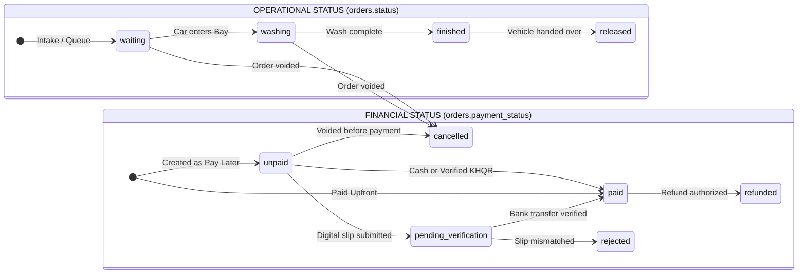

# POS Payment & Operational Business Rules

**Document ID:** POS-RUL-2026-001  
**Project:** Car-WashService  
**Scope:** Transactional Integrity, Financial Controls, Payment Governance, Auditing Standards  
**Date:** November 2026  
**Status:** Complete – Awaiting Management Approval  

---

## 1. Core Principles

This document defines the 10 binding business rules governing the POS cashier workflow, payment processing, ledger integrity, and operational state management for `Car-WashService`. These rules are strictly enforced across both backend APIs and frontend user interfaces.

---

## 2. The 10 Binding Business Rules

### Rule 1: Idempotency & Duplicate Order Prevention

#### Rule Statement:
> Under no circumstances shall double-clicking a submit button, network timeouts, client-side re-tries, or page refreshes create duplicate orders or double-charge a customer.

#### Architectural Enforcement:
1. **Cart-Lifecycle Token:** The `idempotency_key` is generated when a new cart session starts or when cart contents are first modified. It is **never** regenerated inside the button click event handler.
2. **Client-Side Debounce & State Lock:** The instant the cashier taps "Confirm", the checkout button is disabled, visually transforms into a loading spinner, and locks against subsequent clicks.
3. **Backend Idempotent Replay:**
   - In `api/pos/index.php`, when an `idempotency_key` matches an existing row in `orders`:
     ```sql
     SELECT id, order_number, status, payment_status, total_usd, total_khr, created_at 
     FROM orders WHERE idempotency_key = ?;
     ```
   - If found, the server must **not** execute a second insert. It immediately returns HTTP 200 with the existing order payload and `'is_duplicate' => true`.
4. **Retry Safety:** If a network drop occurs during transmission, the client resends the exact same `idempotency_key`. The server returns the previously confirmed order, allowing the POS to proceed to receipt printing without creating a duplicate ticket.

---

### Rule 2: Complete Separation of Operational Status vs. Payment Status

#### Rule Statement:
> Operational workflow status (what is happening to the physical car) and financial payment status (what has happened to the money) are orthogonal domains and must never share a single database column or state machine.

#### State Machine Matrix:



#### Database Field Standards:
1. **`orders.status` (Operational Lifecycle):**
   - Allowed values: `'waiting'`, `'in_progress'` / `'washing'`, `'finished'`, `'released'`, `'cancelled'`.
   - **Forbidden values:** `'paid'`. An order is never "operationally paid".
2. **`orders.payment_status` (Financial Lifecycle):**
   - Allowed values: `'unpaid'`, `'pending_verification'`, `'paid'`, `'refunded'`, `'cancelled'`.
3. **Financial Reporting Integrity:**
   - Financial management reports (`views/owner/reports.php`) must query:
     ```sql
     WHERE o.payment_status = 'paid' AND o.status != 'cancelled'
     ```
   - Queries must **never** filter by `WHERE o.status = 'paid'`. Finished cars that were paid remain fully recognized in financial reports.

---

### Rule 3: KHQR Payment Verification & Anti-Fraud Governance

#### Rule Statement:
> No order shall be marked as financially `paid` based on unverified customer claims. Digital payments must be positively verified without creating an apron bottleneck that requires physical manager presence for every routine car wash.

#### Operational Standards:
1. **Tiered Verification Protocol:**
   - **Tier A (Standard Car Wash < $20.00):** Cashier visually verifies bank push notification or SMS on the store's counter notification phone/tablet, or confirms customer transaction reference number. Cashier confirms payment directly under their own authenticated session (`cashier_id` recorded).
   - **Tier B (High-Value Detailing / Commercial Fleet > $50.00):** Customer reference number is mandatory. Transaction is logged with reference number.
2. **Elimination of Awkward Screen Photography:** Cashiers are not required to physically point a webcam at customer mobile phones. The bank reference number or direct counter notification serves as verification.
3. **Pending Verification Exception:** If a customer claims payment has left their bank but the shop counter device has not received notification (network delay), the order is saved as `pending_verification`. The car may proceed to washing, but the vehicle exit/gate pass is withheld until verification clears.

---

### Rule 4: Discount & Refund Governance

#### Rule Statement:
> Discounts, price overrides, and cash refunds directly impact the business ledger and must be authorized according to strict role-based permission tiers with full immutable audit trails.

#### Permission & Threshold Matrix:

| Role | Maximum Permitted Discount | Cash Refund Authority | Override PIN Required | Audit Log Event |
| :--- | :---: | :---: | :---: | :--- |
| **Cashier** | 0% (or standard loyalty coupon) | No Authority | Yes (Manager PIN) | `DISCOUNT_APPLIED` |
| **Senior Cashier** | Up to 10% (max $5.00) | No Authority | No | `DISCOUNT_APPLIED` |
| **Shift Supervisor** | Up to 20% (max $15.00) | Up to $15.00 | Self-Auth PIN | `SUPERVISOR_DISCOUNT` |
| **Shop Manager** | Up to 100% | Full Authority | Manager PIN | `MANAGER_OVERRIDE` |
| **Owner** | Full Authority | Full Authority | Direct | `OWNER_DISCOUNT` |

#### Enforcement Rules:
1. **Inline PIN Capture:** If a cashier applies a discount exceeding their tier, the POS immediately requests a 4-digit Manager PIN inline. The modal does not crash or fail at checkout submission.
2. **Mandatory Reason Logging:** Any discount or price override > $2.00 requires selecting a reason (`Customer Loyalty`, `Service Complaint`, `Promotional Campaign`, `Manager Discretion`).
3. **Self-Approval Prohibition:** A manager cannot approve a discount or refund on an order where they are recorded as the cashier or creator (`SELF_APPROVAL_NOT_ALLOWED`).

---

### Rule 5: Attribution & Non-Repudiation

#### Rule Statement:
> Every transaction, price alteration, worker assignment, and cancellation must indelibly identify who initiated the action, who approved it, which device was used, and the exact timestamp.

#### Mandatory Database Tracking Columns:
Every record in `orders` and `payments` must maintain:
- `cashier_id`: User ID of the logged-in staff member operating the terminal.
- `created_by`: User ID who initiated the ticket.
- `pos_device_id` & `pos_device_name`: Terminal identifier.
- `discount_approved_by`: User ID of the manager authorizing any price reduction.
- `cancelled_by_user_id` & `cancel_approved_by_user_id`: Dual attribution for voids.
- `created_at` & `paid_at`: Explicit wall-clock timestamps.

---

### Rule 6: Preservation of Transaction History & Immutable Ledgers

#### Rule Statement:
> Financial and operational history must never be destroyed. Orders, payments, stock deductions, and audit records shall never be permanently deleted from the database.

#### Rules for Voids and Cancellations:
1. **Soft Cancellation Only:** Voids are executed by setting `status = 'cancelled'`, `payment_status = 'cancelled'`, and logging `cancelled_at` and `cancel_reason`.
2. **Stock Reversal via Ledger:** When an order containing products or parts is cancelled, stock is restored by appending a reversal entry into the stock movement ledger (`StockControl`). Raw DB updates without ledger records are prohibited.
3. **Commission Clawback:** Washer and mechanic commissions tied to a cancelled order are deactivated (`is_active = 0`, `commission_usd = 0`). Historical commission records remain queryable for audit reconciliation.

---

### Rule 7: Decoupling of Receipt Printing from Order Mutation

#### Rule Statement:
> Printing or re-printing a customer receipt is a read-only presentation action. It must never create a new order, alter financial balances, or mutate business records.

#### Operational Rules:
1. **Idempotent Print Dispatch:** Clicking "Print 80mm Receipt" or "Reprint" sends the existing `order` object to `PosThermalPrinter.printReceipt()`. No database `INSERT` is executed.
2. **Reprint Header Watermark:** Re-printed receipts must display a clear header indicator:
   ```
   ================================================
              *** DUPLICATE RECEIPT ***
              Reprinted: 2026-11-05 21:45
   ================================================
   ```
3. **Advisory Gate:** Thermal printer offline or out-of-paper conditions must never paralyze vehicle washing operations. Digital job dispatch to washers proceeds regardless of physical paper status.

---

### Rule 8: Network Resilience & Offline-First Integrity

#### Rule Statement:
> Intermittent local Wi-Fi drops or broadband outages must not stop counter cashier operations. The POS must queue transactions locally and synchronize reliably upon reconnection without data collision.

#### Protocol:
1. **Local Queue Storage:** When network calls fail with `isOffline = true`, completed orders are immediately committed to browser IndexedDB (`PosStorage.addPendingOrder()`).
2. **Offline Order Identification:** Offline orders receive a deterministic temporary identifier:
   `ORD-OFFLINE-[DeviceUID]-[Timestamp]`
3. **Automatic Replay upon Reconnection:**
   - Background sync thread polls every 15 seconds.
   - Upon reconnecting, orders are submitted sequentially using their original `idempotency_key`.
   - The backend validates stock and records orders with `is_synced = 1` and `synced_at = NOW()`.
   - Cashier is alerted via a non-disruptive sync badge: `"🟢 3 offline orders synced successfully"`.

---

### Rule 9: Full Local LAN Operability Without Internet

#### Rule Statement:
> The entire car wash POS, bay management, and printing infrastructure must remain 100% operational on a local area network (LAN) with zero dependency on external public cloud connectivity.

#### Technical Standards:
1. **Local Server Authority:** The primary database (`MariaDB` or `carwash.sqlite`) lives on the local counter server PC.
2. **Local KHQR Generation:** Static QR stand data or offline KHQR payload strings are generated locally by the counter application without querying external cloud payment gateways.
3. **Zero External CDNs:** All fonts (`Inter`, `Kantumruy Pro`), FontAwesome icons, and scripts are served strictly from the local filesystem (`/pos/webfonts/`, `/pos/css/`). No CDN requests are permitted.

---

### Rule 10: Clear Payment & Operational Confirmation

#### Rule Statement:
> Cashier and customer must receive unambiguous, instant confirmation of transaction success, change due, and bay assignment.

#### Standards:
1. **High-Contrast Confirmation:**
   - Change calculation displayed in giant numerals (minimum 24pt bold green).
   - Dual-currency display: e.g., **`Change: $1.30 (5,330 ៛)`**.
2. **Auditory & Physical Feedback:**
   - Audio chime upon successful checkout confirmation.
   - Physical cash drawer kick pulse sent immediately.
3. **Customer-Facing Digital Display (Optional 2nd Monitor):**
   - Renders a clean welcome screen, itemized live cart, total payable in USD/KHR, dynamic KHQR code, and "Thank You" confirmation with assigned bay number (`"Please drive to Bay 1"`).
