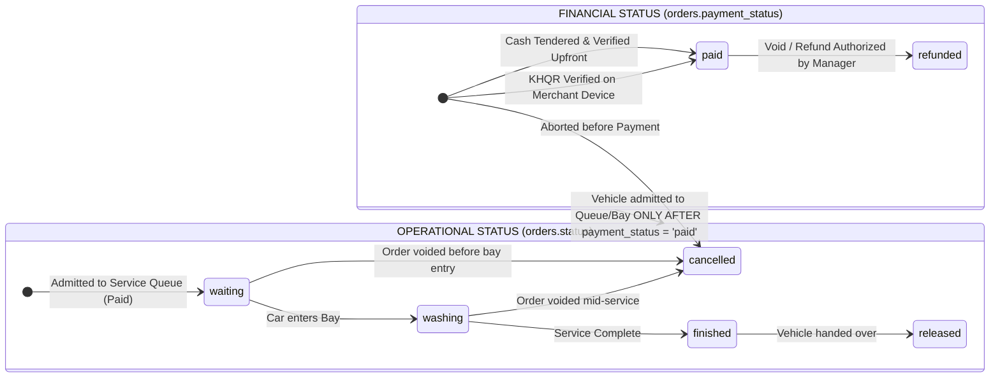
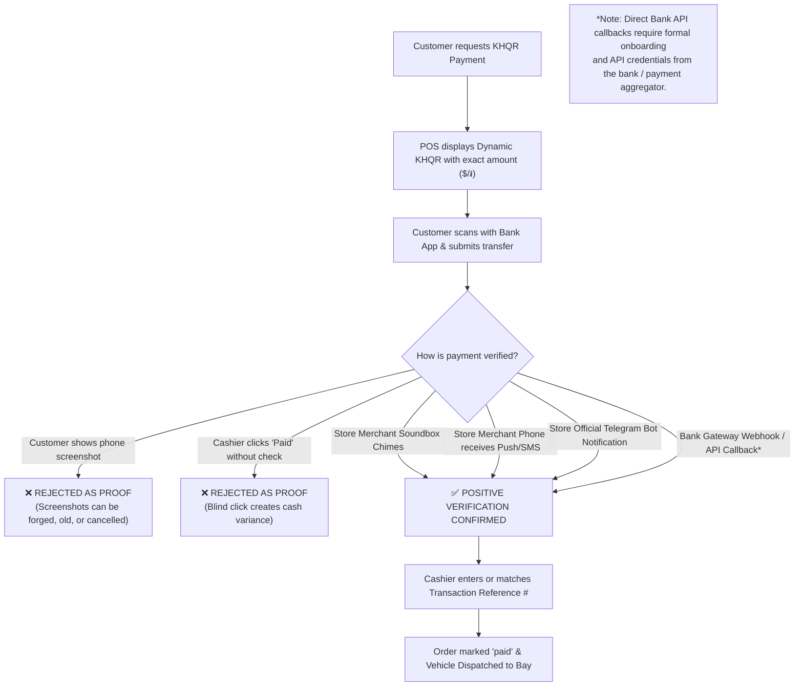

# POS Payment & Operational Business Rules

**Document ID:** POS-RUL-2026-001  
**Project:** Car-WashService  
**Scope:** Transactional Integrity, Financial Controls, Payment Governance, Auditing Standards  
**Date:** November 2026 (Revised with Management Decisions)  
**Status:** Complete – Awaiting Management Approval  

---

## Management Revision Summary

This document has been revised in accordance with confirmed management decisions:
1. **Mandatory Payment BEFORE Service:** A vehicle must **never** enter the service queue or work bay until payment is positively confirmed ("No Payment, No Service", "No Receipt, No Wash"). "Pay Later" and "Pay at Exit" are **removed** from standard cashier counter operations.
2. **Strict Anti-Fraud KHQR Verification:** QR code generation, customer phone screenshots, or blind cashier button clicks are **strictly forbidden** as proof of payment. Verification must be validated via the store's merchant notification device, soundbox, Telegram bot, or official bank payment gateway callback (which requires formal bank onboarding).
3. **Preservation of Existing Permission Architecture:** No unauthorized discount percentage tiers or new manager limits are invented. Discounts are governed strictly by the existing database permission `pos.discount` and `CashierControl::verifyManagerPin()`.
4. **Careful Historical Data Migration:** Historical orders with `status = 'paid'` must **never** be blindly converted to operational `status = 'finished'`. State normalization must evaluate actual operational timestamps (`started_at`, `finished_at`, `cancelled_at`).
5. **Safe Multi-Stage Bay Routing:** Formal specification of atomic concurrency checks and Stage 1 $\rightarrow$ Stage 2 sequential bay routing for combined services.
6. **Project Decoupling:** `Car-WashService` (local station) remains strictly decoupled from `Car-WashCloud`.

---

## 1. The 10 Binding Business Rules

### Rule 1: Idempotency & Duplicate Order Prevention

#### Rule Statement:
> Under no circumstances shall double-clicking a submit button, network timeouts, client-side retries, or page refreshes create duplicate orders or double-charge a customer.

#### Architectural Enforcement:
1. **Cart-Lifecycle Token:** The `idempotency_key` is generated when a new cart session starts or when cart contents are first modified. It is **never** regenerated inside the button click event handler.
2. **Client-Side Debounce & State Lock:** The instant the cashier taps "Confirm", the checkout button is disabled, visually transforms into a loading spinner, and locks against subsequent clicks.
3. **Backend Idempotent Replay:**
   - In `api/pos/index.php`, when an `idempotency_key` matches an existing row in `orders`:
     ```sql
     SELECT id, order_number, status, payment_status, total_usd, total_khr, created_at 
     FROM orders WHERE idempotency_key = ?;
     ```
   - If found, the server must **not** execute a second insert. It immediately returns HTTP 200 with the existing order payload and `'is_duplicate' => true`.
4. **Retry Safety:** If a network drop occurs during transmission, the client resends the exact same `idempotency_key`. The server returns the previously confirmed order, allowing the POS to proceed to receipt printing without creating a duplicate ticket.

---

### Rule 2: Complete Separation of Operational Status vs. Payment Status

#### Rule Statement:
> Operational workflow status (what is happening to the physical vehicle) and financial payment status (what has happened to the money) are orthogonal domains and must never share a single database column or state machine. Payment must be confirmed BEFORE a vehicle enters the service queue.

#### State Machine Matrix:



#### Database Field Standards:
1. **`orders.status` (Operational Lifecycle):**
   - Allowed values: `'waiting'`, `'washing'` / `'in_progress'`, `'finished'`, `'released'`, `'cancelled'`.
   - **Forbidden values:** `'paid'`. An order is never "operationally paid".
2. **`orders.payment_status` (Financial Lifecycle):**
   - Allowed values: `'unpaid'`, `'pending_verification'`, `'paid'`, `'refunded'`, `'cancelled'`.
3. **Financial Reporting Integrity:**
   - Financial management reports (`views/owner/reports.php`) must query:
     ```sql
     WHERE o.payment_status = 'paid' AND o.status != 'cancelled'
     ```
   - Queries must **never** filter by `WHERE o.status = 'paid'`. Finished cars that were paid remain fully recognized in financial reports.
4. **Careful Historical Order Migration & Edge Cases:**
   - Under no circumstances shall a migration script execute a blanket update:
     `UPDATE orders SET status = 'finished' WHERE status = 'paid';` -- STRICTLY FORBIDDEN
   - Legacy records where `status = 'paid'` must be evaluated using multi-column operational criteria:
     - **Edge Case 1: In-Flight Jobs:** If `started_at IS NOT NULL AND finished_at IS NULL AND cancelled_at IS NULL` $\rightarrow$ set `payment_status = 'paid'`, maintain operational `status = 'washing'` (or active bay state) so workers can complete the active wash.
     - **Edge Case 2: Today's Queue Waiting Jobs:** If `started_at IS NULL AND finished_at IS NULL AND DATE(created_at) = CURRENT_DATE AND cancelled_at IS NULL` $\rightarrow$ set `payment_status = 'paid'`, maintain operational `status = 'waiting'` so the vehicle is not dropped from the queue.
     - **Edge Case 3: Completed Jobs:** If `finished_at IS NOT NULL AND cancelled_at IS NULL` $\rightarrow$ set `payment_status = 'paid'`, operational `status = 'finished'`.
     - **Edge Case 4: Cancelled / Voided Orders:** If `cancelled_at IS NOT NULL OR cancel_reason IS NOT NULL` $\rightarrow$ set `payment_status = 'cancelled'` (or `'refunded'`), operational `status = 'cancelled'`.
     - **Edge Case 5: Archived Historical Records (Older than Today with Null Timestamps):** If `DATE(created_at) < CURRENT_DATE AND started_at IS NULL AND finished_at IS NULL AND cancelled_at IS NULL` $\rightarrow$ set `payment_status = 'paid'`, operational `status = 'finished'` (historical completed assumption), while appending an audit log entry noting reconstructed operational status.
     - **Edge Case 6: Legacy Unpaid Finished Jobs (Web POS intake):** If legacy orders exist with `status = 'finished' AND payment_status = 'unpaid'` $\rightarrow$ preserve operational `status = 'finished'`, preserve financial `payment_status = 'unpaid'`. They must NOT be marked paid automatically.

---

### Rule 3: KHQR Payment Verification & Anti-Fraud Governance

#### Rule Statement:
> No order shall be marked as financially `paid` and admitted to the service queue based on unverified customer claims. QR generation, customer phone screenshots, or blind cashier button clicks are STRICTLY FORBIDDEN as proof of payment.



#### Operational Verification Standards:
1. **Positive Verification Requirement:**
   - Proof of payment must arrive on the **business's own devices**, not the customer's device.
   - **Accepted Verification Channels:**
     - **Channel A (Merchant Notification Device):** Store's dedicated counter phone receives the official bank push notification / SMS alert showing exact matching amount and customer account name.
     - **Channel B (Merchant IoT Soundbox):** Counter soundbox automatically announces: *"Received [Amount] Riels via KHQR"*.
     - **Channel C (Merchant Telegram Bot):** Store's official banking bot announces incoming transfer with reference code.
     - **Channel D (Bank Payment Gateway API Webhook):** Direct automated webhook from merchant aggregator (e.g. ABA PayWay / Bakong MD5 verification).
       *(Note: Banking API integrations require formal commercial confirmation, merchant account onboarding, and API credentials from the respective financial institution).*
2. **Transaction Reference Capture:**
   - Cashier enters or confirms the last 4–6 digits of the bank transaction reference number (`payment_ref`) before clicking confirm.
3. **Unconfirmed Transfers:**
   - If a customer claims funds were sent but the merchant device receives no alert (network lag), the car is **held at the counter**. The vehicle is **never dispatched to a wash bay** until funds arrive.

---

### Rule 4: Discount & Price Override Governance

#### Rule Statement:
> Discounts and price overrides directly reduce cash drawer revenue and must strictly adhere to existing database permissions. No unapproved discount percentage tiers shall be invented.

#### Operational Standards:
1. **Existing Permission Model Maintained:**
   - Permission code: `pos.discount` (defined in `database/migrate_roles.php` and stored in `role_permissions`).
   - If the logged-in staff user has `pos.discount` (or role `owner`), they may apply standard promotional or loyalty discounts.
2. **Mandatory Manager PIN for Unauthorized Staff:**
   - If a cashier lacks `pos.discount`, the POS requires a 4-digit Manager PIN inline before the discount can be applied.
   - The PIN is verified against `CashierControl::verifyManagerPin()`.
   - The order records `discount_approved_by = [manager_user_id]` alongside a mandatory reason (`Customer Loyalty`, `Service Recovery`, `Owner Discretion`).
3. **Self-Approval Prohibition:**
   - A manager cannot approve a discount on an order where they are operating as the primary cashier (`SELF_APPROVAL_NOT_ALLOWED`).

---

### Rule 5: Safe Multi-Stage Bay Routing & Atomic Concurrency

#### Rule Statement:
> Multi-stage service jobs (such as Oil Change + Car Wash) must execute via deterministic, sequential routing with atomic database locks preventing two terminals from double-booking the same bay.

#### Routing Specification:
1. **Physical Sequencing:**
   - Multi-service orders combining mechanical lube work and car washing must always execute:
     $$\text{Stage 1: Mechanical / Lift Bay (Bay 4)} \longrightarrow \text{Stage 2: Wash & Dry Bay (Bay 1 or 2)}$$
   - Mechanical work (hot engine oil drain, filter replacement, chassis inspection) is performed first on the lift before exterior washing and drying.
2. **Atomic Concurrency Lock:**
   - Assigning a vehicle to a bay must be atomic to prevent race conditions across multiple counter terminals:
     ```sql
     UPDATE bays 
     SET status = 'busy', current_order_id = ? 
     WHERE id = ? AND status = 'free';
     ```
   - If `affected_rows == 0`, the bay was claimed by another terminal during checkout. The POS immediately catches this, alerts the cashier, and routes the vehicle to the next available bay or queue without data corruption.
3. **Stage Handoff Protocol:**
   - When the technician finishes Stage 1 on the workshop tablet (`BayManager::finishStage()`), Bay 4 is released to `free`.
   - The order automatically advances to `Stage 2: Waiting Wash Bay`.
   - The wash bay screen displays the incoming car, and washer commissions remain strictly segregated from mechanic commissions.
4. **Reservation & Rollback Protocol:**
   - **Staged Reservation Rule:** Stage 1 (Bay 4) is atomically locked at checkout. Stage 2 (Wash Bay) is **never pre-locked** at checkout; pre-locking Stage 2 would hold an empty wash bay idle for 30–45 minutes while the vehicle is on the lift, wasting 50% of shop wash capacity. Instead, Stage 2 is registered in the priority queue buffer.
   - **Checkout Collision Rollback:** If Bay 4 atomic update fails (0 rows affected because another terminal claimed it), the checkout transaction rolls back cleanly, the cashier is alerted: *"Bay 4 occupied. Redirecting to Queue / Alternative Bay"*, and no customer charge is committed.
   - **Mid-Service Cancellation Rollback:**
     - *If cancelled before Stage 1 starts:* 100% refund, Bay 4 released to `free` atomically, reserved parts/stock returned to inventory.
     - *If cancelled mid-Stage 1 (in progress):* Requires Manager PIN override. Parts and fluids already poured into the engine cannot be returned to stock; technician logs consumed items; partial refund is issued only for unperformed wash services ($3.00); Bay 4 is released atomically.
     - *If cancelled after Stage 1 finishes (prior to Stage 2):* Mechanic commission for Stage 1 remains locked and credited; Stage 2 wash fee ($3.00) is refunded to customer; Stage 2 queue ticket is cancelled; vehicle is released.

---

### Rule 6: Attribution & Non-Repudiation

#### Rule Statement:
> Every transaction, price alteration, worker assignment, and cancellation must indelibly identify who initiated the action, who approved it, which device was used, and the exact timestamp.

#### Mandatory Database Tracking Columns:
Every record in `orders` and `payments` must maintain:
- `cashier_id`: User ID of the logged-in staff member operating the terminal.
- `created_by`: User ID who initiated the ticket.
- `pos_device_id` & `pos_device_name`: Terminal identifier.
- `discount_approved_by`: User ID of the manager authorizing any price reduction.
- `cancelled_by_user_id` & `cancel_approved_by_user_id`: Dual attribution for voids.
- `created_at` & `paid_at`: Explicit wall-clock timestamps.

---

### Rule 7: Preservation of Transaction History & Immutable Ledgers

#### Rule Statement:
> Financial and operational history must never be destroyed. Orders, payments, stock deductions, and audit records shall never be permanently deleted from the database.

#### Rules for Voids and Cancellations:
1. **Soft Cancellation Only:** Voids are executed by setting `status = 'cancelled'`, `payment_status = 'cancelled'`, and logging `cancelled_at` and `cancel_reason`.
2. **Stock Reversal via Ledger:** When an order containing products or parts is cancelled, stock is restored by appending a reversal entry into the stock movement ledger (`StockControl`). Raw DB updates without ledger records are prohibited.
3. **Commission Clawback:** Washer and mechanic commissions tied to a cancelled order are deactivated (`is_active = 0`, `commission_usd = 0`). Historical commission records remain queryable for audit reconciliation.

---

### Rule 8: Decoupling of Receipt Printing from Order Mutation

#### Rule Statement:
> Printing or re-printing a customer receipt is a read-only presentation action. It must never create a new order, alter financial balances, or mutate business records.

#### Operational Rules:
1. **Idempotent Print Dispatch:** Clicking "Print 80mm Receipt" or "Reprint" sends the existing `order` object to `PosThermalPrinter.printReceipt()`. No database `INSERT` is executed.
2. **Reprint Header Watermark:** Re-printed receipts must display a clear header indicator:
   ```
   ================================================
              *** DUPLICATE RECEIPT ***
              Reprinted: 2026-11-06 20:00
   ================================================
   ```
3. **Resolution of Receipt-Printing Contradiction:**
   - **The Historical Contradiction:** Previously, the slogan *"No Receipt, No Wash"* was coded in `core/OrderGate.php` as a hard blockade that halted vehicle washing if the physical thermal printer was out of paper or jammed, unless a manager typed an override PIN.
   - **The Two-Tier Policy Resolution:**
     - **Tier 1 (Financial Hard Gate): "No Confirmed Payment, No Wash"** is absolute. An order must have `payment_status = 'paid'` before any car enters the queue or bay.
     - **Tier 2 (Physical Paper Advisory Gate):** Confirmed payment immediately creates an electronic receipt record (`receipt_printed_at` timestamp and official `receipt_number` generated) and transmits the job digitally to the washer bay display/tablet (`tv.php`).
     - **Printer Hardware Fault Handling:** If the physical 80mm thermal printer runs out of paper, jams, or is offline:
       - The POS displays an advisory warning: *"Printer offline/out of paper - Order #ORD-... sent to Bay Screen"*.
       - The vehicle is **NOT blocked** from entering the wash bay; physical apron operations continue without delay.
       - The cashier loads paper and clicks "Reprint Receipt" at any time.
     - **Optional Shop Gate Enforcement:** If a shop owner requires a strict paper gate (e.g., an exit security guard inspects paper slips), the owner toggles `enforce_physical_paper_gate = 1` in Settings. Otherwise, the default operational standard is **Financial Hard Gate + Advisory Physical Print**.

---

### Rule 9: Network Resilience & Offline-First LAN Integrity

#### Rule Statement:
> Intermittent local Wi-Fi drops or broadband outages must not stop counter cashier operations. The POS must operate on the local area network (LAN) with zero dependency on public cloud connectivity.

#### Technical Standards:
1. **Local Queue Storage:** When network calls fail with `isOffline = true`, completed orders are immediately committed to browser IndexedDB (`PosStorage.addPendingOrder()`).
2. **Offline Order Identification:** Offline orders receive a deterministic temporary identifier:
   `ORD-OFFLINE-[DeviceUID]-[Timestamp]`
3. **Automatic Replay upon Reconnection:**
   - Background sync thread polls every 15 seconds.
   - Upon reconnecting, orders are submitted sequentially using their original `idempotency_key`.
   - The backend validates stock and records orders with `is_synced = 1` and `synced_at = NOW()`.
   - Cashier is alerted via a non-disruptive sync badge: `"🟢 3 offline orders synced successfully"`.
4. **Zero External CDNs:** All fonts (`Inter`, `Kantumruy Pro`), FontAwesome icons, and scripts are served strictly from the local filesystem (`/pos/webfonts/`, `/pos/css/`). No external cloud dependencies are permitted.

---

### Rule 10: Clear Payment & Operational Confirmation

#### Rule Statement:
> Cashier and customer must receive unambiguous, instant confirmation of transaction success, change due, and bay assignment.

#### Standards:
1. **High-Contrast Confirmation:**
   - Change calculation displayed in giant numerals (minimum 24pt bold green).
   - Dual-currency display: e.g., **`Change: $2.00 (8,200 ៛)`**.
2. **Auditory & Physical Feedback:**
   - Audio chime upon successful checkout confirmation.
   - Physical cash drawer kick pulse sent immediately.
3. **Customer-Facing Digital Display (Optional 2nd Monitor):**
   - Renders a clean welcome screen, itemized live cart, total payable in USD/KHR, dynamic KHQR code, and "Thank You" confirmation with assigned bay number (`"Please drive to Bay 1"`).
