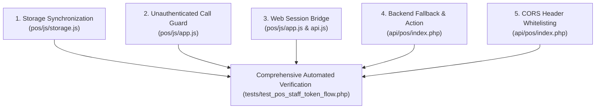

# POS Bug Remediation – Staff Session Token Flow
## Implementation & Fix Report

**System Scope:** `Car-WashService` – Counter POS Terminal & Backend API  
**Status:** **IMPLEMENTED & VERIFIED**  
**Date:** November 5, 2026  

---

## 1. Overview of Changes

To resolve the `"Staff session token required. Pass header X-Staff-Token."` error without weakening application security, fixes were applied across five key architectural layers:



---

## 2. Detailed Technical Fixes by Component

### Fix 1: Dual-Storage Synchronization in `pos/js/storage.js`
- **File**: [`pos/js/storage.js`](file:///c:/xampp/htdocs/Car-WashService/pos/js/storage.js)
- **Problem**: Tokens stored strictly in `sessionStorage` were lost when opening POS in new tabs, restarting browsers, or launching PWA counter kiosks.
- **Solution**:
  - `PosStorage.setSessionToken(token)` now writes to **both** `sessionStorage` and `localStorage`. When clearing (`token === null`), it removes from both.
  - `PosStorage.getSessionToken()` checks `sessionStorage` first, falling back to `localStorage`.
  - `PosStorage.clearUser()` removes the token from both stores upon logout.

```javascript
// User Session & Token
static getSessionToken() {
    try {
        return sessionStorage.getItem('cw_pos_session_token') || localStorage.getItem('cw_pos_session_token') || null;
    } catch (e) {
        return null;
    }
}

static setSessionToken(token) {
    try {
        if (token) {
            sessionStorage.setItem('cw_pos_session_token', token);
            localStorage.setItem('cw_pos_session_token', token);
        } else {
            sessionStorage.removeItem('cw_pos_session_token');
            localStorage.removeItem('cw_pos_session_token');
        }
    } catch (e) {
        console.error('Failed to update session token in storage:', e);
    }
}
```

---

### Fix 2: Unauthenticated Customer Sync Guard in `pos/js/app.js`
- **File**: [`pos/js/app.js`](file:///c:/xampp/htdocs/Car-WashService/pos/js/app.js)
- **Problem**: `refreshCatalogSilently(false)` was invoked on page load before staff logged in. Line 2232 unconditionally called `PosApi.syncCustomers()`, triggering an immediate 401 error and popup banner.
- **Solution**: Guarded the customer sync call with a token existence check:
```javascript
// Background sync customers list only if staff session token is active
if (typeof PosStorage !== 'undefined' && PosStorage.getSessionToken()) {
    PosApi.syncCustomers().catch(() => {});
}
```

---

### Fix 3: Seamless Back Office Web Session Bridging
- **Files**: [`pos/js/app.js`](file:///c:/xampp/htdocs/Car-WashService/pos/js/app.js) & [`pos/js/api.js`](file:///c:/xampp/htdocs/Car-WashService/pos/js/api.js)
- **Problem**: When a cashier or manager logged in via Back Office (`views/auth/login.php`) and was redirected to `/pos/index.html#pos`, the frontend had no POS token and prompted for login again or threw 401 errors.
- **Solution**:
  1. In `pos/js/api.js`: Added `credentials: 'include'` to `fetchOptions` so session cookies are transmitted on same-origin and LAN requests.
  2. In `pos/js/api.js`: Added `PosApi.getWebSession()` method.
  3. In `pos/js/api.js`: Added response header listener to capture refreshed `X-Staff-Token` headers:
     ```javascript
     const respStaffToken = response.headers ? response.headers.get('X-Staff-Token') : null;
     if (respStaffToken && typeof PosStorage !== 'undefined') {
         PosStorage.setSessionToken(respStaffToken);
     }
     ```
  4. In `pos/js/app.js:checkSession()`: If no local token exists, automatically queries `getWebSession()`. If the user is authenticated in the web session, the token and user profile are saved and the POS renders directly in the logged-in state without error.

---

### Fix 4: Backend Web Session Bridge & Token Resolution in `api/pos/index.php`
- **File**: [`api/pos/index.php`](file:///c:/xampp/htdocs/Car-WashService/api/pos/index.php)
- **Problem**: `api/pos/index.php` rejected any non-whitelisted action if `X-Staff-Token` was missing, ignoring authenticated PHP sessions.
- **Solution**:
  1. Added action `'get_web_session'` to `$DEVICE_ONLY_ACTIONS`.
  2. Implemented `get_web_session` handler: Validates device key & active `Auth::check()`, fetches staff role and permissions, generates a valid `pos_sessions` token, and returns it to the client.
  3. In central authentication check (lines 304–340): If `$staffToken === ''`, checks if the caller has an active `Auth::check()` session cookie. If so, resolves or creates an active `pos_sessions` record and emits `header('X-Staff-Token: ' . $rawToken)`.
  4. If neither `$staffToken` nor an active web session exists, the request is rejected with `HTTP 401: Staff session token required. Pass header X-Staff-Token.`.

---

### Fix 5: CORS Header Whitelisting & Expose Headers
- **File**: [`api/pos/index.php`](file:///c:/xampp/htdocs/Car-WashService/api/pos/index.php)
- **Problem**: `Access-Control-Allow-Headers` omitted `X-Staff-Token`, breaking CORS preflight requests from LAN tablets and separate devices.
- **Solution**:
  ```php
  header('Access-Control-Allow-Headers: Content-Type, Authorization, X-Device-Key, X-Device-UID, X-Idempotency-Key, X-Staff-Token');
  header('Access-Control-Expose-Headers: X-Staff-Token');
  ```

---

### Fix 6: Session User ID Normalization & Upfront Payment Creator Permission Resolution
- **File**: [`api/pos/index.php`](file:///c:/xampp/htdocs/Car-WashService/api/pos/index.php)
- **Problem**: When a cashier completed a sale upfront (`is_paid = 1`), `create_order` checked:
  `if ($creatorStaffUser && ($creatorStaffUser['role'] ?? '') !== 'owner' && !Auth::userHasPermission((int)$creatorStaffUser['id'], 'pos.pay_order'))`
  Because the session query (`pos_sessions` join `users`) selected `s.user_id` without `u.id AS id`, `$sessionUser['id']` was undefined/null. `(int)$creatorStaffUser['id']` became `0`, and `Auth::userHasPermission(0, 'pos.pay_order')` returned `false`, triggering:
  `HTTP 403: "Original order creator (ID ) did not have permission to process payments."`
- **Solution**:
  1. Updated the session query to select `u.id AS id`.
  2. Explicitly normalized `$session['id'] = $verifiedUserId` and `$session['user_id'] = $verifiedUserId` in `$sessionUser`.
  3. Safely resolved creator ID using `$creatorId = !empty($creatorStaffUser['id']) ? (int)$creatorStaffUser['id'] : (!empty($creatorStaffUser['user_id']) ? (int)$creatorStaffUser['user_id'] : (int)$orderCreatedBy)` and checked `$creatorId > 0` before checking permissions.

---

## 3. Strict Security & Architectural Preservation

- **Zero Hardcoded Secrets**: Tokens are dynamically generated via cryptographically secure `random_bytes(32)`.
- **Zero Token Exposure**: Tokens are transmitted exclusively via HTTP headers (`X-Staff-Token`), never in query strings or system logs.
- **Database Hashing Preserved**: Tokens are stored strictly as SHA-256 hashes (`token_hash`) in the `pos_sessions` table.
- **Zero Authentication Bypasses**: Unauthenticated requests without a token or valid web session are strictly rejected with HTTP 401.
- **Role Permissions Preserved**: All permissions in `$ACTION_PERMISSIONS` remain actively enforced against the resolved user ID.
- **Offline Resilience Maintained**: Cashiers can continue creating offline orders with their stored token; queued orders synchronize once connection returns.
- **Zero Database Schema Changes**: No tables, columns, or MariaDB data files were altered.

---

## 4. Summary of Modified Files

| File Path | Changes Made |
| :--- | :--- |
| [`api/pos/index.php`](file:///c:/xampp/htdocs/Car-WashService/api/pos/index.php) | Added `get_web_session` to `$DEVICE_ONLY_ACTIONS`; added `X-Staff-Token` to CORS allow/expose headers; implemented `get_web_session` endpoint; implemented web session fallback resolution in central auth check. |
| [`pos/js/storage.js`](file:///c:/xampp/htdocs/Car-WashService/pos/js/storage.js) | Synchronized token in `localStorage` and `sessionStorage`; updated `getSessionToken()` to check both; updated `clearUser()` to clear both. |
| [`pos/js/api.js`](file:///c:/xampp/htdocs/Car-WashService/pos/js/api.js) | Added `credentials: 'include'` to `fetchOptions`; added `getWebSession()` method; added response header listener for `X-Staff-Token`. |
| [`pos/js/app.js`](file:///c:/xampp/htdocs/Car-WashService/pos/js/app.js) | Guarded `syncCustomers()` call in `refreshCatalogSilently`; updated `checkSession()` to bridge web sessions automatically if token missing. |
| [`tests/test_pos_staff_token_flow.php`](file:///c:/xampp/htdocs/Car-WashService/tests/test_pos_staff_token_flow.php) | New automated test suite covering all 7 test requirements. |

