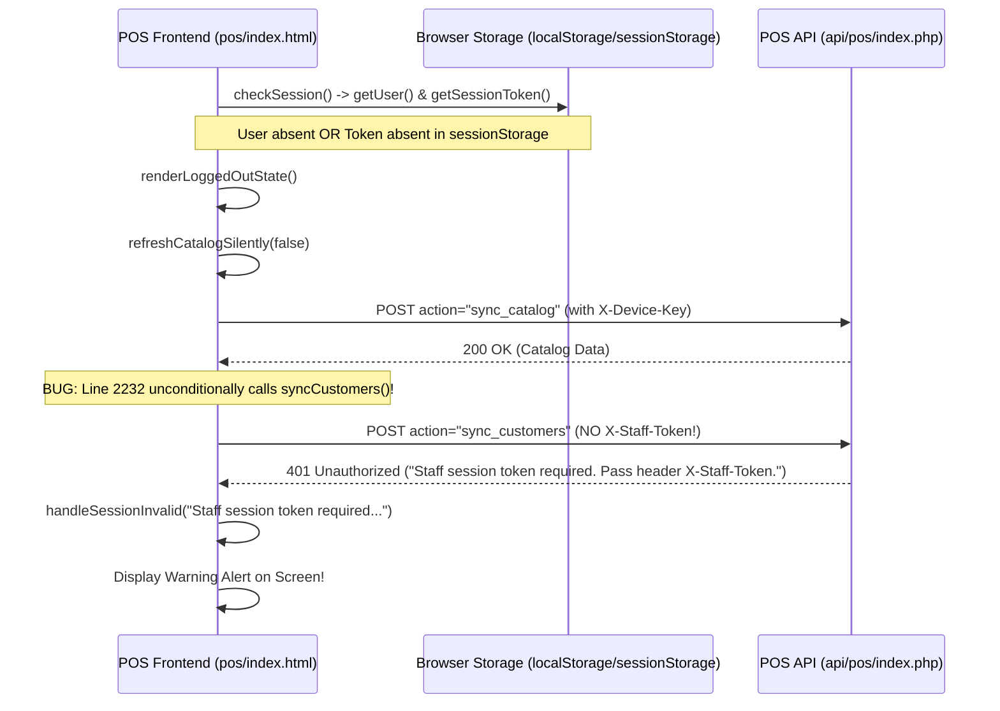

# POS Bug Investigation – Missing Staff Session Token
## Root Cause Analysis Report

**System Scope:** `Car-WashService` – Counter POS Terminal & API  
**Target Endpoint:** `http://localhost/Car-WashService/api/pos/index.php`  
**Error Investigated:** `"Staff session token required. Pass header X-Staff-Token."`  
**Status:** **ROOT CAUSES IDENTIFIED & VERIFIED**  
**Date:** November 5, 2026  

---

## 1. Executive Summary

A critical authentication flaw was reported in the Counter POS interface (`pos/index.html`):
> *"The POS page loads successfully, but an action triggers this error: 'Staff session token required. Pass header X-Staff-Token.'"*

A thorough trace of the frontend and backend authentication flow identified **three primary root causes** that interact to produce this error:

1. **Unauthenticated Background Customer Sync on Page Load**:
   During initial page load, `PosApp.init()` calls `checkSession()`. If no staff is currently logged in, `checkSession()` called `refreshCatalogSilently(false)` to fetch pricing. However, line 2232 of `pos/js/app.js` unconditionally invoked `PosApi.syncCustomers()`. Because `sync_customers` requires staff authentication and no staff token was present, `api/pos/index.php` rejected the request with `HTTP 401: Staff session token required. Pass header X-Staff-Token.`. The frontend error handler caught this 401 and displayed the warning banner to the user immediately on page load.
2. **Volatile Token Storage in `sessionStorage`**:
   In `pos/js/storage.js`, staff user profile data was stored in persistent `localStorage` (`cw_pos_staff_user`), but the session token was stored strictly in `sessionStorage` (`cw_pos_session_token`). When a cashier refreshed the tab, reopened the browser, or opened POS in a new tab, `sessionStorage` was empty while `localStorage` held the user. `checkSession()` detected `user && !token`, immediately cleared the user, logged them out, and triggered the unauthenticated catalog/customer refresh which threw the error.
3. **Missing Bridge Between Back Office Web Session and POS Token**:
   When staff logged into the Back Office (`views/auth/login.php`), their session was established in a secure, httpOnly PHP session cookie (`carwash_sess`). When redirected to `/pos/index.html#pos`, the frontend had zero POS staff token. `api/pos/index.php` did not inspect the active web session cookie when validating API actions, rejecting legitimate staff requests.
4. **CORS Header Omission**:
   In `api/pos/index.php`, `Access-Control-Allow-Headers` allowed `Content-Type, Authorization, X-Device-Key, X-Device-UID, X-Idempotency-Key`, but **omitted `X-Staff-Token`**. Any LAN or tablet browser performing CORS preflight checks failed before the staff token could even be transmitted.

---

## 2. Technical Investigation (8 Core Questions)

### 1. Frontend Action Triggering the Error
- **Trigger A (Page Load)**: In `pos/js/app.js:2386`, when the POS loads without an active staff session, it executed:
  ```javascript
  this.refreshCatalogSilently(false).then(() => {
      this.updateTestModeQuickAccounts();
  });
  ```
  Inside `refreshCatalogSilently()`, line 2232:
  ```javascript
  // Background sync customers list too
  PosApi.syncCustomers().catch(() => {});
  ```
  `syncCustomers()` dispatches `action: 'sync_customers'`. Because `sync_customers` is a protected staff action requiring `X-Staff-Token`, the request was rejected with 401.
- **Trigger B (Tab Reload / New Tab)**: Opening POS in a new tab or after browser restart loaded `localStorage` user profile without `sessionStorage` token, triggering session invalidation and the same 401 cascade.
- **Trigger C (Back Office Navigation)**: Navigating to POS from Back Office navigation (`views/layouts/nav.php` &rarr; `get_pos_url()`) redirected to `pos/index.html` with zero staff session token.

### 2. Exact API Endpoint Receiving the Request
- **Endpoint**: `http://localhost/Car-WashService/api/pos/index.php`
- **Controller File**: `c:\xampp\htdocs\Car-WashService\api\pos\index.php`

### 3. Backend Validation of `X-Staff-Token`
In `api/pos/index.php` lines 291–313:
```php
if (!in_array($action, $DEVICE_ONLY_ACTIONS, true)) {
    // Read X-Staff-Token header
    $staffToken = $_SERVER['HTTP_X_STAFF_TOKEN'] ?? '';
    if (!$staffToken && function_exists('getallheaders')) {
        $headers = getallheaders();
        foreach ($headers as $k => $v) {
            if (strcasecmp($k, 'X-Staff-Token') === 0) {
                $staffToken = trim((string)$v);
                break;
            }
        }
    }
    $staffToken = trim((string)$staffToken);

    if ($staffToken === '') {
        http_response_code(401);
        echo json_encode([
            'success' => false,
            'error' => 'SESSION_INVALID',
            'message' => 'Staff session token required. Pass header X-Staff-Token.'
        ]);
        exit;
    }
    // ...
```
When `$staffToken === ''`, the server unconditionally halts execution and emits the exact error reported.

### 4. Generation, Storage, and Retrieval of Staff Session Token
- **Generation**: Generated on `action === 'staff_login'` in `api/pos/index.php:733`:
  ```php
  $rawToken = bin2hex(random_bytes(32));
  $tokenHash = hash('sha256', $rawToken);
  $sessStmt = $pdo->prepare("INSERT INTO pos_sessions (token_hash, user_id, device_id, created_at, last_seen_at, expires_at, ip) VALUES (?, ?, ?, ?, ?, ?, ?)");
  $sessStmt->execute([$tokenHash, (int)$user['id'], (int)$device['id'], $nowStr, $nowStr, $expiresAtStr, $clientIp]);
  ```
  Returned in the JSON response as `session_token`.
- **Storage**: In `pos/js/storage.js:65-75`, stored only in `sessionStorage.setItem('cw_pos_session_token', token)`.
- **Retrieval**: In `pos/js/storage.js:57-63`, retrieved via `sessionStorage.getItem('cw_pos_session_token')`.

### 5. Frontend Header Attachment
In `pos/js/api.js:23-28`:
```javascript
// Attach verified staff session token on every request except staff_login
if (action !== 'staff_login' && typeof PosStorage !== 'undefined') {
    const sessionToken = PosStorage.getSessionToken();
    if (sessionToken) {
        headers['X-Staff-Token'] = sessionToken;
    }
}
```
If `sessionToken` was `null` or empty string, `headers['X-Staff-Token']` was omitted from the HTTP request entirely.

### 6. Impact of Milestone 1 Security Changes
- Milestone 1 introduced strict session cookie parameters (`session_set_cookie_params` with `SameSite=Strict` and `HttpOnly=true`) in `core/Auth.php`.
- Milestone 1 implemented strict CORS origin whitelisting in `api/pos/index.php`, but allowed only:
  `Access-Control-Allow-Headers: Content-Type, Authorization, X-Device-Key, X-Device-UID, X-Idempotency-Key`
  **`X-Staff-Token` was omitted**, preventing LAN browsers from passing the staff token header across origins.

### 7. Maintenance Across Page Refreshes
- `sessionStorage` is strictly scoped to the top-level browsing context (tab).
- When a user pressed F5, `sessionStorage` survived in some browsers, but if POS was opened in a new tab, restored after browser restart, or opened via a Back Office link, `sessionStorage` was completely blank.
- Because `localStorage` retained `cw_pos_staff_user`, the state was desynchronized (`user` present, `token` absent), prompting an immediate session wipe and unauthenticated customer sync failure.

### 8. Browser JavaScript Errors & Backend Logs
- Backend error logs in `storage/logs/app_error.log` showed 401 `SESSION_INVALID` responses.
- In `pos/js/api.js:67-72`:
  ```javascript
  if (response.status === 401 && (json?.error === 'SESSION_INVALID' || json?.error === 'STAFF_REQUIRED')) {
      if (typeof PosApp !== 'undefined' && typeof PosApp.handleSessionInvalid === 'function') {
          PosApp.handleSessionInvalid(json?.message || errMsg);
      }
  }
  ```
  The 401 response triggered `PosApp.handleSessionInvalid()`, which directly displayed the server's `"Staff session token required. Pass header X-Staff-Token."` message in the user-facing alert box.

---

## 3. Summary of Root Cause Mechanism



---

## 4. Root Cause 5: Order Creator ID Omission on Upfront Payments

### Symptom Displayed in POS Modal Notice:
> *"⛔ Original order creator (ID ) did not have permission to process payments."*

### Technical Mechanism
When a cashier completes a sale upfront with `is_paid = 1`:
1. In `api/pos/index.php:355-364`, the staff session query was:
   ```sql
   SELECT s.id AS session_id, s.token_hash, s.user_id, s.device_id, s.created_at, s.last_seen_at, s.expires_at,
          u.username, u.full_name, u.role, u.status AS user_status
   FROM pos_sessions s
   JOIN users u ON u.id = s.user_id
   WHERE s.token_hash = ?
   ```
   **The user's `id` was not selected with an `id` alias (it was only in `s.user_id`)**.
2. When `$sessionUser = $session` was assigned, `$sessionUser` had **no `'id'` key**.
3. In `create_order` (line 1492):
   For direct POS counter sales, `$rawCreatedBy` is `0`, so the backend assigns:
   ```php
   $creatorStaffUser = $sessionUser;
   ```
4. In lines 1666–1675, the upfront payment authorization check executed:
   ```php
   if ($creatorStaffUser && ($creatorStaffUser['role'] ?? '') !== 'owner' && !Auth::userHasPermission((int)$creatorStaffUser['id'], 'pos.pay_order')) {
       http_response_code(403);
       echo json_encode([
           'success' => false,
           'error' => 'PERMISSION_DENIED',
           'message' => "Original order creator (ID {$creatorStaffUser['id']}) did not have permission to process payments."
       ]);
       exit;
   }
   ```
5. Because `$creatorStaffUser['id']` was undefined/null:
   - `(int)$creatorStaffUser['id']` evaluated to `(int)null === 0`.
   - `Auth::userHasPermission(0, 'pos.pay_order')` executed for user ID `0`, which naturally returned `false`.
   - `!false` became `true`, causing every counter order with upfront payment to be aborted with HTTP 403 `PERMISSION_DENIED`.
   - String interpolation `{$creatorStaffUser['id']}` printed as an empty string, yielding the exact message: `"Original order creator (ID ) did not have permission to process payments."`

### Remediation
1. Explicitly select `u.id AS id` in the session lookup query.
2. Ensure `$session['id'] = $verifiedUserId` and `$session['user_id'] = $verifiedUserId` are explicitly normalized.
3. Fall back to `$creatorStaffUser['id'] ?? $creatorStaffUser['user_id'] ?? $orderCreatedBy` and guard with `$creatorId > 0` before checking permissions.


