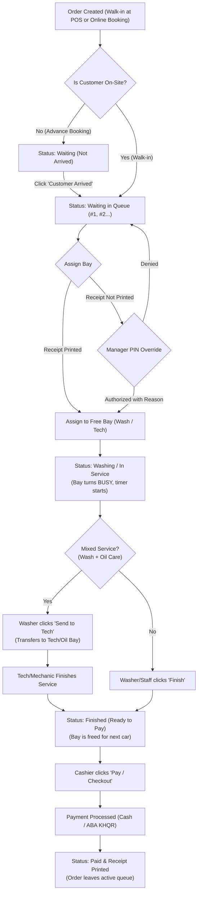

# POS Job Queue & Bay Management Workflow (`/pos/#queue`)

## 1. Overview
The **Job Queue** (`/pos/#queue`) is the operational coordination hub of the Car Wash & Auto Care Service system. It links the front-desk POS counter and online booking system with the physical wash bays and technical service stations on the shop floor.

---

## 2. High-Level Process Flow

---

## 3. Detailed Operational Stages

### Stage 1: Vehicle Ingestion & Arrival
1. **POS Counter Walk-ins:**
   - Cashier creates an order from `/pos/#pos` by entering customer plate number and selecting services.
   - The vehicle automatically joins the queue in First-In, First-Out (FIFO) sequence with status `waiting`.
2. **Advance Online Bookings:**
   - Bookings created via web or mobile app appear in the queue with a yellow **Not Arrived** indicator.
   - Once the customer arrives at the shop, staff click **Customer Arrived**, which marks the order on-site and assigns its active queue rank (`#1 Next`, `#2`, etc.).

---

### Stage 2: Live Bay Status Strip & Quick Assignment
The top strip displays the real-time status of physical bays:
* **Wash Bays 1–3:** Dedicated to exterior/interior wash and detailing.
* **Oil / Tech Bay 4:** Dedicated to engine oil replacement, filter changes, and mechanical diagnostics.

#### Bay Status States:
* **`FREE` (Green):**
  - Indicates the bay is clean and available.
  - If cars are waiting in queue, the bay card displays a **1-Tap "Assign Next: [PLATE]"** button that immediately pulls the next waiting vehicle into that bay.
* **`BUSY` (Blue):**
  - Displays the occupant's plate number, service names, customer name, order number, and elapsed minutes (`Xm in bay`).

---

### Stage 3: Bay Assignment & Manager PIN Protection Gate
When staff manually assign a vehicle to a bay via the **Assign Bay** button:
1. **Receipt Enforcement Check:**
   - By default, policy requires an initial service receipt or ticket to be printed before work begins.
   - If not yet printed, the backend responds with `RECEIPT_REQUIRED`.
2. **Manager Override:**
   - If a customer needs expedited service before payment/printing, the system prompts for **Manager PIN** and an audit reason (e.g., *"Customer requested wash before payment"*).
   - Once verified, the assignment proceeds.
3. **Concurrency Protection:**
   - The backend validates bay availability via atomic state checks to prevent two staff members from dispatching vehicles into the same bay simultaneously.

---

### Stage 4: In-Service Execution & Mixed Service Routing
* **Standard Service:**
  - Bay state changes to `busy`, and queue ticket moves to `washing`.
  - Washer or mechanic works on the vehicle. Elapsed time is monitored in real-time.
  - When complete, staff tap **Finish** to conclude service.
* **Mixed Service (Wash + Oil Care):**
  - For combo packages (e.g., Full Wash + Semi-Synthetic Oil Change), the vehicle first occupies a Wash Bay.
  - When the wash finishes, the button automatically adapts to **Send to Tech**.
  - Tapping transfers the vehicle to the Technical/Oil bay workflow for mechanic servicing.

---

### Stage 5: Completion & Bay Release
* Once **Finish** is confirmed:
  - The bay is deallocated immediately back to `FREE`, allowing the next vehicle in line to be assigned without delay.
  - The queue card transitions to `finished`, highlighted by a green border and a **Ready to pay** badge.

---

### Stage 6: Checkout & Settlement
1. Cashier clicks **Pay / Checkout** on the finished card to open the payment modal.
2. Accepts multi-currency cash (USD and KHR with real-time exchange rates and change calculation) or instant ABA KHQR.
3. Upon payment approval:
   - Order transitions to `paid`.
   - Final tax receipt prints automatically.
   - The ticket is archived from the active shop floor queue into today's completed transactions.

---

## 4. Supervisory & Auxiliary Actions

| Action | Accessible By | Function |
| :--- | :--- | :--- |
| **Change Crew (`Crew`)** | Manager / Owner | Reassign or balance washers and mechanics assigned to a job in progress. |
| **Cancel Order (`Cancel`)** | Manager / Owner | Cancel active ticket with PIN verification and mandatory reason logging. |
| **Reprint Receipt** | Cashier / Manager | Reprints customer service receipt without altering order state. |
| **Print Washer Ticket** | All Staff | Prints the physical washer job slip containing plate number, service items, and bay notes. |

---

## 5. Offline Resilience & Live Polling

* **Background Polling:** Every 3.5 seconds, `pollShopFloorData()` queries the backend to sync bay occupancy and incoming tickets across all connected POS terminals and tablets.
* **Modal Protection:** Background polling pauses UI grid re-renders while a cashier is interacting with an open modal (payment, bay selection, cancellation) to prevent focus disruption.
* **Offline Operation:** If local network connectivity drops:
  - The UI displays an amber **Offline** indicator.
  - Status updates are stored locally in `localStorage` under `offlineStatusQueue`.
  - When connection is restored, pending updates sync automatically to the central back office without data loss.

---

## 6. Key Source Code References

* **UI Structure:** [`pos/index.html`](file:///C:/xampp/htdocs/Car-WashService/pos/index.html) (`#viewQueue`, lines 737–794)
* **Frontend Controller:** [`pos/js/app.js`](file:///C:/xampp/htdocs/Car-WashService/pos/js/app.js) (`renderJobQueue`, `renderCashierBays`, `handleAssignBayOneTap`, `pollShopFloorData`)
* **API Client:** [`pos/js/api.js`](file:///C:/xampp/htdocs/Car-WashService/pos/js/api.js) (`getBaysAndQueue`, `assignBay`, `markCustomerArrived`, `finishCar`)
* **Backend API Controller:** [`api/pos/index.php`](file:///C:/xampp/htdocs/Car-WashService/api/pos/index.php) (`get_bays_and_queue`, `customer_arrived`, `assign_bay`, `finish_car`)
* **Bay Business Logic:** [`core/BayManager.php`](file:///C:/xampp/htdocs/Car-WashService/core/BayManager.php)
