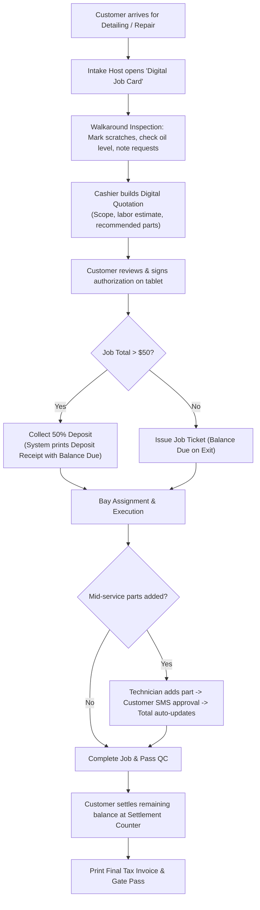

# Recommended POS Workflow & Counter Operational Manual

**Document ID:** POS-DES-2026-005  
**Project:** Car-WashService  
**Scope:** Counter Ergonomics, High-Velocity Checkout, Multi-Tender Settlement, and Receipt/Gate Pass Standards  
**Date:** November 2026  
**Status:** Complete – Awaiting Boss / Management Approval  

---

## 1. Executive Summary & Design Principles

The Point of Sale (POS) is the commercial heart of the car wash and auto-care center. Every second spent fumbling with complex menus, waiting for photo uploads, or searching for customer records directly causes vehicular traffic jams on the driveway.

### Core POS Engineering Principles:
1. **The 20-Second Intake Rule:** A standard walk-in car wash ticket must be created in less than 20 seconds from the moment the vehicle stops.
2. **Decoupled Intake vs. Settlement:** Intake is for queueing the vehicle; settlement is for collecting payment. They must not choke the front driveway.
3. **Multi-Tender Currency Support:** Seamless real-time mixing of USD, KHR, and Bakong KHQR dynamic payments on a single transaction without manager intervention.
4. **Unified Order Architecture:** Eliminating the discrepancy between Web POS (`views/cashier/pos.php`) and API POS (`api/pos/index.php`).

---

## 2. Reconciling the Dual-POS Architectural Split

### Current Process
* The codebase currently operates two disconnected POS engines:
  1. **Web POS (`views/cashier/pos.php`):** Generates `CW-YYYYMMDD-###` order numbers, sets payment status to `unpaid`, and reserves stock without decrementing inventory.
  2. **API POS (`api/pos/index.php`):** Generates `ORD-YYMMDD-###` order numbers, enforces immediate payment processing, and decrements stock on creation.

### Identified Problem
* Inconsistent order numbering confuses staff and creates reconciliation nightmares in daily closing reports.
* Staff cannot seamlessly start an order on a tablet at the apron and settle it at the main cashier PC counter without data desynchronization.

### Recommended Process
* **Single Authoritative API Architecture:**
  - Deprecate direct database writes in `views/cashier/pos.php`. All client interfaces (Main Cashier PC, Mobile Intake Tablets, and Bay Displays) must consume `api/pos/index.php`.
  - Standardize Order Number format globally across the entire business:
    `ORD-[YYMMDD]-[DEVICE_ID]-[SEQUENCE_4_DIGIT]` (e.g. `ORD-261105-01-0042`).
  - Introduce an explicit `workflow_stage` column in `orders`:
    `intake` -> `in_service` -> `qc_pending` -> `ready_for_pickup` -> `closed`.

### Business Benefit
* 100% data consistency; instantaneous synchronization across apron tablets and counter PCs; zero duplicate orders.

### Implementation Details
* **Complexity:** Medium.
* **Required Roles:** System Administrator & Lead Developer.
* **Dependencies & Risks:** Must run migration script to normalize existing order number sequences.

---

## 3. High-Velocity Fast-Lane Wash POS Workflow (< 20 Seconds)

### Operational Sequence

```mermaid
sequenceDiagram
    autonumber
    actor Driver
    actor Greeter as Apron Host (Tablet)
    actor Queue as SmartQueue Engine
    actor Lounge as Customer Lounge

    Driver->>Greeter: Vehicle arrives at apron window
    Greeter->>Greeter: Types plate or presses F2 (Auto-completes vehicle type)
    Greeter->>Greeter: Taps 1-Touch Quick Button: [Premium Wash SUV - $8]
    Greeter->>Greeter: Clips Key Tag #15 to keyring & hands Tag Token #15 to driver
    Greeter->>Queue: Taps [Queue Vehicle] -> Creates Order in < 15 seconds
    Greeter->>Driver: "Please proceed to Lounge. Key #15 will be called on screen."
    Driver->>Lounge: Driver relaxes in lounge; payment handled at leisure
```

### Key POS Screen Features for High Velocity:
1. **1-Touch Fast Packages:** Top 6 most popular combinations displayed as large colored cards:
   - `[F1] Basic Exterior ($4 / $6)`
   - `[F2] Premium Foam + Vacuum ($7 / $9)`
   - `[F3] Express Wax + Interior ($10 / $12)`
   - `[F4] Motorbike Wash ($2.00)`
   - `[F5] Oil Change 10W-40 Synthetic ($25)`
   - `[F6] Retail Cold Drink / Counter ($1.00)`
2. **Auto-Vehicle Type Defaults:** When entering a known plate (e.g., `2A-1234`), the system remembers the vehicle type (`suv_pickup`) and immediately adjusts prices without cashier prompting.
3. **No Upfront Payment Forcing:** Cashier can choose `[Queue First, Pay Later]` or `[Pay Now & Queue]`.

---

## 4. Consultative Detailing & Technical Repair POS Workflow

For high-ticket jobs (> $30), a consultative workflow replaces the fast-lane sequence to prevent billing disputes.

### Operational Sequence



---

## 5. Multi-Tender & Split-Payment Settlement Workflow

Cambodian retail operations routinely handle transactions mixed between US Dollars, Cambodian Riel, and Bakong KHQR. The POS must support fluid split tendering.

### Supported Split-Tender Scenarios:
1. **Cash USD + Cash KHR:** Customer has a $5 bill and pays the remaining $3.50 in Riel (14,500 ៛ at 4,100 exchange rate).
2. **Cash + Digital Bank (ABA / KHQR):** Customer pays $10 cash deposit and settles remaining $15 via ABA KHQR.
3. **Points Redemption + Cash:** Customer redeems 500 loyalty points ($2.50 discount) and pays remainder in cash.

### Recommended Split-Payment UI Modal:
```
┌────────────────────────────────────────────────────────┐
│ TOTAL PAYABLE: $25.00  (102,500 ៛)                     │
├────────────────────────────────────────────────────────┤
│ Split Tender Entry:                                    │
│ [1] Cash USD:     [ $10.00  ] -> Paid $10.00          │
│ [2] Cash KHR:     [ 20,500៛ ] -> Paid $5.00           │
│ [3] Bakong KHQR:  [ $10.00  ] -> Dynamic QR Generated │
├────────────────────────────────────────────────────────┤
│ REMAINING BALANCE DUE: $0.00                           │
│ [ COMPLETE SPLIT TRANSACTION & OPEN CASH DRAWER ]      │
└────────────────────────────────────────────────────────┘
```

### Eliminating the Mandatory Webcam Photo Upload:
* **The Problem:** Capturing webcam photos of customer mobile screens creates glare, failures, and apron gridlock.
* **The Solution:**
  1. **Dynamic Bakong KHQR:** POS displays a dynamic KHQR with the exact dollar amount embedded. When customer scans, the bank API / webhook receives confirmation and marks payment `paid` in < 2 seconds automatically.
  2. **Static Merchant QR Fallback:** If internet is slow, customer transfers to the shop's printed static QR. Cashier simply keys in the last 4 digits of the bank reference number (`Ref #`) and verifies the audible chime on the shop's ABA Merchant Soundbox. Physical photo upload is **optional** and reserved only for spot audit spot-checks.

---

## 6. Receipt, Key Tag & Gate Pass Documentation Standards

To guarantee physical asset security and prevent unpaid vehicle drive-offs, every order generates three distinct thermal printouts at specific lifecycle milestones:

### 1. The Dashboard / Key Tag Ticket (Printed at Intake)
* **When:** Immediately upon vehicle check-in.
* **Where it goes:** Clipped to customer keyring; duplicate placed under windshield wiper.
* **Contents:**
  - Large Bold Queue Number: `Q-024`
  - Large Bold Key Tag Number: `KEY # 15`
  - License Plate & Vehicle Model: `2A-9876 (Ford Ranger Raptor)`
  - Intake Timestamp & Selected Services.

### 2. The Customer Payment Receipt (Printed at Settlement)
* **When:** Upon payment completion (Cash, ABA, or KHQR).
* **Where it goes:** Handed to customer for accounting / records.
* **Contents:**
  - Shop Logo, Address, Tax ID, Telephone.
  - Itemized Services, Products, Spare Parts, and Lubricants.
  - Subtotal, Discounts, Loyalty Points Earned / Balance.
  - Amount Tendered (USD / KHR), Change Dispensed, Payment Ref.

### 3. The Digital Exit Gate Pass (Printed / Stamped at Handover)
* **When:** Released only when `payment_status = 'paid'` AND `qc_status = 'passed'`.
* **Where it goes:** Handed to Exit Barrier Guard.
* **Contents:**
  - Large Scannable Exit Barcode.
  - Plate Number & Authorizing Cashier ID.
  - Validity: `Valid for 15 minutes from print timestamp`.
  - Guard scans barcode at driveway exit arm; arm opens; pass is retained in guard drop box.

---

## 7. Cashier Shift Handover & End-of-Day Z-Report Reconciliation

### Morning Shift Opening Procedure (07:30 AM)
1. Cashier logs into POS with individual Staff PIN.
2. Promoted with `Shift Opening Modal`:
   - Enter starting cash drawer float (e.g. $50.00 USD + 200,000 ៛ KHR).
   - System verifies yesterday's closing float matches opening count.
   - Cash drawer kicks open for visual verification.
3. System logs `SHIFT_STARTED` in audit trail.

### Mid-Day Shift Handover Procedure (02:00 PM)
1. Outgoing Cashier clicks `[End Shift / Handover]`.
2. Outgoing Cashier counts physical cash in drawer without looking at expected system totals (Blind Count):
   - Enter counted USD and counted KHR.
3. System displays calculated variance:
   - Expected: `$450.00` | Counted: `$450.00` | Diff: `$0.00` (Balanced).
4. Incoming Cashier enters their Staff PIN to accept custody of the cash float.
5. Dual-PIN sign-off recorded in immutable audit log (`SHIFT_HANDOVER`).

### Evening Closing & Z-Report Procedure (09:00 PM)
1. General Manager and Evening Cashier initiate `[Daily Z-Report Close]`.
2. All active orders must be either `closed`, `cancelled`, or formally marked `overnight_stay`.
3. System prints official Z-Report containing:
   - Gross Wash Sales, Gross Technical Sales, Gross Product Sales.
   - Total Discounts Granted (Itemized by Manager Override ID).
   - Total Cash USD, Total Cash KHR, Total ABA Pay, Total KHQR.
   - System-calculated Staff Commissions (Washers + Mechanics).
   - Net Cash to be Deposited into Owner Safe.
4. Cash is bagged with printed Z-Report slip and dropped into the locked drop safe.
5. System sets `pos_closings.status = 'closed'`, locking sales until the next morning.
