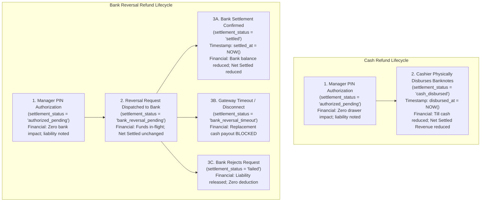
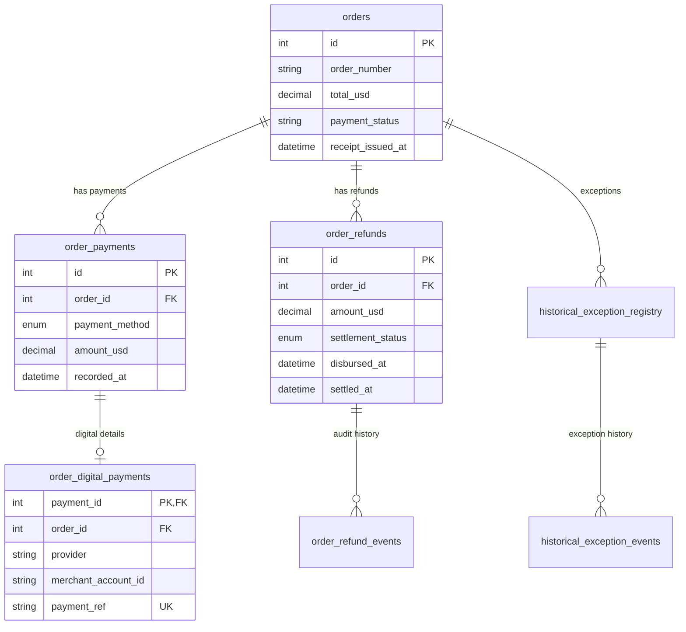
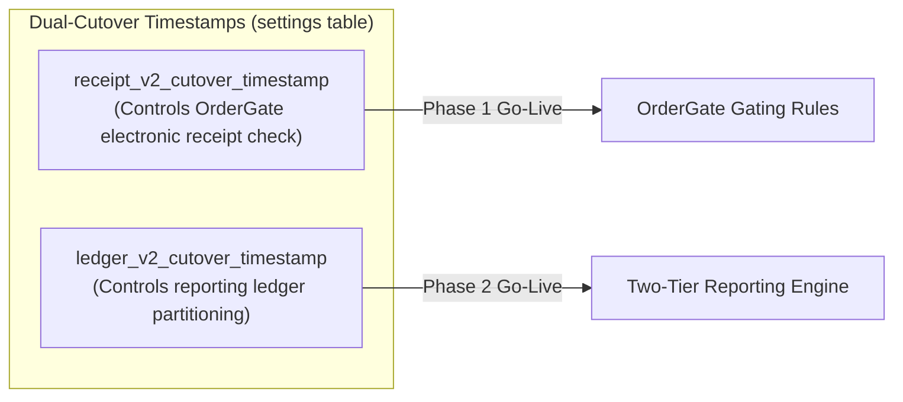
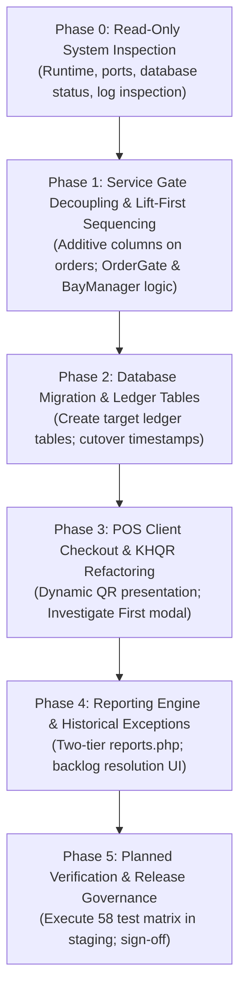

# ROUND 18.1 – Architecture Corrections & Final Design Decisions

**Project:** Car-WashService (Local Counter Terminal)  
**Document ID:** POS-ARC-2026-CORR-18.1  
**Date:** November 8, 2026  
**Status:** **STRICT PLANNING ONLY – AWAITING SEPARATE EXECUTIVE AUTHORIZATION**  
**Audit Reference:** Round 17 Read-Only Implementation Gap Audit & Round 18 Implementation Plan  
**Governing Standard:** Six Approved Executive Business Decisions (November 8, 2026) – Unchanged and Preserved

---

## Executive Summary & Purpose

This document provides architectural corrections and technical design decisions following the Round 18 Implementation Architecture and Migration Plan. 

During Round 18 review, critical technical inconsistencies were identified regarding payment-to-receipt sequencing, pending KHQR intent data modeling, refund financial recognition timestamps, accounting terminology, dual-cutover management, and phase dependency ordering.

This document formally resolves those issues, establishes deterministic lifecycles, and provides the full 58-test planned verification matrix. In strict accordance with project safety rules, **this document is a planning deliverable only; no implementation code, SQL migrations, database writes, or test executions have been performed.**

---

## 1. Receipt Issuance & Payment Sequence Resolution

### 1.1 Round 18 Flaw Identification
In Round 18 (Section 5, Phase 1), the plan proposed:
> *"POST /api/pos/index.php?action=create_order populates receipt_issued_at = NOW()"*

**Architectural Defect:** In POS cashier workflows, an order can be created in an unpaid state, staged for payment, or held awaiting a customer bank transfer. Populating `receipt_issued_at = NOW()` unconditionally at `create_order` prematurely issues an electronic receipt before money is collected. This directly violates **Decision 2 ("Payment Before Service Gate")**, which establishes that confirmed payment (`payment_status = 'paid'`) and electronic receipt issuance (`receipt_issued_at IS NOT NULL`) are the mandatory dual-key service gate pass.

### 1.2 Deterministic Payment & Receipt Lifecycles

```mermaid
stateDiagram-v2
    [*] --> CartDraft : Cashier selects items & plate
    
    CartDraft --> CashTender : Select Cash
    CashTender --> CashPaid : Cash collected in till
    CashPaid --> ReceiptIssued : Atomic insert order_payments & set receipt_issued_at
    
    CartDraft --> KHQRInitiated : Select KHQR
    KHQRInitiated --> KHQRPending : Dynamic QR displayed (300s TTL)
    KHQRPending --> HeldAtApron : Car held; gate closed
    
    KHQRPending --> KHQRStatementVerified : Cashier checks merchant banking app statement
    KHQRStatementVerified --> KHQRPaid : Genuine payment_ref entered & validated
    KHQRPaid --> ReceiptIssued : Atomic insert order_digital_payments & set receipt_issued_at
    
    KHQRPending --> KHQRExpired : Timer t > 300s
    KHQRExpired --> InvestigateFirst : Customer claims late transfer
    InvestigateFirst --> KHQRStatementVerified : Funds confirmed on merchant statement
    InvestigateFirst --> PaymentCancelled : Funds missing after manager review
    
    ReceiptIssued --> GatePassGranted : OrderGate evaluates paid + receipt_issued_at
    GatePassGranted --> Bay4Mechanical : Mixed order (Lift First)
    GatePassGranted --> Bay1to3Wash : Wash-only order
```



#### A. Cash Payment Lifecycle:
1. **Intake & Cart:** Cashier enters vehicle license plate (defaulting customer to `'Walk-in Guest'`) and selects catalog items.
2. **Tender:** Cashier taps cash pad. Smart cash pad computes dual-currency change ($ USD / ៛ KHR).
3. **Atomic Commit:** Backend inserts row into `order_payments` (`payment_method = 'cash'`, `recorded_at = NOW()`).
4. **Order State:** Backend updates `orders`:
   - `payment_status = 'paid'`
   - `paid_at = NOW()`
   - `receipt_number = 'REC-' || DATE_FORMAT(NOW(), '%y%m%d') || '-' || LPAD(orders.id, 5, '0')`
   - `receipt_issued_at = NOW()`
5. **Gate Evaluation:** `OrderGate::assertAdmissibleToService()` verifies `payment_status === 'paid'` AND `receipt_issued_at IS NOT NULL`. Gate pass is granted immediately. Vehicle proceeds to Bay 4 (if mechanical lube) or Bay 1–3 (if wash).

#### B. KHQR Pending Payment Lifecycle:
1. **QR Generation:** Cashier selects "KHQR". Dynamic EMVCo QR payload is assembled and displayed on counter screen with live countdown timer (configurable default: 300 seconds).
2. **Pending In-Flight State:** An ephemeral `client_pending_intent_id` (UUID v4) tracks the intent in browser memory / IndexedDB (`PosStorage`).
3. **Database Guard:** Zero rows are written to `order_payments` or `order_digital_payments`.
4. **Gate Evaluation:** In `orders`, `payment_status = 'pending'`, and `receipt_issued_at IS NULL`.
5. **Hold Protocol:** `OrderGate` strictly blocks bay admission. The vehicle is held at the intake apron.

#### C. KHQR Verified Payment Lifecycle:
1. **Customer Transfer:** Customer transfers funds via mobile banking app (Bakong / ABA).
2. **Audio & Discovery Alerts:** Counter soundbox voice announcement and phone push notifications alert the cashier that incoming credit has occurred.
3. **Statement Verification (Primary Evidence):** Cashier opens the official mobile banking application on the merchant counter phone and verifies the 5 mandatory statement fields:
   - (1) Merchant destination account
   - (2) Exact amount
   - (3) Currency (USD vs. KHR)
   - (4) Transaction status = `SUCCESS` / `COMPLETED`
   - (5) Genuine bank transaction reference (`payment_ref`)
4. **Atomic Commit:** Cashier inputs the authentic `payment_ref`. The backend executes an atomic single transaction:
   - Inserts row into `order_payments` (`payment_method = 'khqr'`, `recorded_at = NOW()`).
   - Inserts row into `order_digital_payments` (`provider = 'aba_payway'`, `merchant_account_id = '001-234567'`, `payment_ref = :payment_ref`, `created_at = NOW()`). Composite uniqueness (`uq_digital_bank_ref`) rejects duplicate references.
   - Updates `orders`: `payment_status = 'paid'`, `paid_at = NOW()`, `receipt_number = ...`, `receipt_issued_at = NOW()`.
5. **Gate Evaluation:** Gate pass granted. Vehicle admitted to Bay 4 or Bay 1–3.

#### D. Failed or Uncertain Payment:
1. If the transfer fails, the bank rejects it, or the customer claims payment but zero funds appear on the merchant banking app statement:
2. The order remains `payment_status = 'pending'` or transitions to `'cancelled'`.
3. `receipt_issued_at` remains `NULL`.
4. Electronic receipt is **never** issued, and the vehicle is **never** dispatched to a service bay.

#### E. Thermal Printer Failure (Advisory Only):
1. Thermal printer runs out of paper, USB disconnects, or hardware jams during print execution.
2. Physical printer callback logs failure; `orders.receipt_printed_at` remains `NULL`.
3. POS client displays an advisory warning toast: `"Printer offline / paper jam – receipt stored electronically"`.
4. **Gate Pass Unaffected:** Because `payment_status = 'paid'` and `receipt_issued_at IS NOT NULL` are valid, `OrderGate` grants admission. Service is **never** blocked by physical printing issues.

---

## 2. KHQR Pending-Intent Architecture

### 2.1 Architectural Comparison

| Architectural Criteria | Option A: Separate `pos_payment_intents` Staging Table | Option B: Nullable `payment_ref` in `order_digital_payments` |
| :--- | :--- | :--- |
| **1. Pending Intent Creation** | Clean separation: pending checkout intents reside in a non-financial staging table. Financial ledgers remain pristine. | Pending rows are inserted directly into `order_digital_payments` with `payment_ref = NULL` and status `'pending'`. |
| **2. Local UI Expiry (300s TTL)** | TTL managed via `expires_at` column in staging table; expired intents cleaned by lightweight sweep without touching ledgers. | Requires managing non-financial intent timeouts inside the authoritative digital financial ledger. |
| **3. Duplicate Payment Prevention** | Intent carries `idempotency_key`. Prevents duplicate submission before touching ledgers. | Harder to differentiate intent double-click from confirmed payment double-submission. |
| **4. Late Transfer Investigation** | Expired intent retained in staging table for cashier audit lookup while merchant statement is inspected. | Expired rows clutter financial table with uncollected attempts. |
| **5. Bank Reference Uniqueness** | `order_digital_payments.payment_ref` is strictly `NOT NULL` with `UNIQUE (provider, merchant_account_id, payment_ref)`. Zero SQL standard `NULL != NULL` index vulnerabilities. | Unique index must allow `NULL` or use partial indexing. In MariaDB, multiple `NULL` values bypass unique indexes. |
| **6. Merchant Account ID** | Mandatory `NOT NULL` on both staging and financial ledgers. | Mandatory `NOT NULL`. |
| **7. Offline LAN Recovery** | In standard counter operations, IndexedDB (`PosStorage`) handles offline intent recovery. Staging table acts as LAN server backup. | If local server restarts, pending nullable rows in ledger require cleanup. |
| **8. Atomic Confirmation** | Moving from pending to paid executes an atomic transaction inserting confirmed records into `order_payments` and `order_digital_payments`. | Updates existing row from `NULL` to actual reference, mutating financial history instead of appending. |
| **9. Historical Auditability** | Financial ledger is 100% append-only confirmed tenders. Abandoned intents do not distort financial data. | Audit reports must constantly filter `WHERE settlement_status = 'settled'` to avoid summing unconfirmed intents. |

### 2.2 Recommended Architecture & Justification

**Selected Architecture: Option A – In-Memory/IndexedDB (`PosStorage`) Staging with Pristine Append-Only Two-Table Ledger**

```mermaid
flowchart TD
    subgraph Staging_Zone["Staging Zone (Non-Financial)"]
        PosStorage["Browser IndexedDB (PosStorage)\nclient_pending_intent_id\nidempotency_key\nexpires_at (300s TTL)"]
        OptionalStaging["Optional: pos_payment_intents\n(Server-Side Non-Financial Staging)"]
    end

    subgraph Ledger_Zone["Authoritative Financial Ledgers (Pristine Append-Only)"]
        OP["order_payments\n(amount_usd, amount_khr, recorded_at)"]
        ODP["order_digital_payments\nNOT NULL payment_ref\nCONSTRAINT uq_digital_bank_ref"]
    end

    PosStorage -.->|If server staging required| OptionalStaging
    PosStorage ==>|Cashier verifies statement & enters genuine payment_ref| OP
    PosStorage ==>|Atomic INSERT (never UPDATE from NULL)| ODP
```

#### Detailed Justification:
1. **Preservation of Authoritative Ledger Purity:** In accounting systems, financial tables must record confirmed financial transactions, not shopping cart browsing or abandoned QR scans. Inserting uncollected attempts with `NULL` references into `order_digital_payments` corrupts ledger integrity.
2. **Defeating the MariaDB `NULL != NULL` Vulnerability:** Under SQL standards implemented by MySQL and MariaDB, `NULL` values are treated as distinct in unique indexes. If `order_digital_payments.payment_ref` allows `NULL`, multiple pending rows with identical providers and accounts bypass unique protection. By keeping `order_digital_payments.payment_ref` strictly `NOT NULL`, the constraint `CONSTRAINT uq_digital_bank_ref UNIQUE (provider, merchant_account_id, payment_ref)` operates with 100% mathematical certainty.
3. **Zero Invented Bank APIs:** The workflow operates purely on local counter LAN. No bank webhook endpoints or automated polling threads are assumed. Dynamic QR code formatting is verified against official NBC Bakong EMVCo Merchant-Presented Mode specifications prior to release.

---

## 3. Refund Accounting Corrections & Deterministic Lifecycles

### 3.1 Cash Refund vs. Bank Reversal Lifecycles



### 3.2 Authoritative Financial Recognition Timestamps

To resolve Round 18 inconsistencies between `cash_disbursed`, `settled`, `disbursed_at`, and `settled_at`, the authoritative recognition timestamp is defined strictly by tender type:

| Refund Type | Terminal Settlement Status | Authoritative Recognition Timestamp | Trigger Event | Financial Account Impact |
| :--- | :--- | :--- | :--- | :--- |
| **Cash Refund** | `cash_disbursed` | `order_refunds.disbursed_at` | Cashier taps "Disburse Cash", conditional lock succeeds (`rowCount === 1`), cash drawer opens. | Deducts from Physical Cash Till. Deducts from Net Settled Revenue in period containing `disbursed_at`. |
| **Bank Reversal** | `settled` | `order_refunds.settled_at` | Merchant confirms clearinghouse reversal credit in bank records. | Deducts from Digital Bank Ledger. Deducts from Net Settled Revenue in period containing `settled_at`. |

### 3.3 Impact on Reporting Across Time Horizons

1. **Net Settled Revenue Impact:**
   $$\text{Net Settled Revenue} = \sum \text{Gross Confirmed Payments} - \sum \text{Settled Refunds}$$
   Where $\sum \text{Settled Refunds}$ includes:
   - Cash refunds where `settlement_status = 'cash_disbursed'` and `disbursed_at` falls in the reporting window.
   - Bank reversals where `settlement_status = 'settled'` and `settled_at` falls in the reporting window.
   - Statuses `'authorized_pending'`, `'bank_reversal_pending'`, `'bank_reversal_timeout'`, and `'failed'` have **zero impact** on Net Settled Revenue.
2. **Net Operating Profit Impact:**
   $$\text{Net Operating Profit} = \text{Net Settled Revenue} - (\text{COGS} + \text{Commissions} + \text{Expenses})$$
   A refund reduces Net Settled Revenue and proportionally reduces Net Operating Profit. If refunded goods are returned to inventory, stock quantity increments, and COGS is credited in the period of return.
3. **Daily Shift Reporting & Cash Drawer Balancing:**
   - Expected Till Cash = `Opening Float + Cash Sales - Cash Expenses - Cash Refunds (WHERE settlement_status = 'cash_disbursed')`.
   - Bank reversals have **zero impact** on physical cash drawer balancing.
4. **Historical Periods (Anti-Double-Counting Rule):**
   - If an order created in October is refunded in November, the refund is recognized on its event date in November (`disbursed_at` or `settled_at`).
   - The closed October revenue report is **never** retroactively modified.

---

## 4. Accounting Terminology & Ledger Integrity

### 4.1 Critique of "Discrete Double-Entry Financial Engine"
Round 18 used the phrase *"Discrete Double-Entry Financial Engine"*. In standard accounting science, a double-entry system requires dual debit and credit ledger entries across a five-class Chart of Accounts (Assets, Liabilities, Equity, Revenue, Expense) where every transaction balances to zero ($\sum \text{Debits} = \sum \text{Credits}$). 

The Car-WashService database does not contain a Chart of Accounts, debit/credit journals, or general ledger balance sheets. Claiming "double-entry" is technically inaccurate. 

**Accurate Terminology:** **"Immutable Payment and Refund Transaction Ledgers"** (with Discrete Cash and Digital Tender Isolation).

### 4.2 Financial Integrity Constraints & Transaction Boundaries



1. **Append-Only Immutability:** Financial inflow tables (`order_payments`, `order_digital_payments`) permit `INSERT` and `SELECT` only. Application database credentials prohibit `UPDATE` and `DELETE` on payment ledger rows.
2. **Restrictive Referential Deletion (`ON DELETE RESTRICT`):** Deleting an order that has attached payments or refunds is blocked at the database engine level.
3. **Cumulative Refund Ceiling:**
   $$\sum \text{Non-Cancelled Refunds} \le \sum \text{Confirmed Payments for Order}$$
   Enforced via atomic database checks during refund authorization.
4. **Composite Foreign Key Alignment:**
   `FOREIGN KEY (payment_id, order_id) REFERENCES order_payments(id, order_id) ON DELETE RESTRICT` guarantees that digital payment records can never disagree with parent order assignments.

---

## 5. Cutover Strategy & Historical Data Partitioning

### 5.1 Dual-Cutover Timestamp Architecture

To guarantee operational safety, receipt gating and financial reporting cutovers are decoupled into two distinct settings:



1. **`settings.receipt_v2_cutover_timestamp`:**
   - *Meaning:* The exact wall-clock second when the electronic receipt gate becomes mandatory for vehicle apron admission.
   - *Behavior:* Orders created $\ge$ this timestamp require `payment_status = 'paid'` AND `receipt_issued_at IS NOT NULL`. Orders created prior to this timestamp are admitted using legacy criteria (`receipt_printed_at` or manager override).
2. **`settings.ledger_v2_cutover_timestamp`:**
   - *Meaning:* The exact wall-clock second when discrete immutable ledgers (`order_payments`, `order_digital_payments`, `order_refunds`) become the authoritative source for financial reporting.
   - *Behavior:* Reporting queries evaluate transactions based on this boundary.
3. **One-Time Immutable Initialization:**
   - Both timestamps are set to `NOW()` during their respective phase deployment scripts.
   - Once set, application logic treats both timestamps as strictly read-only constants.

### 5.2 Reporting Partitioning & Anti-Double-Counting Rules

| Time Horizon of Report | Reporting Source for Inflows | Reporting Source for Outflows | Handling of Subsequent Ledger Activity on Legacy Orders |
| :--- | :--- | :--- | :--- |
| **Pre-Cutover Period** ($t < \text{cutover}$) | Legacy `orders` table (`WHERE status = 'paid'`). Unconflicted orders only. | Legacy `orders.refund_amount_usd`. | Orders with later payments or cancellations are surfaced on **Exceptions Backlog**; zero retroactive changes to historical totals. |
| **Post-Cutover Period** ($t \ge \text{cutover}$) | Discrete ledger `order_payments` (`recorded_at` in window). | Discrete ledger `order_refunds` (`disbursed_at` or `settled_at` in window). | Subsequent payments on legacy orders are recognized in post-cutover period when recorded. |
| **Cross-Cutover Period** (Window spans across cutover) | Sum of Tier 1 (`order_payments` in window) + Tier 2 (Unconflicted historical orders in window). | Sum of Tier 1 (`order_refunds` in window) + Tier 2 (Historical refunds in window). | Exact partitioning; zero orders counted in both tiers; zero omission. |

---

## 6. Corrected Phase Dependencies & Rollback Governance

### 6.1 Corrected Sequential Dependency Order



#### Detailed Phase Guardrails:
- **Phase 1 Independence:** Phase 1 modifies only `OrderGate.php` and `BayManager.php`, adding nullable columns `orders.receipt_issued_at` and `orders.receipt_number`. It does **not** depend on Phase 2 ledger tables; checkout continues writing to `orders` while electronic receipt gating and Lift-First sequencing become active.
- **Phase 2 Non-Destructive Addition:** Target tables are created with `CREATE TABLE IF NOT EXISTS`. Existing queries in `views/cashier/pos.php` and `views/orders/index.php` continue operating seamlessly without interruption.
- **Phase 3 Client Cutover:** POS frontend is updated to use the new discrete tender endpoints, removing customer slip uploads and activating dynamic QR countdowns.
- **Phase 4 Financial Cutover:** `views/owner/reports.php` activates the Two-Tier query architecture and launches the Historical Exceptions review tab.
- **Phase 5 Release Governance:** Final acceptance testing executed on an isolated staging database.

### 6.2 MariaDB DDL Implicit Commit & Rollback Limitations

> [!WARNING]
> **MariaDB DDL Rollback Limitation:**  
> In MySQL and MariaDB, all Data Definition Language (DDL) statements (`CREATE TABLE`, `ALTER TABLE`, `DROP TABLE`) trigger an **implicit commit**. DDL statements cannot be rolled back inside a database transaction block (`START TRANSACTION ... ROLLBACK`).

#### Rollback Protocol:
1. **Never Mutate Existing Data Columns:** Migration scripts must **never** drop, rename, or truncate existing columns in `orders`, `order_items`, or `bays`.
2. **Additive-Only DDL:** All schema modifications consist strictly of:
   - Creating new tables with `CREATE TABLE IF NOT EXISTS`.
   - Adding new nullable columns to existing tables (`ALTER TABLE ... ADD COLUMN ... NULL`).
3. **Failure Recovery:** If a migration script encounters an error at Step $N$, previously created tables do not affect the legacy application. The rollback procedure consists of dropping the newly created tables (`DROP TABLE IF EXISTS ...`) and removing the newly added nullable columns, returning the schema to byte-level parity.
4. **Isolated Test Restore Requirement:** No production DDL is executed until the identical migration script has completed with zero errors on a freshly restored staging copy.

---

## 7. Complete 58-Test Planned Verification Matrix

> [!NOTE]
> All 58 test cases below are **PLANNED TEST SPECIFICATIONS** from [`POS-IMPLEMENTATION-TEST-MATRIX.md`](file:///C:/xampp/htdocs/Car-WashService/POS-IMPLEMENTATION-TEST-MATRIX.md). They must **NOT** be executed during this planning phase. Execution is scheduled strictly for Phase 5 in an isolated staging environment.

### Suite 1: Receipt Printing Decoupling & OrderGate Tests (8 Tests)

| Test ID | Test Scenario | Preconditions & Execution Steps | Expected System Behavior | Pass / Fail Criteria |
| :---: | :--- | :--- | :--- | :--- |
| **TC-REC-01** | Electronic Receipt Issuance on Payment | Cashier logged in; submit cash checkout for $3.00 Sedan Wash. | Order created with `payment_status = 'paid'`; `receipt_number` generated (`REC-YYMMDD-#####`); `receipt_issued_at` timestamped. `receipt_printed_at` remains NULL. | **PASS** if electronic receipt is recorded in database without depending on physical printer status. |
| **TC-REC-02** | Physical Printer Offline Bay Passage | Thermal printer USB disconnected or paper removed. Car paid (TC-REC-01). Dispatch car to Bay 1. | `OrderGate::assertAdmissibleToService()` evaluates `receipt_issued_at` and `payment_status = 'paid'`. Gate passes; vehicle admitted. | **PASS** if vehicle is NOT blocked from entering wash bay despite printer offline. |
| **TC-REC-03** | Block Admission When Electronic Receipt Missing | Order created with `payment_status = 'paid'`, but simulate missing `receipt_issued_at = NULL`. | `OrderGate` detects missing electronic receipt timestamp and throws `ReceiptRequiredException`. Admission strictly blocked. | **PASS** if orders without electronic receipts are blocked even if marked paid. |
| **TC-REC-04** | Unpaid Order Blocked at Bay Gate | Order exists with `payment_status = 'unpaid'`. Attempt to assign to Bay 1. | `OrderGate` detects unpaid status, throws `PaymentRequiredException` (HTTP 422). Vehicle movement rejected. | **PASS** if unpaid vehicle is 100% blocked from entering service bay. |
| **TC-REC-05** | Legacy Order Compatibility Admission | Historical order created before cutover date (`created_at < cutover_ts`) with `receipt_issued_at IS NULL`. | `OrderGate` evaluates cutover timestamp; allows admission based on legacy `receipt_printed_at` or manager PIN override. | **PASS** if legacy historical orders are admitted without requiring backfilled electronic receipts. |
| **TC-REC-06** | Reprint Receipt Presentation Independence | Order already paid and washed. Cashier clicks "Reprint Receipt". | Returns existing receipt payload; appends `*** DUPLICATE RECEIPT ***` watermark; increments audit print count; mutates zero financial totals. | **PASS** if re-printing is strictly read-only and mutates zero financial totals. |
| **TC-REC-07** | Fail-Closed Gate on Missing Cutover Timestamp | `receipt_v2_cutover_timestamp` absent or empty in `settings` table. Attempt order admission. | `OrderGate` detects missing setting, throws `SystemConfigurationException`. Gate fails closed; admission halted. | **PASS** if missing cutover timestamp fails closed and prevents receipt bypass. |
| **TC-REC-08** | Fail-Closed Gate on Malformed Cutover Timestamp | `receipt_v2_cutover_timestamp` set to malformed string (`'INVALID_DATE'`) or future date (`'2099-12-31'`). | `OrderGate` verifies configuration; throws `SystemConfigurationException`. Admission halted; refuses to fail open. | **PASS** if invalid or future cutover timestamps fail closed. |

### Suite 2: Anti-Fraud KHQR & Scoped Reference Verification Tests (13 Tests)

| Test ID | Test Scenario | Preconditions & Execution Steps | Expected System Behavior | Pass / Fail Criteria |
| :---: | :--- | :--- | :--- | :--- |
| **TC-KHQR-01** | Rejection of Synthetic TRX Fallback | POS API receives KHQR checkout request with empty `payment_ref = ''`. | API does NOT generate synthetic `TRX-` string via `md5(uniqid())`; rejects request with HTTP 422 `BANK_REFERENCE_REQUIRED`. | **PASS** if backend refuses to manufacture fake bank transaction references. |
| **TC-KHQR-02** | Manual Merchant-Device Verification & Attribution | Customer scans dynamic KHQR; merchant counter phone statement confirms credit. Cashier inputs authentic `payment_ref`. | Backend captures cashier attestation, cashier ID, timestamp, and stores genuine `payment_ref`. Audit log records `KHQR_PAYMENT_VERIFIED`. | **PASS** if cashier attestation and attribution are immutably captured without fake bank validation. |
| **TC-KHQR-03** | Authoritative Ledger Scoped Duplicate Bank Ref Rejection | Order #1001 payment committed with `provider = 'aba_payway'`, `account = '001-234567'`, `ref = '849201'`. Second order attempts same ref. | Constraint `uq_digital_bank_ref` triggers duplicate collision. Request rejected with HTTP 409 `DUPLICATE_PAYMENT_REFERENCE`. | **PASS** if duplicate bank references are strictly rejected within provider and merchant account scope. |
| **TC-KHQR-04** | Customer Screenshot Rejection Protocol | Customer presents mobile screenshot of transfer. No credit visible on merchant counter phone statement. | Cashier holds vehicle at apron; does not dispatch to bay. POS displays awaiting merchant statement confirmation. | **PASS** if unverified customer screens do not admit vehicle to wash apron. |
| **TC-KHQR-05A** | ABA PayWay Webhook HMAC-SHA512 Verification | Staging environment receiving automated ABA PayWay webhook callback. | Valid hash matching PayWay spec transitions order to `'paid'`. Tampered payload or bad key rejected with HTTP 401. | **PASS** if PayWay webhooks validate strictly against official parameter sequence HMAC-SHA512. |
| **TC-KHQR-05B** | NBC Bakong RSA-SHA256 Verification | Staging environment receiving automated NBC Bakong webhook callback. | Valid signature verified via `openssl_verify()` with Bakong public cert transitions order; forged cert rejected with HTTP 401. | **PASS** if Bakong webhooks validate strictly against official RSA-SHA256 certificate specifications. |
| **TC-KHQR-06** | Offline LAN Handling of KHQR Attempt | WAN Internet disconnected; local LAN Wi-Fi active. Cashier selects KHQR. | POS alerts that real-time merchant alerts may require cellular check on store phone; cash pad remains fully operational. | **PASS** if system handles internet loss gracefully without freezing. |
| **TC-KHQR-07** | Duplicate Webhook Delivery Idempotency | Valid signed webhook processed for bank event `EVT-998811`. Duplicate webhook arrives 15s later. | Endpoint queries processed events, detects existing ID, returns HTTP 200 `{ status: 'duplicate_acknowledged' }` without double-crediting. | **PASS** if bank webhook retries are handled idempotently with zero duplicate transactions. |
| **TC-KHQR-08** | Webhook Replay Attack Outside Window | Valid bank signature generated for historical event with `bank_timestamp` 301s in past. | Endpoint detects drift > 300s, rejects with HTTP 400 `WEBHOOK_TIMESTAMP_EXPIRED`, logs warning in audit log. | **PASS** if expired or replayed webhooks outside 300-second drift tolerance are rejected. |
| **TC-KHQR-09** | NULL Merchant Account Duplicate Defense | Attacker submits digital payment with `provider = 'aba_payway'`, `merchant_account_id = NULL`, and duplicate `ref`. | Database column schema enforces `merchant_account_id VARCHAR(50) NOT NULL`. Request rejected with HTTP 422. | **PASS** if NULL merchant account values are blocked, preserving composite unique protection. |
| **TC-KHQR-10** | Webhook Replay Inside 5-Minute Window | Valid signed webhook processed at $T_0$. Replayed at $T_0 + 60\text{s}$. | Event uniqueness constraint catches duplicate event ID, logs replay attempt, returns HTTP 200 without mutating ledger. | **PASS** if replays inside the 5-minute window are caught by event ID uniqueness with zero duplicate payments. |
| **TC-KHQR-11** | Altered Webhook Payload Tampering Defense | Valid signed webhook captured; attacker alters `amount` from $5.00 to $50.00. | Cryptographic verification over raw payload fails; request rejected immediately with HTTP 401 `INVALID_SIGNATURE`. | **PASS** if altered payloads fail cryptographic signature verification immediately. |
| **TC-KHQR-12** | Provider Event Time vs. Local Recorded Time Audit Distinction | Process webhook with bank timestamp `14:02:10`, received at `14:02:15`. Process cash checkout at `14:05:00`. | Webhook stores authentic bank time in `provider_event_at` and receipt time in `recorded_at`. Cash stores `provider_event_at = NULL`. | **PASS** if authentic external bank timestamps are preserved without tampering and cash records store NULL. |

### Suite 3: Historical Migration, Cancellation & Refund Reconciliation Tests (8 Tests)

| Test ID | Test Scenario | Preconditions & Execution Steps | Expected System Behavior | Pass / Fail Criteria |
| :---: | :--- | :--- | :--- | :--- |
| **TC-MIG-01** | Full Database Backup & Isolated Restore Test | Production database containing orders, items, bays, audit logs. | Execute dump to archive; restore into isolated schema `carwash_test_restore`; verify table checksums. | **PASS** if verified restoration test succeeds on isolated database before production migration. |
| **TC-MIG-02** | Pre-Migration Dry-Run Preview Query | Unmigrated database with mixed legacy records. Run preview query. | Returns exact distribution counts for reliable completion, active service, queue, and ambiguous tickets with zero table mutations. | **PASS** if preview executes purely read-only with complete categorization. |
| **TC-MIG-03** | Reliable Completion Evidence Reconciled | Order has `status = 'paid'`, `finished_at = '2026-05-10'`, `cancelled_at IS NULL`. | `payment_status` becomes `'paid'`; `status` becomes `'finished'`; original notes preserved. | **PASS** if records with genuine finish timestamps become finished. |
| **TC-MIG-04** | Reliable Active-Service Evidence Reconciled | Order has `status = 'paid'`, `started_at = '2026-11-06'`, `finished_at IS NULL`. | `payment_status` becomes `'paid'`; `status` becomes `'washing'`; vehicle remains visible on washer board. | **PASS** if active in-progress cars are NOT marked finished prematurely. |
| **TC-MIG-05** | Reliable Today's Queue Car Reconciled | Order created today, paid upfront, `started_at IS NULL`, `finished_at IS NULL`. | `payment_status` becomes `'paid'`; `status` becomes `'waiting'`; queue ticket preserved on TV board. | **PASS** if waiting customers are NOT dropped from service queue. |
| **TC-MIG-06** | Verified Refunded Cancellation Reconciled | Order has `status = 'paid'`, `cancel_reason = 'Left'`, explicit `refunded_amount = 5.00`. | `status` becomes `'cancelled'`; `payment_status` becomes `'refunded'`; refund amount preserved. | **PASS** if verified refunded cancellations are classified correctly without data loss. |
| **TC-MIG-07** | Paid Cancellation with Unknown Refund (CRITICAL) | Order has `status = 'paid'`, `cancelled_at IS NOT NULL`, but `refunded_amount = 0`. | **Record MUST remain unchanged in database.** Status remains `'paid'`. Appears on Exceptions Backlog as unknown refund. | **PASS** if collected payments are never automatically erased when refund evidence is absent. |
| **TC-MIG-08** | Complete Database Disaster Recovery Rollback | Migration script executed on test schema. Execute full restore from backup. | Database schema, foreign keys, triggers, auto-increment sequences, and table rows return to 100% identical pre-migration state. | **PASS** if complete database restore returns 100% byte-for-byte schema and data parity. |

### Suite 4: Bay Concurrency, Expiry, Safety & Commission Idempotency Tests (8 Tests)

| Test ID | Test Scenario | Preconditions & Execution Steps | Expected System Behavior | Pass / Fail Criteria |
| :---: | :--- | :--- | :--- | :--- |
| **TC-BAY-01** | Atomic Bay Reservation Concurrency | Bay 1 is `status = 'free'`. Two cashier terminals simultaneously attempt reservation. | Terminal A acquires Bay 1 (`rowCount == 1`). Terminal B receives `rowCount == 0` (collision caught) and routes to queue. | **PASS** if exactly ONE vehicle is assigned to Bay 1 with zero double-booking. |
| **TC-BAY-02** | Bay 4 Busy at Intake (Priority Lift Queue) | Bay 4 (Lift) is occupied (`status = 'busy'`). Customer pays upfront for Oil Package ($35). | Bay 4 is NOT marked reserved. Paid vehicle placed in "Priority Lift Queue" (`assigned_bay_id = NULL`, `status = 'waiting'`). | **PASS** if occupied bay is never marked reserved and paid vehicle is queued safely. |
| **TC-BAY-03** | Intake Hold TTL Expiry (180s Boundary) vs. Occupied Bay Protection | Terminal A holds Bay 1 (`intake_reserved`, `hold_expires_at = T_0 + 180s`); Bay 2 is physically occupied (`busy`); Bay 3 has active order attached. | At 179s: hold valid. At 180s: hold expires, resets Bay 1 to `'free'`. Across all intervals: Bay 2 and 3 remain 100% busy/attached. | **PASS** if intake holds expire precisely at 180s boundary while occupied bays remain 100% protected. |
| **TC-BAY-04** | Transaction-Safe Stage Progression | Mixed job (Oil + Wash) paid upfront ($38). Stage 1 underway in Bay 4. Mechanic completes oil change. | `transitionStageAtomically()` locks order and Bay 4 with `FOR UPDATE`. Bay 4 released to `'free'`. Task 2 enters Wash Queue. | **PASS** if bay release and stage transition execute within a single atomic database transaction. |
| **TC-BAY-05** | Duplicate Stage Finish Idempotency | Stage 1 is in progress. Mechanic rapidly taps "Complete Stage 1" 3 times in 400ms. | Request 1 advances stage. Requests 2 and 3 hit `WHERE active_stage = 1`, match 0 rows, and return idempotent success. | **PASS** if rapid double-clicks do not cause duplicate stage advancement. |
| **TC-BAY-06** | Task-Based Commission Idempotency Protection | Technician assigned to Task 101 ($5 commission). Taps "Complete Task" 3 times rapidly in 300ms. | Request 1 commits commission with unique `commission_idempotency_key`. Requests 2 and 3 caught by unique constraint. | **PASS** if task idempotency key prevents duplicate commission payouts on double taps. |
| **TC-BAY-07** | Multi-Task Legitimate Commission Assignment | Technician assigned to Task 101 (Oil, $5) and Task 102 (Brakes, $8) on same order. Completes both. | Task 101 credited with key `comm_..._101`. Task 102 credited with key `comm_..._102`. Both legitimate tasks credited ($13 total). | **PASS** if distinct legitimate task assignments succeed without collision. |
| **TC-BAY-08** | Deterministic Commission Idempotency Retry Test | Worker assigned to Task 103 ($7 commission). Network times out; client retries 3 times using SHA-256 derived key. | All 3 retries compute identical hash. First commits; retries collide gracefully with HTTP 200. Payout remains exactly $7.00. | **PASS** if deterministic commission key derivation guarantees idempotency across retries. |

### Suite 5: Cashier Intake, Business Rules & Accounting Workflows (21 Tests)

| Test ID | Test Scenario | Preconditions & Execution Steps | Expected System Behavior | Pass / Fail Criteria |
| :---: | :--- | :--- | :--- | :--- |
| **TC-BIZ-01** | Optional Customer Registration (Walk-In Plate-First Intake) | Walk-in customer arrives without prior account. Cashier enters plate `2BC-1234` only; leaves name/phone blank; tenders $3.00 cash. | System completes checkout without forcing registration modal; order created with `customer_id = NULL`, `customer_name = 'Walk-in Guest'`. | **PASS** if walk-in customer checkout completes plate-first without forced customer registration. |
| **TC-BIZ-02** | Mandatory Upfront Payment Enforcement | Cart contains $15 detailing package. Attempt to dispatch vehicle to Bay 1 with unpaid request. | POS API strictly rejects checkout with HTTP 422 `PAYMENT_REQUIRED`. Car cannot enter queue or bay. | **PASS** if unpaid dispatch is 100% blocked from the system. |
| **TC-BIZ-03** | Cash Tender & Dual-Currency Change Calculation | Cart total is $3.00 (12,300 ៛ at exchange rate 4,100). Cashier taps $5.00 Quick Cash button. | Cash pad calculates exact change: $2.00 and 8,200 ៛; drawer pulse triggers immediately; cash ledger increments $3.00. | **PASS** if dual-currency change calculates accurately and drawer pulse triggers. |
| **TC-BIZ-04** | Manager-Approved Discount Authorization Gate | Cashier applies $5.00 discount on $20.00 service. Prompts for Manager PIN. Valid fixture PIN entered. | Backend validates Manager PIN and confirms manager ID != cashier ID. Discount applied; `discount_approved_by = manager_id`. | **PASS** if unapproved discounts are blocked and manager approval is immutably attributed. |
| **TC-BIZ-05** | Duplicate Submission Defense (Cart Idempotency Token) | Cart loaded with $3.00 wash. Cashier rapidly clicks "Confirm Checkout" 5 times in 1 second. | Button disables on first click; single `idempotency_key` transmitted; 1 order created; requests 2–5 return cached replay. | **PASS** if rapid multi-clicking generates exactly one order and zero duplicate charges. |
| **TC-BIZ-06** | 100% Offline Local LAN Resilience (LAN Self-Sufficiency) | Disconnect WAN uplink cable; local Wi-Fi active. Complete 2 cash walk-in sales on local counter PC. | Intake, calculation, cash tendering, drawer kick, and ESC/POS thermal printing operate seamlessly with zero latency. | **PASS** if counter functions 100% autonomously during total internet blackouts. |
| **TC-BIZ-07** | Event-Timestamp Driven Financial Revenue Accounting | Order A created & paid Day 1 ($20). Order B created & paid Day 1 ($30). Order B cancelled Stage 2 on Day 2 with $10 cash refund. Order C paid Day 2 ($15). | Day 1 Report: Gross = $50, Refunds = $0, Net = $50. Day 2 Report: Gross = $15, Refunds = $10, Net = $5. Combined: Gross = $65, Net = $55. | **PASS** if cross-date payments and refunds report on their exact transaction event dates without distortion. |
| **TC-BIZ-08** | Queue TV Display & Worker Job Board Live Synchronization | Vehicle `2BC-1234` paid and dispatched to Bay 1. Inspect `tv.php` and washer board. | Vehicle appears on TV board in < 2 seconds; appears on washer tablet with electronic receipt confirmed. | **PASS** if TV display and apron tablets synchronize in real time without screen refresh. |
| **TC-BIZ-09** | Repeated Partial Refunds Multi-Event Recording | Order paid $38 upfront. Event 1: Cancel detailing ($10). Event 2: Refund unused engine additive ($5). | Event 1: `order_refunds` seq 1 ($10). Event 2: `order_refunds` seq 2 ($5). Cumulative refund = $15. Net Settled = $23. | **PASS** if multiple partial refund events append discrete ledger rows and accurately maintain cumulative totals. |
| **TC-BIZ-10** | Dual-Currency Reporting & Historical Rate Preservation | Customer pays 41,000 ៛ when rate is 4,100 ($10 USD). Next day rate changes to 4,150. Run previous day report. | Query evaluates frozen `exchange_rate = 4100` from transaction row; revenue reports exactly $10.00 (not $9.88). | **PASS** if historical revenue is preserved permanently against live exchange rate drift. |
| **TC-BIZ-11** | Refund Settlement Lifecycle Accounting | Order 1 paid $25 cash. Order 2 paid $50 KHQR. Cashier authorizes cash refund; disburses cash; authorizes reversal; bank settles reversal. | Step 1: Gross $75, Settled Refunds $0, Pending Liability $25. Step 2: Cash disbursed, Settled Refunds $25, Till reduced $25. Step 4: Reversal settled, Settled Refunds $45, Net Settled $30. | **PASS** if authorization is never counted as money returned and drawer balancing matches physical disbursement. |
| **TC-BIZ-12** | Decoupled Payment & Refund Fallback (Zero Omission) | Historical Order created pre-cutover ($40 USD). Post-cutover, customer receives $15 cash refund in `order_refunds`. | Pre-Cutover Report: Gross = $40, Refunds = $0. Post-Cutover Report: Gross = $0, Refunds = $15. Combined: Net = $25. | **PASS** if pre-cutover payment and post-cutover refund are accurately preserved without omission or double-counting. |
| **TC-BIZ-13** | Fail-Closed Revenue Reporting on Missing Cutover Setting | `receipt_v2_cutover_timestamp` missing or invalid in `settings`. Call revenue reporting API. | Controller detects missing setting, throws `SystemConfigurationException`, halts execution with HTTP 500, refuses to run. | **PASS** if missing or invalid cutover timestamp causes revenue reporting to fail closed immediately. |
| **TC-BIZ-14** | Pre-Cutover Legacy Order with Multiple Post-Cutover Payments | Legacy order unpaid at cutover ($50). Post-cutover: customer pays $25 cash on Day 1, $25 KHQR on Day 2 in `order_payments`. | Pre-Cutover Report: Gross = $0. Post-Cutover Report: Tier 1 captures both payments on event dates ($50). Zero duplicate counting. | **PASS** if multiple post-cutover payments on legacy orders are captured in Tier 1 with zero duplicate historical attribution. |
| **TC-BIZ-15** | Pre-Cutover Legacy Order with Split Historical Deposit & Ledger Balance | Legacy order ($50). Customer paid $20 deposit pre-cutover. Post-cutover, customer pays remaining $30 via KHQR. | Pre-Cutover Report: Tier 2 evaluates historical portion ($20). Post-Cutover Report: Tier 1 captures $30. Total = $50. | **PASS** if split payments across cutover boundary are accurately partitioned into historical deposit and ledger balance. |
| **TC-BIZ-16** | Pre-Cutover Legacy Order with Multiple Cumulative Partial Refunds | Legacy order ($60) paid pre-cutover with $5 historical refund. Post-cutover receives $10 refund, then $5 refund in `order_refunds`. | Pre-Cutover Report: Gross $60, Refunds $5, Net $55. Post-Cutover Report: Refunds $15, Net -$15. Combined: Net $40. | **PASS** if multiple historical and ledger partial refunds are segregated onto authentic event dates without double-counting. |
| **TC-BIZ-17** | Atomic Duplicate Cash Disbursement Prevention (Concurrency Lock) | Order has authorized pending refund ($20). Two cashier terminals simultaneously attempt disbursement. | Request 1 acquires conditional update (`rowCount === 1`), status becomes `cash_disbursed`, drawer opens. Request 2 receives `rowCount === 0`, returns HTTP 409. | **PASS** if conditional update strictly prevents duplicate cash disbursement and duplicate drawer pulse firing. |
| **TC-BIZ-18** | Duplicate Bank Reversal Webhook Idempotency | Reversal in `bank_reversal_pending`. Bank delivers webhook for event `REV-7711`. Re-sends identical webhook 10s later. | Delivery 1 sets `settled`, deducts revenue. Delivery 2 detects duplicate event ID, returns HTTP 200 `{ status: 'already_processed' }`. Zero updates. | **PASS** if duplicate bank reversal webhooks are handled idempotently with zero duplicate settlement deductions. |
| **TC-BIZ-19** | Bank Reversal Failure, Retry, and Manager Cancellation Lifecycle | Order paid $35 KHQR. Reversal authorized; dispatched; bank webhook returns `ACCOUNT_INVALID` (failed); retried; cancelled. | State transitions: `authorized_pending` $\rightarrow$ `bank_reversal_pending` $\rightarrow$ `failed` $\rightarrow$ `bank_reversal_pending` $\rightarrow$ `cancelled`. Gross remains $35. | **PASS** if bank reversal failures, retries, and cancellations follow the FSM with immutable audit logging. |
| **TC-BIZ-20** | Cumulative Refund Ceiling Enforcement | Order total paid = $30. Cashier already processed $20 partial refund. Attempts second refund for $15 ($35 > $30). | Cumulative query detects $35 > $30; API rejects request with HTTP 422 `REFUND_EXCEEDS_PAYMENT_BALANCE`. Zero records created. | **PASS** if cumulative non-cancelled refunds exceeding total payments collected are strictly blocked. |
| **TC-BIZ-21** | Cash Drawer Balance Reconciliation Across Multi-State Refunds | Float = $100. Cash sale $30. Cash refund $10 authorized pending. KHQR reversal $15 settled. Cash refund $10 disbursed. | Expected Cash = $100 + $30 - $10 = **$120.00**. Pending refund and digital reversal have $0 impact on physical till. Shift variance = $0.00. | **PASS** if cash drawer balance calculation perfectly isolates physical banknote disbursements from pending and digital refunds. |

---

## 8. Remaining Unresolved External Dependencies

| Dependency ID | External Dependency Domain | Technical Limitation & Risk | Resolution Requirement |
| :--- | :--- | :--- | :--- |
| **UTD-1** | Pre-Cutover Schema Discrepancy | Legacy `orders` table lacks `refunded_amount`. Cancellations prior to cutover cannot distinguish full refund, partial refund, or zero refund from database fields alone. | Resolved via policy: pre-cutover cancellations are permanently flagged on the **Exceptions Backlog** as indeterminate refunds awaiting owner review. |
| **UTD-2** | Historical Timestamp Precedence | Legacy reports relied on `COALESCE(paid_at, created_at)`. If `paid_at` is null on historical tickets, reporting on `created_at` could misattribute cash. | Resolved via policy: post-cutover discrete ledgers rely strictly on `order_payments.recorded_at`. Pre-cutover tickets without `paid_at` are surfaced on Exceptions Backlog. |
| **UTD-3** | Offline Bank Reversal Finality | On an offline LAN counter terminal operating without direct bank API integrations, automated confirmation of bank reversals cannot occur. | Resolved via policy: reversal timeout procedures are manual. Automated cash replacement is strictly blocked; manager dispute protocol is required. |
| **UTD-4** | Acquiring Bank Reference Format Specifications | Exact character set, minimum/maximum length, and rollover cycle for dynamic KHQR bank transaction references vary across Cambodian financial institutions (ABA PayWay, Canadia, Wing, ACLEDA). | Provisional format `VARCHAR(100)` handles all observed strings. Official acquiring bank technical documentation must be signed off prior to adding regex validation. |

---

## 9. Implementation Authorization Boundary

> [!CAUTION]
> **MANDATORY GOVERNANCE HOLD – ZERO IMPLEMENTATION PERMITTED**  
> 
> This document (`ROUND-18.1-ARCHITECTURE-CORRECTIONS.md`) represents an architectural correction and technical planning milestone.
> 
> Under strict governance instructions:
> 1. **No application source code files (`.php`, `.js`, `.css`, `.html`) have been edited.**
> 2. **No SQL statements, DDL scripts, or database migrations have been executed.**
> 3. **No database connections, repairs, or service restarts (Apache / MariaDB) have been initiated.**
> 4. **No tests have been executed; all 58 test matrix specifications remain planned.**
> 5. **No Git commits or pushes have been performed.**
> 6. **The four Round 16 business documentation files and working-tree changes remain preserved intact.**
> 
> **System Status: STRICT PLANNING ONLY – AWAITING SEPARATE EXECUTIVE AUTHORIZATION.**  
> Implementation Phase 0 through Phase 5 will commence only upon receiving explicit, formal written authorization from management.
