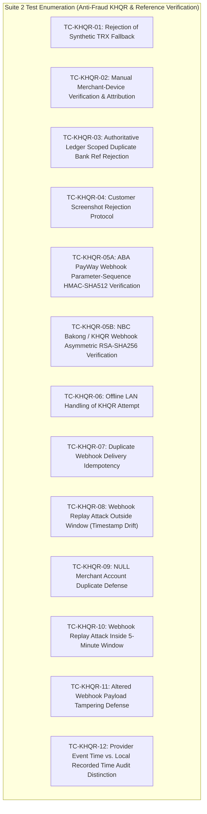
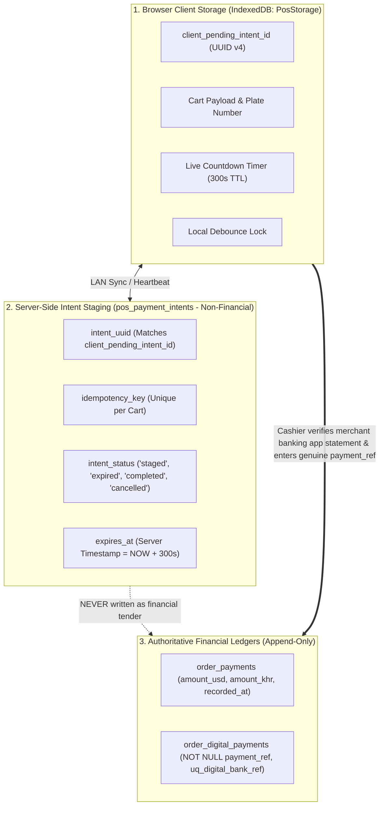
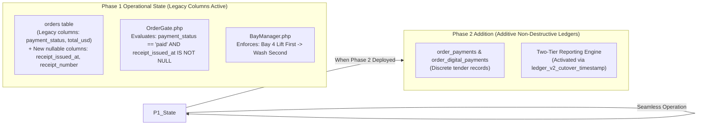
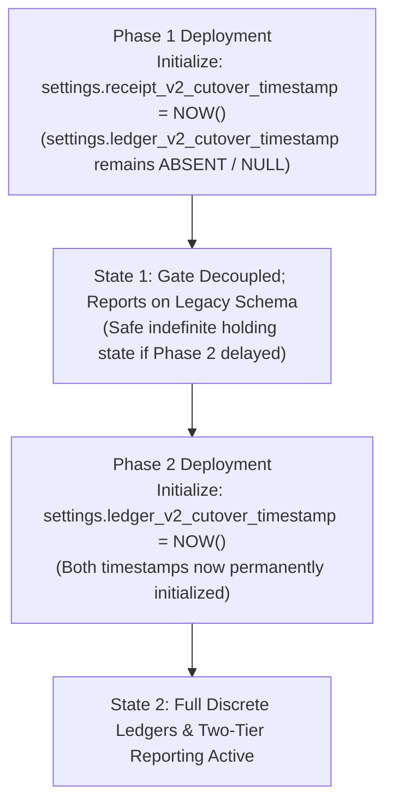
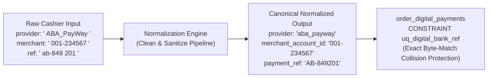

# ROUND 18.2 – Final Architecture Validation & Technical Design Decisions

**Project:** Car-WashService (Local Counter Terminal)  
**Document ID:** POS-ARC-2026-VAL-18.2  
**Date:** November 8, 2026  
**Status:** **STRICT PLANNING ONLY – AWAITING SEPARATE EXECUTIVE AUTHORIZATION**  
**Audit Reference:** Round 17 Implementation Gap Audit, Round 18 Plan & Round 18.1 Corrections  
**Governing Standard:** Six Approved Executive Business Decisions (November 8, 2026) – Unchanged and Preserved

---

## Executive Summary & Scope

This validation deliverable resolves the remaining five architectural and verification questions raised in Round 18.1. It provides deterministic solutions for:
1. Reconciling the 58 planned verification tests against test suite range notations.
2. Formally delineating server-side staging (`pos_payment_intents`) from browser-side IndexedDB (`PosStorage`).
3. Establishing phased backward compatibility between Phase 1 (Service Gate & Sequencing) and Phase 2 (Discrete Ledgers).
4. Specifying failure-handling and immutability governance for the dual-cutover timestamps.
5. Defining field normalization and uniqueness enforcement for digital bank transaction references.

In strict compliance with project governance, **this document is a planning deliverable only. No application source code, SQL migrations, database records, or test runners have been executed.**

---

## 1. Verification Matrix Reconciliation (Claimed 58 vs. Suite Ranges)

### 1.1 Discovery & Root Cause Analysis

A review of [`POS-IMPLEMENTATION-TEST-MATRIX.md`](file:///C:/xampp/htdocs/Car-WashService/POS-IMPLEMENTATION-TEST-MATRIX.md) lines 18–75 explains why Suite 2 is labeled `TC-KHQR-01..12` in section summaries while the suite contains **13 test specifications**:



- **The Discrepancy:** In [`POS-IMPLEMENTATION-TEST-MATRIX.md#L27`](file:///C:/xampp/htdocs/Car-WashService/POS-IMPLEMENTATION-TEST-MATRIX.md#L27), the summary diagram labels Suite 2 as `(TC-KHQR-01..12)`. However, Test 05 is formally subdivided into two distinct cryptographic test specifications:
  1. [`TC-KHQR-05A`](file:///C:/xampp/htdocs/Car-WashService/POS-IMPLEMENTATION-TEST-MATRIX.md#L66): HMAC-SHA512 verification for ABA PayWay webhook signatures.
  2. [`TC-KHQR-05B`](file:///C:/xampp/htdocs/Car-WashService/POS-IMPLEMENTATION-TEST-MATRIX.md#L67): Asymmetric RSA-SHA256 PKI certificate verification for NBC Bakong Open API signatures.
- **The Mathematical Reality:** Because Test 05 contains both `05A` and `05B`, the range 01 through 12 comprises **exactly 13 distinct test cases**.

### 1.2 Exact Final Test Suite Reconciliation

| Suite Identifier | Functional Domain | Exact Test ID Range | Distinct Test Count |
| :--- | :--- | :--- | :---: |
| **Suite 1** | Receipt Printing Decoupling & OrderGate | `TC-REC-01` through `TC-REC-08` | **8** |
| **Suite 2** | Anti-Fraud KHQR & Scoped Reference Verification | `TC-KHQR-01`, `02`, `03`, `04`, `05A`, `05B`, `06`, `07`, `08`, `09`, `10`, `11`, `12` | **13** |
| **Suite 3** | Historical Migration, Cancellation & Reconciliation | `TC-MIG-01` through `TC-MIG-08` | **8** |
| **Suite 4** | Bay Concurrency, Expiry, Safety & Commissions | `TC-BAY-01` through `TC-BAY-08` | **8** |
| **Suite 5** | Cashier Intake, Business Rules & Accounting | `TC-BIZ-01` through `TC-BIZ-21` | **21** |
| **TOTAL** | **Complete Planned Verification Matrix** | **5 Suites (Unexecuted / Planned Only)** | **58** |

$$\text{Total Test Cases} = 8 + 13 + 8 + 8 + 21 = \mathbf{58}$$

*Standardization Policy:* To eliminate ambiguity in automated test runners during Phase 5, Suite 2 will either maintain the explicit sub-IDs `TC-KHQR-05A` and `TC-KHQR-05B` or be canonically renumbered to `TC-KHQR-01` through `TC-KHQR-13`. The total of 58 planned test specifications is confirmed and verified.

---

## 2. KHQR Pending-Intent Storage: Server-Side vs. Browser PosStorage

To maintain strict accounting separation between ephemeral UI checkout state and confirmed financial revenue, the pending intent architecture is bifurcated into two discrete components:



### 2.1 Responsibilities & Boundary Comparison

| Architectural Dimension | Browser-Side: IndexedDB (`PosStorage`) | Server-Side: Staging Table (`pos_payment_intents`) |
| :--- | :--- | :--- |
| **Primary Responsibility** | Local UI state management, live countdown timer animation, thermal printer communication, and instant UI restoration upon accidental tab refresh. | Multi-terminal intent visibility, soundbox webhook correlation (future), server-side TTL timeout sweeps, and cart idempotency locking. |
| **Primary Identifier** | `client_pending_intent_id` (UUID v4 generated by browser `crypto.randomUUID()`). | `intent_uuid` (VARCHAR(36) matching client UUID) and `idempotency_key` (VARCHAR(64) UNIQUE). |
| **Financial Ledger Impact** | **ZERO.** Never represents money collected. | **ZERO.** Resides in non-financial staging table. Never included in revenue queries. |
| **Recovery on Browser Crash** | Reads `PosStorage`. If $t < \text{expires_at}$, restores active countdown and QR. If $t \ge \text{expires_at}$, restores cart in `expired` state. | Client transmits `client_pending_intent_id` to server to verify whether an order was already created. |
| **Behavior When Local Server is Offline** | Cashier can view cart and license plate. Tendering KHQR displays: *"Local server offline – cannot stage digital payment. Please tender cash or reconnect LAN."* | Unreachable. Database remains completely protected from corrupted half-open state. |
| **Duplicate Submission Defense** | Frontend button debouncing locks UI for 2,000ms upon cashier tap. | Database unique index `UNIQUE KEY uq_intent_idempotency (idempotency_key)` rejects duplicate checkout payloads with HTTP 409 `ORDER_ALREADY_STAGED`. |
| **Cleanup Protocol** | Periodic client sweep purges local IndexedDB intents older than 15 minutes. | Scheduled cron/event sweep purges or archives rows where `intent_status = 'expired'` and `created_at < NOW() - INTERVAL 1 DAY`. |

### 2.2 Core Operational Principle:
**A pending intent is merely an invitation to pay; it is NEVER proof of payment.**  
Under zero circumstances may a row in `pos_payment_intents` or an entry in `PosStorage` satisfy the service admission gate (`OrderGate`) or increment revenue metrics. Service admission strictly requires cashier statement verification and atomic insertion into `order_payments` and `order_digital_payments`.

---

## 3. Phase 1 / Phase 2 Backward Compatibility & Safe Staggering

A critical architectural requirement is ensuring that Phase 1 (Service Gate Decoupling & Lift-First Sequencing) can be deployed safely without requiring Phase 2 (Discrete Payment Ledgers) to be active simultaneously.



### 3.1 Transition Mechanics & Verification Rules

1. **Phase 1 Execution Scope (Additive Nullable Schema):**
   - Migration adds two nullable columns to `orders`:
     ```sql
     ALTER TABLE orders ADD COLUMN receipt_issued_at DATETIME NULL;
     ALTER TABLE orders ADD COLUMN receipt_number VARCHAR(50) NULL;
     ```
   - No new tables are created in Phase 1. `order_payments` does **not** exist yet.
2. **Payment Verification in Phase 1 (Legacy Gating):**
   - Cashier completes checkout via existing `create_order` action.
   - Payment data is written to existing legacy columns: `orders.payment_method = 'cash'`, `orders.payment_status = 'paid'`, `orders.total_usd = ...`.
   - Upon successful payment commitment, Phase 1 logic updates:
     ```php
     $receiptNumber = 'REC-' . date('ymd') . '-' . str_pad((string)$orderId, 5, '0', STR_PAD_LEFT);
     $pdo->prepare("UPDATE orders SET receipt_issued_at = NOW(), receipt_number = ? WHERE id = ?")
         ->execute([$receiptNumber, $orderId]);
     ```
   - `OrderGate::assertAdmissibleToService()` verifies `payment_status === 'paid'` AND `receipt_issued_at IS NOT NULL`. Gate passes; vehicle is admitted to Bay 4 (Lift First).
   - Thermal printer failure leaves `receipt_printed_at = NULL` but emits an advisory alert; service admission proceeds smoothly.
3. **Safety if Deployment Pauses Between Phase 1 and Phase 2:**
   - **Cashier Operations Preserved 100%:** The counter operates normally. Cashiers take orders, tender cash or legacy bank transfers, generate electronic receipts, and dispatch vehicles to Bay 4 without experiencing physical printer jamming blocks.
   - **Reporting Unaffected:** `views/owner/reports.php` continues reading `orders` legacy columns without disruption.
   - **Zero Schema Conflicts:** Because the schema changes are purely additive nullable columns, zero existing SQL queries fail.
4. **Transition to Phase 2 (Ledger Activation):**
   - Phase 2 creates `order_payments`, `order_digital_payments`, `order_refunds`, and `historical_exception_registry`.
   - The checkout backend is updated to execute an atomic insert into `orders`, `order_payments`, and `order_digital_payments`.
   - `settings.ledger_v2_cutover_timestamp` is initialized.
   - Reporting queries activate Tier 1 discrete ledger logic for records $\ge \text{cutover timestamp}$, while reading legacy orders for records prior to cutover.
   - **Zero Double-Counting:** Because `ledger_v2_cutover_timestamp` strictly partitions legacy orders from discrete ledger rows, no payment is counted twice.

---

## 4. Dual-Cutover Failure Handling & Immutability Governance

### 4.1 Timestamp Specifications & Staggered Initialization



1. **`settings.receipt_v2_cutover_timestamp`:**
   - *Purpose:* Governs service admission rules in [`core/OrderGate.php`](file:///C:/xampp/htdocs/Car-WashService/core/OrderGate.php).
   - *Initialized:* During Phase 1 deployment script.
2. **`settings.ledger_v2_cutover_timestamp`:**
   - *Purpose:* Governs financial revenue partitioning in [`views/owner/reports.php`](file:///C:/xampp/htdocs/Car-WashService/views/owner/reports.php).
   - *Initialized:* During Phase 2 deployment script.

### 4.2 Failure Scenarios & Recovery Protocols

| Failure Scenario | System Risk | Deterministic Recovery Protocol |
| :--- | :--- | :--- |
| **Scenario A: Phase 1 succeeds; Phase 2 is delayed or fails.** | `receipt_v2_cutover_timestamp` is active, but `ledger_v2_cutover_timestamp` is absent/NULL. | `OrderGate` uses `receipt_v2_cutover_timestamp` to enforce electronic receipt gating on new orders. `reports.php` detects that `ledger_v2_cutover_timestamp` is missing and gracefully falls back to 100% legacy reporting. **Zero crash; zero data loss.** |
| **Scenario B: Timestamp initialization attempted twice.** | Re-running migration scripts might overwrite the cutover timestamp with a newer date, causing historical records to be misclassified. | **Immutability Enforcement:** Migration scripts use conditional insert: `INSERT INTO settings (setting_key, setting_value) SELECT 'receipt_v2_cutover_timestamp', NOW() WHERE NOT EXISTS (SELECT 1 FROM settings WHERE setting_key = 'receipt_v2_cutover_timestamp')`. If setting exists, it is **never overwritten**. |
| **Scenario C: Historical order arrives at new receipt gate.** | Customer with legacy order (created prior to `receipt_v2_cutover_timestamp`) arrives for service. | `OrderGate` detects `order.created_at < receipt_v2_cutover_timestamp`. It applies legacy validation: checks `receipt_printed_at` or accepts Manager PIN override. It **never throws a false-alarm missing electronic receipt exception**. |
| **Scenario D: Subsequent payment on historical pre-cutover order.** | Customer pays balance on a pre-cutover order after `ledger_v2_cutover_timestamp`. | Discrete payment row is inserted into `order_payments` (`recorded_at = NOW()`). Post-cutover report captures payment in Tier 1 on its authentic event date. Pre-cutover report leaves closed period untouched. Ambiguous historical balance is logged on Exceptions Backlog. **Zero double-counting.** |

---

## 5. Bank Reference Normalization & Scoped Uniqueness

To guarantee that composite unique constraint `CONSTRAINT uq_digital_bank_ref UNIQUE (provider, merchant_account_id, payment_ref)` operates flawlessly without collisions or whitespace bypasses, strict field normalization rules are established:



### 5.1 Field Normalization Pipeline

1. **`provider` (Canonical Slug):**
   - *Rule:* Trim whitespace, convert to lowercase ASCII.
   - *Transformation:* `strtolower(trim($provider))`
   - *Allowed Whitelist:* `['aba_payway', 'bakong', 'acleda', 'canadia', 'wing']`. Any unknown string is rejected with HTTP 422 `UNSUPPORTED_PAYMENT_PROVIDER`.
2. **`merchant_account_id` (Canonical Merchant Account):**
   - *Rule:* Trim leading/trailing whitespace; collapse inner whitespace. Preserve internal hyphens if standard for acquirer.
   - *Validation:* Must be non-empty string with length $3 \le \text{len} \le 50$. Rejects `NULL` or whitespace-only strings.
3. **`payment_ref` (Authentic Bank Transaction Reference):**
   - *Rule:* Trim leading/trailing whitespace; strip internal spaces; convert to uppercase ASCII alphanumeric.
   - *Transformation:* `strtoupper(preg_replace('/\s+/', '', trim($paymentRef)))`
   - *Length Bound (Provisional):* $4 \le \text{len} \le 100$.

### 5.2 Composite Uniqueness Enforcement in MariaDB

- **Database Definition:**
  ```sql
  CONSTRAINT uq_digital_bank_ref UNIQUE (provider, merchant_account_id, payment_ref)
  ```
- **Collision Protection:** Because all three columns are `VARCHAR(...) NOT NULL` and inputs are normalized prior to insertion, variations such as `" 849201 "` and `"849201"` resolve to the identical canonical string `'849201'`. MariaDB triggers a duplicate key error (`SQLSTATE 23000, Error 1062`), which the API catches and returns as `HTTP 409 Conflict` (`DUPLICATE_PAYMENT_REFERENCE`).
- **External Dependency Boundary (UTD-4):**
  Acquiring banks (ABA, Canadia, Wing, ACLEDA) utilize differing reference character sets, check digits, and rollover cycles. **No provider-specific regex or synthetic formats may be invented.** Length and format rules beyond basic alphanumeric bounds remain an **Unresolved Technical Dependency (UTD-4)** until official bank specifications are reviewed.

---

## 6. Implementation Authorization Boundary & Governance

> [!CAUTION]
> **MANDATORY GOVERNANCE HOLD – ZERO IMPLEMENTATION PERMITTED**  
> 
> This document (`ROUND-18.2-FINAL-ARCHITECTURE-VALIDATION.md`) represents the completed architectural validation milestone.
> 
> Under strict governance instructions:
> 1. **No application source code files (`.php`, `.js`, `.css`, `.html`) have been edited.**
> 2. **No SQL statements, DDL scripts, or database migrations have been executed.**
> 3. **No database connections, repairs, or service restarts (Apache / MariaDB) have been initiated.**
> 4. **No tests have been executed; all 58 test matrix specifications remain planned.**
> 5. **No Git commits or pushes have been performed.**
> 6. **All existing Round 16 documentation files, Round 17 audit findings, Round 18 plans, and Round 18.1 corrections remain preserved intact in the workspace.**
> 
> **System Status: PLANNING ONLY – AWAITING SEPARATE EXECUTIVE AUTHORIZATION.**  
> Implementation Phase 0 through Phase 5 will commence only upon receiving explicit, formal written authorization from management.
