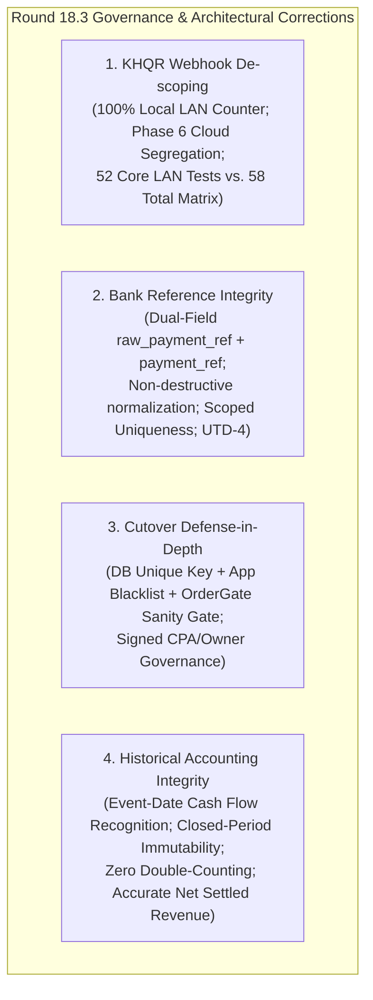
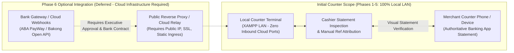
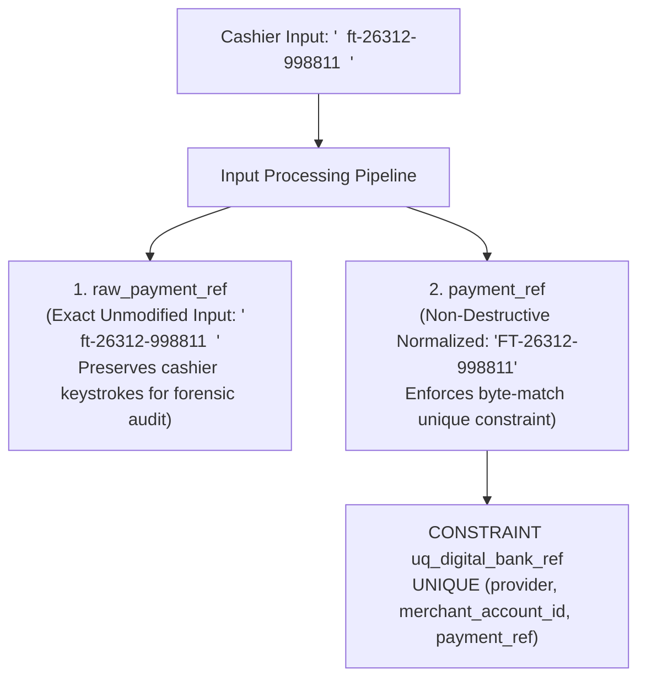
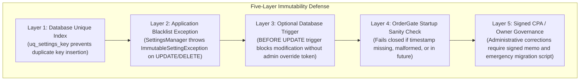
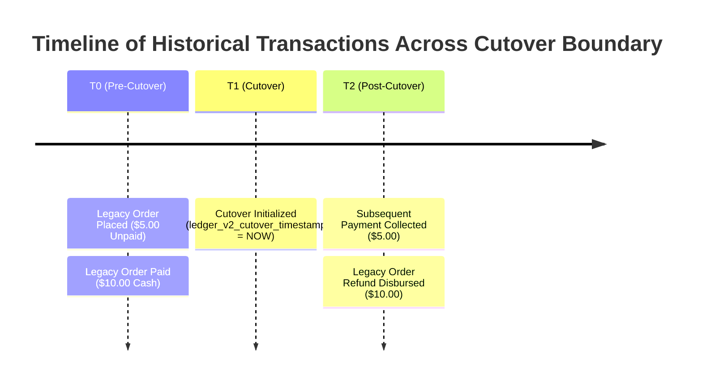

# ROUND 18.3 – KHQR Governance & Cutover Final Corrections

**Project:** Car-WashService (Local Counter Terminal)  
**Document ID:** POS-ARC-2026-VAL-18.3  
**Date:** November 8, 2026  
**Status:** **STRICT PLANNING ONLY – AWAITING SEPARATE EXECUTIVE AUTHORIZATION**  
**Audit Reference:** Round 17 Implementation Gap Audit, Round 18 Architecture Plan, Round 18.1 Corrections & Round 18.2 Validation  
**Governing Standard:** Six Approved Executive Business Decisions (November 8, 2026) – Unchanged and Preserved

---

## Executive Summary & Scope

This document delivers the final four governance, security, and accounting corrections required to complete the architectural planning phase for the Car-WashService POS modernization:

1. **KHQR Webhook Architecture Conflict:** Formally de-scopes automated public cloud webhooks from the initial local counter release. Establishes 100% local LAN self-sufficiency where the merchant counter phone banking app statement is the sole primary settlement evidence (push/SMS/soundbox as assist only), segregates automated webhooks into Phase 6 (Future Optional Cloud Integration), and reconciles the planned verification test suite enumeration.
2. **Bank Reference Normalization & Raw Input Preservation:** Specifies dual-field storage (`raw_payment_ref` alongside canonical `payment_ref`), defines non-destructive normalization (casing and whitespace only, preserving legitimate bank punctuation/hyphens), details database composite uniqueness collision protection (`uq_digital_bank_ref`), mandates cashier verification attribution logging, and reaffirms acquiring bank format validation as an Unresolved Technical Dependency (UTD-4).
3. **Multi-Layered Cutover Immutability:** Enhances dual-cutover timestamp security beyond conditional SQL inserts through database unique indexes, application-level settings blacklists (`ImmutableSettingException` returning HTTP 403), startup fail-closed sanity checks (`OrderGate`), and strict administrative correction governance requiring signed CPA/Owner authorization.
4. **Historical Payment & Refund Accounting Mechanics:** Establishes concrete event-date recognition rules for subsequent transactions on pre-cutover legacy orders, ensuring zero double-counting, non-mutation of closed accounting periods, clean distinction between `disbursed_at` and `settled_at`, and mathematically sound Net Settled Revenue reporting.



In strict compliance with governance rules, **this document is a planning deliverable only. No application source code, database migrations, SQL scripts, or automated tests have been executed.**

---

## 1. KHQR Webhook Architecture Conflict & Verification Matrix Reconciliation

### 1.1 Root Cause & Architecture Realignment

In [`POS-IMPLEMENTATION-TEST-MATRIX.md#L66-L74`](file:///C:/xampp/htdocs/Car-WashService/POS-IMPLEMENTATION-TEST-MATRIX.md#L66-L74), several test specifications (`TC-KHQR-05A`, `TC-KHQR-05B`, `TC-KHQR-07`, `TC-KHQR-08`, `TC-KHQR-10`, and `TC-KHQR-11`) assumed that the local counter terminal would expose a public HTTP endpoint (`api/webhook/khqr_callback.php`) to receive automated webhook callbacks from acquiring banks (e.g., ABA PayWay, NBC Bakong Open API).

This assumption directly contradicted the physical reality of the Car-WashService counter and the **Approved Executive Business Decision #5 (KHQR Verification)**:
1. **Physical Counter Reality:** The Car-WashService terminal runs on a local on-premise XAMPP stack over a local area network (LAN). It possesses no static public IP address, no dynamic DNS ingress, no public SSL reverse proxy, and no open inbound firewall ports.
2. **Approved Executive Governance (Decision #5):**
   - The merchant counter banking app transaction statement is the **primary authoritative settlement evidence**.
   - Push notifications, SMS chimes, and soundbox chimes are **investigative aids only**.
   - No bank APIs, synthetic gateway callbacks, or unverified public cloud dependencies may be invented or required for counter operation.
3. **Architectural Realignment:** Automated cloud webhooks are hereby **fully de-scoped from the initial counter terminal release** (Phases 1 through 5) and classified as a **Phase 6 Future Optional Cloud Integration**. The initial counter deployment operates with 100% local LAN self-sufficiency.



### 1.2 Verification Matrix Reconciliation

To maintain absolute clarity for test automation and audit tracking while preserving existing test documentation:

1. **Initial Counter Terminal Verification Scope (52 Core Tests):**  
   The initial release requires passing **52 Core LAN Tests** across all 5 operational suites. All cloud webhook tests are excluded from the initial release gate.
2. **Roadmap & Future Verification Scope (6 Deferred Tests):**  
   The 6 webhook-dependent tests (`TC-KHQR-05A`, `TC-KHQR-05B`, `TC-KHQR-07`, `TC-KHQR-08`, `TC-KHQR-10`, `TC-KHQR-11`) remain documented as **Phase 6 Deferred Specifications**, executable only if management establishes a cloud reverse proxy and acquires official bank integration contracts.
3. **Reconciliation Mapping Table:**

| Suite Identifier | Functional Domain | Initial Core LAN Test IDs | Core Count | Phase 6 Deferred Cloud Tests | Total Planned |
| :--- | :--- | :--- | :---: | :--- | :---: |
| **Suite 1** | Receipt Decoupling & OrderGate | `TC-REC-01` .. `TC-REC-08` | **8** | None | 8 |
| **Suite 2** | Anti-Fraud KHQR & Reference Verification | `TC-KHQR-01`, `02`, `03`, `04`, `06`, `09`, `12` | **7** | `05A`, `05B`, `07`, `08`, `10`, `11` | 13 |
| **Suite 3** | Historical Migration & Reconciliation | `TC-MIG-01` .. `TC-MIG-08` | **8** | None | 8 |
| **Suite 4** | Bay Concurrency, Expiry & Commissions | `TC-BAY-01` .. `TC-BAY-08` | **8** | None | 8 |
| **Suite 5** | Cashier Intake, Business Rules & Ledger | `TC-BIZ-01` .. `TC-BIZ-21` | **21** | None | 21 |
| **TOTALS** | **Operational Verification Matrix** | **Phases 1–5 Core Local LAN** | **52** | **Phase 6 Deferred Cloud Webhooks: 6** | **58** |

$$\text{Initial Core Counter Tests} = 8 + 7 + 8 + 8 + 21 = \mathbf{52}$$
$$\text{Full Multi-Phase Roadmap Total} = 52 \text{ (Core LAN)} + 6 \text{ (Phase 6 Cloud)} = \mathbf{58}$$

---

## 2. Bank Reference Normalization & Raw Reference Preservation

### 2.1 The Danger of Destructive Normalization

In Round 18.2 Section 5.1, the proposed transformation for `payment_ref` was:
```php
strtoupper(preg_replace('/\s+/', '', trim($paymentRef)))
```
While collapsing internal whitespace and capitalizing ASCII letters is essential, **blindly stripping characters or altering genuine punctuation poses severe operational risks**:
- Certain acquiring banks and microfinance institutions format transaction IDs with legitimate internal hyphens, dots, or slashes (e.g., `FT26312-998811`, `TXN.2026.0482`, or `001-984210`).
- If an aggressive regex strips punctuation destructively, the stored reference no longer matches the authentic merchant banking app statement. During customer disputes or bank audits, cashiers would be unable to correlate the transaction with genuine bank records.

### 2.2 Dual-Field Storage Architecture

To guarantee both **flawless database collision protection** and **100% forensic audit integrity**, digital payments are stored using two complementary columns:



1. **`raw_payment_ref VARCHAR(100) NOT NULL`:**
   - Stores the exact string entered by the cashier prior to normalization.
   - Preserves original casing, spaces, and punctuation for forensic audit trails and cashier accountability dispute resolution.
2. **`payment_ref VARCHAR(100) NOT NULL`:**
   - Stores the canonical normalized representation used for database unique indexing, deduplication queries, and financial reconciliation.

### 2.3 Non-Destructive Normalization Specification

The normalization pipeline is strictly non-destructive:

```php
/**
 * Safely normalizes digital payment reference without character stripping.
 *
 * @param string $rawRef Raw cashier input
 * @return string Canonical normalized reference
 */
function normalizePaymentReference(string $rawRef): string {
    // 1. Trim leading and trailing whitespace
    $ref = trim($rawRef);
    // 2. Collapse internal whitespace (tabs, consecutive spaces) to single space or remove spacing
    $ref = preg_replace('/\s+/', '', $ref);
    // 3. Convert lowercase ASCII to uppercase without altering UTF-8 symbols or punctuation
    $ref = strtoupper($ref);
    return $ref;
}
```

- **What Normalization DOES:**
  - Trims leading and trailing whitespace (`"  849201 "` $\rightarrow$ `"849201"`).
  - Strips accidental internal spacing (`"849 201"` $\rightarrow$ `"849201"`).
  - Converts lowercase ASCII characters to uppercase (`"aba-tx99"` $\rightarrow$ `"ABA-TX99"`).
- **What Normalization NEVER DOES:**
  - It **NEVER** strips hyphens (`-`), underscores (`_`), periods (`.`), or forward slashes (`/`) that may form an integral part of genuine bank transaction serials.
  - It **NEVER** generates synthetic or manufactured transaction references.

### 2.4 Whitelist Validation & Scoped Uniqueness Enforcement

1. **Provider Whitelist:**
   The `provider` field is trimmed, lowercased, and validated against an explicit server-side whitelist:
   ```php
   $allowedProviders = ['aba_payway', 'bakong', 'acleda', 'canadia', 'wing'];
   if (!in_array($provider, $allowedProviders, true)) {
       throw new UnprocessableEntityException('UNSUPPORTED_PAYMENT_PROVIDER');
   }
   ```
2. **Merchant Account ID:**
   Leading/trailing whitespace is trimmed. Must be a non-empty string ($3 \le \text{length} \le 64$). Rejects `NULL` and empty strings with HTTP 422 `INVALID_MERCHANT_ACCOUNT`.
3. **Database Uniqueness Collision Defense:**
   ```sql
   CONSTRAINT uq_digital_bank_ref UNIQUE (provider, merchant_account_id, payment_ref)
   ```
   If a duplicate canonical reference is submitted for the same provider and merchant account, MariaDB triggers duplicate key error (`1062`), and the API returns HTTP 409 Conflict:
   ```json
   {
       "error": "DUPLICATE_PAYMENT_REFERENCE",
       "message": "This bank reference has already been recorded for this merchant account."
   }
   ```
4. **Audit Attribution Evidence:**
   Every digital payment row in `order_digital_payments` immutably captures:
   - `raw_payment_ref` (exact input).
   - `verified_by_user_id` (Cashier ID).
   - `verification_method = 'manual_merchant_device'`.
   - `device_statement_verified_at` (Cashier attestation timestamp).
5. **Reaffirmation of UTD-4 (Unresolved Technical Dependency):**
   Bank-specific regex formats, character lengths, check-digit algorithms, and provider serial structures differ between ABA, Canadia, Wing, ACLEDA, and Bakong. **No provider-specific regex validation may be hardcoded until official bank technical integration documentation is provided.** Basic alphanumeric and safe punctuation bounds ($4 \le \text{length} \le 100$) govern initial validation.

---

## 3. Cutover Immutability & Multi-Layered Defense

### 3.1 Limitation of Conditional SQL Inserts

Round 18.2 specified using conditional inserts to prevent cutover timestamp overwrites:
```sql
INSERT INTO settings (setting_key, setting_value)
SELECT 'receipt_v2_cutover_timestamp', NOW()
WHERE NOT EXISTS (SELECT 1 FROM settings WHERE setting_key = 'receipt_v2_cutover_timestamp');
```
While conditional insert prevents duplicate insertions during re-runs of migration scripts, **it offers zero protection against runtime mutation**:
- A developer, cashier, or admin could execute an `UPDATE settings SET setting_value = NOW() WHERE setting_key = ...` through an administrative settings page or direct database query.
- Overwriting a cutover timestamp corrupts financial reporting boundaries and distorts historical order admission logic.

### 3.2 Five-Layer Defense-in-Depth Architecture

To guarantee absolute immutability of `receipt_v2_cutover_timestamp` and `ledger_v2_cutover_timestamp`, a five-layer defense is implemented:



#### Layer 1: Database Unique Key
The `settings` table schema enforces a unique constraint on the key:
```sql
CONSTRAINT uq_settings_key UNIQUE (setting_key)
```
This guarantees that multiple rows with the same key cannot exist simultaneously.

#### Layer 2: Application-Level Blacklist & Exception
The backend settings management model [`core/SettingsManager.php`](file:///C:/xampp/htdocs/Car-WashService/core/SettingsManager.php) explicitly blacklists both cutover keys from updates and deletions:

```php
class SettingsManager {
    private const IMMUTABLE_SETTINGS = [
        'receipt_v2_cutover_timestamp',
        'ledger_v2_cutover_timestamp'
    ];

    public static function updateSetting(PDO $pdo, string $key, string $value): void {
        if (in_array($key, self::IMMUTABLE_SETTINGS, true)) {
            // Check if setting already exists
            $stmt = $pdo->prepare("SELECT setting_value FROM settings WHERE setting_key = ?");
            $stmt->execute([$key]);
            if ($stmt->fetch()) {
                throw new ImmutableSettingException(
                    "Security Violation: Setting '{$key}' is permanently immutable and cannot be updated.",
                    403
                );
            }
        }
        // Proceed with normal update...
    }

    public static function deleteSetting(PDO $pdo, string $key): void {
        if (in_array($key, self::IMMUTABLE_SETTINGS, true)) {
            throw new ImmutableSettingException(
                "Security Violation: Setting '{$key}' is permanently immutable and cannot be deleted.",
                403
            );
        }
        // Proceed with normal deletion...
    }
}
```

#### Layer 3: Optional Database Trigger Defense
For production deployments where database users might have direct SQL access, a MariaDB `BEFORE UPDATE` trigger rejects changes to immutable keys:
```sql
DELIMITER //
CREATE TRIGGER trg_protect_immutable_settings
BEFORE UPDATE ON settings
FOR EACH ROW
BEGIN
    IF OLD.setting_key IN ('receipt_v2_cutover_timestamp', 'ledger_v2_cutover_timestamp')
       AND NEW.setting_value <> OLD.setting_value
       AND @ALLOW_IMMUTABLE_SETTING_OVERRIDE IS NULL THEN
        SIGNAL SQLSTATE '45000'
            SET MESSAGE_TEXT = 'Modification of cutover timestamp settings is strictly prohibited.';
    END IF;
END //
DELIMITER ;
```

#### Layer 4: Startup Sanity Checks & Fail-Closed Gate
[`core/OrderGate.php`](file:///C:/xampp/htdocs/Car-WashService/core/OrderGate.php) verifies cutover timestamps during boot and service admission:
1. **Existence Verification:** Detects if setting is missing or empty $\rightarrow$ throws `SystemConfigurationException` (fail-closed, `TC-REC-07`).
2. **Format Verification:** Validates that the timestamp matches valid SQL format (`YYYY-MM-DD HH:MM:SS`) $\rightarrow$ throws `SystemConfigurationException` if malformed (`TC-REC-08`).
3. **Past-Date Verification:** Asserts that $t_{\text{cutover}} \le \text{NOW}()$. If the timestamp is in the future, the system refuses to admit vehicles and alerts management immediately (`TC-REC-08`).

#### Layer 5: Administrative Correction Protocol
If a catastrophic operational misconfiguration occurs (e.g., incorrect server clock during initial deployment), **no cashier, developer, or single administrator may alter the cutover timestamp**. Modification requires:
1. A formally written and signed memorandum by both the **Business Owner** and an **External Certified Public Accountant (CPA)**.
2. Execution via a dedicated, audited one-time CLI script that logs the prior timestamp, new timestamp, authorizer credentials, and rationale into `audit_logs`.

### 3.3 Partial Initialization Handling

The staggered deployment lifecycle operates safely:
- **Phase 1 Deployed, Phase 2 Pending:**  
  `receipt_v2_cutover_timestamp` is active. `ledger_v2_cutover_timestamp` is absent/NULL.
  - `OrderGate` enforces electronic receipt issuance on all orders $\ge \text{receipt_v2_cutover_timestamp}$.
  - `reports.php` detects that `ledger_v2_cutover_timestamp` is NULL and safely defaults to legacy reporting mode.
  - The counter operates indefinitely in this intermediate state without crashing or generating false errors.
- **Phase 2 Deployed:**  
  `ledger_v2_cutover_timestamp` is initialized. Two-tier reporting activates immediately.

---

## 4. Historical Payment & Refund Reporting Mechanics

### 4.1 The Core Accounting Dilemma

A critical financial challenge occurs when transactions take place across the cutover boundary:
- What happens when a customer pays for an order that was placed **before** cutover, but the payment occurs **after** cutover?
- What happens when a customer requests a refund for an order that was paid **before** cutover, but the refund is disbursed **after** cutover?



### 4.2 Four Governing Accounting Principles

1. **Closed Accounting Period Immutability:**  
   Historical financial reports generated for dates prior to $T_{\text{cutover}}$ represent closed accounting periods and tax filings. They must **never be retroactively mutated** by subsequent events.
2. **Event-Date Cash Flow Recognition:**  
   All cash inflows and outflows must be recognized on the authentic date and shift they physically occur (`recorded_at` for payments, `disbursed_at` for refunds).
3. **Zero Double-Counting:**  
   No financial transaction may be counted in both legacy reporting and discrete ledger reporting.
4. **Distinction Between Settled Time and Disbursed Time:**  
   Revenue recognition relies strictly on `order_payments.recorded_at` (when money entered the drawer/account) and `order_refunds.disbursed_at` (when money left the drawer/account).

### 4.3 Concrete Worked Scenarios

#### Scenario 1: Post-Cutover Payment on Pre-Cutover Legacy Order

*Context:*  
At $T_0$ (October 20, 2026 – pre-cutover), Order #500 was created for $5.00, but payment remained unpaid/pending.  
At $T_1$ (November 8, 2026 00:00:00), `ledger_v2_cutover_timestamp` is activated.  
At $T_2$ (November 9, 2026 14:00:00 – post-cutover), the customer returns and pays $5.00 cash.

*System Handling:*
1. **Ledger Recording:**  
   A discrete payment row is inserted into `order_payments`:
   ```sql
   INSERT INTO order_payments (
       order_id, payment_method, amount_usd, amount_khr,
       recorded_at, shift_id, cashier_id
   ) VALUES (
       500, 'cash', 5.00, 0,
       '2026-11-09 14:00:00', 42, 3
   );
   ```
2. **Order Header Update:**  
   Legacy order status is updated: `UPDATE orders SET payment_status = 'paid' WHERE id = 500`.
3. **Pre-Cutover Reporting Period (October 20, 2026):**  
   The report query reads `orders WHERE created_at < cutover_ts AND payment_status = 'paid' AND payment_date < cutover_ts`. Because this payment occurred post-cutover, the October 20 report remains completely unchanged.
4. **Post-Cutover Reporting Period (November 9, 2026):**  
   The daily revenue report queries `order_payments WHERE recorded_at BETWEEN '2026-11-09 00:00:00' AND '2026-11-09 23:59:59'`.
   - The $5.00 payment is correctly recognized in today's cash drawer balance.
   - The report displays a footnote: *"Includes $5.00 collected against historical pre-cutover Order #500."*
5. **Exceptions Backlog:**  
   Any ambiguous historical exception logged for Order #500 is automatically closed with an audit resolution note.
6. **Result:** **Zero double-counting; closed period preserved; cashier drawer balances 100%.**

#### Scenario 2: Post-Cutover Refund on Pre-Cutover Legacy Order

*Context:*  
At $T_0$ (October 25, 2026 – pre-cutover), Order #620 was paid in full ($10.00 cash).  
At $T_1$ (November 8, 2026 00:00:00), `ledger_v2_cutover_timestamp` is activated.  
At $T_2$ (November 10, 2026 10:30:00 – post-cutover), customer complains of service damage. Owner approves a full $10.00 cash refund.

*System Handling:*
1. **Refund Ledger Recording:**  
   A discrete refund record is inserted into `order_refunds`:
   ```sql
   INSERT INTO order_refunds (
       order_id, refund_method, amount_usd, amount_khr,
       disbursed_at, approved_by_user_id, reason
   ) VALUES (
       620, 'cash', 10.00, 0,
       '2026-11-10 10:30:00', 1, 'Owner authorized goodwill refund for Order #620'
   );
   ```
2. **Pre-Cutover Reporting Period (October 25, 2026):**  
   The historical gross sales of October 25 remain $10.00. The past period is **not mutated**.
3. **Post-Cutover Reporting Period (November 10, 2026):**  
   The daily cash reconciliation for November 10 calculates:
   $$\text{Drawer Cash Outflow} = \$10.00$$
   $$\text{Net Settled Revenue for Nov 10} = \sum (\text{Nov 10 Payments}) - \$10.00 \text{ (Refund)}$$
   The cash drawer for November 10 balances perfectly with physical cash removed.
4. **Audit Trail:**  
   The refund report explicitly flags: *"Refund disbursed on pre-cutover Order #620 (Original Date: 2026-10-25)."*
5. **Result:** **Past accounting books remain pristine; current cash drawer reflects authentic cash disbursement.**

### 4.4 Net Settled Revenue Calculation

In [`views/owner/reports.php`](file:///C:/xampp/htdocs/Car-WashService/views/owner/reports.php), the Two-Tier Reporting Engine computes Net Settled Revenue with strict mathematical precision:

$$\mathbf{Net\ Settled\ Revenue}_{\text{Period}} = \sum \mathbf{Gross\ Settled\ Payments}_{\text{recorded\_at} \in \text{Period}} - \sum \mathbf{Disbursed\ Refunds}_{\text{disbursed\_at} \in \text{Period}}$$

```sql
-- Tier 1 Post-Cutover Daily Revenue Query
SELECT 
    COALESCE(SUM(p.amount_usd), 0.00) AS gross_settled_usd,
    COALESCE(SUM(r.amount_usd), 0.00) AS disbursed_refunds_usd,
    (COALESCE(SUM(p.amount_usd), 0.00) - COALESCE(SUM(r.amount_usd), 0.00)) AS net_settled_revenue_usd
FROM (
    SELECT amount_usd FROM order_payments 
    WHERE recorded_at BETWEEN :start_date AND :end_date
      AND recorded_at >= :ledger_cutover_timestamp
) p
LEFT JOIN (
    SELECT amount_usd FROM order_refunds 
    WHERE disbursed_at BETWEEN :start_date AND :end_date
      AND disbursed_at >= :ledger_cutover_timestamp
) r ON 1=1;
```

---

## 5. Implementation Authorization Boundary & Governance

> [!CAUTION]
> **MANDATORY GOVERNANCE HOLD – ZERO IMPLEMENTATION PERMITTED**  
> 
> This deliverable (`ROUND-18.3-KHQR-GOVERNANCE-CUTOVER-CORRECTIONS.md`) finalizes all open architectural questions from Rounds 17, 18, 18.1, and 18.2.
> 
> Under strict governance instructions:
> 1. **No application source code files (`.php`, `.js`, `.css`, `.html`) have been edited.**
> 2. **No SQL statements, schema migrations, or DDL commands have been executed.**
> 3. **No database connections, repairs, or service restarts (Apache / MariaDB) have been initiated.**
> 4. **No tests have been executed; all 52 core LAN tests and 6 deferred cloud tests remain unexecuted specifications.**
> 5. **No Git commits, pushes, stashes, or resets have been performed.**
> 6. **All existing Round 16 documentation, Round 17 audit findings, Round 18 plans, Round 18.1 corrections, and Round 18.2 validation documents remain preserved intact in the workspace.**
> 
> **System Status: STRICT PLANNING ONLY – AWAITING SEPARATE EXECUTIVE AUTHORIZATION.**  
> Any execution of Phase 0 database backups, Phase 1 service gates, or Phase 2 ledgers requires separate, explicit executive sign-off.
