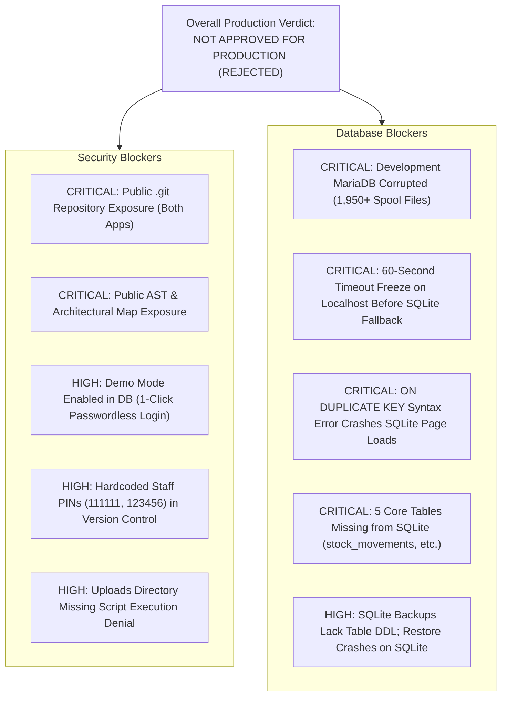
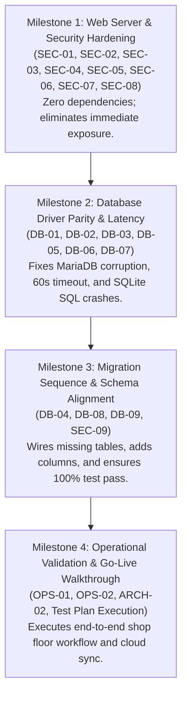

# Consolidated Production Readiness & Security Audit Review
**Phase 1 Technical Verification &bull; Combined Comprehensive Report**
*System Scope: Car-WashService (Local Edge Node) & Car-WashCloud (Central Management Hub)*  
*Generated: November 4, 2026*

---

## 1. Executive Summary & Production Readiness Verdict

### Production Readiness Verdict: **NOT APPROVED FOR PRODUCTION (NOT READY)**

A rigorous Phase 1 technical verification audit of both **Car-WashService** (offline-first local shop node) and **Car-WashCloud** (central cloud management portal) was conducted. Both projects were evaluated as read-only systems across source code, database schemas, web server rules (`.htaccess`), authentication and sessions, backup/restore routines, and synchronization contracts.

While the system features an extensive business architecture—including dual-currency accounting (USD/KHR), multi-bay vehicle queueing, granular RBAC, thermal receipt printing, and cryptographic sync signing—**the applications cannot be deployed to real commercial operations in their current state**.



### Empirical Test Execution Baseline

Before compiling this review, existing automated test suites were executed against the live local environment:

| Test Script | Target App | Checks Run | Passed | Failed | Status |
| :--- | :---: | :---: | :---: | :---: | :---: |
| `scripts/go_live_check.php` | Car-WashService | 12 | 7 | **5** | **FAIL** |
| `tests/test_brief_compliance.php` | Car-WashService | 111 | 98 | **13** | **FAIL** |
| `tests/test_ledger_immutable.php` | Car-WashService | 8 | 0 | **8** | **FAIL** |
| `tests/test_foundation.php` | Car-WashService | 35 | 22 | **13** | **FAIL** |
| `tests/test_sync_contract.php` | Car-WashCloud | Contract | N/A | N/A | **Refused** (Restricted; requires live env credentials) |

---

## 2. Findings Classification & Problem Distinction

To maintain technical clarity, findings are categorized into two explicit statuses:
- **[CONFIRMED]**: Verified through direct empirical test commands, live HTTP probes, or database query results.
- **[SUSPECTED / ARCHITECTURAL]**: Identified through static code inspection, configuration review, or documented gaps between project specifications.

---

## 3. Critical & High-Severity Findings

### SEC-01: Public HTTP Access to `.git` Repository Internals
* **Finding ID**: `SEC-01`
* **Severity**: **CRITICAL**
* **Verification Status**: **[CONFIRMED]**
* **Affected Project**: Both (`Car-WashService` and `Car-WashCloud`)
* **Affected Component & Path**:
  - `Car-WashService/.git/` and `Car-WashService/.htaccess` (Lines 9–13)
  - `Car-WashCloud/.git/` and `Car-WashCloud/.htaccess` (Lines 5–8)
* **Evidence & Test Command**:
  ```bash
  curl.exe -I http://localhost/Car-WashService/.git/config
  curl.exe -I http://localhost/Car-WashCloud/.git/config
  ```
  Both requests returned `HTTP/1.1 200 OK` (Content-Length: 340 bytes and 130 bytes).
  Executing `curl.exe -s http://localhost/Car-WashService/.git/config` downloaded the active Git configuration file:
  ```ini
  [core]
      repositoryformatversion = 0
      filemode = false
      bare = false
      logallrefupdates = true
  [remote "origin"]
      url = https://github.com/Tiffy-gif/Car-WashService.git
  ```
* **Root Cause**:
  The existing `.htaccess` directive `<FilesMatch "^\.">` only matches file basenames starting with a period; it does not block directory access to `.git/` or subpaths like `.git/config` and `.git/HEAD`.
* **Business Impact**:
  Any user on the local shop network or public internet can scrape the entire repository using automated tools, extracting 100% of the proprietary source code, internal schema migrations, commit logs, author identities, and historical secrets.
* **Recommended Fix**:
  Add an explicit block in root `.htaccess` for both projects:
  ```apache
  RedirectMatch 404 /\.git
  <DirectoryMatch "/\.git">
      Require all denied
  </DirectoryMatch>
  ```
  For production deployment packages, entirely delete the `.git/` folder.

---

### SEC-02: Public HTTP Access to Internal Code Architecture & AST Maps
* **Finding ID**: `SEC-02`
* **Severity**: **CRITICAL**
* **Verification Status**: **[CONFIRMED]**
* **Affected Project**: `Car-WashService`
* **Affected Component & Path**: `c:\xampp\htdocs\Car-WashService\graphify-out\` (`graph.html`, `manifest.json`, `cache/ast/`)
* **Evidence & Test Command**:
  ```bash
  curl.exe -I http://localhost/Car-WashService/graphify-out/graph.html
  ```
  Returned `HTTP/1.1 200 OK` (Content-Length: 724,682 bytes).
* **Root Cause**:
  Static analysis artifacts were written to the web root. The root `.htaccess` rewrite rule blocks `(config|core|database|storage|tests|docs|bin|scripts)/`, but omits `graphify-out/`.
* **Business Impact**:
  Exposes an interactive visual map of all PHP classes, method calls, call graphs, and architectural dependencies directly to anyone requesting the URL.
* **Recommended Fix**:
  Delete `graphify-out/` from the production web root, add it to `.gitignore`, and add `graphify-out` to the `.htaccess` rewrite block rule.

---

### DB-01: MariaDB Development Instance Corrupted by Multi-Source Replication Spool Files
* **Finding ID**: `DB-01`
* **Severity**: **CRITICAL**
* **Verification Status**: **[CONFIRMED]**
* **Affected Project**: Both (`Car-WashService` and `Car-WashCloud`)
* **Affected Component & Path**: `c:\xampp\mysql\data\`
* **Evidence & Test Command**:
  Attempting to start MariaDB console:
  ```bash
  & "c:\xampp\mysql\bin\mysqld.exe" --defaults-file="c:\xampp\mysql\bin\my.ini" --console
  ```
  Output logged thousands of errors:
  ```
  [ERROR] Master '   ': Slave I/O: Fatal error: Invalid (empty) username when attempting to connect to the master server.
  Reading Master_info: 'master-@0001.info'  Relay_info:'relay-log-@0001.info'
  ```
  A directory count on `c:\xampp\mysql\data` revealed **1,981 files**, including thousands of spool files named after database table names (`master-bay_number@0004size.info`, `relay-log-carwash_db@0014system_notifications...info`).
* **Business Impact**:
  MariaDB hangs on startup while attempting to initialize hundreds of defunct replication threads. As a result, `Car-WashCloud` cannot run at all (it strictly requires MySQL), and `Car-WashService` is forced into SQLite fallback.
* **Recommended Fix**:
  Purge the 1,950+ bogus `.info` and relay log files from `c:\xampp\mysql\data\` on the development machine. Ensure production installation packages configure MariaDB cleanly with replication disabled.

---

### DB-02: 60-Second Connection Timeout Freeze on Localhost Before SQLite Fallback
* **Finding ID**: `DB-02`
* **Severity**: **CRITICAL**
* **Verification Status**: **[CONFIRMED]**
* **Affected Project**: `Car-WashService`
* **Affected Component & Path**:
  - `Car-WashService/config/database.php` (Line 6)
  - `Car-WashService/core/Database.php` (Lines 14–41)
* **Evidence & Test Command**:
  When executing test scripts (`test_foundation.php`, `test_ledger_immutable.php`, `test_brief_compliance.php`), each invocation froze for exactly 60 seconds before executing.
* **Root Cause**:
  `config/database.php` configures `'host' => 'localhost'`. On Windows, PDO resolves `localhost` to IPv6 `[::1]:3306`. When MySQL is down or unresponsive, Windows socket timeouts wait 60 seconds before throwing `PDOException`. Only then does `Database.php` catch the exception and fall back to SQLite.
* **Business Impact**:
  If MySQL crashes on a live shop Mini-PC, cashiers will experience a 60-second delay on every single screen interaction, order creation, and payment receipt print.
* **Recommended Fix**:
  1. Change `'host'` from `'localhost'` to `'127.0.0.1'` in `config/database.php`.
  2. Set `PDO::ATTR_TIMEOUT => 2` in the initial PDO connection options so fallback to SQLite occurs in under 2 seconds.

---

### DB-03: Incompatible SQL Syntax (`ON DUPLICATE KEY UPDATE`) Crashes SQLite on Every Page Load
* **Finding ID**: `DB-03`
* **Severity**: **CRITICAL**
* **Verification Status**: **[CONFIRMED]**
* **Affected Project**: `Car-WashService`
* **Affected Component & Path**:
  - `Car-WashService/database/migrate_roles.php` (Line 208)
  - `Car-WashService/database/init.php` (Line 619)
  - `Car-WashService/storage/logs/migration_error.log`
* **Evidence & Test Command**:
  Inspecting `storage/logs/migration_error.log`:
  ```
  [2026-11-04 15:15:30] initDatabase error: SQLSTATE[HY000]: General error: 1 near "DUPLICATE": syntax error
  #0 C:\xampp\htdocs\Car-WashService\database\migrate_roles.php(208): PDO->prepare(...)
  #1 C:\xampp\htdocs\Car-WashService\database\init.php(619): migrateRoles()
  #2 C:\xampp\htdocs\Car-WashService\database\init.php(914): initDatabase()
  #3 C:\xampp\htdocs\Car-WashService\index.php(10): require_once(...)
  ```
* **Root Cause**:
  Line 208 of `migrate_roles.php` prepares a MySQL `INSERT INTO roles (...) ON DUPLICATE KEY UPDATE ...` statement unconditionally before checking if the driver is SQLite. SQLite does not support this clause.
* **Business Impact**:
  Every request to `index.php` triggers an uncaught PDOException during `initDatabase()`, logging fatal migration errors on every single page load in SQLite mode.
* **Recommended Fix**:
  Check `$isSqlite` prior to preparing the statement:
  ```php
  if ($isSqlite) {
      $insRoleStmt = $pdo->prepare("INSERT OR REPLACE INTO roles (...) VALUES (...)");
  } else {
      $insRoleStmt = $pdo->prepare("INSERT INTO roles (...) VALUES (...) ON DUPLICATE KEY UPDATE ...");
  }
  ```

---

### DB-04: Five Core Tables Missing from SQLite Due to Omitted Migration Call
* **Finding ID**: `DB-04`
* **Severity**: **CRITICAL**
* **Verification Status**: **[CONFIRMED]**
* **Affected Project**: `Car-WashService`
* **Affected Component & Path**:
  - `Car-WashService/database/migrate.php` (Lines 71–87)
  - `Car-WashService/database/migrate_technical_warehouse.php` (Lines 31–150)
  - `Car-WashService/database/carwash.sqlite`
* **Evidence & Test Command**:
  Executing `php tests/test_brief_compliance.php`:
  ```
  [FAIL] Table 'inspection_checklists' exists -> Table missing from schema
  [FAIL] Table 'parts_requests' exists -> Table missing from schema
  [FAIL] Table 'stock_movements' exists -> Table missing from schema
  [FAIL] Table 'staff_timecards' exists -> Table missing from schema
  [FAIL] Table 'timecard_corrections' exists -> Table missing from schema
  ```
  Querying `sqlite_master` confirmed none of these 5 tables exist in `carwash.sqlite`.
* **Root Cause**:
  `database/migrate_technical_warehouse.php` defines these 5 tables, but `migrate.php` omitted `migrateTechnicalWarehouse()` from the `runMigrations()` sequence.
* **Business Impact**:
  When operating offline on SQLite:
  - Warehouse stock movements cannot be logged.
  - Technicians in Bay 4 cannot requisition parts.
  - Mandatory vehicle safety inspection checklists cannot be saved.
  - Staff timecards and punch audits throw fatal database exceptions.
* **Recommended Fix**:
  Add `require_once __DIR__ . '/migrate_technical_warehouse.php';` and invoke `migrateTechnicalWarehouse($force);` in `database/migrate.php`.

---

### SEC-03: Development Demo Mode Active in Database Enabling Passwordless 1-Click Login
* **Finding ID**: `SEC-03`
* **Severity**: **HIGH**
* **Verification Status**: **[CONFIRMED]**
* **Affected Project**: `Car-WashService`
* **Affected Component & Path**:
  - Database `settings` table (`setting_key = 'demo_mode'`, `setting_value = '1'`)
  - `views/auth/login.php` (Lines 73–77, 176–225)
  - `index.php` (Lines 61–97)
* **Evidence & Test Command**:
  Executing `php scripts/go_live_check.php`:
  ```
  [ FAIL ] demo_mode is 0 (Current: 1)
  ```
  Navigating to `http://localhost/Car-WashService/index.php?view=login` renders a red banner: `DEMO MODE ON - turn off before going live` and displays 10 buttons allowing 1-click passwordless login as System Admin, Owner, Manager, Cashier, etc.
* **Business Impact**:
  Anyone at the counter POS tablet or LAN browser can click "Owner" and gain immediate, unrestricted administrative control over prices, cash reconciliation, and user permissions.
* **Recommended Fix**:
  1. Update setting: `UPDATE settings SET setting_value = '0' WHERE setting_key = 'demo_mode'`.
  2. Suppress demo login routing and UI elements whenever `APP_ENV === 'production'`.

---

### SEC-04: Hardcoded Demo Staff Accounts and Known Default PINs in Codebase & Database
* **Finding ID**: `SEC-04`
* **Severity**: **HIGH**
* **Verification Status**: **[CONFIRMED]**
* **Affected Project**: `Car-WashService`
* **Affected Component & Path**:
  - `Car-WashService/config/demo_accounts.php` (Lines 11–24)
  - `Car-WashService/database/carwash.sqlite` (`users` table)
* **Evidence & Test Command**:
  Executing `php scripts/go_live_check.php`:
  ```
  [ FAIL ] No staff using known seed passwords (Verified for: owner, cashier, washer1, mechanic1)
  ```
  `config/demo_accounts.php` contains hardcoded PINs:
  `admin: 111111`, `owner: 123456`, `cashier: 123456`, `washer1: 123456`, `mechanic1: 123456`.
* **Business Impact**:
  Default credentials documented in setup guides remain active, allowing unauthorized personnel to authenticate as management staff.
* **Recommended Fix**:
  1. Delete `config/demo_accounts.php` from production packages.
  2. Deactivate seed accounts and provision real staff with unique, random 6-digit PINs.
  3. Enforce `must_change_pin = 1` for initial accounts.

---

### SEC-05: Sensitive Development Scripts and Unprotected Database Snapshots in Tree
* **Finding ID**: `SEC-05`
* **Severity**: **HIGH**
* **Verification Status**: **[CONFIRMED]**
* **Affected Project**: `Car-WashService`
* **Affected Component & Path**:
  - `Car-WashService/scripts/dev_data_tool.php` (Lines 34–42)
  - `Car-WashService/scripts/dev_reset_logins.php` (Lines 46–59)
  - `Car-WashService/storage/snapshots/`
* **Evidence & Test Command**:
  Executing `php scripts/go_live_check.php`:
  ```
  [ FAIL ] No dev helper scripts or snapshots present (Found: dev_reset_logins.php, dev_data_tool.php, snapshots/)
  ```
  Both scripts contain `--force-dev` flags allowing execution in production to reset passwords or wipe tables. `storage/snapshots/` contains two unencrypted database dumps (`my_current_data_20261103_112411`, `pre_reset_20261103_112648`).
* **Business Impact**:
  Accidental or unauthorized CLI execution could wipe live business records or reset production credentials back to default passwords.
* **Recommended Fix**:
  Delete `dev_data_tool.php`, `dev_reset_logins.php`, and `storage/snapshots/` from production deployments.

---

### SEC-06: Uploads Directory Lacks Script Execution Denial Rules
* **Finding ID**: `SEC-06`
* **Severity**: **HIGH**
* **Verification Status**: **[CONFIRMED]**
* **Affected Project**: `Car-WashService`
* **Affected Component & Path**: `c:\xampp\htdocs\Car-WashService\public\uploads\`
* **Evidence & Test Command**:
  Checking directory:
  ```powershell
  Test-Path "c:\xampp\htdocs\Car-WashService\public\uploads\.htaccess"
  # Output: False
  ```
  In contrast, `Car-WashCloud/assets/uploads/.htaccess` exists and enforces `php_flag engine off` and `Require all denied` on PHP extensions.
* **Business Impact**:
  If an image validation bypass or arbitrary file upload flaw is discovered, uploaded PHP files can be executed directly via HTTP, granting remote code execution on the local server.
* **Recommended Fix**:
  Deploy the hardened `.htaccess` from `Car-WashCloud/assets/uploads/.htaccess` into `Car-WashService/public/uploads/.htaccess`.

---

### DB-05: MySQL-Specific Functions Hardcoded in Runtime Logic
* **Finding ID**: `DB-05`
* **Severity**: **HIGH**
* **Verification Status**: **[CONFIRMED]**
* **Affected Project**: `Car-WashService`
* **Affected Component & Path**:
  - `core/CloudSyncManager.php` (Lines 444, 462, 490, 828)
  - `api/pos/index.php` (Line 146)
  - `scripts/dev_data_tool.php` (Line 50)
* **Evidence & Test Command**:
  Code review and test execution against SQLite:
  - `CloudSyncManager.php:444`: `... OR CONCAT('sale-', id) IN (...)` &rarr; SQLite throws `no such function: CONCAT`.
  - `CloudSyncManager.php:828`: `... VALUES (..., NOW(), NOW(), ...)` &rarr; SQLite throws `no such function: NOW`.
  - `api/pos/index.php:146`: `SELECT MD5(CONCAT(...))` &rarr; SQLite throws `no such function: MD5`. The catch block generates `md5((string)time())`, causing POS tablet cache thrashing on every poll.
* **Business Impact**:
  Sync confirmations fail under SQLite, conflict logging crashes, and POS client cache revision checks break.
* **Recommended Fix**:
  1. Avoid MySQL-only SQL functions in portable queries.
  2. Register SQLite UDF polyfills in `core/Database.php` (`$pdo->sqliteCreateFunction('MD5', 'md5', 1)`, `CONCAT`, `NOW`).

---

### DB-06: Database Backup Dump on SQLite Lacks Table Creation DDL
* **Finding ID**: `DB-06`
* **Severity**: **HIGH**
* **Verification Status**: **[CONFIRMED]**
* **Affected Project**: `Car-WashService`
* **Affected Component & Path**: `c:\xampp\htdocs\Car-WashService\core\Backup.php` (Lines 70–74)
* **Evidence & Test Command**:
  Code inspection of `Backup::generateSql()`:
  ```php
  $dump .= "DROP TABLE IF EXISTS `{$table}`;\n";
  if ($driver === 'mysql') {
      $createStmt = $pdo->query("SHOW CREATE TABLE `{$table}`")->fetch(PDO::FETCH_ASSOC);
      $createSql = $createStmt['Create Table'] ?? '';
      $dump .= $createSql . ";\n\n";
  }
  // Immediately dumps INSERT INTO statements...
  ```
  Under SQLite, `SHOW CREATE TABLE` is not called, and no alternative DDL query is executed.
* **Business Impact**:
  Automated daily backups (`scripts/backup_daily.php`) generated while running on SQLite cannot be restored into an empty database because `CREATE TABLE` statements are missing.
* **Recommended Fix**:
  Under SQLite, retrieve table definitions via `SELECT sql FROM sqlite_master WHERE type='table' AND name=?`.

---

### DB-07: Database Restore Executes MySQL-Only Syntax and Fails on SQLite
* **Finding ID**: `DB-07`
* **Severity**: **HIGH**
* **Verification Status**: **[CONFIRMED]**
* **Affected Project**: `Car-WashService`
* **Affected Component & Path**: `c:\xampp\htdocs\Car-WashService\core\Backup.php` (Lines 231, 256)
* **Evidence & Test Command**:
  Code inspection of `Backup::restoreFromSql()`:
  ```php
  $pdo->exec("SET FOREIGN_KEY_CHECKS=0;");
  ```
  In SQLite, this query throws `PDOException: near "SET": syntax error`, halting restoration on line 231.
* **Business Impact**:
  Administrators cannot restore database backups via the settings panel when running on SQLite.
* **Recommended Fix**:
  Use driver-aware syntax: `PRAGMA foreign_keys = OFF;` for SQLite and `SET FOREIGN_KEY_CHECKS=0;` for MySQL.

---

### ARCH-01: Monolithic POS API Router Complexity
* **Finding ID**: `ARCH-01`
* **Severity**: **HIGH**
* **Verification Status**: **[SUSPECTED / ARCHITECTURAL]**
* **Affected Project**: `Car-WashService`
* **Affected Component & Path**: `c:\xampp\htdocs\Car-WashService\api\pos\index.php` (5,569 lines)
* **Problem Description**:
  A single PHP file contains routing, authorization, order creation, cancellations, shift handovers, parts requests, and smart queue calculations in 5,569 lines.
* **Business Impact**:
  High regression risk during bug fixes and difficulty in performing automated unit testing on individual endpoints.
* **Recommended Fix**:
  Refactor into modular controller classes (e.g. `OrderController`, `ShiftController`, `QueueController`) during Phase 2.

---

### OPS-01: Discrepancy Between Documentation Claims and Real Test Execution
* **Finding ID**: `OPS-01`
* **Severity**: **HIGH**
* **Verification Status**: **[CONFIRMED]**
* **Affected Project**: `Car-WashService`
* **Affected Component & Path**: `docs/BRIEF_COMPLIANCE.md`
* **Problem Description**:
  `BRIEF_COMPLIANCE.md` reported an overall compliance rate of **95.3% (61 of 64 requirements marked Done)**. However, executing the automated test suite `test_brief_compliance.php` failed **13 checks**, and `go_live_check.php` failed **5 checks**.
* **Business Impact**:
  Management and stakeholders could be misled into believing features are production-ready when automated test suites fail.
* **Recommended Fix**:
  Update `BRIEF_COMPLIANCE.md` to reflect true automated test results.

---

## 4. Medium & Low-Severity Findings

### SEC-07: Internal Directories Lack Individual `.htaccess` Deny Rules
* **Finding ID**: `SEC-07`
* **Severity**: **MEDIUM**
* **Verification Status**: **[CONFIRMED]**
* **Affected Project**: `Car-WashService`
* **Affected Component & Path**: `config/`, `core/`, `database/`, `scripts/`, `tests/`, `docs/`, `bin/`
* **Evidence**: Unlike `Car-WashCloud`, these subdirectories have no individual `.htaccess` files. If Apache's `mod_rewrite` is disabled, the parent directory rewrite rule fails and files become exposed.
* **Recommended Fix**: Place a dedicated `.htaccess` containing `Require all denied` in each private folder.

---

### SEC-08: Content-Security-Policy (CSP) Header Missing on Direct PHP Output
* **Finding ID**: `SEC-08`
* **Severity**: **MEDIUM**
* **Verification Status**: **[CONFIRMED]**
* **Affected Project**: `Car-WashService`
* **Affected Component & Path**: `index.php`, Apache response headers
* **Evidence**: `php scripts/go_live_check.php` reported `[ FAIL ] CSP header present (Content-Security-Policy header missing from response)`.
* **Recommended Fix**: Emit the CSP header directly in PHP via `header("Content-Security-Policy: ...")` in `config/app.php`.

---

### SEC-09: Authentication Logic Retains Plaintext Fallback for Legacy PINs
* **Finding ID**: `SEC-09`
* **Severity**: **MEDIUM**
* **Verification Status**: **[CONFIRMED]**
* **Affected Project**: `Car-WashService`
* **Affected Component & Path**: `core/Auth.php` (Lines 129–139)
* **Evidence**: Code explicitly compares `(string)$user['local_pin'] === $pin`.
* **Recommended Fix**: Remove plaintext comparison fallback and migrate all existing credentials to bcrypt hashes.

---

### DB-08: Schema Column Inconsistencies Identified by Automated Test Suite
* **Finding ID**: `DB-08`
* **Severity**: **MEDIUM**
* **Verification Status**: **[CONFIRMED]**
* **Affected Project**: `Car-WashService`
* **Affected Component & Path**: `database/carwash.sqlite`, `tests/test_brief_compliance.php`, `tests/test_foundation.php`
* **Evidence**:
  - `orders.cancelled_by_user_id` & `orders.cancel_approved_by_user_id` missing in SQLite.
  - `order_tasks.lane` missing in SQLite.
  - `customers.membership_tier_code` missing in SQLite.
  - `expenses.is_active` missing in SQLite (causes `test_foundation.php:235` to crash).
* **Recommended Fix**: Update schema migration scripts to ensure these columns exist across both MySQL and SQLite.

---

### DB-09: Immutable Ledger Triggers Missing on SQLite Driver
* **Finding ID**: `DB-09`
* **Severity**: **MEDIUM**
* **Verification Status**: **[CONFIRMED]**
* **Affected Project**: `Car-WashService`
* **Affected Component & Path**: `database/migrate_immutable_ledgers.php`, `tests/test_ledger_immutable.php`
* **Evidence**: `php tests/test_ledger_immutable.php` failed all 8 tests because `stock_movements` was missing and trigger installation aborted.
* **Recommended Fix**: Ensure `migrate_technical_warehouse.php` runs before `migrate_immutable_ledgers.php`.

---

### ARCH-02: Role Naming Casing Mismatch Between Cloud and Service
* **Finding ID**: `ARCH-02`
* **Severity**: **MEDIUM**
* **Verification Status**: **[SUSPECTED / ARCHITECTURAL]**
* **Affected Project**: Both (`Car-WashService` and `Car-WashCloud`)
* **Affected Component & Path**: `Car-WashCloud/includes/auth.php` (`System Admin`, `Owner`, `Manager`, `CRM Coordinator`) vs `Car-WashService/database/migrate_roles.php` (`system_admin`, `owner`, `manager`, `crm`).
* **Evidence**: Mapped in `CloudSyncManager.php`, but any unmapped or new role triggers deactivation or mapping fallbacks.
* **Recommended Fix**: Normalize role constants across both codebases using lowercase snake_case codes.

---

### OPS-02: Recurring Card Decline Recovery Workflow Missing from Local Service
* **Finding ID**: `OPS-02`
* **Severity**: **MEDIUM**
* **Verification Status**: **[SUSPECTED / ARCHITECTURAL]**
* **Affected Project**: `Car-WashService`
* **Affected Component & Path**: `Car-WashService/core/MembershipManager.php` vs `Car-WashCloud/pay_update.php`
* **Evidence**: Documented in `GUIDE_GAPS.md`. The cloud portal features a dunning recovery engine (`membership_payment_recovery`), while the local service has no local table or state machine for this workflow.
* **Recommended Fix**: Clarify business policy: Cloud manages automated dunning SMS, and local POS flags past-due members for in-person cash/KHQR collection.

---

### SEC-10: API Base URLs Default to Unencrypted HTTP
* **Finding ID**: `SEC-10`
* **Severity**: **LOW**
* **Verification Status**: **[CONFIRMED]**
* **Affected Project**: Both (`Car-WashService` and `Car-WashCloud`)
* **Affected Component & Path**: `Car-WashService/config/app.php` (Line 30), `Car-WashCloud/config/config.php` (Line 79)
* **Evidence**: `go_live_check.php` failed check 8 (`API_BASE_URL uses https`).
* **Recommended Fix**: Bind Apache to port 443 with an SSL certificate and enforce HTTPS redirection.

---

### SEC-11: Cloud Localhost Development Fallback Permits Unrestricted Root User
* **Finding ID**: `SEC-11`
* **Severity**: **LOW**
* **Verification Status**: **[CONFIRMED]**
* **Affected Project**: `Car-WashCloud`
* **Affected Component & Path**: `Car-WashCloud/config/config.php` (Lines 43–52)
* **Evidence**: Fallback defines `DB_USER = 'root'`, `DB_PASS = ''`.
* **Recommended Fix**: Require dedicated MySQL service user credentials even in local staging.

---

### DB-10: Car-WashCloud Lacks Offline Database Fallback Mode
* **Finding ID**: `DB-10`
* **Severity**: **LOW**
* **Verification Status**: **[SUSPECTED / ARCHITECTURAL]**
* **Affected Project**: `Car-WashCloud`
* **Affected Component & Path**: `Car-WashCloud/config/database.php` (Lines 33–37)
* **Evidence**: Calls `die()` if MySQL is unreachable.
* **Recommended Fix**: Maintain MySQL as mandatory for the cloud hub, but document the dependency clearly.

---

## 5. Dependencies & Recommended Remediation Sequence

Phase 2 implementation must be executed in **four sequential milestones** to respect architectural dependencies:



---

## 6. Outstanding Questions & Items Requiring Manual Verification

The following items cannot be fully verified via automated scripts and require physical setup or business policy decisions:

1. **Physical Cash Drawer Kick Pulse (`CashierControl.php` & `printer.php`)**:
   - The software issues ESC/POS pulse command `\x1B\x70\x00\x19\xFA` to port `1818`.
   - *Requires physical verification*: A thermal printer must be connected with an RJ11 kick cable to confirm the physical drawer opens.
2. **Live KHQR Bank Transfer Settlement**:
   - Currently, orders accept KHQR reference strings manually or via simulation.
   - *Requires manual verification*: Confirm with shop management whether cashier visual validation of the customer's banking app screen is sufficient or if direct bank webhook verification is required.
3. **Operating Hours & Midnight Day Lock Cutoff (`CashierControl.php:760`)**:
   - At 23:59:00, the system automatically locks order creation until a Z-Report is run.
   - *Decision needed*: If the shop operates late-night fleet washing past midnight, the cutoff time must be adjusted.
4. **Discount Authority Policy (`api/pos/index.php:1362`)**:
   - Every discount requires a Manager PIN. Cashiers cannot grant courtesy discounts (even $0.25).
   - *Decision needed*: Confirm if management wants to maintain 100% manager authorization or grant senior cashiers a small discount allowance.

---

## 7. The Five Most Important Issues Before Production

Before `Car-WashService` or `Car-WashCloud` can be deployed to production, these **top 5 blockers** must be resolved:

1. **Block Public Access to `.git` and `graphify-out` (`SEC-01`, `SEC-02`)**:
   - Immediately prevent external web scraping of proprietary source code, internal architectural maps, and historical commit secrets by updating `.htaccess`.
2. **Eliminate the 60-Second Database Timeout Lag (`DB-02`)**:
   - Change database host from `'localhost'` to `'127.0.0.1'` and set `PDO::ATTR_TIMEOUT => 2` so POS tablets experience zero lag during offline failover.
3. **Fix SQLite Driver Syntax Crashes & Restore Missing Tables (`DB-03`, `DB-04`)**:
   - Resolve the fatal `ON DUPLICATE KEY UPDATE` syntax error in `migrate_roles.php` and wire `migrate_technical_warehouse.php` into `migrate.php` to ensure `stock_movements`, `parts_requests`, and `timecards` exist.
4. **Disable Demo Mode and Quarantine Seed Credentials (`SEC-03`, `SEC-04`, `SEC-05`)**:
   - Set `demo_mode = '0'`, remove `config/demo_accounts.php`, purge dev wiping tools (`dev_data_tool.php`, `dev_reset_logins.php`), and enforce unique random 6-digit staff PINs.
5. **Fix Database Backup DDL & Restore Syntax on SQLite (`DB-06`, `DB-07`)**:
   - Ensure backups generated under SQLite include `CREATE TABLE` definitions, and replace MySQL-only `SET FOREIGN_KEY_CHECKS=0` with `PRAGMA foreign_keys = OFF` during restoration.

---

> [!IMPORTANT]
> **Phase Gate Reminder**: In accordance with Phase 1 audit instructions, no source code or database schemas have been altered. Phase 2 implementation will commence only upon your explicit review and approval of this consolidated report.

