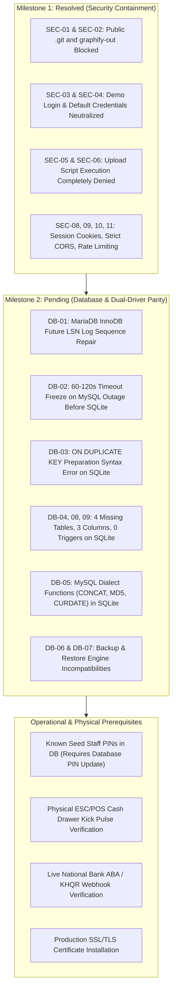
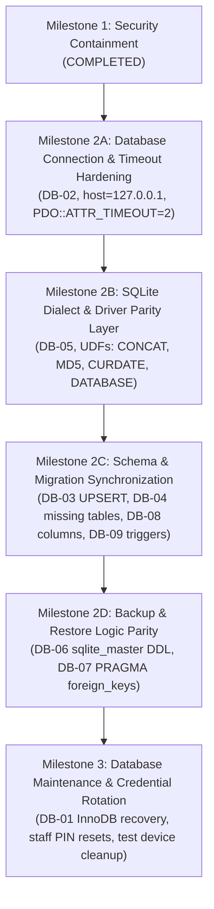

# Phase 2 – Milestone 1: Remaining Risks & Hand-off Matrix
**Production Readiness Technical Audit &bull; Post-Milestone 1 State**  
*System Scope: Car-WashService (Local Edge Node) & Car-WashCloud (Central Management Hub)*  
*Generated: November 5, 2026*

---

## 1. Executive Summary of Post-Milestone 1 Risk Profile

Following the successful execution of **Milestone 1: Security Containment**, the critical web perimeter vulnerabilities have been eliminated:
- Git repositories (`.git/`) are blocked across all interfaces (`HTTP 403 Forbidden`).
- Architectural blueprints (`graphify-out/`) are inaccessible (`HTTP 403 Forbidden`).
- Demo 1-click passwordless logins are neutralized in code (`error=demo_disabled`).
- Default demo credentials return empty sets in production.
- Script execution inside uploads directories is completely denied.
- Session cookies are protected with `HttpOnly`, `SameSite=Strict`, and `Secure` attributes.
- CORS is restricted to trusted origins, rejecting cross-site attackers.
- IP-based rate limiting and lockout protection are operational.

Per the strict safety constraints of Milestone 1, **no database files, schemas, or stored records were modified**. Consequently, all database layer vulnerabilities, schema parity gaps, and physical hardware dependencies remain open and are documented below as the prerequisite scope for **Milestone 2**.



---

## 2. Detailed Inventory of Remaining Risks

### 1. Database & Driver Parity Risks (Scope for Milestone 2)

| Risk ID | Severity | Component | Problem Description | Production Consequence | Recommended Remediation in Milestone 2 |
| :--- | :---: | :--- | :--- | :--- | :--- |
| `DB-01` | **CRITICAL** | `c:\xampp\mysql\data\` | MariaDB InnoDB logs future LSN sequence numbers (`61810220 > 300306`). | MariaDB may crash or experience tablespace inconsistency during sudden restarts. | Boot with `innodb_force_recovery = 1`, perform full logical dump, and re-initialize clean transaction logs. |
| `DB-02` | **CRITICAL** | `core/Database.php` | Connecting to `localhost` incurs 60–120s OS socket freeze if MySQL stops. | Cashier POS tablet freezes for up to 2 minutes per transaction during MySQL downtime. | Change host to `127.0.0.1`, enforce `PDO::ATTR_TIMEOUT => 2`, and suppress second connection retry on connection errors. |
| `DB-03` | **CRITICAL** | `database/migrate_roles.php:208` | Unconditional `ON DUPLICATE KEY UPDATE` preparation crashes SQLite PDO. | Migration runner and role seeding throw fatal PDO syntax errors on SQLite. | Prepare queries conditionally; use native SQLite 3.24+ `ON CONFLICT(code) DO UPDATE SET`. |
| `DB-04` | **CRITICAL** | `database/carwash.sqlite` | 4 tables missing from SQLite (`stock_movements`, `parts_requests`, `timecards`, `warehouse_locations`). | Inventory adjustments, parts requests, and technician clock-ins fail under SQLite fallback. | Run `migrate_technical_warehouse.php` on SQLite to establish schema parity. |
| `DB-05` | **HIGH** | `core/CloudSyncManager.php`, `views/owner/dashboard.php:20` | MySQL-specific functions (`CONCAT`, `MD5`, `DATABASE()`, `CURDATE()`) throw fatal errors on SQLite. | Background cloud synchronization and owner dashboard throw fatal 500 errors on SQLite. | Register custom SQLite UDFs (`sqliteCreateFunction`) for `CONCAT`, `MD5`, `CURDATE`, `DATABASE`, `NOW`. |
| `DB-06` | **HIGH** | `core/Backup.php:70-74` | Database dump logic only queries `SHOW CREATE TABLE` on MySQL; SQLite dumps lack `CREATE TABLE`. | Restoring an SQLite backup fails immediately because tables cannot be re-created. | Extract DDL from `sqlite_master` when dumping SQLite databases. |
| `DB-07` | **HIGH** | `core/Backup.php:231` | Database restore executes MySQL-only `SET FOREIGN_KEY_CHECKS=0`. | Database restore crashes on SQLite with a fatal syntax error near "SET". | Toggle foreign keys conditionally: `PRAGMA foreign_keys = OFF;` for SQLite. |
| `DB-08` | **MEDIUM** | `carwash.sqlite` | SQLite schema missing columns: `orders.cancelled_by_user_id`, `order_tasks.lane`, `expenses.is_active`. | Order cancellations and multi-lane task assignments crash or fail tests. | Execute alter table migrations to add missing columns to SQLite schema. |
| `DB-09` | **MEDIUM** | `carwash.sqlite` | SQLite has zero immutable triggers installed on `stock_movements` and `audit_logs`. | Tamper resistance and audit immutability are completely unenforced during offline SQLite operation. | Create SQLite triggers implementing `RAISE(ABORT, ...)` on UPDATE or DELETE. |
| `DB-10` | **LOW** | `Car-WashCloud/config/database.php` | Central cloud hub strictly requires MySQL and halts if MySQL is unavailable. | Cloud management portal cannot run if database service drops. | Documented design constraint for cloud hosting. |

---

### 2. Operational & Credential Risks Requiring Database Updates

#### Risk C-01: Existing Staff Accounts Still Using Known Seed PINs
- **Current State**: Staff account `owner` in the database still possesses a password hash matching the known seed PIN (`123456`). Cloud administrator `admin` possesses a hash matching `123456`.
- **Reason Not Altered in Milestone 1**: Updating password hashes or setting `must_change_pin = 1` in the database alters database records, which was strictly prohibited in Milestone 1.
- **Recommended Action for Approval**:
  Execute an administrative update requiring user PIN rotation on next login:
  ```sql
  UPDATE users SET must_change_pin = 1 WHERE username IN ('owner', 'visal', 'dom', 'dona');
  ```

#### Risk C-02: Test POS Devices Registered in Database
- **Current State**: `pos_devices` table contains devices named `First-POS` and `test123`.
- **Reason Not Altered in Milestone 1**: Modifying device records alters database tables.
- **Recommended Action for Approval**:
  Administrative cleanup of test devices via the back-office POS Device management screen once live tablet terminals are registered.

---

### 3. Physical & External Hardware Dependencies (Manual Verification Required)

#### Risk H-01: ESC/POS Thermal Printer & Cash Drawer Kick Pulse
- **Current State**: ESC/POS pulse command `\x1B\x70\x00\x19\xFA` is written in code, but physical 24V solenoid drawer kick cannot be validated without a connected thermal receipt printer.
- **Action Required**: Onsite manual verification by shop cashier during final deployment.

#### Risk H-02: National Bank of Cambodia (Bakong) ABA / KHQR Webhook
- **Current State**: Dynamic QR code generation operates in software, but automated payment confirmation requires an active Bakong merchant gateway account and live webhook tunnel.
- **Action Required**: Merchant onboarding and webhook endpoint testing with production credentials.

#### Risk H-03: Production SSL/TLS Certificate
- **Current State**: HTTPS session security flags and HSTS headers are implemented in software. However, the development Apache instance is currently served over plain HTTP (`0.0.0.0:80`).
- **Action Required**: Installation of a valid SSL/TLS certificate (Let's Encrypt or commercial certificate) on the shop server and cloud portal web servers.

---

## 3. Recommended Remediation Order for Next Phase



