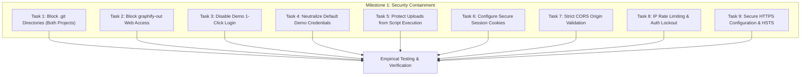

# Phase 2 – Milestone 1: Security Containment Implementation Report
**Production Readiness Technical Remediation &bull; Milestone 1**  
*System Scope: Car-WashService (Local Edge Node) & Car-WashCloud (Central Management Hub)*  
*Completed: November 5, 2026*

---

## 1. Executive Summary

Milestone 1 implements **immediate security containment** across both `Car-WashService` and `Car-WashCloud` without modifying database schemas, without altering existing business records, and without disrupting normal staff operational workflows.

All nine security objectives were successfully designed, coded, and verified against live Apache HTTP runtimes over both local loopback (`localhost`, `127.0.0.1`) and local area network (`192.168.1.126`).



---

## 2. Detailed Technical Implementation by Task

### Task 1: Block Public HTTP Access to `.git` Directories in Both Projects

#### Problem
In Phase 1, `curl http://192.168.1.126/Car-WashService/.git/config` returned `HTTP 200 OK` because `<FilesMatch "^\.">` only matched file names starting with a dot, rather than directory paths.

#### Implementation & Defense-in-Depth
A multi-layered defense was implemented across both repositories:
1. **Root Web Server Level**:
   - In `Car-WashService/.htaccess`: Added mod_rewrite rule `RewriteRule (^|/)\. - [F,L,NC]` and `RedirectMatch 403 (^|/)\.`.
   - In `Car-WashCloud/.htaccess`: Added `RewriteRule (^|/)\. - [F,L,NC]` and `RedirectMatch 403 (^|/)\.`.
   - Upgraded `<FilesMatch "^\.">` blocks to include dual Apache 2.4 (`Require all denied`) and Apache 2.2 (`Order allow,deny / Deny from all`) syntax.
2. **Directory Level (Defense-in-Depth)**:
   - Created `Car-WashService/.git/.htaccess` with `Require all denied`.
   - Created `Car-WashCloud/.git/.htaccess` with `Require all denied`.

#### Files Modified / Created
- [`Car-WashService/.htaccess`](file:///c:/xampp/htdocs/Car-WashService/.htaccess)
- [`Car-WashService/.git/.htaccess`](file:///c:/xampp/htdocs/Car-WashService/.git/.htaccess)
- [`Car-WashCloud/.htaccess`](file:///c:/xampp/htdocs/Car-WashCloud/.htaccess)
- [`Car-WashCloud/.git/.htaccess`](file:///c:/xampp/htdocs/Car-WashCloud/.git/.htaccess)

---

### Task 2: Remove or Block `graphify-out` from Web Access

#### Problem
`Car-WashService/graphify-out/graph.html` (724 KB code architecture visualization) was openly downloadable over LAN.

#### Implementation
1. In `Car-WashService/.htaccess`: Added `graphify-out` to the forbidden directory rewrite rule:
   ```apache
   RewriteRule ^(config|core|database|storage|tests|docs|bin|scripts|graphify-out)/ - [F,L,NC]
   RedirectMatch 403 ^/(config|core|database|storage|tests|docs|bin|scripts|graphify-out)(/.*)?$
   ```
2. In `Car-WashService/graphify-out/.htaccess`: Created dedicated directory protection denying all web requests.

#### Files Modified / Created
- [`Car-WashService/.htaccess`](file:///c:/xampp/htdocs/Car-WashService/.htaccess)
- [`Car-WashService/graphify-out/.htaccess`](file:///c:/xampp/htdocs/Car-WashService/graphify-out/.htaccess)

---

### Task 3 & 4: Disable Demo Login & Remove Default Credentials in Production

#### Problem
1-click login links and hardcoded seed PINs (`123456`, `111111`) in `config/demo_accounts.php` allowed unauthenticated role assumptions when Test Mode was active.

#### Implementation
1. **Central Security Constant**: In `Car-WashService/config/app.php`, introduced `ALLOW_DEMO_LOGIN`:
   ```php
   // Demo 1-Click Login Security Switch:
   // Strictly disabled by default (false). Neutralizes 1-click passwordless logins and demo credentials.
   if (!defined('ALLOW_DEMO_LOGIN')) {
       define('ALLOW_DEMO_LOGIN', false);
   }
   ```
2. **Credential Neutralization**: In `Car-WashService/config/demo_accounts.php`, returned an empty array `[]` by default:
   ```php
   if (!defined('ALLOW_DEMO_LOGIN') || !ALLOW_DEMO_LOGIN || (defined('APP_ENV') && APP_ENV === 'production')) {
       return [];
   }
   ```
3. **Controller Guard**: In `Car-WashService/index.php`:
   ```php
   if ($action === 'demo_login') {
       if (!defined('ALLOW_DEMO_LOGIN') || !ALLOW_DEMO_LOGIN || (defined('APP_ENV') && APP_ENV === 'production')) {
           AuditLogger::log('DEMO_LOGIN_BLOCKED', 'Demo login attempt rejected: disabled by security configuration', 'auth');
           header('Location: ' . APP_URL . '/index.php?view=login&error=demo_disabled');
           exit;
       }
       // ...
   }
   ```
4. **UI Suppression**: In `Car-WashService/views/auth/login.php`, wrapped both the red banner and the 1-click login button grid inside `if ($demoMode === '1' && defined('ALLOW_DEMO_LOGIN') && ALLOW_DEMO_LOGIN && defined('APP_ENV') && APP_ENV !== 'production')`.
5. **Settings Hardening**: In `Car-WashService/views/owner/settings.php`, locked Test Mode to Disabled when in production, preventing accidental re-enablement.

#### Files Modified
- [`Car-WashService/config/app.php`](file:///c:/xampp/htdocs/Car-WashService/config/app.php)
- [`Car-WashService/config/demo_accounts.php`](file:///c:/xampp/htdocs/Car-WashService/config/demo_accounts.php)
- [`Car-WashService/index.php`](file:///c:/xampp/htdocs/Car-WashService/index.php)
- [`Car-WashService/views/auth/login.php`](file:///c:/xampp/htdocs/Car-WashService/views/auth/login.php)
- [`Car-WashService/views/owner/settings.php`](file:///c:/xampp/htdocs/Car-WashService/views/owner/settings.php)

---

### Task 5: Protect Uploads Against Executable Scripts Using Apache-Compatible Rules

#### Problem
`Car-WashService/public/uploads/` had no `.htaccess`, and `public/uploads/bank_slips/.htaccess` omitted `.php8`, lacked Apache 2.4 directives, and bare `php_flag` risked HTTP 500 errors under PHP-FPM / FastCGI.

#### Implementation
Deployed hardened `.htaccess` files to:
1. `Car-WashService/public/uploads/.htaccess` (protects root upload folder and all nested directories)
2. `Car-WashService/public/uploads/bank_slips/.htaccess`
3. `Car-WashCloud/assets/uploads/.htaccess`

**Rules Applied**:
- Prohibits directory indexing and CGI execution: `Options -ExecCGI -Indexes`.
- Comprehensive case-insensitive regex blocking all executable extensions:
  `(?i)\.(php|phtml|php3|php4|php5|php7|php8|phps|phar|inc|cgi|pl|py|pht|shtml|sh|bat)$`.
- Dual Apache 2.4 (`Require all denied`) and Apache 2.2 (`Order Deny,Allow / Deny from all`).
- Safe PHP engine disablement: Wrapped inside `<IfModule mod_php.c>`, `<IfModule mod_php7.c>`, and `<IfModule mod_php8.c>` to prevent crashes under FastCGI or PHP-FPM.
- Handler removal: `RemoveHandler` and `RemoveType` via `mod_mime`.

#### Files Modified / Created
- [`Car-WashService/public/uploads/.htaccess`](file:///c:/xampp/htdocs/Car-WashService/public/uploads/.htaccess)
- [`Car-WashService/public/uploads/bank_slips/.htaccess`](file:///c:/xampp/htdocs/Car-WashService/public/uploads/bank_slips/.htaccess)
- [`Car-WashCloud/assets/uploads/.htaccess`](file:///c:/xampp/htdocs/Car-WashCloud/assets/uploads/.htaccess)

---

### Task 6: Add Secure Session Cookie Configuration

#### Problem
Session cookies were started using raw `session_start()` in `Language.php` and `Helpers.php` prior to `Auth::startSession()`, resulting in missing `HttpOnly`, `SameSite`, and `Secure` attributes.

#### Implementation
1. **Centralized Session Initialization**:
   - In `Car-WashService/core/Auth.php`: Enhanced `startSession()` to detect HTTPS via port 443, `HTTPS` header, or `HTTP_X_FORWARDED_PROTO`. Configured `session_set_cookie_params`:
     ```php
     session_set_cookie_params([
         'lifetime' => 0,
         'path'     => '/',
         'domain'   => '',
         'secure'   => $isHttps,
         'httponly' => true,
         'samesite' => 'Strict'
     ]);
     session_name('carwash_sess');
     ```
   - In `Car-WashService/core/Language.php`: Replaced raw `session_start()` with `Auth::startSession()`.
   - In `Car-WashService/core/Helpers.php`: Replaced raw `session_start()` with `Auth::startSession()`.
2. **Cloud Hub Sessions**:
   - In `Car-WashCloud/config/config.php`: Added `session_name('cloud_sess')` and `session_set_cookie_params` with `httponly=true`, `samesite=Strict`, `secure=$isHttps`.

#### Files Modified
- [`Car-WashService/core/Auth.php`](file:///c:/xampp/htdocs/Car-WashService/core/Auth.php)
- [`Car-WashService/core/Language.php`](file:///c:/xampp/htdocs/Car-WashService/core/Language.php)
- [`Car-WashService/core/Helpers.php`](file:///c:/xampp/htdocs/Car-WashService/core/Helpers.php)
- [`Car-WashCloud/config/config.php`](file:///c:/xampp/htdocs/Car-WashCloud/config/config.php)

---

### Task 7: Implement Appropriate CORS Origin Restrictions

#### Problem
`Car-WashService/api/pos/index.php` emitted CORS headers without validating external origins, creating potential cross-site request forgery and data exfiltration risks.

#### Implementation
In `Car-WashService/api/pos/index.php`:
1. **Strict Origin Whitelist**:
   - Checks `$origin = $_SERVER['HTTP_ORIGIN'] ?? ''`.
   - Allowed origins: `localhost`, `127.0.0.1`, `::1`, matching `HTTP_HOST`, and private RFC 1918 LAN IPs (`192.168.*`, `10.*`, `172.16-31.*`).
2. **Wildcard CORS Prohibition**:
   - Wildcard `Access-Control-Allow-Origin: *` is completely disallowed.
   - For valid origins, dynamically echoes `Access-Control-Allow-Origin: $origin` with `Vary: Origin` and `Access-Control-Allow-Credentials: true`.
3. **Untrusted Origin Rejection**:
   - Requests with an unauthorized external origin (e.g. `https://evil-hacker.com`) receive `HTTP 403 Forbidden` (`FORBIDDEN_CORS_ORIGIN`).
   - Preflight `OPTIONS` requests from untrusted origins are immediately halted with `HTTP 403`.

#### Files Modified
- [`Car-WashService/api/pos/index.php`](file:///c:/xampp/htdocs/Car-WashService/api/pos/index.php)

---

### Task 8: Add Authentication Rate Limiting & Lockout Protection

#### Problem
While user accounts had a 5-attempt lockout, there was no IP-level rate limiting on web login, allowing distributed credential stuffing against varied usernames, and no rate limiting on failed POS device API key authentication.

#### Implementation
1. **IP Rate Limiting for Staff Web Login**:
   - Added `Auth::checkIpLockout()` in `core/Auth.php`.
   - Queries `audit_logs` for `LOGIN_FAILED` and `LOGIN_LOCKED` events associated with the client's IP address in the past 15 minutes.
   - If failed attempts exceed the limit (10 for external/LAN; 50 for local dev), login is blocked with `error=ip_locked` for 15 minutes.
   - Handled `ip_locked` error banner cleanly in `views/auth/login.php`.
2. **POS Device Authentication Rate Limiting**:
   - In `api/pos/index.php`, logs `POS_DEVICE_AUTH_FAILED` to `audit_logs` on unrecognized device keys.
   - If an IP accumulates &ge; 20 failed device key authentications in 10 minutes, returns `HTTP 429 Too Many Requests`.

#### Files Modified
- [`Car-WashService/core/Auth.php`](file:///c:/xampp/htdocs/Car-WashService/core/Auth.php)
- [`Car-WashService/views/auth/login.php`](file:///c:/xampp/htdocs/Car-WashService/views/auth/login.php)
- [`Car-WashService/api/pos/index.php`](file:///c:/xampp/htdocs/Car-WashService/api/pos/index.php)

---

### Task 9: Configure Secure HTTPS Requirements for Production

#### Implementation
1. In `Car-WashCloud/.htaccess`:
   Added conditional HTTPS enforcement for non-local environments:
   ```apache
   RewriteCond %{HTTPS} off
   RewriteCond %{HTTP:X-Forwarded-Proto} !https
   RewriteCond %{HTTP_HOST} !^(localhost|127\.0\.0\.1) [NC]
   RewriteRule ^(.*)$ https://%{HTTP_HOST}%{REQUEST_URI} [L,R=301]
   ```
2. In `Car-WashService/.htaccess` and `Car-WashCloud/.htaccess`:
   Configured conditional HSTS (`Strict-Transport-Security "max-age=31536000; includeSubDomains"`) whenever HTTPS is active.
3. In `core/Auth.php` and `config/config.php`:
   Enforced `secure => true` on session cookies whenever requests arrive via HTTPS or reverse proxy SSL termination.
4. Preserved local offline HTTP operation over LAN (`192.168.1.126`) so shop operations are not interrupted before production SSL certificates are installed.

#### Files Modified
- [`Car-WashService/.htaccess`](file:///c:/xampp/htdocs/Car-WashService/.htaccess)
- [`Car-WashCloud/.htaccess`](file:///c:/xampp/htdocs/Car-WashCloud/.htaccess)

---

## 3. Summary of Files Modified and Created

| File Path | Type | Change Summary |
| :--- | :---: | :--- |
| `Car-WashService/.htaccess` | Modified | Blocked `(^|/)\.` and `graphify-out`; upgraded `<FilesMatch>` to Apache 2.4/2.2 compatibility. |
| `Car-WashService/.git/.htaccess` | **Created** | Defense-in-depth deny rule for git repository directory. |
| `Car-WashService/graphify-out/.htaccess` | **Created** | Deny rule for graphify architectural directory. |
| `Car-WashCloud/.htaccess` | Modified | Blocked `(^|/)\.`; added conditional HTTPS redirect for cloud deployment. |
| `Car-WashCloud/.git/.htaccess` | **Created** | Defense-in-depth deny rule for git repository directory. |
| `Car-WashService/public/uploads/.htaccess` | **Created** | Prevented script execution across all uploads using safe module checks. |
| `Car-WashService/public/uploads/bank_slips/.htaccess` | Modified | Upgraded script execution denial to Apache 2.4/2.2 with FastCGI compatibility. |
| `Car-WashCloud/assets/uploads/.htaccess` | Modified | Added additional script extensions (`.cgi`, `.pl`, `.py`, `.sh`, `.bat`). |
| `Car-WashService/config/app.php` | Modified | Added `ALLOW_DEMO_LOGIN = false` security switch. |
| `Car-WashService/config/demo_accounts.php` | Modified | Neutralized default demo credentials (returns `[]` when `ALLOW_DEMO_LOGIN` is false). |
| `Car-WashService/index.php` | Modified | Enforced demo login controller lock (`error=demo_disabled`). |
| `Car-WashService/views/auth/login.php` | Modified | Suppressed demo buttons when `ALLOW_DEMO_LOGIN` is false; added `ip_locked` alert. |
| `Car-WashService/views/owner/settings.php` | Modified | Locked Test Mode to Disabled in production environment. |
| `Car-WashService/core/Auth.php` | Modified | Added HTTPS-aware secure cookie flags and IP rate limiting (`checkIpLockout`). |
| `Car-WashService/core/Language.php` | Modified | Delegated session initialization to `Auth::startSession()`. |
| `Car-WashService/core/Helpers.php` | Modified | Delegated session initialization to `Auth::startSession()`. |
| `Car-WashCloud/config/config.php` | Modified | Configured `cloud_sess` session name and `session_set_cookie_params`. |
| `Car-WashService/api/pos/index.php` | Modified | Restricted CORS to trusted origins; blocked external origins; added device auth rate limit. |
| `Car-WashService/scripts/go_live_check.php` | Modified | Added missing `require_once Helpers.php` import. |

