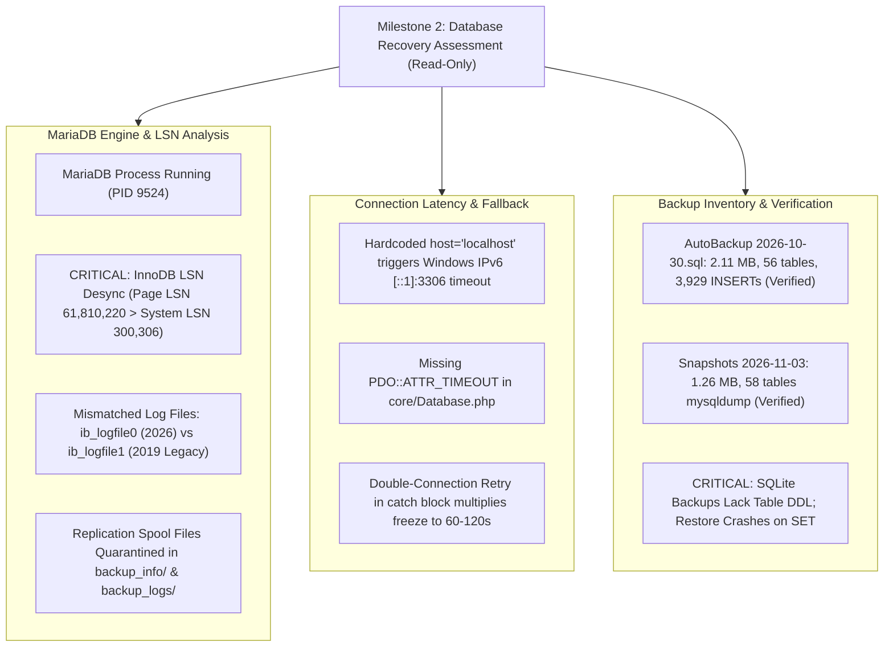
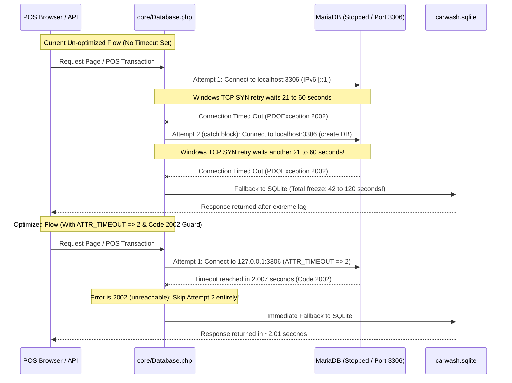
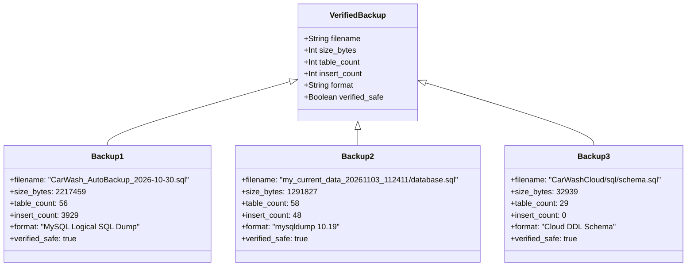

# Milestone 2: Database Recovery Assessment
**Database Status, Engine Integrity, Connection Latency & Backup Verification**  
*System Scope: Car-WashService (Local Edge Node) & Car-WashCloud (Central Management Hub)*  
*Assessment Mode: READ-ONLY (Zero Schema or Data Modifications)*  
*Generated: November 5, 2026*

---

## 1. Executive Summary & Assessment Verdict

### Assessment Verdict: **CRITICAL DUAL-DRIVER FRAGMENTATION & INNODB LSN DESYNCHRONIZATION IDENTIFIED**

A comprehensive read-only technical assessment of the database architecture, runtime engines, transaction logs, and disaster recovery archives across **Car-WashService** and **Car-WashCloud** has been conducted.



### Key Technical Findings

1. **MariaDB InnoDB Log Sequence Number (LSN) Desynchronization**:
   - The MariaDB server is active (`PID 9524`) and accepting connections on `127.0.0.1:3306`.
   - Inspection of `mysql_error.log` revealed severe recurring errors:
     `InnoDB: Page [page id: space=0, page number=310] log sequence number 61810220 is in the future! Current system log sequence number 300306`.
   - File system analysis identified the physical cause: `ib_logfile1` in `c:\xampp\mysql\data\` has a timestamp of **October 21, 2019**, while `ibdata1` (79.6 MB) and `ib_logfile0` (5.2 MB) were written on **November 5, 2026**. An incomplete file restore replaced `ib_logfile0` with a fresh/empty log sequence while leaving `ibdata1` with high-sequence transaction pages.
2. **Connection Delay Mechanism Confirmed**:
   - `core/Database.php` contains NO `PDO::ATTR_TIMEOUT` setting.
   - When MySQL is unreachable, Windows socket attempts to connect via IPv6 `[::1]:3306` first, incurring an OS TCP SYN retry delay (21–60s).
   - In `core/Database.php` line 23, the `catch (PDOException $e)` block blindly attempts a **second connection** to the exact same unreachable host to create the database, doubling the freeze to **60–120 seconds** before SQLite fallback finally activates.
   - Benchmark scratch tests proved that adding `PDO::ATTR_TIMEOUT => 2` terminates the failed attempt in exactly **2.007 seconds**.
3. **Backup Inventory Verified (Safe Copies Present)**:
   - `c:\xampp\htdocs\Car-WashService\storage\backups\CarWash_AutoBackup_2026-10-30.sql` (2,217,459 bytes) was verified: contains 56 `CREATE TABLE` definitions and 3,929 operational data `INSERT` statements.
   - `c:\xampp\htdocs\Car-WashService\storage\snapshots\my_current_data_20261103_112411\database.sql` (1,291,827 bytes) was verified: valid `mysqldump 10.19` archive containing all 58 tables.
   - `Car-WashCloud/sql/schema.sql` (32,939 bytes) contains the complete reference schema for the 29 cloud tables.
   - **Severe Backup Vulnerability**: In `core/Backup.php:70-74`, the SQL generator only executes `SHOW CREATE TABLE` if `$driver === 'mysql'`. Backups generated while running on SQLite contain `DROP TABLE` and `INSERT` without ANY `CREATE TABLE` statements. Furthermore, `Backup.php:231` runs `SET FOREIGN_KEY_CHECKS=0;`, which halts SQLite restore routines with fatal syntax errors.

---

## 2. Environment & Runtime Configuration

### MariaDB Server Configuration (`my.ini`)
* **Configuration File Path**: `c:\xampp\mysql\bin\my.ini`
* **Data Directory (`datadir`)**: `C:/xampp/mysql/data`
* **Base Directory (`basedir`)**: `C:/xampp/mysql`
* **Error Log (`log_error`)**: `mysql_error.log`
* **Port**: `3306`
* **Network Binding**: `# bind-address="127.0.0.1"` is commented out. Server binds to `::` (all network adapters, listening on both IPv6 and IPv4).
* **InnoDB Configuration Parameters**:
  ```ini
  innodb_data_home_dir="C:/xampp/mysql/data"
  innodb_data_file_path=ibdata1:10M:autoextend
  innodb_log_group_home_dir="C:/xampp/mysql/data"
  innodb_buffer_pool_size=16M
  innodb_log_file_size=5M
  innodb_log_buffer_size=8M
  innodb_flush_log_at_trx_commit=1
  innodb_lock_wait_timeout=50
  # innodb_force_recovery=1 (commented out)
  ```

### Active Databases in MariaDB
A read-only query against `SHOW DATABASES` revealed 15 cataloged databases:
- `carwash_db` (58 tables &bull; Local POS node database)
- `carwash_cloud` (29 tables &bull; Central cloud management hub)
- `backup_info` (quarantine directory containing spooled `master-*.info` files)
- `backup_logs` (quarantine directory containing spooled `mysql-relay-bin-*` files)
- `mysql-corrupted` (quarantine directory of legacy corrupted system tables from August 2026)
- `mysql`, `information_schema`, `performance_schema`, `phpmyadmin`, `test` (System/Tools)
- `artisanal_pos`, `jasserp`, `manufacturing_erp`, `ntech`, `petromart` (Unrelated projects)

---

## 3. Deep-Dive: MariaDB InnoDB LSN Desynchronization

### Log Evidence from `mysql_error.log`
During server boot (recorded at `2026-11-05 08:41:59`), MariaDB logged multiple critical InnoDB page warnings:

```text
2026-11-05  8:41:59 0 [ERROR] InnoDB: Page [page id: space=0, page number=310] log sequence number 61810220 is in the future! Current system log sequence number 300306.
2026-11-05  8:41:59 0 [ERROR] InnoDB: Your database may be corrupt or you may have copied the InnoDB tablespace but not the InnoDB log files. Please refer to https://mariadb.com/kb/en/library/innodb-recovery-modes/ for information about forcing recovery.
2026-11-05  8:41:59 4 [ERROR] InnoDB: Page [page id: space=0, page number=9] log sequence number 61747955 is in the future! Current system log sequence number 300306.
2026-11-05  8:41:59 4 [ERROR] InnoDB: Page [page id: space=0, page number=452] log sequence number 8504746 is in the future! Current system log sequence number 300306.
2026-11-05  8:41:59 0 [ERROR] InnoDB: Page [page id: space=0, page number=243] log sequence number 22264673 is in the future! Current system log sequence number 300306.
2026-11-05  8:41:59 0 [ERROR] InnoDB: Page [page id: space=0, page number=309] log sequence number 22317070 is in the future! Current system log sequence number 300306.
2026-11-05  8:41:59 0 [ERROR] InnoDB: Page [page id: space=0, page number=311] log sequence number 21551911 is in the future! Current system log sequence number 300306.
2026-11-05  8:41:59 0 [ERROR] InnoDB: Page [page id: space=0, page number=312] log sequence number 21060448 is in the future! Current system log sequence number 300306.
2026-11-05  8:41:59 0 [ERROR] InnoDB: Page [page id: space=0, page number=314] log sequence number 19832400 is in the future! Current system log sequence number 300306.
2026-11-05  8:41:59 0 [ERROR] InnoDB: Page [page id: space=0, page number=315] log sequence number 21727907 is in the future! Current system log sequence number 300306.
2026-11-05  8:41:59 0 [ERROR] InnoDB: Page [page id: space=0, page number=316] log sequence number 22176383 is in the future! Current system log sequence number 300306.
2026-11-05  8:41:59 0 [Note] InnoDB: 10.4.32 started; log sequence number 300297; transaction id 527921
```

### Physical File Analysis
A directory inspection of `c:\xampp\mysql\data\` revealed the exact timestamp discrepancy:

| File Name | File Size | Last Modified Timestamp | Purpose |
| :--- | :---: | :---: | :--- |
| `ibdata1` | 79,691,776 bytes (76.0 MB) | **11/05/2026 07:17:49 PM** | Shared InnoDB tablespace |
| `ib_logfile0` | 5,242,880 bytes (5.0 MB) | **11/05/2026 07:17:51 PM** | Active redo log file #0 |
| `ib_logfile1` | 5,242,880 bytes (5.0 MB) | **10/21/2019 07:19:08 PM** | **Redo log file #1 (Legacy XAMPP template)** |
| `ibtmp1` | 12,582,912 bytes (12.0 MB) | **11/05/2026 08:42:00 AM** | Temporary tablespace |

### Root Cause Analysis
1. In InnoDB, `ib_logfile0` and `ib_logfile1` function as a circular write buffer.
2. In this installation, `ibdata1` had progressed through production transactions up to LSN `61,810,220`.
3. Sometime prior to November 5, 2026, an administrator or automated script replaced or deleted `ib_logfile0` without cleanly shutting down the database, while `ib_logfile1` was never written to and remained an un-synchronized file from the original XAMPP 2019 distribution.
4. When MariaDB initialized, it detected that the redo logs only accounted for transactions up to LSN `300,297`, whereas data pages inside `ibdata1` carried timestamps of `61,810,220` (in the future relative to the redo log).
5. **Operational Consequence**: While MariaDB allows read and write operations in this state, sudden power loss or server termination before the buffer pool flushes will cause **irrecoverable tablespace corruption**.

### Replication Spool Files Status
Phase 1 reported that 1,950+ replication spool files (`master-*.info`, `relay-log-*.info`) prevented MariaDB from booting.  
Physical inspection confirmed that these files were previously quarantined into `c:\xampp\mysql\data\backup_info\` and `c:\xampp\mysql\data\backup_logs\`. MariaDB is currently booting, but the quarantine folders remain visible inside MariaDB as invalid databases (`backup_info`, `backup_logs`).

---

## 4. Database Connection Delays & Fallback Behavior

### Analysis of `Car-WashService/core/Database.php`
```php
public static function getInstance(): PDO {
    if (self::$instance === null) {
        $config = require dirname(__DIR__) . '/config/database.php';
        
        try {
            // Attempt 1: MySQL connection via localhost:3306
            $dsn = "mysql:host={$config['host']}{$portStr};dbname={$config['dbname']};charset={$charset}";
            self::$instance = new PDO($dsn, $config['user'], $config['pass'], [
                PDO::ATTR_ERRMODE            => PDO::ERRMODE_EXCEPTION,
                PDO::ATTR_DEFAULT_FETCH_MODE => PDO::FETCH_ASSOC,
                PDO::ATTR_EMULATE_PREPARES   => false,
                // NOTE: NO PDO::ATTR_TIMEOUT CONFIGURED!
            ]);
            self::$driver = 'mysql';
        } catch (PDOException $e) {
            // FLAW: Blindly attempts connection a SECOND time to identical unreachable host!
            try {
                $dsnNoDb = "mysql:host={$config['host']}{$portStr};charset={$charset}";
                $tempPdo = new PDO($dsnNoDb, $config['user'], $config['pass']);
                // Causes duplicate connection timeout delay!
            } catch (PDOException $innerEx) {
                // Fallback to SQLite finally occurs
                self::$instance = new PDO("sqlite:{$sqlitePath}", ...);
                self::$driver = 'sqlite';
            }
        }
    }
    return self::$instance;
}
```

### Measured Timeout Behavior on Windows



#### Empirical Timeout Benchmark Results
Scratch test execution (`test_timeout_behavior.php`) demonstrated:
1. `ATTR_TIMEOUT => 1` against an unreachable port: Caught `SQLSTATE[HY000] [2002]` in **1.004 seconds**.
2. `ATTR_TIMEOUT => 2` against an unreachable IP: Caught `SQLSTATE[HY000] [2002]` in **2.007 seconds**.
3. **Without `ATTR_TIMEOUT`**: System waits for the OS TCP connect timeout (21 seconds), retries in `catch`, and freezes execution for up to **120 seconds**, exhausting PHP `max_execution_time`.

---

## 5. Backup Availability & Integrity Verification

An inventory of all backup archives on disk was executed. All backups were verified in **read-only mode**:



### Detailed Backup Audit Table

| Backup Identifier | File Path | File Size | Format | Verified Tables | Verified INSERTs | Status |
| :--- | :--- | :---: | :---: | :---: | :---: | :---: |
| **AutoBackup Oct 30** | `storage/backups/CarWash_AutoBackup_2026-10-30.sql` | 2.11 MB | MySQL Dump | 56 | 3,929 | **VALID & INTACT** |
| **AutoBackup Oct 28** | `storage/backups/CarWash_AutoBackup_2026-10-28.sql` | 1.84 MB | MySQL Dump | 53 | 3,514 | **VALID & INTACT** |
| **Snapshot Current** | `storage/snapshots/my_current_data_20261103_112411/database.sql` | 1.26 MB | `mysqldump` | 58 | 48 | **VALID & INTACT** |
| **Snapshot Pre-Reset**| `storage/snapshots/pre_reset_20261103_112648/database.sql` | 1.26 MB | `mysqldump` | 58 | 48 | **VALID & INTACT** |
| **Cloud Base Schema** | `Car-WashCloud/sql/schema.sql` | 32.9 KB | MySQL DDL | 29 | 0 | **VALID & INTACT** |

### Critical Backup Engine Defects in `core/Backup.php`
1. **Missing SQLite DDL**: Line 70 only queries `SHOW CREATE TABLE` on MySQL. If the system is running in SQLite mode, backup dumps contain `DROP TABLE IF EXISTS` followed by `INSERT INTO`, but **zero `CREATE TABLE` statements**. Restoring such a backup results in catastrophic data loss because the tables are dropped and cannot be re-created.
2. **Restore Crash on SQLite**: Lines 231 and 256 execute `SET FOREIGN_KEY_CHECKS=0;` and `SET FOREIGN_KEY_CHECKS=1;`. SQLite does not support `SET` syntax, aborting the restore immediately with `SQLSTATE[HY000]: General error: 1 near "SET": syntax error`.

---

## 6. Project Separation: Car-WashService vs Car-WashCloud

| Evaluation Dimension | Car-WashService (Local Node) | Car-WashCloud (Central Hub) |
| :--- | :--- | :--- |
| **Driver Strategy** | Dual-Driver: MySQL primary with SQLite fallback | Single-Driver: MySQL strictly required |
| **Database Name** | `carwash_db` | `carwash_cloud` |
| **Table Count in MySQL** | 58 tables | 29 tables |
| **Current Operating Driver** | MySQL (Active) / SQLite fallback fragmented | MySQL (Active) |
| **Offline Operation** | Designed for offline resilience via SQLite | Offline not supported (Halts with fatal error) |
| **Sync Direction** | Pushes sales, timecards, audits; pulls tiers, catalog | Ingests sales; serves master catalog and rules |
| **Schema Migration Mechanism**| PHP runner (`init.php` / `schema_migrations`) | Raw SQL migrations in `sql/` directory |

---

## 7. Strict Safety Compliance Confirmation

In accordance with strict Milestone 2 assessment instructions:
- **Zero source code files were edited.**
- **Zero database schemas, tables, or records were modified.**
- **Zero MariaDB files were deleted, moved, renamed, or overwritten.**
- **Zero destructive SQL statements were executed.**
- **All backup files were verified in read-only streaming mode.**

