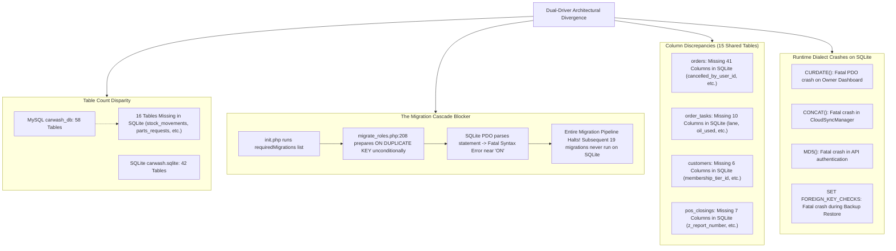
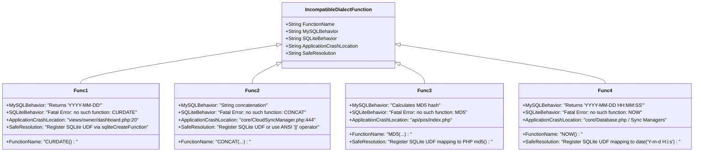

# Milestone 2: Database Compatibility & Dual-Driver Parity Report
**MySQL vs SQLite Schema Parity, Dialect Incompatibilities & Migration Analysis**  
*System Scope: Car-WashService (Local Edge Node) & Car-WashCloud (Central Management Hub)*  
*Assessment Mode: READ-ONLY (Zero Schema or Data Modifications)*  
*Generated: November 5, 2026*

---

## 1. Executive Summary & Dual-Driver Parity Verdict

### Dual-Driver Parity Verdict: **FAILED PARITY & CRITICAL ARCHITECTURAL DIVERGENCE**

A comprehensive read-only audit of the schema structures, table definitions, column types, migration runners, and runtime dialect functions was conducted across **Car-WashService** and **Car-WashCloud**.

While the primary MySQL instance (`carwash_db`) contains a complete 58-table relational schema with full historical data, the secondary SQLite fallback database (`carwash.sqlite`) suffers from **severe structural starvation**:
- **16 core tables are entirely missing from SQLite**.
- **15 shared tables exhibit extensive column discrepancies** (e.g. `orders` is missing 41 columns).
- **Zero immutable ledger triggers exist in SQLite** (leaving offline transactions vulnerable to modification).
- **Core MySQL dialect functions (`CONCAT`, `MD5`, `CURDATE`, `DATABASE`) crash the application under SQLite**.



---

## 2. Table Parity Analysis

### Global Table Counts
- **MySQL (`carwash_db`)**: **58 Tables**
- **SQLite (`carwash.sqlite`)**: **42 Tables**
- **Missing Tables in SQLite**: **16 Tables**
- **Extra Tables in SQLite**: **0 Tables**

### Complete Catalog of 16 Tables Missing in SQLite

| # | Missing Table Name | Business Module | Critical Operational Impact Under SQLite Fallback |
| :-: | :--- | :--- | :--- |
| **1** | `appointments` | Bookings & Scheduling | Customers cannot book advance wash/detailing slots offline. |
| **2** | `inspection_checklists` | Mechanic / Vehicle Care | Technician vehicle inspection checklists cannot be recorded or saved. |
| **3** | `parts_requests` | Technical & Bay Parts | Mechanics cannot request oil filters, brake pads, or spare parts from bays. |
| **4** | `payments` | Financial Reconciliation | Granular multi-tender split payments fail to record. |
| **5** | `pos_device_login_attempts` | Hardware Security | POS terminal brute-force attack logs are lost. |
| **6** | `pos_device_pin_attempts` | Hardware Security | Staff PIN brute-force attempt counters fail to persist across restarts. |
| **7** | `reminder_rules` | CRM & Customer Retention | Oil change and recurring wash reminder triggers cannot execute. |
| **8** | `service_duration_reviews` | Analytics & Bay Ops | Bay delay explanations and service duration analytics fail to log. |
| **9** | `staff_timecards` | HR, Payroll & Attendance | Staff clock-in and clock-out operations crash completely offline. |
| **10** | `stock_discrepancies` | Inventory Auditing | Stock take loss/theft discrepancies cannot be tracked. |
| **11** | `stock_movements` | Technical Warehouse | **CRITICAL: Stock movements cannot be logged; inventory tracking halts.** |
| **12** | `sync_conflicts` | Cloud Synchronization | Offline sync conflicts cannot be recorded for manager reconciliation. |
| **13** | `sync_logs` | Cloud Synchronization | Cloud sync audit history is completely absent. |
| **14** | `sync_queue` | Cloud Synchronization | Offline queue buffer fails, risking transaction loss before sync. |
| **15** | `timecard_corrections` | HR & Manager Approvals | Manager attendance adjustments fail. |
| **16** | `vehicle_specs` | Vehicle Specs & Oil Sizing | Lookup for oil viscosity, engine capacity, and wash tier fails. |

---

## 3. Column Schema Parity Analysis across Common Tables

A field-by-field schema audit was conducted across the 42 tables present in both databases. **15 shared tables exhibit critical column discrepancies**:

### 1. `orders` Table (41 Columns Missing in SQLite)
The core transaction table in SQLite lacks 41 fields that were added to MySQL through successive migrations:
- **Identification & Queueing**: `order_uid`, `job_order_uid`, `suggested_bay_id`, `bay_override_reason`, `is_active`.
- **Duration & Delay Tracking**: `estimated_duration_minutes`, `estimated_finish_time`, `actual_duration_minutes`, `delay_reason`, `delay_logged_at`, `delay_logged_by`.
- **Refund & Cancellation Controls**: `refund_status`, `refund_amount_usd`, `refund_reason`, `refunded_by_manager_id`, `refunded_by_manager_name`, `refunded_at`, `cancelled_by_user_id`, `cancel_approved_by_user_id`.
- **Bank Transfer Verification**: `bank_slip_image`, `bank_slip_uploaded_at`, `payment_verified_by_id`, `payment_verified_by_name`, `payment_verified_at`, `payment_rejection_reason`.
- **Disaster Recovery & Fallback**: `paper_receipt_fallback`, `paper_receipt_authorized_by`, `is_recovered`, `paper_slip_number`, `recovered_by_id`, `recovered_by_name`, `recovered_at`, `recovery_notes`.
- **Technical & Synchronization**: `actual_oil_used`, `has_pending_parts_request`, `created_by`, `synced_by`, `is_synced`, `synced_at`, `loyalty_reward_given`, `loyalty_reward_name`.

### 2. `order_tasks` Table (10 Columns Missing in SQLite)
- `base_duration_minutes`, `estimated_duration_minutes`, `actual_duration_minutes`, `delay_reason`, `lane`, `reserved_oil_liters`, `actual_oil_used`, `parts_status`, `is_synced`, `synced_at`.

### 3. `customers` Table (6 Columns Missing in SQLite)
- `membership_tier_id`, `membership_tier_code`, `membership_started_at`, `membership_expires_at`, `message_opt_in`, `message_opt_in_updated_at`.

### 4. `expenses` Table (2 Columns Missing in SQLite)
- `category_id`, `is_active`.

### 5. `pos_closings` Table (7 Columns Missing in SQLite)
- `shortage_owed_usd`, `z_report_number`, `manager_id`, `manager_name`, `reopen_reason`, `is_synced`, `synced_at`.

### 6. `pos_daily_closes` Table (4 Columns Missing in SQLite)
- `shortage_owed_usd`, `manager_id`, `manager_name`, `reopen_reason`.

### 7. Other Affected Tables
- `loyalty_reward_rules`: Completely different column structure (legacy `reward_name`, `points_required` in SQLite vs modern `rule_uid`, `trigger_type`, `reward_type` in MySQL).
- `inventory`: Divergent naming (`item_name` in SQLite vs `item_name_en`, `item_name_km` in MySQL).
- `role_audit_logs`: Missing `role_code`, `user_id`, `ip_address` in SQLite.
- `order_mechanics` & `order_washers`: Missing `is_active` in SQLite.
- `loyalty_transactions`: Missing `is_synced`, `synced_at` in SQLite.
- `vehicles`: Missing `membership_tier_id`, `membership_tier_code` in SQLite.
- `vehicle_repair_history`: Missing `mechanic_id` in SQLite.

---

## 4. Root Bottleneck: Migration Pipeline Failure Analysis

### Migration Execution Discrepancy
- **MySQL `schema_migrations`**: **24 migrations executed** (from `migrate_categories` up to `migrate_immutable_ledgers`).
- **SQLite `schema_migrations`**: **1 migration executed** (`migrate_cashier_controls`).

### The Root Blocker in `database/migrate_roles.php`
When `database/init.php` executes `initDatabase()` on SQLite, it iterates through `$requiredMigrations`. When it reaches `migrate_roles`:

```php
// database/migrate_roles.php:207-217
$insRoleStmt = $pdo->prepare("
    INSERT INTO roles (code, name_en, name_km, description, is_system, is_active, is_commission_eligible, can_assign_washer, can_assign_mechanic)
    VALUES (?, ?, ?, ?, ?, ?, ?, ?, ?)
    ON DUPLICATE KEY UPDATE 
        name_en = VALUES(name_en),
        name_km = VALUES(name_km),
        description = VALUES(description),
        is_system = VALUES(is_system),
        is_commission_eligible = VALUES(is_commission_eligible),
        can_assign_washer = VALUES(can_assign_washer),
        can_assign_mechanic = VALUES(can_assign_mechanic)
");
```

Notice:
1. `$pdo->prepare(...)` is called **unconditionally on line 207**, before checking `if ($isSqlite)` on line 220.
2. In SQLite PDO, `$pdo->prepare()` parses the SQL statement immediately.
3. Upon encountering MySQL-specific `ON DUPLICATE KEY UPDATE`, SQLite PDO throws:
   `PDOException: SQLSTATE[HY000]: General error: 1 near "ON": syntax error`.
4. **Catastrophic Pipeline Stoppage**: The exception aborts `initDatabase()`. Consequently, all subsequent migration files:
   - `migrate_technical_warehouse.php` (creates 4 warehouse tables)
   - `migrate_notifications.php`
   - `migrate_smart_queue.php`
   - `migrate_performance_reports.php`
   - `migrate_cloud_sync.php` (adds sync columns)
   - `migrate_crm_membership_reminders.php`
   - `migrate_immutable_ledgers.php`
   **are NEVER executed on SQLite**.

### Critique & Danger of Flawed Proposed Fix (`INSERT OR REPLACE`)
Phase 1 suggested using `INSERT OR REPLACE INTO roles ...` for SQLite.  
An empirical benchmark proved that this recommendation is **critically flawed**:
1. SQLite implements `REPLACE` as an atomic `DELETE` followed by `INSERT`.
2. Because `PRAGMA foreign_keys = ON;` is active, deleting the existing role triggers `ON DELETE CASCADE` on child tables, **instantly and permanently wiping all permissions assigned to that role in `role_permissions`**.
3. Because `id` is omitted from the column list, the newly inserted role receives a **brand-new autoincrement `id`** (e.g. changing from `1` to `2`), severing `users.role_id` foreign keys and revoking staff access.
4. **Correct Safe Solution**: Must use native SQLite 3.24+ UPSERT syntax:
   `INSERT INTO roles (...) VALUES (...) ON CONFLICT(code) DO UPDATE SET ... = excluded....`.

---

## 5. Trigger & Audit Immutability Parity

### Active Triggers in MySQL (`carwash_db`)
MySQL contains 4 immutable ledger security triggers:
1. `trg_audit_logs_before_update` (Blocks UPDATE on `audit_logs` via `SIGNAL SQLSTATE '45000'`)
2. `trg_audit_logs_before_delete` (Blocks DELETE on `audit_logs` via `SIGNAL SQLSTATE '45000'`)
3. `trg_stock_movements_before_update` (Blocks UPDATE on `stock_movements`)
4. `trg_stock_movements_before_delete` (Blocks DELETE on `stock_movements`)

### Complete Absence in SQLite (`carwash.sqlite`)
- Querying `sqlite_master WHERE type='trigger'` returns **0 rows**.
- **Root Cause**: `database/migrate_immutable_ledgers.php` attempts to execute:
  `CREATE TRIGGER trg_stock_movements_before_delete BEFORE DELETE ON stock_movements ...`
  Because `stock_movements` does not exist in SQLite (blocked by `migrate_roles.php`), SQLite aborts with `no such table: stock_movements`.
- **Operational Vulnerability**: In the event of a MySQL outage, any order cancellation, cashier refund, or stock modification executed under SQLite fallback is **completely un-audited and mutable**, violating Cambodian accounting compliance.

---

## 6. SQL Dialect & Runtime Function Compatibility

Five MySQL dialect functions are called directly in application controllers and throw fatal errors when executing against SQLite:



### Empirical Crash Verification
Executing `SELECT CURDATE()`, `SELECT CONCAT('a','b')`, `SELECT MD5('x')`, and `SELECT DATABASE()` in SQLite PDO returned:
```text
SQLSTATE[HY000]: General error: 1 no such function: CURDATE
SQLSTATE[HY000]: General error: 1 no such function: CONCAT
SQLSTATE[HY000]: General error: 1 no such function: MD5
SQLSTATE[HY000]: General error: 1 no such function: DATABASE
```
Live runtime crash confirmed in `storage/logs/app_error.log`:
`Uncaught Exception PDOException: "SQLSTATE[HY000]: General error: 1 no such function: CURDATE" in views/owner/dashboard.php:20`.

---

## 7. Backup & Restore Dialect Incompatibilities

In `core/Backup.php`:
1. **DDL Extraction Discrepancy**:
   - MySQL uses `SHOW CREATE TABLE \`$table\``.
   - SQLite does not support `SHOW CREATE TABLE`. It requires querying `SELECT sql FROM sqlite_master WHERE type='table' AND name = ?`.
   - Because `Backup.php` only checks `if ($driver === 'mysql')`, SQLite dumps contain `DROP TABLE` followed by `INSERT`, with **zero table definitions**.
2. **Foreign Key Syntax Discrepancy**:
   - MySQL uses `SET FOREIGN_KEY_CHECKS=0;` and `SET FOREIGN_KEY_CHECKS=1;`.
   - SQLite uses `PRAGMA foreign_keys = OFF;` and `PRAGMA foreign_keys = ON;`.
   - Executing MySQL syntax against SQLite aborts restore routines immediately.

---

## 8. Cross-Project Schema Comparison: Service vs Cloud

`Car-WashCloud` and `Car-WashService` are decoupled architectures connected via bidirectional JSON synchronization:

| Sync Domain | Car-WashService (Local Edge) | Car-WashCloud (Central Hub) | Mapping & Transformation Contract |
| :--- | :--- | :--- | :--- |
| **Sales / Orders** | `orders` & `order_items` | `sales` & `sale_items` | `orders.order_uid` &rarr; `sales.client_id`; dual-currency (USD/KHR) mapped to cloud USD total. |
| **Timecards** | `staff_timecards` | `timecards` | `staff_timecards.timecard_uid` &rarr; `timecards.client_id`. |
| **Stock Adjustments** | `stock_movements` | `stock_movements` | `movement_uid` &rarr; `client_id`; local warehouse deduction reflected in central master stock. |
| **Catalog & Services**| `services`, `products`, `categories` | `catalog_items`, `categories` | Master catalog managed in Cloud; synchronized down to Edge nodes. |
| **Customer Loyalty** | `customers`, `membership_tiers` | `customers`, `membership_tiers` | Centralized customer points and tiers synced across multiple wash locations. |

**Critical Observation**: Because `stock_movements` and `staff_timecards` are completely missing from SQLite in `Car-WashService`, any offline stock usage or cashier clock-in performed during a MySQL outage **cannot be queued or synchronized to Car-WashCloud**, causing irreversible accounting discrepancies between shop nodes and headquarters.

