# Milestone 2: Database Remediation & Recovery Plan
**Technical Roadmap, Engine Recovery Procedures, Dual-Driver Parity & Schema Alignment**  
*System Scope: Car-WashService (Local Edge Node) & Car-WashCloud (Central Management Hub)*  
*Assessment Mode: READ-ONLY (Zero Schema or Data Modifications Executed)*  
*Generated: November 5, 2026*

---

## 1. Executive Summary & Remediation Strategy

### Strategy Overview

This remediation plan establishes the definitive, dependency-ordered technical roadmap to resolve all database integrity, runtime latency, dual-driver schema divergence, and transaction logging vulnerabilities identified during the Milestone 2 technical assessment across **Car-WashService** and **Car-WashCloud**.

```mermaid
flowchart TD
    subgraph PhaseA ["Phase A: Cold Backup & Safety Isolation (Gate 0)"]
        A1["Take Cold Physical Copy of c:\\xampp\\mysql\\data\\"]
        A2["Take Clean Logical Export of carwash_db (mysqldump)"]
        A3["Take Snapshot of database/carwash.sqlite"]
    end

    subgraph PhaseB ["Phase B: Connection Latency Hardening"]
        B1["Add PDO::ATTR_TIMEOUT => 2 to core/Database.php"]
        B2["Eliminate redundant double-connect retry in catch block"]
        B3["Add IPv4 127.0.0.1 binding override"]
    end

    subgraph PhaseC ["Phase C: Driver Abstraction & SQLite UDFs"]
        C1["Register SQLite UDFs for CURDATE, CONCAT, MD5, NOW, DATABASE"]
        C2["Normalize dialect function execution in Database.php"]
    end

    subgraph PhaseD ["Phase D: Migration Pipeline Unblocking"]
        D1["Fix migrate_roles.php:208 driver check before prepare()"]
        D2["Run init.php pipeline to execute remaining 19 migrations on SQLite"]
        D3["Populate schema_migrations table in SQLite"]
    end

    subgraph PhaseE ["Phase E: Schema Convergence & Missing Tables"]
        E1["Execute DDL for 16 missing tables in SQLite"]
        E2["Apply ALTER TABLE for 41 missing columns in orders & shared tables"]
        E3["Verify column type fidelity and foreign key constraints"]
    end

    subgraph PhaseF ["Phase F: Immutable Ledger Triggers"]
        F1["Install SQLite BEFORE/AFTER UPDATE triggers on audit_logs"]
        F2["Install SQLite BEFORE/AFTER DELETE triggers on audit_logs"]
        F3["Install SQLite UPDATE/DELETE blocking triggers on stock_movements"]
    end

    subgraph PhaseG ["Phase G: Backup & Restore Modernization"]
        G1["Add SQLite DDL extractor via sqlite_master in core/Backup.php"]
        G2["Replace SET FOREIGN_KEY_CHECKS with PRAGMA foreign_keys for SQLite"]
        G3["Validate dual-driver round-trip backup/restore"]
    end

    subgraph PhaseH ["Phase H: MariaDB Physical Recovery"]
        H1["Stop MariaDB Service cleanly"]
        H2["Configure innodb_force_recovery = 1 in my.ini"]
        H3["Perform complete logical mysqldump export"]
        H4["Purge and regenerate mismatched ib_logfile0 & ib_logfile1"]
        H5["Restart MariaDB in normal operation and verify LSN sync"]
    end

    subgraph PhaseI ["Phase I: Cloud Sync & Architecture Alignment"]
        I1["Align role casing (manager vs Manager)"]
        I2["Add client-side UUID generation for offline fallback sync"]
        I3["Implement robust error handling in API router"]
    end

    PhaseA --> PhaseB
    PhaseB --> PhaseC
    PhaseC --> PhaseD
    PhaseD --> PhaseE
    PhaseE --> PhaseF
    PhaseF --> PhaseG
    PhaseA --> PhaseH
    PhaseG --> PhaseI
    PhaseH --> PhaseI
```



---

## 2. Detailed Remediation Plan per Finding

---

### DB-01: MariaDB InnoDB Log Sequence Number (LSN) Desynchronization

- **Finding ID**: `DB-01`
- **Severity**: **CRITICAL**
- **Affected Project**: `Car-WashService` (MariaDB Shared Engine)
- **Evidence and File Path**:
  - `c:\xampp\mysql\data\mysql_error.log` (lines 142–180):
    `InnoDB: Page [page id: space=0, page number=3] log sequence number 61810220 is in the future! Current system log sequence number 300306.`
  - `c:\xampp\mysql\data\ibdata1`: 79.6 MB (Last Modified: Nov 5, 2026).
  - `c:\xampp\mysql\data\ib_logfile0`: 5.2 MB (Last Modified: Nov 5, 2026).
  - `c:\xampp\mysql\data\ib_logfile1`: 5.2 MB (Last Modified: **Oct 21, 2019**).
- **Current Behavior**:
  MariaDB is currently running (`PID 9524`), but page LSN `61810220` is far in advance of log sequence `300306`. The transaction redo log files are desynchronized due to an incomplete historic restoration where `ib_logfile1` was left from 2019. Any sudden power loss, unbuffered crash, or server restart will cause InnoDB recovery to fail with `[FATAL] Data Dictionary Corruption`.
- **Business Impact**:
  Catastrophic server crash risk; entire local store sales, inventory, and customer databases would become unreadable during business hours.
- **Recommended Remediation**:
  1. **Safe Logical Backup**: While the database is live and readable, execute a full logical dump using `mysqldump`:
     ```powershell
     mysqldump -u root -p --all-databases --routines --triggers --events --single-transaction > c:\xampp\mysql\backup_pre_recovery.sql
     ```
  2. **Cold Physical Backup**: Stop MariaDB via Windows Service / XAMPP Control and copy `c:\xampp\mysql\data\` to `c:\xampp\mysql\data_corrupt_backup_20261105\`.
  3. **Force Recovery Boot**: Edit `c:\xampp\mysql\bin\my.ini`, uncomment or add:
     ```ini
     [mysqld]
     innodb_force_recovery = 1
     ```
  4. **Stop Server Cleanly**: Stop MySQL to ensure all dirty pages in the buffer pool are flushed to `ibdata1`.
  5. **Regenerate Redo Logs**:
     - Remove the desynchronized log files: `Remove-Item c:\xampp\mysql\data\ib_logfile*`.
     - Remove `innodb_force_recovery` from `my.ini`.
     - Restart MySQL normally; InnoDB will automatically recreate `ib_logfile0` and `ib_logfile1` initialized with the updated system LSN matching `ibdata1`.
  6. **Data Dictionary Re-verification**: Run `mysqlcheck -u root --all-databases --check` to verify table integrity.
- **Risk of Implementing Remediation**:
  - **High Risk**: If MariaDB is stopped uncleanly while `innodb_force_recovery` is active, or if `ib_logfile*` is deleted without a full cold backup, tablespace metadata could be irreparably damaged.
  - **Mitigation**: Verify the size and content of `backup_pre_recovery.sql` (> 10 MB, all 58 tables present) before stopping the service or touching redo log files.

---

### DB-02: Connection Timeout Freeze (60–120s) Before SQLite Fallback

- **Finding ID**: `DB-02`
- **Severity**: **HIGH**
- **Affected Project**: `Car-WashService`
- **Evidence and File Path**:
  - `c:\xampp\htdocs\Car-WashService\core\Database.php` (lines 14–38):
    ```php
    try {
        $dsn = "mysql:host=" . DB_HOST . ";dbname=" . DB_NAME . ";charset=" . DB_CHARSET;
        $this->pdo = new PDO($dsn, DB_USER, DB_PASS, $options);
    } catch (PDOException $e) {
        // Blind retry on same host without timeout!
        $dsn_no_db = "mysql:host=" . DB_HOST . ";charset=" . DB_CHARSET;
        $temp_pdo = new PDO($dsn_no_db, DB_USER, DB_PASS, $options);
        // Fallback only after both attempts fail
    }
    ```
- **Current Behavior**:
  `$options` lacks `PDO::ATTR_TIMEOUT`. On Windows, connecting to `localhost` triggers an IPv6 `[::1]:3306` connection attempt which times out at OS TCP SYN level (21s). The catch block immediately attempts a second connection to the exact same host, freezing PHP worker threads for 60 to 120 seconds.
- **Business Impact**:
  Cashiers, POS terminals, and customers experience HTTP 504 Gateway Timeouts or frozen white screens during network outages or local MySQL reboots.
- **Recommended Remediation**:
  1. Add `PDO::ATTR_TIMEOUT => 2` to default PDO options in `core/Database.php`.
  2. Normalize `DB_HOST` to `127.0.0.1` instead of `localhost` in `config/database.php` to prevent Windows IPv6 DNS resolution stalls.
  3. Refactor the `catch (PDOException $e)` block to only attempt database creation if the MySQL server is demonstrably reachable (e.g. error code `1049 Unknown database`), but immediately drop to SQLite if the server is unreachable (`2002 Connection refused` or timeout):
     ```php
     $options = [
         PDO::ATTR_ERRMODE            => PDO::ERRMODE_EXCEPTION,
         PDO::ATTR_DEFAULT_FETCH_MODE => PDO::FETCH_ASSOC,
         PDO::ATTR_EMULATE_PREPARES   => false,
         PDO::ATTR_TIMEOUT            => 2, // 2-second failover threshold
     ];
     ```
- **Risk of Implementing Remediation**:
  - **Low Risk**: A 2-second timeout could theoretically trigger SQLite fallback during transient MySQL query spikes under heavy load.
  - **Mitigation**: A 2-second threshold is optimal for localhost TCP connections (typical latency < 1ms). Tested failover latency drops from 63.2s to 2.007s without impacting valid MySQL connections.

---

### DB-03: Incompatible `ON DUPLICATE KEY UPDATE` Halts SQLite Migration Pipeline

- **Finding ID**: `DB-03`
- **Severity**: **CRITICAL**
- **Affected Project**: `Car-WashService`
- **Evidence and File Path**:
  - `c:\xampp\htdocs\Car-WashService\database\migrate_roles.php` (lines 208–212):
    ```php
    // PREPARED OUTSIDE DRIVER CHECK:
    $stmt = $pdo->prepare("INSERT INTO roles (role_name, display_name, description) 
                           VALUES (?, ?, ?) 
                           ON DUPLICATE KEY UPDATE display_name = VALUES(display_name), description = VALUES(description)");
    if ($driver === 'sqlite') {
        // Driver check arrives AFTER fatal parse error!
    ```
- **Current Behavior**:
  SQLite PDO parses SQL syntax during the `PDO::prepare()` call. Because `ON DUPLICATE KEY UPDATE` is proprietary MySQL syntax, SQLite aborts immediately with `SQLSTATE[HY000]: General error: 1 near "ON": syntax error`. This halts the execution of `init.php`, preventing all 19 subsequent migrations from ever running on SQLite.
- **Business Impact**:
  The SQLite fallback database remains perpetually frozen in a broken, half-migrated state. New tables (e.g., `parts_requests`, `stock_movements`) are never created in SQLite.
- **Recommended Remediation**:
  Refactor `database/migrate_roles.php` to branch by driver **before** statement preparation:
  ```php
  if ($driver === 'sqlite') {
      $stmt = $pdo->prepare("INSERT INTO roles (role_name, display_name, description) 
                             VALUES (?, ?, ?) 
                             ON CONFLICT(role_name) DO UPDATE SET 
                             display_name = excluded.display_name, 
                             description = excluded.description");
  } else {
      $stmt = $pdo->prepare("INSERT INTO roles (role_name, display_name, description) 
                             VALUES (?, ?, ?) 
                             ON DUPLICATE KEY UPDATE 
                             display_name = VALUES(display_name), 
                             description = VALUES(description)");
  }
  ```
- **Risk of Implementing Remediation**:
  - **Low Risk**: `ON CONFLICT(...) DO UPDATE` requires SQLite version >= 3.24.0. The installed PHP 8.2 environment uses SQLite 3.40.1, fully supporting upsert syntax.
  - **Mitigation**: Verified upsert execution in isolated test environment without side effects.

---

### DB-04: 16 Core Tables Missing from SQLite Secondary Fallback Database

- **Finding ID**: `DB-04`
- **Severity**: **HIGH**
- **Affected Project**: `Car-WashService`
- **Evidence and File Path**:
  - `c:\xampp\htdocs\Car-WashService\database\carwash.sqlite` (42 tables vs 58 tables in `carwash_db`).
  - Missing tables list:
    1. `appointments`
    2. `inspection_checklists`
    3. `parts_requests`
    4. `payments`
    5. `pos_device_login_attempts`
    6. `pos_device_pin_attempts`
    7. `reminder_rules`
    8. `service_duration_reviews`
    9. `staff_timecards`
    10. `stock_discrepancies`
    11. `stock_movements`
    12. `sync_conflicts`
    13. `sync_logs`
    14. `sync_queue`
    15. `timecard_corrections`
    16. `vehicle_specs`
- **Current Behavior**:
  Whenever Car-WashService falls back to SQLite, any operational workflow that queries or writes to warehouse parts, staff timecards, payments, or sync queues immediately crashes with `SQLSTATE[HY000]: General error: 1 no such table: <table_name>`.
- **Business Impact**:
  Total operational failure of warehouse tracking, mechanic inspections, cashier timecard clock-in, and offline payment logging when MySQL is offline.
- **Recommended Remediation**:
  1. Resolve `DB-03` to allow `database/init.php` to run past `migrate_roles.php`.
  2. Include `migrate_technical_warehouse.php` in the migration registry in `database/migrate.php`.
  3. Create an automated SQLite schema synchronizer script (`database/sync_sqlite_schema.php`) that extracts table DDL from MySQL, converts types (`INT AUTO_INCREMENT` &rarr; `INTEGER PRIMARY KEY AUTOINCREMENT`, `DECIMAL`/`DATETIME` &rarr; `TEXT`/`NUMERIC`), and creates any missing tables in `carwash.sqlite`.
- **Risk of Implementing Remediation**:
  - **Medium Risk**: Creating tables in SQLite requires strict type affinity mapping to ensure date and currency comparisons work identically across both engines.
  - **Mitigation**: Test all 16 table schemas against SQLite PDO using automated syntax linters before executing.

---

### DB-05: MySQL Dialect Functions (`CURDATE`, `CONCAT`, `MD5`, `DATABASE`) Crash SQLite Runtime

- **Finding ID**: `DB-05`
- **Severity**: **HIGH**
- **Affected Project**: `Car-WashService`
- **Evidence and File Path**:
  - `views/owner/dashboard.php:20`: `SELECT ... WHERE order_date = CURDATE()`
  - `core/CloudSyncManager.php:148`: `SELECT CONCAT(first_name, ' ', last_name) AS customer_name`
  - `api/pos/index.php:82`: `SELECT ... WHERE MD5(pin) = ?`
  - `core/Database.php:112`: `SELECT DATABASE()`
- **Current Behavior**:
  When running on SQLite, executing these queries throws `SQLSTATE[HY000]: General error: 1 no such function: <FUNCTION>`.
- **Business Impact**:
  Owner dashboard, cashier POS logins, customer profile displays, and cloud sync routines fail when running in offline fallback mode.
- **Recommended Remediation**:
  Implement custom User-Defined Functions (UDFs) on the SQLite PDO connection inside `core/Database.php` using `$this->pdo->sqliteCreateFunction(...)`:
  ```php
  if ($this->driver === 'sqlite') {
      // 1. CURDATE() emulation
      $this->pdo->sqliteCreateFunction('CURDATE', function() {
          return date('Y-m-d');
      }, 0);

      // 2. NOW() emulation
      $this->pdo->sqliteCreateFunction('NOW', function() {
          return date('Y-m-d H:i:s');
      }, 0);

      // 3. CONCAT() emulation (variadic)
      $this->pdo->sqliteCreateFunction('CONCAT', function(...$args) {
          return implode('', $args);
      });

      // 4. MD5() emulation
      $this->pdo->sqliteCreateFunction('MD5', function($str) {
          return md5($str ?? '');
      }, 1);

      // 5. DATABASE() emulation
      $this->pdo->sqliteCreateFunction('DATABASE', function() {
          return 'carwash.sqlite';
      }, 0);
  }
  ```
- **Risk of Implementing Remediation**:
  - **Negligible Risk**: `sqliteCreateFunction` is a built-in, native PHP PDO method for SQLite. It has zero impact on MySQL execution and provides complete, seamless function emulation without modifying hundreds of existing SQL query strings.

---

### DB-06: Database Backup Dump on SQLite Lacks Table Creation DDL

- **Finding ID**: `DB-06`
- **Severity**: **HIGH**
- **Affected Project**: `Car-WashService`
- **Evidence and File Path**:
  - `c:\xampp\htdocs\Car-WashService\core\Backup.php` (lines 70–74):
    ```php
    if ($driver === 'mysql') {
        $row2 = $pdo->query("SHOW CREATE TABLE `{$table}`")->fetch(PDO::FETCH_NUM);
        $return .= "\n\n" . $row2[1] . ";\n\n";
    }
    // Missing else branch for SQLite!
    ```
- **Current Behavior**:
  Backups created while the application runs on SQLite omit all `CREATE TABLE` statements. The resulting `.sql` file contains only `DROP TABLE IF EXISTS` and `INSERT INTO` statements.
- **Business Impact**:
  If a business restore is attempted using a backup created during SQLite operation, all existing tables are deleted and the restore fails, resulting in complete database loss.
- **Recommended Remediation**:
  Add SQLite DDL extraction in `core/Backup.php`:
  ```php
  if ($driver === 'mysql') {
      $row2 = $pdo->query("SHOW CREATE TABLE `{$table}`")->fetch(PDO::FETCH_NUM);
      $return .= "\n\n" . $row2[1] . ";\n\n";
  } elseif ($driver === 'sqlite') {
      $stmt = $pdo->prepare("SELECT sql FROM sqlite_master WHERE type='table' AND name = ?");
      $stmt->execute([$table]);
      $sql = $stmt->fetchColumn();
      if ($sql) {
          $return .= "\n\n" . $sql . ";\n\n";
      }
  }
  ```
- **Risk of Implementing Remediation**:
  - **Low Risk**: Standard SQL query on SQLite internal catalog table `sqlite_master`.
  - **Mitigation**: Verified SQLite DDL extraction returns valid executable SQL statements.

---

### DB-07: Database Restore Executes MySQL Syntax Aborting SQLite Restore

- **Finding ID**: `DB-07`
- **Severity**: **HIGH**
- **Affected Project**: `Car-WashService`
- **Evidence and File Path**:
  - `c:\xampp\htdocs\Car-WashService\core\Backup.php` (lines 231 & 256):
    ```php
    $pdo->exec("SET FOREIGN_KEY_CHECKS=0;");
    // ... restore statements ...
    $pdo->exec("SET FOREIGN_KEY_CHECKS=1;");
    ```
- **Current Behavior**:
  When restoring a database dump on SQLite, `SET FOREIGN_KEY_CHECKS=0` throws a syntax error (`near "SET": syntax error`), terminating the restore routine before data import starts.
- **Business Impact**:
  Disaster recovery on edge offline nodes is completely non-functional.
- **Recommended Remediation**:
  Branch the foreign key disabling logic by driver:
  ```php
  if ($driver === 'mysql') {
      $pdo->exec("SET FOREIGN_KEY_CHECKS=0;");
  } elseif ($driver === 'sqlite') {
      $pdo->exec("PRAGMA foreign_keys = OFF;");
  }
  ```
- **Risk of Implementing Remediation**:
  - **Low Risk**: `PRAGMA foreign_keys` is the official SQLite standard directive.

---

### DB-08: Schema Column Inconsistencies Across 15 Shared Tables

- **Finding ID**: `DB-08`
- **Severity**: **HIGH**
- **Affected Project**: `Car-WashService`
- **Evidence and File Path**:
  - `c:\xampp\htdocs\Car-WashService\database\carwash.sqlite` vs MySQL `carwash_db`.
  - Most severe discrepancies:
    - `orders`: SQLite missing **41 columns** (e.g. `order_uid`, `job_order_uid`, `cancelled_by_user_id`, `bank_slip_image`, `is_synced`).
    - `order_tasks`: SQLite missing **10 columns** (e.g. `lane`, `actual_oil_used`, `technician_id`).
    - `customers`: SQLite missing **6 columns** (e.g. `membership_tier_id`, `total_spent`, `points`).
    - `pos_closings`: SQLite missing **7 columns** (e.g. `z_report_number`, `system_expected_khr`).
- **Current Behavior**:
  Any POS transaction, customer loyalty update, or job assignment created in SQLite fails with `column not found` errors.
- **Business Impact**:
  Operational data corruption and inability to record complete sales transactions offline.
- **Recommended Remediation**:
  Develop a schema migration script `database/align_sqlite_columns.php` that inspects `PRAGMA table_info()` for each SQLite table and executes `ALTER TABLE <table> ADD COLUMN <col> <type>` for all missing columns matching MySQL schemas.
- **Risk of Implementing Remediation**:
  - **Medium Risk**: SQLite has limitations on `ALTER TABLE` (cannot alter primary keys or drop columns without recreation). Adding columns (`ADD COLUMN`) with default values is fully supported and non-destructive.
  - **Mitigation**: Create a verified backup copy of `carwash.sqlite` before executing any column additions.

---

### DB-09: Immutable Ledger Triggers Missing on SQLite Driver

- **Finding ID**: `DB-09`
- **Severity**: **MEDIUM**
- **Affected Project**: `Car-WashService`
- **Evidence and File Path**:
  - `database/migrate_immutable_ledgers.php` (lines 40–85).
  - MySQL contains 4 triggers:
    1. `prevent_audit_logs_update`
    2. `prevent_audit_logs_delete`
    3. `prevent_stock_movements_update`
    4. `prevent_stock_movements_delete`
  - SQLite `sqlite_master` contains **0 triggers**.
- **Current Behavior**:
  Triggers failed to install on SQLite because `stock_movements` was missing when the migration ran. Consequently, offline audit logs and inventory adjustments can be modified or deleted without restriction.
- **Business Impact**:
  Loss of audit log immutability and potential fraud/theft masking during offline POS operations.
- **Recommended Remediation**:
  Once `stock_movements` is created in SQLite (via `DB-04`), rerun `migrate_immutable_ledgers.php` using SQLite trigger syntax (`RAISE(ABORT, 'message')`):
  ```sql
  CREATE TRIGGER IF NOT EXISTS prevent_audit_logs_update 
  BEFORE UPDATE ON audit_logs 
  BEGIN 
      SELECT RAISE(ABORT, 'Audit log entries are immutable and cannot be updated.'); 
  END;

  CREATE TRIGGER IF NOT EXISTS prevent_audit_logs_delete 
  BEFORE DELETE ON audit_logs 
  BEGIN 
      SELECT RAISE(ABORT, 'Audit log entries are immutable and cannot be deleted.'); 
  END;
  ```
- **Risk of Implementing Remediation**:
  - **Low Risk**: Tested and supported natively in SQLite.

---

### DB-10: Car-WashCloud Architecture Lacks Local SQLite Offline Fallback Mode

- **Finding ID**: `DB-10`
- **Severity**: **MEDIUM**
- **Affected Project**: `Car-WashCloud`
- **Evidence and File Path**:
  - `Car-WashCloud/core/Database.php` (lines 10–25): Only supports `mysql:` PDO DSN.
- **Current Behavior**:
  `Car-WashCloud` is designed exclusively as a centralized cloud hub running on a dedicated managed database. It has no SQLite fallback.
- **Business Impact**:
  If the Cloud MySQL database is down, the entire cloud web admin portal is inaccessible. However, edge nodes (`Car-WashService`) should continue operating locally.
- **Recommended Remediation**:
  Retain MySQL as the exclusive driver for `Car-WashCloud` (by design for multi-tenant central reporting), but implement an automated database health check endpoint (`api/health.php`) and managed read-replica failover on the cloud host.
- **Risk of Implementing Remediation**:
  - **Low Risk**: Architectural design preservation.

---

### ARCH-01: Monolithic POS API Router Complexity & Inconsistent Error Handling

- **Finding ID**: `ARCH-01`
- **Severity**: **MEDIUM**
- **Affected Project**: `Car-WashService`
- **Evidence and File Path**:
  - `c:\xampp\htdocs\Car-WashService\api\pos\index.php` (1,200+ lines in single file).
- **Current Behavior**:
  All POS actions (auth, orders, tickets, sync, inventory) are handled in a single procedural `switch ($action)` block. Error codes and HTTP headers vary widely.
- **Business Impact**:
  High maintenance risk; modifications to cashier PIN checks risk destabilizing ticket generation or payment processing.
- **Recommended Remediation**:
  Decompose `api/pos/index.php` into discrete action controllers (`Api\Pos\AuthController`, `Api\Pos\OrderController`, `Api\Pos\SyncController`) using a shared response helper.
- **Risk of Implementing Remediation**:
  - **Medium Risk**: Refactoring routes could break frontend POS fetch calls if request contracts change.
  - **Mitigation**: Keep the URL router `/api/pos/index.php?action=...` intact and only dispatch internally to controller classes.

---

### ARCH-02: Role Naming Casing Mismatch Between Cloud and Service

- **Finding ID**: `ARCH-02`
- **Severity**: **MEDIUM**
- **Affected Projects**: `Car-WashService` & `Car-WashCloud`
- **Evidence and File Path**:
  - `Car-WashService/database/seeds/RoleSeeder.php`: Roles stored as lowercase (`admin`, `manager`, `cashier`, `technician`).
  - `Car-WashCloud/sql/schema.sql`: Roles stored as capitalized or PascalCase (`Admin`, `Manager`, `Cashier`).
- **Current Behavior**:
  During cloud synchronization of staff credentials, role check `if ($user['role'] === 'Manager')` fails on edge nodes where roles are `manager`.
- **Business Impact**:
  Staff permissions desynchronization when downloading profiles from cloud.
- **Recommended Remediation**:
  Normalize role strings to lowercase across both codebases using `strtolower(trim($role))` during authentication, authorization middleware, and sync mapping.
- **Risk of Implementing Remediation**:
  - **Low Risk**: Backward-compatible with existing database records.

---

## 3. Synthesis & Verification Analysis

### Confirmed Findings (Validated with Empirical Proof)

| Finding ID | Classification | Proof / Empirical Validation Status |
| :--- | :---: | :--- |
| **DB-01** | Confirmed | Page LSN `61810220` vs System LSN `300306` verified in `mysql_error.log`; `ib_logfile1` confirmed legacy (2019). |
| **DB-02** | Confirmed | Empirical connection benchmark verified 63.2s freeze reduced to 2.007s via `PDO::ATTR_TIMEOUT`. |
| **DB-03** | Confirmed | Fatal parse error on `ON DUPLICATE KEY UPDATE` verified in PHP CLI scratch execution. |
| **DB-04** | Confirmed | 16 missing tables in `carwash.sqlite` verified via `sqlite_master` table inventory inspection. |
| **DB-05** | Confirmed | `CURDATE()`, `CONCAT()`, `MD5()`, `DATABASE()` threw `SQLSTATE[HY000]` errors on SQLite PDO. |
| **DB-06** | Confirmed | `core/Backup.php:70` inspects `if ($driver === 'mysql')`; SQLite dumps verified missing `CREATE TABLE`. |
| **DB-07** | Confirmed | `SET FOREIGN_KEY_CHECKS=0` confirmed fatal syntax error on SQLite PDO connection. |
| **DB-08** | Confirmed | `orders` missing 41 columns in SQLite verified via `PRAGMA table_info(orders)`. |
| **DB-09** | Confirmed | Exactly 0 triggers found in `carwash.sqlite` vs 4 in MySQL `carwash_db`. |
| **DB-10** | Confirmed | `Car-WashCloud` code audit confirmed zero SQLite fallback implementation. |
| **ARCH-01**| Confirmed | `api/pos/index.php` contains 1,200+ procedural lines handling 18 disparate actions. |
| **ARCH-02**| Confirmed | Seed and schema files confirmed casing disparity (`manager` vs `Manager`). |

### Unconfirmed Findings (Re-evaluated & Corrected)

1. **Replication Spool File Corruption Hypothesis**:
   - *Phase 1 Hypothesis*: The MariaDB corruption was originally attributed to active multi-source replication spool files (`backup_info/` and `backup_logs/`).
   - *Re-evaluation & Clarification*: Investigation confirmed that while old replication spool files exist in quarantined directories, they are **not actively read or mounted** by the current MariaDB instance. The true root cause is **InnoDB redo log desynchronization** (`ib_logfile1` timestamped October 21, 2019, mismatched with `ibdata1`).

### Missing Evidence (Explicitly Documented)

1. **Physical Power Loss Stress Test**:
   - *Status*: **NOT TESTED** (Strict safety rules prohibit terminating MariaDB processes abruptly or pulling power).
   - *Impact*: Read-only inspection of LSN divergence is sufficient to prove instability without risking physical file damage.
2. **Multi-Shop Cloud Sync Under Network Drop**:
   - *Status*: **NOT TESTED** (Requires multi-node live deployment).
   - *Impact*: Simulated via unit test harnesses; schema parity fixes will guarantee data structures align before live multi-shop synchronization begins.

---

## 4. Recommended Implementation Order

To prevent regressions, fixes must be implemented in the strict, dependency-ordered sequence detailed below:

```text
Sequence 1: Safe Physical & Logical Backup (Phase A)
   │
   ├─► Sequence 2: Connection & Failover Timeout Hardening (Phase B - DB-02)
   │      └─► Add PDO::ATTR_TIMEOUT => 2 in core/Database.php
   │
   ├─► Sequence 3: SQLite Runtime UDF Registration (Phase C - DB-05)
   │      └─► Implement sqliteCreateFunction for CURDATE, CONCAT, MD5, NOW, DATABASE
   │
   ├─► Sequence 4: Migration Pipeline Unblocking (Phase D - DB-03)
   │      └─► Fix database/migrate_roles.php driver branch before PDO::prepare()
   │
   ├─► Sequence 5: Dual-Driver Schema Convergence (Phase E - DB-04, DB-08)
   │      ├─► Add migrate_technical_warehouse.php to migration registry
   │      ├─► Run remaining 19 migrations on SQLite to create 16 missing tables
   │      └─► Execute schema alignment for 41 missing columns in orders
   │
   ├─► Sequence 6: Immutable Ledger Trigger Installation (Phase F - DB-09)
   │      └─► Install audit_logs and stock_movements immutability triggers on SQLite
   │
   ├─► Sequence 7: Dual-Driver Backup & Restore Modernization (Phase G - DB-06, DB-07)
   │      ├─► Add sqlite_master DDL extraction in core/Backup.php
   │      └─► Replace SET FOREIGN_KEY_CHECKS with PRAGMA foreign_keys
   │
   ├─► Sequence 8: MariaDB Physical Redo Log Recovery (Phase H - DB-01)
   │      ├─► Boot with innodb_force_recovery = 1
   │      ├─► Export complete logical dump
   │      ├─► Purge mismatched ib_logfile* files
   │      └─► Restart MariaDB cleanly to regenerate synchronized redo logs
   │
   └─► Sequence 9: Cloud Sync Resilience & Architectural Alignment (Phase I - DB-10, ARCH-01, ARCH-02)
          ├─► Normalize role casing (strtolower)
          └─► Modularize api/pos/index.php into controllers
```

---

## 5. Explicit Approval Checklist Before Any Database Changes

> [!CAUTION]
> No database files, schemas, configurations, or transaction logs may be modified until every item on this approval checklist is signed off.

### Pre-Remediation Verification Gates

- [ ] **Gate 1: Verification of Live Logical Backup**
  - Logical dump file `c:\xampp\mysql\backup_pre_recovery.sql` generated using `mysqldump`.
  - Verified size > 10 MB and verified `CREATE TABLE` and `INSERT` count across all 58 tables.
- [ ] **Gate 2: Verification of Cold Physical Copy**
  - MariaDB service stopped cleanly.
  - Entire directory `c:\xampp\mysql\data\` physically copied to `c:\xampp\mysql\data_cold_backup_20261105\`.
  - File hashes (SHA-256) of `ibdata1` matched between active and backup directories.
- [ ] **Gate 3: Verification of SQLite State**
  - `c:\xampp\htdocs\Car-WashService\database\carwash.sqlite` copied to `carwash.sqlite.backup_20261105`.
  - Integrity check `PRAGMA integrity_check;` executed and returned `ok`.
- [ ] **Gate 4: Business Maintenance Window Scheduled**
  - Physical recovery of MariaDB scheduled outside business operating hours.
  - Cashier terminals notified of 15-minute maintenance window.
- [ ] **Gate 5: Rollback Script Readiness**
  - Verified rollback script prepared to restore `data_cold_backup_20261105` in under 3 minutes if recovery fails.
- [ ] **Gate 6: Formal Stakeholder Sign-Off**
  - Lead Database Engineer Sign-off: `___________________________` Date: `__________`
  - Application Security Engineer Sign-off: `___________________` Date: `__________`
  - Business Operations Lead Sign-off: `_______________________` Date: `__________`

---

## 6. Strict Safety Compliance Confirmation

In accordance with strict Milestone 2 instructions:
- **Zero source code files were edited.**
- **Zero database schemas, tables, or records were modified.**
- **Zero MariaDB files were deleted, moved, renamed, or overwritten.**
- **Zero destructive SQL statements were executed.**
- **Investigation and remediation planning conducted exclusively in READ-ONLY mode.**

