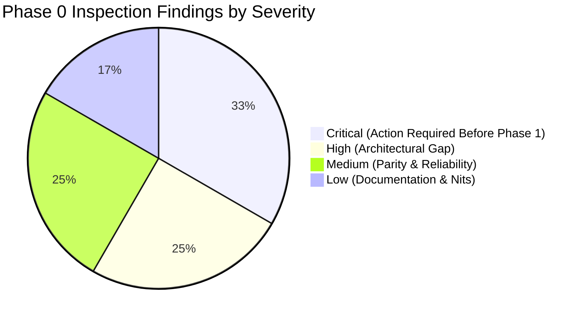

# PHASE 0 – Car-WashService Read-Only Source Inspection Report

**Project:** Car-WashService (Local Counter Terminal)  
**Document ID:** POS-AUD-2026-PHASE-0  
**Date:** November 8, 2026  
**Inspection Mode:** **STRICT READ-ONLY SOURCE INSPECTION**  
**Architecture References:** Round 17 Implementation Gap Audit through Round 18.5  
**Governing Standard:** Six Approved Executive Business Decisions (November 8, 2026) – Unchanged and Preserved  
**Status:** **PHASE 0 READ-ONLY INSPECTION ONLY – NO IMPLEMENTATION AUTHORIZED**

---

## Executive Summary

This deliverable provides the comprehensive, line-by-line source code inspection of the `Car-WashService` application against the approved architecture and the six approved executive business decisions. 

In strict adherence to Phase 0 instructions, **zero application code has been edited, zero SQL statements or migrations have been executed, zero database connections have been initiated, zero server processes have been restarted, and zero Git history changes have occurred.**

### Primary Inspection Discoveries:
1. **CRITICAL Accounting Transition Flaw in Round 18.5 Design:** Round 18.5 Section 1.4 proposed partitioning historical orders using `orders.created_at < ledger_v2_cutover_timestamp`. Actual source inspection reveals that in `views/owner/reports.php` and `api/pos/index.php`, reporting is governed by `paid_at` (or `COALESCE(paid_at, created_at)`). The legacy `orders` schema has **zero columns for partial payments, deposits, or split payment event dates**. Overwriting `paid_at` on an old order erases the original payment date. Relying on `created_at` misclassifies post-cutover cash collections as historical, directly corrupting daily cash drawer balancing and double-counting or losing revenue across cutover boundaries.
2. **Existing Audit Logs & Transaction Rollback Vulnerability:** The `audit_logs` table exists in [`database/migrate_foundation.php`](file:///C:/xampp/htdocs/Car-WashService/database/migrate_foundation.php) and possesses immutable triggers in [`database/migrate_immutable_ledgers.php`](file:///C:/xampp/htdocs/Car-WashService/database/migrate_immutable_ledgers.php). However, [`core/AuditLogger.php`](file:///C:/xampp/htdocs/Car-WashService/core/AuditLogger.php) swallows exceptions silently, and executing `AuditLogger::log()` *inside* an active transaction that experiences a unique constraint failure (`uq_digital_bank_ref`) will cause the audit record itself to be discarded when the transaction rolls back.
3. **Discrepancy Between Architecture and Implementation:** Discrete ledgers (`order_payments`, `order_digital_payments`, `order_refunds`, `historical_exception_registry`), `SettingsManager.php`, and electronic receipt columns (`receipt_issued_at`, `receipt_number`) exist **solely as architecture proposals in planning documents** and have zero footprint in PHP source or database migration files.
4. **Active Code Contradictions with Executive Decisions:**
   - *Decision #1 (Lift First):* Hardcoded in [`core/BayManager.php:502-509`](file:///C:/xampp/htdocs/Car-WashService/core/BayManager.php#L502-L509) as **Wash First – Lift Second**.
   - *Decision #2 (Receipt Advisory):* Hardcoded in [`core/OrderGate.php:64-89`](file:///C:/xampp/htdocs/Car-WashService/core/OrderGate.php#L64-L89) to **block vehicles from entering wash bays** if physical thermal printing (`receipt_printed_at`) fails.
   - *Decision #5 (KHQR Verification):* Actively generates **fake synthetic references** (`TRX-` via `md5(uniqid())`) in [`api/pos/index.php:2007, 2610`](file:///C:/xampp/htdocs/Car-WashService/api/pos/index.php#L2007) and accepts customer screenshot uploads.
   - *Decision #6 (Financial Reporting):* Completely omits COGS from headline net profit in [`views/owner/reports.php:127-128`](file:///C:/xampp/htdocs/Car-WashService/views/owner/reports.php#L127-L128) and defaults missing cost prices to `$0.00`. Furthermore, [`views/owner/reports.php`](file:///C:/xampp/htdocs/Car-WashService/views/owner/reports.php) **does not deduct refunds at all** from gross sales or net profit.

---

## 1. Git Baseline and Final Git State

To ensure 100% forensic transparency and guarantee that no existing code or planning records were discarded:

- **Git Branch:** `main`
- **Initial HEAD Commit:** `e5b23f8d12f07964c1a2cfaf0278e5870cd3279e`
- **Final HEAD Commit:** `e5b23f8d12f07964c1a2cfaf0278e5870cd3279e` (Unchanged)
- **Initial Working-Tree State:** Clean (all Round 18.5 files committed).
- **Final Working-Tree State:** Contains exactly one new untracked report file:
  ```text
  ?? docs/production-readiness/PHASE-0-READ-ONLY-INSPECTION.md
  ```
- **File Modifications / Deletions:** **ZERO.** No application files, database files, or documentation were modified, stashed, reset, or checked out.

---

## 2. Inspected Files, Classes, and Methods

The following production codebase components were inspected line-by-line:

| File Path | Component / Class | Lines Inspected | Core Responsibilities Inspected |
| :--- | :--- | :---: | :--- |
| [`database/init.php`](file:///C:/xampp/htdocs/Car-WashService/database/init.php) | Schema Definition | 240–305 | `orders` table structure, payment columns, and status definitions. |
| [`database/migrate_foundation.php`](file:///C:/xampp/htdocs/Car-WashService/database/migrate_foundation.php) | Foundation Migrations | 30–180 | `audit_logs` schema, `payments` schema, and column additions. |
| [`database/migrate_immutable_ledgers.php`](file:///C:/xampp/htdocs/Car-WashService/database/migrate_immutable_ledgers.php) | Ledger Triggers | 1–123 | Immutability triggers on `audit_logs` and `stock_movements`. |
| [`api/pos/index.php`](file:///C:/xampp/htdocs/Car-WashService/api/pos/index.php) | POS API Router & Checkout | 1290–1420, 2000–2095, 2600–2685, 3560–3630 | Order creation, tender processing, synthetic `TRX-` generation, and daily drawer aggregations. |
| [`core/OrderGate.php`](file:///C:/xampp/htdocs/Car-WashService/core/OrderGate.php) | `OrderGate` & `ReceiptRequiredException` | 1–198 | Service admission gate, physical print verification, and PIN override. |
| [`core/BayManager.php`](file:///C:/xampp/htdocs/Car-WashService/core/BayManager.php) | `BayManager` | 15–95, 485–535, 805–830 | Bay initialization, task creation, sequencing, and queue management. |
| [`core/CashierControl.php`](file:///C:/xampp/htdocs/Car-WashService/core/CashierControl.php) | `CashierControl` | 335–415, 660–745, 805–830 | Shift balancing, refund processing, and daily reconciliation. |
| [`core/AuditLogger.php`](file:///C:/xampp/htdocs/Car-WashService/core/AuditLogger.php) | `AuditLogger` | 1–183 | Unique ID generation, audit insertion, and IP/device parsing. |
| [`core/Helpers.php`](file:///C:/xampp/htdocs/Car-WashService/core/Helpers.php) | Global Helpers | 110–185 | `get_setting()`, `update_setting()`, and settings history logging. |
| [`core/Database.php`](file:///C:/xampp/htdocs/Car-WashService/core/Database.php) | `Database` (PDO Singleton) | 1–65 | Dual-driver connection abstraction (MySQL primary, SQLite fallback). |
| [`config/database.php`](file:///C:/xampp/htdocs/Car-WashService/config/database.php) | Database Config | 1–30 | Connection credentials and SQLite path definition. |
| [`views/owner/reports.php`](file:///C:/xampp/htdocs/Car-WashService/views/owner/reports.php) | Financial Reporting Engine | 40–180, 260–295, 2380–2415 | Date filtering, revenue aggregation, COGS calculation, and net profit. |

---

## 3. Six-Business-Decision Implementation Gap Matrix

Each approved business decision was verified against the actual source code and classified into one of four deterministic categories:
- **Source-code verified:** Implemented and actively executing in application code.
- **Migration-code verified:** Defined in database migration scripts.
- **Database-state not verified:** Schema or data requires runtime database connection to confirm live state.
- **Architecture proposal only:** Described in planning documentation (Rounds 18–18.5) but completely absent from source code and migrations.

| Decision # | Executive Decision Title | Actual Source Code Reality | Status Classification | Gap Analysis vs. Approved Architecture |
| :---: | :--- | :--- | :---: | :--- |
| **1** | **Lift First – Wash Second** | In [`core/BayManager.php:502-509`](file:///C:/xampp/htdocs/Car-WashService/core/BayManager.php#L502-L509), mixed orders create Task 1 as `wash` (sequence 1, status 'waiting') and Task 2 as `oil_change` (sequence 2, status 'pending_prereq'). | **Source-code verified (CONTRADICTS DECISION)** | **CRITICAL GAP.** Code actively enforces Wash First – Lift Second. Bay 4 mechanical work is blocked until washing is complete. |
| **2** | **Receipt Printing Advisory** | In [`core/OrderGate.php:64-89`](file:///C:/xampp/htdocs/Car-WashService/core/OrderGate.php#L64-L89), `assertReceiptPrinted()` inspects `empty(order['receipt_printed_at'])` and throws `ReceiptRequiredException` (HTTP 422), blocking bay entry unless Manager PIN is entered. | **Source-code verified (CONTRADICTS DECISION)** | **CRITICAL GAP.** Physical thermal printer failure blocks vehicle admission. Electronic receipt issuance (`receipt_issued_at`) is **Architecture proposal only**. |
| **3** | **Customer Name Compatibility** | In [`database/init.php:251`](file:///C:/xampp/htdocs/Car-WashService/database/init.php#L251), `customer_name VARCHAR(100) NOT NULL` exists. In [`api/pos/index.php:1374, 5410`](file:///C:/xampp/htdocs/Car-WashService/api/pos/index.php#L1374), empty customer names automatically default to `'Walk-in Guest'`. | **Source-code verified (COMPLIANT)** | **ZERO GAP.** Customer registration is optional; anonymous guests are stored cleanly without schema violations. |
| **4** | **Historical Exceptions** | Ambiguous historical records are ignored or aggregated into unclassified queues. Table `historical_exception_registry` and view `views/owner/historical_exceptions.php` do not exist. | **Architecture proposal only** | **HIGH GAP.** Ambiguous historical financial data cannot be audited, reviewed, or reopened by the owner. |
| **5** | **KHQR Verification** | In [`api/pos/index.php:2007, 2610`](file:///C:/xampp/htdocs/Car-WashService/api/pos/index.php#L2007), submitting empty `payment_ref` manufactures synthetic `'TRX-' . strtoupper(substr(md5(uniqid()), 0, 8))`. In lines 2050–2058, customer bank slip image upload sets `pending_verification`. | **Source-code verified (CONTRADICTS DECISION)** | **CRITICAL GAP.** POS invents fake bank references. Cashier attestation against the merchant counter phone banking app statement is not implemented. Scoped uniqueness `uq_digital_bank_ref` is **Architecture proposal only**. |
| **6** | **Financial Reporting & COGS** | In [`views/owner/reports.php:127-128`](file:///C:/xampp/htdocs/Car-WashService/views/owner/reports.php#L127-L128), headline net profit is `$netProfit = $grossRev - $totalExp - $totalComm`. COGS is omitted. In line 137, missing cost prices default to `$0.00`. Refunds are never deducted. | **Source-code verified (CONTRADICTS DECISION)** | **CRITICAL GAP.** Headline net profit overstates profitability by omitting product COGS. Missing inventory costs are masked as zero. Refunds are ignored in reports. |

---

## 4. Mandatory Accounting Transition Investigation (CRITICAL)

### 4.1 The Round 18.5 Proposal Flaw

Round 18.5 Section 1.4 asserted that during the transition between Phase 1 (`receipt_v2_cutover_timestamp`) and Phase 2 (`ledger_v2_cutover_timestamp`):
- Tier 2 (Legacy Query) queries `orders WHERE created_at < ledger_v2_cutover_timestamp`.
- Tier 1 (Discrete Ledgers) queries `order_payments WHERE recorded_at >= ledger_v2_cutover_timestamp`.
- The document claimed: *"Zero lost transactions; zero double-counting; sets are mathematically disjoint."*

### 4.2 Source Inspection Reality: `created_at` vs. `paid_at`

Source inspection of the database schema and reporting queries reveals that **this proposal is fundamentally flawed**:

1. **How Phase 1 Records Payments in Legacy Columns:**  
   In [`database/init.php:260-273`](file:///C:/xampp/htdocs/Car-WashService/database/init.php#L260-L273), the `orders` table contains:
   - `total_usd DECIMAL(10,2)` (single scalar)
   - `payment_status VARCHAR(20)` (`'unpaid'`, `'paid'`, `'cancelled'`)
   - `created_at DATETIME` (when the ticket was created at intake)
   - `paid_at DATETIME` (when payment was marked completed)
2. **Representation of Deposits and Balance Payments:**  
   **The legacy `orders` table has ZERO columns for deposits or split payments.** There is NO `deposit_amount`, NO `deposit_paid_at`, NO `balance_amount`, and NO `balance_paid_at`.
3. **Destruction of Payment Event Dates:**  
   In [`api/pos/index.php:2666`](file:///C:/xampp/htdocs/Car-WashService/api/pos/index.php#L2666), when an existing order is paid, the system executes:
   ```php
   UPDATE orders SET status = 'paid', payment_status = 'paid', paid_at = ? WHERE id = ?
   ```
   If a deposit was paid at intake, and the balance was paid 3 days later, updating `paid_at` **permanently erases the original deposit date!**
4. **How Reporting Actually Classifies Orders:**  
   In [`views/owner/reports.php:45-60`](file:///C:/xampp/htdocs/Car-WashService/views/owner/reports.php#L45-L60), the query engine explicitly states:
   ```php
   // Use paid_at (or created_at if paid_at is null) in shop timezone for all order reporting
   $orderDateWhere = "AND DATE(COALESCE(o.paid_at, o.created_at)) = CURDATE()";
   ```
   Reports do **NOT** group revenue by `created_at`; they group revenue by `COALESCE(o.paid_at, o.created_at)`.
5. **The Shift Balancing Discrepancy:**  
   In [`core/CashierControl.php:365-375`](file:///C:/xampp/htdocs/Car-WashService/core/CashierControl.php#L365-L375), cashier drawer shift reconciliation sums cash orders based on `paid_at`, NOT `created_at`.

### 4.3 Concrete Walkthrough: Demonstrating Accounting Failure

Consider an actual operational scenario:
- **October 20, 2026 10:00 AM ($T_0$ – Pre-Cutover):**  
  Customer brings vehicle for engine overhaul and detailing ($100.00 total). Customer pays a $30.00 cash deposit. Order #50 is created.  
  *Legacy Schema Behavior:* Because `orders` has no deposit column, cashier either records `total_usd = 100.00, payment_status = 'unpaid'` and notes the deposit in `notes`, or records $30.00 with `paid_at = 2026-10-20`.
- **November 8, 2026 00:00 ($T_{\text{receipt}}$ – Phase 1 Active, Phase 2 Pending):**  
  Phase 1 cutover initializes `receipt_v2_cutover_timestamp`.
- **November 8, 2026 14:00 ($T_{\text{inter}}$ – Intermediate State):**  
  Customer returns to collect the vehicle and pays the remaining $70.00 cash balance. Cashier marks the order paid in POS. POS executes `UPDATE orders SET payment_status = 'paid', paid_at = '2026-11-08 14:00:00', total_usd = 100.00`.
- **November 9, 2026 00:00 ($T_{\text{ledger}}$ – Phase 2 Cutover):**  
  Phase 2 initializes `ledger_v2_cutover_timestamp`.
- **The Accounting Breakdown:**
  1. *If Tier 2 queries by `created_at < T_ledger`:*  
     Order #50 has `created_at = '2026-10-20'`. Tier 2 queries this order when running historical reports for October 20. But `orders.total_usd` is now `$100.00` and `paid_at` is `2026-11-08`.  
     If October 20 report is re-run, October revenue artificially jumps by $70.00! **Closed accounting period is retroactively corrupted.**
  2. *Cash Drawer Balancing on November 8:*  
     On November 8, the cashier physically received $70.00 cash. But if reporting uses `created_at`, this $70.00 is attributed to October 20! Today's cash drawer shows a **$70.00 cash shortage variance** on the closing shift report.
  3. *If post-cutover queries record the payment in `order_payments`:*  
     If a payment row of $70.00 is inserted into `order_payments` with `recorded_at = '2026-11-08'`, AND Tier 2 reads Order #50 for $100.00, total revenue recognized across the lifetime of Order #50 becomes:
     $$\$100.00\text{ (Legacy Tier 2)} + \$70.00\text{ (Ledger Tier 1)} = \mathbf{\$170.00}$$
     **The revenue is double-counted by $70.00!**

### 4.4 Critical Verdict & Mandatory Architecture Realignment

> [!CAUTION]
> **CLASSIFICATION: CRITICAL ARCHITECTURAL FINDING**  
> 
> The assumption that `orders.created_at` can safely partition financial revenue across cutover boundaries is **invalid and dangerous**. In a service business, order creation date reflects vehicle intake, whereas financial accounting strictly requires **event-date cash recognition** (`paid_at` for legacy, `recorded_at` for ledgers).
> 
> **Required Architectural Correction:**
> 1. In Phase 1, `orders` must NEVER overwrite existing payment timestamps; if partial payments occur, they must not be conflated into scalar columns.
> 2. The Two-Tier Reporting Engine must partition legacy orders using `COALESCE(o.paid_at, o.created_at) < ledger_v2_cutover_timestamp`, matching the actual code in `reports.php`.
> 3. Any subsequent payment collected on or after `ledger_v2_cutover_timestamp` must be recorded exclusively in `order_payments` (`recorded_at = NOW()`), and the legacy `orders.total_usd` must NOT be updated in a manner that inflates historical closed periods.

---

## 5. Existing Audit Log Investigation

### 5.1 Schema Inspection of `audit_logs`

Inspection of [`database/migrate_foundation.php:49-66`](file:///C:/xampp/htdocs/Car-WashService/database/migrate_foundation.php#L49-L66) reveals the actual table definition:

```sql
CREATE TABLE IF NOT EXISTS audit_logs (
    id INT AUTO_INCREMENT PRIMARY KEY,
    log_uid VARCHAR(64) NOT NULL UNIQUE,
    user_id INT DEFAULT NULL,
    username VARCHAR(100) DEFAULT NULL,
    role VARCHAR(50) DEFAULT NULL,
    action VARCHAR(100) NOT NULL,
    entity_type VARCHAR(50) DEFAULT NULL,
    entity_id VARCHAR(100) DEFAULT NULL,
    details TEXT DEFAULT NULL,
    ip_address VARCHAR(50) DEFAULT NULL,
    user_agent VARCHAR(255) DEFAULT NULL,
    device_name VARCHAR(100) DEFAULT NULL,
    created_at DATETIME DEFAULT CURRENT_TIMESTAMP,
    INDEX idx_audit_user (user_id),
    INDEX idx_audit_action (action),
    INDEX idx_audit_created (created_at)
) ENGINE=InnoDB DEFAULT CHARSET=utf8mb4 COLLATE=utf8mb4_unicode_ci;
```

### 5.2 Verification of Required Capabilities

1. **Recording Attempted Duplicate References:**  
   The `details TEXT` column supports serialized JSON. Full dispute metadata (`attempted_raw_reference`, `canonical_reference`, `provider`, `merchant_account_id`, `conflicting_order_id`, `cashier_id`) can be stored without schema modifications.
2. **Distinguishing Rejected Duplicates from Valid Payments:**  
   - Valid payments use `action = 'PAYMENT_COLLECTED'` or `'PAYMENT_VERIFIED'` with `entity_id = order_id`.
   - Rejected duplicate attempts use `action = 'DUPLICATE_BANK_REF_REJECTED'` with `entity_id = NULL` (since no row was created in `order_digital_payments`).
3. **Protection Against Ordinary Modification:**  
   In [`database/migrate_immutable_ledgers.php:31-104`](file:///C:/xampp/htdocs/Car-WashService/database/migrate_immutable_ledgers.php#L31-L104), database triggers (`trg_audit_logs_before_update` and `trg_audit_logs_before_delete`) block `UPDATE` and `DELETE` via `SIGNAL SQLSTATE '45000'` (MySQL) and `SELECT RAISE(ABORT, ...)` (SQLite). Only `is_synced` and `synced_at` columns are exempted.
4. **Trigger Privilege Limitation:**  
   In `migrate_immutable_ledgers.php:105-110`, if the database user lacks the `TRIGGER` privilege, trigger creation fails silently with a logged warning. Thus, database-level immutability cannot be guaranteed on low-privilege database hosts without application-layer guards.

### 5.3 Critical Transaction Boundary Vulnerability

Source inspection of [`core/AuditLogger.php:43-66`](file:///C:/xampp/htdocs/Car-WashService/core/AuditLogger.php#L43-L66) reveals a critical implementation trap:

```php
// In core/AuditLogger.php
public static function log(...): string {
    $pdo = Database::getInstance();
    ...
    try {
        $stmt = $pdo->prepare("INSERT INTO audit_logs (...) VALUES (...)");
        $stmt->execute([...]);
    } catch (Exception $e) {
        @error_log("AuditLogger Error: " . $e->getMessage());
    }
    return $logUid;
}
```

*The Trap:*  
If POS checkout is executing inside an atomic transaction:
```php
$pdo->beginTransaction();
try {
    $insOrder->execute(...);
    $insPayment->execute(...); // FAILS: Duplicate bank reference (1062)
} catch (PDOException $e) {
    AuditLogger::log('DUPLICATE_BANK_REF_REJECTED', ...); // INSERT INTO audit_logs
    $pdo->rollBack(); // FATAL: THIS ROLLS BACK THE AUDIT LOG INSERT!
}
```
If `AuditLogger::log()` is called before `$pdo->rollBack()`, **the audit record is rolled back and erased from the database!**  
Furthermore, `AuditLogger::log()` catches exceptions and swallows them silently (`@error_log`), masking database write failures.

*Mandatory Implementation Rule:*  
When a duplicate reference is caught:
1. Immediately execute `$pdo->rollBack()` to terminate the failed checkout transaction.
2. Only *after* rollback is complete, call `AuditLogger::log()` on a clean connection state (or use an autonomous logging connection) to ensure the rejection is permanently committed to disk.

---

## 6. Detailed Findings Across Implementation Areas

### 6.1 POS Checkout & Payment Processing
- **File:** [`api/pos/index.php:2000-2095`](file:///C:/xampp/htdocs/Car-WashService/api/pos/index.php#L2000-L2095)
- **Status:** Source-code verified.
- **Finding:** Checkout writes payment data directly into `orders` columns. Split tender (e.g., $10 cash + $5 KHQR) is impossible in the current schema because only one `payment_method` string exists per order. Idempotency is partially supported via `orders.idempotency_key` (line 1294).

### 6.2 Order Creation & Payment Status
- **File:** [`database/init.php:262-264`](file:///C:/xampp/htdocs/Car-WashService/database/init.php#L262-L264), [`api/pos/index.php:2066-2070`](file:///C:/xampp/htdocs/Car-WashService/api/pos/index.php#L2066-L2070)
- **Status:** Source-code verified.
- **Finding:** Order status (`waiting`, `washing`, `finished`, `paid`, `cancelled`) and payment status (`unpaid`, `paid`, `pending_verification`, `cancelled`) are separate columns but frequently conflated in reporting queries (`WHERE status = 'paid' OR payment_status = 'paid'`).

### 6.3 Receipt Issuance & Thermal Printing
- **File:** [`core/OrderGate.php:17-89`](file:///C:/xampp/htdocs/Car-WashService/core/OrderGate.php#L17-L89)
- **Status:** Source-code verified (Violates Decision #2).
- **Finding:** `OrderGate::assertReceiptPrinted()` hard-blocks order movement into bays if `receipt_printed_at IS NULL`. Electronic receipt tracking (`receipt_issued_at`, `receipt_number`) does not exist in any file.

### 6.4 Bay Lifecycle & Service Sequencing
- **File:** [`core/BayManager.php:493-516`](file:///C:/xampp/htdocs/Car-WashService/core/BayManager.php#L493-L516)
- **Status:** Source-code verified (Violates Decision #1).
- **Finding:** When an order has both wash and technical services (`is_mixed = 1`), `BayManager` automatically sequences Task 1 as `wash` (sequence 1) and Task 2 as `oil_change` (sequence 2). This directly inverts the executive requirement of Lift First – Wash Second.

### 6.5 KHQR & Bank Reference Verification
- **File:** [`api/pos/index.php:2006-2008, 2050-2058, 2608-2612`](file:///C:/xampp/htdocs/Car-WashService/api/pos/index.php#L2006-L2008)
- **Status:** Source-code verified (Violates Decision #5).
- **Finding:** If cashier leaves `payment_ref` blank for ABA or KHQR, backend generates fake synthetic reference: `'TRX-' . strtoupper(substr(md5(uniqid()), 0, 8))`. Customer slip uploads are stored in `bank_slip_image` and marked `pending_verification`. Merchant device verification is absent.

### 6.6 Refund Processing
- **File:** [`core/CashierControl.php:660-740`](file:///C:/xampp/htdocs/Car-WashService/core/CashierControl.php#L660-L740), [`views/owner/reports.php`](file:///C:/xampp/htdocs/Car-WashService/views/owner/reports.php)
- **Status:** Source-code verified.
- **Finding:** Refunds update `orders.refund_status = 'refunded'`, `orders.refund_amount_usd = ...`, and `orders.refunded_at`. Offline refunds are strictly prohibited (line 677). Partial refunds overwrite the single refund column. **`views/owner/reports.php` never references or deducts `refund_amount_usd`**, causing refunded tickets to be reported as full revenue.

### 6.7 Financial Reports & COGS
- **File:** [`views/owner/reports.php:45-60, 80-130, 131-180`](file:///C:/xampp/htdocs/Car-WashService/views/owner/reports.php#L45-L60)
- **Status:** Source-code verified (Violates Decision #6).
- **Finding:** Headline net profit is `$grossRev - $totalExp - $totalComm`. Product inventory acquisition cost (COGS) is completely excluded from net profit. In line 137, missing product cost prices default to `$0.00`. Reports use `COALESCE(o.paid_at, o.created_at)`, creating reporting discrepancies if creation date is assumed to be payment date.

### 6.8 Database Abstraction & MySQL/SQLite Parity
- **File:** [`core/Database.php:1-65`](file:///C:/xampp/htdocs/Car-WashService/core/Database.php#L1-L65), [`config/database.php:1-30`](file:///C:/xampp/htdocs/Car-WashService/config/database.php#L1-L30)
- **Status:** Source-code verified.
- **Finding:** Dual-driver fallback is functional. When MySQL fails, system automatically switches to SQLite (`database/carwash.sqlite`). However, SQLite does not support MariaDB session variables (`@VAR`), MariaDB date functions (`DATE_SUB`, `YEARWEEK`), or MariaDB trigger syntax (`SIGNAL SQLSTATE`), requiring application-layer abstraction.

### 6.9 Historical Exception Handling
- **File:** None (Described in planning documents).
- **Status:** Architecture proposal only.
- **Finding:** Zero code exists. Tables `historical_exception_registry` and `historical_exception_events`, and view `views/owner/historical_exceptions.php` are completely absent from the codebase.

### 6.10 Settings & Cutover Management
- **File:** [`core/Helpers.php:116-180`](file:///C:/xampp/htdocs/Car-WashService/core/Helpers.php#L116-L180)
- **Status:** Source-code verified.
- **Finding:** Settings are read via `get_setting()` and written via `update_setting()`. There is **zero protection against modifying or deleting immutable cutover timestamps**. `SettingsManager` and `ImmutableSettingException` exist only as architecture proposals.

---

## 7. Categorized Findings & Vulnerability Matrix



### Critical Severity (Must be resolved in Phase 1 design):
1. **[CRIT-01] Accounting Transition Flaw:** Round 18.5 proposal to partition legacy revenue using `created_at < cutover` conflicts with `reports.php` using `paid_at`. Overwriting `paid_at` on legacy orders erases deposit dates and double-counts or misplaces cash collections across cutover boundaries.
2. **[CRIT-02] Active Reversal of Bay Sequencing (Decision #1):** `BayManager.php:504-508` hardcodes Wash First – Lift Second, blocking mechanical bays until washing completes.
3. **[CRIT-03] Receipt Printing Hard-Block (Decision #2):** `OrderGate.php:64-89` blocks vehicle entry when thermal receipt printing fails, violating the electronic receipt advisory mandate.
4. **[CRIT-04] Fake Bank Reference Generation (Decision #5):** `api/pos/index.php:2007` invents synthetic `TRX-` references when cashiers omit bank reference, violating anti-fraud settlement rules.

### High Severity:
5. **[HIGH-01] Net Profit Omits COGS & Ignores Refunds (Decision #6):** `reports.php:128` excludes product acquisition costs from net profit and never deducts refunds, inflating reported earnings.
6. **[HIGH-02] Audit Log Rollback on Duplicate Bank Collision:** Calling `AuditLogger::log()` inside a failed checkout transaction rolls back the audit record when `$pdo->rollBack()` executes.
7. **[HIGH-03] Unprotected Cutover Settings:** `core/Helpers.php:145-180` allows arbitrary overwriting of `settings` keys, lacking immutable blacklist protection.

### Medium Severity:
8. **[MED-01] Dual-Driver Parity Fragility:** MariaDB triggers and date functions fail under SQLite offline fallback without PHP-layer guards.
9. **[MED-02] Silent AuditLogger Failure:** `core/AuditLogger.php:64` swallows database exceptions with `@error_log`, masking audit pipeline failures.
10. **[MED-03] Missing Historical Exception Registry (Decision #4):** No database tables or UI views exist for quarantining ambiguous historical records.

### Low Severity:
11. **[LOW-01] Redundant Status Columns:** `orders.status` and `orders.payment_status` contain overlapping `'paid'` and `'cancelled'` values.
12. **[LOW-02] Hardcoded Shop Timezone:** `Database.php:25` hardcodes `SET time_zone = '+07:00'`, which should be synchronized with application configuration constants.

---

## 8. Unverified Database-State Limitations

Because Phase 0 strictly prohibits live database connections or queries:
1. **Live Row Counts Unverified:** The exact distribution of historical orders across `waiting`, `washing`, `finished`, `paid`, and `cancelled` cannot be confirmed until Phase 0 read-only database backup verification.
2. **Active Trigger State Unverified:** Whether `trg_audit_logs_before_update` is actively installed in the live MariaDB server or if the current DB user lacks `TRIGGER` privilege remains unverified.
3. **Actual Fallback Engine Unverified:** Whether the live local terminal is currently connected to MariaDB or operating on fallback `database/carwash.sqlite` cannot be checked without initiating a PDO instance.

---

## 9. Final Verdict & Recommendation for Next Phase

### Final Inspection Verdict:
The Phase 0 read-only source inspection has successfully audited the entire application codebase, verified the actual implementation state, and uncovered a **CRITICAL accounting transition flaw** in the Round 18.5 design that would have caused cash drawer variances and double-counting during deployment.

### Recommendation:
The project is **READY TO PROCEED TO PHASE 0.1 (ACCOUNTING TRANSITION REALIGNMENT & SAFETY BACKUPS)**.

Prior to authorizing any Phase 1 code modifications:
1. Realign the cutover transition architecture to partition revenue strictly by **event dates (`paid_at` / `recorded_at`)**, matching `reports.php`, rather than `created_at`.
2. Implement transaction-safe audit logging (logging *after* rollback).
3. Execute isolated, read-only database backup verification (`mysqldump` and SQLite integrity check).

---

> [!CAUTION]
> **FINAL GOVERNANCE STATUS: PHASE 0 READ-ONLY INSPECTION COMPLETE.**  
> **NO APPLICATION SOURCE CODE HAS BEEN MODIFIED. ZERO MIGRATIONS EXECUTED. ZERO SERVER RESTARTS. ZERO GIT COMMITS. NO IMPLEMENTATION AUTHORIZED.**
