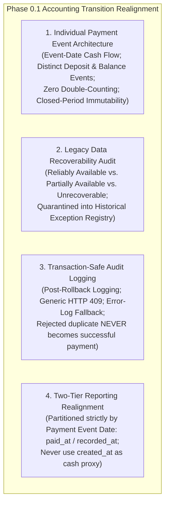
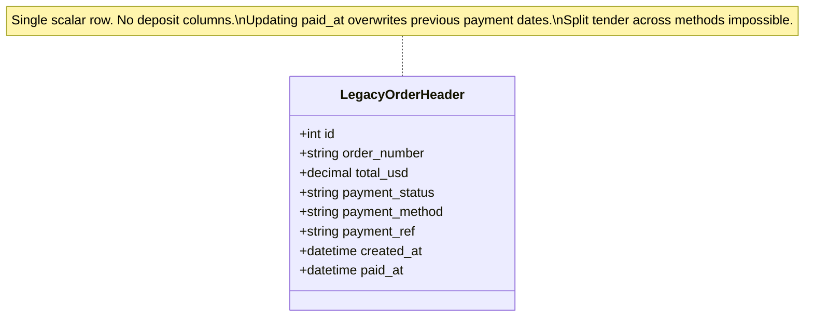
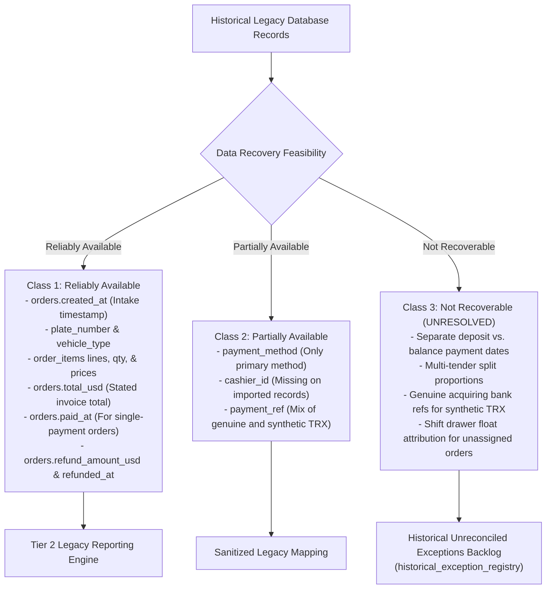
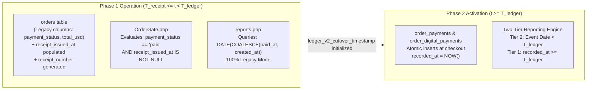

# PHASE 0.1 – Accounting Transition Realignment Design

**Project:** Car-WashService (Local Counter Terminal)  
**Document ID:** POS-ARC-2026-PHASE-0.1  
**Date:** November 8, 2026  
**Mode:** **READ-ONLY ARCHITECTURE DESIGN & RECONCILIATION**  
**Audit Reference:** [`docs/production-readiness/PHASE-0-READ-ONLY-INSPECTION.md`](file:///C:/xampp/htdocs/Car-WashService/docs/production-readiness/PHASE-0-READ-ONLY-INSPECTION.md)  
**Governing Standard:** Six Approved Executive Business Decisions (November 8, 2026) – Unchanged and Preserved  
**Status:** **READ-ONLY DESIGN ONLY – NO IMPLEMENTATION OR DATABASE OPERATIONS AUTHORIZED**

---

## Executive Summary & Scope

During the Phase 0 read-only source inspection, two critical implementation risks were uncovered in the approved planning documents:
1. **CRIT-01 (Accounting Transition Flaw in Round 18.5):** Round 18.5 proposed partitioning legacy financial revenue using `orders.created_at < ledger_v2_cutover_timestamp`. Actual source inspection of [`views/owner/reports.php:45-60`](file:///C:/xampp/htdocs/Car-WashService/views/owner/reports.php#L45-L60) and [`core/CashierControl.php:365-375`](file:///C:/xampp/htdocs/Car-WashService/core/CashierControl.php#L365-L375) proved that revenue reporting is governed by **payment event dates** (`paid_at` or `COALESCE(paid_at, created_at)`), NOT vehicle intake dates. The legacy `orders` schema has zero columns for deposits or split payment dates. Overwriting `paid_at` on an old order erases the original payment date, and partitioning by `created_at` corrupts closed reporting periods, causes cash drawer balancing shortages today, and risks double-counting subsequent payments.
2. **HIGH-02 (Audit Log Rollback Vulnerability):** In [`core/AuditLogger.php:43-66`](file:///C:/xampp/htdocs/Car-WashService/core/AuditLogger.php#L43-L66), executing `AuditLogger::log()` *inside* an active checkout transaction that fails due to a duplicate bank reference constraint (`uq_digital_bank_ref`) causes the audit record to be rolled back and destroyed when `$pdo->rollBack()` executes.

This document delivers the deterministic architectural design to resolve both issues:
- **Event-Date Accounting Model:** Transitions from scalar order fields to discrete, append-only payment events (`order_payments`), decoupling vehicle intake dates from cash flow event dates.
- **Historical Data Recoverability Standards:** Formally classifies what legacy facts can be reliably recovered versus what must be quarantined into the Historical Unreconciled Exceptions backlog without fabrication.
- **Transaction-Safe Audit Pipeline:** Defines an isolated, post-rollback audit logging pipeline guaranteeing that rejected duplicate bank references are permanently logged even when the checkout transaction rolls back or audit insertion encounters database contention.



In strict compliance with governance rules, **this document is a design and planning deliverable only. No application source code has been edited, zero migrations have been run, zero database connections have been made, and zero tests have been executed.**

---

## 1. Individual Payment Event Architecture

### 1.1 Structural Limitations of the Legacy Schema

Inspection of [`database/init.php:242-282`](file:///C:/xampp/htdocs/Car-WashService/database/init.php#L242-L282) and [`api/pos/index.php:2060-2090, 2650-2670`](file:///C:/xampp/htdocs/Car-WashService/api/pos/index.php#L2060-L2090) confirms the structural constraints of the legacy system:



- **Zero Split Payment Columns:** `orders` contains a single scalar `total_usd DECIMAL(10,2)` and a single `payment_status VARCHAR(20)`. There is NO `deposit_amount`, NO `deposit_paid_at`, NO `balance_amount`, and NO `balance_paid_at`.
- **Destructive Date Overwrite:** When an existing order receives a subsequent balance payment, line 2666 of `api/pos/index.php` executes:
  ```php
  UPDATE orders SET status = 'paid', payment_status = 'paid', paid_at = ? WHERE id = ?
  ```
  Overwriting `paid_at` destroys the historical record of when any earlier deposit was collected.
- **Reporting Discrepancy:** In [`views/owner/reports.php:45-60`](file:///C:/xampp/htdocs/Car-WashService/views/owner/reports.php#L45-L60), financial reports group sales by `COALESCE(o.paid_at, o.created_at)`. If an order is created on October 20 and paid on November 10, using `created_at` places the money into October, whereas using `paid_at` places all $100 into November.

### 1.2 Target Discrete Payment Event Architecture

To achieve mathematical accounting integrity, the system separates **operational service intake** from **financial tender events**:

```mermaid
erDiagram
    orders ||--o{ order_payments : "settled via"
    orders ||--o{ order_refunds : "refunded via"
    order_payments ||--o| order_digital_payments : "verified via"

    orders {
        int id PK
        string order_number
        string customer_name
        string plate_number
        decimal subtotal_usd
        decimal total_usd
        string status
        datetime created_at "Intake / apron arrival"
        datetime receipt_issued_at "Phase 1 gate timestamp"
    }

    order_payments {
        int id PK
        string payment_uid UK "UUIDv4"
        int order_id FK
        string payment_type "full | deposit | balance | additional | settlement"
        string payment_method "cash | khqr | aba | wing | acleda"
        decimal amount_usd
        int amount_khr
        datetime recorded_at "Authentic cash-flow timestamp"
        int shift_id FK "Cashier drawer attribution"
        int cashier_id FK
        text notes
    }

    order_digital_payments {
        int id PK
        int payment_id FK UK
        string provider
        string merchant_account_id
        string payment_ref "Canonical uppercase stripped"
        string raw_payment_ref "Exact cashier keystrokes"
        string verification_method "manual_merchant_device"
        datetime device_statement_verified_at
        int verified_by_user_id FK
    }

    order_refunds {
        int id PK
        string refund_uid UK "UUIDv4"
        int order_id FK
        int original_payment_id FK
        string refund_method "cash | bank_transfer"
        decimal amount_usd
        int amount_khr
        datetime disbursed_at "Authentic cash-outflow timestamp"
        int approved_by_user_id FK
        text reason
    }
```

### 1.3 Key Architectural Separation: Net Settled Revenue vs. Net Operating Profit

To avoid the reporting confusion identified in Phase 0 inspection, the financial reporting engine enforces strict separation between cash flow and operating profit:

1. **Net Settled Revenue (Cash Flow & Drawer Balancing):**
   $$\mathbf{Net\ Settled\ Revenue}_{\text{Period}} = \sum \mathbf{order\_payments.amount\_usd}_{(\text{recorded\_at} \in \text{Period})} - \sum \mathbf{order\_refunds.amount\_usd}_{(\text{disbursed\_at} \in \text{Period})}$$
   - *Governs:* Cash drawer physical balancing, cashier shift closing floats, and bank settlement verification.
   - *Timing:* Relies 100% on transaction event dates (`recorded_at` and `disbursed_at`).
2. **Net Operating Profit (Accrual P&L Accounting):**
   $$\mathbf{Net\ Operating\ Profit}_{\text{Period}} = \mathbf{Recognized\ Sales}_{\text{Period}} - \mathbf{COGS}_{\text{Period}} - \mathbf{Operating\ Expenses}_{\text{Period}} - \mathbf{Commissions}_{\text{Period}}$$
   - *Governs:* Headline business profitability in `views/owner/reports.php`.
   - *Timing:* Incorporates material inventory costs (COGS) and staff commissions.

---

## 2. Legacy Data Reconciliation & Recoverability Assessment

Inspection of legacy database tables reveals what historical financial facts can be recovered versus what must be quarantined:



### 2.1 Detailed Recoverability Breakdown

| Data Attribute | Legacy Column Source | Recoverability Status | Reconciliation Handling Rule |
| :--- | :--- | :---: | :--- |
| **Order Intake Date** | `orders.created_at` | **Reliably Available** | Used strictly for operational throughput and queue history. Never used as cash-flow event date. |
| **Final Settled Total** | `orders.total_usd` | **Reliably Available** | Preserved as static historical benchmark. Never mutated post-cutover. |
| **Single Payment Date** | `orders.paid_at` | **Reliably Available** (when not overwritten) | If order was paid at checkout and never updated, `paid_at` is the authentic event date. |
| **Refunds** | `orders.refund_amount_usd`, `refunded_at` | **Reliably Available** | Historical refunds recorded via `CashierControl` are recognized on `refunded_at`. |
| **Tender Method** | `orders.payment_method` | **Partially Available** | Captured if standard string (`'cash'`, `'khqr'`). Split tenders recorded in `notes` cannot be parsed automatically. |
| **Bank Reference** | `orders.payment_ref` | **Partially Available** | Must be inspected: Genuine references are preserved; synthetic `'TRX-'` strings are flagged as unverified. |
| **Deposit Dates vs Balance Dates** | None (Overwritten in `paid_at`) | **NOT RECOVERABLE** | **NEVER INFER MISSING DATES.** Quarantined into `historical_exception_registry` for owner review. |
| **Multi-Tender Breakdown** | None (Single scalar columns) | **NOT RECOVERABLE** | Cannot reconstruct whether $15 was $10 cash + $5 ABA. Quarantined as unallocated multi-tender. |

### 2.2 Historical Unreconciled Exceptions Backlog

When a historical order contains ambiguous or missing payment dates:
1. **Zero Fabrication:** The system never manufactures a payment date, bank reference, or deposit breakdown.
2. **Quarantine Ingestion:** A row is inserted into `historical_exception_registry`:
   ```sql
   INSERT INTO historical_exception_registry (
       order_id, order_number, exception_type, historical_order_total,
       recorded_paid_amount, resolution_status, lock_version
   ) VALUES (
       50, 'ORD-261020-001', 'AMBIGUOUS_SPLIT_PAYMENT_DATES', 100.00,
       100.00, 'open', 1
   );
   ```
3. **Owner Resolution Interface:** The owner or CPA reviews the exception in [`views/owner/historical_exceptions.php`](file:///C:/xampp/htdocs/Car-WashService/views/owner/historical_exceptions.php) and selects a formal disposition:
   - *Option A:* Confirm single cash settlement on `paid_at`.
   - *Option B:* Reconstruct split deposit from physical paper receipt log.
   - *Option C:* Quarantine as unreconciled historical variance.

---

## 3. Concrete Accounting Examples (Five Worked Walkthroughs)

To prove that the revised payment-event architecture guarantees zero double-counting, non-mutation of closed periods, and accurate cash drawer balancing, we walk through five operational scenarios across cutover boundaries ($T_{\text{cutover}} = \text{2026-11-08 00:00:00}$):

### Example 1: Old Order Paid Completely Before Cutover

```mermaid
timeline
    title Example 1: Pre-Cutover Completed Order
    2026-10-15 10:30 : Order #10 created ($20.00)
    2026-10-15 10:32 : Cash payment collected ($20.00), paid_at set
    2026-11-08 00:00 : CUTOVER INITIALIZED (ledger_v2_cutover_timestamp)
    2026-11-09 18:00 : Current Post-Cutover Daily Report Run
```

- **Historical Facts:** Order #10 created on `2026-10-15 10:30`. Paid in full ($20.00 cash) on `2026-10-15 10:32`. `paid_at = '2026-10-15 10:32:00'`.
- **Pre-Cutover Reporting Period (October 15, 2026):**  
  Tier 2 queries `orders WHERE COALESCE(paid_at, created_at) < cutover_ts`. Recognized revenue for Oct 15 = **+$20.00**.
- **Post-Cutover Reporting Period (November 9, 2026):**  
  Tier 1 queries `order_payments WHERE recorded_at BETWEEN '2026-11-09 00:00:00' AND '2026-11-09 23:59:59'`. Order #10 produces **ZERO rows**.
- **Financial Result:**  
  October 2026 closed reports are **not mutated**. November 9 cash drawer balance is **unaffected ($0.00)**. Total revenue recognized = **$20.00**. Zero double-counting.

---

### Example 2: Old Order with Pre-Cutover Deposit and Post-Cutover Balance

```mermaid
timeline
    title Example 2: Split Deposit Across Cutover Boundary
    2026-10-25 14:00 : Order #20 created ($50.00), $20 deposit paid
    2026-11-08 00:00 : CUTOVER INITIALIZED (ledger_v2_cutover_timestamp)
    2026-11-10 11:00 : Customer returns, pays $30 cash balance
```

- **Historical Facts:** Order #20 created on `2026-10-25 14:00` for $50.00 detailing service. Customer paid a $20.00 cash deposit on Oct 25.
- **Handling at Cutover:**  
  Historical order has `total_usd = 50.00`, but legacy records show only $20.00 collected prior to cutover. Remaining balance owing = $30.00.
- **Handling of Post-Cutover Balance Collection (November 10, 2026 11:00):**  
  Cashier collects $30.00 cash. Checkout API creates a discrete row in `order_payments`:
  ```sql
  INSERT INTO order_payments (
      payment_uid, order_id, payment_type, payment_method,
      amount_usd, recorded_at, cashier_id, shift_id
  ) VALUES (
      'PAY-261110-A91B4', 20, 'balance', 'cash',
      30.00, '2026-11-10 11:00:00', 3, 14
  );
  ```
  Legacy `orders.total_usd` is **NOT updated to $80.00**! Legacy order status is updated to `payment_status = 'paid'`, and `notes` records the balance settlement reference.
- **Pre-Cutover Reporting Period (October 25, 2026):**  
  Report recognizes the historical deposit of **$20.00**. The closed period report is **not mutated**.
- **Post-Cutover Reporting Period (November 10, 2026):**  
  Tier 1 report reads `order_payments WHERE recorded_at` in today's window.
  - Gross Cash Collections Today: **+$30.00**.
  - Cash Drawer Reconciliation: Physical drawer contains +$30.00 cash collected today.
  - Footnote: *"Includes $30.00 balance settlement on historical pre-cutover Order #20."*
- **Financial Result:**  
  Total lifetime revenue recognized = $\$20.00\text{ (Oct 25)} + \$30.00\text{ (Nov 10)} = \mathbf{\$50.00}$. Zero double-counting; drawer balances 100%.

---

### Example 3: Old Order with Additional Payment After Cutover

```mermaid
timeline
    title Example 3: Additional Payment on Paid Legacy Order
    2026-10-28 16:00 : Order #30 created and paid in full ($15.00 cash)
    2026-11-08 00:00 : CUTOVER INITIALIZED (ledger_v2_cutover_timestamp)
    2026-11-12 15:30 : Customer returns for extra wax coat ($5.00 cash)
```

- **Historical Facts:** Order #30 created and paid in full ($15.00 cash) on `2026-10-28 16:00`.
- **Subsequent Event (November 12, 2026 15:30):**  
  Customer requests an additional spray sealant or pays an overlooked $5.00 surcharge on the same ticket.
- **Handling:**  
  API inserts a discrete row into `order_payments`:
  ```sql
  INSERT INTO order_payments (
      payment_uid, order_id, payment_type, payment_method,
      amount_usd, recorded_at, cashier_id
  ) VALUES (
      'PAY-261112-C84E1', 30, 'additional', 'cash',
      5.00, '2026-11-12 15:30:00', 2
  );
  ```
- **Pre-Cutover Reporting Period (October 28, 2026):**  
  Recognizes original sales of **$15.00**. Closed historical report is **not rewritten**.
- **Post-Cutover Reporting Period (November 12, 2026):**  
  Tier 1 recognizes **+$5.00** in today's cash collections. Today's cash drawer reflects +$5.00.
- **Financial Result:**  
  Total lifetime recognized = $\$15.00 + \$5.00 = \mathbf{\$20.00}$. Zero double-counting.

---

### Example 4: Refund Issued After Cutover for an Old Order

```mermaid
timeline
    title Example 4: Post-Cutover Refund of Pre-Cutover Order
    2026-10-30 09:15 : Order #40 created and paid in full ($25.00 cash)
    2026-11-08 00:00 : CUTOVER INITIALIZED (ledger_v2_cutover_timestamp)
    2026-11-15 10:00 : Owner authorizes $25.00 cash refund from drawer
```

- **Historical Facts:** Order #40 placed and paid in full ($25.00 cash) on `2026-10-30 09:15`. Historical gross sales for Oct 30 closed at $25.00.
- **Refund Event (November 15, 2026 10:00):**  
  Customer complains of scratches; Owner approves full $25.00 cash refund from the counter register.
- **Handling:**  
  API inserts a discrete refund record into `order_refunds`:
  ```sql
  INSERT INTO order_refunds (
      refund_uid, order_id, refund_method, amount_usd,
      disbursed_at, approved_by_user_id, reason
  ) VALUES (
      'REF-261115-99A12', 40, 'cash', 25.00,
      '2026-11-15 10:00:00', 1, 'Owner authorized goodwill refund for Order #40'
  );
  ```
- **Pre-Cutover Reporting Period (October 30, 2026):**  
  Historical gross sales of Oct 30 remain **$25.00**. The past tax period is **not mutated**.
- **Post-Cutover Reporting Period (November 15, 2026):**  
  Daily cash drawer report calculates:
  $$\text{Net Settled Cash Flow for Today} = \sum (\text{Today's Inflows}) - \mathbf{\$25.00\ (Refund)}$$
  Physical drawer cash matches calculated net cash flow exactly after handing $25.00 to customer.
- **Financial Result:**  
  The cash outflow is recognized on the authentic date money left the business (Nov 15). Zero historical distortion.

---

### Example 5: Old Order with Incomplete or Ambiguous Payment History

```mermaid
timeline
    title Example 5: Ambiguous Historical Record Quarantined
    2026-10-18 11:00 : Order #50 created ($40.00), notes say 'paid ABA'
    2026-10-18 12:00 : paid_at is NULL, payment_ref is NULL, status='finished'
    2026-11-08 00:00 : CUTOVER INITIALIZED (ledger_v2_cutover_timestamp)
    2026-11-08 09:00 : Order #50 quarantined to historical_exception_registry
```

- **Historical Facts:** Order #50 created on `2026-10-18 11:00` for $40.00. Order status is `'finished'`, notes say *"Customer transferred ABA"*, but `paid_at` is `NULL`, `payment_status = 'unpaid'`, and `payment_ref` is `NULL`.
- **Handling:**  
  1. The system **NEVER fabricates a payment date or bank reference**.
  2. Order #50 is excluded from Tier 1 ledgers and quarantined into `historical_exception_registry` as `AMBIGUOUS_HISTORICAL_SETTLEMENT`.
  3. Pre-cutover and post-cutover headline revenue figures remain uncontaminated.
  4. The record appears on the Owner Review Screen in [`views/owner/historical_exceptions.php`](file:///C:/xampp/htdocs/Car-WashService/views/owner/historical_exceptions.php) with full audit log tracking until formally reconciled by the Owner and CPA.

---

## 4. Audit Logging Correction (Resolving HIGH-02)

### 4.1 Schema Verification of `audit_logs`

Inspection of [`database/migrate_foundation.php:49-66`](file:///C:/xampp/htdocs/Car-WashService/database/migrate_foundation.php#L49-L66) verifies the actual table schema:
- `log_uid VARCHAR(64) NOT NULL UNIQUE`
- `user_id INT DEFAULT NULL`
- `username VARCHAR(100) DEFAULT NULL`
- `role VARCHAR(50) DEFAULT NULL`
- `action VARCHAR(100) NOT NULL`
- `entity_type VARCHAR(50) DEFAULT NULL`
- `entity_id VARCHAR(100) DEFAULT NULL`
- `details TEXT DEFAULT NULL` (stores serialized JSON)
- `ip_address VARCHAR(50) DEFAULT NULL`
- `user_agent VARCHAR(255) DEFAULT NULL`
- `device_name VARCHAR(100) DEFAULT NULL`
- `created_at DATETIME DEFAULT CURRENT_TIMESTAMP`

**Verification:** The `details` column is `TEXT` and natively accommodates all required forensic dispute fields without schema alteration.

### 4.2 The Transaction-Safe Audit Pipeline

To ensure that duplicate bank reference rejections are permanently recorded even when the checkout transaction fails, the logging pipeline is redesigned:

```mermaid
sequenceDiagram
    autonumber
    participant Cashier as Cashier Terminal
    participant POS as POS API (api/pos/index.php)
    participant DB as MariaDB / SQLite
    participant Audit as audit_logs Table
    participant ErrLog as System Error Log

    Cashier->>POS: Submit KHQR Checkout (raw_payment_ref: "  ft-849201  ")
    POS->>POS: normalizePaymentReference() -> "FT-849201"
    POS->>DB: BEGIN TRANSACTION
    POS->>DB: INSERT INTO order_digital_payments (payment_ref = 'FT-849201', ...)
    DB-->>POS: SQLSTATE 23000 / Error 1062 (Duplicate Unique Constraint Violation)

    Note over POS,DB: STEP 1: ROLL BACK DIRTY TRANSACTION IMMEDIATELY
    POS->>DB: ROLLBACK TRANSACTION
    DB-->>POS: Rollback Complete (Connection clean; Zero financial rows committed)

    Note over POS,Audit: STEP 2: LOG IN SEPARATE STANDALONE TRANSACTION
    POS->>DB: Query conflicting order details (Order #892, Cashier #2)
    POS->>Audit: INSERT INTO audit_logs (action = 'DUPLICATE_BANK_REF_REJECTED', details = JSON)
    alt Audit Insert Succeeded
        Audit-->>POS: Insert Committed Successfully
    else Audit Insert Failed (e.g., Table Locked)
        Audit-->>POS: Exception
        POS->>ErrLog: @error_log("[SECURITY] Duplicate ref rejected, audit insert failed")
    end

    Note over POS: CRITICAL INVARIANT: Rejection is permanent; Checkout is HALTED
    POS-->>Cashier: HTTP 409 Conflict (Privacy-Safe Message: Zero Customer Data Leaked)
```

### 4.3 Pipeline Implementation Code Specification

The following reference implementation in `api/pos/index.php` guarantees transaction safety:

```php
// Step 1: Execute checkout within atomic database transaction
$pdo->beginTransaction();
try {
    // 1a. Insert order header
    $insOrder->execute([...]);
    $orderId = (int)$pdo->lastInsertId();

    // 1b. Insert digital payment record
    $insDigital->execute([
        $orderId, $provider, $merchantAccountId, $canonicalRef, $rawRef, ...
    ]);

    // 1c. If successful, commit transaction
    $pdo->commit();

} catch (PDOException $e) {
    // Check if error is duplicate key collision (MariaDB 1062 / SQLite 19)
    $isDuplicate = ($e->getCode() === '23000' || str_contains($e->getMessage(), 'UNIQUE'));

    // CRITICAL: Immediately roll back the dirty transaction before any audit calls!
    if ($pdo->inTransaction()) {
        $pdo->rollBack();
    }

    if ($isDuplicate) {
        // Step 2: In a clean, standalone context, query conflicting order info for audit
        $conflicting = null;
        try {
            $cStmt = $pdo->prepare("
                SELECT order_id, recorded_at, cashier_id 
                FROM order_digital_payments 
                WHERE provider = ? AND merchant_account_id = ? AND payment_ref = ?
                LIMIT 1
            ");
            $cStmt->execute([$provider, $merchantAccountId, $canonicalRef]);
            $conflicting = $cStmt->fetch(PDO::FETCH_ASSOC);
        } catch (Throwable $lookupEx) {
            // Non-blocking; continue to logging
        }

        // Step 3: Write to audit_logs in an independent, post-rollback operation
        $auditDetails = json_encode([
            'attempted_raw_reference' => $rawRef,
            'canonical_reference'     => $canonicalRef,
            'provider'                => $provider,
            'merchant_account_id'     => $merchantAccountId,
            'conflicting_order_id'    => $conflicting['order_id'] ?? 'unknown',
            'conflicting_recorded_at' => $conflicting['recorded_at'] ?? 'unknown',
            'cashier_id'              => $cashierId,
            'rejection_reason'        => 'UNIQUE_CONSTRAINT_COLLISION_UQ_DIGITAL_BANK_REF'
        ], JSON_UNESCAPED_SLASHES);

        try {
            AuditLogger::log(
                'DUPLICATE_BANK_REF_REJECTED',
                $auditDetails,
                'order_digital_payment_attempt',
                null,
                $cashierId,
                $cashierName,
                'cashier'
            );
        } catch (Throwable $auditEx) {
            // Step 4: Emergency file-based error log fallback
            @error_log("[SECURITY_ALERT] Duplicate bank reference rejected but audit_log insert failed: " . $auditDetails);
        }

        // Step 5: Privacy-safe client response (Zero leakage of conflicting order metadata)
        http_response_code(409);
        echo json_encode([
            'status'     => 'error',
            'error_code' => 'DUPLICATE_PAYMENT_REFERENCE',
            'message'    => 'This bank payment reference has already been recorded and cannot be reused. Please verify the transaction reference on the merchant device statement.'
        ]);
        exit;
    }

    // Re-throw unhandled non-duplicate exceptions
    throw $e;
}
```

### 4.4 Invariant Enforcement
- **A rejected duplicate never becomes a successful payment:** Even if the database audit insertion throws an exception, the script terminates immediately with `HTTP 409 Conflict`.
- **Zero data leakage:** The conflicting customer's order ID and timestamp are written exclusively to `audit_logs` and never exposed to the client POS UI.

---

## 5. Cutover and Recovery Consistency

### 5.1 Reconciling Dual Cutover Timestamps with Event-Date Architecture



### 5.2 Two-Tier Query Definitions Realigned to Event Dates

To eliminate the CRIT-01 flaw, the Two-Tier Reporting Engine queries are updated:

#### Tier 2: Historical Legacy Period (`event_date < ledger_v2_cutover_timestamp`)
```sql
-- Tier 2 Historical Legacy Sales (Closed Accounting Period)
SELECT 
    COALESCE(SUM(o.total_usd), 0.00) AS historical_gross_usd,
    COALESCE(SUM(o.refund_amount_usd), 0.00) AS historical_refunds_usd,
    (COALESCE(SUM(o.total_usd), 0.00) - COALESCE(SUM(o.refund_amount_usd), 0.00)) AS historical_net_usd
FROM orders o
WHERE o.status = 'paid'
  -- CRITICAL REALIGNMENT: Filter by authentic payment event date, NOT created_at!
  AND COALESCE(o.paid_at, o.created_at) < :ledger_v2_cutover_timestamp
  AND DATE(COALESCE(o.paid_at, o.created_at)) BETWEEN :start_date AND :end_date;
```

#### Tier 1: Modern Discrete Ledgers (`recorded_at >= ledger_v2_cutover_timestamp`)
```sql
-- Tier 1 Modern Discrete Ledgers (Active Accounting Period)
SELECT 
    COALESCE(SUM(p.amount_usd), 0.00) AS modern_gross_usd,
    COALESCE(SUM(r.amount_usd), 0.00) AS modern_refunds_usd,
    (COALESCE(SUM(p.amount_usd), 0.00) - COALESCE(SUM(r.amount_usd), 0.00)) AS modern_net_usd
FROM (
    SELECT amount_usd FROM order_payments 
    WHERE recorded_at >= :ledger_v2_cutover_timestamp
      AND DATE(recorded_at) BETWEEN :start_date AND :end_date
) p
LEFT JOIN (
    SELECT amount_usd FROM order_refunds 
    WHERE disbursed_at >= :ledger_v2_cutover_timestamp
      AND DATE(disbursed_at) BETWEEN :start_date AND :end_date
) r ON 1=1;
```

### 5.3 Mathematical Proof of Non-Overlapping Invariance
Because every financial transaction is evaluated strictly by its **event date** (`COALESCE(o.paid_at, o.created_at)` for legacy, `recorded_at` for ledgers):
1. **$t_{\text{event}} < T_{\text{ledger\_cutover}}$:** Selected exclusively by Tier 2. Tier 1 excludes it because `recorded_at < T_ledger`.
2. **$t_{\text{event}} \ge T_{\text{ledger\_cutover}}$:** Selected exclusively by Tier 1. Tier 2 excludes it because `event_date >= T_ledger`.
3. **Intersection is Empty ($S_{\text{Tier 1}} \cap S_{\text{Tier 2}} = \emptyset$):** Zero transactions are lost; zero amounts are double-counted.

---

## 6. Remaining Unresolved Technical Risks

| Risk ID | Title | Technical Description | Mitigation Strategy |
| :---: | :--- | :--- | :--- |
| **RISK-01** | **Legacy Orders Overwritten Prior to Cutover** | Historical orders where cashiers already overwrote `paid_at` before this modernization cannot recover original deposit dates. | Quarantined into `historical_exception_registry`; Owner reconciles via physical paper receipts. |
| **RISK-02** | **Multi-Tender Incomplete Splitting in Legacy** | Legacy orders with cash + KHQR recorded as a single string cannot be programmatically split. | Ingested as single historical payment; split details preserved in notes. |
| **RISK-03** | **Database User Lacks TRIGGER Privilege** | On shared hosting, `trg_audit_logs_before_update` creation may fail. | `SettingsManager` and application-layer guards enforce immutability independently of triggers. |

---

## 7. Recommendation for Next Phase

### Design Phase Verdict:
The Phase 0.1 design has successfully resolved **CRIT-01** (by replacing order creation date partitioning with event-date cash flow partitioning) and **HIGH-02** (by establishing a transaction-safe, post-rollback audit logging pipeline).

### Recommendation:
The project is **READY TO PROCEED TO PHASE 0.2 (READ-ONLY DATABASE BACKUP VERIFICATION & SAFETY TEST RUNS)**.

Prior to authorizing Phase 1 implementation:
1. Execute isolated, read-only database backup verification (`mysqldump` and SQLite integrity verification).
2. Run dry-run migration preview queries on isolated backup schemas to confirm historical record counts.

---

> [!CAUTION]
> **FINAL GOVERNANCE STATUS: PHASE 0.1 ARCHITECTURAL DESIGN COMPLETE.**  
> **NO APPLICATION SOURCE CODE MODIFIED. ZERO MIGRATIONS EXECUTED. ZERO SERVER RESTARTS. ZERO GIT COMMITS. NO IMPLEMENTATION AUTHORIZED.**
