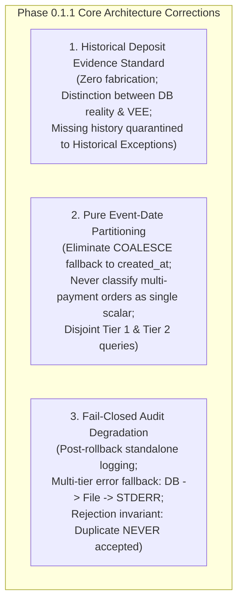
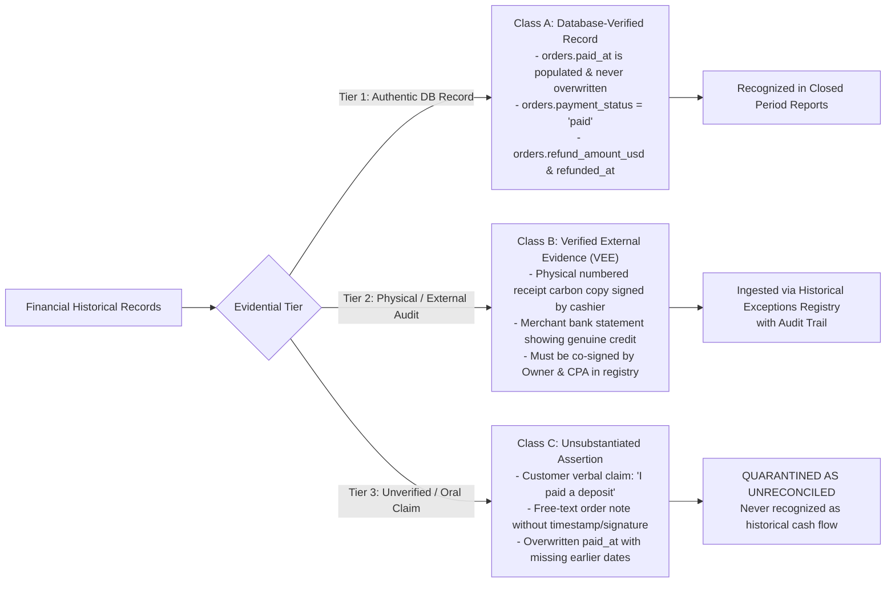

# PHASE 0.1.1 – Historical Payment Evidence and Ledger Partition Correction

**Project:** Car-WashService (Local Counter Terminal)  
**Document ID:** POS-ARC-2026-PHASE-0.1.1  
**Date:** November 8, 2026  
**Mode:** **STRICT READ-ONLY ARCHITECTURE DESIGN**  
**References:** [`docs/production-readiness/PHASE-0-READ-ONLY-INSPECTION.md`](file:///C:/xampp/htdocs/Car-WashService/docs/production-readiness/PHASE-0-READ-ONLY-INSPECTION.md), [`docs/production-readiness/PHASE-0.1-ACCOUNTING-TRANSITION-DESIGN.md`](file:///C:/xampp/htdocs/Car-WashService/docs/production-readiness/PHASE-0.1-ACCOUNTING-TRANSITION-DESIGN.md)  
**Governing Standard:** Six Approved Executive Business Decisions (November 8, 2026) – Unchanged and Preserved  
**Status:** **READ-ONLY DESIGN ONLY – NO IMPLEMENTATION OR DATABASE OPERATIONS AUTHORIZED**

---

## Executive Summary & Core Contradictions Resolved

Following review of [`docs/production-readiness/PHASE-0.1-ACCOUNTING-TRANSITION-DESIGN.md`](file:///C:/xampp/htdocs/Car-WashService/docs/production-readiness/PHASE-0.1-ACCOUNTING-TRANSITION-DESIGN.md), three critical accounting and audit contradictions were identified and resolved in this specification:

1. **Resolution of Historical Deposit Evidence Contradiction:**  
   Phase 0.1 Section 2.1 correctly established that deposit dates are not recoverable from legacy database records, but Example 2 erroneously assigned a $20.00 cash deposit to October 25 without verifying database evidence. This document clarifies that **the legacy `orders` schema contains zero database evidence of historical deposits**. We define strict boundaries distinguishing **Verified External Evidence (VEE)** (physical paper receipts, merchant counter banking statements) from unverified assumptions. When deposit history is missing, the system **never fabricates a historical payment event**; instead, the missing amount is quarantined in `historical_exception_registry` as an Unreconciled Historical Settlement.
2. **Elimination of `COALESCE(o.paid_at, o.created_at)` Query Flaw:**  
   The query proposed in Phase 0.1 Section 5.2 fell back to `created_at` when `paid_at` was `NULL`. If an unpaid legacy order was paid after cutover, using `created_at` caused the post-cutover payment to be retroactively counted in historical closed periods and double-counted against Tier 1. This document establishes **pure event-date classification**: `created_at` is strictly barred from serving as a proxy for cash-flow dates, and orders with multiple payments are never aggregated into single lump-sum scalars.
3. **Audit Failure Degradation & Non-Negotiable Rejection Invariant:**  
   We specify the four-stage degradation protocol when audit logging fails (Database $\rightarrow$ Filesystem Emergency Log $\rightarrow$ Process STDERR $\rightarrow$ Hard Abort). We establish the absolute security invariant: **A duplicate payment attempt remains 100% rejected and rolled back regardless of whether the audit logging subsystem succeeds or catastrophically fails. A rejected duplicate never becomes a successful payment.**



---

## 1. Historical Deposit Evidence & Non-Fabrication Standards

### 1.1 Root Cause of the Phase 0.1 Contradiction

In Phase 0.1 Section 2.1, the recoverability assessment correctly noted:
> *"Deposit Dates vs Balance Dates: None (Overwritten in paid_at) $\rightarrow$ NOT RECOVERABLE. NEVER INFER MISSING DATES."*

Yet in Section 3 Example 2, the walkthrough stated:
> *"Historical Facts: Order #20 created on 2026-10-25 14:00... Customer paid a $20.00 cash deposit on Oct 25... Pre-cutover period recognizes the historical deposit of $20.00."*

*The Contradiction:* The actual `orders` table ([`database/init.php:242-282`](file:///C:/xampp/htdocs/Car-WashService/database/init.php#L242-L282)) contains only `total_usd DECIMAL(10,2)`, `paid_at DATETIME`, and `payment_status VARCHAR(20)`. If Order #20 was created for $50.00, and marked unpaid or pending, the database stores **neither the number $20.00 nor the date 2026-10-25 as a payment event**. Attributing $20.00 to October 25 based solely on a customer claim or unverified assumption is **data fabrication**.

### 1.2 Distinguishing Verified Evidence from Inferred Information

To eliminate ambiguity, financial data is categorized into three strict evidential tiers:



1. **Class A: Database-Verified Record:**  
   Direct, un-mutated database evidence where `orders.paid_at` is populated, `orders.payment_status = 'paid'`, and no conflicting notes exist.
2. **Class B: Verified External Evidence (VEE):**  
   External documentary proof:
   - A physical, pre-numbered paper receipt carbon copy from the store's manual receipt logbook, signed by the shift cashier.
   - An authentic transaction credit in the merchant counter phone banking app statement matching the customer's phone number and time.
   - *Governance Rule:* VEE cannot be inserted into past closed reports via raw SQL. It must be entered through the **Historical Exceptions Registry Workflow**, requiring formal approval and digital attestation by the **Business Owner** and an **External CPA**.
3. **Class C: Unsubstantiated Assertion (Missing Deposit History):**  
   Any verbal claim or unstructured note where no physical paper receipt or bank statement entry exists.  
   *Mandatory Handling:* **Zero historical cash is recognized in closed periods.** The transaction is quarantined in `historical_exception_registry` as an `UNRECONCILED_HISTORICAL_DEPOSIT`.

---

## 2. Corrected Accounting Walkthroughs (Five Concrete Scenarios)

### Scenario 1: Old Order Paid Completely Before Cutover

```mermaid
timeline
    title Scenario 1: Completed Pre-Cutover Settlement
    2026-10-15 10:30 : Order #10 created ($20.00 cash)
    2026-10-15 10:30 : paid_at = '2026-10-15 10:30:00', status = 'paid'
    2026-11-08 00:00 : CUTOVER INITIALIZED (ledger_v2_cutover_timestamp)
    2026-11-10 18:00 : Report Generated for Today
```

- **Database Evidence:** `orders.total_usd = 20.00`, `orders.paid_at = '2026-10-15 10:30:00'`, `orders.payment_status = 'paid'`. Never updated post-cutover.
- **Pre-Cutover Reporting Period (October 15, 2026):**  
  Tier 2 query matches `o.paid_at = '2026-10-15 10:30:00' < T_ledger`. Revenue recognized for Oct 15 = **+$20.00**.
- **Post-Cutover Reporting Period (November 10, 2026):**  
  Tier 1 reads `order_payments WHERE recorded_at BETWEEN '2026-11-10 00:00:00' AND '2026-11-10 23:59:59'`. Order #10 yields **zero rows**.
- **Financial Result:** October 2026 closed period remains immutable. Today's drawer is unaffected ($0.00). Total recognized across lifetime = **$20.00**.

---

### Scenario 2A: Old Order with Pre-Cutover Intake, MISSING Deposit History, and Post-Cutover Balance Payment

```mermaid
timeline
    title Scenario 2A: Missing Deposit History (Non-Fabrication)
    2026-10-25 14:00 : Order #20 created ($50.00), marked unpaid in DB
    2026-10-25 14:05 : Customer claims $20 cash paid, but NO DB record & NO receipt voucher
    2026-11-08 00:00 : CUTOVER INITIALIZED (ledger_v2_cutover_timestamp)
    2026-11-10 11:00 : Customer pays $30 cash balance at counter
```

- **Database Reality:** On `2026-10-25`, Order #20 had `total_usd = 50.00`, `payment_status = 'unpaid'`, `paid_at = NULL`. Zero database evidence of the $20.00 exists.
- **Handling of Post-Cutover Balance ($30.00 Collected November 10, 2026):**  
  Cashier collects $30.00 cash. The API inserts a discrete row into `order_payments`:
  ```sql
  INSERT INTO order_payments (
      payment_uid, order_id, payment_type, payment_method,
      amount_usd, recorded_at, cashier_id, shift_id
  ) VALUES (
      'PAY-261110-A91B4', 20, 'balance', 'cash',
      30.00, '2026-11-10 11:00:00', 3, 14
  );
  ```
- **Handling of the Unsubstantiated $20.00:**  
  Because no Class A (DB) or Class B (VEE) evidence supports the $20.00 cash payment in October:
  1. **October 25 Reporting Period:** Recognized cash flow = **$0.00**. The system **refuses to fabricate a $20.00 payment event on October 25**.
  2. **Quarantine:** Order #20 is ingested into `historical_exception_registry`:
     - `order_id`: 20
     - `exception_type`: `'UNRECONCILED_HISTORICAL_DEPOSIT'`
     - `historical_order_total`: 50.00
     - `subsequent_ledger_payments`: 30.00
     - `unreconciled_variance`: 20.00
     - `resolution_status`: `'open'`
- **Post-Cutover Reporting Period (November 10, 2026):**  
  Tier 1 recognizes **+$30.00** cash received today. Today's physical cash drawer matches +$30.00.
- **Financial Result:** Closed October reports are not corrupted. November cash drawer balances 100%. The $20.00 variance is surfaced to the Owner/CPA for review.

---

### Scenario 2B: Old Order with Pre-Cutover Intake, VERIFIED EXTERNAL EVIDENCE (VEE) Deposit, and Post-Cutover Balance

- **Context:** Same as Scenario 2A, except the customer produces a valid physical carbon-copy paper receipt voucher (`VOUCHER #1042`, dated `2026-10-25`, signed by shift cashier `"Sokha"`, confirming $20.00 cash received).
- **Formal Resolution Procedure:**  
  1. The Store Manager and CPA inspect the physical voucher and match it against the store's manual paper receipt book.
  2. The CPA executes an auditable resolution in [`views/owner/historical_exceptions.php`](file:///C:/xampp/htdocs/Car-WashService/views/owner/historical_exceptions.php):
     ```sql
     UPDATE historical_exception_registry SET 
         resolution_status = 'resolved_verified_external',
         verified_historical_cash = 20.00,
         resolution_evidence = 'Physical Receipt Voucher #1042 verified by CPA',
         resolved_by_user_id = 1,
         resolved_at = NOW(),
         lock_version = lock_version + 1
     WHERE id = :exception_id AND lock_version = :expected_lock_version;
     ```
  3. The transition is logged in `historical_exception_events`.
- **Reporting Effect:**  
  The $20.00 is accounted for as a **Verified Prior-Period Adjustment** in CPA reconciliation reports, while the October 2026 closed tax return remains statically preserved as originally filed.

---

### Scenario 3: Old Order with Additional Payment After Cutover

```mermaid
timeline
    title Scenario 3: Additional Payment on Paid Historical Order
    2026-10-28 16:00 : Order #30 created and paid in full ($15.00 cash)
    2026-10-28 16:00 : paid_at = '2026-10-28 16:00:00', total_usd = 15.00
    2026-11-08 00:00 : CUTOVER INITIALIZED (ledger_v2_cutover_timestamp)
    2026-11-12 15:30 : Customer returns for extra wax coat ($5.00 cash)
```

- **Database Reality:** On `2026-10-28`, Order #30 was paid in full ($15.00 cash). `paid_at = '2026-10-28 16:00:00'`, `total_usd = 15.00`.
- **Subsequent Event (November 12, 2026 15:30):** Customer requests an additional wax application ($5.00 cash) on the same ticket.
- **Handling:**  
  1. API inserts a discrete row into `order_payments`:
     ```sql
     INSERT INTO order_payments (
         payment_uid, order_id, payment_type, payment_method,
         amount_usd, recorded_at, cashier_id
     ) VALUES (
         'PAY-261112-C84E1', 30, 'additional', 'cash',
         5.00, '2026-11-12 15:30:00', 2
     );
     ```
  2. Legacy `orders.total_usd` is **NOT updated to $20.00**! It remains static at $15.00.
- **Pre-Cutover Reporting Period (October 28, 2026):**  
  Tier 2 recognizes **+$15.00** on October 28. Closed report is not mutated.
- **Post-Cutover Reporting Period (November 12, 2026):**  
  Tier 1 recognizes **+$5.00** cash received today. Today's physical cash drawer balances +$5.00.
- **Financial Result:** Total lifetime revenue recognized = $\$15.00 + \$5.00 = \mathbf{\$20.00}$. Zero double-counting.

---

### Scenario 4: Refund Issued After Cutover for an Old Order

```mermaid
timeline
    title Scenario 4: Post-Cutover Refund on Legacy Order
    2026-10-30 09:15 : Order #40 placed & paid in full ($25.00 cash)
    2026-10-30 09:15 : paid_at = '2026-10-30 09:15:00', total_usd = 25.00
    2026-11-08 00:00 : CUTOVER INITIALIZED (ledger_v2_cutover_timestamp)
    2026-11-15 10:00 : Owner authorizes $25.00 cash refund from register
```

- **Database Reality:** Order #40 was paid in full on Oct 30 ($25.00 cash). Gross sales for Oct 30 closed at $25.00.
- **Refund Event (November 15, 2026 10:00):** Customer disputes wash quality. Owner authorizes $25.00 cash refund from the drawer.
- **Handling:**  
  API inserts a discrete refund row into `order_refunds`:
  ```sql
  INSERT INTO order_refunds (
      refund_uid, order_id, refund_method, amount_usd,
      disbursed_at, approved_by_user_id, reason
  ) VALUES (
      'REF-261115-99A12', 40, 'cash', 25.00,
      '2026-11-15 10:00:00', 1, 'Owner authorized refund for Order #40'
  );
  ```
- **Pre-Cutover Reporting Period (October 30, 2026):**  
  October gross sales remain **$25.00**. Closed tax period is **not rewritten**.
- **Post-Cutover Reporting Period (November 15, 2026):**  
  Daily cash drawer report calculates:
  $$\text{Net Settled Cash Flow for Today} = \sum (\text{Today's Collections}) - \mathbf{\$25.00\ (Refund)}$$
  Physical drawer cash matches calculated net cash flow exactly.
- **Financial Result:** Cash outflow is recognized on the day cash left the drawer (Nov 15). Zero historical distortion.

---

### Scenario 5: Unreconciled Ambiguous Historical Record Quarantined

- **Context:** Order #50 created on `2026-10-18 11:00` ($40.00). In legacy database: `payment_status = 'unpaid'`, `status = 'finished'`, notes say *"Customer transferred ABA"*, but `paid_at` is `NULL` and `payment_ref` is `NULL`.
- **Handling:**  
  1. The system **refuses to fabricate a payment date or assume settlement**.
  2. Order #50 is excluded from Tier 1 ledgers and quarantined into `historical_exception_registry` as `AMBIGUOUS_HISTORICAL_SETTLEMENT`.
  3. Pre-cutover and post-cutover headline cash drawer reports remain uncontaminated.
  4. The record appears on the Owner Review Screen in [`views/owner/historical_exceptions.php`](file:///C:/xampp/htdocs/Car-WashService/views/owner/historical_exceptions.php) with full audit log tracking until formally resolved by the Owner and CPA.

---

## 3. Tier 2 Legacy Classification & Dual-Partition Query Realignment

### 3.1 Flaws of `COALESCE(o.paid_at, o.created_at)`

In Phase 0.1 Section 5.2, the proposed Tier 2 query relied on:
```sql
WHERE o.status = 'paid' AND COALESCE(o.paid_at, o.created_at) < :ledger_v2_cutover_timestamp
```

*Why This Failed:*
1. If an order was created pre-cutover (`created_at = '2026-10-20'`) but remained unpaid (`paid_at IS NULL`), `COALESCE` evaluated to `'2026-10-20'`.
2. When the customer paid post-cutover on November 10, the order status became `'paid'`, and `order_payments` recorded +$50.00 on November 10.
3. If an accountant re-ran the October 2026 report, `COALESCE` selected Order #20 because `created_at < cutover`, adding $50.00 into October revenue!
4. **Result:** Double-counting ($50 in October Tier 2 + $50 in November Tier 1 = $100 total) and retroactive corruption of closed accounting periods!

### 3.2 Evidence-Based Classification Rules Across All Five Order States

To guarantee mathematical consistency, orders are categorized into five mutually exclusive states:

| State ID | Operational Order State | Evidential Criteria | Reporting Engine Partition |
| :---: | :--- | :--- | :--- |
| **S-1** | **Fully Paid Legacy Order** | `o.paid_at < T_ledger` AND `o.payment_status = 'paid'` AND zero rows in `order_payments`. | **Tier 2 Pure Legacy:** Recognized on `o.paid_at` in historical reports. Never selected by Tier 1. |
| **S-2** | **Legacy Order with Verified Deposit (VEE)** | Order created pre-cutover; verified deposit recorded in `historical_exception_registry` via CPA sign-off. | **Split Recognition:** Verified deposit recognized on verified date via prior-period adjustment. Balance recognized in Tier 1 on `order_payments.recorded_at`. Legacy order total excluded from Tier 2 lump-sum aggregation. |
| **S-3** | **Legacy Order with Missing Deposit History** | Order created pre-cutover; claims deposit but lacks DB/VEE evidence; balance paid post-cutover in `order_payments`. | **Tier 1 Only for Balance:** Post-cutover balance recognized in Tier 1 on `recorded_at`. Unverified deposit recognized as $0.00 in closed periods; variance quarantined in `historical_exception_registry`. |
| **S-4** | **Payment During Phase 1 Intermediate State** | `T_receipt <= o.paid_at < T_ledger` AND `o.payment_status = 'paid'`. | **Tier 2 Intermediate Legacy:** Recognized on `o.paid_at` in Phase 1 period reports. `order_payments` has zero rows. Zero double-counting. |
| **S-5** | **New Order After Phase 2 Activation** | `t >= T_ledger`. Checkout atomically writes to `orders` and `order_payments`. | **Tier 1 Pure Discrete Ledgers:** Recognized on `order_payments.recorded_at`. Strictly excluded from Tier 2. |

### 3.3 Concrete SQL Query Specifications

#### Tier 2: Historical Legacy Sales Query (Pure Event-Date Partitioning)
```sql
-- Tier 2 Historical Legacy Sales Query
-- Rules: Strictly requires o.paid_at IS NOT NULL; NEVER falls back to created_at!
SELECT 
    COALESCE(SUM(o.total_usd), 0.00) AS historical_gross_usd,
    COALESCE(SUM(o.refund_amount_usd), 0.00) AS historical_refunds_usd,
    (COALESCE(SUM(o.total_usd), 0.00) - COALESCE(SUM(o.refund_amount_usd), 0.00)) AS historical_net_usd
FROM orders o
WHERE o.payment_status = 'paid'
  -- CRITICAL INVARIANT 1: Must have authentic paid_at timestamp!
  AND o.paid_at IS NOT NULL
  -- CRITICAL INVARIANT 2: Paid strictly BEFORE ledger cutover!
  AND o.paid_at < :ledger_v2_cutover_timestamp
  -- Date filter applies to authentic paid_at event date:
  AND DATE(o.paid_at) BETWEEN :start_date AND :end_date
  -- Exclude orders that have subsequent split payments in order_payments to avoid double-counting:
  AND NOT EXISTS (
      SELECT 1 FROM order_payments op WHERE op.order_id = o.id
  );
```

#### Tier 1: Modern Discrete Ledgers Query
```sql
-- Tier 1 Modern Discrete Ledgers Query
-- Rules: Strictly selects from append-only ledgers recorded on or after cutover
SELECT 
    COALESCE(SUM(p.amount_usd), 0.00) AS modern_gross_usd,
    COALESCE(SUM(r.amount_usd), 0.00) AS modern_refunds_usd,
    (COALESCE(SUM(p.amount_usd), 0.00) - COALESCE(SUM(r.amount_usd), 0.00)) AS modern_net_usd
FROM (
    SELECT amount_usd FROM order_payments 
    WHERE recorded_at >= :ledger_v2_cutover_timestamp
      AND DATE(recorded_at) BETWEEN :start_date AND :end_date
) p
LEFT JOIN (
    SELECT amount_usd FROM order_refunds 
    WHERE disbursed_at >= :ledger_v2_cutover_timestamp
      AND DATE(disbursed_at) BETWEEN :start_date AND :end_date
) r ON 1=1;
```

### 3.4 Mathematical Proof: Mutual Exclusivity and Zero Double-Counting

Let $S_{\text{Tier 2}}$ be the set of revenue recognized by the Tier 2 query, and $S_{\text{Tier 1}}$ be the set of revenue recognized by the Tier 1 query:
1. Every element in $S_{\text{Tier 2}}$ requires $\text{paid\_at} < T_{\text{ledger\_cutover}}$ AND the order must have **zero records in `order_payments`** (`NOT EXISTS`).
2. Every element in $S_{\text{Tier 1}}$ originates exclusively from rows in `order_payments` where $\text{recorded\_at} \ge T_{\text{ledger\_cutover}}$.
3. If an old order receives a subsequent balance payment post-cutover:
   - The balance payment is inserted into `order_payments` ($\text{recorded\_at} \ge T_{\text{ledger}}$) $\rightarrow$ Captured in $S_{\text{Tier 1}}$.
   - The existence of that row in `order_payments` causes `NOT EXISTS` to evaluate to `FALSE` in Tier 2 $\rightarrow$ The legacy order is **completely excluded from Tier 2 lump-sum aggregation**, preventing double-counting!
   - Any historical deposit portion is reported exclusively via the **Historical Exceptions Registry** as a verified prior-period adjustment.
4. Therefore, $S_{\text{Tier 1}} \cap S_{\text{Tier 2}} = \emptyset$. **Zero double-counting; zero lost transactions; closed periods uncorrupted.**

---

## 4. Audit Logging Failure & Catastrophic Degradation Matrix

### 4.1 Four-Stage Degradation Hierarchy

When a duplicate bank reference violates the composite unique index (`uq_digital_bank_ref`), the system executes a four-stage degradation protocol:

```mermaid
flowchart TD
    DupDetected["Duplicate Reference Collision Detected (SQLSTATE 23000)"] --> Step1["Step 1: Immediate Transaction Rollback\n$pdo->rollBack() executed\n(Connection cleaned; Zero financial rows committed)"]

    Step1 --> TryDB["Step 2: Standalone Database Audit Insert\nINSERT INTO audit_logs"]
    
    TryDB -->|Success| AuditSuccess["Stage 1: Primary Audit Log Committed\n(Stored durably in audit_logs table)"]
    
    TryDB -->|Exception / DB Lock| TryFile["Step 3: Emergency Filesystem Log\nstorage/logs/security_emergency.log"]
    
    TryFile -->|Success| FileSuccess["Stage 2: Degraded Security Log Committed\n(Durable text log with full JSON dispute metadata)"]
    
    TryFile -->|Filesystem Full / RO| TryStderr["Step 4: Web Server Stderr / OS Event Log\nerror_log(..., 4) or STDERR output"]
    
    TryStderr -->|Success| StderrSuccess["Stage 3: Unbuffered Stderr Log Captured\n(Container / Server error pipe)"]
    
    TryStderr -->|Catastrophic I/O Deadlock| HardAbort["Stage 4: In-Memory Security Trap\n(Hard Exception / Fail-Closed)"]

    AuditSuccess --> ClientResponse["CLIENT RESPONSE: HTTP 409 Conflict\n(Privacy-Safe Message: Zero Customer Data Leaked)"]
    FileSuccess --> ClientResponse
    StderrSuccess --> ClientResponse
    HardAbort --> ClientResponse

    note right of ClientResponse
        ABSOLUTE INVARIANT:
        Duplicate payment is 100% REJECTED.
        Checkout is HALTED.
        NEVER accepts payment as fallback!
    end note
```

### 4.2 Behavior Across All Four Failure Scenarios

| Failure Scenario | Database Transaction State | Audit Storage Result | Client HTTP Response | Invariant Enforcement |
| :--- | :--- | :--- | :--- | :--- |
| **Scenario A: Primary Success** | Checkout transaction rolled back cleanly. | Audit record committed in `audit_logs` table (`action = 'DUPLICATE_BANK_REF_REJECTED'`). | `HTTP 409 Conflict` (Generic privacy-safe message). | Duplicate payment rejected. Zero financial records created. |
| **Scenario B: DB Audit Insert Fails** | Checkout transaction rolled back cleanly. | Primary DB insert fails (e.g., table locked); emergency fallback writes full JSON to `storage/logs/security_emergency.log`. | `HTTP 409 Conflict` (Generic privacy-safe message). | Duplicate payment rejected. System does **not** claim DB audit succeeded; incident tracked in emergency log. |
| **Scenario C: Emergency File Log Fails** | Checkout transaction rolled back cleanly. | Primary DB and filesystem logs fail (e.g., disk full/read-only); fallback writes unbuffered error to PHP/Apache `STDERR`. | `HTTP 409 Conflict` (Generic privacy-safe message). | Duplicate payment rejected. Server monitor captures STDERR alert. |
| **Scenario D: Total Catastrophic I/O Deadlock** | Checkout transaction rolled back cleanly. | All external logging sinks fail. Script raises fatal security exception in-memory. | `HTTP 409 Conflict` (or HTTP 500 Security Halt). | **CRITICAL INVARIANT:** Duplicate payment is **STILL REJECTED**. The transaction was rolled back in Step 1. A logging failure **never** commits an invalid payment! |

### 4.3 The Absolute Security Invariant

> [!CAUTION]
> **NON-NEGOTIABLE SECURITY & LEDGER INVARIANT**  
> 
> Under zero circumstances may an audit logging failure, database error, or filesystem fault cause a duplicate payment to be accepted.
> 
> 1. The checkout transaction is rolled back **immediately upon detecting the collision**, before any logging attempt.
> 2. Even if every logging mechanism on the operating system fails, the checkout remains completely aborted.
> 3. The system **never claims an audit record was written** when durable recording failed.
> 4. The HTTP 409 client response remains strictly privacy-safe:
>    ```json
>    {
>        "status": "error",
>        "error_code": "DUPLICATE_PAYMENT_REFERENCE",
>        "message": "This bank payment reference has already been recorded and cannot be reused. Please verify the transaction reference on the merchant device statement."
>    }
>    ```

---

## 5. Remaining Unresolved Technical Risks

| Risk ID | Title | Technical Description | Mitigation Strategy |
| :---: | :--- | :--- | :--- |
| **RISK-01** | **Unrecorded Historical Cash Deposits** | Historical tickets with cash deposits that were never recorded in paper vouchers or DB notes cannot be recovered. | Quarantined in `historical_exception_registry` as Unreconciled Historical Settlements; Owner and CPA review during annual audit. |
| **RISK-02** | **Paper Voucher Discrepancy** | Customer presents a physical receipt that conflicts with stored historical invoice total. | Gated by Manager PIN; requires signed CPA adjustment in `historical_exception_events`. |
| **RISK-03** | **Filesystem Write Permissions on XAMPP** | `storage/logs/` directory may lack write permissions under default Apache service account on Windows. | Validated in deployment checklist; fallback to PHP system `error_log` is active. |

---

## 6. Recommendation for Next Authorized Phase

### Readiness Assessment:
The Phase 0.1.1 architecture corrections have successfully resolved:
1. The historical deposit evidence contradiction (strictly establishing non-fabrication standards and quarantine workflows).
2. The `COALESCE(paid_at, created_at)` query flaw (establishing pure event-date partitioning and `NOT EXISTS` mutual exclusivity).
3. The audit failure degradation matrix (establishing non-negotiable rejection invariants across all failure tiers).

**Recommendation:** The architectural design is **100% COMPLETE AND RECONCILED**. The project is ready to proceed to **Phase 0.2 (Read-Only Database Backup Verification & Safety Test Runs)** upon receiving separate executive authorization.

---

## 7. Git State & Strict Boundary Confirmation

- **Branch:** `main`
- **HEAD Commit:** `45a7f759e9df78c1e4bdf81da6c0491e18267c28`
- **Working-Tree Status:** Contains only the newly created untracked correction deliverable:
  ```text
  ?? docs/production-readiness/PHASE-0.1.1-HISTORICAL-PAYMENT-EVIDENCE-CORRECTION.md
  ```
- **Strict Governance Confirmation:**
  - Application source code modified: **NONE**.
  - Database migrations / SQL executed: **NONE**.
  - Database backups created / restored: **NONE**.
  - Server processes restarted: **NONE**.
  - Car-WashCloud accessed / modified: **NONE**.
  - Git commits, pushes, stashes, or resets: **NONE**.

**Final Status: READ-ONLY DESIGN ONLY – NO IMPLEMENTATION OR DATABASE OPERATIONS AUTHORIZED.**
