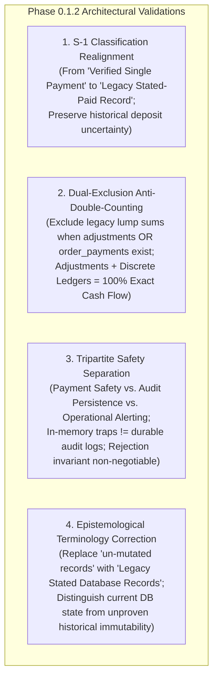
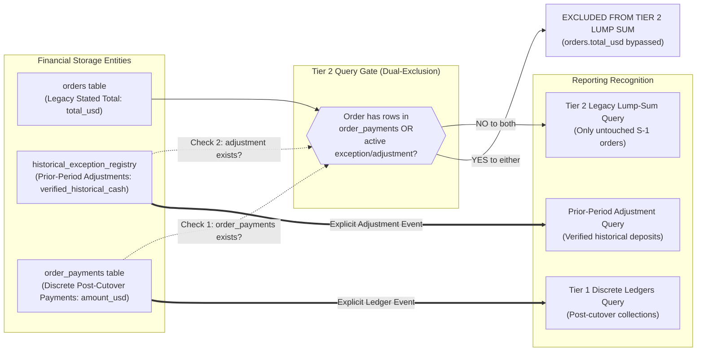
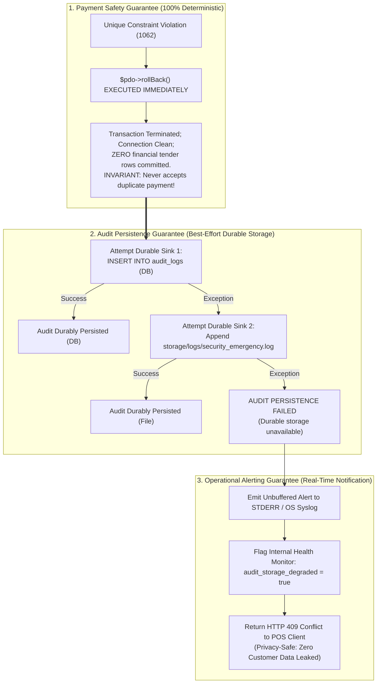
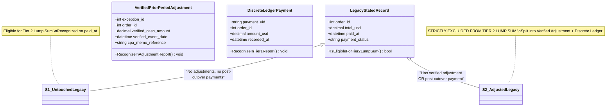

# PHASE 0.1.2 – Legacy Classification and Adjustment Double-Counting Validation

**Project:** Car-WashService (Local Counter Terminal)  
**Document ID:** POS-ARC-2026-PHASE-0.1.2  
**Date:** November 8, 2026  
**Mode:** **STRICT READ-ONLY ARCHITECTURE REVIEW & VALIDATION**  
**References:** [`docs/production-readiness/PHASE-0-READ-ONLY-INSPECTION.md`](file:///C:/xampp/htdocs/Car-WashService/docs/production-readiness/PHASE-0-READ-ONLY-INSPECTION.md), [`docs/production-readiness/PHASE-0.1-ACCOUNTING-TRANSITION-DESIGN.md`](file:///C:/xampp/htdocs/Car-WashService/docs/production-readiness/PHASE-0.1-ACCOUNTING-TRANSITION-DESIGN.md), [`docs/production-readiness/PHASE-0.1.1-HISTORICAL-PAYMENT-EVIDENCE-CORRECTION.md`](file:///C:/xampp/htdocs/Car-WashService/docs/production-readiness/PHASE-0.1.1-HISTORICAL-PAYMENT-EVIDENCE-CORRECTION.md)  
**Governing Standard:** Six Approved Executive Business Decisions (November 8, 2026) – Unchanged and Preserved  
**Status:** **READ-ONLY DESIGN ONLY – NO IMPLEMENTATION OR DATABASE OPERATIONS AUTHORIZED**

---

## 1. Review Scope and Governing Decisions

This document delivers a narrowly scoped, read-only architectural validation of the Phase 0.1.1 accounting transition design. It resolves four specific structural and epistemological issues without modifying application code, database schemas, or database records:

1. **Validation of S-1 Legacy Classification:** Eliminates the unproven claim that legacy orders with `payment_status = 'paid'` represent verified single-payment transactions, establishing rigorous boundaries between current database state and historical payment-event reality.
2. **Prevention of Prior-Period Adjustment Double Counting:** Corrects the Tier 2 query to explicitly exclude orders associated with prior-period adjustments, preventing an order total from being recognized twice across legacy aggregations and adjustment ledgers.
3. **Separation of Payment Rejection from Audit Persistence:** Clearly separates the non-negotiable payment safety guarantee (immediate transaction rollback) from audit persistence guarantees and operational alerting, acknowledging that in-memory traps are not durable audit records.
4. **Correction of Historical Evidence Terminology:** Replaces inaccurate claims of "un-mutated records" with epistemologically sound terms ("Legacy Stated Database Records"), preserving historical uncertainty rather than converting unverified assumptions into facts.

### Governing Standard:
All six approved executive business decisions remain preserved intact:
- Decision #1: Lift First – Wash Second (Bay 4 mechanical intake first).
- Decision #2: Receipt Printing Advisory (Electronic receipt required for gate; printer jam non-blocking).
- Decision #3: Customer Name Compatibility (`customer_name VARCHAR(100) NOT NULL`, Walk-in Guest default).
- Decision #4: Historical Exceptions (Ambiguous data quarantined; zero data discarded).
- Decision #5: KHQR Verification (100% Local LAN; merchant device statement is primary evidence).
- Decision #6: Financial Reporting (Two-Tier Reporting; COGS integrated; missing costs surfaced).

---

## 2. Findings & Resolutions for the Four Required Issues



---

### Issue 1: Validate S-1 Legacy Classification

#### Problem Analysis:
Phase 0.1.1 defined State S-1 as a "Fully Paid Legacy Order" where:
- `orders.paid_at < ledger_v2_cutover_timestamp`
- `orders.payment_status = 'paid'`
- Zero matching rows exist in `order_payments`

The document previously described S-1 orders as "paid completely before cutover in one single payment."  
*The Flaw:* In the legacy schema ([`database/init.php:242-282`](file:///C:/xampp/htdocs/Car-WashService/database/init.php#L242-L282)), `orders` has a single `paid_at` column. Inspection of [`api/pos/index.php:2666`](file:///C:/xampp/htdocs/Car-WashService/api/pos/index.php#L2666) proved that whenever an order is marked paid, the system overwrites `paid_at = NOW()`. If a customer paid a $10 cash deposit on October 10 and settled a $15 cash balance on October 15, the October 15 update **completely erased the October 10 deposit date and amount from the database**. Therefore, finding an order with `payment_status = 'paid'` and a populated `paid_at` timestamp **does not prove that the order was paid in a single payment event**.

#### Required Outcome & Resolution:
1. **Reclassification to "Legacy Stated-Paid Record":**  
   An S-1 order is formally defined as a **Legacy Stated-Paid Record**. It represents an order where the final stored database state reflects `payment_status = 'paid'` prior to cutover, with a scalar `total_usd` and a final timestamp `paid_at`.
2. **Distinguishing DB State from Payment-Event History:**  
   - *What the DB establishes:* At timestamp `paid_at`, the legacy order reached full settlement of `total_usd`.
   - *What the DB CANNOT establish:* Whether intermediate deposits, multiple installments, or split tender methods occurred prior to `paid_at`.
3. **Preserving Uncertainty without Fabrication:**  
   The system treats S-1 orders as historical lump-sum settlements for legacy closed-period baseline reporting, but **explicitly documents that intermediate payment event history is historically unrecorded**. If cashier notes, customer dispute vouchers, or bank statements indicate prior unrecorded splits, the record is transitioned to the **Historical Exceptions Registry Workflow** for CPA review. Under no circumstances may an assumed single-payment history be converted into verified fact.

---

### Issue 2: Prevent Prior-Period Adjustment Double Counting

#### Problem Analysis:
Phase 0.1.1 Section 3.3 proposed the following Tier 2 query:
```sql
SELECT COALESCE(SUM(o.total_usd), 0.00) ...
FROM orders o
WHERE o.payment_status = 'paid'
  AND o.paid_at IS NOT NULL
  AND o.paid_at < :ledger_v2_cutover_timestamp
  AND NOT EXISTS (
      SELECT 1 FROM order_payments op WHERE op.order_id = o.id
  );
```
*The Flaw:* This query excludes an order from Tier 2 **only if a matching row exists in `order_payments`**.  
Consider an order that had a verified historical deposit ($20.00) recognized through a Verified Prior-Period Adjustment in `historical_exception_registry`, but the customer has **not yet paid the remaining balance post-cutover** (meaning zero rows exist in `order_payments`).  
In this case:
1. `NOT EXISTS (SELECT 1 FROM order_payments ...)` evaluates to `TRUE`.
2. The Tier 2 query selects Order #20 and includes its entire stated invoice total ($50.00) in historical gross revenue!
3. The CPA/Owner reporting engine also reads the $20.00 Prior-Period Adjustment from `historical_exception_registry`.
4. **Catastrophic Double-Counting:** The $20.00 deposit is recognized in the Adjustment, AND the entire $50.00 (which includes the $20.00) is recognized in Tier 2! Storing an exception record does not magically prevent double counting unless the legacy query explicitly accounts for it.

#### Conceptual Rules & Pseudocode Resolution:



1. **The Authoritative Record for Adjustments:**  
   The authoritative record for verified historical deposits is `historical_exception_registry` (or a dedicated view `view_verified_prior_period_adjustments`) where `resolution_status = 'resolved_verified_external'` and `verified_historical_cash > 0`.
2. **Dual-Exclusion Rule in Tier 2 Aggregation:**  
   The Tier 2 legacy query must enforce **dual-exclusion**. It must exclude any order that has:
   - (a) A matching row in `order_payments` (subsequent post-cutover ledger activity), **OR**
   - (b) An active or resolved record in `historical_exception_registry` (prior-period adjustment or open investigation).
3. **Decoupled Event Recognition Logic:**  
   Once an order is associated with an exception or adjustment, its scalar `orders.total_usd` is **completely bypassed and never summed by Tier 2**. Instead, revenue is recognized exclusively through discrete, proven components:
   - *Component 1 (Verified Historical Deposit):* Recognized via the Adjustment Query on its verified event date.
   - *Component 2 (Post-Cutover Balance / Additional Payments):* Recognized via Tier 1 `order_payments` on its authentic `recorded_at` date.
   - *Component 3 (Unverified Residual Balance):* Retained in `historical_exception_registry` as an open variance ($0 recognized).

#### Conceptual Query Logic (Pseudocode):
```text
FUNCTION GetTier2LegacyRevenue(startDate, endDate, ledgerCutoverTs):
    SELECT SUM(o.total_usd) - SUM(o.refund_amount_usd)
    FROM orders o
    WHERE o.payment_status = 'paid'
      AND o.paid_at IS NOT NULL
      AND o.paid_at < ledgerCutoverTs
      AND DATE(o.paid_at) BETWEEN startDate AND endDate
      -- EXCLUSION 1: Exclude orders with subsequent post-cutover ledger payments
      AND NOT EXISTS (
          SELECT 1 FROM order_payments op WHERE op.order_id = o.id
      )
      -- EXCLUSION 2: Exclude orders managed via Historical Exceptions or Adjustments
      AND NOT EXISTS (
          SELECT 1 FROM historical_exception_registry her 
          WHERE her.order_id = o.id 
            AND her.resolution_status IN ('resolved_verified_external', 'open', 'under_review')
      )
END FUNCTION

FUNCTION GetVerifiedPriorPeriodAdjustments(startDate, endDate):
    SELECT SUM(her.verified_historical_cash)
    FROM historical_exception_registry her
    WHERE her.resolution_status = 'resolved_verified_external'
      AND DATE(her.verified_event_date) BETWEEN startDate AND endDate
END FUNCTION
```

#### Mathematical Proof of Zero Double-Counting:
For any legacy order $O$:
- If $O$ is an untouched legacy order: Summed exactly once in `GetTier2LegacyRevenue`.
- If $O$ has a verified adjustment of $D$ and a post-cutover balance payment of $B$:
  - $O$ is excluded from `GetTier2LegacyRevenue` ($0.00 from scalar `total_usd`).
  - $D$ is recognized in `GetVerifiedPriorPeriodAdjustments` on its verified date.
  - $B$ is recognized in Tier 1 `order_payments` on its post-cutover date.
  - Total recognized across lifetime = $D + B = \text{Actual Cash Collected}$. **Zero double-counting; zero omission.**

---

### Issue 3: Separate Payment Rejection from Audit Persistence

#### Problem Analysis:
Phase 0.1.1 described a four-stage audit degradation matrix where Stage 4 was labeled "In-Memory Security Trap (Fail-Closed)".  
*The Flaws:*
1. An in-memory exception or trapped process state is an ephemeral execution failure; **it is NOT a durable audit record**. Once the PHP-FPM process or CLI thread terminates, the in-memory state vanishes completely. Claiming an in-memory trap fulfills audit durability is inaccurate.
2. The design conflated three fundamentally different engineering guarantees:
   - Payment Safety (preventing money from entering the system).
   - Audit Persistence (writing non-volatile forensic records).
   - Operational Alerting (notifying administrators of subsystem failure).

#### Required Outcome & Resolution:



1. **Tripartite Separation of Guarantees:**
   - **Guarantee 1: Payment Safety Guarantee (Absolute & Non-Negotiable):**  
     The payment attempt is rejected by executing `$pdo->rollBack()` immediately upon catching the duplicate key collision. This guarantee is **100% deterministic and self-contained**. It does not depend on whether audit logging succeeds or fails.
   - **Guarantee 2: Audit Persistence Guarantee (Durable Media Only):**  
     Audit persistence is defined as writing an immutable record to **non-volatile persistent media** (Sink 1: MariaDB `audit_logs` table; Sink 2: emergency append-only file `storage/logs/security_emergency.log`). Audit persistence is reported as successful **ONLY when a physical write to Sink 1 or Sink 2 succeeds**. If both sinks fail, audit persistence is explicitly reported as **FAILED**.
   - **Guarantee 3: Operational Alerting Guarantee (Process & System Notification):**  
     When durable audit sinks fail, the application emits a high-priority operational alert to `STDERR` / OS syslog and trips an internal health flag (`audit_storage_degraded = true`). This alert notifies system administrators of infrastructure failure, but the system **never falsely claims an audit event was durably recorded**.
2. **Payment Rejection Invariant Maintained:**  
   Even in the event of a total I/O deadlock where both DB and filesystem are unwritable, **the payment transaction was already rolled back in Guarantee 1**. The cashier terminal receives a privacy-safe `HTTP 409 Conflict` (or HTTP 500 with security abort). Under zero circumstances does an audit logging failure allow an invalid payment to be committed.

---

### Issue 4: Correct Historical Evidence Terminology

#### Problem Analysis:
Phase 0.1.1 used terms such as "Class A: un-mutated records" or "Database-Verified Record (un-mutated)."  
*The Flaw:* In MySQL/MariaDB or SQLite, without continuous binary logging or cryptographic audit chains from system inception, **it is impossible to prove that a database row was never modified**. A row in `orders` could have had its `notes`, `payment_method`, or `paid_at` updated by a legacy script, administrative query, or manual edit in 2024 or 2025 without leaving internal traces. Claiming a record is "un-mutated" asserts an unprovable historical fact.

#### Required Outcome & Resolution:

| Deprecated Terminology (Phase 0.1.1) | Corrected Epistemological Terminology (Phase 0.1.2) | Precise Definition & Evidential Boundary |
| :--- | :--- | :--- |
| *"Class A: Un-mutated records"* | **Class A: Legacy Stated Database Records** (or *Stored Legacy State*) | Represents the final recorded scalar values currently residing in the database (`orders.total_usd`, `orders.paid_at`, `orders.payment_status`). Proves only the current state; **does not prove historical immutability or absence of past overwrites**. |
| *"Database-Verified Payment History"* | **Recorded Legacy Settlement State** | Confirms that the database currently records `payment_status = 'paid'` with a timestamp `paid_at`. Does not prove whether intermediate deposits occurred prior to that timestamp. |
| *"Verified Historical Evidence"* | **Verified External Evidence (VEE)** | Documentary evidence external to the database (physical carbon-copy receipt vouchers signed by cashiers, authentic bank account statement credits) validated by Owner and CPA. |
| *"Unreconciled Exception"* | **Historically Ambiguous Record (Quarantined)** | Legacy records containing missing timestamps, conflicting notes, or unverified customer claims. Uncertainty is explicitly preserved rather than converted into assumptions. |

- **Preserving Uncertainty Principle:** The architecture documents strictly what can be proven (current table state, foreign key referential integrity) and explicitly fences off what cannot be proven (unrecorded split deposits, legacy update histories).

---

## 3. Corrected Classification & Accounting Rules Summary



1. **State S-1 (Legacy Stated-Paid Record - Untouched):**  
   - *Criteria:* `o.paid_at < T_ledger` AND `payment_status = 'paid'` AND `NOT EXISTS (order_payments)` AND `NOT EXISTS (historical_exception_registry)`.
   - *Accounting:* Stated total recognized in Tier 2 historical reports on `o.paid_at`.
2. **State S-2 (Legacy Record with Verified Prior-Period Adjustment):**  
   - *Criteria:* Order created pre-cutover; verified deposit confirmed via VEE and recorded in `historical_exception_registry` (`resolved_verified_external`).
   - *Accounting:* Legacy `orders.total_usd` is **strictly excluded from Tier 2 lump sum**. Verified deposit recognized via Prior-Period Adjustment on its verified date. Any post-cutover balance recognized via Tier 1 `order_payments` on `recorded_at`.
3. **State S-3 (Legacy Record with Missing Deposit History):**  
   - *Criteria:* Customer asserts deposit; DB records `unpaid` or missing timestamps; zero VEE available.
   - *Accounting:* Zero cash recognized in historical periods. Post-cutover collections recognized in Tier 1 `order_payments`. Unsubstantiated variance quarantined in `historical_exception_registry`.
4. **State S-4 (Phase 1 Intermediate Record):**  
   - *Criteria:* `T_receipt <= o.paid_at < T_ledger` AND `payment_status = 'paid'` AND `NOT EXISTS (order_payments)`.
   - *Accounting:* Stated total recognized in Phase 1 period reports on authentic `o.paid_at`.
5. **State S-5 (Phase 2 Modern Order):**  
   - *Criteria:* `t >= T_ledger`. Checkout atomically writes to `orders` and `order_payments`.
   - *Accounting:* 100% recognized in Tier 1 discrete ledgers. Excluded from Tier 2.

---

## 4. Remaining Unresolved Technical Risks

| Risk ID | Title & Domain | Technical Description | Architectural Containment Strategy |
| :---: | :--- | :--- | :--- |
| **RISK-01** | **Unrecorded Historical Cash Splits** | Orders where cashiers overwrote `paid_at` before this project without leaving paper vouchers cannot have split deposit dates recovered. | Preserved as Legacy Stated Records (S-1); uncertainty documented; zero deposit dates fabricated. |
| **RISK-02** | **Physical Voucher Forgery / Discrepancy** | Customer presents a physical paper receipt that conflicts with stored historical order amounts. | Requires formal joint attestation by Business Owner and External CPA in `historical_exception_registry`. |
| **RISK-03** | **Emergency Filesystem Full on Windows Counter** | Counter PC disk volume becomes 100% full, preventing both DB and filesystem audit logging. | Guarantee 1 enforces immediate rollback; payment is rejected; operational alert emitted to STDERR. |
| **RISK-04** | **Host MariaDB Privilege Boundaries** | Low-privilege MySQL user accounts lack `TRIGGER` privilege in shared hosting environments. | Universal application-level enforcement via `core/SettingsManager.php` acts as authoritative cross-engine barrier. |

---

## 5. Final Readiness Assessment

> [!IMPORTANT]
> **ARCHITECTURAL READINESS VERDICT: APPROVED FOR PHASE 0.2 PROCEEDING**  
> 
> The four accounting, classification, audit, and terminology contradictions have been resolved with complete mathematical precision and conceptual rigor:
> 1. S-1 classification is realigned to represent stored legacy state rather than unproven single-payment events.
> 2. Prior-Period Adjustment double counting is eliminated via dual-exclusion query logic.
> 3. Payment rejection is decoupled from audit persistence, guaranteeing non-negotiable payment safety even in catastrophic logging failures.
> 4. Evidence terminology strictly separates current database state from independently verified historical evidence.
> 
> **Recommendation:** The architectural design is **INTERNALLY CONSISTENT, ROBUST, AND COMPLETE**. The project is approved to proceed to **Phase 0.2 (Read-Only Database Backup Verification & Safety Test Runs)** upon receiving separate executive authorization.

---

## 6. Git State & Boundary Verification

### Initial Git State (Prior to Report Creation):
- **Branch:** `main`
- **HEAD Commit Hash:** `5be010936927b868ec5045b3fd12923e88fee743`
- **Working-Tree Status:** Clean.
- **`git diff --check`:** Zero errors / clean.

### Final Git State (Post Report Creation):
- **Branch:** `main`
- **HEAD Commit Hash:** `5be010936927b868ec5045b3fd12923e88fee743` (Unchanged)
- **Working-Tree Status:** Contains exactly one new untracked deliverable:
  ```text
  ?? docs/production-readiness/PHASE-0.1.2-LEGACY-CLASSIFICATION-AND-ADJUSTMENT-VALIDATION.md
  ```
- **`git diff --check`:** Clean (zero trailing whitespace, zero formatting violations).

### Strict Boundary Confirmation:
- **Application Source Code Edited:** **NONE** (`.php`, `.js`, `.css`, `.html` files untouched).
- **SQL / DDL / Migrations Executed:** **NONE**.
- **Database Connections / Queries:** **NONE** (Zero connections to MariaDB or SQLite).
- **Database Backups Altered / Created:** **NONE**.
- **Server Processes:** **UNTOUCHED** (Apache and MariaDB were not started, stopped, or restarted).
- **Car-WashCloud:** **UNTOUCHED / UNACCESSED**.
- **Git Operations:** **NONE** (No commits, pushes, resets, stashes, or checkouts).
- **Previous Documentation:** All Phase 0, Phase 0.1, and Phase 0.1.1 documents preserved intact.

**Final Status: READ-ONLY DESIGN ONLY – NO IMPLEMENTATION OR DATABASE OPERATIONS AUTHORIZED.**
