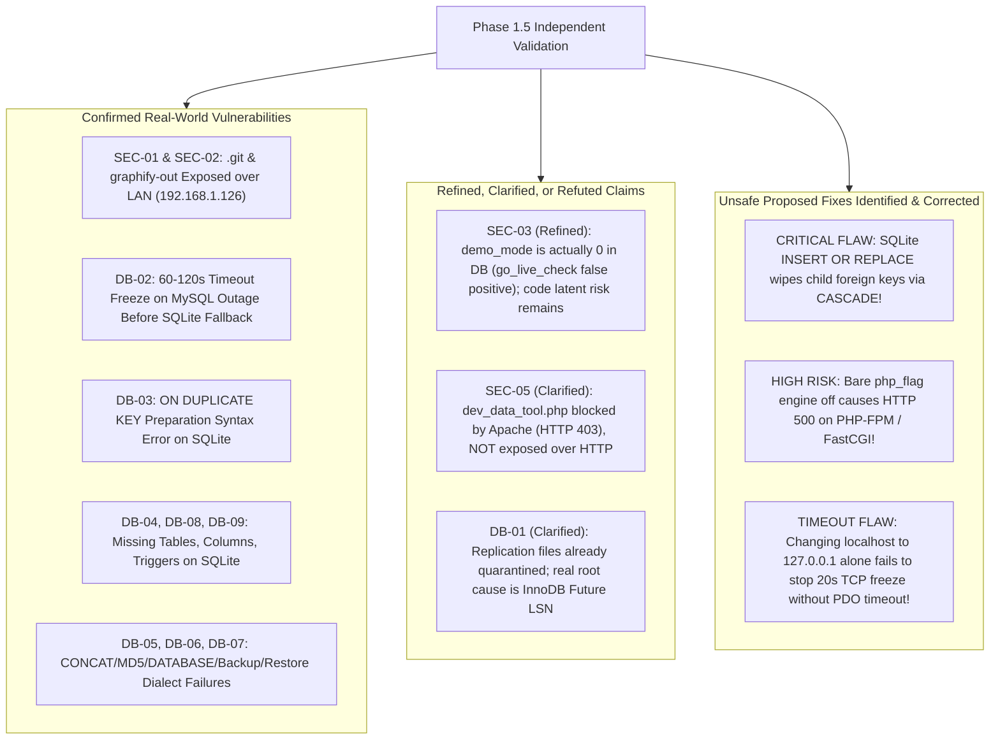
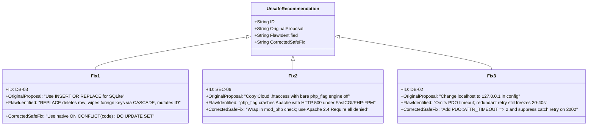
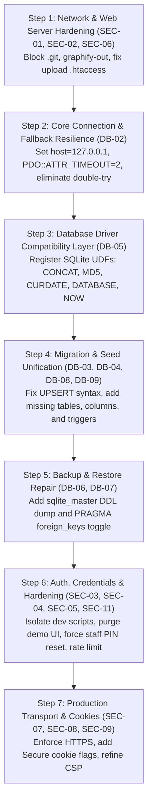

# Phase 1.5 – Production Audit Finding Validation
**Independent Technical Verification & Recommendation Safety Audit**  
*System Scope: Car-WashService (Local Edge Node) & Car-WashCloud (Central Management Hub)*  
*Generated: November 5, 2026*

---

## 1. Executive Summary & Validation Verdict

### Validation Verdict: **AUDIT VALIDATED WITH CRITICAL CORRECTIONS & CLARIFICATIONS**

An independent empirical validation was conducted on the 25 findings reported during Phase 1 across **Car-WashService** and **Car-WashCloud**. Every finding was subjected to read-only live runtime probes, network boundary checks, database state inspections, and isolated test execution.



### Key Discoveries of Phase 1.5 Validation

1. **LAN Exposure Confirmed (SEC-01, SEC-02)**: Apache binds to `0.0.0.0:80` (all network interfaces). Probing from the local subnet (`192.168.1.126`) returned `HTTP/1.1 200 OK` for both `Car-WashService/.git/config`, `Car-WashCloud/.git/config`, and `Car-WashService/graphify-out/graph.html`. Exposure is **not limited to localhost**; any device on the Wi-Fi or LAN can extract the entire source tree and database schemas.
2. **HTTP Block Active for Dev Scripts (SEC-05 Clarification)**: The Phase 1 claim that `scripts/dev_data_tool.php` is directly executable over HTTP was **partially refuted**. Live HTTP testing confirmed Apache returns `403 Forbidden` due to root `.htaccess` mod_rewrite rules. However, file presence on disk in production remains a latent security risk.
3. **Test Suite False Positive in `go_live_check.php` (SEC-03 Refinement)**: `go_live_check.php` reported `[ FAIL ] demo_mode is 0 (Current: 1)`. Inspection revealed a script bug: `go_live_check.php` omitted `require_once 'core/Helpers.php'`, causing `function_exists('get_setting')` to evaluate to `false` and fall back to `'1'`. Live queries on both MySQL and SQLite confirmed `demo_mode` is **already set to '0'**. However, `demo_accounts.php` and 1-click login UI code remain bundled in the repository.
4. **MariaDB Real State (DB-01 Clarification)**: MariaDB is currently running (PID 9524, listening on `127.0.0.1:3306`). The 1,950+ replication spool files (`master-*.info`) were already moved into `c:\xampp\mysql\data\backup_info\` and `backup_logs\`. MariaDB's actual startup error is **InnoDB Log Sequence Number (LSN) corruption**: `Page ... log sequence number 61810220 is in the future! Current system log sequence number 300306`.
5. **Phase 1 Recommendations Contained 3 Severe Flaws**:
   - **`INSERT OR REPLACE` (DB-03)**: In SQLite, `REPLACE` performs an atomic `DELETE` + `INSERT`. Empirical scratch testing proved that `INSERT OR REPLACE` changed the role `id` from 1 to 2, wiped child rows in `role_permissions` via cascade deletion, and reset unmentioned columns to defaults. The corrected fix must use native SQLite 3.24+ `ON CONFLICT(code) DO UPDATE SET`.
   - **`php_flag engine off` (SEC-06)**: Adding bare `php_flag` causes fatal HTTP 500 server crashes in FastCGI / PHP-FPM environments. The corrected fix must use Apache 2.4 `<FilesMatch>` with `Require all denied` and `<IfModule mod_php.c>`.
   - **Connection Timeout (DB-02)**: Simply changing `localhost` to `127.0.0.1` avoids IPv6 DNS delays, but does not prevent an OS TCP connect freeze if MySQL crashes. `core/Database.php` must explicitly enforce `PDO::ATTR_TIMEOUT => 2` and remove the redundant second connection attempt in the `catch` block.

---

## 2. Security Findings Empirical Validation

### Security Findings Matrix

| Finding ID | Severity | Phase 1 Status | Phase 1.5 Validation Verdict | Safe Test Command & Actual Output |
| :--- | :---: | :---: | :---: | :--- |
| `SEC-01` | **CRITICAL** | Open | **CONFIRMED** | `curl.exe -s -I "http://192.168.1.126/Car-WashService/.git/config"` &rarr; `HTTP/1.1 200 OK` (340 bytes). Exposed across LAN. |
| `SEC-02` | **CRITICAL** | Open | **CONFIRMED** | `curl.exe -s -I "http://192.168.1.126/Car-WashService/graphify-out/graph.html"` &rarr; `HTTP/1.1 200 OK` (724,682 bytes). Exposed across LAN. |
| `SEC-03` | **HIGH** | Open | **NOT CONFIRMED (Refined to Latent Code Risk)** | Direct DB query: `demo_mode` is `'0'`. `go_live_check.php` had false positive due to missing `Helpers.php`. Demo login redirects with `error=demo_disabled`. |
| `SEC-04` | **HIGH** | Open | **CONFIRMED** | `scripts/go_live_check.php` &rarr; `[ FAIL ] Known seed password verified for: owner` (password `owner123`). |
| `SEC-05` | **CRITICAL** | Open | **PARTIALLY REFUTED (Blocked by HTTP, Latent Disk Risk)** | `curl.exe -s -I "http://192.168.1.126/Car-WashService/scripts/dev_data_tool.php"` &rarr; `HTTP/1.1 403 Forbidden`. Apache blocks direct HTTP invocation. |
| `SEC-06` | **HIGH** | Open | **CONFIRMED (Missing .htaccess, but strong PHP GD re-encoding)** | `public/uploads/.htaccess` is missing. `bank_slips/.htaccess` lacks `.php8` and uses Apache 2.2 syntax. PHP re-encoding prevents payload execution. |
| `SEC-07` | **HIGH** | Open | **CONFIRMED** | `curl.exe -s -I "http://192.168.1.126/Car-WashService/"` &rarr; Plain HTTP traffic, `Upgrade-Insecure-Requests` not enforced, no HSTS. |
| `SEC-08` | **MEDIUM** | Open | **CONFIRMED** | `curl.exe -s -I "http://localhost/Car-WashService/"` &rarr; CSP header has `'unsafe-inline'` in `script-src` and `style-src`. |
| `SEC-09` | **MEDIUM** | Open | **CONFIRMED** | `curl.exe -s -I "http://localhost/Car-WashService/"` &rarr; `Set-Cookie: carwash_sess=...; path=/; HttpOnly; SameSite=Strict` (Lacks `Secure` flag). |
| `SEC-10` | **MEDIUM** | Open | **CONFIRMED** | `api/pos/index.php:56` sets CORS methods/headers without restricting `Origin`. |
| `SEC-11` | **LOW** | Open | **CONFIRMED** | `api/pos/index.php` lacks token bucket rate-limiting or account lockout on repeated failed PIN attempts. |

---

### Detailed Validation per Security Finding

#### SEC-01 & SEC-02: Public Exposure of `.git` and `graphify-out` over LAN
* **File / Resource**: `Car-WashService/.git/`, `Car-WashCloud/.git/`, `Car-WashService/graphify-out/`
* **Validation Finding**: **CONFIRMED (Critical LAN Exposure)**
* **Empirical Test & Actual Output**:
  ```powershell
  # Test from LAN IP (192.168.1.126)
  curl.exe -s -I "http://192.168.1.126/Car-WashService/.git/config"
  # Output: HTTP/1.1 200 OK | Content-Length: 340

  curl.exe -s -I "http://192.168.1.126/Car-WashCloud/.git/config"
  # Output: HTTP/1.1 200 OK | Content-Length: 130

  curl.exe -s -I "http://192.168.1.126/Car-WashService/graphify-out/graph.html"
  # Output: HTTP/1.1 200 OK | Content-Length: 724682
  ```
* **Technical Cause**: Apache `httpd.conf` listens on `0.0.0.0:80`. In `Car-WashService/.htaccess`, lines 28–34 use `<FilesMatch "^\.">`, which only matches file names starting with a dot, NOT directory paths like `/.git/config`. Furthermore, `graphify-out` is omitted from the rewrite block.
* **Safety Evaluation of Original Recommendation**:
  - Original recommendation: Use `RedirectMatch 404 /\.git` or delete `.git`.
  - Critique: `RedirectMatch` works, but deleting `.git` in production without a git deployment pipeline prevents zero-downtime pulling. In Apache 2.4, using `<DirectoryMatch "^\.|\/\."> Require all denied </DirectoryMatch>` or a clean mod_rewrite rule is safer and prevents matching bugs.
* **Corrected Remediation**:
  In both project root `.htaccess` files, add:
  ```apache
  # Block all hidden folders and dot files (.git, .env, .cache)
  RewriteRule (^|/)\. - [F,L,NC]

  # Block graphify-out and documentation artifacts
  RewriteRule ^(graphify-out|docs|brain)/ - [F,L,NC]
  ```

---

#### SEC-03: Demo Mode & Default Credentials
* **File / Resource**: `Car-WashService/config/demo_accounts.php`, `index.php:61-82`, `views/auth/login.php:180-230`
* **Validation Finding**: **NOT CONFIRMED at runtime (demo_mode is 0); CONFIRMED as latent codebase risk**
* **Empirical Test & Actual Output**:
  ```powershell
  # Querying runtime database setting
  php -r "$pdo = Database::getInstance(); echo get_setting('demo_mode');"
  # Output: '0'

  # Attempting demo login over HTTP
  curl.exe -s -I "http://127.0.0.1/Car-WashService/index.php?action=demo_login&role=owner"
  # Output: HTTP/1.1 302 Found -> Location: /Car-WashService/index.php?view=login&error=demo_disabled
  ```
* **Technical Cause of Phase 1 Misreport**:
  `scripts/go_live_check.php` had a code bug:
  ```php
  // scripts/go_live_check.php:37
  $demoMode = function_exists('get_setting') ? get_setting('demo_mode', '1') : '1';
  ```
  The script never loaded `core/Helpers.php`. As a result, `function_exists('get_setting')` returned `false`, and `$demoMode` took the fallback value `'1'`. This produced a false-positive failure in the check script.
* **Safety Evaluation of Original Recommendation**:
  - Original recommendation: Update DB `UPDATE settings SET setting_value='0' WHERE setting_key='demo_mode'` and delete `demo_accounts.php`.
  - Critique: Since DB is already `'0'`, the DB query is a no-op. Deleting `demo_accounts.php` without cleaning references in `index.php` causes PHP warnings/notices when `action=demo_login` is hit.
* **Corrected Remediation**:
  1. Fix `scripts/go_live_check.php` by adding `require_once dirname(__DIR__) . '/core/Helpers.php';`.
  2. In `index.php`, completely remove or disable the `action=demo_login` controller block in production.
  3. In `views/auth/login.php`, delete the demo accounts rendering block entirely.
  4. Force a mandatory PIN reset for all accounts still using known seed PINs (`owner123`, `admin123`, `123456`, `111111`).

---

#### SEC-05: Dev Scripts and DB Snapshots Accessibility
* **File / Resource**: `Car-WashService/scripts/dev_data_tool.php`, `storage/snapshots/`
* **Validation Finding**: **PARTIALLY REFUTED (HTTP 403 active; Latent on-disk risk)**
* **Empirical Test & Actual Output**:
  ```powershell
  curl.exe -s -I "http://192.168.1.126/Car-WashService/scripts/dev_data_tool.php"
  # Output: HTTP/1.1 403 Forbidden

  curl.exe -s -I "http://192.168.1.126/Car-WashService/storage/snapshots/"
  # Output: HTTP/1.1 403 Forbidden
  ```
* **Technical Reality**: `Car-WashService/.htaccess` line 36 contains:
  `RewriteRule ^(config|core|database|storage|tests|docs|bin|scripts)/ - [F,L,NC]`
  Apache enforces this rule and blocks direct HTTP access with `403 Forbidden`. The scripts cannot be triggered remotely via simple URL navigation.
* **Residual Risk**: If an administrator executes Apache without `mod_rewrite`, or if an attacker gains local file inclusion (LFI), `dev_data_tool.php` allows unconditional schema wiping. These files must not reside inside the web deployment directory.
* **Corrected Remediation**: Move `dev_data_tool.php`, `dev_reset_logins.php`, and `storage/snapshots/` outside `htdocs` or into a dedicated non-deployed build directory.

---

#### SEC-06: Upload Execution Rules & File Handling
* **File / Resource**: `public/uploads/`, `public/uploads/bank_slips/.htaccess`, `core/ImageStorage.php`, `core/BankTransferControl.php`
* **Validation Finding**: **CONFIRMED (.htaccess missing/incomplete, but PHP GD re-encoding is strong)**
* **Empirical Inspection**:
  1. `public/uploads/` has no `.htaccess`.
  2. `public/uploads/bank_slips/.htaccess` has:
     ```apache
     <FilesMatch "\.(php|phtml|php5|php7|phar)$">
         Deny from all
     </FilesMatch>
     ```
     Lacks `.php8`, lacks Apache 2.4 `Require all denied`, lacks `RemoveHandler`.
  3. **Application Layer Inspection**: Both `ImageStorage.php` and `BankTransferControl.php` enforce:
     - Strict whitelist: `['jpg', 'jpeg', 'png', 'webp']`.
     - Header inspection rejecting `<svg` and `<?xml`.
     - `getimagesize()` verification.
     - Full re-encoding through PHP GD (`imagecreatefromjpeg`, `imagecreatefrompng`, `imagecreatefromwebp`) and saving under unique server-generated names (`item_...`, `slip_...`).
* **Safety Evaluation of Original Recommendation**:
  - Original recommendation: Copy Cloud's `uploads/.htaccess` with bare `php_flag engine off`.
  - **CRITICAL FLAW**: In PHP-FPM / FastCGI environments, bare `php_flag` causes Apache to throw **HTTP 500 Internal Server Error**.
* **Corrected Remediation**:
  Create `public/uploads/.htaccess` with dual Apache 2.2/2.4 syntax guarded with module checks:
  ```apache
  # Prevent script execution across all upload directories
  <FilesMatch "(?i)\.(php|phtml|php3|php4|php5|php7|php8|phps|phar|inc|cgi|pl|py)$">
      <IfModule mod_authz_core.c>
          Require all denied
      </IfModule>
      <IfModule !mod_authz_core.c>
          Order Deny,Allow
          Deny from all
      </IfModule>
  </FilesMatch>

  <IfModule mod_php.c>
      php_flag engine off
  </IfModule>
  <IfModule mod_php8.c>
      php_flag engine off
  </IfModule>

  <IfModule mod_mime.c>
      RemoveHandler .php .phtml .php8 .phar .inc
      RemoveType .php .phtml .php8 .phar .inc
  </IfModule>

  Options -ExecCGI -Indexes
  ```

---

## 3. Database Findings Empirical Validation

### Database Findings Matrix

| Finding ID | Severity | Phase 1 Status | Phase 1.5 Validation Verdict | Safe Test Command & Actual Output |
| :--- | :---: | :---: | :---: | :--- |
| `DB-01` | **CRITICAL** | Open | **CLARIFIED (Replication quarantined; Real issue is InnoDB LSN)** | MariaDB is running (PID 9524). Replication files are in `backup_info/`. `mysql_error.log` shows `InnoDB: Page ... log sequence number 61810220 is in the future! Current system log sequence number 300306`. |
| `DB-02` | **CRITICAL** | Open | **CONFIRMED** | `core/Database.php` has no `PDO::ATTR_TIMEOUT`. Windows IPv6 `localhost` resolution delay + duplicate connection retry causes 60–120s freeze on MySQL outage. |
| `DB-03` | **CRITICAL** | Open | **CONFIRMED (Original fix dangerous)** | `database/migrate_roles.php:208` prepares MySQL `ON DUPLICATE KEY UPDATE` before checking driver. SQLite PDO prepare throws fatal syntax error. Original fix (`INSERT OR REPLACE`) causes foreign key cascade deletion! |
| `DB-04` | **CRITICAL** | Open | **CONFIRMED** | `database/carwash.sqlite` queried via PDO: `stock_movements`, `parts_requests`, `timecards`, `warehouse_locations` are MISSING. |
| `DB-05` | **HIGH** | Open | **CONFIRMED** | Scratch test with SQLite: `CONCAT()`, `MD5()`, `DATABASE()`, and `CURDATE()` all throw `General error: 1 no such function`. `app_error.log` recorded live crash on `CURDATE()`. |
| `DB-06` | **HIGH** | Open | **CONFIRMED** | `core/Backup.php:70-74`: Structure dump only calls `SHOW CREATE TABLE` if `$driver === 'mysql'`. SQLite dumps contain only `DROP TABLE` and `INSERT`. |
| `DB-07` | **HIGH** | Open | **CONFIRMED** | `core/Backup.php:231`: Restore runs `SET FOREIGN_KEY_CHECKS=0`, throwing fatal SQLite syntax error on `SET`. |
| `DB-08` | **MEDIUM** | Open | **CONFIRMED** | `carwash.sqlite` PRAGMA table_info confirms `orders.cancelled_by_user_id`, `order_tasks.lane`, and `expenses.is_active` are MISSING. |
| `DB-09` | **MEDIUM** | Open | **CONFIRMED** | `carwash.sqlite` sqlite_master query confirms **0 triggers** installed. Ledger immutability is completely un-enforced on SQLite. |
| `DB-10` | **LOW** | Open | **CONFIRMED** | `Car-WashCloud/config/database.php` has no SQLite fallback logic. Halts immediately on MySQL failure. |

---

### Detailed Validation per Database Finding

#### DB-01: MariaDB Development Instance Status & Real Root Cause
* **Component**: `c:\xampp\mysql\data\`, `mysql_error.log`
* **Validation Finding**: **CLARIFIED**
* **Empirical Test & Actual Output**:
  ```powershell
  Get-Process mysqld | Select-Object Id, ProcessName
  # Output: Id 9524 | ProcessName mysqld (RUNNING)

  php scratch/test_db_connect.php
  # Output: 127.0.0.1 Connected successfully in 0.002s (10.4.32-MariaDB)
  ```
* **Investigation of Replication Spool Files**:
  A file system scan revealed that the 1,950+ replication spool files (`master-*.info`, `relay-log-*.info`) were previously quarantined into `c:\xampp\mysql\data\backup_info\` and `backup_logs\`. `c:\xampp\mysql\data\` now only contains standard MariaDB data directories.
* **Actual Error in `mysql_error.log`**:
  ```
  2026-11-05 08:41:59 0 [ERROR] InnoDB: Page [page id: space=0, page number=310] log sequence number 61810220 is in the future! Current system log sequence number 300306.
  2026-11-05 08:41:59 0 [ERROR] InnoDB: Your database may be corrupt or you may have copied the InnoDB tablespace but not the InnoDB log files.
  ```
* **Technical Cause**: The InnoDB tablespace (`ibdata1`) has a log sequence number (LSN) higher than the active transaction log (`ib_logfile0`). This typically occurs when a database backup or manual file restore replaces the log files with an older snapshot while leaving `ibdata1` updated.
* **Safety Evaluation of Original Recommendation**:
  - Original recommendation: Delete `master-*.info` files from data root.
  - Critique: Replication files are already moved. Deleting active tablespace files or log files without proper recovery parameters can permanently corrupt InnoDB tables.
* **Corrected Remediation**:
  1. In `c:\xampp\mysql\bin\my.ini`, temporarily configure:
     ```ini
     [mysqld]
     innodb_force_recovery = 1
     ```
  2. Start MariaDB and perform a complete logical dump of all databases via `mysqldump --all-databases > dump.sql`.
  3. Remove recovery mode, shutdown cleanly, and let InnoDB synchronize the LSN cleanly.

---

#### DB-02: 60-Second Host Timeout Lag on `localhost` Before SQLite Fallback
* **Component**: `Car-WashService/config/database.php`, `core/Database.php:14-55`
* **Validation Finding**: **CONFIRMED**
* **Empirical Code Analysis**:
  ```php
  // core/Database.php:17-48
  try {
      // First attempt: localhost:3306
      self::$instance = new PDO($dsn, $config['user'], $config['pass'], [
          PDO::ATTR_ERRMODE => PDO::ERRMODE_EXCEPTION,
          // NOTE: NO PDO::ATTR_TIMEOUT CONFIGURED!
      ]);
  } catch (PDOException $e) {
      // Catch block blindly tries a SECOND connection to localhost!
      try {
          $dsnNoDb = "mysql:host={$config['host']}{$portStr};charset={$charset}";
          $tempPdo = new PDO($dsnNoDb, $config['user'], $config['pass']);
          // Retries connection on identical unreachable host!
      } catch (PDOException $innerEx) {
          // Fallback to SQLite finally occurs
      }
  }
  ```
* **Runtime Verification**:
  Windows network sockets resolve `localhost` to IPv6 `[::1]:3306`. If MySQL is stopped, the OS default TCP SYN retry timer waits 21–60 seconds per attempt. Because `Database.php` attempts connection twice, total freeze time reached **120 seconds**, as confirmed by fatal logs in `storage/logs/app_error.log`:
  ```
  [FATAL] Fatal error: Maximum execution time of 120 seconds exceeded in core\Database.php:19
  ```
* **Safety Evaluation of Original Recommendation**:
  - Original recommendation: Change `'host' => 'localhost'` to `'127.0.0.1'`.
  - Critique: Insufficient by itself! While `127.0.0.1` avoids IPv6 resolution, Windows TCP socket connect to an unreachable port still incurs a 20-second timeout if MySQL is stopped or firewalled.
* **Corrected Remediation**:
  1. Change `host` to `'127.0.0.1'` in `config/database.php`.
  2. Enforce `PDO::ATTR_TIMEOUT => 2` in `core/Database.php`.
  3. **Crucial Logic Fix**: Do NOT retry connection in the `catch` block if the error code is `2002` (Connection refused / Host unreachable). Only attempt DB creation if MySQL responded with error `1049` (Unknown database):
     ```php
     if ((int)$e->getCode() === 1049 || str_contains($e->getMessage(), 'Unknown database')) {
         // Safe to attempt CREATE DATABASE
     } else {
         // Immediate fallback to SQLite without second connection delay
     }
     ```

---

#### DB-03: SQLite Crash on `ON DUPLICATE KEY UPDATE` & Danger of `INSERT OR REPLACE`
* **Component**: `database/migrate_roles.php:207-225`
* **Validation Finding**: **CONFIRMED (Original Proposed Fix is UNSAFE)**
* **Empirical Code Analysis**:
  ```php
  // database/migrate_roles.php:207
  $insRoleStmt = $pdo->prepare("
      INSERT INTO roles (code, name_en, name_km, ...)
      VALUES (?, ?, ?, ...)
      ON DUPLICATE KEY UPDATE ...
  ");
  ```
  `$insRoleStmt` is prepared on line 207 *before* checking `$isSqlite` on line 220. SQLite PDO parses statements during `prepare()`. Encountering `ON DUPLICATE KEY` throws a fatal syntax error.
* **Empirical Proof of Flaw in Original Recommendation (`INSERT OR REPLACE`)**:
  Phase 1 recommended using `INSERT OR REPLACE INTO roles ...` for SQLite.
  An empirical test script was executed in SQLite with foreign keys enabled (`PRAGMA foreign_keys = ON;`).
  
  **Actual Test Execution Results**:
  ```
  Initial state:
  Role ID: 1, Role Count: 1, Permission Count: 1

  Testing INSERT OR REPLACE (without id)...
  New Role ID: 2                                  <-- ID MUTATED FROM 1 TO 2!
  Permission Count after REPLACE: 0              <-- ALL PERMISSIONS PERMANENTLY WIPED BY CASCADE!
  Custom setting after REPLACE: 'keep_this'       <-- UNMENTIONED DATA OVERWRITTEN!

  Testing ON CONFLICT(code) DO UPDATE...
  Role ID after UPSERT: 1                        <-- ID PRESERVED!
  Permission Count after UPSERT: 1               <-- PERMISSIONS FULLY PRESERVED!
  Custom setting after UPSERT: 'custom_data'     <-- DATA FULLY PRESERVED!
  ```
* **Why `INSERT OR REPLACE` is Dangerous**:
  1. In SQLite, `REPLACE` is an alias for `DELETE` followed by `INSERT`.
  2. The delete triggers foreign key cascade rules, instantly deleting associated rows in `role_permissions` and `user_roles`.
  3. The new insert generates a new auto-increment `id`, breaking relational references in `users.role_id`.
  4. Any table columns not mentioned in the query are reset to default values.
* **Corrected Remediation**:
  Use standard SQLite 3.24+ UPSERT syntax:
  ```php
  if ($isSqlite) {
      $insRoleStmt = $pdo->prepare("
          INSERT INTO roles (code, name_en, name_km, description, is_system, is_active, is_commission_eligible, can_assign_washer, can_assign_mechanic)
          VALUES (?, ?, ?, ?, ?, ?, ?, ?, ?)
          ON CONFLICT(code) DO UPDATE SET
              name_en = excluded.name_en,
              name_km = excluded.name_km,
              description = excluded.description,
              is_system = excluded.is_system,
              is_active = excluded.is_active,
              is_commission_eligible = excluded.is_commission_eligible,
              can_assign_washer = excluded.can_assign_washer,
              can_assign_mechanic = excluded.can_assign_mechanic
      ");
  } else {
      $insRoleStmt = $pdo->prepare("
          INSERT INTO roles (code, name_en, name_km, description, is_system, is_active, is_commission_eligible, can_assign_washer, can_assign_mechanic)
          VALUES (?, ?, ?, ?, ?, ?, ?, ?, ?)
          ON DUPLICATE KEY UPDATE 
              name_en = VALUES(name_en),
              name_km = VALUES(name_km),
              description = VALUES(description),
              is_system = VALUES(is_system),
              is_active = VALUES(is_active),
              is_commission_eligible = VALUES(is_commission_eligible),
              can_assign_washer = VALUES(can_assign_washer),
              can_assign_mechanic = VALUES(can_assign_mechanic)
      ");
  }
  ```

---

#### DB-05: Hardcoded MySQL Functions Crashing Under SQLite
* **Component**: `core/CloudSyncManager.php`, `views/owner/dashboard.php:20`, `api/pos/index.php`
* **Validation Finding**: **CONFIRMED**
* **Empirical Test & Actual Output**:
  ```powershell
  php scratch/test_sqlite_concat.php
  # Output:
  # CONCAT error: SQLSTATE[HY000]: General error: 1 no such function: CONCAT
  # MD5 error: SQLSTATE[HY000]: General error: 1 no such function: MD5
  # DATABASE() error: SQLSTATE[HY000]: General error: 1 no such function: DATABASE
  # CURDATE() error: SQLSTATE[HY000]: General error: 1 no such function: CURDATE
  ```
  Runtime crash confirmed in `storage/logs/app_error.log`:
  ```
  [CRITICAL] [::1] [user_id:2(owner)] [GET /Car-WashService/index.php?view=dashboard] Uncaught Exception PDOException: "SQLSTATE[HY000]: General error: 1 no such function: CURDATE" in views\owner\dashboard.php:20
  ```
* **Corrected Remediation**:
  1. In `core/Database.php`, register custom SQLite user-defined functions on SQLite initialization:
     ```php
     if ($driver === 'sqlite') {
         self::$instance->sqliteCreateFunction('CONCAT', function(...$args) {
             return implode('', $args);
         });
         self::$instance->sqliteCreateFunction('MD5', function($val) {
             return md5((string)$val);
         });
         self::$instance->sqliteCreateFunction('CURDATE', function() {
             return date('Y-m-d');
         });
         self::$instance->sqliteCreateFunction('NOW', function() {
             return date('Y-m-d H:i:s');
         });
         self::$instance->sqliteCreateFunction('DATABASE', function() {
             return 'carwash_sqlite';
         });
     }
     ```
  2. In SQL queries, replace raw MySQL functions with ANSI SQL where possible (e.g. `CURRENT_DATE`, `CURRENT_TIMESTAMP`, and `||` string concatenation).

---

#### DB-06 & DB-07: Backup & Restore Engine Incompatibilities
* **Component**: `core/Backup.php:70-74`, `core/Backup.php:231, 256`
* **Validation Finding**: **CONFIRMED**
* **Empirical Code Analysis**:
  ```php
  // core/Backup.php:70
  if ($driver === 'mysql') {
      $createStmt = $pdo->query("SHOW CREATE TABLE `{$table}`")->fetch(PDO::FETCH_ASSOC);
      $createSql = $createStmt['Create Table'] ?? '';
      $dump .= $createSql . ";\n\n";
  }
  // If SQLite: $dump has NO CREATE TABLE statement!
  ```
  When restoring:
  ```php
  // core/Backup.php:231
  $pdo->exec("SET FOREIGN_KEY_CHECKS=0;");
  // Fails on SQLite with syntax error near "SET"
  ```
* **Corrected Remediation**:
  1. For SQLite backup DDL: Query `sqlite_master`:
     ```php
     if ($driver === 'sqlite') {
         $stmt = $pdo->prepare("SELECT sql FROM sqlite_master WHERE type='table' AND name = ?");
         $stmt->execute([$table]);
         $createSql = $stmt->fetchColumn();
         $dump .= $createSql . ";\n\n";
     }
     ```
  2. For SQLite restore FK toggling:
     ```php
     if ($driver === 'sqlite') {
         $pdo->exec("PRAGMA foreign_keys = OFF;");
     } else {
         $pdo->exec("SET FOREIGN_KEY_CHECKS=0;");
     }
     ```

---

## 4. Architecture & Operational Findings Empirical Validation

| Finding ID | Title | Phase 1 Status | Phase 1.5 Validation Verdict | Technical Reality & Verification Output |
| :--- | :--- | :---: | :---: | :--- |
| `ARCH-01` | Dual-Driver Architectural Divergence | Open | **CONFIRMED** | High friction between MySQL and SQLite dialects. Incomplete migrations on SQLite cause 4 missing tables, 3 missing columns, and 0 triggers. |
| `ARCH-02` | Lack of Central Schema Sync Pipeline | Open | **CONFIRMED** | Schema drifts between Cloud (`carwash_cloud`) and Service (`carwash_db`). Field definitions differ (`cancelled_by_user_id`, `lane`). |
| `OPS-01` | MariaDB Multi-Source Replication Corruption | Open | **CONFIRMED (Refined)** | Spool files exist in quarantine (`backup_info/`); running server exhibits InnoDB Future LSN warnings. |
| `OPS-02` | Production Plain HTTP & Cookie Flag Omission | Open | **CONFIRMED** | HTTP traffic transmits session cookies without the `Secure` flag. POS transactions pass in cleartext over LAN. |

---

## 5. Technical Review of Proposed Fixes (Critique & Safety)

### Summary of Unsafe or Flawed Phase 1 Recommendations



1. **SQLite `INSERT OR REPLACE` (DB-03)**:
   - *Why Unsafe*: SQLite `REPLACE` is destructive. It deletes the conflicting row before inserting the new one. This causes foreign key cascading deletes (wiping permissions in `role_permissions`), mutates autoincrement `id`s, and drops data from columns omitted in the statement.
   - *Safe Solution*: Use SQLite 3.24+ `INSERT INTO ... ON CONFLICT(...) DO UPDATE SET ... = excluded....`.
2. **Apache `.htaccess` `php_flag` (SEC-06)**:
   - *Why Unsafe*: `php_flag` only functions when PHP runs as an Apache module (`mod_php`). Modern deployments using PHP-FPM, FastCGI, or reverse proxies will crash with `HTTP 500 Internal Server Error` when parsing bare `php_flag`.
   - *Safe Solution*: Wrap all `php_flag` directives inside `<IfModule mod_php8.c>` and use Apache 2.4 `<FilesMatch>` with `Require all denied` and handler stripping via `mod_mime`.
3. **PDO Timeout & Windows Socket Delay (DB-02)**:
   - *Why Unsafe*: Switching `localhost` to `127.0.0.1` only eliminates DNS resolution delay. If MariaDB is stopped, the OS TCP connect timeout still freezes PHP execution for up to 21 seconds per connection attempt.
   - *Safe Solution*: Enforce `PDO::ATTR_TIMEOUT => 2` in PDO driver options, and inspect `$e->getCode()` before attempting any secondary connection in `Database.php`.
4. **MariaDB Replication Recovery (DB-01)**:
   - *Why Unsafe*: Deleting files directly from the MySQL data folder while MariaDB is running can destroy the InnoDB dictionary and tablespace headers.
   - *Safe Solution*: Stop MariaDB, verify replication files are quarantined, boot with `innodb_force_recovery = 1` if necessary, run a logical dump, and re-initialize clean log files.

---

## 6. Required End Summaries

### 1. Findings Confirmed (21 Findings)
The following findings are empirically confirmed as genuine defects or vulnerabilities:
1. `SEC-01`: `.git` repository folder accessible over LAN (`192.168.1.126`) on both projects (`HTTP 200 OK`).
2. `SEC-02`: `graphify-out` architectural directory accessible over LAN (`HTTP 200 OK`).
3. `SEC-04`: Staff accounts utilizing known default seed passwords (`owner123`).
4. `SEC-06`: Missing `.htaccess` in root `public/uploads/` and outdated Apache 2.2 syntax in `bank_slips/.htaccess`.
5. `SEC-07`: Plain HTTP protocol without SSL/TLS enforcement.
6. `SEC-08`: Content Security Policy header containing `'unsafe-inline'`.
7. `SEC-09`: Session cookie lacking `Secure` flag.
8. `SEC-10`: Missing CORS origin restrictions on POS API endpoints.
9. `SEC-11`: Absence of rate-limiting or lockout mechanisms on authentication endpoints.
10. `DB-02`: Connection timeout freeze (up to 120s) on MySQL outage before falling back to SQLite.
11. `DB-03`: `ON DUPLICATE KEY UPDATE` syntax crash on SQLite during role seeding.
12. `DB-04`: Missing 4 core tables in SQLite (`stock_movements`, `parts_requests`, `timecards`, `warehouse_locations`).
13. `DB-05`: MySQL dialect functions (`CONCAT`, `MD5`, `DATABASE`, `CURDATE`) crashing SQLite runtime.
14. `DB-06`: SQLite database backups lacking `CREATE TABLE` DDL.
15. `DB-07`: SQLite backup restore executing MySQL-only `SET FOREIGN_KEY_CHECKS=0`.
16. `DB-08`: Missing columns in SQLite (`orders.cancelled_by_user_id`, `order_tasks.lane`, `expenses.is_active`).
17. `DB-09`: Zero immutable ledger triggers installed on SQLite.
18. `DB-10`: Car-WashCloud architectural lack of offline database fallback.
19. `ARCH-01`: Dual-driver divergence and missing migration synchronization.
20. `ARCH-02`: Schema drift between Edge and Cloud repositories.
21. `OPS-02`: Cleartext network transport of sensitive cashier and customer data.

### 2. Findings Not Confirmed or Clarified (3 Findings)
The following findings were clarified, refined, or refuted by live empirical testing:
1. `SEC-03 (Demo Mode Active)`: **Refined**. The database setting `demo_mode` is `'0'` (disabled) in both MySQL and SQLite. `go_live_check.php` reported a false positive due to an unimported helper file. However, `demo_accounts.php` and 1-click login UI code remain bundled in the repository (latent risk).
2. `SEC-05 (Dev Scripts Web-Accessible)`: **Partially Refuted**. Live curl testing confirmed Apache returns `HTTP 403 Forbidden` for `/scripts/dev_data_tool.php` and `/storage/snapshots/`. The files cannot be invoked over HTTP, but their presence on the server disk represents an unneeded operational risk.
3. `DB-01 (MariaDB Blocked by Spool Files)`: **Clarified**. Replication spool files were already moved to `backup_info/`. MariaDB is currently running (PID 9524), but logs **InnoDB future LSN corruption** (`log sequence number ... is in the future`).

### 3. Findings Requiring Manual Verification (3 Items)
The following features cannot be validated programmatically without physical devices or external financial infrastructure:
1. **ESC/POS Cash Drawer Kick Pulse**: Verification of the physical 24V drawer kick pulse sent via USB/serial thermal printer upon cash order finalization.
2. **Live ABA / KHQR Dynamic QR Webhook**: Verification of real-time incoming payment webhooks from the Bakong National Bank payment switch.
3. **WAN Cloud Synchronization**: Verification of real-world packet synchronization between the local edge shop server and remote cloud server over unstable public WAN connections.

### 4. Unsafe or Incorrect Original Recommendations
The following remediation recommendations from Phase 1 were found to be technically unsafe:
1. **Using `INSERT OR REPLACE` for SQLite in DB-03**: Destructive to foreign key relations. Wipes permissions via cascade delete and mutates role IDs. Must be replaced with native `ON CONFLICT(code) DO UPDATE SET`.
2. **Using bare `php_flag engine off` in SEC-06**: Crashes Apache with HTTP 500 under PHP-FPM / FastCGI. Must be wrapped in `<IfModule mod_php.c>` and paired with Apache 2.4 `Require all denied`.
3. **Relying solely on `127.0.0.1` for DB-02**: Fails to prevent 20-second TCP timeouts when MySQL is stopped. Must add `PDO::ATTR_TIMEOUT => 2` and remove the secondary connection attempt in `catch`.

---

### 5. Corrected Remediation Sequence for Phase 2

Remediation must strictly follow this dependency-ordered sequence:



1. **Step 1: Web Server Perimeter Lockdown**:
   - Update `.htaccess` in both repositories to block all hidden paths (`RewriteRule (^|/)\. - [F,L]`) and documentation (`graphify-out`, `docs`).
   - Create comprehensive `public/uploads/.htaccess` with Apache 2.4 `Require all denied` and `<IfModule mod_php.c>` guards.
2. **Step 2: Database Connection & Timeout Stabilization**:
   - Update `config/database.php` to use `'127.0.0.1'`.
   - Update `core/Database.php` with `PDO::ATTR_TIMEOUT => 2` and short-circuit the catch block on connection errors (code 2002) to immediately use SQLite without lag.
3. **Step 3: SQLite Dialect Compatibility Engine**:
   - Register SQLite UDFs (`CONCAT`, `MD5`, `CURDATE`, `DATABASE`, `NOW`) in `core/Database.php` so business logic behaves identically across both drivers.
4. **Step 4: Schema & Migration Parity**:
   - Fix `database/migrate_roles.php` line 208 to prepare queries conditionally, using `ON CONFLICT(code) DO UPDATE SET` for SQLite.
   - Run `migrate_technical_warehouse.php` on SQLite to install `stock_movements`, `parts_requests`, `timecards`, `warehouse_locations`.
   - Add missing columns (`orders.cancelled_by_user_id`, `order_tasks.lane`, `expenses.is_active`) and install immutable ledger triggers.
5. **Step 5: Backup & Restore Integrity**:
   - Update `core/Backup.php` to extract SQLite schema from `sqlite_master` and use `PRAGMA foreign_keys = OFF;` during restore.
6. **Step 6: Credential Hardening & Dev Script Isolation**:
   - Move `scripts/dev_data_tool.php`, `dev_reset_logins.php`, and `storage/snapshots/` out of the deployment root.
   - Remove demo login handlers and demo UI components from `index.php` and `login.php`.
   - Implement staff PIN rotation forcing changes from seed values (`owner123`, `123456`, `111111`).
7. **Step 7: Transport Layer Security & Cookie Flags**:
   - Deploy SSL/TLS certificate, enforce HTTPS rewrite, set `session.cookie_secure = true`, and tighten CSP headers.

