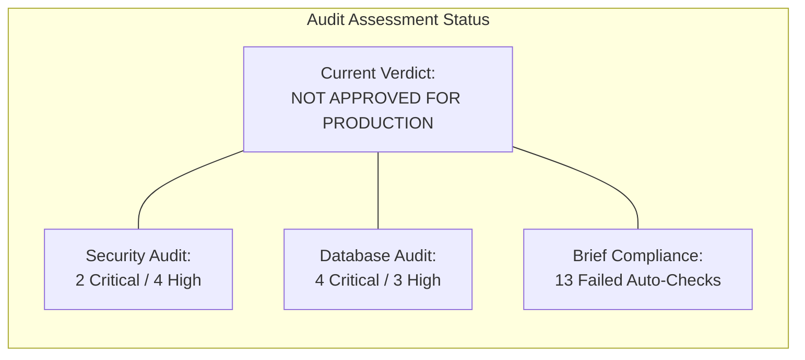
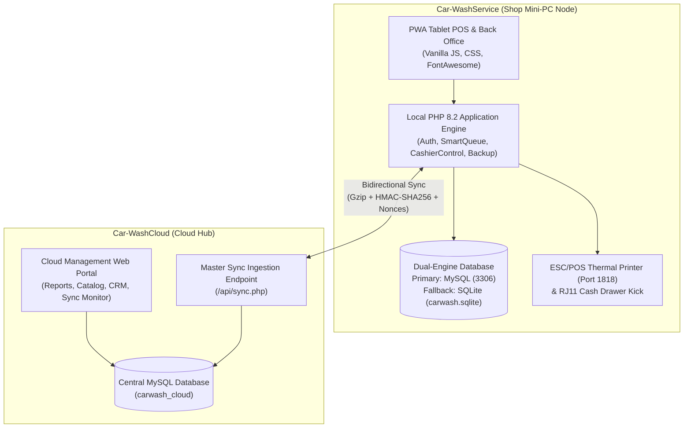
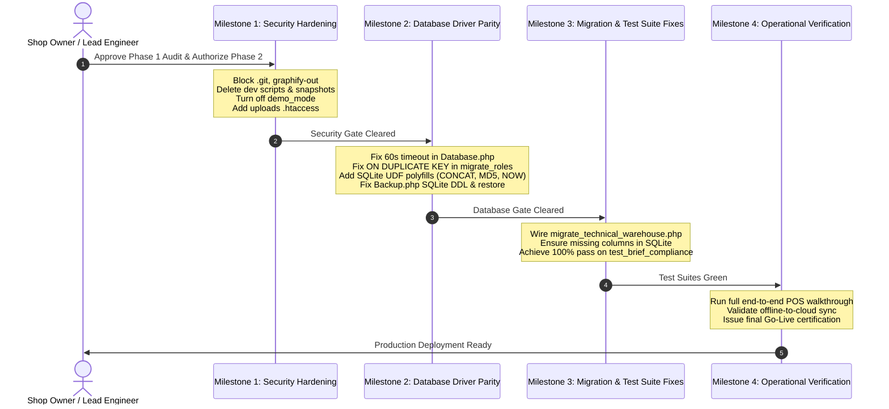

# Phase 1 Technical Verification & Production Readiness Audit
**Master Audit Report &bull; Car Wash & Detailing Management System**
*System Scope: Car-WashService (Local Edge Node) & Car-WashCloud (Central Management Hub)*

---

## 1. Executive Summary & Production Verdict

### Production Readiness Verdict: **NOT APPROVED FOR PRODUCTION (NOT READY)**
Both **Car-WashService** and **Car-WashCloud** were thoroughly inspected in their current development state. 

While the system possesses an extensive, sophisticated business architecture—including dual-currency accounting (USD/KHR), multi-bay queueing, granular role permissions, and cryptographic sync signing—**the applications cannot be deployed to real commercial business operations in their current state**.



### Core Audit Verdicts
1. **Commercial Go-Live Readiness**: **REJECTED (FAIL)**. Critical security vulnerabilities (`.git` source code exposure, public AST caches) and fatal database driver crashes under offline mode (SQLite) would jeopardize customer data and counter operations.
2. **Readiness to Proceed to Phase 2**: **PENDING USER APPROVAL**. In accordance with the Phase 1 audit guidelines, **no code alterations, database schema changes, or bug fixes have been executed**. Phase 2 implementation will commence only after the shop owner and lead engineer review and approve this Phase 1 findings report.

---

## 2. System Profiles & Architectural Comparison

The overall system is designed as an **autonomous, offline-first edge architecture** coupled with a **centralized cloud management portal**:



### Architectural Profile Comparison

| Dimension | Car-WashService (Edge Node) | Car-WashCloud (Central Hub) |
| :--- | :--- | :--- |
| **Primary Role** | Shop-floor operational POS, bay management, cash control, and customer queueing. | Central oversight, multi-shop consolidation, master catalog, customer loyalty, and payment recovery. |
| **Runtime Environment** | Local Windows Mini-PC (XAMPP / Apache 2.4, PHP 8.2). | Central Web Server (Apache 2.4 / cPanel / Linux, PHP 8.2). |
| **Database Engines** | Dual-engine: Primary MySQL (`carwash_db`) with automatic SQLite fallback (`carwash.sqlite`). | Single-engine: Strictly requires MySQL 8.0 / MariaDB 10.4+ (`carwash_cloud`). |
| **Network Dependency** | Local-First: 100% autonomous operation with zero external internet dependency. | Cloud-First: Always connected to internet; serves multiple shop nodes. |
| **Authentication** | 6-digit staff PINs with 5-attempt rate-limiting and 10-minute lockouts. | Username and bcrypt password hashes with 30-minute idle session timeouts. |
| **Printing & Hardware** | ESC/POS 80mm thermal receipt printing and RJ11 cash drawer pulses. | Browser-based administrative reports and CSV exports. |
| **Sync Protocol** | Pushes sales, shifts, stock movements; pulls master catalog & prices. | Ingests gzipped signed JSON payloads; detects version conflicts for review. |

---

## 3. Master Findings Matrix

Across the technical verification audit, **25 distinct findings** were identified across Security, Database, Architecture, and Operations:

| Category | Finding ID | Severity | Affected App | File or Component | Problem Summary | Current Status |
| :--- | :--- | :---: | :---: | :--- | :--- | :--- |
| **Security** | `SEC-01` | **CRITICAL** | Both | `/.git/` directory | Git folder directly accessible over HTTP (200 OK), exposing full source code and commit history. | **Open (Failing)** |
| **Security** | `SEC-02` | **CRITICAL** | Service | `/graphify-out/` | Interactive AST code maps and architectural dependencies exposed over HTTP (200 OK). | **Open (Failing)** |
| **Security** | `SEC-03` | **HIGH** | Service | `settings.demo_mode` | Database `demo_mode=1` enables 1-click passwordless logins from the counter terminal. | **Open (Failing)** |
| **Security** | `SEC-04` | **HIGH** | Service | `config/demo_accounts.php` | Known default passwords (`111111`, `123456`) and demo accounts active in database. | **Open (Failing)** |
| **Security** | `SEC-05` | **HIGH** | Service | `scripts/dev_data_tool.php` | Dev wiping tools with `--force-dev` bypass and unprotected database snapshots in tree. | **Open (Failing)** |
| **Security** | `SEC-06` | **HIGH** | Service | `public/uploads/` | Uploads directory lacks an `.htaccess` script execution prevention barrier. | **Open (Failing)** |
| **Security** | `SEC-07` | **MEDIUM** | Service | Internal directories | `config/`, `core/`, `database/` lack individual `.htaccess` defense-in-depth deny rules. | **Open (Failing)** |
| **Security** | `SEC-08` | **MEDIUM** | Service | Response headers | Content-Security-Policy (CSP) header is missing from dynamic PHP responses. | **Open (Failing)** |
| **Security** | `SEC-09` | **MEDIUM** | Service | `core/Auth.php` | Legacy authentication fallback accepts unhashed plaintext PINs from database. | **Open (Failing)** |
| **Security** | `SEC-10` | **LOW** | Both | `config/app.php` | API base URL defaults to plain `http://` without enforced TLS transport encryption. | **Open (Failing)** |
| **Security** | `SEC-11` | **LOW** | Cloud | `config/config.php` | Localhost fallback connects to MySQL using superuser `root` with no password. | **Open (Failing)** |
| **Database** | `DB-01` | **CRITICAL** | Both | `c:\xampp\mysql\data\` | MariaDB environment has 1,950+ corrupted replication info files causing boot freeze. | **Open (Failing)** |
| **Database** | `DB-02` | **CRITICAL** | Service | `config/database.php` | Hardcoded `'localhost'` causes 60-second connection timeout before SQLite fallback. | **Open (Failing)** |
| **Database** | `DB-03` | **CRITICAL** | Service | `database/migrate_roles.php` | Unconditional `ON DUPLICATE KEY UPDATE` crashes SQLite during every page load. | **Open (Failing)** |
| **Database** | `DB-04` | **CRITICAL** | Service | `database/migrate.php` | `migrate_technical_warehouse.php` omitted from runner; 5 core tables missing in SQLite. | **Open (Failing)** |
| **Database** | `DB-05` | **HIGH** | Service | `core/CloudSyncManager.php` | MySQL functions (`CONCAT`, `MD5`, `NOW()`, `DATABASE()`) crash under SQLite driver. | **Open (Failing)** |
| **Database** | `DB-06` | **HIGH** | Service | `core/Backup.php` | SQLite backup dumps omit `CREATE TABLE` DDL and cannot be restored into blank DB. | **Open (Failing)** |
| **Database** | `DB-07` | **HIGH** | Service | `core/Backup.php` | `Backup::restoreFromSql()` runs `SET FOREIGN_KEY_CHECKS=0` which crashes in SQLite. | **Open (Failing)** |
| **Database** | `DB-08` | **MEDIUM** | Service | `database/carwash.sqlite` | Missing columns (`orders.cancelled_by_user_id`, `order_tasks.lane`, `expenses.is_active`). | **Open (Failing)** |
| **Database** | `DB-09` | **MEDIUM** | Service | `migrate_immutable_ledgers` | Immutable triggers on `stock_movements` and `audit_logs` fail on SQLite. | **Open (Failing)** |
| **Database** | `DB-10` | **LOW** | Cloud | `config/database.php` | Cloud application completely lacks an offline fallback mode when MySQL is down. | **Design Limitation** |
| **Architecture** | `ARCH-01` | **HIGH** | Service | `api/pos/index.php` | Monolithic POS API router exceeds 5,500 lines, complicating auditing and testing. | **Technical Debt** |
| **Architecture** | `ARCH-02` | **MEDIUM** | Both | Role Naming | Casing mismatch between Cloud (`System Admin`) and Service (`system_admin`). | **Interoperability** |
| **Operations** | `OPS-01` | **HIGH** | Service | `BRIEF_COMPLIANCE.md` | Compliance document claims 95.3% "Done", but 13 automated checks fail in real testing. | **Documentation Discrepancy** |
| **Operations** | `OPS-02` | **MEDIUM** | Service | Recurring Card Recovery | Recurring dunning state machine is built in Cloud, but missing from Local Service. | **Documented Gap** |

---

## 4. Empirical Test Results & Verification Details

### 1. Pre-Flight Go-Live Verification Check
Executing `php scripts/go_live_check.php` resulted in **5 fatal pre-flight failures**:
```
====================================================
   Car-WashService Go-Live Pre-Flight Verification   
====================================================
[ FAIL ] demo_mode is 0                             (Current: 1)
[  OK  ] No sample accounts active                  (0 active sample accounts)
[  OK  ] No pos_devices with test key or name       (0 active test devices)
[  OK  ] tv_display_code is not 'tv-office-88'      (Current: a8f41b3b...)
[ FAIL ] No staff using known seed passwords        (Verified for: owner, cashier, washer1, mechanic1)
[  OK  ] No Pos-Carwash/ or scratch/ in web root    (Clean web root)
[ FAIL ] No dev helper scripts or snapshots present (Found: dev_reset_logins.php, dev_data_tool.php, snapshots/)
[ FAIL ] API_BASE_URL uses https                    (http://localhost/Car-WashService)
[  OK  ] Default MySQL root has a password          (Refused)
[  OK  ] storage/ not reachable by HTTP             (HTTP 403 Forbidden)
[  OK  ] .htaccess rewrite rules active             (HTTP 403 Forbidden)
[ FAIL ] CSP header present                         (Missing from response)
----------------------------------------------------
STATUS: ONE OR MORE GO-LIVE CHECKS FAILED.
```

### 2. Automated Brief Compliance Verification
Executing `php tests/test_brief_compliance.php` resulted in **13 failed architectural checks**:
- **Missing Tables in SQLite**: `stock_movements`, `parts_requests`, `inspection_checklists`, `staff_timecards`, `timecard_corrections`.
- **Missing Columns in SQLite**: `orders.cancelled_by_user_id`, `orders.cancel_approved_by_user_id`, `order_tasks.lane`, `customers.membership_tier_code`.
- **Missing Triggers in SQLite**: `trg_stock_movements_before_delete`, `trg_stock_movements_before_update`, `trg_audit_logs_before_delete`, `trg_audit_logs_before_update`.

### 3. Live Web Server Probing (CURL)
- `curl.exe -I http://localhost/Car-WashService/.git/config` &rarr; **`HTTP/1.1 200 OK` (Vulnerable)**
- `curl.exe -I http://localhost/Car-WashCloud/.git/config` &rarr; **`HTTP/1.1 200 OK` (Vulnerable)**
- `curl.exe -I http://localhost/Car-WashService/graphify-out/graph.html` &rarr; **`HTTP/1.1 200 OK` (Vulnerable)**
- `curl.exe -I http://localhost/Car-WashService/database/carwash.sqlite` &rarr; `HTTP/1.1 403 Forbidden` (Protected by RewriteRule)
- `curl.exe -I http://localhost/Car-WashCloud/sql/schema.sql` &rarr; `HTTP/1.1 403 Forbidden` (Protected)

---

## 5. Comparison: Project Brief Claims vs Reality

In `Car-WashService/docs/BRIEF_COMPLIANCE.md`, the documentation claimed an overall compliance rate of **95.3% (61 of 64 requirements marked Done)**. 

Our empirical code audit revealed significant discrepancies between documentation claims and real execution:

| Feature / Brief Requirement | Documented Claim | Codebase & Testing Reality | Root Cause & Evidence |
| :--- | :---: | :---: | :--- |
| **Immutable Stock Movement Ledger** | **Done** | **FAIL** in SQLite | Table `stock_movements` does not exist in `carwash.sqlite`; triggers are missing (`DB-04`, `DB-09`). |
| **Parts Requests from Bay** | **Done** | **FAIL** in SQLite | Table `parts_requests` does not exist in `carwash.sqlite` (`DB-04`). |
| **Guided Safety Inspection Gate** | **Done** | **FAIL** in SQLite | Table `inspection_checklists` does not exist in `carwash.sqlite` (`DB-04`). |
| **Staff Timecards & Punch Audits** | **Done** | **FAIL** in SQLite | Tables `staff_timecards` and `timecard_corrections` missing in SQLite (`DB-04`). |
| **Strict Cashier Order Void Tracking** | **Done** | **PARTIAL** | Cashier cancellation permission is revoked, but tracking columns `cancelled_by_user_id` and `cancel_approved_by_user_id` are missing from the SQLite orders table (`DB-08`). |
| **Offline First Engine** | **Done** | **FAIL** (60s lag) | SQLite fallback works, but hangs for 60 seconds on every connection due to `'localhost'` DNS timeout (`DB-02`). |
| **Card Decline Recovery Workflow** | **Not built** | **Accurate** | Local shop server does not have the dunning state machine; it resides exclusively in `Car-WashCloud`. |
| **Hardware Cash Drawer Kick** | **Setup only** | **Accurate** | Serial pulse commands (`\x1B\x70\x00\x19\xFA`) are implemented, but require physical RJ11 printer hardware. |

---

## 6. Phase 2 Implementation Roadmap

Following user approval of this Phase 1 audit report, Phase 2 implementation should proceed in four sequential milestones:



### Detailed Milestone Breakdown

#### Milestone 1: Immediate Web Server & Security Hardening
1. Add explicit blocks for `/\.git` and `/graphify-out` in the root `.htaccess` of both projects (`SEC-01`, `SEC-02`).
2. Update database settings to disable demo mode: `demo_mode = '0'` (`SEC-03`).
3. Quarantine or remove `config/demo_accounts.php`, `scripts/dev_data_tool.php`, `scripts/dev_reset_logins.php`, and `storage/snapshots/` (`SEC-04`, `SEC-05`).
4. Install hardened `.htaccess` in `public/uploads/` to disable script execution (`SEC-06`).
5. Place defense-in-depth deny rules in all private subdirectories (`SEC-07`).
6. Enforce Content-Security-Policy headers in `config/app.php` (`SEC-08`).

#### Milestone 2: Database Driver Parity & Resilience
1. In `config/database.php`, change `'host'` from `'localhost'` to `'127.0.0.1'` and add `PDO::ATTR_TIMEOUT => 2` to eliminate the 60-second lag (`DB-02`).
2. Fix `database/migrate_roles.php` (line 208) to check `$isSqlite` before preparing `ON DUPLICATE KEY UPDATE` (`DB-03`).
3. Add SQLite user-defined function polyfills in `Database.php` for `CONCAT`, `MD5`, and `NOW` (`DB-05`).
4. Update `core/Backup.php` to extract SQLite table DDL from `sqlite_master` and use portable `PRAGMA foreign_keys = OFF` during restore (`DB-06`, `DB-07`).

#### Milestone 3: Migration Sequence & Test Suite Resolution
1. Wire `migrate_technical_warehouse.php` into `runMigrations()` in `database/migrate.php` (`DB-04`).
2. Ensure columns `cancelled_by_user_id`, `cancel_approved_by_user_id`, `lane`, and `expenses.is_active` exist in all table definitions (`DB-08`).
3. Re-run `test_brief_compliance.php`, `test_ledger_immutable.php`, `test_foundation.php`, and `go_live_check.php` until 100% of automated checks pass.

#### Milestone 4: Operational Validation & Go-Live Sign-Off
1. Execute the 10-step end-to-end business walkthrough (shifts, orders, bay queue, parts requisition, thermal printing, Z-reports).
2. Verify bidirectional sync with cloud hub using test credentials.
3. Obtain written sign-off from the shop owner.

---

## 7. Sign-Off & Review Requirement

> [!IMPORTANT]
> **PHASE GATE NOTICE**: In accordance with the project rules:
> - No existing source code has been altered during this audit.
> - No database tables or schemas have been modified.
> - No files have been deleted or moved.
> 
> **Phase 2 implementation will not begin until the user reviews this Phase 1 audit report and provides explicit approval to proceed.**

---

*Report authored by: Senior Application Security & Database Reviewer*  
*Timestamp: November 4, 2026*  
*Report Deliverables:*
1. [`PHASE-1-AUDIT.md`](file:///c:/xampp/htdocs/Car-WashService/docs/production-readiness/PHASE-1-AUDIT.md)
2. [`SECURITY-FINDINGS.md`](file:///c:/xampp/htdocs/Car-WashService/docs/production-readiness/SECURITY-FINDINGS.md)
3. [`DATABASE-FINDINGS.md`](file:///c:/xampp/htdocs/Car-WashService/docs/production-readiness/DATABASE-FINDINGS.md)
4. [`TEST-PLAN.md`](file:///c:/xampp/htdocs/Car-WashService/docs/production-readiness/TEST-PLAN.md)

