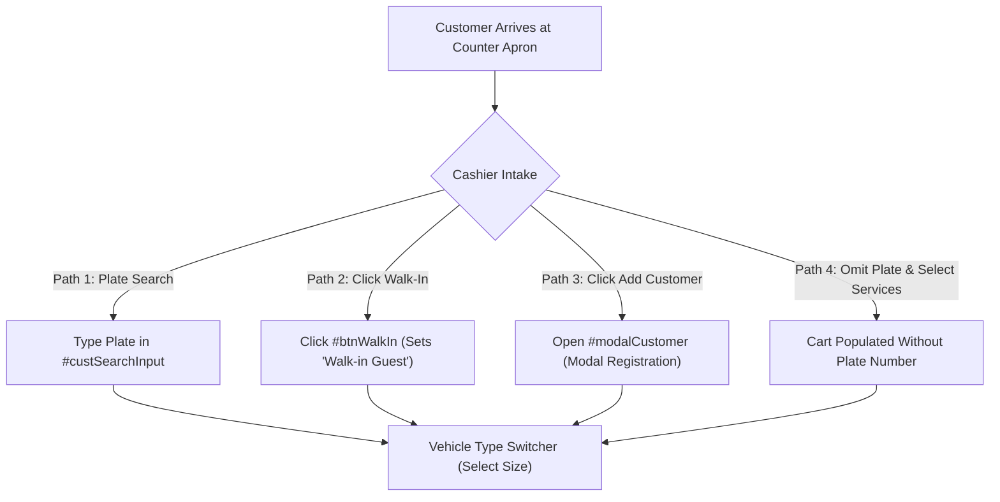
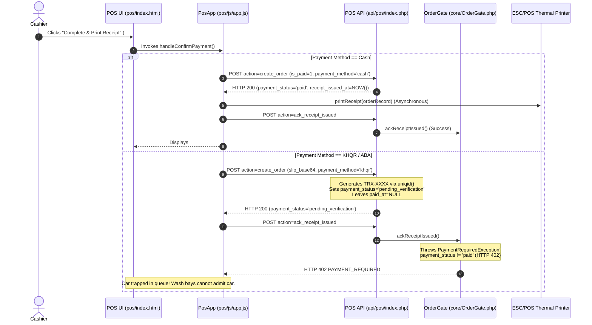
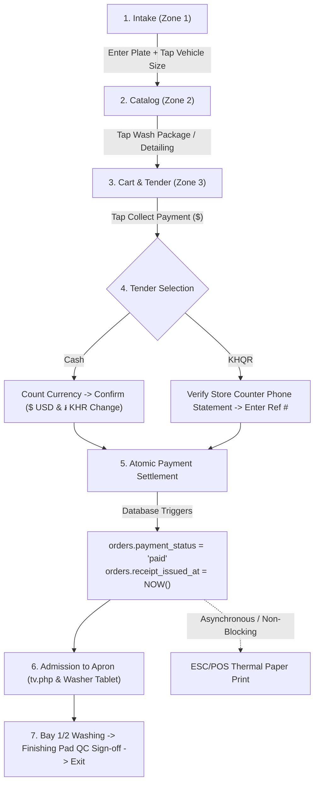

# Phase 1: POS Workflow & UI/UX Audit Report
**Car-WashService Point-of-Sale (POS), Dispatch & Back-Office Operational Audit**

* **Document ID:** AUD-POS-2026-PHASE1
* **Project:** Car-WashService (Local Shop Server & Counter Terminal)
* **Author:** Principal Systems Architect & Senior QA Lead
* **Date:** November 9, 2026
* **Status:** Complete Audit & Redesign Specification — **AWAITING USER APPROVAL PRIOR TO IMPLEMENTATION**
* **Governing Documents:**
  * [`POS-FINAL-BUSINESS-RULES.md`](file:///C:/xampp/htdocs/Car-WashService/POS-FINAL-BUSINESS-RULES.md) (Authoritative Corporate Business Rules)
  * [`POS-BUSINESS-RULES-OPEN-QUESTIONS.md`](file:///C:/xampp/htdocs/Car-WashService/POS-BUSINESS-RULES-OPEN-QUESTIONS.md) (Executive Decisions & Technical Dependency Registry)
  * [`ROUND-18.1-ARCHITECTURE-CORRECTIONS.md`](file:///C:/xampp/htdocs/Car-WashService/ROUND-18.1-ARCHITECTURE-CORRECTIONS.md) through [`ROUND-18.5-FINAL-TRANSITION-AUDIT-CONSISTENCY.md`](file:///C:/xampp/htdocs/Car-WashService/ROUND-18.5-FINAL-TRANSITION-AUDIT-CONSISTENCY.md)

---

## Executive Summary

This Phase 1 audit provides a comprehensive, forensic evaluation of the Point-of-Sale (POS) cashier workflow, apron service admission, job dispatching, and role-based user interfaces across the `Car-WashService` codebase. The audit was conducted strictly in **read-only mode**: no application source files, database records, test databases, or Git tracking structures were mutated.

### Core Audit Verdict
The existing codebase contains robust security foundations (CSRF guards, fine-grained RBAC permissions, LAN-first asset bundling, ESC/POS thermal rasterization, and hard payment gates in [`core/OrderGate.php`](file:///C:/xampp/htdocs/Car-WashService/core/OrderGate.php)). However, the **live cashier workflow suffers from critical business-rule non-compliances, UI flow interruptions, and operational traps**:
1. **Pay Later Is Still Active:** The cashier interface provides a prominent "Pay Later" button ([`pos/index.html#L706`](file:///C:/xampp/htdocs/Car-WashService/pos/index.html#L706)) and backend handler ([`pos/js/app.js#L5854`](file:///C:/xampp/htdocs/Car-WashService/pos/js/app.js#L5854)) that admits unpaid vehicles into the queue (`is_paid = 0`, `payment_status = 'unpaid'`).
2. **The "Pending Verification" Deadlock:** For digital tenders (KHQR / ABA), the cashier UI demands a camera photo of the customer's phone slip ([`pos/index.html#L1616`](file:///C:/xampp/htdocs/Car-WashService/pos/index.html#L1616), [`pos/js/app.js#L5644`](file:///C:/xampp/htdocs/Car-WashService/pos/js/app.js#L5644)), generates synthetic reference codes (`TRX-` in [`api/pos/index.php#L2018`](file:///C:/xampp/htdocs/Car-WashService/api/pos/index.php#L2018)), and marks the order as `payment_status = 'pending_verification'`. Consequently, electronic receipt issuance is blocked with `HTTP 402` ([`core/OrderGate.php#L98`](file:///C:/xampp/htdocs/Car-WashService/core/OrderGate.php#L98)), trapping the vehicle at the counter apron.
3. **UI Duplication & Late Validation Interruptions:** Duty washers and mechanics are selected twice (in the cart details accordion and again inside the payment modal). Furthermore, if a cashier fails to enter a license plate upfront, they can complete cart building, pricing, and tender selection, only to be abruptly interrupted by a blocking modal popup ([`modalPromptPlate`](file:///C:/xampp/htdocs/Car-WashService/pos/index.html#L2845)) at the final moment of checkout.
4. **Service Sequencing Inconsistencies:** While [`core/BayManager.php#L566`](file:///C:/xampp/htdocs/Car-WashService/core/BayManager.php#L566) correctly orders mixed services as **Lift First (Bay 4) $\rightarrow$ Wash Second (Bay 1/2)**, residual messages ([`core/BayManager.php#L1933`](file:///C:/xampp/htdocs/Car-WashService/core/BayManager.php#L1933)) and UI buttons in [`views/mechanic/jobs.php#L65`](file:///C:/xampp/htdocs/Car-WashService/views/mechanic/jobs.php#L65) and [`views/owner/bays_queue.php#L131`](file:///C:/xampp/htdocs/Car-WashService/views/owner/bays_queue.php#L131) still reference the legacy `receive_from_wash` flow.
5. **Reporting Distortions:** The executive financial reporting engine ([`views/owner/reports.php#L75`](file:///C:/xampp/htdocs/Car-WashService/views/owner/reports.php#L75)) filters orders using `WHERE o.status = 'paid'` instead of `WHERE o.payment_status = 'paid'`, assumes missing cost of goods sold (COGS) is $0.00, and lacks the mandated "Historical Unreconciled Exceptions" tab.

This report establishes the baseline evidence, categorizes all discrepancies, and presents a complete, role-based redesign plan for executive review.

---

## 1. Review of Business-Rule Documents & Open Decisions

A comparative cross-audit of all strategic and architectural governance documents was conducted to isolate confirmed policies from historical drafts and open technical dependencies.

### 1.1 Authoritative Status vs. Superseded Documents
* **[`POS-FINAL-BUSINESS-RULES.md`](file:///C:/xampp/htdocs/Car-WashService/POS-FINAL-BUSINESS-RULES.md):** The **sole authoritative operational policy specification**, incorporating the six executive decisions confirmed by the business owner on November 8, 2026.
* **[`BUSINESS-DECISIONS-REQUIRED.md`](file:///C:/xampp/htdocs/Car-WashService/BUSINESS-DECISIONS-REQUIRED.md):** **Superseded draft.** Proposed "Option C: Service-Tiered Hybrid" (Pay Later on exit for detailing/mechanic jobs). This option was **explicitly rejected** by Owner Decision 2, which permanently removed Pay Later in favor of mandatory upfront payment ("Payment Before Service").
* **[`CURRENT-VS-RECOMMENDED-WORKFLOW.md`](file:///C:/xampp/htdocs/Car-WashService/CURRENT-VS-RECOMMENDED-WORKFLOW.md) / [`POS-CASHIER-WORKFLOW-AUDIT.md`](file:///C:/xampp/htdocs/Car-WashService/POS-CASHIER-WORKFLOW-AUDIT.md):** Earlier review drafts with an option lettering discrepancy (Option A vs. Option B regarding Lift-First vs. Wash-First). Clarified definitively in [`POS-BUSINESS-RULES-OPEN-QUESTIONS.md#L30`](file:///C:/xampp/htdocs/Car-WashService/POS-BUSINESS-RULES-OPEN-QUESTIONS.md#L30): **Lift First $\rightarrow$ Wash Second is the approved corporate standard**.

### 1.2 Unresolved Technical Dependencies (UTD Summary)
While business policies are closed, four technical design dependencies remain registered in [`POS-BUSINESS-RULES-OPEN-QUESTIONS.md`](file:///C:/xampp/htdocs/Car-WashService/POS-BUSINESS-RULES-OPEN-QUESTIONS.md) awaiting Phase 2 database schema implementation:

```
+-----------------------------------------------------------------------------------+
|                        CONFIRMED EXECUTIVE BUSINESS RULES                         |
|  1. Mixed Services Sequencing: Lift First (Bay 4) -> Wash Second (Bay 1/2)        |
|  2. Payment Gate: Confirmed Payment & Electronic Receipt Issuance Mandatory       |
|  3. Printing Independence: Physical paper receipt printing is strictly advisory   |
|  4. Walk-In Schema: Default customer_name = 'Walk-in Guest', preserve schema      |
|  5. KHQR Verification: Store counter phone notification + Soundbox (No Webhooks)  |
|  6. Financial Separation: Net Settled Revenue != Net Operating Profit             |
+-----------------------------------------------------------------------------------+
                                          |
                                          v
+-----------------------------------------------------------------------------------+
|                   UNRESOLVED TECHNICAL DESIGN DEPENDENCIES (UTD)                  |
|  - UTD-1: Historical split-payment partitioning & exception registry lifecycle     |
|  - UTD-2: Reporting timestamps (recorded_at, disbursed_at, settled_at) schema gap|
|  - UTD-3: Bank reversal state machine & payout block on timeout                   |
|  - UTD-4: Two-table digital schema (order_payments + order_digital_payments)      |
+-----------------------------------------------------------------------------------+
```

---

## 2. Actual Cashier Workflow Trace

The cashier intake and checkout workflow was traced across HTML templates, CSS classes, JavaScript handlers in [`pos/js/app.js`](file:///C:/xampp/htdocs/Car-WashService/pos/js/app.js), and backend endpoints in [`api/pos/index.php`](file:///C:/xampp/htdocs/Car-WashService/api/pos/index.php).

### 2.1 Trace: Customer & Vehicle Intake (Zone 1)

* **Step 1:** Cashier enters vehicle license plate into `#custSearchInput` ([`pos/index.html#L383`](file:///C:/xampp/htdocs/Car-WashService/pos/index.html#L383)) or clicks "Walk-in Guest" (`#btnWalkIn` at line 421) or "Add Customer" (`#btnOpenNewCustomerModal` at line 425).
* **Step 2:** Cashier clicks one of four vehicle category buttons (`motorbike`, `small_car`, `suv_pickup`, `van_truck`) in `.vehicle-type-switcher` ([`pos/index.html#L451-472`](file:///C:/xampp/htdocs/Car-WashService/pos/index.html#L451-472)).
* **Defect Observed:** Plate number entry is **not enforced upfront in Zone 1**. If a cashier skips plate entry, the system allows them to browse services, select products, and proceed to checkout. When they click tender or Pay Later, the UI abruptly halts and launches a modal prompt ([`modalPromptPlate`](file:///C:/xampp/htdocs/Car-WashService/pos/index.html#L2845), [`pos/js/app.js#L5663`](file:///C:/xampp/htdocs/Car-WashService/pos/js/app.js#L5663)), creating jarring friction.

### 2.2 Trace: Service Catalog, Add-ons & Cart Configuration (Zone 2 & Zone 3)
* **Step 3:** Cashier selects services from `.catalog-grid` ([`pos/index.html#L495`](file:///C:/xampp/htdocs/Car-WashService/pos/index.html#L495)) filtered by `.category-vertical-sidebar` ([`pos/index.html#L501`](file:///C:/xampp/htdocs/Car-WashService/pos/index.html#L501)).
* **Step 4:** Cart calculates prices dynamically using the cached vehicle pricing matrix in `PosStorage`.
* **Step 5 (Optional Details):** Cashier opens collapsible details accordion `#cartServiceDetailsAccordion` ([`pos/index.html#L602-660`](file:///C:/xampp/htdocs/Car-WashService/pos/index.html#L602-660)) to assign `#cartWasherSelect`, `#cartMechanicSelect`, vehicle mileage, next oil change interval, and repair notes.
* **Step 6 (Discount):** If a discount is requested, clicking `#btnCartPillDiscount` opens `#modalDiscount` ([`pos/index.html#L2755`](file:///C:/xampp/htdocs/Car-WashService/pos/index.html#L2755)). If the cashier lacks `pos.discount`, inline Manager PIN authorization is required via `#modalManagerPin` ([`pos/index.html#L3045`](file:///C:/xampp/htdocs/Car-WashService/pos/index.html#L3045)).

### 2.3 Trace: Checkout & Payment Modal (`#modalPayment`)
When the cashier clicks `#btnOpenCheckout` ([`pos/index.html#L723`](file:///C:/xampp/htdocs/Car-WashService/pos/index.html#L723)), `#modalPayment` ([`pos/index.html#L1501-1671`](file:///C:/xampp/htdocs/Car-WashService/pos/index.html#L1501-1671)) opens:
* **Zone 3A: Tender Tabs:**
  * **Tab 1: Cash (`#payPaneCash`):** Cashier enters tendered currency or taps quick bills ($5, $10, $20, $50, $100, 20,000៛, 50,000៛). Change due is calculated in USD and KHR.
  * **Tab 2: ABA Pay (`#payPaneAba`):** Displays merchant account number and text input `#abaRefInput`.
  * **Tab 3: KHQR Scan (`#payPaneKhqr`):** Displays dynamic/static KHQR code for the customer to scan.
* **Defect Observed (Duplicated Crew Inputs):** Inside `#modalPayment` ([`pos/index.html#L1640-1660`](file:///C:/xampp/htdocs/Car-WashService/pos/index.html#L1640-1660)), `#selectDutyWasher` and `#selectDutyMechanic` are presented **again**, duplicating the inputs already present in the cart details accordion.
* **Defect Observed (Mandatory Slip Photo Upload):** Under `#bankSlipUploadContainer` ([`pos/index.html#L1616-1636`](file:///C:/xampp/htdocs/Car-WashService/pos/index.html#L1616-1636)), ABA and KHQR checkouts **require** taking or attaching a camera photo of the bank transfer slip (`SLIP_REQUIRED` in [`pos/js/app.js#L5644`](file:///C:/xampp/htdocs/Car-WashService/pos/js/app.js#L5644)). If omitted, checkout is blocked by a browser alert.

### 2.4 Trace: Submission, Service Gate & Printer Trigger


### 2.5 Trace: Legacy Pay Later Bypass
Alongside standard checkout, the cart action pills row features `#btnPayLater` ([`pos/index.html#L706`](file:///C:/xampp/htdocs/Car-WashService/pos/index.html#L706)). Clicking it invokes `handlePayLaterOrder()` ([`pos/js/app.js#L5854`](file:///C:/xampp/htdocs/Car-WashService/pos/js/app.js#L5854)):
* Submits `is_paid = 0`, `status = 'waiting'`, `payment_status = 'unpaid'`, `payment_method = 'unpaid'`.
* Backend records an unpaid ticket in the database.
* The car is pushed into the queue without payment.
* When apron washers attempt to start the job, [`core/OrderGate.php#L160`](file:///C:/xampp/htdocs/Car-WashService/core/OrderGate.php#L160) throws `PaymentRequiredException`, halting work on the vehicle.

---

## 3. Review of Role-Based Interfaces

| Role | Primary Interface Files | Current Operational State | Ergonomic & Workflow Defects Identified |
| :--- | :--- | :--- | :--- |
| **Cashier** | [`pos/index.html`](file:///C:/xampp/htdocs/Car-WashService/pos/index.html)<br>[`pos/js/app.js`](file:///C:/xampp/htdocs/Car-WashService/pos/js/app.js)<br>[`views/cashier/pos.php`](file:///C:/xampp/htdocs/Car-WashService/views/cashier/pos.php)<br>[`views/cashier/shift.php`](file:///C:/xampp/htdocs/Car-WashService/views/cashier/shift.php) | Dual implementations: Modern SPA (`pos/`) and legacy PHP script (`views/cashier/pos.php`). | 1. Prominent "Pay Later" button contradicts corporate policy.<br>2. 25+ overlapping modal windows create high cognitive load.<br>3. Bank slip photo requirement causes camera permission errors and delays.<br>4. Duplicated crew assignment in cart and payment modal.<br>5. Legacy `pos.php` creates all orders unpaid by default ([`views/cashier/pos.php#L242`](file:///C:/xampp/htdocs/Car-WashService/views/cashier/pos.php#L242)). |
| **Washer** | [`views/washer/jobs.php`](file:///C:/xampp/htdocs/Car-WashService/views/washer/jobs.php)<br>[`pos/index.html#viewWasher`](file:///C:/xampp/htdocs/Car-WashService/pos/index.html#L1216) | Tablet web view with assigned orders, commissions, and "Start/Finish Wash" actions. | 1. If an unpaid order is admitted via Pay Later, washer is blocked with a cryptic `PAYMENT_REQUIRED` error.<br>2. Washers mark cars complete without independent quality control (QC) inspection.<br>3. POS `#viewWasher` contains desktop topbar elements inappropriate for rugged shop-floor tablets. |
| **Mechanic** | [`views/mechanic/jobs.php`](file:///C:/xampp/htdocs/Car-WashService/views/mechanic/jobs.php)<br>[`pos/index.html#viewMechanic`](file:///C:/xampp/htdocs/Car-WashService/pos/index.html#L1277) | Task list, guided inspection checklist, oil usage adjuster, and parts request. | 1. Contains outdated `receive_from_wash` action ([`views/mechanic/jobs.php#L65`](file:///C:/xampp/htdocs/Car-WashService/views/mechanic/jobs.php#L65)), assuming wash precedes mechanical work.<br>2. Admitting cars checks `OrderGate`, which fails if digital payment is in `pending_verification`. |
| **Supervisor** | [`views/owner/bays_queue.php`](file:///C:/xampp/htdocs/Car-WashService/views/owner/bays_queue.php)<br>[`pos/index.html#viewQueue`](file:///C:/xampp/htdocs/Car-WashService/pos/index.html#L750) | Live visual bay board (Bays 1–4), queue reordering, and finish car handling. | 1. Line 61 comments state *"Bay becomes Free & order is 'Ready to pay'"*, retaining the pre-decision post-pay mindset.<br>2. Still includes `receive_from_wash` action ([`views/owner/bays_queue.php#L131`](file:///C:/xampp/htdocs/Car-WashService/views/owner/bays_queue.php#L131)).<br>3. Lacks a dedicated 4-point Finishing Pad QC Sign-off Gate. |
| **Manager / Owner** | [`views/owner/dashboard.php`](file:///C:/xampp/htdocs/Car-WashService/views/owner/dashboard.php)<br>[`views/owner/reports.php`](file:///C:/xampp/htdocs/Car-WashService/views/owner/reports.php)<br>[`views/orders/index.php`](file:///C:/xampp/htdocs/Car-WashService/views/orders/index.php) | Financial reports, live dashboard widgets, order management, and slip verification. | 1. [`reports.php#L75`](file:///C:/xampp/htdocs/Car-WashService/views/owner/reports.php#L75) calculates Gross Revenue via `WHERE o.status = 'paid'`, excluding in-progress paid orders.<br>2. COGS assumes $0.00 when cost data is missing, falsifying operating profit.<br>3. No separation between Net Settled Revenue and Net Operating Profit.<br>4. No "Historical Unreconciled Exceptions" tab. |

---

## 4. Source Evidence of Problems Found

The following table provides verified file paths and line numbers for all identified defects, distinguishing verified source findings from architectural assumptions:

| Issue ID | Severity | File Path & Line Reference | Nature of Finding | Source Code Evidence & Description |
| :--- | :---: | :--- | :---: | :--- |
| **ISS-01** | **Critical** | [`pos/index.html#L706-709`](file:///C:/xampp/htdocs/Car-WashService/pos/index.html#L706-L709)<br>[`pos/js/app.js#L5854-5950`](file:///C:/xampp/htdocs/Car-WashService/pos/js/app.js#L5854-L5950) | **Verified** | **Active Pay Later Button & Flow:** `<button id="btnPayLater">` submits orders with `is_paid = 0, status = 'waiting', payment_status = 'unpaid'`. Directly violates Corporate Rule 2.2 and Owner Decision 2. |
| **ISS-02** | **Critical** | [`api/pos/index.php#L2038-2069`](file:///C:/xampp/htdocs/Car-WashService/api/pos/index.php#L2038-L2069)<br>[`core/OrderGate.php#L98-100`](file:///C:/xampp/htdocs/Car-WashService/core/OrderGate.php#L98-L100) | **Verified** | **Digital Payment Receipt Deadlock:** Backend forces `payment_status = 'pending_verification'` and sets `paid_at = null` for ABA/KHQR checkouts. When client acknowledges receipt, `OrderGate::ackReceiptIssued()` throws `PaymentRequiredException` (HTTP 402), leaving `receipt_issued_at` NULL and permanently blocking service admission. |
| **ISS-03** | **Critical** | [`api/pos/index.php#L2018`](file:///C:/xampp/htdocs/Car-WashService/api/pos/index.php#L2018) | **Verified** | **Synthetic Bank Reference Generation:** `$paymentRef = 'TRX-' . strtoupper(substr(md5(uniqid()), 0, 8));` invents synthetic bank codes when empty, corrupting bank reconciliation ledgers and violating Rule 3.2. |
| **ISS-04** | **High** | [`pos/index.html#L1616-1636`](file:///C:/xampp/htdocs/Car-WashService/pos/index.html#L1616-L1636)<br>[`pos/js/app.js#L5644-5650`](file:///C:/xampp/htdocs/Car-WashService/pos/js/app.js#L5644-L5650) | **Verified** | **Mandatory Customer Phone Slip Upload:** UI demands camera slip photo (`bankSlipUploadContainer`), halting counter intake with an alert if missing. Violates Rule 3.2 (customer smartphone screens rejected; verification is on store merchant devices). |
| **ISS-05** | **High** | [`views/cashier/pos.php#L242-243`](file:///C:/xampp/htdocs/Car-WashService/views/cashier/pos.php#L242-L243) | **Verified** | **Legacy POS Creates Orders Unpaid:** `INSERT INTO orders ... VALUES (..., 'unpaid', 'unpaid', ...)`. Legacy cashier screen has zero upfront payment integration. |
| **ISS-06** | **High** | [`views/owner/reports.php#L75`](file:///C:/xampp/htdocs/Car-WashService/views/owner/reports.php#L75)<br>[`views/owner/reports.php#L137`](file:///C:/xampp/htdocs/Car-WashService/views/owner/reports.php#L137) | **Verified** | **Revenue Query & COGS Distortion:** Report filters `WHERE o.status = 'paid'`, omitting paid orders in `washing` or `finished` status. Furthermore, missing COGS defaults to $0.00 (`COALESCE(p.cost_price_usd, 0)`), violating Rule 5.1 and Rule 6. |
| **ISS-07** | **Medium** | [`pos/index.html#L613-625`](file:///C:/xampp/htdocs/Car-WashService/pos/index.html#L613-L625)<br>[`pos/index.html#L1640-1660`](file:///C:/xampp/htdocs/Car-WashService/pos/index.html#L1640-L1660) | **Verified** | **Duplicated Crew Assignment:** Washer and mechanic selectors appear both in the cart details accordion (`#cartWasherSelect`, `#cartMechanicSelect`) and inside `#modalPayment` (`#selectDutyWasher`, `#selectDutyMechanic`). |
| **ISS-08** | **Medium** | [`pos/index.html#L2845-2895`](file:///C:/xampp/htdocs/Car-WashService/pos/index.html#L2845-L2895)<br>[`pos/js/app.js#L5663-5680`](file:///C:/xampp/htdocs/Car-WashService/pos/js/app.js#L5663-L5680) | **Verified** | **Late Plate Entry Modal Interruption:** Omitting license plate upfront is permitted during intake, but clicking tender triggers a disruptive popup `#modalPromptPlate` interrupting the cashier at the final step. |
| **ISS-09** | **Medium** | [`core/BayManager.php#L1933`](file:///C:/xampp/htdocs/Car-WashService/core/BayManager.php#L1933)<br>[`views/mechanic/jobs.php#L65`](file:///C:/xampp/htdocs/Car-WashService/views/mechanic/jobs.php#L65)<br>[`views/owner/bays_queue.php#L131`](file:///C:/xampp/htdocs/Car-WashService/views/owner/bays_queue.php#L131) | **Verified** | **Residual Wash-First Messaging & Action:** `receive_from_wash` buttons and error string `"Sequence Rule: Car Wash step is not finished yet. Technician cannot receive this car"` contradict the approved Lift-First sequencing policy. |
| **ISS-10** | **Low** | [`pos/index.html#L1665-1670`](file:///C:/xampp/htdocs/Car-WashService/pos/index.html#L1665-L1670) | **Verified** | **Misleading "Pay & Print" Label:** Primary button labeled *"បង់ប្រាក់ & បោះពុម្ព"* (Pay & Print) falsely implies physical printing is coupled to financial settlement. |

---

## 5. Business-Rule Compliance Gap Analysis

```
+------------------------------------+--------------------------+-------------------------------------+
| CORPORATE BUSINESS RULE            | EXISTING IMPLEMENTATION  | COMPLIANCE STATUS & ROOT CAUSE      |
+------------------------------------+--------------------------+-------------------------------------+
| Rule 2.1: Optional Walk-in Intake  | Preserves schema;        | PARTIALLY COMPLIANT                 |
| (Plate mandatory, Name optional)   | Defaults 'Walk-in Guest' | Plate entry interrupted at checkout |
+------------------------------------+--------------------------+-------------------------------------+
| Rule 2.2: Mandatory Upfront Pay    | Active #btnPayLater;     | NON-COMPLIANT                       |
| ("Payment Before Service")         | handlePayLaterOrder()    | Pay Later active across POS & API   |
+------------------------------------+--------------------------+-------------------------------------+
| Rule 2.3: Idempotency Protection   | UUID v4 idempotency_key  | FULLY COMPLIANT                     |
| (Duplicate order prevention)       | checked in backend       | Successfully deduplicates retries   |
+------------------------------------+--------------------------+-------------------------------------+
| Rule 2.4: Printing Independence    | OrderGate checks receipt | PARTIALLY COMPLIANT                 |
| (Advisory paper, Electronic gate)  | UI couples Pay & Print   | Pending verification blocks ack     |
+------------------------------------+--------------------------+-------------------------------------+
| Rule 3.1: Cash Dual-Currency       | Sufficient tender check; | FULLY COMPLIANT                     |
| (Change in USD and KHR)            | Dual change displayed    | Accurate exchange math & drawer kick|
+------------------------------------+--------------------------+-------------------------------------+
| Rule 3.2: Anti-Fraud KHQR          | Camera slip photo upload;| NON-COMPLIANT                       |
| (Merchant phone statement + chime) | Synthetic TRX- generated | Violates device verification rules  |
+------------------------------------+--------------------------+-------------------------------------+
| Rule 4.1-4.4: Refund State Machine | No refund state machine; | NON-COMPLIANT                       |
| (Discrete ledger & timeout lock)   | No order_refunds table   | Deferred to Phase 2 schema design   |
+------------------------------------+--------------------------+-------------------------------------+
| Rule 5.1-5.4: Accounting Standards | Reports use status='paid'| NON-COMPLIANT                       |
| (Net Revenue != Operating Profit)  | Missing COGS defaults $0 | Distorts executive financial reports|
+------------------------------------+--------------------------+-------------------------------------+
| Rule 7.2: Mixed Order Sequencing   | BayManager sets Bay 4 1st| PARTIALLY COMPLIANT                 |
| (Lift First -> Wash Second)        | UI has receive_from_wash | Residual legacy code in views       |
+------------------------------------+--------------------------+-------------------------------------+
```

---

## 6. Recommended Future-State Workflows

### 6.1 Standard Wash-Only Order Workflow


### 6.2 Mechanical / Lube-Only Order Workflow
* **Intake:** Cashier captures plate, vehicle category, current odometer mileage, and oil service item.
* **Payment:** 100% upfront payment confirmed via Cash or verified KHQR. Electronic receipt stamped.
* **Dispatch:** Assigned directly to **Bay 4 (Hydraulic Lift / Pit)**.
* **Execution:** Mechanic performs fluid drain, oil filter replacement, and inspection. Mechanic logs actual oil volume in [`views/mechanic/jobs.php`](file:///C:/xampp/htdocs/Car-WashService/views/mechanic/jobs.php).
* **Handover:** Supervisor signs off on work; customer departs.

### 6.3 Mixed Service Order Workflow (Owner Decision 1: Lift First $\rightarrow$ Wash Second)

```mermaid
stateDiagram-v2
    [*] --> Intake_Paid: Cashier Confirms Upfront Payment (orders.payment_status = 'paid')
    Intake_Paid --> Bay4_Mechanical: Step 1 (Bay 4 Lift Claimed; Wash Bay Deferred)

    state Bay4_Mechanical {
        [*] --> Under_Lube_Service: Hot Oil Drain & Filter Replacement
        Under_Lube_Service --> Tech_Signoff: Mechanic Logs Actual Liters & Taps Complete
        Tech_Signoff --> [*]
    }

    Bay4_Mechanical --> Wash_Queue_Priority: Step 1 Completed -> Auto-Promoted to Head of Wash Queue
    Wash_Queue_Priority --> Bay1_2_Wash: Step 2 (Claim Free Wash Bay 1 or 2)

    state Bay1_2_Wash {
        [*] --> Exterior_Wash: Foam Wash & Undercarriage Rinse
        Exterior_Wash --> Drying_Pad: Hand Wipe-down & Interior Vacuum
        Drying_Pad --> [*]
    }

    Bay1_2_Wash --> Finishing_QC: Supervisor 4-Point Inspection
    Finishing_QC --> Customer_Handover: Clean Car Handed Over (Zero Oil Smudges)
    Customer_Handover --> [*]
```


---

## 7. Proposed Role-Based UI/UX Redesign Plans

### 7.1 Cashier Counter POS Layout (Streamlined Single-Page Architecture)
To eliminate clutter, remove Pay Later, and ensure sub-30-second checkout, the cashier interface is reorganized into a clean 3-zone layout:

```
+---------------------------------------------------------------------------------------------------------+
|                                    ZONE 1: INTAKE & APRON STATUS STRIP                                  |
| [ Plate: 2BC-1234 ]  ( Small Car ) [ SUV/Pickup ] ( Van/Truck ) ( Moto ) | Bay 1: [BUSY] Bay 4: [FREE] |
+--------------------------------------------------------------------+------------------------------------+
| ZONE 2: FAST TOUCH CATALOG (TABS: Wash | Lube | Detail | Care)     | ZONE 3: CART, TOTALS & DIRECT PAY  |
| +---------------------+ +---------------------+ +----------------+ | Current Customer: Walk-in Guest    |
| | Standard Foam Wash  | | Premium Wax Package | | Oil 5W-30 Full | | Plate: 2BC-1234 (SUV/Pickup)       |
| | $7.00 / 28,700 ៛   | | $15.00 / 61,500 ៛   | | $25.00 / 102k  | | -------------------------------- |
| +---------------------+ +---------------------+ +----------------+ | 1x Standard Foam Wash       $7.00  |
| +---------------------+ +---------------------+ +----------------+ | 1x Premium Wax             $15.00  |
| | Engine Oil Change   | | Ceramic Shield      | | Air Freshener  | | -------------------------------- |
| | $20.00 / 82,000 ៛   | | $45.00 / 184,500 ៛  | | $2.50 / 10,250 ៛| Subtotal:                    $22.00|
| +---------------------+ +---------------------+ +----------------+ | Total KHR:                90,200 ៛ |
|                                                                    | [ Discount ]  [ Clear Cart ]       |
|                                                                    | ================================== |
|                                                                    | [ COLLECT PAYMENT ($22.00) ]       |
|                                                                    | (Pay Later permanently removed)    |
+--------------------------------------------------------------------+------------------------------------+
```

#### Streamlined Payment Dialog (Clean Modal)
* **Tab 1: Cash:**
  * Numeric tender input auto-focused.
  * Quick-tender buttons ($5, $10, $20, $50, $100, 20,000៛, 50,000៛) and "Exact Cash".
  * Dual-currency change display rendered in high-contrast 26pt bold emerald typography.
* **Tab 2: KHQR (Anti-Fraud Lan Architecture):**
  * Dynamic EMVCo QR code display with 300-second countdown timer.
  * Explicit instruction: *"Verify credit in store counter phone banking app"*.
  * Text input: `Genuine Bank Transaction Ref #` (captured directly from counter phone/soundbox).
  * Link: *"Investigate Late Transfer"* (Rule 3.2 Investigate-First workflow).
  * **Removed:** Camera bank slip photo upload and synthetic `TRX-` generator.
* **Primary Checkout Action Button:**
  * Label: *"Confirm Payment & Admit Vehicle"* (replaces *"Pay & Print"*).
  * Automatically records payment, stamps `receipt_issued_at = NOW()`, emits cash drawer pulse, queues asynchronous thermal print, and dispatches the car to the apron.

### 7.2 Wash Supervisor Interface (Apron & QC Gatekeeper)
* **Live Bay Monitor:** Visual cards for Bay 1, 2, 3 (Wash) and Bay 4 (Lift) displaying plate, elapsed timer, and assigned technicians.
* **Admitted Paid Queue Column:** Shows vehicles with confirmed payment awaiting bay entry.
* **Finishing Pad Quality Control (QC) Gate:**
  * When washers finish cleaning, the car moves to the "Finishing Pad" column.
  * Supervisor inspects 4 physical touchpoints: (1) Rims & tire shine, (2) Windshield & mirrors, (3) Vacuum & mats, (4) Door jambs.
  * Tapping **"QC Pass & Notify Customer"** triggers the customer TV chime (`tv.php`), notifies the waiting lounge, and archives the order.

### 7.3 Washer Tablet Interface (Bay Companion)
* **Single Active Task Card:** Prominently displays the vehicle plate, vehicle size, and wash package checklist items (e.g. Foam, Undercarriage Spray, Wax).
* **Two Simple Touch Actions:**
  * Button 1: *"Start Wash"* (gates on electronic receipt; transitions bay to busy).
  * Button 2: *"Send to Finishing Pad (QC)"* (releases bay, notifies supervisor).
* **Personal Commission Tracker:** Small footer widget showing today's completed wash count and earned commission balance ($).

### 7.4 Mechanic Tablet Interface (Bay 4 Lift Companion)
* **Active Mechanical Work Order:** Dedicated to Bay 4 Lift.
* **Stage 1 Checklist:** Engine oil drain, filter replacement, inspection points.
* **Actual Oil Usage Field:** Direct input for liters consumed (updates inventory stock ledger).
* **Multi-Stage Handoff Action:** Single button: *"Complete Lift & Route to Wash Bay"*. Automatically moves vehicle to the head of the wash queue.

### 7.5 Manager & Owner Reports Interface
* **Two Distinct Executive KPIs:**
  1. **Net Settled Revenue:** Gross confirmed payments minus settled refunds.
  2. **Net Operating Profit:** Net Settled Revenue minus (COGS + Commissions + Logged Expenses).
* **Untracked Cost Alert:** If services or parts lack cost records, flags an informational banner with the count of untracked items rather than assuming $0.00 COGS.
* **Historical Unreconciled Exceptions Tab:** Dedicated audit workspace isolating pre-cutover unverified orders for manual owner review, write-off sign-off, or CPA adjustments.

---

## 8. Backend Changes Required (Specification Only)

The following backend refactoring requirements are identified for implementation during Phase 2 (subject to separate authorization):

### 8.1 API Refactoring ([`api/pos/index.php`](file:///C:/xampp/htdocs/Car-WashService/api/pos/index.php))
1. **Deprecate Pay Later:** Remove `is_paid = 0` handling in `action=create_order`. Reject unpaid submissions with `HTTP 422 PAYMENT_REQUIRED`.
2. **Decommission `pay_order` Action:** Remove post-service payment endpoints from standard counter cashier permissions.
3. **Remove Bank Slip Requirement:** Remove `SLIP_REQUIRED` file upload validation and directory storage in counter checkout.
4. **Eliminate Synthetic `TRX-`:** Prohibit `uniqid()` fallback. Enforce mandatory capture of genuine `payment_ref` for KHQR.
5. **Atomic Service Admission Trigger:** Ensure `create_order` atomically sets `orders.payment_status = 'paid'`, `orders.paid_at = NOW()`, and `orders.receipt_issued_at = NOW()`.

### 8.2 Service Gate Refactoring ([`core/OrderGate.php`](file:///C:/xampp/htdocs/Car-WashService/core/OrderGate.php))
1. Maintain `assertServiceAdmissible()` requiring `orders.payment_status === 'paid'` and `orders.receipt_issued_at IS NOT NULL`.
2. Ensure thermal paper printer errors never roll back transactions or block service entry.

### 8.3 Dispatch & Sequencing Refactoring ([`core/BayManager.php`](file:///C:/xampp/htdocs/Car-WashService/core/BayManager.php))
1. Purge residual wash-first error messages (e.g. line 1933).
2. Decommission legacy `receive_from_wash` endpoints across all views.
3. Ensure completing Stage 1 in Bay 4 automatically promotes the vehicle to Priority Queue status for Stage 2 wash bays.

### 8.4 Financial Reporting Refactoring ([`views/owner/reports.php`](file:///C:/xampp/htdocs/Car-WashService/views/owner/reports.php))
1. Update revenue queries from `WHERE o.status = 'paid'` to `WHERE o.payment_status = 'paid'`.
2. Implement two-tier temporal partitioning at $T_{\text{ledger\_cutover}}$ (Round 18.5).
3. Introduce Untracked Cost warning logic.
4. Construct the "Historical Unreconciled Exceptions" tab.

---

## 9. Testing Recommendations

Following approved audit and redesign sign-off, implementation should be verified across three distinct testing tiers:

### Tier 1: Unit & API Contract Tests (Automated)
* **Idempotency Verification:** Transmitting identical `idempotency_key` multiple times must return HTTP 200 with `is_duplicate = true` and zero duplicate ledger rows.
* **Upfront Payment Hard Gate:** Submitting `create_order` with `is_paid = 0` or empty payment payload must return HTTP 422 `PAYMENT_REQUIRED`.
* **Bank Reference Format Validation:** Submitting digital payments with synthetic or empty reference codes must be rejected.
* **Service Gate Contract:** Calling `OrderGate::assertServiceAdmissible()` on unpaid orders must throw `PaymentRequiredException`.

### Tier 2: Real Browser Integration Tests (Playwright Chromium)
* **Express Wash Flow:** Walk-in intake $\rightarrow$ vehicle size selection $\rightarrow$ cash tender $\rightarrow$ dual-currency change display $\rightarrow$ electronic receipt stamped $\rightarrow$ Bay 1 assignment.
* **Printer Jam Resilience:** Simulate thermal printer disconnect; verify order completes, electronic receipt is issued, and vehicle enters wash bay without delay.
* **Mixed Service Routing:** Checkout order with lube service + car wash $\rightarrow$ verify Bay 4 Lift claims car first $\rightarrow$ finish lube $\rightarrow$ verify car appears at head of wash bay queue.
* **Late KHQR Transfer Investigation:** Expire 300s timer $\rightarrow$ enter genuine bank reference from merchant statement $\rightarrow$ verify successful reconciliation.

### Tier 3: Operational Shop-Floor Smoke Tests
* **Soundbox & Smartphone Audit:** Verify cashier matches counter smartphone push alerts with POS screen totals before confirming tender.
* **Finishing Pad QC Inspection:** Verify supervisor 4-point inspection checklist before vehicle release.
* **Shift Close Out:** Verify physical drawer cash matches Net Settled Cash totals exactly.

---

## 10. Prioritized Issue & Task Matrix

| Item | Focus Area | Description | Priority | Target Phase |
| :-: | :--- | :--- | :---: | :-: |
| **P1** | **Cashier UI** | Remove `#btnPayLater` and decommission `handlePayLaterOrder()` | **Critical** | Phase 1 Redesign |
| **P2** | **Digital Payment** | Eliminate camera slip upload requirement and synthetic `TRX-` references; capture genuine bank `payment_ref` | **Critical** | Phase 1 Redesign |
| **P3** | **Service Admission** | Fix `pending_verification` deadlock; ensure electronic receipt stamps immediately upon tender confirmation | **Critical** | Phase 1 Redesign |
| **P4** | **Intake UX** | Move license plate and vehicle size selection to mandatory upfront Zone 1 inputs; eliminate interrupting modal prompt | **High** | Phase 1 Redesign |
| **P5** | **UI Deduplication** | Remove duplicate duty washer and mechanic selectors from `#modalPayment` | **High** | Phase 1 Redesign |
| **P6** | **Apron Dispatch** | Purge legacy `receive_from_wash` actions and align all views with Lift First $\rightarrow$ Wash Second | **High** | Phase 1 Redesign |
| **P7** | **Executive Reports** | Fix `reports.php` revenue query (`payment_status = 'paid'`), add Missing COGS Alert, and build Exceptions Tab | **Medium** | Phase 2 Back Office |
| **P8** | **Thermal Printing** | Update checkout button label to *"Confirm Payment & Admit Vehicle"* to decouple paper printing from service pass | **Low** | Phase 1 Redesign |

---

## 11. Sign-off & Governance Boundary

* **Phase:** Phase 1 — POS Workflow & UI/UX Audit
* **Audit Execution:** Completed (Read-Only)
* **Code Modifications:** None (0 lines modified, 0 database writes, 0 git mutations)
* **Next Action:** **Awaiting User Review and Approval of this Audit & Redesign Specification prior to implementing any code or interface changes.**
