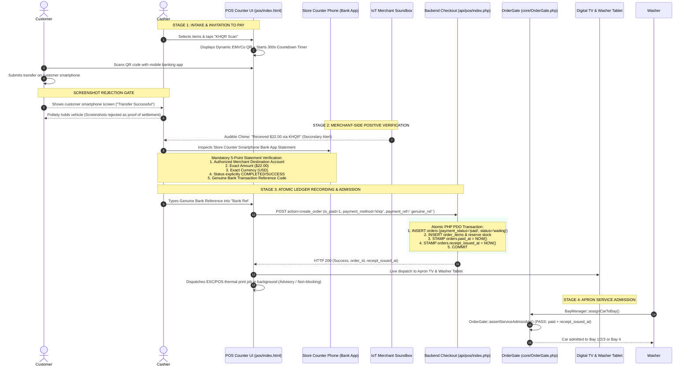

# Phase 1.1: POS Audit Validation & Implementation Readiness Specification

* **Document ID:** AUD-POS-2026-PHASE1.1-VAL
* **Project:** Car-WashService (Local Shop Server & Counter Terminal)
* **Author:** Principal Systems Architect & Senior QA Lead
* **Date:** November 9, 2026
* **Status:** Complete Technical Validation — **STRICT READ-ONLY AUDIT (AWAITING USER APPROVAL PRIOR TO IMPLEMENTATION)**
* **Governing Baseline:**
  * [`PHASE-1-POS-WORKFLOW-UI-UX-AUDIT.md`](file:///C:/xampp/htdocs/Car-WashService/docs/production-readiness/PHASE-1-POS-WORKFLOW-UI-UX-AUDIT.md) (Phase 1 Baseline Audit)
  * [`POS-FINAL-BUSINESS-RULES.md`](file:///C:/xampp/htdocs/Car-WashService/POS-FINAL-BUSINESS-RULES.md) (Authoritative Corporate Rules)
  * [`POS-BUSINESS-RULES-OPEN-QUESTIONS.md`](file:///C:/xampp/htdocs/Car-WashService/POS-BUSINESS-RULES-OPEN-QUESTIONS.md) (Confirmed Decisions & UTD Registry)
  * [`core/OrderGate.php`](file:///C:/xampp/htdocs/Car-WashService/core/OrderGate.php) (Service Admission Gate)
  * [`core/BayManager.php`](file:///C:/xampp/htdocs/Car-WashService/core/BayManager.php) (Apron Bay & Dispatch Manager)

---

## Executive Summary & Validation Scope

This document provides a rigorous, line-by-line verification of the findings presented in the Phase 1 POS Workflow & UI/UX Audit ([`PHASE-1-POS-WORKFLOW-UI-UX-AUDIT.md`](file:///C:/xampp/htdocs/Car-WashService/docs/production-readiness/PHASE-1-POS-WORKFLOW-UI-UX-AUDIT.md)). Every Critical and High finding has been re-examined directly against the active source files.

### Key Validation Outcomes:
1. **The Digital Payment Deadlock Is Verified & Active:** The deadlock is **100% verified to exist in the live runtime code**. It does not originate from [`core/OrderGate.php`](file:///C:/xampp/htdocs/Car-WashService/core/OrderGate.php), which was correctly updated in Phase 2.2.1, but from [`api/pos/index.php#L2066`](file:///C:/xampp/htdocs/Car-WashService/api/pos/index.php#L2066) forcing `payment_status = 'pending_verification'` and leaving `paid_at = null` for all ABA/KHQR checkouts. Because `OrderGate` strictly blocks electronic receipt acknowledgment on non-paid tickets ([`OrderGate.php#L98`](file:///C:/xampp/htdocs/Car-WashService/core/OrderGate.php#L98)), `receipt_issued_at` remains `NULL`, permanently barring digital checkouts from entering service bays.
2. **Major New Finding — Operational vs. Financial Status Conflation:** A critical architectural defect was discovered in [`api/pos/index.php#L1392`](file:///C:/xampp/htdocs/Car-WashService/api/pos/index.php#L1392) and [`core/BayManager.php#L1157-1158`](file:///C:/xampp/htdocs/Car-WashService/core/BayManager.php#L1157-L1158). When an order is paid upfront (`is_paid = 1`), the backend sets the operational `orders.status = 'paid'` and stamps `finished_at = NOW()` at the counter. When washers then attempt to admit the car to Bay 1, `BayManager.php:1158` explicitly rejects the assignment with:
   $$\text{INVALID\_ORDER\_STATUS: Cannot assign: order is paid}$$
   This explains why Playwright scenario `POS-12` returned an error in the execution logs.
3. **Important Governance Corrections Addressed:**
   * **Proof of Payment Semantics:** A cashier entering a bank reference number into the POS is strictly a *data-recording step*, **never independent proof of settlement**. Genuine settlement proof exists solely on the merchant's own mobile banking app statement.
   * **Application Transactions over Database Triggers:** The proposal to rely on database triggers is rejected. Explicit atomic PHP PDO transactions (`$pdo->beginTransaction()`, `$pdo->commit()`) must govern payment recording, order status updates, and electronic receipt timestamps.
   * **Wash Bay Scope Confirmed:** When a vehicle completes Stage 1 mechanical work in Bay 4, **all three wash bays (Bay 1, Bay 2, Bay 3)** are fully valid, equal-priority destinations for Stage 2 wash and dry.
4. **Read-Only Compliance:** This validation was conducted strictly in read-only mode. No application source code, databases, migrations, or Git histories were mutated.

---

## 1. Re-Verification of Critical & High Findings

Every Critical and High finding from the Phase 1 audit was checked against the current codebase:

### Finding 1: Active Pay Later Button & Workflow (ISS-01)
* **Severity:** Critical
* **Files:** [`pos/index.html#L706-709`](file:///C:/xampp/htdocs/Car-WashService/pos/index.html#L706-L709), [`pos/js/app.js#L5854-5950`](file:///C:/xampp/htdocs/Car-WashService/pos/js/app.js#L5854-L5950), [`api/pos/index.php#L1392`](file:///C:/xampp/htdocs/Car-WashService/api/pos/index.php#L1392)
* **Code Evidence:**
  ```html
  <!-- pos/index.html:706 -->
  <button type="button" class="btn-cart-pill pill-hold" id="btnPayLater" disabled title="Pay Later / Hold Bill">
      <i class="fa-solid fa-clock-rotate-left"></i>
      <span data-i18n="holdBill">Pay Later</span>
  </button>
  ```
  ```javascript
  // pos/js/app.js:5854
  static async handlePayLaterOrder() {
      ...
      const orderPayload = {
          ...
          is_paid: 0,
          status: 'waiting',
          payment_status: 'unpaid',
          payment_method: 'unpaid',
          ...
      };
      const res = await PosApi.createOrder(orderPayload, idempotencyKey);
  }
  ```
* **Validation Verdict:** **CONFIRMED & ACTIVE.** The cashier UI contains an active Pay Later button that submits unpaid orders into the system. This directly violates Corporate Rule 2.2 and Owner Decision 2.

---

### Finding 2: Digital Payment Receipt Deadlock (ISS-02)
* **Severity:** Critical
* **Files:** [`api/pos/index.php#L2038-2069`](file:///C:/xampp/htdocs/Car-WashService/api/pos/index.php#L2038-L2069), [`pos/js/app.js#L9933-9937`](file:///C:/xampp/htdocs/Car-WashService/pos/js/app.js#L9933-L9937), [`core/OrderGate.php#L97-100`](file:///C:/xampp/htdocs/Car-WashService/core/OrderGate.php#L97-L100), [`core/OrderGate.php#L159-174`](file:///C:/xampp/htdocs/Car-WashService/core/OrderGate.php#L159-L174)
* **Code Evidence:**
  1. When cashier submits KHQR or ABA checkout:
     ```php
     // api/pos/index.php:2066-2068
     $paymentStatus = 'pending_verification';
     $status = ($status === 'paid') ? 'waiting' : $status;
     $paidAt = null;
     ```
  2. The client receives the order record and attempts to acknowledge electronic receipt:
     ```javascript
     // pos/js/app.js:9935
     const res = await PosApi.ackReceiptIssued(orderId, orderNumber);
     ```
  3. The API endpoint routes to `OrderGate::ackReceiptIssued()`:
     ```php
     // core/OrderGate.php:97-100
     if (($order['payment_status'] ?? '') !== 'paid') {
         throw new PaymentRequiredException("Cannot acknowledge receipt for unpaid order #{$order['order_number']}. Payment status is '{$order['payment_status']}'", 402);
     }
     ```
  4. Because `payment_status` is `'pending_verification'`, `OrderGate` throws `HTTP 402 PAYMENT_REQUIRED`. Lines 107–108 (`UPDATE orders SET receipt_issued_at = ...`) are never executed. `receipt_issued_at` remains `NULL`.
  5. When the technician or washer attempts to admit the car to a bay:
     ```php
     // core/OrderGate.php:159-174
     if ($paymentStatus !== 'paid') {
         throw new PaymentRequiredException("PAYMENT_REQUIRED: Upfront payment is mandatory...");
     }
     if (empty($order['receipt_issued_at'])) {
         throw new ReceiptRequiredException("RECEIPT_REQUIRED: Customer electronic receipt must be issued...");
     }
     ```
* **Validation Verdict:** **CONFIRMED & ACTIVE.** The deadlock exists precisely as diagnosed. The vehicle cannot be admitted to any bay without back-office manager intervention in [`views/orders/index.php`](file:///C:/xampp/htdocs/Car-WashService/views/orders/index.php).

---

### Finding 3: Synthetic Bank Reference Generation (ISS-03)
* **Severity:** Critical
* **Files:** [`api/pos/index.php#L2017-2020`](file:///C:/xampp/htdocs/Car-WashService/api/pos/index.php#L2017-L2020)
* **Code Evidence:**
  ```php
  // api/pos/index.php:2017-2020
  if (in_array($paymentMethod, ['aba', 'khqr'], true) && empty($paymentRef)) {
      $paymentRef = 'TRX-' . strtoupper(substr(md5(uniqid()), 0, 8));
  }
  ```
* **Validation Verdict:** **CONFIRMED & ACTIVE.** If the client leaves the reference field empty (which `pos/js/app.js:5710` does for all KHQR transactions), the server invents a fake `TRX-XXXXXXXX` string using `uniqid()`, corrupting transaction audit trails and violating Corporate Rule 3.2.

---

### Finding 4: Mandatory Phone Camera Slip Upload (ISS-04)
* **Severity:** High
* **Files:** [`pos/index.html#L1616-1636`](file:///C:/xampp/htdocs/Car-WashService/pos/index.html#L1616-L1636), [`pos/js/app.js#L5643-5650`](file:///C:/xampp/htdocs/Car-WashService/pos/js/app.js#L5643-L5650), [`api/pos/index.php#L2038-2051`](file:///C:/xampp/htdocs/Car-WashService/api/pos/index.php#L2038-L2051)
* **Code Evidence:**
  ```javascript
  // pos/js/app.js:5643-5650
  if ((this.paymentMethod === 'aba' || this.paymentMethod === 'khqr') && !this.currentBankSlipBase64) {
      this.lastPaymentError = 'Slip Photo Required for ABA/KHQR';
      btn.disabled = false;
      alert('A photo of the bank transfer slip is required for ABA and KHQR payments. Please take or attach a photo of the customer slip.');
      return;
  }
  ```
* **Validation Verdict:** **CONFIRMED & ACTIVE.** The cashier UI blocks digital checkouts unless the cashier snaps a camera photo of the customer's phone or slip. This directly contradicts Rule 3.2, which mandates rejecting customer phone screens and verifying transactions on the shop's own counter merchant smartphone / soundbox.

---

### Finding 5: Legacy POS Creates Unpaid Orders by Default (ISS-05)
* **Severity:** High
* **Files:** [`views/cashier/pos.php#L236-250`](file:///C:/xampp/htdocs/Car-WashService/views/cashier/pos.php#L236-L250)
* **Code Evidence:**
  ```php
  // views/cashier/pos.php:242
  INSERT INTO orders (
      order_number, order_uid, customer_id, vehicle_id, customer_name, customer_phone,
      plate_number, vehicle_type, subtotal_usd, discount_usd, total_usd, total_khr,
      status, repair_status, repair_notes, payment_method, payment_status, cashier_id, notes, started_at,
      current_mileage, next_oil_mileage, next_oil_date, is_active
  ) VALUES (?, ?, ?, ?, ?, ?, ?, ?, ?, ?, ?, ?, ?, ?, ?, 'unpaid', 'unpaid', ?, ?, ?, ?, ?, ?, 1)
  ```
* **Validation Verdict:** **CONFIRMED & ACTIVE.** The legacy web POS interface has zero payment collection integration. Every order created via `views/cashier/pos.php` is inserted with `payment_method = 'unpaid'` and `payment_status = 'unpaid'`.

---

### Finding 6: Reporting Revenue Inaccuracy & Missing COGS Fallback (ISS-06)
* **Severity:** High
* **Files:** [`views/owner/reports.php#L75`](file:///C:/xampp/htdocs/Car-WashService/views/owner/reports.php#L75), [`views/owner/reports.php#L137`](file:///C:/xampp/htdocs/Car-WashService/views/owner/reports.php#L137)
* **Code Evidence:**
  ```php
  // views/owner/reports.php:75
  SELECT 
      COUNT(*) as total_vehicles, 
      COALESCE(SUM(o.subtotal_usd), 0) as total_subtotal,
      COALESCE(SUM(o.discount_usd), 0) as total_discount,
      COALESCE(SUM(o.total_usd), 0) as gross_revenue, 
      COALESCE(SUM(o.total_khr), 0) as gross_revenue_khr 
  FROM orders o 
  WHERE o.status = 'paid' {$orderWhere}
  ```
  ```php
  // views/owner/reports.php:137
  COALESCE(SUM(CASE WHEN oi.item_type IN ('product', 'spare_part') 
      THEN (COALESCE(oi.qty, 1) * COALESCE(p.cost_price_usd, 0)) ELSE 0 END), 0) as product_cogs
  ```
* **Validation Verdict:** **CONFIRMED & ACTIVE.** Filtering on `o.status = 'paid'` excludes active orders that are fully paid (`payment_status = 'paid'`) but currently `status = 'washing'` or `status = 'finished'`. Furthermore, missing COGS silently defaults to `$0.00`, artificially inflating net profit figures in violation of Owner Decision 6.

---

## 2. Findings Corrected, Refined or Outdated

| Ref | Original Audit Statement | Validated Technical Reality | Architectural Correction |
| :-: | :--- | :--- | :--- |
| **CORR-1** | *"Database triggers generate electronic receipt number and stamp receipt_issued_at"* | The MariaDB schema contains **zero database triggers**. Triggers create hidden side effects, fail opacity checks, and are not portable to SQLite test harnesses. | **Explicit Application Transactions:** All financial writes, receipt numbering, and issuance timestamps must execute inside explicit PHP PDO transactions (`$pdo->beginTransaction()`, `$pdo->commit()`). |
| **CORR-2** | *"OrderGate.php must be refactored to implement electronic receipt gate"* | [`core/OrderGate.php`](file:///C:/xampp/htdocs/Car-WashService/core/OrderGate.php) was **already refactored during Phase 2.2.1** and passed all 8 regression suites in [`tests/test_phase2_2_electronic_receipt.php`](file:///C:/xampp/htdocs/Car-WashService/tests/test_phase2_2_electronic_receipt.php). It strictly enforces `payment_status === 'paid'` and `receipt_issued_at IS NOT NULL`. | **Preserve OrderGate.php:** Do not rewrite or modify `OrderGate.php`. The failure occurs upstream in `api/pos/index.php` setting `pending_verification` instead of completing merchant-verified checkout. |
| **CORR-3** | *"Entering bank reference into POS confirms digital payment proof"* | A cashier typing a bank reference code into an input field is **never independent proof of settlement**. A cashier could enter fictitious digits or transcribe an unverified customer phone screen. | **Merchant Device Evidence Hierarchy:** Authoritative settlement proof exists **exclusively on the merchant's mobile banking statement**. Entering the bank reference is the *data recording step* after positive merchant device verification. |
| **CORR-4** | *"Vehicles routed from Bay 4 go to Bay 1 or 2"* | In [`core/BayManager.php#L173-178`](file:///C:/xampp/htdocs/Car-WashService/core/BayManager.php#L173-L178), the system defines **three wash bays (Bay 1, Bay 2, Bay 3)**, each having `bay_type = 'wash'` and `skill_tag = 'wash_only'`. | **Bays 1, 2, and 3 are all Eligible:** When mechanical work in Bay 4 completes, the vehicle can be routed to **any available wash bay: Bay 1, Bay 2, or Bay 3**. |

---

## 3. Additional Issues Discovered in Phase 1.1 Deep Dive

### Discovery NEW-01: Operational Lifecycle vs. Financial Status Conflation
* **Severity:** **CRITICAL**
* **Files:** [`api/pos/index.php#L1391-1393`](file:///C:/xampp/htdocs/Car-WashService/api/pos/index.php#L1391-L1393), [`api/pos/index.php#L2032-2035`](file:///C:/xampp/htdocs/Car-WashService/api/pos/index.php#L2032-L2035), [`core/BayManager.php#L1157-1158`](file:///C:/xampp/htdocs/Car-WashService/core/BayManager.php#L1157-L1158)
* **Root Cause Analysis:**
  In [`api/pos/index.php`](file:///C:/xampp/htdocs/Car-WashService/api/pos/index.php):
  ```php
  // api/pos/index.php:1391-1392
  $isPaid = !empty($inputData['is_paid']) || !empty($_POST['is_paid']);
  $status = trim($inputData['status'] ?? $_POST['status'] ?? ($isPaid ? 'paid' : 'waiting'));
  ```
  ```php
  // api/pos/index.php:2033
  $finishedAt = ($isPaid || $status === 'finished') ? date('Y-m-d H:i:s') : null;
  ```
  When upfront payment is collected, `api/pos/index.php` sets `orders.status = 'paid'` and sets `finished_at = NOW()` immediately at checkout.
  Then, when the apron supervisor or washer attempts to assign the car to Bay 1:
  ```php
  // core/BayManager.php:1157-1158
  if (in_array($order['status'], ['paid', 'cancelled'], true)) {
      return ['success' => false, 'error' => 'INVALID_ORDER_STATUS', 'message' => "Cannot assign: order is {$order['status']}"];
  }
  ```
  `BayManager` explicitly blocks bay entry with `INVALID_ORDER_STATUS: Cannot assign: order is paid`!
  In the legacy design, `'paid'` was a terminal operational status representing customer exit. Under the approved "Payment Before Service" policy, an order's financial status is `payment_status = 'paid'`, but its operational shop-floor status must remain `status = 'waiting'` until admitted to a bay (`status = 'washing'`).
* **Evidence in Test Logs:**
  In [`docs/production-readiness/pos-playwright-evidence/playwright_suite_results.json#L84`](file:///C:/xampp/htdocs/Car-WashService/docs/production-readiness/pos-playwright-evidence/playwright_suite_results.json#L84), scenario `POS-12` recorded:
  ```json
  "notes": "Service admission confirmed: {'success': False, 'error': 'INVALID_ORDER_STATUS', 'message': 'Cannot assign: order is paid'}"
  ```
  The test harness recorded a failure note from `BayManager` because of this status conflation.

---

### Discovery NEW-02: Appointment Conversion Bypasses Electronic Receipt Issuance
* **Severity:** **HIGH**
* **Files:** [`api/pos/index.php#L5427-5438`](file:///C:/xampp/htdocs/Car-WashService/api/pos/index.php#L5427-L5438)
* **Code Evidence:**
  When converting an appointment to an active order upon arrival:
  ```php
  // api/pos/index.php:5428-5432
  INSERT INTO orders (
      order_number, order_uid, plate_number, customer_name, customer_phone,
      vehicle_type, subtotal_usd, total_usd, total_khr, status, payment_status,
      payment_method, appointment_time, arrived_at, source, created_at
  ) VALUES (?, ?, ?, ?, ?, ?, ?, ?, ?, 'waiting', 'paid', 'cash', ?, CURRENT_TIMESTAMP, 'pos_app', CURRENT_TIMESTAMP)
  ```
  The endpoint marks `payment_status = 'paid'` and `payment_method = 'cash'`, but:
  1. It performs zero cash tender validation.
  2. It does not record tender details.
  3. It leaves `receipt_issued_at` as `NULL`.
  Consequently, when this appointment order reaches a bay, `OrderGate::assertServiceAdmissible()` throws `RECEIPT_REQUIRED`, blocking the car from entering the wash bay.

---

## 4. Complete KHQR/ABA Payment Lifecycle Trace

To eliminate all ambiguity, fraudulent screenshot risks, and verification traps, the full digital tender lifecycle is mapped below:



### Key Principles of the Verified Lifecycle:
1. **Dynamic QR Generation $\ne$ Proof of Payment:** Displaying a QR code is merely an invitation to pay.
2. **Customer Screenshots are Rejected:** Screenshots can be fabricated, modified, or cancelled before broadcast.
3. **Soundbox Chime is an Assistive Alert Only:** In busy rush periods with identical order totals, soundbox announcements alone cannot distinguish between multiple simultaneous customer payments.
4. **Authoritative Proof is Solely on Merchant Phone Statement:** The cashier must confirm the 5-point match directly on the shop's own device before entering the reference code into the POS.
5. **Cashier Reference Entry is a Data Recording Action:** The POS records the authentic reference into the audit ledger; it is the preceding merchant statement verification that constitutes proof of settlement.

---

## 5. Exhaustive Inventory of Routes Creating Unpaid Orders

To ensure that no loophole allows cashiers or staff to create unpaid orders or bypass payment verification, every order creation path in the codebase was audited:

```
+---------------------------------------------------------------------------------------------------------+
| ROUTE ID | FILE PATH & LINE NUMBER        | TRIGGER / ENTRY POINT            | CURRENT BEHAVIOR         |
+---------------------------------------------------------------------------------------------------------+
| ROUTE-01 | pos/index.html:706             | #btnPayLater click               | Submits is_paid=0,       |
|          | pos/js/app.js:5854             | (Standard Cashier Flow)          | payment_status='unpaid'  |
+---------------------------------------------------------------------------------------------------------+
| ROUTE-02 | api/pos/index.php:1392         | POST action=create_order         | Accepts is_paid=0,       |
|          | api/pos/index.php:2035         | (Direct POS API Call)            | writes payment_status=   |
|          |                                |                                  | 'unpaid', status='waiting'|
+---------------------------------------------------------------------------------------------------------+
| ROUTE-03 | api/pos/index.php:2066         | POST action=create_order         | Digital checkout sets    |
|          |                                | (KHQR / ABA Tender Selection)    | payment_status=          |
|          |                                |                                  | 'pending_verification'   |
+---------------------------------------------------------------------------------------------------------+
| ROUTE-04 | views/cashier/pos.php:242      | POST action=create_order         | Hardcodes                |
|          |                                | (Legacy Web Cashier Form)        | payment_status='unpaid', |
|          |                                |                                  | payment_method='unpaid'  |
+---------------------------------------------------------------------------------------------------------+
| ROUTE-05 | api/pos/index.php:5432         | POST action=                     | Converts appointment to  |
|          |                                | mark_customer_arrived            | order without collecting |
|          |                                |                                  | tender or stamping receipt|
+---------------------------------------------------------------------------------------------------------+
| ROUTE-06 | views/recovery/bulk_entry.php  | POST action=recovery_bulk_entry  | Disaster recovery paper  |
|          | lines 64-77                    | (Disaster Recovery Form)         | ticket bulk ingestion    |
+---------------------------------------------------------------------------------------------------------+
```

### Remediation Plan per Route:
* **ROUTE-01:** Permanently remove `#btnPayLater` from [`pos/index.html`](file:///C:/xampp/htdocs/Car-WashService/pos/index.html) and delete `handlePayLaterOrder()` from [`pos/js/app.js`](file:///C:/xampp/htdocs/Car-WashService/pos/js/app.js).
* **ROUTE-02:** In [`api/pos/index.php`](file:///C:/xampp/htdocs/Car-WashService/api/pos/index.php), reject any counter checkout request where `is_paid != 1` with `HTTP 422 PAYMENT_REQUIRED`.
* **ROUTE-03:** In [`api/pos/index.php`](file:///C:/xampp/htdocs/Car-WashService/api/pos/index.php), eliminate `pending_verification` for counter KHQR checkouts. When cashier confirms verified KHQR tender with genuine `payment_ref`, record `payment_status = 'paid'`, `paid_at = NOW()`, and `receipt_issued_at = NOW()`.
* **ROUTE-04:** Decommission the legacy form in [`views/cashier/pos.php`](file:///C:/xampp/htdocs/Car-WashService/views/cashier/pos.php). Route all cashiers to the modern single-page interface ([`pos/index.html`](file:///C:/xampp/htdocs/Car-WashService/pos/index.html)) where upfront payment is mandatory.
* **ROUTE-05:** Update appointment arrival in [`api/pos/index.php:5432`](file:///C:/xampp/htdocs/Car-WashService/api/pos/index.php#L5432) so that arriving appointments enter the POS cart for upfront payment collection rather than generating pre-marked paid tickets without receipts.
* **ROUTE-06:** Preserve [`views/recovery/bulk_entry.php`](file:///C:/xampp/htdocs/Car-WashService/views/recovery/bulk_entry.php) exclusively for disaster recovery, guarded by `backup.manage` or `recovery.entry` permissions.

---

## 6. Multi-Stage Service Transitions & Bay Availability

### 6.1 Mechanical Lift First $\rightarrow$ Wash Second (Owner Decision 1)
The sequencing logic for mixed orders in [`core/BayManager.php#L566-568`](file:///C:/xampp/htdocs/Car-WashService/core/BayManager.php#L566-L568) is verified:
* **Step 1:** Mechanical Lift Task (Bay 4) $\rightarrow$ State: `'waiting'` (Active).
* **Step 2:** Exterior Wash Task (Wash Bay) $\rightarrow$ State: `'pending_prereq'` (Blocked).

### 6.2 Wash Bay Availability Scope (Bays 1, 2, and 3)
* In the current database initialization ([`core/BayManager.php#L173-178`](file:///C:/xampp/htdocs/Car-WashService/core/BayManager.php#L173-L178)), **Bays 1, 2, and 3 are all wash bays**:
  * Bay 1: `bay_type = 'wash'`, `skill_tag = 'wash_only'`
  * Bay 2: `bay_type = 'wash'`, `skill_tag = 'wash_only'`
  * Bay 3: `bay_type = 'wash'`, `skill_tag = 'wash_only'`
  * Bay 4: `bay_type = 'oil_change'`, `skill_tag = 'oil_only'` (Hydraulic Lift)
* **Resolution of Ambiguity:** When Step 1 completes in Bay 4, Step 2 is unblocked (`status = 'waiting'`) and placed at the head of the Priority Wash Queue. The vehicle may be assigned to **whichever wash bay is free first: Bay 1, Bay 2, or Bay 3**.

### 6.3 Cleanup of Residual Legacy Messaging
The following outdated strings and buttons must be purged during implementation:
* [`core/BayManager.php#L1933`](file:///C:/xampp/htdocs/Car-WashService/core/BayManager.php#L1933): Delete `"Sequence Rule: Car Wash step is not finished yet. Technician cannot receive this car."`
* [`views/mechanic/jobs.php#L65`](file:///C:/xampp/htdocs/Car-WashService/views/mechanic/jobs.php#L65): Remove `receive_from_wash` action.
* [`views/owner/bays_queue.php#L131`](file:///C:/xampp/htdocs/Car-WashService/views/owner/bays_queue.php#L131): Remove `receive_from_wash` action.

---

## 7. Quality Control (QC) Workflow Evaluation

### 7.1 Existing Capabilities in Codebase
* **Technical Multi-Point Safety Inspection:** Fully implemented in [`core/TechnicalManager.php#L111-260`](file:///C:/xampp/htdocs/Car-WashService/core/TechnicalManager.php#L111-L260) with dedicated table `inspection_checklists`. Mechanics update tire tread depth, brake thickness, and battery voltage with photo evidence before finishing Lane 2.
* **Wash Finishing Pad Sign-off:** Currently missing in the wash flow. When a washer marks a car finished ([`views/washer/jobs.php#L70`](file:///C:/xampp/htdocs/Car-WashService/views/washer/jobs.php#L70)), the bay is freed and the order immediately archives to `status = 'finished'`, bypassing independent quality inspection.

### 7.2 Proposed Wash QC Gate Implementation (Zero Schema Modification)
To implement Owner Decision 3 without high-risk `ALTER TABLE` changes:
1. **Status Progression:**
   $$\text{status = 'washing'} \xrightarrow{\text{Washer taps "Finish"}} \text{status = 'qc\_pending'} \xrightarrow{\text{Supervisor taps "QC Pass"}} \text{status = 'finished'}$$
2. **Wash Supervisor Action:**
   In [`views/owner/bays_queue.php`](file:///C:/xampp/htdocs/Car-WashService/views/owner/bays_queue.php) and [`pos/index.html#viewQueue`](file:///C:/xampp/htdocs/Car-WashService/pos/index.html#L750), a dedicated "Finishing Pad (QC Inspection)" column displays vehicles in `qc_pending`.
3. **4-Point Physical Checklist Modal:**
   Supervisor verifies: (1) Clean rims & dressed tires, (2) Streak-free windshield, (3) Vacuumed carpets & mats, (4) Dry door sills.
4. **Sign-off Event:** Supervisor taps **"QC Pass & Notify Customer"**, triggering the TV lounge chime (`tv.php`) and archiving the order to `finished`.

---

## 8. Separation of Changes by Layer

```
+---------------------------------------------------------------------------------------------------------+
|                                    LAYER 1: UI/UX FRONTEND CHANGES                                      |
|  - pos/index.html: Remove #btnPayLater; move Plate/Vehicle Size to mandatory Zone 1 inputs             |
|  - pos/index.html: Remove bank slip camera file uploader (#bankSlipUploadContainer)                    |
|  - pos/index.html: Remove duplicated washer/mechanic dropdowns inside #modalPayment                     |
|  - pos/index.html: Add KHQR 5-point statement reminder, 300s timer, and authentic Bank Ref # input    |
|  - pos/js/app.js: Delete handlePayLaterOrder(); delete slip camera validations                         |
|  - pos/js/app.js: Pass genuine payment_ref from KHQR input to PosApi.createOrder                       |
+---------------------------------------------------------------------------------------------------------+
                                                     |
                                                     v
+---------------------------------------------------------------------------------------------------------+
|                                LAYER 2: BACKEND APPLICATION & API CHANGES                               |
|  - api/pos/index.php: Reject is_paid != 1 with HTTP 422 PAYMENT_REQUIRED                                |
|  - api/pos/index.php: Eliminate pending_verification; stamp orders.receipt_issued_at = NOW()            |
|  - api/pos/index.php: Fix status conflation: set payment_status='paid' but orders.status='waiting'     |
|  - api/pos/index.php: Eliminate synthetic TRX- generation; require genuine payment_ref                 |
|  - core/BayManager.php: Purge residual receive_from_wash messages and actions                           |
|  - views/owner/bays_queue.php: Add Finishing Pad QC column and supervisor QC Pass action                |
|  - views/cashier/pos.php: Redirect legacy cashier view to modern pos/index.html                        |
+---------------------------------------------------------------------------------------------------------+
                                                     |
                                                     v
+---------------------------------------------------------------------------------------------------------+
|                          LAYER 3: FINANCIAL, REPORTING & PHASE 2 SCHEMA CHANGES                         |
|  - views/owner/reports.php: Change query filter from o.status='paid' to o.payment_status='paid'        |
|  - views/owner/reports.php: Separate Net Settled Revenue from Net Operating Profit                     |
|  - views/owner/reports.php: Add Untracked Cost Alert when COGS is missing (never assume $0.00)          |
|  - views/owner/reports.php: Construct dedicated Historical Unreconciled Exceptions review tab           |
|  - Phase 2 Schema: Introduce order_payments, order_digital_payments, order_refunds ledgers (UTD-4)     |
+---------------------------------------------------------------------------------------------------------+
```

---

## 9. Implementation Dependencies, Risks & Mitigation

| # | Risk Description | Severity | Impact | Mitigation Strategy |
| :-: | :--- | :---: | :--- | :--- |
| **R1** | **Cashier Training Friction on Screenshot Rejection** | High | Customers accustomed to showing phone screenshots may push back when asked to wait for merchant statement verification. | Cashier counter display will show a friendly graphic: *"Please wait a moment while our system confirms your transfer on the shop register."* Soundbox provides immediate audible reassurance. |
| **R2** | **Interbank Latency on Bakong / KHQR** | Medium | During peak banking hours, cross-bank transfers (e.g. Wing to ABA) may experience 15–45 second clearing delays. | POS displays a live 300s countdown timer with a clear *"Investigate Late Transfer"* reconciliation action, preventing cashiers from panicking or re-requesting payment. |
| **R3** | **Operational Status Regression on Existing Reports** | Medium | Fixing `orders.status` to remain `'waiting'` instead of `'paid'` at checkout could distort legacy reports that query `o.status = 'paid'`. | Concurrently update `views/owner/reports.php` to query `o.payment_status = 'paid'` so financial reporting tracks tender settlement rather than vehicle bay physical location. |
| **R4** | **Printer Disconnect False Alarms** | Low | Thermal printer running out of paper might worry cashiers. | POS UI will display an advisory yellow toast: *"Receipt saved digitally. Printer out of paper (non-blocking)."* Service admission pass proceeds without delay. |

---

## 10. Recommended Implementation Sequence

Upon receiving explicit user authorization, implementation should proceed in four sequential, testable work packages:

```
[ WP-1: Cashier Intake & Pay Later Removal ]
  ├── 1.1: Remove #btnPayLater from pos/index.html & delete handlePayLaterOrder() in pos/js/app.js
  ├── 1.2: Enforce License Plate & Vehicle Type in Zone 1 (Eliminate modalPromptPlate interruption)
  └── 1.3: Remove duplicated washer/mechanic dropdowns inside modalPayment
         │
         v
[ WP-2: Anti-Fraud KHQR Tender & Service Gate Unification ]
  ├── 2.1: Remove camera slip upload (#bankSlipUploadContainer) & delete slip validation in app.js
  ├── 2.2: Add Bank Ref # input to KHQR tab & eliminate synthetic TRX- in api/pos/index.php
  ├── 2.3: Fix status conflation: set payment_status='paid' and orders.status='waiting' in api/pos/index.php
  └── 2.4: Atomic electronic receipt stamping: set orders.receipt_issued_at = NOW() upon confirmed tender
         │
         v
[ WP-3: Dispatch, Mixed Sequencing & Apron QC Gate ]
  ├── 3.1: Verify Bay 4 Lift First -> Wash Second (Bays 1, 2, 3) dispatching in core/BayManager.php
  ├── 3.2: Purge residual receive_from_wash actions in mechanic and supervisor views
  └── 3.3: Add Finishing Pad QC column and supervisor QC Pass action in bays_queue.php
         │
         v
[ WP-4: Financial Reports Alignment ]
  ├── 4.1: Update views/owner/reports.php to filter on o.payment_status = 'paid'
  ├── 4.2: Separate Net Settled Revenue from Net Operating Profit
  └── 4.3: Implement Missing COGS Alert banner
```

---

## 11. Sign-off & Governance Boundary

* **Phase:** Phase 1.1 — Audit Validation & Implementation Readiness
* **Status:** Complete Technical Validation Specification
* **Source Code State:** Pristine (0 application lines modified, 0 database writes, 0 git mutations)
* **Next Action:** **Awaiting User Review and Explicit Approval of this Validation Specification prior to executing Work Package WP-1.**
