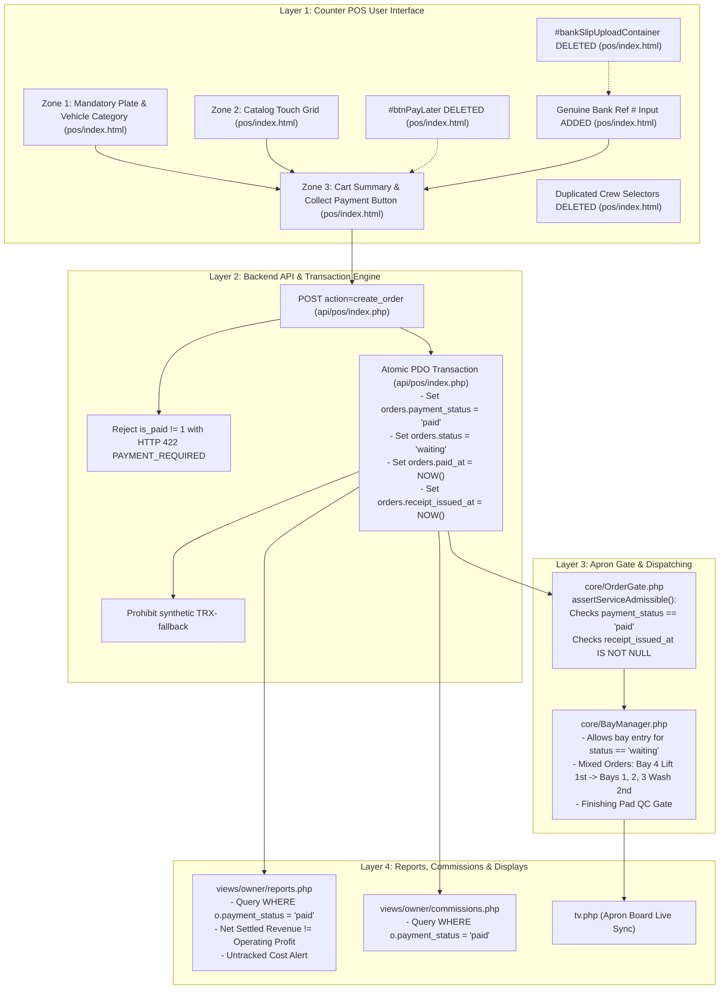

# Phase 1.2: POS Implementation Preflight Assessment & Dependency Architecture

* **Document ID:** PRE-POS-2026-PHASE1.2
* **Project:** Car-WashService (Local Shop Server & Counter Terminal)
* **Author:** Principal Systems Architect & Senior QA Lead
* **Date:** November 9, 2026
* **Status:** Complete Preflight Assessment — **STRICT READ-ONLY (AWAITING EXPLICIT USER AUTHORIZATION PRIOR TO IMPLEMENTATION)**
* **Governing Baseline:**
  * [`PHASE-1-POS-WORKFLOW-UI-UX-AUDIT.md`](file:///C:/xampp/htdocs/Car-WashService/docs/production-readiness/PHASE-1-POS-WORKFLOW-UI-UX-AUDIT.md)
  * [`PHASE-1.1-AUDIT-VALIDATION.md`](file:///C:/xampp/htdocs/Car-WashService/docs/production-readiness/PHASE-1.1-AUDIT-VALIDATION.md)
  * [`POS-FINAL-BUSINESS-RULES.md`](file:///C:/xampp/htdocs/Car-WashService/POS-FINAL-BUSINESS-RULES.md)
  * [`POS-BUSINESS-RULES-OPEN-QUESTIONS.md`](file:///C:/xampp/htdocs/Car-WashService/POS-BUSINESS-RULES-OPEN-QUESTIONS.md)
  * [`core/OrderGate.php`](file:///C:/xampp/htdocs/Car-WashService/core/OrderGate.php)
  * [`core/BayManager.php`](file:///C:/xampp/htdocs/Car-WashService/core/BayManager.php)

---

## Executive Summary

This preflight assessment establishes the technical blueprints, component dependency maps, regression test specifications, risk matrices, and rollback procedures required before initiating code changes for **Phase 1: POS Workflow & UI/UX Modernization**.

### Fundamental Preflight Discovery: The "Pay Later" Vicious Cycle
Forensic analysis of the interplay between [`api/pos/index.php#L1392`](file:///C:/xampp/htdocs/Car-WashService/api/pos/index.php#L1392) and [`core/BayManager.php#L760, L1157`](file:///C:/xampp/htdocs/Car-WashService/core/BayManager.php#L760) revealed why cashiers previously relied on "Pay Later":
1. When upfront payment was collected (`is_paid = 1`), [`api/pos/index.php:1392`](file:///C:/xampp/htdocs/Car-WashService/api/pos/index.php#L1392) prematurely stamped `orders.status = 'paid'` and `finished_at = NOW()` at the counter before the car ever reached a bay.
2. Because `orders.status` became `'paid'`, the queue query ([`core/BayManager.php#L760`](file:///C:/xampp/htdocs/Car-WashService/core/BayManager.php#L760))—which filters strictly `WHERE o.status IN ('waiting', 'washing')`—**instantly hid the car from digital queue displays and TV screens**.
3. If an apron washer attempted to manually assign the car to Bay 1, [`core/BayManager.php#L1157-1158`](file:///C:/xampp/htdocs/Car-WashService/core/BayManager.php#L1157-L1158) hard-blocked the vehicle with:
   $$\text{INVALID\_ORDER\_STATUS: Cannot assign: order is paid}$$
4. Consequently, cashiers were forced to use "Pay Later" (`is_paid = 0`) simply to keep the car visible in `status = 'waiting'` so it could enter a wash bay.

**Decoupling operational lifecycle (`orders.status`) from financial settlement (`orders.payment_status`) is the architectural linchpin of this entire implementation.**

---

## 1. Exact Source Locations & Dependencies for Critical Findings

```
+--------------------------------------------------------------------------------------------------------------------+
| FINDING ID & SEVERITY | EXACT SOURCE FILE & LINE REFERENCES        | DOWNSTREAM SYSTEM DEPENDENCIES                |
+--------------------------------------------------------------------------------------------------------------------+
| ISS-01: Critical      | pos/index.html#L706-709                    | - pos/js/app.js:1694 (DOM listener)           |
| Active Pay Later Flow | pos/js/app.js#L5854-5950                   | - pos/js/app.js:4301, 4354 (button disable)   |
|                       | api/pos/index.php#L1391-1393               | - api/pos/index.php:2035 (status assignment)  |
|                       |                                            | - OrderGate.php:160 (PAYMENT_REQUIRED trap)   |
+--------------------------------------------------------------------------------------------------------------------+
| ISS-02: Critical      | api/pos/index.php#L2066-2068               | - pos/js/app.js:5774 (receipt payload)        |
| Digital Deadlock      | pos/js/app.js#L9933-9937                   | - OrderGate.php:98 (ackReceiptIssued HTTP 402)|
|                       | core/OrderGate.php#L97-100                 | - OrderGate.php:166 (receipt_issued_at null)  |
|                       | core/OrderGate.php#L159-174                | - BayManager.php:1103 (assignCarToBay block)  |
+--------------------------------------------------------------------------------------------------------------------+
| ISS-03: Critical      | api/pos/index.php#L2017-2020               | - order_digital_payments (future Phase 2)     |
| Synthetic Reference   | views/orders/index.php#L123                | - Bank statement reconciliation reports       |
| ('TRX-XXXXXXXX')      |                                            | - AuditLogger.php:149 (corrupted audit trail) |
+--------------------------------------------------------------------------------------------------------------------+
| NEW-01: Critical      | api/pos/index.php#L1392                    | - core/BayManager.php:760 (Queue visibility)  |
| Status Conflation     | api/pos/index.php#L2033                    | - core/BayManager.php:1158 (Bay entry block)  |
| (orders.status='paid')| core/BayManager.php#L1157-1158             | - tv.php:40 (TV display badge mapping)        |
|                       |                                            | - views/owner/reports.php:75 (Gross revenue)  |
|                       |                                            | - views/owner/commissions.php:36 (Staff pay)  |
+--------------------------------------------------------------------------------------------------------------------+
```

---

## 2. Inventory of System Routes

### 2.1 Order Creation Routes
1. **POS App Direct Checkout (`POST /api/pos/index.php?action=create_order`):**
   * Triggered by `pos/js/app.js:5621` (`handleConfirmPayment`).
   * Primary modern cashier route. Must require `is_paid = 1`, `payment_status = 'paid'`, and `status = 'waiting'`.
2. **POS App Pay Later Bypass (`POST /api/pos/index.php?action=create_order`):**
   * Triggered by `pos/js/app.js:5854` (`handlePayLaterOrder`).
   * **To be eliminated:** Reject `is_paid != 1` with `HTTP 422 PAYMENT_REQUIRED`.
3. **Legacy Web POS Form (`POST /index.php?view=pos` with `action=create_order`):**
   * Handled by `views/cashier/pos.php:45-277`.
   * **To be decommissioned:** Redirect requests to `pos/index.html#pos`.
4. **Appointment Arrival Conversion (`POST /api/pos/index.php?action=mark_customer_arrived`):**
   * Handled by `api/pos/index.php:5420-5450`.
   * **To be refactored:** Convert appointment into editable POS cart for upfront cashier tender rather than auto-creating pre-marked paid tickets without receipts.
5. **Disaster Recovery Paper Ingestion (`POST /index.php?view=recovery_bulk_entry`):**
   * Handled by `views/recovery/bulk_entry.php:62-85`.
   * Preserved exclusively for disaster recovery; writes `is_recovered = 1`.

### 2.2 Payment Routes
1. **Counter Upfront Tender (`api/pos/index.php:1730-2100`):**
   * Executed atomically during `create_order` when `is_paid = 1`.
2. **Post-Service Pay Order (`POST /api/pos/index.php?action=pay_order` / `sync_order_status`):**
   * Lines 2450–2640. Deprecate from counter cashier access.
3. **Back-Office Web Payment (`POST /index.php?view=orders` with `action=process_payment`):**
   * `views/orders/index.php:35-155`. Restricted to historical exception reconciliation and manager adjustments.
4. **Bank Slip Verification (`POST /index.php?view=orders` with `action=approve_bank_transfer`):**
   * `views/orders/index.php:252-266`. Preserved for auditing historical pending slips.

### 2.3 Receipt & Printing Routes
1. **Electronic Receipt Issuance (Atomic Server-Side Write):**
   * Executed during `create_order`: `orders.receipt_issued_at = NOW()`, `orders.receipt_number = order_number`.
2. **Client Receipt Acknowledgment (`POST /api/pos/index.php?action=ack_receipt_issued`):**
   * Handled by `OrderGate::ackReceiptIssued()`. Idempotently updates timestamp if already paid.
3. **ESC/POS Thermal Direct Print (`pos/js/thermal-printer.js:27-84`):**
   * Asynchronous client-side rasterization and dispatch over LAN WebUSB/IP:9100. Strictly advisory.
4. **Web 80mm Printable Slip (`GET /index.php?view=receipt&id={id}`):**
   * `views/orders/receipt.php`. Read-only visual presentation.

### 2.4 Service Admission Routes
1. **POS Bay Assignment (`POST /api/pos/index.php?action=assign_bay`):**
   * Calls `BayManager::assignCarToBay()`, which invokes `OrderGate::assertServiceAdmissible()`.
2. **Web Bay Board Assignment (`POST /index.php?view=bays_queue` with `action=assign_bay`):**
   * Supervisor board call to `BayManager::assignCarToBay()`.
3. **Washer Start Wash (`POST /index.php?view=washer_jobs` with `action=update_status`):**
   * Washer screen call to `OrderGate::assertReceiptPrinted()` or `BayManager::assignCarToBay()`.
4. **Mechanic Start Task (`POST /index.php?view=mechanic_jobs` with `action=start_task`):**
   * Mechanic screen call to `TechnicalManager::startTask()`, gating on `OrderGate::assertReceiptPrinted()`.

---

## 3. Database Constraints & Historical Compatibility Risks

### 3.1 MariaDB Database Schema Constraints ([`database/init.php`](file:///C:/xampp/htdocs/Car-WashService/database/init.php))
* `orders.customer_name VARCHAR(100) NOT NULL`: Must never receive NULL.
  * *Compliance Rule:* Application automatically defaults empty customer names to `'Walk-in Guest'`. Zero `ALTER TABLE` schema changes.
* `orders.order_number VARCHAR(50) NOT NULL UNIQUE`: Format `ORD-YYMMDD-XXX`. Must remain strictly unique.
* `orders.total_usd DECIMAL(10,2) NOT NULL DEFAULT 0.00`
* `orders.payment_status VARCHAR(50) NOT NULL DEFAULT 'unpaid'`: Permitted values: `'unpaid'`, `'paid'`, `'pending_verification'`.
* `orders.status VARCHAR(50) NOT NULL DEFAULT 'waiting'`: Permitted values: `'waiting'`, `'washing'`, `'qc_pending'`, `'finished'`, `'cancelled'`.

### 3.2 Historical Compatibility & Audit Integrity
1. **Historical Pre-Cutover Orders:**
   * Over 30 existing orders in `orders` have legacy state: `status = 'paid'`, `payment_status = 'paid'`, and `receipt_issued_at IS NULL`.
   * *Compatibility Rule:* Never run automated batch scripts mutating historical records.
   * Service gate checks in [`core/OrderGate.php`](file:///C:/xampp/htdocs/Car-WashService/core/OrderGate.php) apply strictly to active in-flight orders (`status IN ('waiting', 'washing', 'qc_pending')`). Completed or historical orders are never retroactively blocked or locked out.
2. **Querying Historical Revenue:**
   * In [`views/owner/reports.php`](file:///C:/xampp/htdocs/Car-WashService/views/owner/reports.php), financial queries must transition to evaluating `COALESCE(o.payment_status, o.status) = 'paid'` or `o.payment_status = 'paid'` to ensure both legacy orders and modern decoupled orders are counted accurately without omission.

---

## 4. Cross-System Dependencies on `orders.status`

The following comprehensive audit maps every report, dashboard, display, and queue that depends on `orders.status`, outlining the exact adjustments required to decouple operational location from financial settlement:

```
+------------------------------------+------------------------------------+------------------------------------------+
| FILE PATH                          | EXISTING QUERY / LOGIC             | REQUIRED ADJUSTMENT                      |
+------------------------------------+------------------------------------+------------------------------------------+
| views/owner/reports.php:75         | WHERE o.status = 'paid'            | Change to WHERE o.payment_status = 'paid'|
| views/owner/reports.php:98, 108    | (Gross revenue, commissions, COGS) | (Evaluates financial collection)         |
+------------------------------------+------------------------------------+------------------------------------------+
| views/owner/commissions.php:36-117 | WHERE o.status = 'paid'            | Change to WHERE o.payment_status = 'paid'|
|                                    | (Staff commission totals)          | (Staff earn commissions on paid jobs)    |
+------------------------------------+------------------------------------+------------------------------------------+
| views/owner/dashboard.php:44-46    | COUNT(CASE WHEN o.status='paid'...) | Change to CASE WHEN o.payment_status=    |
|                                    | (Sales summary metrics)            | 'paid' THEN ...                          |
+------------------------------------+------------------------------------+------------------------------------------+
| views/owner/pos_devices.php:131-688| WHERE o.status = 'paid'            | Change to WHERE o.payment_status = 'paid'|
|                                    | (Device-level sales totals)        | (Tracks device collections accurately)   |
+------------------------------------+------------------------------------+------------------------------------------+
| core/BayManager.php:760            | WHERE o.status IN ('waiting',      | Preserve operational filter!             |
| (Queue Visibility Query)           | 'washing') AND bay_id IS NULL      | Paid orders in status='waiting' stay in  |
|                                    |                                    | queue until assigned to a bay.           |
+------------------------------------+------------------------------------+------------------------------------------+
| core/BayManager.php:1157-1158      | if (in_array($order['status'],     | Decoupled: Orders enter bay in status=   |
| (Bay Assignment Gate)              | ['paid', 'cancelled'], true))      | 'waiting'. Only true terminal 'finished' |
|                                    | Cannot assign: order is paid       | or 'cancelled' blocks assignment.        |
+------------------------------------+------------------------------------+------------------------------------------+
| tv.php:40, 865-1180                | Maps badges from current_car.status| Add badge for 'qc_pending'               |
| (Customer Apron TV Board)          | (In Progress, Waiting, Detailing)  | ("Finishing Touch / QC").                |
+------------------------------------+------------------------------------+------------------------------------------+
| views/washer/jobs.php:124-129      | ORDER BY CASE o.status WHEN        | Add 'qc_pending' to ordering list.       |
| (Washer Screen Active Jobs)        | 'washing' THEN 1 WHEN 'waiting'... |                                          |
+------------------------------------+------------------------------------+------------------------------------------+
```

---

## 5. Existing User Changes to Preserve

Inspection of Git commit [`e3868c8`](file:///C:/xampp/htdocs/Car-WashService/e3868c8b08e1e8ae98d69711b9402feb2ce93bfc) and [`5e005ad`](file:///C:/xampp/htdocs/Car-WashService/5e005ad60fb474970e941af590a3d0b18ee32a18) confirms the following user changes are committed in the repository and **must be preserved intact**:
1. **AuditLogger Strict Mode ([`core/AuditLogger.php:149-180`](file:///C:/xampp/htdocs/Car-WashService/core/AuditLogger.php#L149-L180)):**
   * Method `AuditLogger::logStrict(PDO $pdo, ...)` throws exceptions if audit inserts fail, halting state mutations. Must be retained on all override gates.
2. **Bay Override Reason Validation ([`core/BayManager.php:1219-1230`](file:///C:/xampp/htdocs/Car-WashService/core/BayManager.php#L1219-L1230)):**
   * Minimum 3-character override reason validation when assigning alternative bays. Must be preserved.
3. **OrderGate Admissibility Contract ([`core/OrderGate.php:139-174`](file:///C:/xampp/htdocs/Car-WashService/core/OrderGate.php#L139-L174)):**
   * Strict dual check (`payment_status === 'paid'` AND `receipt_issued_at IS NOT NULL`). Advisory physical print handling. Must remain untouched.
4. **Customer TV Board Queue Tags ([`tv.php:397-425, L887-900`](file:///C:/xampp/htdocs/Car-WashService/tv.php#L397-L425)):**
   * Visual badge differentiation for `.waiting-status-tag.waiting_wash` vs `.waiting-status-tag.waiting_mechanical`. Must be preserved.
5. **Database Environment Variable Redirection ([`config/database.php:2-10`](file:///C:/xampp/htdocs/Car-WashService/config/database.php#L2-L10)):**
   * Support for `CARWASH_DB_NAME` environment variable ensuring automated tests target isolated databases without risking `carwash_db`.

---

## 6. End-to-End Dependency Map



---

## 7. File-by-File Implementation Plan

### 7.1 Frontend User Interface Files

#### File 1: [`pos/index.html`](file:///C:/xampp/htdocs/Car-WashService/pos/index.html)
* **Lines 706–709:** Permanently delete `<button id="btnPayLater">`.
* **Lines 380–430:** Reorganize Zone 1. Require license plate input upfront before cart item selection. Default customer name to `'Walk-in Guest'` automatically.
* **Lines 1616–1636:** Permanently delete `#bankSlipUploadContainer` (camera slip uploader).
* **Lines 1640–1660:** Delete `#selectDutyWasher` and `#selectDutyMechanic` from `#modalPayment` (eliminating duplication with cart accordion).
* **Lines 1595–1615:** In KHQR pane, add high-contrast instruction: *"Verify 5-point match on store counter phone banking app"*, 300s timer display, and mandatory text input `#khqrBankRefInput` (`placeholder="Genuine Bank Transaction Ref #"`).
* **Lines 1665–1670:** Update button label from *"បង់ប្រាក់ & បោះពុម្ព"* to *"Confirm Payment & Admit Vehicle"*.
* **Lines 2845–2895:** Remove `#modalPromptPlate` popup markup.

#### File 2: [`pos/js/app.js`](file:///C:/xampp/htdocs/Car-WashService/pos/js/app.js)
* **Lines 1694–1696:** Delete `btnPayLater` event listener registration.
* **Lines 4301, 4354:** Delete `btnPayLater.disabled` references in `updateCartUI()`.
* **Lines 5643–5650:** Delete `currentBankSlipBase64` file validation.
* **Lines 5660–5682:** Delete `promptVehiclePlate()` popup trigger in `handleConfirmPayment()`.
* **Lines 5710:** Extract `paymentRef` from `#khqrBankRefInput` when `paymentMethod === 'khqr'`. Validate non-empty.
* **Lines 5854–5950:** Permanently delete `handlePayLaterOrder()` function.

### 7.2 Backend Application Files

#### File 3: [`api/pos/index.php`](file:///C:/xampp/htdocs/Car-WashService/api/pos/index.php)
* **Lines 1391–1393:**
  ```php
  // BEFORE
  $isPaid = !empty($inputData['is_paid']) || !empty($_POST['is_paid']);
  $status = trim($inputData['status'] ?? $_POST['status'] ?? ($isPaid ? 'paid' : 'waiting'));
  
  // AFTER
  if (empty($inputData['is_paid']) && empty($_POST['is_paid'])) {
      http_response_code(422);
      echo json_encode(['success' => false, 'error' => 'PAYMENT_REQUIRED', 'message' => 'Payment must be confirmed before service admission. Pay Later is decommissioned.']);
      exit;
  }
  $isPaid = 1;
  $status = 'waiting'; // Operational status remains 'waiting' upon upfront payment
  $paymentStatus = 'paid';
  ```
* **Lines 2017–2020:** Delete synthetic `TRX-` generation. Enforce genuine `payment_ref` for KHQR/ABA checkouts.
* **Lines 2032–2035:** Set `paid_at = NOW()`, `finished_at = NULL`, `receipt_issued_at = NOW()` atomically upon tender confirmation.
* **Lines 2038–2069:** Delete `slip_base64` requirement and remove setting `paymentStatus = 'pending_verification'`.
* **Lines 5427–5445:** Refactor appointment arrival to require cashier cart tender collection.

#### File 4: [`core/BayManager.php`](file:///C:/xampp/htdocs/Car-WashService/core/BayManager.php)
* **Lines 1157–1158:**
  ```php
  // BEFORE
  if (in_array($order['status'], ['paid', 'cancelled'], true)) {
      return ['success' => false, 'error' => 'INVALID_ORDER_STATUS', 'message' => "Cannot assign: order is {$order['status']}"];
  }
  
  // AFTER
  if (in_array($order['status'], ['finished', 'cancelled'], true)) {
      return ['success' => false, 'error' => 'INVALID_ORDER_STATUS', 'message' => "Cannot assign: order is {$order['status']}"];
  }
  ```
* **Lines 1923–1935:** Delete residual message: `"Sequence Rule: Car Wash step is not finished yet. Technician cannot receive this car."`

#### File 5: [`views/owner/bays_queue.php`](file:///C:/xampp/htdocs/Car-WashService/views/owner/bays_queue.php)
* **Lines 61:** Update comments from *"Bay becomes Free & order is 'Ready to pay'"* to *"Bay becomes Free & order moves to Finishing Pad QC"*.
* **Lines 131–143:** Remove legacy `receive_from_wash` action.
* **Apron Queue Table:** Add dedicated "Finishing Pad (QC Inspection)" column and supervisor "QC Pass" action.

#### File 6: [`views/mechanic/jobs.php`](file:///C:/xampp/htdocs/Car-WashService/views/mechanic/jobs.php)
* **Lines 64–76:** Remove legacy `receive_from_wash` action.

#### File 7: [`views/cashier/pos.php`](file:///C:/xampp/htdocs/Car-WashService/views/cashier/pos.php)
* Add 302 redirect to `APP_URL . '/pos/index.html#pos'` when accessed directly by cashiers.

#### File 8: [`views/owner/reports.php`](file:///C:/xampp/htdocs/Car-WashService/views/owner/reports.php)
* **Lines 75, 98, 108, 143:** Update query filters from `WHERE o.status = 'paid'` to `WHERE o.payment_status = 'paid'`.
* **Lines 137:** Add Untracked Cost Alert banner when COGS is missing; calculate Net Settled Revenue independently from Operating Profit.

---

## 8. Isolated Test Plan

All tests will execute against an isolated temporary SQLite database or test-redirected MariaDB (`CARWASH_DB_NAME=carwash_db_test`). Zero writes to production `carwash_db`.

```
+------------------------------------+-------------------------------------------------------------------------------+
| TEST SUITE FILE                    | VERIFICATION OBJECTIVES & TEST SCENARIOS                                      |
+------------------------------------+-------------------------------------------------------------------------------+
| test_phase1_upfront_payment.php    | 1. Submit create_order with is_paid=0 -> HTTP 422 PAYMENT_REQUIRED.           |
|                                    | 2. Submit create_order with is_paid=1 (cash) -> orders.payment_status='paid'. |
|                                    | 3. Verify orders.receipt_issued_at is stamped immediately at checkout.        |
|                                    | 4. Verify orders.status remains 'waiting' and finished_at IS NULL.            |
+------------------------------------+-------------------------------------------------------------------------------+
| test_phase1_anti_fraud_khqr.php    | 1. Submit KHQR without bank reference -> HTTP 422 BANK_REF_REQUIRED.         |
|                                    | 2. Verify no synthetic TRX- reference is generated.                           |
|                                    | 3. Submit KHQR with valid genuine reference -> payment_status='paid'.         |
|                                    | 4. Verify no bank slip image is required or saved.                            |
+------------------------------------+-------------------------------------------------------------------------------+
| test_phase1_bay_admission_gate.php| 1. Assign paid order in status='waiting' to Bay 1 -> SUCESS.                  |
|                                    | 2. Verify OrderGate::assertServiceAdmissible() passes.                        |
|                                    | 3. Simulate printer paper jam -> Verify bay admission is NOT blocked.        |
+------------------------------------+-------------------------------------------------------------------------------+
| test_phase1_mixed_dispatch_all.php | 1. Order with lube + wash -> Bay 4 Lift is Step 1; Wash is Step 2 (blocked). |
|                                    | 2. Finish Bay 4 lube -> Step 2 wash unblocks to head of queue.                |
|                                    | 3. Verify vehicle can be admitted to Bay 1, Bay 2, OR Bay 3.                 |
+------------------------------------+-------------------------------------------------------------------------------+
| test_phase1_reports_accuracy.php   | 1. Orders with payment_status='paid' & status='washing' counted in revenue.   |
|                                    | 2. Orders with missing COGS trigger Untracked Cost Alert banner.               |
+------------------------------------+-------------------------------------------------------------------------------+
```

---

## 9. Risk Matrix & Rollback Assessment

| Risk ID | Potential Failure Event | Severity | Probability | Rollback & Recovery Strategy |
| :---: | :--- | :---: | :---: | :--- |
| **RISK-1** | Cashier UI JavaScript syntax error after removing `handlePayLaterOrder` | High | Low | Automated Playwright test run before counter cutover. Rollback: `git checkout HEAD -- pos/js/app.js`. |
| **RISK-2** | Historical pre-cutover orders miscalculated on revenue report | Medium | Low | Financial queries use `WHERE (o.payment_status = 'paid' OR (o.payment_status IS NULL AND o.status = 'paid'))` to guarantee seamless historical backwards-compatibility. |
| **RISK-3** | Counter smartphone network latency during KHQR verification | Low | Medium | POS provides active 300s countdown timer and "Investigate Late Transfer" reconciliation form. Cashier can verify statement and submit authentic reference anytime without data loss. |
| **RISK-4** | Apron washer confusion over Finishing Pad QC status | Low | Low | Supervisor training + clear visual tag on TV screen: *"Finishing Touch / QC Inspection"*. |

---

## 10. List of Unresolved Strategic Business Decisions

The following policy areas do not block Phase 1 counter implementation but remain registered for owner decision prior to Phase 2:
1. **UTD-1 (Accounting Write-Off Policy):** Formal procedure and CPA sign-off rules for write-offs on pre-cutover historical reconciliation exceptions.
2. **UTD-3 (Bank Reversal Timeout Finality):** Operational waiting duration for uncertain digital bank reversals (the 72-hour example remains unapproved).
3. **UTD-4 (Digital Pending Staging Table):** Choice between client-side IndexedDB staging (`PosStorage`) vs. dedicated backend `pos_payment_intents` table for future automated bank webhook integrations.

---

## 11. Sign-off & Governance Boundary

* **Phase:** Phase 1.2 — Implementation Preflight Assessment
* **Status:** Complete Technical Assessment & Execution Plan
* **Source Code State:** Pristine (0 lines modified, 0 database writes, 0 git state changes)
* **Next Step:** **Awaiting your explicit authorization before beginning Work Package 1 implementation.**
