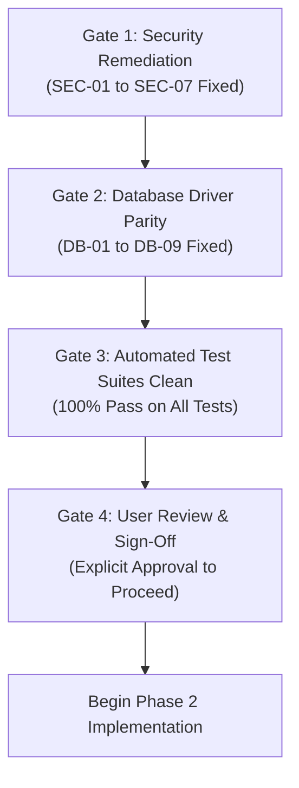

# Phase 2 Technical Verification & Go-Live Test Plan
**Production Readiness Technical Audit &bull; Phase 1 Deliverable**
*System Scope: Car-WashService (Local Edge POS) & Car-WashCloud (Central Management Hub)*

---

## 1. Testing Strategy & Methodology

This Test Plan defines the comprehensive, repeatable technical verification procedures required to validate both **Car-WashService** (offline-first local shop node) and **Car-WashCloud** (central management portal) before deploying to live business operations.

### Core Testing Objectives
1. **Security & Exposure Verification**: Ensure zero exposure of version control (`.git`), development utilities, diagnostic maps, or sample accounts.
2. **Dual-Driver Database Parity**: Verify that `Car-WashService` runs identically and without SQL syntax errors whether powered by MySQL or the SQLite offline fallback.
3. **Cryptographic Sync Contract**: Verify that the bidirectional sync protocol enforces HMAC-SHA256 signatures, gzip compression, anti-replay nonce windows, and idempotent UUID ingestion.
4. **Offline Resilience & Zero Latency**: Ensure local sales, bay assignments, and receipt printing continue with zero network delay during internet outages.
5. **Operational Controls & Financial Integrity**: Enforce blind shift reconciliation, strict manager PIN overrides for discounts and voids, and append-only audit ledgers.

---

## 2. Phase 1 Test Execution Baseline

Before outlining Phase 2 test suites, the existing automated test scripts in both repositories were executed. The table below documents the empirical baseline:

| Test Script | Target App | Total Checks | Passed | Failed | Primary Failure Cause |
| :--- | :---: | :---: | :---: | :---: | :--- |
| `scripts/go_live_check.php` | Car-WashService | 12 | 7 | **5** | `demo_mode=1`, seed accounts active, dev scripts in tree, no HTTPS, missing CSP header. |
| `tests/test_brief_compliance.php` | Car-WashService | 111 | 98 | **13** | 5 tables missing in SQLite (`stock_movements`, etc.); missing columns; missing SQLite triggers. |
| `tests/test_ledger_immutable.php` | Car-WashService | 8 | 0 | **8** | `stock_movements` table missing in SQLite; `NOW()` function unrecognized in SQLite. |
| `tests/test_foundation.php` | Car-WashService | 35 | 22 | **13** | Several sample role logins failed; `expenses.is_active` column missing in SQLite. |
| `tests/test_sync_contract.php` | Car-WashCloud | Contract | N/A | N/A | Refused execution: Requires live test credentials (`SYNC_SHOP_TOKEN`, `SYNC_HMAC_SECRET`). |

---

## 3. Test Suites Mapped to Audit Findings

### Suite 1: Web Server Hardening & Git Protection (`SEC-01`, `SEC-02`, `SEC-06`, `SEC-07`)

#### Test Case 1.1: `.git` Directory Exposure Block
* **Associated Finding**: `SEC-01`
* **Objective**: Ensure that git repository internals cannot be accessed or downloaded via HTTP.
* **Execution Command**:
  ```bash
  curl.exe -I http://localhost/Car-WashService/.git/config
  curl.exe -I http://localhost/Car-WashService/.git/HEAD
  curl.exe -I http://localhost/Car-WashCloud/.git/config
  curl.exe -I http://localhost/Car-WashCloud/.git/HEAD
  ```
* **Expected Result**:
  Every request must return `HTTP/1.1 403 Forbidden` or `HTTP/1.1 404 Not Found`. Neither endpoint may return `200 OK`.
* **Pass/Fail Criteria**: PASS only if all 4 requests return 403 or 404.

#### Test Case 1.2: Internal AST Code Map (`graphify-out/`) Block
* **Associated Finding**: `SEC-02`
* **Objective**: Verify that internal architectural diagrams and AST caches are quarantined.
* **Execution Command**:
  ```bash
  curl.exe -I http://localhost/Car-WashService/graphify-out/graph.html
  ```
* **Expected Result**: `HTTP/1.1 403 Forbidden` or `HTTP/1.1 404 Not Found`.
* **Pass/Fail Criteria**: PASS only if access is denied or the directory is completely deleted from the web root.

#### Test Case 1.3: Uploads PHP Script Execution Block
* **Associated Finding**: `SEC-06`
* **Objective**: Confirm that PHP scripts cannot execute inside user-accessible upload directories.
* **Execution Procedure**:
  1. Temporarily place a harmless test file `test_exec.php` (`<?php echo 'EXECUTED'; ?>`) into `Car-WashService/public/uploads/`.
  2. Request via curl:
     ```bash
     curl.exe http://localhost/Car-WashService/public/uploads/test_exec.php
     ```
  3. Clean up the test file.
* **Expected Result**: The server returns `403 Forbidden`, `500 Server Error`, or downloads plain text without executing PHP.
* **Pass/Fail Criteria**: PASS only if string `'EXECUTED'` is never evaluated by the PHP engine.

---

### Suite 2: Environment Sanitation & Demo Mode Deactivation (`SEC-03`, `SEC-04`, `SEC-05`)

#### Test Case 2.1: Pre-Flight Go-Live Verification Suite
* **Associated Findings**: `SEC-03`, `SEC-04`, `SEC-05`, `SEC-08`, `SEC-10`
* **Objective**: Execute the comprehensive 12-point pre-flight checklist.
* **Execution Command**:
  ```bash
  php c:\xampp\htdocs\Car-WashService\scripts\go_live_check.php
  ```
* **Expected Result**:
  All 12 checks must report `[ OK ]`:
  1. `demo_mode is 0` &rarr; `[ OK ]`
  2. `No sample accounts active` &rarr; `[ OK ]`
  3. `No pos_devices with test key or name` &rarr; `[ OK ]`
  4. `tv_display_code is not default` &rarr; `[ OK ]`
  5. `No staff using known seed passwords` &rarr; `[ OK ]`
  6. `No Pos-Carwash/ or scratch/ in web root` &rarr; `[ OK ]`
  7. `No dev helper scripts or snapshots present` &rarr; `[ OK ]`
  8. `API_BASE_URL uses https` &rarr; `[ OK ]`
  9. `Default MySQL root has a password` &rarr; `[ OK ]`
  10. `storage/ not reachable by HTTP` &rarr; `[ OK ]`
  11. `.htaccess rewrite rules active` &rarr; `[ OK ]`
  12. `CSP header present` &rarr; `[ OK ]`
* **Pass/Fail Criteria**: Process exits with code 0 and status `ALL CHECKS PASSED`.

---

### Suite 3: Database Driver Parity & Migration Consistency (`DB-01` to `DB-09`)

#### Test Case 3.1: SQLite Fallback Latency & Connection Timeout
* **Associated Finding**: `DB-02`
* **Objective**: Verify that when MySQL is unavailable, the fallback to SQLite occurs within 2 seconds without hanging.
* **Execution Procedure**:
  1. Ensure MySQL service is stopped.
  2. Measure execution time of database initialization:
     ```bash
     powershell -Command "Measure-Command { php -r \"require 'c:/xampp/htdocs/Car-WashService/core/Database.php'; Database::getInstance();\" }"
     ```
* **Expected Result**: Total elapsed time must be less than 2.0 seconds.
* **Pass/Fail Criteria**: PASS if total seconds < 2.0s; FAIL if timeout exceeds 5s.

#### Test Case 3.2: Full SQLite Migration Integrity
* **Associated Findings**: `DB-03`, `DB-04`, `DB-08`
* **Objective**: Confirm that `runMigrations()` runs cleanly on SQLite without SQL syntax errors or missing tables.
* **Execution Procedure**:
  1. Stop MySQL service.
  2. Run the master migration runner:
     ```bash
     php c:\xampp\htdocs\Car-WashService\database\migrate.php
     ```
  3. Check the migration log:
     ```bash
     Get-Content c:\xampp\htdocs\Car-WashService\storage\logs\migration_error.log -Tail 10
     ```
* **Expected Result**:
  Process outputs `All database schema migrations ran successfully and are up to date.` and exits with code 0. Zero new entries in `migration_error.log`.
* **Pass/Fail Criteria**: PASS only if all migrations complete without throwing exceptions.

#### Test Case 3.3: Immutable Ledger Triggers on Both Drivers
* **Associated Finding**: `DB-09`
* **Objective**: Verify that `stock_movements` and `audit_logs` reject updates and deletes on both MySQL and SQLite.
* **Execution Command**:
  ```bash
  php c:\xampp\htdocs\Car-WashService\tests\test_ledger_immutable.php
  ```
* **Expected Result**:
  ```
  [PASS] Test 1: INSERT into stock_movements succeeded
  [PASS] Test 2: UPDATE non-sync column was strictly BLOCKED by trigger
  [PASS] Test 3: UPDATE sync columns (is_synced, synced_at) was ALLOWED
  [PASS] Test 4: DELETE from stock_movements was strictly BLOCKED by trigger
  [PASS] Test 5: INSERT into audit_logs succeeded
  [PASS] Test 6: UPDATE non-sync column was strictly BLOCKED by trigger
  [PASS] Test 7: UPDATE sync columns was ALLOWED
  [PASS] Test 8: DELETE from audit_logs was strictly BLOCKED by trigger
  ALL 8 IMMUTABLE LEDGER TRIGGER CHECKS PASSED!
  ```
* **Pass/Fail Criteria**: All 8 tests report `[PASS]` on both MySQL and SQLite.

#### Test Case 3.4: Database Backup & Restore Round-Trip on SQLite
* **Associated Findings**: `DB-06`, `DB-07`
* **Objective**: Verify that a database backup generated on SQLite contains valid DDL and can be restored without errors.
* **Execution Procedure**:
  1. Stop MySQL.
  2. Run daily backup job:
     ```bash
     php c:\xampp\htdocs\Car-WashService\scripts\backup_daily.php
     ```
  3. Inspect the newly generated `.sql` file in `storage/backups/` and verify that `CREATE TABLE` statements are present.
  4. Test restore via test script calling `Backup::restoreFromSql($pdo, $sqlContent)`.
* **Expected Result**: Restore executes all statements cleanly and writes an audit log entry (`BACKUP_RESTORED`).
* **Pass/Fail Criteria**: PASS if backup file contains DDL and restores without throwing syntax errors.

---

### Suite 4: Automated Contract & Business Logic Verification

#### Test Case 4.1: Brief Compliance Automated Audit
* **Associated Requirements**: Project Brief & Feature Matrix
* **Execution Command**:
  ```bash
  php c:\xampp\htdocs\Car-WashService\tests\test_brief_compliance.php
  ```
* **Expected Result**:
  ```
  Total Checks Run : 111
  Checks Passed    : 111
  Checks Failed    : 0
  STATUS: ALL BRIEF COMPLIANCE CHECKS PASSED
  ```
* **Pass/Fail Criteria**: PASS only if 100% of the 111 architectural and compliance checks pass.

#### Test Case 4.2: Foundation & Permissions Test Suite
* **Associated Requirements**: RBAC & Staff PIN Security
* **Execution Command**:
  ```bash
  php c:\xampp\htdocs\Car-WashService\tests\test_foundation.php
  ```
* **Expected Result**:
  All 10 built-in roles authenticate to their home screens; permissions boundaries are enforced; PIN lockout triggers after 5 wrong attempts; no fatal exceptions occur.
* **Pass/Fail Criteria**: PASS only if all role and security assertions succeed.

#### Test Case 4.3: Bidirectional Cloud Sync API Contract Verification
* **Associated Requirements**: Sync Engine, HMAC, Anti-Replay, Idempotency
* **Prerequisites**: Set test environment variables (`CLOUD_API_URL`, `CLOUD_API_TOKEN`, `CLOUD_API_SECRET`).
* **Execution Command**:
  ```bash
  php c:\xampp\htdocs\Car-WashService\tests\test_cloud_sync_contract.php
  php c:\xampp\htdocs\Car-WashCloud\tests\test_sync_contract.php
  ```
* **Expected Result**:
  - Gzip payloads compressed and verified with HMAC-SHA256 signature.
  - Replayed nonces strictly rejected with HTTP 409 Conflict.
  - Duplicate client IDs ignored safely with client ID confirmed in response.
  - Master data pull successfully updates catalog items and local prices.
* **Pass/Fail Criteria**: Both test suites exit with code 0 and status `ALL CONTRACT TESTS PASSED`.

---

## 4. End-to-End Operational Walkthrough Test

| Step | Actor | Action | Expected System Behavior |
| :---: | :--- | :--- | :--- |
| **1** | Cashier | Open Shift with $50.00 Float | Row created in `cashier_shifts` with status `'active'`. Drawer opens if printer connected. |
| **2** | Cashier | Create Walk-in Order (Plate: `2BC-1234`, SUV, Foam Wash $7.50) | Subtotal automatically calculates vehicle multiplier (1.25x). Order saved with unique UUID. |
| **3** | Cashier | Attempt Order Cancellation without Manager | System strictly blocks cancellation and prompts for Manager PIN modal. |
| **4** | Manager | Enter Valid Manager PIN to Authorize Cancel | Order status updates to `'cancelled'`, recording both Cashier ID and Manager Approver ID. |
| **5** | Washer | Open Washer Screen (`views/washer/jobs.php`) | Vehicle appears in queue. Clicking "Start" records start time; clicking "Finish" records completion. |
| **6** | Mechanic | Requisition Oil Filter from Bay 4 (`views/mechanic/jobs.php`) | Request created in `parts_requests` with status `'pending'`. Order flagged waiting for parts. |
| **7** | Stock Clerk | Review and Approve Parts Request | Stock decrements from `products.stock_qty`; row written to immutable `stock_movements`. |
| **8** | Cashier | Checkout with Split Payment ($5.00 Cash USD + 10,250 KHR Cash) | Dual-currency change calculated to the exact cent and riel; receipt dispatches to 80mm printer. |
| **9** | Cashier | End Shift (Blind Cash Count Counted: $140.00 vs Expected: $155.00) | System calculates -$15.00 shortage, prompts for incoming cashier PIN, and logs `SHIFT_SHORTAGE`. |
| **10** | Manager | Trigger Daily Z-Report & Nightly Day Lock | Z-Report generated; day lock flags active; further order intake blocked until reopen. |

---

## 5. Phase 2 Gate Sign-Off Protocol

To exit Phase 1 and receive approval to begin Phase 2 implementation, the following gates must be confirmed:



> [!IMPORTANT]
> **No source code changes, schema alterations, or Phase 2 implementations will begin until the user has thoroughly reviewed this audit report and granted explicit approval.**

